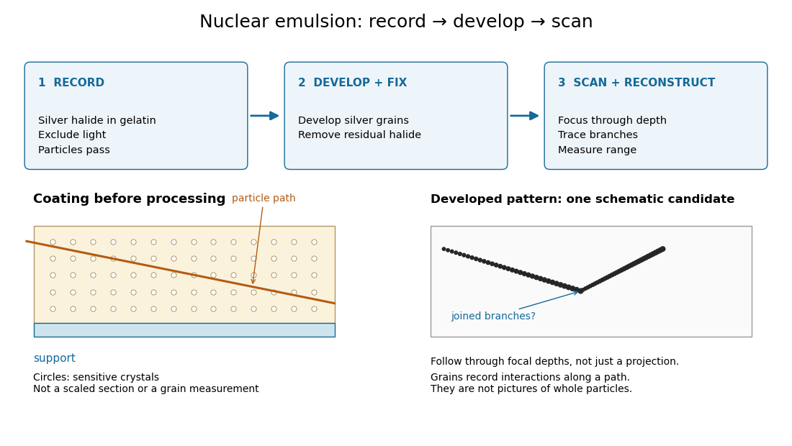

# Photography

↑ **Parent:** [Codex Wiki](README.md)

**Table of contents**

- [Stereoscopy](#stereoscopy)
- [Camera](#camera)
- [Photographic emulsion](#photographic-emulsion)
  - [Latent image](#latent-image)
  - [Developed grain](#developed-grain)
  - [Nuclear emulsion](#nuclear-emulsion)
    - [Nuclear emulsion track experiment](#nuclear-emulsion-track-experiment)
      - [Emulsion range measurement](#emulsion-range-measurement)
        - [Range straggling](#range-straggling)
      - [Track grain density](#track-grain-density)
      - [Pion decay at rest in emulsion](#pion-decay-at-rest-in-emulsion)
- [Photographic processing](#photographic-processing)
- [Photographer](#photographer)
  - [Dona Mapston](#dona-mapston)
    - [Work by Dona Mapston](#work-by-dona-mapston)
- [Microphotograph](#microphotograph)

## Stereoscopy

↑ **Parent:** [Photography](photography.md)  
ⓦ [Wiki](https://en.wikipedia.org/wiki/Stereoscopy)

Using images from different viewpoints to convey or recover depth. In scientific [photography](photography.md), comparing corresponding features in calibrated views can help reconstruct their three-dimensional positions; a single image generally leaves depth ambiguous.

## Camera

↑ **Parent:** [Photography](photography.md)  
ⓦ [Wiki](https://en.wikipedia.org/wiki/Camera)

## Photographic emulsion

↑ **Parent:** [Photography](photography.md)  
ⓦ [Wiki](https://en.wikipedia.org/wiki/Photographic_emulsion)

A [photographic emulsion](#photographic-emulsion) is a coating that responds to [light](optics.md#light) to record an image in [photography](photography.md), for example on a [photographic plate](optical-instrument.md#photographic-plate). [Silver halide](chemical-substance.md#silver-halide) [crystals](thermodynamics.md#crystal), commonly [silver bromide](chemical-substance.md#silver-bromide), are dispersed in [gelatin](chemical-substance.md#gelatin). Exposure leaves a [latent image](#latent-image). A developer produces dark [silver](chemical-substance.md#silver) grains and fixing removes remaining sensitive material. A [microscope](physics.md#microscope) can reveal a [charged particle](electric-charge.md#charged-particle)'s path through the coating: the basis of [nuclear emulsion](#nuclear-emulsion) [particle detection](particle-detection.md).[Luisa Bonolis, Research Profile: Cecil Powell, “A new visual method: nuclear emulsions”, paragraphs describing composition, coating, development, fixing and microscope observation](physics-bibliography.md#research-profile-cecil-powell-by-luisa-bonolis)

### Latent image

↑ **Parent:** [Photographic emulsion](#photographic-emulsion)  
ⓦ [Wiki](https://en.wikipedia.org/wiki/Latent_image)

A [latent image](#latent-image) is the pattern of exposure-induced changes in a [photographic emulsion](#photographic-emulsion) before [photographic processing](#photographic-processing) makes it visible. A missing visible mark before development therefore says nothing about whether a [charged particle](electric-charge.md#charged-particle) passed through the coating.

### Developed grain

↑ **Parent:** [Photographic emulsion](#photographic-emulsion)

A [developed grain](#developed-grain) is a visible deposit of [silver](chemical-substance.md#silver) produced during [photographic processing](#photographic-processing). The chain of [developed grains](#developed-grain) in a [nuclear emulsion](#nuclear-emulsion) records interactions along a [charged particle](electric-charge.md#charged-particle)'s path. Its width is a property of the recording and viewing process, not a measurement of the particle's diameter.

### Nuclear emulsion

↑ **Parent:** [Photographic emulsion](#photographic-emulsion)  
ⓦ [Wiki](https://en.wikipedia.org/wiki/Nuclear_emulsion)

A [nuclear emulsion](#nuclear-emulsion) is a [photographic emulsion](#photographic-emulsion) prepared for recording [charged particles](electric-charge.md#charged-particle). The sensitive material serves as both target and record: a particle may slow, stop, decay or cause a [nuclear reaction](physics.md#nuclear-reaction) inside it. Reading that record requires [track reconstruction](particle-detection.md#track-reconstruction), not recognizing a miniature picture of a particle. Unlike a [cloud chamber](particle-detection.md#cloud-chamber) photograph, the exposed [nuclear emulsion](#nuclear-emulsion) itself retains the record until it is developed and examined.

#### Nuclear emulsion track experiment

↑ **Parent:** [Nuclear emulsion](#nuclear-emulsion)

In 1947, [Cesare Lattes](physicist.md#cesare-mansueto-giulio-lattes), [Hugh Muirhead](physicist.md#hugh-muirhead), [Giuseppe Occhialini](physicist.md#giuseppe-paolo-stanislao-occhialini) and [Cecil Frank Powell](physicist.md#cecil-frank-powell) reported [charged particle](electric-charge.md#charged-particle) tracks in which a stopping particle was followed by a secondary particle. Their paper treated the interpretation as provisional.[Lattes, Muirhead, Occhialini and Powell, Processes Involving Charged Mesons, Nature 159 (24 May 1947), pp. 694–697, abstract and byline](physics-bibliography.md#processes-involving-charged-mesons-by-cesare-mansueto-giulio-lattes-and-others) The eventual distinction between [pions](standard-model.md#pion) and [muons](standard-model.md#muon) made a striking use of [photography](photography.md): a tiny permanent record could distinguish particles by how they slowed and transformed.

The method already had a history. In their jointly authored 1937 report, [Marietta Blau](physicist.md#marietta-blau) and [Hertha Wambacher](physicist.md#hertha-wambacher) described [photographic plates](optical-instrument.md#photographic-plate) exposed for five months at Hafelekar, $2300\,\mathrm m$ above sea level.[Blau and Wambacher, Disintegration Processes by Cosmic Rays with the Simultaneous Emission of Several Heavy Particles, Nature 140 (1937), p. 585, opening paragraph and joint byline](physics-bibliography.md#disintegration-processes-by-cosmic-rays-with-the-simultaneous-emission-of-several-heavy-particles-by-marietta-blau-and-hertha-wambacher) Neither shared the 1950 [Nobel Prize in Physics](nobel-prize-in-physics.md), awarded to [Cecil Frank Powell](physicist.md#cecil-frank-powell).[Opening award statement: Powell's 1950 prize concerned development of the method and meson discoveries](physics-bibliography.md#research-profile-cecil-powell-by-luisa-bonolis) This was a development of photographic [particle detection](particle-detection.md), with earlier contributors, rather than its invention by one person.

In his own later account, [Cesare Lattes](physicist.md#cesare-mansueto-giulio-lattes) recalls calibrating emulsion shrinkage and the [particle range](particle-detection.md#particle-range)–[energy](energy.md) relation with accelerator-produced particles. [Giuseppe Occhialini](physicist.md#giuseppe-paolo-stanislao-occhialini) took borax-treated and untreated plates to Pic du Midi for about a month. The untreated plates provided a control; the treated plates retained more events because [latent image](#latent-image) fading was reduced. Later, [Cesare Lattes](physicist.md#cesare-mansueto-giulio-lattes) exposed plates at the higher Chacaltaya station in Bolivia and obtained more candidate events.[Lattes, Meu trabalho em física de mésons com emulsões nucleares, 1984 recollection in Portuguese translation, paragraphs beginning “Foi-me dada a tarefa”, “Occhialini e eu decidimos”, “Quando Occhialini revelou” and “Assim, propus”; the recollection's altitude estimate is not adopted here](physics-bibliography.md#meu-trabalho-em-fisica-de-mesons-com-emulsoes-nucleares-by-cesare-mansueto-giulio-lattes) The Pic du Midi [cosmic ray](galaxy.md#cosmic-ray) exposure was roughly $3\,\mathrm{km}$ above sea level.[“The discovery of the pion”: Pic du Midi exposure altitude, given as 3000 metres](physics-bibliography.md#research-profile-cecil-powell-by-luisa-bonolis)

**[Figure 1](#image-from-nuclear-emulsion-exposure-to-a-reconstructed-charged-particle-track). From nuclear emulsion exposure to a reconstructed charged particle track**. Original functional diagram. Dots and paths are schematic, with no measured grain counts or spatial scale. The coating and joined-track drawings are separate schematic examples. The [microscope](physics.md#microscope) reads developed material, rather than a whole [pion](standard-model.md#pion).

##### Emulsion range measurement

↑ **Parent:** [Nuclear emulsion track experiment](#nuclear-emulsion-track-experiment)

An [emulsion range measurement](#emulsion-range-measurement) follows a stopping [charged particle](electric-charge.md#charged-particle) through the coating to estimate its complete [particle range](particle-detection.md#particle-range). A projected length on one image can underestimate the distance travelled. In an original geometry example, a straight segment with projected length $L_{xy}=240\,\mathrm{\mu m}$ and corrected depth change $\Delta z=180\,\mathrm{\mu m}$ has length

$$
L=\sqrt{L_{xy}^2+(\Delta z)^2}=300\,\mathrm{\mu m}.
$$

Using the projection alone would underestimate this length by $20\%$. A bent track requires a sum over reconstructed segments. These are stipulated coordinates, not measurements of a historical track.

Suppose [photographic processing](#photographic-processing) contracts the coating only in depth, with shrinkage ratio $s=t_{\rm developed}/t_{\rm exposed}$. Then an observed depth difference $\Delta z_{\rm developed}$ corresponds to $\Delta z=\Delta z_{\rm developed}/s$. For $s=0.60$, an observed $108\,\mathrm{\mu m}$ becomes the $180\,\mathrm{\mu m}$ used above. This correction assumes uniform contraction and unchanged lateral dimensions; it cannot repair a track that leaves the coating before stopping.

A simple continuous-loss model connects [particle range](particle-detection.md#particle-range) to [kinetic energy](energy.md#kinetic-energy) $T_0$ through [stopping power](particle-detection.md#stopping-power) $S(T)=-\mathrm dT/\mathrm dx>0$:

$$
R(T_0)=\int_0^{T_0}\frac{\mathrm dT}{S(T)}.
$$

This describes the mean trend for a specified particle and material. Fluctuating energy loss produces a spread of stopping distances, called [range straggling](#range-straggling). An exit point supplies only a lower bound on [particle range](particle-detection.md#particle-range). Consequently, a narrow distribution from fully contained tracks and one assembled by treating exits as stops answer different questions.

###### Range straggling

↑ **Parent:** [Emulsion range measurement](#emulsion-range-measurement)

[Range straggling](#range-straggling) is the event-to-event spread in [particle range](particle-detection.md#particle-range) for otherwise similar incident particles, caused by fluctuations in their energy loss and transport through matter. It must be distinguished from [measurement uncertainty](physics.md#measurement-uncertainty) and from the incomplete recording of particles that escape.

##### Track grain density

↑ **Parent:** [Nuclear emulsion track experiment](#nuclear-emulsion-track-experiment)

The [track grain density](#track-grain-density) is the number $N$ of resolved [developed grains](#developed-grain) along reconstructed track length $L$, divided by $L$. It is a response variable, not a universal conversion from darkness to [energy](energy.md). Overlapping [developed grains](#developed-grain), exposure fading, processing and optical [spatial resolution](optics.md#spatial-resolution) can all change what is counted. Calibration must use comparable material and viewing conditions.

[Cesare Lattes](physicist.md#cesare-mansueto-giulio-lattes) specifically recalls distinguishing meson tracks from [proton](physics.md#proton) tracks using their greater deflection by scattering and changing [track grain density](#track-grain-density) toward the stopping point. He also recounts a secondary track that left the coating, requiring extrapolation rather than a directly measured stopping distance.[1984 recollection, paragraph beginning “Devo adicionar”: scattering, grain density and an escaping secondary; no numerical grain count is reported here](physics-bibliography.md#meu-trabalho-em-fisica-de-mesons-com-emulsoes-nucleares-by-cesare-mansueto-giulio-lattes)

For a candidate joined track, the useful questions are whether both branches actually meet in depth, whether the incoming branch is consistent with stopping there, and whether the outgoing branch has the expected [particle range](particle-detection.md#particle-range) and [track grain density](#track-grain-density). A visible change of direction alone cannot distinguish a decay from scattering or an accidental crossing. Examining successive focal depths tests a projected crossing; comparison with ordinary stopping tracks tests the identification. These are measurement checks, not a claim that the original plates provided time-resolved movies.

A [nuclear emulsion](#nuclear-emulsion) integrates exposure over time. It does not by itself supply the time between two apparently joined branches. Finite [spatial resolution](optics.md#spatial-resolution) also limits how tightly one can establish their common origin: developed marks and the [microscope](physics.md#microscope) response are much larger than a subatomic particle. There is no single resolution number applicable to every emulsion, developer and optical arrangement.

##### Pion decay at rest in emulsion

↑ **Parent:** [Nuclear emulsion track experiment](#nuclear-emulsion-track-experiment)

[Cecil Frank Powell](physicist.md#cecil-frank-powell)'s 1950 lecture illustrates the successive decays of [pions](standard-model.md#pion) and [muons](standard-model.md#muon) through their tracks and explains why the nearly fixed secondary [muon](standard-model.md#muon) range, allowing for [range straggling](#range-straggling), supports a single neutral decay partner. He describes its identification as a [neutrino](standard-model.md#neutrino) tentatively. The neutral particle itself leaves no recorded track. He contrasts this decay with the [nuclear reactions](physics.md#nuclear-reaction) caused by stopped negative [pions](standard-model.md#pion), connecting the latter with the [nuclear force](nuclear-force.md).[Powell, The cosmic radiation, Nobel lecture, 11 December 1950, printed pp. 151–152, Fig. 5 and paragraphs beginning “When brought to rest” and “When a negative”; inspected in the Columbia-hosted Nobel lecture volume, PDF pp. 151–152](physics-bibliography.md#the-cosmic-radiation-by-cecil-frank-powell)

Here is a modern [special relativity](special-relativity.md) derivation for the dominant [leptonic pion decay](standard-model.md#leptonic-pion-decay), assuming a free [pion](standard-model.md#pion) at rest, a massless [muon neutrino](standard-model.md#muon-neutrino), and no emitted [photon](quantum-mechanics.md#photon). Write $m_\pi$ and $m_\mu$ for the [pion](standard-model.md#pion) and [muon](standard-model.md#muon) masses. By [conservation of momentum](momentum.md#momentum-conservation) the daughter momenta are opposite with equal magnitude $p$. By [conservation of energy](mathematical-physics.md#conservation-of-energy) and the [energy–momentum relation](special-relativity.md#energy-momentum-relation),

$$
m_\pi c^2=E_\mu+pc,\qquad E_\mu^2=p^2c^2+m_\mu^2c^4.
$$

Substitute $E_\mu=m_\pi c^2-pc$, square, and cancel $p^2c^2$. This gives

$$
p=\frac{(m_\pi^2-m_\mu^2)c}{2m_\pi},\qquad
E_\mu=\frac{(m_\pi^2+m_\mu^2)c^2}{2m_\pi},\qquad
T_\mu=\frac{(m_\pi-m_\mu)^2c^2}{2m_\pi}.
$$

The resulting $p$ is fixed, although the [muon](standard-model.md#muon)'s direction is not set by the incoming stopping track. Thus the kink angle relative to that earlier track is not the angle between the two daughters: in the [pion](standard-model.md#pion) [rest frame](mathematical-physics.md#rest-frame), the daughters are back to back. A neutral-partner arrow in a diagram represents inferred [momentum](momentum.md), not an observed string of grains.

For an original calculation, adopt rounded input values $m_\pi c^2=139.57\,\mathrm{MeV}$ and $m_\mu c^2=105.66\,\mathrm{MeV}$. They give $pc=29.79\,\mathrm{MeV}$, $T_\mu=4.119\,\mathrm{MeV}$ and $E_\nu=29.79\,\mathrm{MeV}$. Their sum satisfies $T_\mu+E_\nu=(m_\pi-m_\mu)c^2=33.91\,\mathrm{MeV}$. These are rounded calculation inputs and outputs, not a fit to the 1947 plates.

**[Figure 2](#image-pion-decay-at-rest-in-emulsion-daughter-momentum-balance-and-a-stipulated-particle-range-response). Pion decay at rest in emulsion: daughter momentum balance and a stipulated particle range response**. Original [special relativity](special-relativity.md) calculation and synthetic [histograms](probability-and-statistics.md#histogram). The dashed [neutrino](standard-model.md#neutrino) arrow is an inference. For illustration only, the range response has arbitrarily chosen mean $1$ and [standard deviation](variance.md#standard-deviation) $0.06$ in dimensionless units; it does not reproduce historical grain measurements, a measured resolution or a calibrated muon range.

At fixed material and particle identity, a fixed initial [kinetic energy](energy.md#kinetic-energy) suggests a narrow [particle range](particle-detection.md#particle-range) distribution broadened by [range straggling](#range-straggling) and [measurement uncertainty](physics.md#measurement-uncertainty). The synthetic example convolves a single chosen range with a [normal distribution](probability-distribution.md#normal-distribution); a second example superposes two such chosen ranges. It explains why repeated comparable stopping distances can be informative, without pretending to extract a historical spectrum.

The decay equations do not identify the neutral partner as a [neutrino](standard-model.md#neutrino) on their own: a massless [photon](quantum-mechanics.md#photon) would satisfy the same energy and momentum equations. Nor does any isolated kink establish the [pion](standard-model.md#pion)'s identity. The inference gains force from calibrated [particle range](particle-detection.md#particle-range), [track grain density](#track-grain-density), repeated decay patterns and independent particle properties. Historical particle names should not obscure the distinction: a [muon](standard-model.md#muon) is a [lepton](standard-model.md#lepton), whereas a [pion](standard-model.md#pion) is a [meson](physics.md#meson).

## Photographic processing

↑ **Parent:** [Photography](photography.md)  
ⓦ [Wiki](https://en.wikipedia.org/wiki/Photographic_processing)

In [photography](photography.md), [photographic processing](#photographic-processing) uses [chemical reactions](chemical-reaction.md) to develop and stabilize an exposed [photographic emulsion](#photographic-emulsion).

## Photographer

↑ **Parent:** [Photography](photography.md)

### Dona Mapston

↑ **Parent:** [Photographer](#photographer)

#### Work by Dona Mapston

↑ **Parent:** [Dona Mapston](#dona-mapston)

## Microphotograph

↑ **Parent:** [Photography](photography.md)

A [microphotograph](#microphotograph) is a photograph reduced to a small size for viewing under magnification.

## ↑ Ancestors (1)

1. [Codex Wiki](README.md)

## ← Incoming links (7)

- [Gargamelle](standard-model.md#gargamelle)
- [Glaser bubble-chamber experiment](particle-detection.md#glaser-bubble-chamber-experiment)
- [Nuclear emulsion track experiment](#nuclear-emulsion-track-experiment)
- [Photographic emulsion](#photographic-emulsion)
- [Photographic processing](#photographic-processing)
- [Stereoscopy](#stereoscopy)
- [Wilson cloud-chamber experiment](particle-detection.md#wilson-cloud-chamber-experiment)
