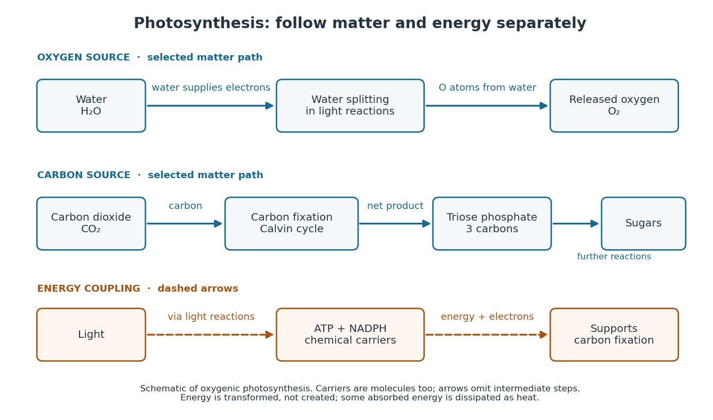

# Photosynthesis

↑ **Parent:** [Metabolism](metabolism.md)  
ⓦ [Wiki](https://en.wikipedia.org/wiki/Photosynthesis)

[Photosynthesis](photosynthesis.md) captures [light](light.md) [energy](energy.md) and transforms it into chemical forms that a [biological cell](biological-cell.md) can use. In [plants](plant.md), [algae](algae.md) and [cyanobacteria](cyanobacteria.md), this supports [carbon fixation](carbon-fixation.md): incorporation of [carbon](carbon.md) from [carbon dioxide](carbon-dioxide.md) into [chemical compounds](chemical-compound.md) used to build living material. Capturing [light](light.md) and incorporating [carbon](carbon.md) are distinct processes coupled through [metabolism](metabolism.md). See [OpenStax Biology 2e, 8.1: overview of photosynthesis](https://openstax.org/books/biology-2e/pages/8-1-overview-of-photosynthesis).

For [oxygenic photosynthesis](oxygenic-photosynthesis.md), a simplified net equation writes a six-[carbon](carbon.md) [sugar](sugar.md), [glucose](glucose.md), as the representative product:

$$
6\mathrm{CO}_2+6\mathrm{H}_2\mathrm{O}+\text{light}\longrightarrow\mathrm{C}_6\mathrm{H}_{12}\mathrm{O}_6+6\mathrm{O}_2.
$$

This is net [stoichiometry](stoichiometry.md), not a one-step mechanism. A worked bookkeeping check counts six [carbon](carbon.md) [chemical atoms](atom-physics.md), twelve [hydrogen](hydrogen.md) [chemical atoms](atom-physics.md), and eighteen [oxygen](oxygen.md) [chemical atoms](atom-physics.md) on each side: the product side has six [oxygen](oxygen.md) [chemical atoms](atom-physics.md) in the [sugar](sugar.md) and twelve in [molecular oxygen](molecular-oxygen.md). The [light](light.md) label supplies [energy](energy.md), not additional [chemical atoms](atom-physics.md).

Crucially, the released [molecular oxygen](molecular-oxygen.md) comes from [water](water.md), not [carbon dioxide](carbon-dioxide.md). Cancelling [water](water.md) made and consumed in different steps hides this distinction in the net equation. The [Calvin cycle](calvin-cycle.md) supplies a net three-[carbon](carbon.md) [triose phosphate](triose-phosphate.md), such as [glyceraldehyde 3-phosphate](glyceraldehyde-3-phosphate.md), for subsequent [sugar](sugar.md) synthesis; it does not directly export [glucose](glucose.md). See [OpenStax Biology 2e, 8.2: light-dependent reactions](https://openstax.org/books/biology-2e/pages/8-2-the-light-dependent-reactions-of-photosynthesis) and [OpenStax Biology 2e, 8.3: using light energy to make organic molecules](https://openstax.org/books/biology-2e/pages/8-3-using-light-energy-to-make-organic-molecules).

**[Figure 75](#image-photosynthesis-water-supplies-released-molecular-oxygen-carbon-dioxide-supplies-sugar-carbon). Photosynthesis: water supplies released molecular oxygen; carbon dioxide supplies sugar carbon**. Original schematic of [oxygenic photosynthesis](oxygenic-photosynthesis.md). Solid blue arrows trace selected material transfers; dashed orange arrows show [energy](energy.md) transfer and the coupling through [ATP](adenosine-triphosphate.md) and [NADPH](nadph.md). These carriers are also [molecules](molecule.md), not pure [energy](energy.md). Arrows omit intermediate [chemical reactions](chemical-reaction.md) and do not specify rates or yields.

The useful achievement is connecting incoming [light](light.md) to both usable [energy](energy.md) and new biological material. [ATP](adenosine-triphosphate.md) is an immediate [energy](energy.md) currency; [NADPH](nadph.md) supplies [Electrons](electron.md) for synthesis; [carbon dioxide](carbon-dioxide.md) supplies the [carbon](carbon.md) incorporated into [carbohydrates](carbohydrate.md). These roles are complementary. [Conservation of energy](conservation-of-energy.md) still holds: [photosynthesis](photosynthesis.md) transforms [energy](energy.md), never creates it, and some absorbed [energy](energy.md) is dissipated as [heat](heat.md). A [plant](plant.md) also carries out [cellular respiration](cellular-respiration.md), including in [biological cells](biological-cell.md) that perform [photosynthesis](photosynthesis.md). Gas exchange reflects both processes. [Oxygenic photosynthesis](oxygenic-photosynthesis.md) remains central to interpreting terrestrial [molecular oxygen](molecular-oxygen.md) as an [atmospheric biosignature gas](atmospheric-biosignature-gas.md). See [OpenStax Biology 2e, 8.3: photosynthesis and respiration](https://openstax.org/books/biology-2e/pages/8-3-using-light-energy-to-make-organic-molecules).

**Table of contents**

- [Oxygenic photosynthesis](oxygenic-photosynthesis.md)
- [Anoxygenic photosynthesis](anoxygenic-photosynthesis.md)
- [Light-dependent reactions](light-dependent-reactions.md)
  - [Chlorophyll](chlorophyll.md)

## ↑ Ancestors (3)

1. [Metabolism](metabolism.md)
2. [Biology](biology-split.md)
3. [Codex Wiki](split.md)

## ← Incoming links (15)

- [Anoxygenic photosynthesis](anoxygenic-photosynthesis.md)
- [Calvin cycle](calvin-cycle.md)
- [Carbon fixation](carbon-fixation.md)
- [Cellular respiration](cellular-respiration.md)
- [Chlorophyll](chlorophyll.md)
- [Cyanobacteria](cyanobacteria.md)
- [Ecology](ecology.md)
- [Fungus](fungus.md)
- [Light-dependent reactions](light-dependent-reactions.md)
- [Molecular oxygen](molecular-oxygen.md)
- [Solution](past-exam-of-the-mathematics-course-of-the-university-of-cambridge/2015/iii/paper-59/4/f/solution.md)
- [Photosynthesis](photosynthesis.md)
- [Plant](plant.md)
- [Primary metabolic byproduct](primary-metabolic-byproduct.md)
- [Primary producer](primary-producer.md)
