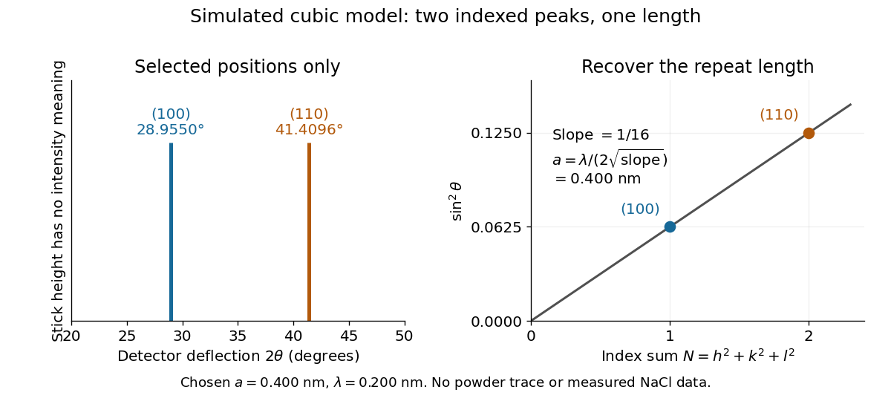
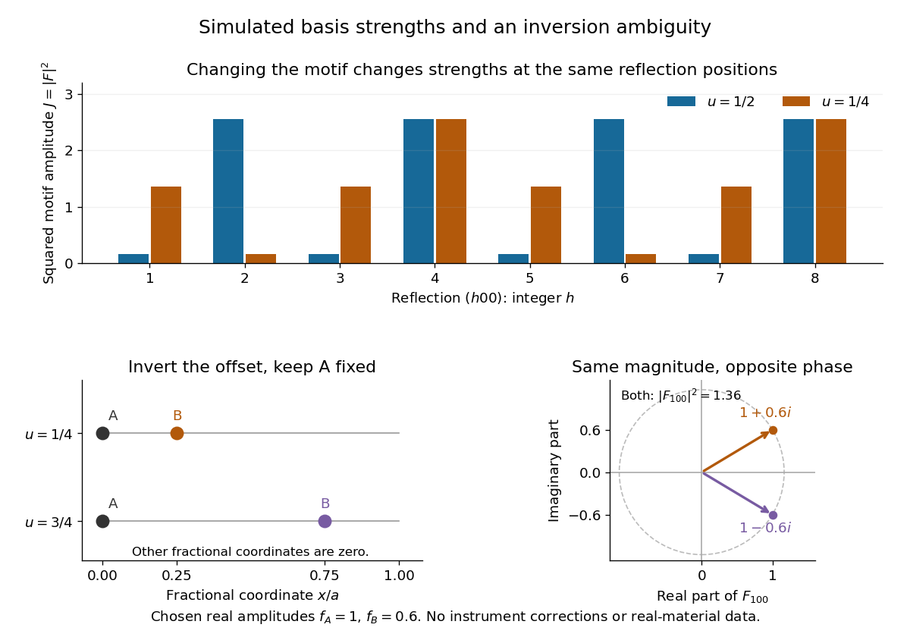
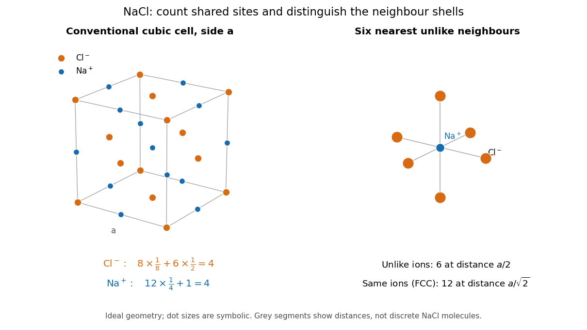
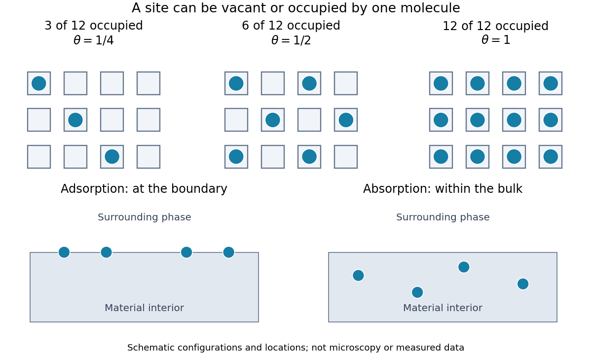
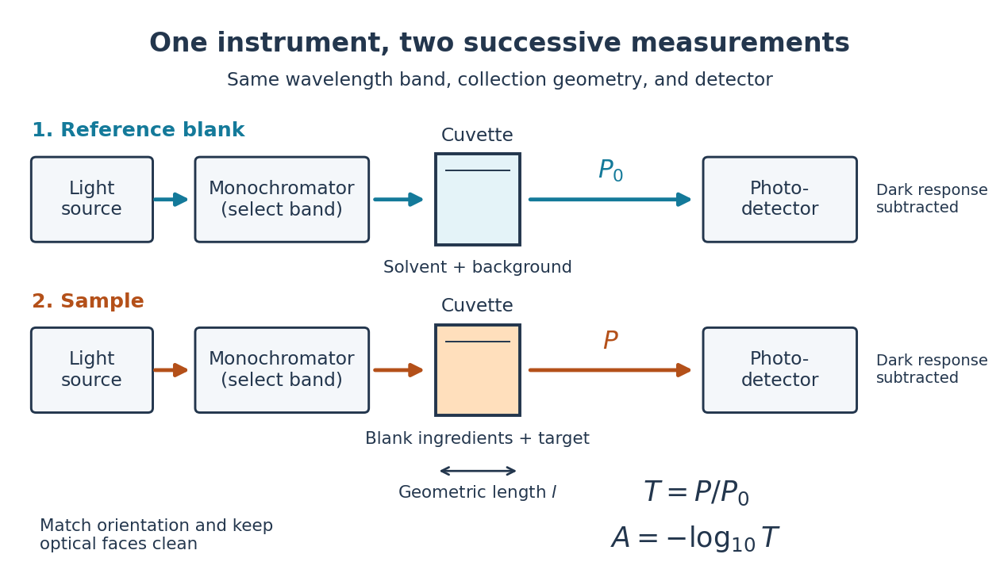
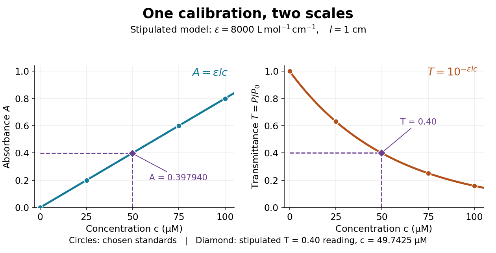
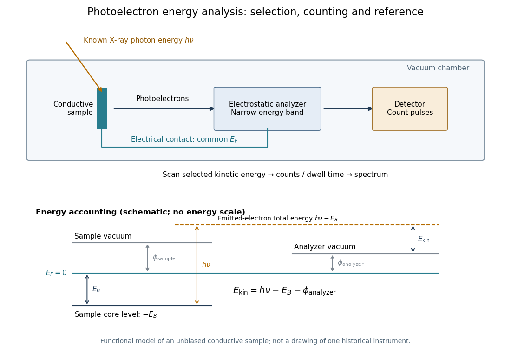
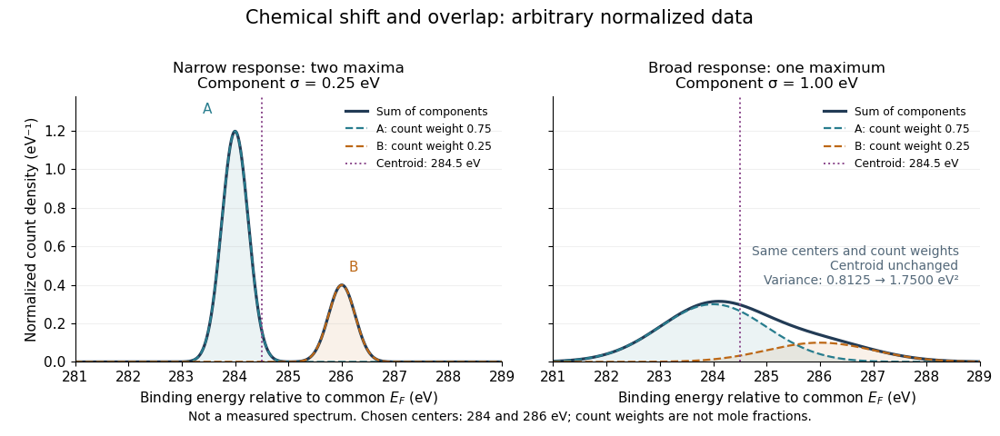

# Physical chemistry

↑ **Parent:** [Chemistry](chemistry.md)  
ⓦ [Wiki](https://en.wikipedia.org/wiki/Physical_chemistry)

**Table of contents**

- [Solvent cage](#solvent-cage)
- [Hammett equation](#hammett-equation)
- [Electrophoresis](#electrophoresis)
  - [Gel sieving of synthetic polymers](#gel-sieving-of-synthetic-polymers)
  - [Diffusive broadening of electrophoretic bands](#diffusive-broadening-of-electrophoretic-bands)
  - [Electrophoretic mobility](#electrophoretic-mobility)
    - [Hückel electrophoretic mobility](#huckel-electrophoretic-mobility)
    - [Smoluchowski electrophoretic mobility](#smoluchowski-electrophoretic-mobility)
- [Chemical thermodynamics](#chemical-thermodynamics)
- [Crystal structure](#crystal-structure)
  - [Hard-sphere cubic packing fractions](#hard-sphere-cubic-packing-fractions)
  - [Hexagonal unit-cell volume](#hexagonal-unit-cell-volume)
  - [Tetrahedral interstitial site](#tetrahedral-interstitial-site)
  - [Cubic close-packed structure](#cubic-close-packed-structure)
  - [Close-packed stacking sequence](#close-packed-stacking-sequence)
  - [Crystal interface](#crystal-interface)
    - [Interfacial energy](#interfacial-energy)
    - [Incoherent crystal interface](#incoherent-crystal-interface)
    - [Semicoherent crystal interface](#semicoherent-crystal-interface)
    - [Coherent crystal interface](#coherent-crystal-interface)
      - [Coherency strain](#coherency-strain)
  - [Diamond cubic structure](#diamond-cubic-structure)
    - [Hard-sphere packing fraction of diamond cubic](#hard-sphere-packing-fraction-of-diamond-cubic)
    - [Bond-centred inversion in diamond cubic](#bond-centred-inversion-in-diamond-cubic)
    - [Vertical mirrors of the diamond cubic structure](#vertical-mirrors-of-the-diamond-cubic-structure)
  - [Crystal motif](#crystal-motif)
  - [Hexagonal close-packed structure](#hexagonal-close-packed-structure)
  - [Orthorhombic crystal system](#orthorhombic-crystal-system)
    - [C-centered orthorhombic lattice](#c-centered-orthorhombic-lattice)
  - [Pyrochlore structure](#pyrochlore-structure)
  - [Polytype](#polytype)
  - [L10 crystal structure](#l10-crystal-structure)
  - [Crystallographic texture](#crystallographic-texture)
  - [Lattice constant](#lattice-constant)
  - [Perovskite structure](#perovskite-structure)
  - [Wurtzite](#wurtzite)
  - [Stacking fault](#stacking-fault)
  - [Crystal twinning](#crystal-twinning)
    - [Multiply twinned particle](#multiply-twinned-particle)
  - [Zone axis](#zone-axis)
    - [Zone law](#zone-law)
  - [Crystal orientation](#crystal-orientation)
  - [L12 structure](#l12-structure)
  - [Caesium chloride structure](#caesium-chloride-structure)
  - [Fluorite structure](#fluorite-structure)
    - [Fluorite packing fraction](#fluorite-packing-fraction)
  - [Tetragonal crystal system](#tetragonal-crystal-system)
    - [Primitive tetragonal lattice](#primitive-tetragonal-lattice)
  - [Crystallographic defect](#crystallographic-defect)
    - [Antiphase boundary](#antiphase-boundary)
    - [Grain boundary](#grain-boundary)
      - [Grain boundary strengthening](#grain-boundary-strengthening)
        - [Hall-Petch relation](#hall-petch-relation)
    - [Point defect](#point-defect)
      - [Graphene vacancy defect](#graphene-vacancy-defect)
        - [Graphene divacancy](#graphene-divacancy)
        - [Graphene monovacancy](#graphene-monovacancy)
      - [Self-interstitial](#self-interstitial)
      - [Vacancy](#vacancy)
        - [Vacancy supersaturation](#vacancy-supersaturation)
      - [Frenkel pair](#frenkel-pair)
    - [Kröger–Vink notation](#kroger-vink-notation)
    - [Carbon nanotube vacancy defect](#carbon-nanotube-vacancy-defect)
    - [Stone-Wales defect](#stone-wales-defect)
    - [Dislocation](#dislocation)
      - [Dislocation line-tension estimate](#dislocation-line-tension-estimate)
      - [Partial dislocation](#partial-dislocation)
        - [Stair-rod dislocation](#stair-rod-dislocation)
        - [Shockley partial dislocation](#shockley-partial-dislocation)
          - [Dissociation of an FCC perfect dislocation](#dissociation-of-an-fcc-perfect-dislocation)
      - [Superdislocation](#superdislocation)
      - [Misfit dislocation](#misfit-dislocation)
      - [Dislocation climb](#dislocation-climb)
      - [Dislocation density](#dislocation-density)
      - [Dislocation loop](#dislocation-loop)
      - [Dislocation junction](#dislocation-junction)
        - [Lomer-Cottrell lock](#lomer-cottrell-lock)
      - [Frank's rule](#frank-s-rule)
      - [Dislocation glide](#dislocation-glide)
        - [Peierls stress](#peierls-stress)
        - [Slip system](#slip-system)
          - [Multiple slip](#multiple-slip)
          - [Basal slip](#basal-slip)
          - [Resolved shear stress](#resolved-shear-stress)
            - [Critical resolved shear stress](#critical-resolved-shear-stress)
              - [Taylor factor](#taylor-factor)
            - [Schmid's law](#schmid-s-law)
              - [Single-slip tensile-axis rotation](#single-slip-tensile-axis-rotation)
              - [Schmid factor](#schmid-factor)
      - [Dislocation character](#dislocation-character)
        - [Mixed dislocation](#mixed-dislocation)
        - [Edge dislocation](#edge-dislocation)
        - [Screw dislocation](#screw-dislocation)
          - [Dislocation cross-slip](#dislocation-cross-slip)
      - [Burgers vector](#burgers-vector)
    - [Vacancy defect](#vacancy-defect)
      - [F center](#f-center)
      - [Oxygen vacancy](#oxygen-vacancy)
      - [Equilibrium vacancies with variable lattice size](#equilibrium-vacancies-with-variable-lattice-size)
        - [Finite-size correction to a variable-site vacancy model](#finite-size-correction-to-a-variable-site-vacancy-model)
    - [Interstitial defect](#interstitial-defect)
  - [Rutile structure](#rutile-structure)
  - [Corner-sharing tetrahedron](#corner-sharing-tetrahedron)
  - [Zinc blende structure](#zinc-blende-structure)
  - [Surface reconstruction](#surface-reconstruction)
  - [Crystallography](#crystallography)
    - [Powder diffraction](#powder-diffraction)
      - [Powder diffraction multiplicity](#powder-diffraction-multiplicity)
    - [Crystal symmetry](#crystal-symmetry)
      - [Crystallographic point group](#crystallographic-point-group)
      - [Glide plane](#glide-plane)
      - [Screw axis](#screw-axis)
    - [Direct-methods triplet relationship](#direct-methods-triplet-relationship)
    - [Direct-methods pair relationship](#direct-methods-pair-relationship)
    - [Space group](#space-group)
      - [Nonsymmorphic space group](#nonsymmorphic-space-group)
      - [Symmorphic space group](#symmorphic-space-group)
      - [Seitz notation](#seitz-notation)
    - [Patterson map](#patterson-map)
    - [Friedel pair](#friedel-pair)
      - [Friedel's law](#friedel-s-law)
    - [Anomalous X-ray scattering](#anomalous-x-ray-scattering)
      - [Multiwavelength anomalous diffraction](#multiwavelength-anomalous-diffraction)
    - [Crystal system](#crystal-system)
    - [Crystallographer](#crystallographer)
      - [List of crystallographers](#list-of-crystallographers)
        - [R. W. G. Wyckoff](#r-w-g-wyckoff)
          - [Work by R. W. G. Wyckoff](#work-by-r-w-g-wyckoff)
        - [Christian Samuel Weiss](#christian-samuel-weiss)
        - [Gasper J. Piermarini](#gasper-j-piermarini)
          - [Work by Gasper J. Piermarini](#work-by-gasper-j-piermarini)
    - [X-ray crystallography](#x-ray-crystallography)
      - [Single-crystal X-ray diffraction](#single-crystal-x-ray-diffraction)
      - [Molecular replacement](#molecular-replacement)
    - [X-ray crystallographic structure inference](#x-ray-crystallographic-structure-inference)
      - [Lattice constant from two indexed reflections](#lattice-constant-from-two-indexed-reflections)
      - [Basis intensities and phase ambiguity](#basis-intensities-and-phase-ambiguity)
      - [Phase problem](#phase-problem)
      - [Bragg structure inference from measured intensities](#bragg-structure-inference-from-measured-intensities)
  - [Lattice plane](#lattice-plane)
    - [Interplanar spacing](#interplanar-spacing)
    - [Miller index](#miller-index)
      - [Miller-Bravais index](#miller-bravais-index)
      - [Weiss zone law](#weiss-zone-law)
  - [Atomic basis of a crystal](#atomic-basis-of-a-crystal)
    - [Fractional crystal coordinate](#fractional-crystal-coordinate)
    - [NaCl conventional cell and coordination](#nacl-conventional-cell-and-coordination)
  - [Crystal habit](#crystal-habit)
- [Adsorption](#adsorption)
  - [Breakthrough curve](#breakthrough-curve)
  - [Adsorption confinement free energy](#adsorption-confinement-free-energy)
  - [Adsorbate](#adsorbate)
  - [Temperature-programmed desorption](#temperature-programmed-desorption)
  - [BET adsorption](#bet-adsorption)
  - [Sticking coefficient](#sticking-coefficient)
  - [Chemisorption](#chemisorption)
    - [Carbon monoxide adsorption on platinum](#carbon-monoxide-adsorption-on-platinum)
  - [Multilayer adsorption](#multilayer-adsorption)
    - [Uniform-binding multilayer adsorption model](#uniform-binding-multilayer-adsorption-model)
  - [Surface excess](#surface-excess)
  - [Adsorption site](#adsorption-site)
    - [Surface coverage](#surface-coverage)
  - [Monolayer](#monolayer)
  - [Desorption](#desorption)
  - [Adsorption isotherm](#adsorption-isotherm)
    - [Gibbs adsorption equation](#gibbs-adsorption-equation)
    - [Langmuir adsorption model](#langmuir-adsorption-model)
      - [Vibrational factor in a Langmuir equilibrium constant](#vibrational-factor-in-a-langmuir-equilibrium-constant)
      - [Adsorption-site grand partition function](#adsorption-site-grand-partition-function)
        - [Chemical potential of an adsorbed species on equivalent sites](#chemical-potential-of-an-adsorbed-species-on-equivalent-sites)
      - [Adsorption chemical potential](#adsorption-chemical-potential)
      - [Magnetic-field-dependent Langmuir adsorption](#magnetic-field-dependent-langmuir-adsorption)
      - [Competitive adsorption](#competitive-adsorption)
      - [Dissociative adsorption](#dissociative-adsorption)
  - [Langmuir mica adsorption experiment](#langmuir-mica-adsorption-experiment)
- [Absorption (chemistry)](#absorption-chemistry)
- [Chemical polarity](#chemical-polarity)
  - [Polar molecule](#polar-molecule)
  - [Nonpolar molecule](#nonpolar-molecule)
- [Hydrophilicity](#hydrophilicity)
- [Amphiphile](#amphiphile)
  - [Micelle](#micelle)
    - [Cylindrical micelle geometry](#cylindrical-micelle-geometry)
    - [Aggregation number](#aggregation-number)
    - [Spherical micelle geometry](#spherical-micelle-geometry)
    - [Amphiphile packing parameter](#amphiphile-packing-parameter)
    - [Critical micelle concentration](#critical-micelle-concentration)
      - [Critical micelle concentration from standard chemical potentials](#critical-micelle-concentration-from-standard-chemical-potentials)
      - [Mass-action model of micellization](#mass-action-model-of-micellization)
        - [Finite-micelle aggregation-number distribution](#finite-micelle-aggregation-number-distribution)
        - [Aggregate molecular fraction versus aggregate number fraction](#aggregate-molecular-fraction-versus-aggregate-number-fraction)
- [Hydrophobicity](#hydrophobicity)
  - [Hydrophobic effect](#hydrophobic-effect)
    - [Hydrophobic attraction](#hydrophobic-attraction)
- [Absorbance](#absorbance)
  - [Beer-Lambert law](#beer-lambert-law)
    - [Molar absorption coefficient](#molar-absorption-coefficient)
    - [Beer-Lambert calibration model](#beer-lambert-calibration-model)
    - [Beer-Lambert measurement controls](#beer-lambert-measurement-controls)
      - [Reference blank](#reference-blank)
- [Photoemission spectroscopy](#photoemission-spectroscopy)
  - [Core-level chemical shift](#core-level-chemical-shift)
  - [Surface core-level shift](#surface-core-level-shift)
  - [Ultraviolet photoelectron spectroscopy](#ultraviolet-photoelectron-spectroscopy)
  - [Concentric hemispherical electron analyser](#concentric-hemispherical-electron-analyser)
    - [Electron analyser retard ratio](#electron-analyser-retard-ratio)
    - [Electron analyser pass energy](#electron-analyser-pass-energy)
  - [Angle-resolved photoemission spectroscopy](#angle-resolved-photoemission-spectroscopy)
    - [Photoemission momentum conversion](#photoemission-momentum-conversion)
    - [Photoemission intensity and spectral function](#photoemission-intensity-and-spectral-function)
  - [X-ray photoelectron spectroscopy](#x-ray-photoelectron-spectroscopy)
    - [Photoelectron binding energy reference](#photoelectron-binding-energy-reference)
    - [Chemical shift in photoelectron spectroscopy](#chemical-shift-in-photoelectron-spectroscopy)
      - [Photoelectron peak overlap and resolution](#photoelectron-peak-overlap-and-resolution)
    - [Siegbahn photoelectron spectroscopy experiments](#siegbahn-photoelectron-spectroscopy-experiments)

## Solvent cage

↑ **Parent:** [Physical chemistry](physical-chemistry.md)

The surrounding solvent environment that temporarily keeps newly separated reaction fragments near one another. Geminate recombination can retain ligand identity even after a metal-ligand bond breaks.

## Hammett equation

↑ **Parent:** [Physical chemistry](physical-chemistry.md)

The linear free-energy relation $\log(k_X/k_H)=\rho\sigma_X$. The substituent constant measures electronic character and the reaction constant measures its kinetic sensitivity.

## Electrophoresis

↑ **Parent:** [Physical chemistry](physical-chemistry.md)

[Electrophoresis](#electrophoresis) is motion of charged dispersed species relative to a surrounding medium under an applied [electric field](electric-field.md). The drift depends on electrical driving and friction, including the surrounding ionic atmosphere. [Gel electrophoresis](biology.md#gel-electrophoresis) adds a porous matrix that makes migration sensitive to molecular size and conformation.

### Gel sieving of synthetic polymers

↑ **Parent:** [Electrophoresis](#electrophoresis)

A porous gel changes the [electrophoretic mobility](#electrophoretic-mobility) of charged synthetic [polymers](polymer.md) through confinement, deformation and pore-to-pore dynamics. Free-draining charge and friction can both grow proportionally to chain [length](physics.md#length), leaving free-solution [mobility](critical-phenomenon.md#order-parameter-mobility) nearly [length](physics.md#length) independent; matrix obstruction adds size sensitivity. [reptation](polymer.md#reptation) supplies one weak-field long-chain regime, not a universal calibration. Matrix [concentration](mathematical-physics.md#concentration), effective charge, [solvent](mixture.md#solvent) conditions, conformation, [topology](topology.md), [adsorption](#adsorption), electro-osmotic drift and heating can all alter migration. Size standards should match the relevant chemistry and operating regime.

### Diffusive broadening of electrophoretic bands

↑ **Parent:** [Electrophoresis](#electrophoresis)

A narrow population band undergoing uniform [electrophoresis](#electrophoresis) and ordinary [diffusion](thermodynamics.md#diffusion) has mean position $x_0+\mu Et$ and [variance](variance.md) $\sigma_0^2+2Dt$. This follows from the [advection-diffusion equation](diffusion-equation.md#advection-diffusion-equation) by changing to the coordinate $x-\mu Et$. For two species with mobility difference $\Delta\mu$, their centre separation is $|\Delta\mu|Et$, whereas diffusion widths grow only as $\sqrt t$. Starting from point-like bands with common [diffusion coefficient](brownian-motion.md#diffusion-coefficient) $D$, a required separation of $q$ standard deviations needs

$$
t\geq\frac{2q^2D}{(\Delta\mu E)^2}.
$$

A prescribed distance between centres alone is a resolution convention; finite loading widths and other dispersion mechanisms must be included when interpreting actual [electrophoresis](#electrophoresis) data.

### Electrophoretic mobility

↑ **Parent:** [Electrophoresis](#electrophoresis)

The [electrophoretic mobility](#electrophoretic-mobility) $\mu$ is the proportionality coefficient between drift [velocity](classical-mechanics.md#velocity) and a weak applied [electric field](electric-field.md). Its sign specifies motion relative to the field. When only travel distances are used, the mobility magnitude is often intended. For long linear [DNA](polymer.md#deoxyribonucleic-acid) in a weak-field [reptation](polymer.md#reptation) regime, $|\mu|$ can scale inversely with chain length, whereas free-solution mobility is approximately length-independent. Neither law supplies a universal [gel electrophoresis size calibration](biology.md#gel-electrophoresis-size-calibration) for arbitrary gel concentration, field strength or molecular topology.

<h4 id="huckel-electrophoretic-mobility">Hückel electrophoretic mobility</h4>

↑ **Parent:** [Electrophoretic mobility](#electrophoretic-mobility)

The small-particle, thick-double-layer approximation $\mu_e=2\epsilon\zeta/(3\eta)$ under its linear electrokinetic assumptions.

#### Smoluchowski electrophoretic mobility

↑ **Parent:** [Electrophoretic mobility](#electrophoretic-mobility)

The thin-double-layer approximation $\mu_e=\epsilon\zeta/\eta$, neglecting important relaxation and surface-conduction corrections.

## Chemical thermodynamics

↑ **Parent:** [Physical chemistry](physical-chemistry.md)  
ⓦ [Wiki](https://en.wikipedia.org/wiki/Chemical_thermodynamics)

## Crystal structure

↑ **Parent:** [Physical chemistry](physical-chemistry.md)  
🏷️ **Tags:** [Solid](thermodynamics.md#solid)  
ⓦ [Wiki](https://en.wikipedia.org/wiki/Crystal_structure)

A [crystal structure](#crystal-structure) specifies the [chemical species](mathematical-biology.md#chemical-species) and spatial arrangement of the [chemical atoms](physics.md#atom-physics) or [ions](chemistry.md#ion) in a crystal. For an ideal periodic structure, separate two ingredients: a [Bravais lattice](quantum-scattering.md#bravais-lattice) specifies the [translations](geometry-and-topology.md#translation-geometry) that repeat the arrangement, and an [atomic basis of a crystal](#atomic-basis-of-a-crystal) specifies the chemical motif repeated at every [lattice point](quantum-scattering.md#lattice-point). The outward shape, or [crystal habit](#crystal-habit), is a different description: the internal arrangement is what this article describes.

For a concrete two-dimensional model, choose [primitive lattice translation vectors](quantum-scattering.md#primitive-lattice-translation-vector) $a_1=(2,0)$ and $a_2=(0,1.5)$ in arbitrary length units. At every [lattice point](quantum-scattering.md#lattice-point) $R=ma_1+na_2$, with [integers](integer.md) $m,n$, place species A at $R$ and a different species B at $R+(0.65,0.55)$. Translating by $a_1$ or $a_2$ preserves both the positions and their chemical labels. Translating by $(0.65,0.55)$ sends one A position to a B position, so it is not a [translation symmetry](physics.md#translational-symmetry) of the labeled structure. A picture of dots with the labels erased can therefore conceal essential chemical information.

**[Figure 1](#image-crystal-translations-and-two-site-motif). A translation lattice decorated with a two-site chemical motif**. Original two-dimensional model: the same two-site [atomic basis of a crystal](#atomic-basis-of-a-crystal) is repeated at every [lattice point](quantum-scattering.md#lattice-point). Each shaded [primitive unit cell](quantum-scattering.md#primitive-unit-cell) has [area](differential-geometry.md#surface-area) $2(1.5)=3$ and contains one A site and one B site; shifting the cell boundary avoids shared boundary sites. Dots are positions, not atomic radii, and the two-site motif need not be a [molecule](molecule.md).

A [primitive unit cell](quantum-scattering.md#primitive-unit-cell) contains one [lattice point](quantum-scattering.md#lattice-point), but may contain several [chemical atoms](physics.md#atom-physics). A conventional [unit cell](quantum-scattering.md#unit-cell) can contain several [lattice points](quantum-scattering.md#lattice-point) to display the [symmetry](physics.md#symmetry-physics) more clearly. Thus the conventional cube of a [face-centered cubic lattice](quantum-scattering.md#face-centered-cubic-lattice) contains four [lattice points](quantum-scattering.md#lattice-point), whereas a [body-centered cubic lattice](quantum-scattering.md#body-centered-cubic-lattice) has two. Neither lattice name alone specifies which [chemical species](mathematical-biology.md#chemical-species) occupies the repeated motif. The [NaCl conventional cell and coordination](#nacl-conventional-cell-and-coordination) example makes the distinction explicit.

This separation is useful experimentally: [interplanar spacings](#interplanar-spacing) constrain the repeating geometry, while relative [wave intensities](wave.md#intensity-physics) also depend on the [atomic basis of a crystal](#atomic-basis-of-a-crystal) through the [crystal basis structure factor](quantum-scattering.md#crystal-basis-structure-factor). The [Bragg crystal reflection experiment of 1913](quantum-scattering.md#bragg-crystal-reflection-experiment-of-1913) describes the [X-ray](electromagnetic-radiation.md#x-ray) spectrometer, angular scans and detector checks in detail. Its conversion from angle to length is developed under [Bragg's law](quantum-scattering.md#bragg-s-law); a geometrically possible reflection can still have zero [wave intensity](wave.md#intensity-physics).

[William Lawrence Bragg](physicist.md#william-lawrence-bragg)'s 1913 structure determination supplied a complementary test. He directed [X-rays](electromagnetic-radiation.md#x-ray) through [sodium chloride](chemical-substance.md#sodium-chloride) sections cut parallel to a cube face and recorded spots on photographic plates. Comparing section thicknesses tested how transmission altered the pattern: the relative spot strengths changed. Comparing related [salts](ionic-bonding.md#salt-chemistry) led him to two interpenetrating [face-centered cubic lattices](quantum-scattering.md#face-centered-cubic-lattice), one for each kind of constituent. He explicitly distinguished evidence for that arrangement from the still-needed identification of a single [chemical atom](physics.md#atom-physics) with each scattering center. The photographs were evidence for a structural model, not direct pictures of labeled [ions](chemistry.md#ion).[W. L. Bragg (1913), pp. 262–263, Figs. 8–9 and Tables VII–IX: oriented NaCl sections and thickness comparison; pp. 264–265, Fig. 10: two arrays and the remaining atomic-assignment question](physics-bibliography.md#the-structure-of-some-crystals-as-indicated-by-their-diffraction-of-x-rays-by-william-lawrence-bragg)

### Hard-sphere cubic packing fractions

↑ **Parent:** [Crystal structure](#crystal-structure)

Nearest touching spheres on an FCC conventional cell meet along face diagonals, giving $4r=\sqrt2a$ and four spheres per cell. In BCC they meet along body diagonals, giving $4r=\sqrt3a$ and two spheres per cell. Dividing the respective sphere volumes by $a^3$ proves the displayed packing fractions. A coordination-number comparison alone does not calculate the occupied volume.

### Hexagonal unit-cell volume

↑ **Parent:** [Crystal structure](#crystal-structure)

For basal vectors of equal length $a$ separated by120degrees and perpendicular height $c$, cell volume is $a^2c\sin120^\circ=\sqrt3a^2c/2$. A full hexagonal prism drawn around it has three times this volume and must contain three times as many atoms if used for density calculations.

### Tetrahedral interstitial site

↑ **Parent:** [Crystal structure](#crystal-structure)

A position surrounded by four nearest sites at [tetrahedron](euclidean-geometry.md#tetrahedron) vertices. A conventional face-centred cubic cell has eight such sites, at all combinations of quarter and three-quarter fractional coordinates. Whether occupancy constitutes a defect depends on the reference crystal.

### Cubic close-packed structure

↑ **Parent:** [Crystal structure](#crystal-structure)

A one-atom close-packed structure with a [face-centered cubic lattice](quantum-scattering.md#face-centered-cubic-lattice) and $ABCABC\ldots$ [close-packed stacking sequence](#close-packed-stacking-sequence).

### Close-packed stacking sequence

↑ **Parent:** [Crystal structure](#crystal-structure)

The sequence of lateral positions of triangular atomic layers. Cubic close packing has $ABCABC\ldots$ stacking and hexagonal close packing has $ABAB\ldots$ stacking.

### Crystal interface

↑ **Parent:** [Crystal structure](#crystal-structure)

A boundary between crystalline regions or phases. Its excess [free energy](thermodynamic-potential.md#thermodynamic-free-energy) depends on orientation, chemical bonding and lattice matching.

#### Interfacial energy

↑ **Parent:** [Crystal interface](#crystal-interface)

The excess [free energy](thermodynamic-potential.md#thermodynamic-free-energy) per interface [area](differential-geometry.md#surface-area), specified for the phases, orientation, [temperature](temperature.md) and constraints.

#### Incoherent crystal interface

↑ **Parent:** [Crystal interface](#crystal-interface)

An interface without extended one-to-one lattice registry; its local structure and energy differ from those of a [coherent crystal interface](#coherent-crystal-interface).

#### Semicoherent crystal interface

↑ **Parent:** [Crystal interface](#crystal-interface)

An interface with largely matched regions separated by a network of [misfit dislocations](#misfit-dislocation).

#### Coherent crystal interface

↑ **Parent:** [Crystal interface](#crystal-interface)

An interface whose [lattice planes](#lattice-plane) match continuously across the boundary. Elastic misfit [strain](continuum-mechanics.md#strain) can accumulate when the unstrained [lattice parameters](#lattice-constant) differ.

##### Coherency strain

↑ **Parent:** [Coherent crystal interface](#coherent-crystal-interface)

Elastic deformation required to match differing natural lattice spacings across a [coherent crystal interface](#coherent-crystal-interface). Its energy can affect precipitate shape and loss of coherency.

### Diamond cubic structure

↑ **Parent:** [Crystal structure](#crystal-structure)

An FCC [Bravais lattice](quantum-scattering.md#bravais-lattice) with a two-atom basis at fractional positions $(0,0,0)$ and $(1/4,1/4,1/4)$. Its conventional cubic cell contains eight atoms. Equal scattering amplitudes at the two basis sites produce additional [systematic absences](quantum-scattering.md#systematic-absence) beyond the FCC parity selection rule.

#### Hard-sphere packing fraction of diamond cubic

↑ **Parent:** [Diamond cubic structure](#diamond-cubic-structure)

Nearest neighbors are separated by $a\sqrt3/4$, so touching spheres have radius $a\sqrt3/8$. Eight atoms in a conventional cell occupy fraction $\pi\sqrt3/16\simeq0.3401$. The underlying FCC [Bravais lattice](quantum-scattering.md#bravais-lattice) does not make this two-atom network close packed.

#### Bond-centred inversion in diamond cubic

↑ **Parent:** [Diamond cubic structure](#diamond-cubic-structure)

The point $(1/8,1/8,1/8)$ is an [inversion centre](physics.md#inversion-centre) when an atom is at the origin. Inversion sends $\mathbf r$ to $(1/4,1/4,1/4)-\mathbf r$ and exchanges the identical FCC sublattices. The individual atomic sites are not [inversion centres](physics.md#inversion-centre).

#### Vertical mirrors of the diamond cubic structure

↑ **Parent:** [Diamond cubic structure](#diamond-cubic-structure)

With one atom at the origin and the second FCC sublattice displaced by $(1/4,1/4,1/4)$, the vertical mirrors normal to directions perpendicular to $[001]$ have traces $x-y=n/2$ or $x+y=n/2$ in fractional coordinates. Checking the atomic heights distinguishes a genuine mirror from a misleading planar projection.

### Crystal motif

↑ **Parent:** [Crystal structure](#crystal-structure)

The arrangement of atoms or other constituents attached identically to every [lattice point](quantum-scattering.md#lattice-point) of a [Bravais lattice](quantum-scattering.md#bravais-lattice). The lattice specifies translations; the motif specifies the contents repeated by those translations. A multi-atom motif does not make its atoms separate lattice points.

### Hexagonal close-packed structure

↑ **Parent:** [Crystal structure](#crystal-structure)

A close-packed structure with hexagonal symmetry. Its basal and c-axis directions need not have equal thermal or irradiation response.

### Orthorhombic crystal system

↑ **Parent:** [Crystal structure](#crystal-structure)

A crystal system with three mutually perpendicular axes that are not constrained by symmetry to have equal lengths.

#### C-centered orthorhombic lattice

↑ **Parent:** [Orthorhombic crystal system](#orthorhombic-crystal-system)

A [Bravais lattice](quantum-scattering.md#bravais-lattice) with three perpendicular conventional axes and [lattice points](quantum-scattering.md#lattice-point) at $(0,0,0)$ and $(1/2,1/2,0)$. A translation by half a diagonal of an $ab$ face preserves the complete [crystal motif](#crystal-motif); apparent centering of unlabelled molecular centers alone is insufficient.

### Pyrochlore structure

↑ **Parent:** [Crystal structure](#crystal-structure)

An ordered, anion-deficient fluorite-related structure often written $\mathrm{A_2B_2O_7}$. It can accommodate compositions and [cation](chemistry.md#cation) sizes outside the stability range of [zirconolite](planetary-science.md#zirconolite) [polytypes](#polytype).

### Polytype

↑ **Parent:** [Crystal structure](#crystal-structure)

A structural variant differing in the stacking sequence of closely related layers. [zirconolite](planetary-science.md#zirconolite) [polytypes](#polytype) can change as substituted-ion size and composition change.

### L10 crystal structure

↑ **Parent:** [Crystal structure](#crystal-structure)

An ordered binary structure with alternating species layers along a tetragonal axis. In primitive tetragonal coordinates one species can occupy $(0,0,0)$ and the other $(1/2,1/2,1/2)$. The latter vector exchanges species and therefore is not a translation of the chemically ordered crystal.

### Crystallographic texture

↑ **Parent:** [Crystal structure](#crystal-structure)

A nonuniform distribution of crystallographic orientations among grains in a polycrystal. It can turn directional single-crystal properties into directional bulk behavior.

### Lattice constant

↑ **Parent:** [Crystal structure](#crystal-structure)

A length parameter specifying a periodic [unit cell](quantum-scattering.md#unit-cell). A conventional cubic edge is not always the nearest-neighbour distance.

### Perovskite structure

↑ **Parent:** [Crystal structure](#crystal-structure)

An ABX3 connectivity of corner-sharing BX6 octahedra with A ions in the larger cavities.

### Wurtzite

↑ **Parent:** [Crystal structure](#crystal-structure)

A hexagonal tetrahedrally coordinated structure with ABAB stacking of the relevant bilayers, contrasted with ABCABC stacking in [zinc blende](chemical-substance.md#sphalerite). It can occur as a nanowire polytype even when bulk conditions favour another phase.

### Stacking fault

↑ **Parent:** [Crystal structure](#crystal-structure)

A local interruption of the normal sequence of close-packed or other crystallographic layers. It can change local symmetry and influence [nanocrystal growth](engineering.md#nanocrystal-growth).

### Crystal twinning

↑ **Parent:** [Crystal structure](#crystal-structure)

An orientation relationship between adjacent crystalline regions related by a specific crystallographic symmetry operation. A multiply twinned particle is not one perfect lattice with the composite particle symmetry.

#### Multiply twinned particle

↑ **Parent:** [Crystal twinning](#crystal-twinning)

A finite particle composed of several crystallographically twinned domains. A composite fivefold outline does not require one periodic lattice to have fivefold rotational symmetry. In a decahedral fcc model, five tetrahedral domains meet around a common near-$\langle110\rangle$ axis; elastic distortion accommodates the angular deficit.

### Zone axis

↑ **Parent:** [Crystal structure](#crystal-structure)

A crystallographic direction shared by a set of planes. Aligning a [transmission electron microscopy](optics.md#transmission-electron-microscopy) beam along a suitable [zone axis](#zone-axis) can excite multiple useful lattice reflections.

#### Zone law

↑ **Parent:** [Zone axis](#zone-axis)

The reciprocal vector of a plane containing the real-space direction $[uvw]$ is perpendicular to that direction, giving $hu+kv+lw=0$ in consistent crystallographic indexing. For a cubic $[110]$ zone, allowed plane indices satisfy $h+k=0$.

### Crystal orientation

↑ **Parent:** [Crystal structure](#crystal-structure)

The orientation of a [crystal structure](#crystal-structure) relative to a specimen or instrument coordinate frame. It determines which [Bragg diffraction](quantum-scattering.md#bragg-diffraction) conditions are excited.

### L12 structure

↑ **Parent:** [Crystal structure](#crystal-structure)

An ordered cubic $A_3B$ structure with B at cube corners and A at face centres. The chemically labelled [Bravais lattice](quantum-scattering.md#bravais-lattice) is primitive cubic; its [superlattice reflections](quantum-scattering.md#superlattice-reflection) distinguish it from a chemically disordered [face-centered cubic lattice](quantum-scattering.md#face-centered-cubic-lattice).

### Caesium chloride structure

↑ **Parent:** [Crystal structure](#crystal-structure)

A binary [crystal structure](#crystal-structure) with one species at the corners of a primitive cubic [unit cell](quantum-scattering.md#unit-cell) and the other at its body centre. Each species has [coordination number](ionic-bonding.md#coordination-number) eight. Distinct chemical labels mean that the body-centre translation is not a [translation symmetry](physics.md#translational-symmetry); its [Bravais lattice](quantum-scattering.md#bravais-lattice) is primitive cubic, not body-centred cubic.

### Fluorite structure

↑ **Parent:** [Crystal structure](#crystal-structure)  
ⓦ [Wiki](https://en.wikipedia.org/wiki/Fluorite_structure)

An $AB_2$ [crystal structure](#crystal-structure) with A on a [face-centered cubic lattice](quantum-scattering.md#face-centered-cubic-lattice) and B occupying all eight tetrahedral sites of its conventional cubic [unit cell](quantum-scattering.md#unit-cell). The [coordination numbers](ionic-bonding.md#coordination-number) are eight for A and four for B. The cubic cell contains four $AB_2$ [formula units](chemical-substance.md#formula-unit).

#### Fluorite packing fraction

↑ **Parent:** [Fluorite structure](#fluorite-structure)

With [anion](chemistry.md#anion) [radius](topology.md#radius) $r_a$, [cation](chemistry.md#cation) [radius](topology.md#radius) $r_c$ and unlike-neighbour contact, the conventional cell gives $\eta=(\pi\sqrt3/4)(r_c^3+2r_a^3)/(r_c+r_a)^3$. At the eight-coordinate limiting contact ratio this is $\pi(3\sqrt3-4)/6$. The cation-contact tetrahedral-hole limit is a different geometric ideal.

### Tetragonal crystal system

↑ **Parent:** [Crystal structure](#crystal-structure)

A [crystal system](#crystal-system) with mutually perpendicular conventional cell axes and lengths $a=b\ne c$. The physical length of the direction $[uvw]$ is proportional to $\sqrt{a^2(u^2+v^2)+c^2w^2}$; crystallographic indices are coefficients in a lattice basis, not necessarily Cartesian components of equal scale.

#### Primitive tetragonal lattice

↑ **Parent:** [Tetragonal crystal system](#tetragonal-crystal-system)

A [Bravais lattice](quantum-scattering.md#bravais-lattice) with mutually perpendicular primitive vectors of lengths $a,a,c$, with $c\ne a$. A chemically ordered [L10 crystal structure](#l10-crystal-structure) has this translation lattice even when drawn using a larger four-site cell that resembles a distorted FCC conventional cell.

### Crystallographic defect

↑ **Parent:** [Crystal structure](#crystal-structure)  
ⓦ [Wiki](https://en.wikipedia.org/wiki/Crystallographic_defect)

A [crystallographic defect](#crystallographic-defect) is a departure from ideal repeated structure. In an [ionic crystal](ionic-bonding.md#ionic-crystal), a missing [ion](chemistry.md#ion) can provide an available site for another [ion](chemistry.md#ion) to move into; movement still requires overcoming an [activation energy](chemical-kinetics.md#activation-energy). This is why an ideal immobile-site model is a limit rather than a universal law for [solid](thermodynamics.md#solid) [electrical conductivity](electric-charge.md#electrical-conductivity).[§10.5, “Crystal Defects”: vacancies and other imperfections](chemistry-bibliography.md#chemistry-2e-by-paul-flowers-and-others)

#### Antiphase boundary

↑ **Parent:** [Crystallographic defect](#crystallographic-defect)

An interface between ordered domains related by a displacement that is a translation of the underlying disordered lattice but not of the ordered chemical structure. Slip by that displacement can leave an [antiphase boundary](#antiphase-boundary) behind a [dislocation](#dislocation); a second appropriate displacement can restore the order.

#### Grain boundary

↑ **Parent:** [Crystallographic defect](#crystallographic-defect)

An interface between crystalline regions with different orientations. Its structure affects transport, mechanical response and absorption of mobile [point defects](#point-defect).

##### Grain boundary strengthening

↑ **Parent:** [Grain boundary](#grain-boundary)

Resistance to plastic flow associated with [grain boundaries](#grain-boundary) obstructing or transmitting [dislocations](#dislocation). In the ordinary Hall-Petch regime, smaller grains raise the yield [stress](continuum-mechanics.md#stress), but at high [temperature](temperature.md) the same boundaries can accelerate [diffusion creep](engineering.md#diffusion-creep).

###### Hall-Petch relation

↑ **Parent:** [Grain boundary strengthening](#grain-boundary-strengthening)

The empirical scaling $\sigma_y=\sigma_0+k_y d^{-1/2}$ of yield [stress](continuum-mechanics.md#stress) with average [grain size](thermodynamics.md#grain-size) in its applicable regime. It is not a universal law for arbitrarily small grains or high-temperature deformation.

#### Point defect

↑ **Parent:** [Crystallographic defect](#crystallographic-defect)

A localized crystal defect such as a vacancy, substitutional impurity or interstitial atom.

##### Graphene vacancy defect

↑ **Parent:** [Point defect](#point-defect)

A missing carbon-atom inventory in [graphene](chemical-substance.md#graphene). Local reconstruction changes the nearby ring pattern and electronic states; irradiation and subsequent annealing can change the reconstruction.

###### Graphene divacancy

↑ **Parent:** [Graphene vacancy defect](#graphene-vacancy-defect)

A [graphene vacancy defect](#graphene-vacancy-defect) with two carbon atoms removed. A common adjacent-pair reconstruction has a 5–8–5 ring arrangement; other reconstructed arrangements exist and can be selected by energetic processing.

###### Graphene monovacancy

↑ **Parent:** [Graphene vacancy defect](#graphene-vacancy-defect)

A [graphene vacancy defect](#graphene-vacancy-defect) with one carbon removed. A common reconstruction has a pentagon and nine-membered ring with residual under-coordination. The reconstructed geometry need not retain the symmetry of the unrelaxed missing-atom site.

##### Self-interstitial

↑ **Parent:** [Point defect](#point-defect)

An extra atom of the host material accommodated outside the ordinary lattice-site inventory. It can migrate, recombine with a [vacancy](#vacancy), or join a cluster.

##### Vacancy

↑ **Parent:** [Point defect](#point-defect)

An unoccupied site in an otherwise specified [crystal structure](#crystal-structure). Equilibrium vacancies and an irradiation-driven [vacancy supersaturation](#vacancy-supersaturation) have different origins.

###### Vacancy supersaturation

↑ **Parent:** [Vacancy](#vacancy)

A vacancy population above its thermal-equilibrium value at the specified temperature. It can drive net vacancy absorption by growing cavities when competing sinks and emission permit.

##### Frenkel pair

↑ **Parent:** [Point defect](#point-defect)

A [vacancy](#vacancy) and a displaced atom occupying an interstitial position. Recombination restores the occupied lattice site; spatial separation or trapping can allow the defects to survive.

<h4 id="kroger-vink-notation">Kröger–Vink notation</h4>

↑ **Parent:** [Crystallographic defect](#crystallographic-defect)

Notation specifying a defect species, its lattice site and its charge relative to the corresponding ideal lattice site.

#### Carbon nanotube vacancy defect

↑ **Parent:** [Crystallographic defect](#crystallographic-defect)

A missing carbon atom or group of atoms in a [carbon nanotube](chemical-substance.md#carbon-nanotube) wall. Local reconstruction can produce a 5–9 monovacancy or 5–8–5 divacancy ring inventory; larger vacancies can interrupt a shell.

#### Stone-Wales defect

↑ **Parent:** [Crystallographic defect](#crystallographic-defect)  
ⓦ [Wiki](https://en.wikipedia.org/wiki/Stone–Wales_defect)

A bond rotation that changes four hexagons in a graphitic carbon network into a pentagon-heptagon-heptagon-pentagon ring arrangement without adding or removing atoms.

#### Dislocation

↑ **Parent:** [Crystallographic defect](#crystallographic-defect)  
ⓦ [Wiki](https://en.wikipedia.org/wiki/Dislocation)

A line defect in a [crystal structure](#crystal-structure). Its [Burgers vector](#burgers-vector) measures the closure failure of a circuit around the line. Motion can produce permanent [plasticity](continuum-mechanics.md#plasticity-physics) without simultaneously breaking every bond across a whole plane.

##### Dislocation line-tension estimate

↑ **Parent:** [Dislocation](#dislocation)

A curved [dislocation](#dislocation) can be approximated as a line with tension $T_\ell$ of order $Gb^2$. The coefficient depends on elastic constants, character and logarithmic length scales. The simple estimate $T_\ell\simeq Gb^2/2$ gives a pinning bypass [stress](continuum-mechanics.md#stress) $Gb/\ell$ for a semicircular segment of free span $\ell$.

##### Partial dislocation

↑ **Parent:** [Dislocation](#dislocation)

A [dislocation](#dislocation) whose [Burgers vector](#burgers-vector) is not a full translation of the perfect crystal, so its glide can leave a planar [stacking fault](#stacking-fault). Vector conservation and the actual slip plane constrain reactions and dissociation.

###### Stair-rod dislocation

↑ **Parent:** [Partial dislocation](#partial-dislocation)

A sessile partial junction associated with intersecting [stacking faults](#stacking-fault). A typical FCC resultant has vector $a\langle110\rangle/6$. Its [Burgers vector](#burgers-vector) and junction line can define a plane outside the ordinary $\{111\}$ glide family.

###### Shockley partial dislocation

↑ **Parent:** [Partial dislocation](#partial-dislocation)

An FCC [partial dislocation](#partial-dislocation) with [Burgers vector](#burgers-vector) $a\langle112\rangle/6$ lying in a close-packed $\{111\}$ plane. Two suitable Shockley vectors can sum to an FCC perfect vector $a\langle110\rangle/2$.

###### Dissociation of an FCC perfect dislocation

↑ **Parent:** [Shockley partial dislocation](#shockley-partial-dislocation)

A perfect vector $a\langle110\rangle/2$ can separate into two in-plane Shockley partials bounding a stacking-fault ribbon. The sum of squared Burgers magnitudes falls from $a^2/2$ to $a^2/3$, reducing the simplest elastic line-energy estimate, while stacking-fault area costs energy.

##### Superdislocation

↑ **Parent:** [Dislocation](#dislocation)

An order-preserving total [dislocation](#dislocation) in an ordered crystal, often dissociated into smaller [dislocations](#dislocation) separated by an [antiphase boundary](#antiphase-boundary). Two matching $a\langle110\rangle/2$ [dislocations](#dislocation) can restore order in the [gamma prime phase](chemical-substance.md#gamma-prime-phase).

##### Misfit dislocation

↑ **Parent:** [Dislocation](#dislocation)

A [dislocation](#dislocation) that accommodates some [lattice mismatch](semiconductor.md#lattice-mismatch) at an interface. An initially coherent epitaxial layer or island can instead store elastic deformation; introducing a misfit dislocation trades some strain energy for the defect's formation energy. A projected image must be indexed before a particular spacing discrepancy is assigned to misfit strain.

##### Dislocation climb

↑ **Parent:** [Dislocation](#dislocation)

Motion of an edge component perpendicular to its glide plane by absorbing or emitting [point defects](#point-defect). Unlike conservative [dislocation glide](#dislocation-glide), it changes the extra-plane content locally and is coupled to defect transport. Irradiation can drive climb by creating nonequilibrium [vacancies](#vacancy) and [self-interstitials](#self-interstitial).

##### Dislocation density

↑ **Parent:** [Dislocation](#dislocation)

Total dislocation line length per material volume, with units $\mathrm{m^{-2}}$. Circular loops with common radius $R$ and number density $N_\ell$ contribute $2\pi RN_\ell$.

##### Dislocation loop

↑ **Parent:** [Dislocation](#dislocation)

A closed [dislocation](#dislocation) line. Vacancy or interstitial clustering can form a platelet bounded by a loop; its Burgers vector, habit plane and possible stacking fault specify its crystallographic character.

##### Dislocation junction

↑ **Parent:** [Dislocation](#dislocation)

A line segment formed by interaction of dislocations from different slip planes. A junction can impede further [dislocation glide](#dislocation-glide). Energetic favourability alone does not establish whether the resulting segment is mobile on a particular plane.

###### Lomer-Cottrell lock

↑ **Parent:** [Dislocation junction](#dislocation-junction)

A junction produced when suitable [partial dislocations](#partial-dislocation) on intersecting FCC slip planes react to form a low-energy sessile stair-rod segment. It obstructs further slip and can promote [work hardening](continuum-mechanics.md#work-hardening). Frank energetic favorability alone is not a complete calculation of junction geometry or mobility.

<h5 id="frank-s-rule">Frank's rule</h5>

↑ **Parent:** [Dislocation](#dislocation)

The energy criterion associated with [Frederick Charles Frank](engineering.md#frederick-charles-frank) states that, for dislocations of comparable length with approximately common line-energy factors, a reaction conserving [Burgers vector](#burgers-vector) is energetically favourable when the displayed inequality holds. The rule is an energy estimate, not a proof that the geometry or kinetic barriers permit the reaction. Edge/screw character, elastic anisotropy and changed lengths refine it.

##### Dislocation glide

↑ **Parent:** [Dislocation](#dislocation)

Conservative motion within a plane containing both the dislocation line and its [Burgers vector](#burgers-vector). For a nonscrew line their [cross product](vector-space.md#cross-product) determines the plane normal; a screw line can belong to more than one such plane.

###### Peierls stress

↑ **Parent:** [Dislocation glide](#dislocation-glide)  
ⓦ [Wiki](https://en.wikipedia.org/wiki/Peierls_stress)

A lattice-friction stress for [dislocation glide](#dislocation-glide), associated with [Rudolf Peierls](physicist.md#rudolf-peierls) and [Frank Nabarro](engineering.md#frank-nabarro). A simple model gives $\tau_P\sim3G\exp(-2\pi w/b)$, where $w$ is core width and $b$ the [Burgers vector](#burgers-vector) magnitude. Spreading slip over many atomic rows reduces the periodic energy barrier; narrower cores are harder to move in this model.

###### Slip system

↑ **Parent:** [Dislocation glide](#dislocation-glide)

A crystallographic plane together with an allowed [dislocation glide](#dislocation-glide) direction in that plane. Geometry alone does not determine its activation stress.

###### Multiple slip

↑ **Parent:** [Slip system](#slip-system)

Plastic flow involving more than one active [slip system](#slip-system). Interactions between [dislocations](#dislocation) on intersecting systems can give substantially faster [work hardening](continuum-mechanics.md#work-hardening) than easy single slip.

###### Basal slip

↑ **Parent:** [Slip system](#slip-system)

[Dislocation glide](#dislocation-glide) in a hexagonal crystal on its basal $(0001)$ plane, ordinarily along a close-packed basal direction in the $\langle11\overline20\rangle$ family. Direction indices must be converted using the actual hexagonal metric, including the ratio $c/a$.

###### Resolved shear stress

↑ **Parent:** [Slip system](#slip-system)

For uniaxial [stress](continuum-mechanics.md#stress) $\sigma$, projection onto a slip-plane normal and a slip direction gives the displayed shear stress. The angles $\phi$ and $\lambda$ are measured from the tensile axis to that normal and direction respectively.

###### Critical resolved shear stress

↑ **Parent:** [Resolved shear stress](#resolved-shear-stress)

###### Taylor factor

↑ **Parent:** [Critical resolved shear stress](#critical-resolved-shear-stress)

The ratio $M=\sigma/\tau_c$ connecting a macroscopic tensile flow [stress](continuum-mechanics.md#stress) to a reference [critical resolved shear stress](#critical-resolved-shear-stress) in a specified polycrystal model. Texture, slip families and compatibility assumptions matter. An order-three factor is a conventional estimate for randomly oriented cubic grains, distinct from the factor two for a perfectly oriented single [slip system](#slip-system).

<h6 id="schmid-s-law">Schmid's law</h6>

↑ **Parent:** [Resolved shear stress](#resolved-shear-stress)  
ⓦ [Wiki](https://en.wikipedia.org/wiki/Schmid's_law)

The ideal activation criterion compares [resolved shear stress](#resolved-shear-stress) with a [critical resolved shear stress](#critical-resolved-shear-stress). Non-glide stresses, notably in some body-centred cubic crystals, can modify this ideal criterion.

###### Single-slip tensile-axis rotation

↑ **Parent:** [Schmid's law](#schmid-s-law)

In an ideal single-slip tensile test neglecting elastic stretch, the specimen end-to-end vector expressed in crystal coordinates changes as $\mathbf r=\mathbf r_0+\gamma(\mathbf n\cdot\mathbf r_0)\mathbf s$, with unit slip direction $\mathbf s$ and slip-plane normal $\mathbf n$. It moves towards the slip direction along a great circle. The perpendicular component is unchanged, so $L\sin\lambda=L_0\sin\lambda_0$. Secondary slip changes this kinematics; equal [Schmid factors](#schmid-factor) determine onset only if the systems have equal current critical [stresses](continuum-mechanics.md#stress).

###### Schmid factor

↑ **Parent:** [Schmid's law](#schmid-s-law)

The orientation factor converting the magnitude of uniaxial [stress](continuum-mechanics.md#stress) to [resolved shear stress](#resolved-shear-stress). It lies between zero and $1/2$ because the slip-plane normal and slip direction are perpendicular.

##### Dislocation character

↑ **Parent:** [Dislocation](#dislocation)

For line tangent $\mathbf t$, a [screw dislocation](#screw-dislocation) has [Burgers vector](#burgers-vector) parallel to $\mathbf t$, an [edge dislocation](#edge-dislocation) has it perpendicular, and a [mixed dislocation](#mixed-dislocation) has both components.

###### Mixed dislocation

↑ **Parent:** [Dislocation character](#dislocation-character)

###### Edge dislocation

↑ **Parent:** [Dislocation character](#dislocation-character)

###### Screw dislocation

↑ **Parent:** [Dislocation character](#dislocation-character)

###### Dislocation cross-slip

↑ **Parent:** [Screw dislocation](#screw-dislocation)

Motion of a screw segment from one allowed glide plane to another containing the same [Burgers vector](#burgers-vector).

##### Burgers vector

↑ **Parent:** [Dislocation](#dislocation)

The lattice translation represented by closure failure of a circuit around a [dislocation](#dislocation), with a consistent circuit convention. It is a vector, so dislocation reactions conserve its direction as well as its magnitude.

#### Vacancy defect

↑ **Parent:** [Crystallographic defect](#crystallographic-defect)

A missing atom at a lattice site that would be occupied in the reference crystal. A [vacancy defect](#vacancy-defect) is a point defect and can contribute [configurational entropy](entropy.md#configurational-entropy) because many choices of empty sites can have the same macroscopic energy. Formation energy and pressure-volume work oppose this entropy gain. Vacancies can be present in [thermal equilibrium](thermal-equilibrium.md); they need not all be preparation mistakes. Their allowed number and creation mechanism depend on whether the lattice size, atom number and surface reservoirs are fixed.

##### F center

↑ **Parent:** [Vacancy defect](#vacancy-defect)

An [electron](physics.md#electron) trapped at an anion vacancy in an [ionic crystal](ionic-bonding.md#ionic-crystal).

##### Oxygen vacancy

↑ **Parent:** [Vacancy defect](#vacancy-defect)

An unoccupied oxygen site in a reference [crystal structure](#crystal-structure). Removing an oxide [ion](chemistry.md#ion) gives an effective charge $+2e$ relative to the perfect lattice; the charge of the actual missing ion is $-2e$. A physical sample must satisfy overall [charge neutrality](electric-charge.md#charge-neutrality) through other defects, electronic carriers or changed cation valences.

##### Equilibrium vacancies with variable lattice size

↑ **Parent:** [Vacancy defect](#vacancy-defect)

Consider fixed $N$ atoms and variable $n$ vacancies among $N+n$ sites, each of volume $v$, with vacancy energy $\epsilon$. The configuration count is $(N+n)!/(N!n!)$. At fixed pressure and temperature, leading [Stirling's approximation](real-analysis.md#stirling-formula) gives the excess [Gibbs free energy](thermodynamic-potential.md#gibbs-free-energy) $n(\epsilon+pv)-k_BT[(N+n)\ln(N+n)-N\ln N-n\ln n]$. Its stationary point is the displayed $n_*$, and its second derivative is $k_BTN/[n(N+n)]>0$. Relative to the vacancy-free Gibbs free energy, the minimum is $Nk_BT\ln(1-e^{-(\epsilon+pv)/(k_BT)})$. The resulting mean-field volume is $v(N+n_*)$. Normalizability requires $\epsilon+pv>0$, and large vacancy fractions lie outside a realistic dilute-defect crystal model.

###### Finite-size correction to a variable-site vacancy model

↑ **Parent:** [Equilibrium vacancies with variable lattice size](#equilibrium-vacancies-with-variable-lattice-size)

If the variable-site model counts every $n$ sector with weight $\binom{N+n}{n}q^n$, its exact relative partition sum is $(1-q)^{-N-1}$. Differentiating its logarithm gives the displayed exact mean. Minimizing the leading extensive Gibbs free energy instead gives $Nq/(1-q)$, the same result to relative order $1/N$. Its exact relative equilibrium free energy is $(N+1)k_BT\ln(1-q)$. This correction distinguishes a thermodynamic saddle from an exact finite-system average; changing the microscopic site-creation convention can also change subextensive factors.

#### Interstitial defect

↑ **Parent:** [Crystallographic defect](#crystallographic-defect)

An interstitial defect is an atom occupying a position between the regular atomic positions in a [crystal structure](#crystal-structure). Small solute atoms or an extra host atom can occupy such positions. Different interstitial orientations can induce anisotropic local strain; an applied [stress](continuum-mechanics.md#stress) changes their relative energies. Thermally activated hopping among those positions can then produce delayed elastic strain and the [Snoek effect](rheology.md#snoek-effect).

### Rutile structure

↑ **Parent:** [Crystal structure](#crystal-structure)

A tetragonal $AB_2$ [crystal structure](#crystal-structure) with sixfold cation and threefold anion [coordination numbers](ionic-bonding.md#coordination-number). A common fractional-coordinate description has A at $(0,0,0)$ and $(1/2,1/2,1/2)$, and B at $\pm(u,u,0)$ and $\pm(1/2+u,1/2-u,1/2)$, interpreted modulo integer lattice translations. The cation coordination is a distorted octahedron and the anion coordination is a planar triangle. [Titanium dioxide](chemical-substance.md#titanium-dioxide) in its rutile polymorph is an example.

### Corner-sharing tetrahedron

↑ **Parent:** [Crystal structure](#crystal-structure)

A tetrahedral coordination unit connected to another through a shared vertex. In a fully corner-sharing network of four-coordinate cations and two-coordinate bridging anions, the anion/cation ratio is two.

### Zinc blende structure

↑ **Parent:** [Crystal structure](#crystal-structure)

The binary diamond-related structure with two interpenetrating face-centred cubic sublattices displaced by a quarter of a body diagonal. Each site has four tetrahedrally arranged neighbours of the other species. [Gallium phosphide](semiconductor.md#gallium-phosphide) is an example; this structure name is distinct from the mineral [sphalerite](chemical-substance.md#sphalerite).

### Surface reconstruction

↑ **Parent:** [Crystal structure](#crystal-structure)  
ⓦ [Wiki](https://en.wikipedia.org/wiki/Surface_reconstruction)

A [surface reconstruction](#surface-reconstruction) rearranges [chemical atoms](physics.md#atom-physics) at a [crystal](thermodynamics.md#crystal) surface relative to a simple termination of its bulk [crystal structure](#crystal-structure).

### Crystallography

↑ **Parent:** [Crystal structure](#crystal-structure)  
ⓦ [Wiki](https://en.wikipedia.org/wiki/Crystallography)

[Crystallography](#crystallography) studies [crystal structures](#crystal-structure) and their [symmetries](physics.md#symmetry-physics). A structure determination connects measurements such as [crystal scattering](quantum-scattering.md#crystal-scattering) patterns to a model of the [unit cell](quantum-scattering.md#unit-cell) and its [atomic basis of a crystal](#atomic-basis-of-a-crystal).

[X-ray crystallographic structure inference](#x-ray-crystallographic-structure-inference) makes that connection explicit: compare proposed [crystal structures](#crystal-structure) through the positions and [wave intensities](wave.md#intensity-physics) of their predicted reflections. The main difficulty is that a [diffraction](quantum-scattering.md#diffraction) pattern encodes [wave interference](physical-optics.md#interference-wave-propagation), so it must be interpreted through a model rather than read as a direct picture of the [chemical atoms](physics.md#atom-physics).

#### Powder diffraction

↑ **Parent:** [Crystallography](#crystallography)  
ⓦ [Wiki](https://en.wikipedia.org/wiki/Powder_diffraction)

[Diffraction](quantum-scattering.md#diffraction) from a specimen containing many crystallite orientations. Equivalent reciprocal-lattice spacings produce powder rings or corresponding peaks in an angular scan. [Powder diffraction multiplicity](#powder-diffraction-multiplicity) counts the equivalent directed normals contributing to a reflection family.

##### Powder diffraction multiplicity

↑ **Parent:** [Powder diffraction](#powder-diffraction)

The number of symmetry-equivalent directed reciprocal-lattice normals belonging to a powder-reflection family. For a cubic crystal, $\{111\}$ has multiplicity eight, corresponding to four unoriented plane orientations; hexagonal $002$ has multiplicity two. Multiplicity contributes to integrated powder intensity alongside the [structure factor](quantum-scattering.md#structure-factor), angular factors and sample-dependent corrections.

#### Crystal symmetry

↑ **Parent:** [Crystallography](#crystallography)

The spatial transformations that preserve a [crystal structure](#crystal-structure).

##### Crystallographic point group

↑ **Parent:** [Crystal symmetry](#crystal-symmetry)

The finite orthogonal group obtained by quotienting a [crystal](thermodynamics.md#crystal) [space group](#space-group) by its [translation subgroup](riemannian-geometry.md#translation-subgroup). In three dimensions there are 32 crystallographic point-group types, constrained by preservation of a lattice. It describes macroscopic rotational and [reflection symmetry](physics.md#reflection-symmetry), not the fractional translations of the full [space group](#space-group).

##### Glide plane

↑ **Parent:** [Crystal symmetry](#crystal-symmetry)

A symmetry combining reflection in a plane with translation parallel to that plane. An $a$ glide translates by half an $a$ period, and a $c$ glide by half a $c$ period. Specifying the reflection trace alone loses the translation and can falsely suggest an ordinary mirror.

##### Screw axis

↑ **Parent:** [Crystal symmetry](#crystal-symmetry)

A symmetry consisting of rotation about an axis and translation parallel to that axis. A $2_1$ operation combines a half-turn with half a lattice period; applying it twice gives a complete lattice translation. It is a spatial symmetry, distinct from a [screw dislocation](#screw-dislocation).

#### Direct-methods triplet relationship

↑ **Parent:** [Crystallography](#crystallography)

For suitable strong reflections, phases tend to satisfy $\phi_h+\phi_k-\phi_{h+k}\simeq0$. In a centrosymmetric origin this becomes $S(h)S(k)S(h+k)\simeq+1$. The phase combination is origin invariant.

#### Direct-methods pair relationship

↑ **Parent:** [Crystallography](#crystallography)

A strong-reflection inference in a centrosymmetric structure: $S(h)^2S(2h)\simeq+1$, favoring positive $F(2h)$. It depends on positivity and concentrated atomic density, rather than holding for every weak Fourier coefficient.

#### Space group

↑ **Parent:** [Crystallography](#crystallography)

The complete group of spatial symmetry operations of a periodic crystal, including translations and combinations such as screw axes and glide planes.

##### Nonsymmorphic space group

↑ **Parent:** [Space group](#space-group)

A [space group](#space-group) whose point-group operations cannot all be represented without essential fractional translations for any origin. [screw axes](#screw-axis) and [glide planes](#glide-plane) are characteristic examples. Its [point group](euclidean-geometry.md#point-group) alone omits these translational data.

##### Symmorphic space group

↑ **Parent:** [Space group](#space-group)

A [space group](#space-group) for which an origin can be chosen so that representatives of all point-group operations have zero translation part. It is a [semidirect product](group-theory.md#semidirect-product) of its [lattice translations](quantum-scattering.md#lattice-translation) and [point group](euclidean-geometry.md#point-group). Presence of centring translations in a conventional cell does not alone make a group nonsymmorphic.

##### Seitz notation

↑ **Parent:** [Space group](#space-group)

Write a Euclidean [isometry](riemannian-geometry.md#isometry) as $\{R\mid t\}$, acting by $x\mapsto Rx+t$. Composition is $\{R\mid t\}\{R^{\prime}\mid t^{\prime}\}=\{RR^{\prime}\mid Rt^{\prime}+t\}$. The [translation subgroup](riemannian-geometry.md#translation-subgroup) is normal; the quotient is the [crystallographic point group](#crystallographic-point-group).

#### Patterson map

↑ **Parent:** [Crystallography](#crystallography)

The [Fourier transform](fourier-transform.md) of diffraction intensities. Its peaks give weighted interatomic displacement vectors; a common translation of the atomic structure is invisible.

#### Friedel pair

↑ **Parent:** [Crystallography](#crystallography)

The reflections with reciprocal indices $\mathbf h$ and $-\mathbf h$. Their amplitudes are complex conjugates for a real scattering density, but anomalous scattering can make their intensities unequal.

<h5 id="friedel-s-law">Friedel's law</h5>

↑ **Parent:** [Friedel pair](#friedel-pair)

For real atomic scattering factors, $F(-\mathbf h)=F(\mathbf h)^*$ and $I(-\mathbf h)=I(\mathbf h)$.

#### Anomalous X-ray scattering

↑ **Parent:** [Crystallography](#crystallography)

Wavelength-dependent complex atomic scattering, written $f=f_0+f^\prime+if^{\prime\prime}$. Its imaginary component can break equality of Friedel-pair intensities.

##### Multiwavelength anomalous diffraction

↑ **Parent:** [Anomalous X-ray scattering](#anomalous-x-ray-scattering)

A phase-determination method combining intensities measured at wavelengths with different anomalous-scattering contributions. Both dispersive and Friedel-pair differences provide constraints.

#### Crystal system

↑ **Parent:** [Crystallography](#crystallography)

#### Crystallographer

↑ **Parent:** [Crystallography](#crystallography)

##### List of crystallographers

↑ **Parent:** [Crystallographer](#crystallographer)

###### R. W. G. Wyckoff

↑ **Parent:** [List of crystallographers](#list-of-crystallographers)

###### Work by R. W. G. Wyckoff

↑ **Parent:** [R. W. G. Wyckoff](#r-w-g-wyckoff)

###### Christian Samuel Weiss

↑ **Parent:** [List of crystallographers](#list-of-crystallographers)

###### Gasper J. Piermarini

↑ **Parent:** [List of crystallographers](#list-of-crystallographers)

A [crystallographer](#crystallographer) researching [X-ray diffraction](quantum-scattering.md#x-ray-diffraction) and materials under high [pressure](pressure.md).[Profile: research fields and keywords; NIST Ceramics Division](physics-bibliography.md#dr-gasper-j-piermarini)

###### Work by Gasper J. Piermarini

↑ **Parent:** [Gasper J. Piermarini](#gasper-j-piermarini)

#### X-ray crystallography

↑ **Parent:** [Crystallography](#crystallography)  
ⓦ [Wiki](https://en.wikipedia.org/wiki/X-ray_crystallography)

[X-ray crystallography](#x-ray-crystallography) infers a [crystal structure](#crystal-structure) from measured [X-ray diffraction](quantum-scattering.md#x-ray-diffraction). Peak positions constrain the lattice geometry, while intensities constrain the [atomic basis of a crystal](#atomic-basis-of-a-crystal); the inference also needs an experimental model and does not directly observe every atomic position.

##### Single-crystal X-ray diffraction

↑ **Parent:** [X-ray crystallography](#x-ray-crystallography)

Determination of a crystalline structure from the diffraction of X-rays by an oriented single crystal. It can distinguish cage connectivities and substitution patterns that share an elemental formula and the same number of NMR environments.

##### Molecular replacement

↑ **Parent:** [X-ray crystallography](#x-ray-crystallography)

Use of an approximate structural model to obtain initial phase information for an experimental crystallographic dataset; the model must still be assessed against the diffraction data.

#### X-ray crystallographic structure inference

↑ **Parent:** [Crystallography](#crystallography)

[X-ray crystallographic structure inference](#x-ray-crystallographic-structure-inference) is an [inverse problem](inverse-problem.md): infer a [crystal structure](#crystal-structure) from measured [X-ray](electromagnetic-radiation.md#x-ray) [diffraction](quantum-scattering.md#diffraction). A proposed [unit cell](quantum-scattering.md#unit-cell) and [atomic basis of a crystal](#atomic-basis-of-a-crystal) predict a pattern; structure determination asks which proposals survive comparison with that pattern. The useful separation is between directions and strengths. Peak positions constrain the [reciprocal lattice](quantum-scattering.md#reciprocal-lattice) and hence [interplanar spacings](#interplanar-spacing); relative [wave intensities](wave.md#intensity-physics) constrain the motif through the [crystal basis structure factor](quantum-scattering.md#crystal-basis-structure-factor). Knowing a repeat distance does not locate all the [chemical atoms](physics.md#atom-physics) within that repeat.

The [lattice constant from two indexed reflections](#lattice-constant-from-two-indexed-reflections) example isolates the geometric inference. [Basis intensities and phase ambiguity](#basis-intensities-and-phase-ambiguity) then holds the translations fixed while changing the motif. Even complete, noiseless [wave intensity](wave.md#intensity-physics) data need not determine all [wave phases](wave.md#phase-waves): this is the [phase problem](#phase-problem). Chemical composition, [symmetry](physics.md#symmetry-physics), and additional measurements can supply constraints beyond the original pattern.[Online Dictionary of Crystallography by International Union of Crystallography; Definition and Methods of solution: intensities determine structure-factor magnitudes but not phases; additional structural information enters phase estimation](physics-bibliography.md#online-dictionary-of-crystallography-by-international-union-of-crystallography/phase-problem)

##### Lattice constant from two indexed reflections

↑ **Parent:** [X-ray crystallographic structure inference](#x-ray-crystallographic-structure-inference)

Choose an original simulated model: a [primitive cubic lattice](quantum-scattering.md#primitive-cubic-lattice) with one identical point scatterer per [primitive unit cell](quantum-scattering.md#primitive-unit-cell), edge $a=0.400\,\mathrm{nm}$, and incident [X-ray](electromagnetic-radiation.md#x-ray) [wavelength](wave-equation.md#wavelength) $\lambda=0.200\,\mathrm{nm}$. These are stipulated lengths, not measurements of [sodium chloride](chemical-substance.md#sodium-chloride). Suppose orientation information has already assigned the two observed reflections the [Miller indices](#miller-index) $(100)$ and $(110)$. The detector deflection is $2\theta$, where $\theta$ is the [Bragg angle](quantum-scattering.md#bragg-angle).

Use the existing [interplanar spacing](#interplanar-spacing) formula and [Bragg's law](quantum-scattering.md#bragg-s-law), with higher [diffraction orders](physical-optics.md#diffraction-order) absorbed into the reflection indices:

$$
N=h^2+k^2+l^2,\qquad d_{hkl}=\frac{a}{\sqrt N},\qquad
\sin^2\theta_{hkl}=\frac{\lambda^2}{4a^2}N,\qquad
a=\frac{\lambda\sqrt N}{2\sin\theta_{hkl}}.
$$

The simulated $(100)$ reflection has $\sin\theta=1/4$, hence $2\theta=28.9550^\circ$. The $(110)$ reflection has $\sin\theta=\sqrt2/4$, hence $2\theta=41.4096^\circ$. Their squared [sines](geometry-and-topology.md#sine) are $0.0625$ and $0.125$, in ratio $1:2$. Substituting the unrounded angles independently gives

$$
a_{100}=\frac{0.200}{2(1/4)}=0.400\,\mathrm{nm},\qquad
a_{110}=\frac{0.200\sqrt2}{2(\sqrt2/4)}=0.400\,\mathrm{nm}.
$$

Agreement tests a proposed indexing and scale together; disagreement would prompt checks of the indexing, [wavelength](wave-equation.md#wavelength), angular zero, or the assumed [unit cell](quantum-scattering.md#unit-cell) geometry.

**[Figure 2](#image-x-ray-two-peak-lattice-inference). Two indexed reflections recover the same cubic repeat length**. Original simulation with $a=0.400\,\mathrm{nm}$ and $\lambda=0.200\,\mathrm{nm}$. Left: selected $(100)$ and $(110)$ positions on a detector-deflection axis; equal stick heights are only markers. Right: their squared [sines](geometry-and-topology.md#sine) lie on the line of slope $\lambda^2/(4a^2)=1/16$. These are selected reflections, not a complete scan, a powder trace, or measured [sodium chloride](chemical-substance.md#sodium-chloride) data.

Two peak positions alone do not establish the indexing. Assigning the same two angles to $(110)$ and $(200)$ would give $N=2,4$ and $a=0.400\sqrt2\simeq0.565685\,\mathrm{nm}$ instead. More reflections, orientation information and [systematic absences](quantum-scattering.md#systematic-absence) help discriminate such assignments. An unobserved reflection can be inaccessible, weak or extinguished by the [atomic basis](#atomic-basis-of-a-crystal); absence is not automatically evidence for a larger [interplanar spacing](#interplanar-spacing).

Absolute scale also requires [measurement calibration](physics.md#measurement-calibration) of the [wavelength](wave-equation.md#wavelength). To first order, [differentiation](calculus.md#differentiation) of the inferred length gives

$$
\frac{\delta a}{a}=\frac{\delta\lambda}{\lambda}-\cot\theta\,\delta\theta,
$$

with angular changes in [radians](geometry-and-topology.md#radian). A stipulated detector-zero error $\delta(2\theta)=+0.100^\circ$, with correct [wavelength](wave-equation.md#wavelength), biases the first inferred edge downward by approximately $0.338\%$ and the second by $0.231\%$. A common angular offset therefore need not cancel when two inferred lengths are compared. These are model sensitivity estimates, not historical instrument uncertainties.

##### Basis intensities and phase ambiguity

↑ **Parent:** [X-ray crystallographic structure inference](#x-ray-crystallographic-structure-inference)

Keep the cubic translations above, but attach an [atomic basis](#atomic-basis-of-a-crystal) with A at [fractional crystal coordinates](#fractional-crystal-coordinate) $(0,0,0)$ and B at $(u,0,0)$. Stipulate real, angle-independent relative [scattering amplitudes](quantum-scattering.md#scattering-amplitude) $f_A=1$ and $f_B=0.6$. Neglect [wave absorption](wave.md#wave-absorption), repeated [crystal scattering](quantum-scattering.md#crystal-scattering) and thermal motion. This is a point-scatterer model under the [Born approximation](quantum-theory.md#born-approximation), not a claim about the scattering strengths of named elements. Its [crystal basis structure factor](quantum-scattering.md#crystal-basis-structure-factor) is

$$
F_{hkl}(u)=1+0.6e^{2\pi ihu},\qquad
J_{hkl}(u)=|F_{hkl}(u)|^2=1.36+1.2\cos(2\pi hu).
$$

Here $J$ is a dimensionless squared motif amplitude. Comparing it with measured integrated [wave intensities](wave.md#intensity-physics) requires the experimental geometry and detector response as well. The algebra follows directly by multiplying $F$ by its [complex conjugate](complex-analysis.md#complex-conjugate); the cross term records [wave interference](physical-optics.md#interference-wave-propagation) between the two sites.

With $u=1/2$, reflections with even $h$ have $J=2.56$, whereas odd $h$ gives $J=0.16$, a ratio of $16:1$. With $u=1/4$, the first four $(h00)$ values instead are $1.36,0.16,1.36,2.56$. Their geometrically possible positions are unchanged, although their strengths change. For equal stipulated amplitudes $f_A=f_B=1$ and $u=1/2$, the odd-$h$ amplitude vanishes exactly: an example of a [systematic absence](quantum-scattering.md#systematic-absence). Different motif weights can thus expose a repeat that equal weights conceal.

**[Figure 3](#image-x-ray-basis-intensities-and-phase-ambiguity). The motif changes intensities, while inversion can preserve them**. Original point-scatterer simulations with $f_A=1$ and $f_B=0.6$. Top: the same $(h00)$ reflection labels have different squared motif amplitudes for $u=1/2$ and $u=1/4$. Bottom left: moving B from $u=1/4$ to $u=3/4$ inverts its offset modulo a translation. Bottom right: the two $(100)$ [crystal basis structure factors](quantum-scattering.md#crystal-basis-structure-factor) are [complex conjugates](complex-analysis.md#complex-conjugate), $1\pm0.6i$, with the same squared modulus $1.36$. No detector profiles or real-material measurements are plotted.

The same formula also proves an ambiguity: $u=1/4$ and $u=3/4$ give identical $J_{hkl}$ for every [integer](integer.md) $h,k,l$, because $\cos(2\pi h(1-u))=\cos(2\pi hu)$. Yet $F_{100}$ changes from $1+0.6i$ to $1-0.6i$, reversing its [wave phase](wave.md#phase-waves). This particular ambiguity is inversion of the motif; it does not prove that these two simple motifs are distinct chemical substances. The conclusion is conditional on the stipulated real [scattering amplitudes](quantum-scattering.md#scattering-amplitude).

##### Phase problem

↑ **Parent:** [X-ray crystallographic structure inference](#x-ray-crystallographic-structure-inference)  
ⓦ [Wiki](https://en.wikipedia.org/wiki/Phase_problem)

The [phase problem](#phase-problem) is the loss of the [wave phases](wave.md#phase-waves) of the [crystal basis structure factors](quantum-scattering.md#crystal-basis-structure-factor) when an experiment records their squared magnitudes. Write $F_{hkl}=|F_{hkl}|e^{i\phi_{hkl}}$. A [Fourier series](fourier-series.md) reconstruction of a periodic [electron density](chemistry.md#electron-density) uses both $|F_{hkl}|$ and $\phi_{hkl}$, whereas an ordinary [wave intensity](wave.md#intensity-physics) measurement supplies only $|F_{hkl}|^2$. Estimating the missing phases therefore needs additional constraints or measurements.[Online Dictionary of Crystallography by International Union of Crystallography; Definition: missing structure-factor phases prevent reconstruction of atomic positions; Methods of solution: estimates are tested against observations](physics-bibliography.md#online-dictionary-of-crystallography-by-international-union-of-crystallography/phase-problem)

There is also an unavoidable choice of origin. Translating all motif positions by the same [fractional crystal coordinate](#fractional-crystal-coordinate) vector $t$ multiplies $F_{hkl}$ by $e^{2\pi i(h,k,l)\cdot t}$ without changing $|F_{hkl}|^2$. The physical arrangement is unchanged. A reconstructed coordinate list must therefore distinguish a coordinate convention from information actually recovered from the measurements.

##### Bragg structure inference from measured intensities

↑ **Parent:** [X-ray crystallographic structure inference](#x-ray-crystallographic-structure-inference)

[William Lawrence Bragg](physicist.md#william-lawrence-bragg)'s 1913 structure paper connects a slit-selected beam, an oriented crystal and an [ionization chamber](physics.md#ionization-chamber) to strength-versus-angle curves. Repeated [sine](geometry-and-topology.md#sine) ratios and matching [absorption coefficients](astrophysics.md#absorption-coefficient) identify common radiation. Narrower slits resolve blended lines. Absolute [wavelengths](wave-equation.md#wavelength) remain undetermined there; intercrystal comparisons first give relative scales. The [Bragg crystal reflection experiment of 1913](quantum-scattering.md#bragg-crystal-reflection-experiment-of-1913) covers the alignment controls.[pp. 268–272, especially Fig. 16: angular ionization scans, order/absorption comparison, slit resolution and wavelength-scale limitation](physics-bibliography.md#the-structure-of-some-crystals-as-indicated-by-their-diffraction-of-x-rays-by-william-lawrence-bragg)

[William Henry Bragg](physicist.md#william-henry-bragg)'s 1915 Bakerian lecture, X-rays and Crystal Structure, separates the geometric and intensity arguments. Its Figure 9 compares reflection positions and strengths from three [sodium chloride](chemical-substance.md#sodium-chloride) orientations; odd and even [diffraction orders](physical-optics.md#diffraction-order) differ in strength along one orientation. The interpretation uses alternating scattering layers. Later, the [calcite](chemical-substance.md#calcite) example identifies an internal [oxygen](chemical-substance.md#oxygen) coordinate that [symmetry](physics.md#symmetry-physics) alone cannot fix. Improved [wave intensity](wave.md#intensity-physics) measurements revise a previously rough estimate. Thus a lattice assignment can precede determination of positions inside the [unit cell](quantum-scattering.md#unit-cell); intensity interpretation also has experimental and theoretical limits. This is the father's 1915 lecture, distinct from the joint 1913 reflection paper.[W. H. Bragg (1915), p. 253 authorship; pp. 260–261, Fig. 9 and alternating-layer argument; pp. 265–266, calcite coordinate and revised estimate](physics-bibliography.md#bakerian-lecture-x-rays-and-crystal-structure-by-william-henry-bragg)

### Lattice plane

↑ **Parent:** [Crystal structure](#crystal-structure)

A [lattice plane](#lattice-plane) is a [plane](geometry-and-topology.md#plane) containing a two-dimensional periodic array of [lattice points](quantum-scattering.md#lattice-point). Parallel [lattice planes](#lattice-plane) form equally spaced geometrical sheets; an [atomic basis](#atomic-basis-of-a-crystal) can place [chemical atoms](physics.md#atom-physics) between them.

With [primitive lattice translation vectors](quantum-scattering.md#primitive-lattice-translation-vector) $a_i$, write $r=xa_1+ya_2+za_3$. For [integers](integer.md) $h,k,l$ with [greatest common divisor](divisibility.md#greatest-common-divisor) one, the [plane equations](geometry-and-topology.md#cartesian-equation-of-a-plane)

$$
hx+ky+lz=m,\qquad m\in\mathbb Z,
$$

give a complete family labeled by [Miller indices](#miller-index) $(hkl)$. In a [primitive cubic lattice](quantum-scattering.md#primitive-cubic-lattice), $(110)$ means $x+y=m$, parallel to $a_3$.[Online Dictionary of Crystallography by International Union of Crystallography; Definition, Direct space: intercepts, plane equation, and the restriction to relatively prime indices when primitive axes are used](physics-bibliography.md#online-dictionary-of-crystallography-by-international-union-of-crystallography/miller-indices)

#### Interplanar spacing

↑ **Parent:** [Lattice plane](#lattice-plane)

The [interplanar spacing](#interplanar-spacing) $d$ is the perpendicular [distance between parallel planes](geometry-and-topology.md#distance-between-parallel-planes) in a specified family. Measuring along an oblique line gives a larger distance, so the direction of measurement matters.

There is a short [reciprocal lattice](quantum-scattering.md#reciprocal-lattice) derivation. With the angular convention $a_i\cdot b_j=2\pi\delta_{ij}$, put $G=hb_1+kb_2+lb_3$. Then $G\cdot r=2\pi m$ is the same [plane equation](geometry-and-topology.md#cartesian-equation-of-a-plane) as $hx+ky+lz=m$. Thus $G$ is a [normal vector](differential-geometry.md#normal-vector). Moving between consecutive sheets along this normal changes the [dot product](inner-product.md#dot-product) by $2\pi$, giving

$$
|G|d=2\pi,\qquad d=\frac{2\pi}{|G|}.
$$

For perpendicular cubic axes of length $a$, this becomes

$$
G=\frac{2\pi}{a}(h,k,l),\qquad d_{hkl}=\frac{a}{\sqrt{h^2+k^2+l^2}}.
$$

For example, choose a [primitive cubic lattice](quantum-scattering.md#primitive-cubic-lattice) with $a=0.600\,\mathrm{nm}$. Its $(210)$ [lattice planes](#lattice-plane) have $d_{210}=0.600/\sqrt5\simeq0.268328\,\mathrm{nm}$. This is a chosen geometry, not an experimental value. The [distance from a point to a plane](geometry-and-topology.md#distance-from-a-point-to-a-plane) gives the same result: the planes $2X+Y=0$ and $2X+Y=a$ in ordinary Cartesian length coordinates are separated by $a/\sqrt5$.

Specify whether $d_{hkl}$ denotes spacing between successive occupied [lattice planes](#lattice-plane) or the formal spacing assigned to a reflection label. In a [primitive cubic lattice](quantum-scattering.md#primitive-cubic-lattice), $(200)$ has formal spacing $a/2$ but every other sheet contains no [lattice points](quantum-scattering.md#lattice-point); its reflection is the second [diffraction order](physical-optics.md#diffraction-order) of $(100)$. In a [face-centered cubic lattice](quantum-scattering.md#face-centered-cubic-lattice) with conventional cubic axes, the $(200)$ sheets at half-integer $X/a$ do contain [lattice points](quantum-scattering.md#lattice-point). Here $a/2$ is the actual spacing of the complete family perpendicular to that cube edge. The [Primitive cubic Bragg peak positions](quantum-scattering.md#primitive-cubic-bragg-peak-positions) example explains how to avoid counting a reflection twice.

#### Miller index

↑ **Parent:** [Lattice plane](#lattice-plane)

Three [Miller indices](#miller-index) $(hkl)$ specify a [lattice plane](#lattice-plane) orientation in chosen [unit cell](quantum-scattering.md#unit-cell) axes. Choose a parallel plane away from the origin, express its intercepts in axis units, take reciprocals, and clear fractions. An infinite intercept gives index zero; a negative intercept gives a negative index, written with an overbar.[Online Dictionary of Crystallography by International Union of Crystallography; Definition, Direct space: reciprocal intercepts; Definition, Reciprocal space: normal to the plane family; primitive versus centered-cell qualifications](physics-bibliography.md#online-dictionary-of-crystallography-by-international-union-of-crystallography/miller-indices)

For example, intercepts $(2a,3b,\infty)$ have reciprocal ratios $(1/2,1/3,0)$, so the orientation is $(320)$ after multiplying by six. Relative to the same axes, intercepts $(a,-b,\infty)$ give $(1\bar10)$. Choosing a different parallel member changes the common intercept scale, not the orientation.

Primitive axes require relatively prime [Miller indices](#miller-index) for complete families. Centered conventional [unit cells](quantum-scattering.md#unit-cell) need not, as the [FCC lattice](quantum-scattering.md#face-centered-cubic-lattice) $(200)$ example shows. Reflection labels can also retain higher [diffraction orders](physical-optics.md#diffraction-order). Use the [reciprocal lattice](quantum-scattering.md#reciprocal-lattice) for the [normal vector](differential-geometry.md#normal-vector) with oblique axes; the direct vector $ha_1+ka_2+la_3$ need not be perpendicular.

##### Miller-Bravais index

↑ **Parent:** [Miller index](#miller-index)

Four hexagonal crystallographic plane indices $(hkil)$ with $i=-(h+k)$; the basal plane is $(0001)$.

##### Weiss zone law

↑ **Parent:** [Miller index](#miller-index)

A lattice direction $[uvw]$ lies parallel to a plane $(hkl)$ exactly when $hu+kv+lw=0$. Indeed, their direct and reciprocal lattice vectors have [dot product](inner-product.md#dot-product) proportional to this expression. This statement holds for noncubic cells as well; angles between directions still require the direct-lattice [metric tensor](general-relativity.md#metric-tensor).

### Atomic basis of a crystal

↑ **Parent:** [Crystal structure](#crystal-structure)

An [atomic basis of a crystal](#atomic-basis-of-a-crystal) is the motif of [chemical species](mathematical-biology.md#chemical-species) $s_j$ and relative positions $r_j$ attached identically to every [lattice point](quantum-scattering.md#lattice-point) $R$ of a [Bravais lattice](quantum-scattering.md#bravais-lattice) $\Lambda$. The ideal periodic structure is the labeled set

$$
\{(s_j,R+r_j):R\in\Lambda,\quad j=1,\ldots,N\}.
$$

The [primitive lattice translation vectors](quantum-scattering.md#primitive-lattice-translation-vector) generate $R$ by [integer](integer.md) combinations; the [atomic basis](#atomic-basis-of-a-crystal) lists what is repeated at $R$. These are different meanings of the word [basis](vector-space.md#basis). In particular, the offsets $r_j$ need not be [linearly independent vectors](vector-space.md#linear-independence), and one of them may be zero. A [primitive unit cell](quantum-scattering.md#primitive-unit-cell) represents $N$ motif sites, even though it represents only one [lattice point](quantum-scattering.md#lattice-point).

Changing the origin, choosing another [primitive unit cell](quantum-scattering.md#primitive-unit-cell), or moving a motif site by a [Bravais lattice](quantum-scattering.md#bravais-lattice) translation changes the coordinates used to describe the same infinite [crystal structure](#crystal-structure). The grouping into a motif does not, by itself, identify bonded [molecules](molecule.md). In solid [sodium chloride](chemical-substance.md#sodium-chloride), grouping one [sodium](chemical-substance.md#sodium) [cation](chemistry.md#cation) and one [chlorine](chemical-substance.md#chlorine) [anion](chemistry.md#anion) into an [atomic basis](#atomic-basis-of-a-crystal) does not create a collection of discrete NaCl [molecules](molecule.md); the [ionic crystal](ionic-bonding.md#ionic-crystal) has an extended network of equivalent neighboring [ions](chemistry.md#ion).

#### Fractional crystal coordinate

↑ **Parent:** [Atomic basis of a crystal](#atomic-basis-of-a-crystal)

[Fractional crystal coordinates](#fractional-crystal-coordinate) are the dimensionless coefficients in $r=ua_1+va_2+wa_3$ for specified [unit cell](quantum-scattering.md#unit-cell) vectors. They are not Cartesian lengths unless the vectors themselves are included. With primitive vectors, replacing $u,v,w$ by values differing by [integers](integer.md) selects an equivalent position in another [unit cell](quantum-scattering.md#unit-cell).

In the two-dimensional example under [crystal structure](#crystal-structure), B has position $(0.65,0.55)$ in ordinary length coordinates, but [fractional crystal coordinates](#fractional-crystal-coordinate) $(0.65/2,0.55/1.5)=(13/40,11/30)$. Multiplying these coefficients by the two translation vectors recovers the drawn position. Reporting the axes is therefore part of reporting a structure.

#### NaCl conventional cell and coordination

↑ **Parent:** [Atomic basis of a crystal](#atomic-basis-of-a-crystal)

Ordinary solid [sodium chloride](chemical-substance.md#sodium-chloride) has the [rock salt structure](ionic-bonding.md#rock-salt-structure). Choose a conventional cube of side $a$ with [chlorine](chemical-substance.md#chlorine) [anions](chemistry.md#anion) at the corners and face centers, and [sodium](chemical-substance.md#sodium) [cations](chemistry.md#cation) at the edge centers and cube center. Corner sites are shared by eight cubes, face sites by two and edge sites by four. The [unit cell](quantum-scattering.md#unit-cell) counts are therefore

$$
N_{\mathrm{Cl}^-}=8\left(\frac18\right)+6\left(\frac12\right)=4,\qquad
N_{\mathrm{Na}^+}=12\left(\frac14\right)+1=4.
$$

There are four [formula units](chemical-substance.md#formula-unit) per conventional [unit cell](quantum-scattering.md#unit-cell), rather than four separate NaCl [molecules](molecule.md).[§10.6, “Unit Cells of Ionic Compounds”, NaCl paragraph and Figure 10.60: corner/face chloride sites, edge/center sodium sites and four ions of each kind](chemistry-bibliography.md#chemistry-2e-by-paul-flowers-and-others)

**[Figure 4](#image-nacl-conventional-cell-and-coordination). NaCl conventional-cell accounting and the six nearest unlike neighbors**. Original ideal [rock salt structure](ionic-bonding.md#rock-salt-structure) geometry. The left panel includes all boundary sites before sharing is accounted for; the right panel isolates one [sodium](chemical-substance.md#sodium) [cation](chemistry.md#cation) and its six nearest [chlorine](chemical-substance.md#chlorine) [anions](chemistry.md#anion). Grey segments indicate distances, not discrete [molecules](molecule.md). Marker sizes do not encode ionic radii.

The [Bravais lattice](quantum-scattering.md#bravais-lattice) is a [face-centered cubic lattice](quantum-scattering.md#face-centered-cubic-lattice). One choice of [primitive lattice translation vectors](quantum-scattering.md#primitive-lattice-translation-vector) and [atomic basis](#atomic-basis-of-a-crystal) is

$$
a_1=\frac a2(0,1,1),\quad a_2=\frac a2(1,0,1),\quad a_3=\frac a2(1,1,0),\qquad
r_{\mathrm{Cl}^-}=0,\quad r_{\mathrm{Na}^+}=\frac a2(1,0,0).
$$

The [determinant](multilinear-algebra.md#determinant) gives a [primitive unit cell](quantum-scattering.md#primitive-unit-cell) [volume](geometry-and-topology.md#volume) of $a^3/4$; that cell represents one [cation](chemistry.md#cation) and one [anion](chemistry.md#anion). Four such volumes make the conventional cube. The union of all [ion](chemistry.md#ion) positions resembles a [primitive cubic lattice](quantum-scattering.md#primitive-cubic-lattice) of step $a/2$ only if the chemical labels are discarded: translation by $a(1,0,0)/2$ exchanges unlike [ions](chemistry.md#ion) and fails to preserve the chemical structure.

Each [ion](chemistry.md#ion) has six nearest unlike neighbors at distance $a/2$, along the positive and negative directions of the three cube axes. Thus the [coordination number](ionic-bonding.md#coordination-number) is six. Within either same-species [face-centered cubic lattice](quantum-scattering.md#face-centered-cubic-lattice), the nearest same-ion neighbors instead number twelve: their displacements are permutations of $(\pm a/2,\pm a/2,0)$, all of length $a/\sqrt2$. Since $a/\sqrt2>a/2$, those twelve are a more distant shell in the complete [sodium chloride](chemical-substance.md#sodium-chloride) structure. The number twelve describes the same-ion [FCC lattice](quantum-scattering.md#face-centered-cubic-lattice) neighborhood; six describes the nearest unlike-ion neighborhood.

### Crystal habit

↑ **Parent:** [Crystal structure](#crystal-structure)  
ⓦ [Wiki](https://en.wikipedia.org/wiki/Crystal_habit)

The characteristic outward shape of a crystal; distinct from its internal [crystal structure](#crystal-structure).

## Adsorption

↑ **Parent:** [Physical chemistry](physical-chemistry.md)  
ⓦ [Wiki](https://en.wikipedia.org/wiki/Adsorption)

[Adsorption](#adsorption) is accumulation of a substance at an interface. Binding a [solute](mixture.md#solute) to a packing surface can delay its passage through a [chromatography](chromatography.md) column. Ideal [size-exclusion chromatography](chromatography.md#size-exclusion-chromatography) separates through [SEC pore access](chromatography.md#sec-pore-access) without such binding; extra retention from [adsorption](#adsorption) requires a different interpretation.

For a [gas](thermodynamics.md#gas) contacting a [solid](thermodynamics.md#solid), [adsorption](#adsorption) concentrates [molecules](molecule.md) at the boundary; [absorption](#absorption-chemistry) takes material into the bulk. A porous [solid](thermodynamics.md#solid) can have a large internal [surface area](differential-geometry.md#surface-area): binding on pore walls is still [adsorption](#adsorption), even though those walls lie inside the particle. Both processes can occur together. [Desorption](#desorption) returns adsorbed material to the surrounding phase. The useful question is therefore not just how much material disappeared from the [gas](thermodynamics.md#gas), but where it went and whether it returns when the [pressure](pressure.md) falls.

An [adsorption site](#adsorption-site) model turns this spatial distinction into counting. With twelve identical [adsorption sites](#adsorption-site) and three bound [molecules](molecule.md), the [surface coverage](#surface-coverage) is $\theta=3/12=1/4$. Filling six gives $\theta=1/2$; filling twelve gives a complete [monolayer](#monolayer). These are configurations illustrating the count, rather than measured arrangements or claims that all real surfaces have twelve sites.

**[Figure 5](#image-adsorption-sites-and-occupation). Adsorption sites: count occupied positions to obtain surface coverage**. Original schematic with $3$, $6$, and $12$ occupied positions out of $12$ [adsorption sites](#adsorption-site). Each position holds at most one intact [molecule](molecule.md) in the [Langmuir adsorption model](#langmuir-adsorption-model). The lower sketch distinguishes interfacial [adsorption](#adsorption) from bulk [absorption](#absorption-chemistry); positions are schematic, not a [crystal structure](#crystal-structure) or microscopy image.

### Breakthrough curve

↑ **Parent:** [Adsorption](#adsorption)

The time dependence of an effluent [concentration](mathematical-physics.md#concentration) as retention capacity is approached or exhausted. Its early tail matters when a minimum retention time is required.

### Adsorption confinement free energy

↑ **Parent:** [Adsorption](#adsorption)

The translational [Helmholtz free energy](thermodynamic-potential.md#helmholtz-free-energy) cost of restricting a dilute [ideal gas](ideal-gas.md) from a volume $V$ to an [area](differential-geometry.md#surface-area) $A$ at the same [temperature](temperature.md). For identical particle number and [mass](classical-mechanics.md#mass),

$$
F_{2D}-F_{3D}=-Nk_{\rm B}T\ln\frac{A/\Lambda^2}{V/\Lambda^3}
=Nk_{\rm B}T\ln\frac{V}{A\Lambda}.
$$

Here $\Lambda$ is the [thermal de Broglie wavelength](canonical-ensemble.md#thermal-de-broglie-wavelength). This contribution is positive for $V/A\gg\Lambda$; a favourable binding [energy](energy.md) must be added separately to predict net [adsorption](#adsorption).

### Adsorbate

↑ **Parent:** [Adsorption](#adsorption)

A species bound at a surface. A measured orientational distribution need not imply one unique [adsorption](#adsorption) site or bonding geometry.

### Temperature-programmed desorption

↑ **Parent:** [Adsorption](#adsorption)

Measurement of desorbing species during a controlled [temperature](temperature.md) ramp.

### BET adsorption

↑ **Parent:** [Adsorption](#adsorption)

The Brunauer-Emmett-Teller multilayer [adsorption](#adsorption) model, distinguishing first-layer binding from higher layers. Suitable portions of an [adsorption](#adsorption) isotherm can estimate accessible surface area.

### Sticking coefficient

↑ **Parent:** [Adsorption](#adsorption)  
ⓦ [Wiki](https://en.wikipedia.org/wiki/Sticking_coefficient)

The probability that an impinging species is retained at a surface under specified conditions. Incident flux alone does not fix net surface accumulation when sticking is incomplete or [desorption](#desorption) occurs.

### Chemisorption

↑ **Parent:** [Adsorption](#adsorption)

#### Carbon monoxide adsorption on platinum

↑ **Parent:** [Chemisorption](#chemisorption)

Carbon-end bonding of CO to Pt can combine donation from a molecular sigma orbital with metal-to-CO pi back-donation. The resulting hybridization and local-potential changes can shift the Pt core binding energy and modify the molecule's vibrational spectrum. A measured core-level shift includes core-hole screening and does not uniquely specify a net transferred charge.

### Multilayer adsorption

↑ **Parent:** [Adsorption](#adsorption)

[Adsorption](#adsorption) in which material can form more than one layer above a surface. The number of adsorbed particles per underlying site can exceed one and differs from the fraction of sites having any adsorbate.

#### Uniform-binding multilayer adsorption model

↑ **Parent:** [Multilayer adsorption](#multilayer-adsorption)

An ideal column model with the same adsorption-to-desorption ratio at every height. With $x=Kp$, the stationary height distribution is $P(j)=(1-x)x^j$ for $0\leq x<1$, and its mean is $x/(1-x)$. Unlimited height makes the mean diverge as $x\to1^-$; at $x\geq1$ no normalized equilibrium height distribution exists.

### Surface excess

↑ **Parent:** [Adsorption](#adsorption)

The interfacial excess of a species relative to bulk reference phases extrapolated up to a chosen reference surface. An excess [number density](statistical-physics.md#number-density) per area is denoted $\Gamma$; its molar counterpart is $\Gamma/N_A$. When an interface is dominated by a molecular layer, an effective area per adsorbed molecule is $\Sigma=1/\Gamma$. The reference-surface convention matters in multicomponent systems.

### Adsorption site

↑ **Parent:** [Adsorption](#adsorption)

An [adsorption site](#adsorption-site) is a position or local environment at which a [chemical species](mathematical-biology.md#chemical-species) can be retained at a boundary. Treating all [adsorption sites](#adsorption-site) as identical is an assumption about their binding properties, not a definition of [adsorption](#adsorption).

#### Surface coverage

↑ **Parent:** [Adsorption site](#adsorption-site)

In a one-[molecule](molecule.md)-per-[adsorption site](#adsorption-site) description, [surface coverage](#surface-coverage) is $\theta=N_{\rm occupied}/N_{\rm sites}$, with $0\leq\theta\leq1$. For a macroscopic sample at [chemical equilibrium](chemical-potential.md#chemical-equilibrium), $\theta$ usually denotes the mean occupied fraction. Inferring it from total uptake also requires the capacity of a complete [monolayer](#monolayer).

### Monolayer

↑ **Parent:** [Adsorption](#adsorption)  
ⓦ [Wiki](https://en.wikipedia.org/wiki/Monolayer)

A [monolayer](#monolayer) is a single layer of [chemical atoms](physics.md#atom-physics) or [molecules](molecule.md). In the [Langmuir adsorption model](#langmuir-adsorption-model), a complete [monolayer](#monolayer) occupies every [adsorption site](#adsorption-site); partial [surface coverage](#surface-coverage) leaves vacancies within that first layer. One layer need not mean one [molecule](molecule.md) per surface [chemical atom](physics.md#atom-physics).

### Desorption

↑ **Parent:** [Adsorption](#adsorption)  
ⓦ [Wiki](https://en.wikipedia.org/wiki/Desorption)

[Desorption](#desorption) releases material previously retained at a boundary. At [chemical equilibrium](chemical-potential.md#chemical-equilibrium), [adsorption](#adsorption) and [desorption](#desorption) can both continue while their mean rates balance.

### Adsorption isotherm

↑ **Parent:** [Adsorption](#adsorption)

An [adsorption isotherm](#adsorption-isotherm) relates equilibrium uptake to surrounding [pressure](pressure.md) or [concentration](mathematical-physics.md#concentration) at fixed [temperature](temperature.md). For a [gas](thermodynamics.md#gas), specify the [partial pressure](ideal-gas.md#partial-pressure) of the adsorbing [chemical species](mathematical-biology.md#chemical-species). An uptake trace during incomplete equilibration need not be an [adsorption isotherm](#adsorption-isotherm).

#### Gibbs adsorption equation

↑ **Parent:** [Adsorption isotherm](#adsorption-isotherm)

For the simple one-solute interface convention, [surface excess](#surface-excess) per molecule is related to the derivative of [surface tension](surface-tension.md) $\gamma$ with respect to the logarithm of solute activity $a$ by the displayed equation. For ideal dilute behavior one may use concentration ratios in place of activity ratios. In molar units, $\Gamma_{\rm mol}=-(RT)^{-1}d\gamma/d\ln a$. A local molecular area estimate is $\Sigma=-k_BT/(d\gamma/d\ln a)$. Ionic surfactants can require counterion and activity factors; the simple single-component expression must not be transferred to them without specifying those constraints.

#### Langmuir adsorption model

↑ **Parent:** [Adsorption isotherm](#adsorption-isotherm)  
ⓦ [Wiki](https://en.wikipedia.org/wiki/Langmuir_adsorption_model)

Consider an [ideal gas](ideal-gas.md) in [chemical equilibrium](chemical-potential.md#chemical-equilibrium) with homogeneous, identical [adsorption sites](#adsorption-site) at fixed [temperature](temperature.md). Each intact [molecule](molecule.md) occupies one site; only one [monolayer](#monolayer) is allowed. Occupation of distinct sites is [independent](random-variable.md#independent-random-variables): neighboring bound [molecules](molecule.md) do not change binding or release rates. The simplest [Langmuir adsorption model](#langmuir-adsorption-model) has one adsorbing [chemical species](mathematical-biology.md#chemical-species), no splitting of [molecules](molecule.md), and no competitors. [Irving Langmuir](chemistry.md#irving-langmuir)'s 1918 paper treats simple [adsorption](#adsorption) alongside more complicated cases; its scope exceeds this particular model.[Langmuir, The Adsorption of Gases on Plane Surfaces of Glass, Mica and Platinum, 1918, theoretical part: Case I and subsequent cases](chemistry-bibliography.md#the-adsorption-of-gases-on-plane-surfaces-of-glass-mica-and-platinum-by-irving-langmuir)

The derivation is a balance between arrivals finding vacancies and departures from occupied [adsorption sites](#adsorption-site). Let $k_{\rm a}P$ be the arrival-and-binding rate per vacant site and $k_{\rm d}$ the departure rate per occupied site. Thus $k_{\rm a}$ has units of inverse [pressure](pressure.md) per unit [time](classical-mechanics.md#time-in-physics), whereas $k_{\rm d}$ has units of inverse [time](classical-mechanics.md#time-in-physics). The mean [surface coverage](#surface-coverage) obeys

$$
\frac{d\theta}{dt}=k_{\rm a}P(1-\theta)-k_{\rm d}\theta.
$$

At [chemical equilibrium](chemical-potential.md#chemical-equilibrium), setting the two terms equal gives

$$
k_{\rm a}P(1-\theta)=k_{\rm d}\theta,
\qquad b=\frac{k_{\rm a}}{k_{\rm d}},
\qquad \boxed{\theta=\frac{bP}{1+bP}}.
$$

The product $bP$ is [dimensionless](physics.md#dimensionless-quantity). Here $P$ is the adsorbing [gas](thermodynamics.md#gas)'s [partial pressure](ideal-gas.md#partial-pressure), expressed in modern bar, with $1\,\mathrm{bar}=10^5\,\mathrm{Pa}$, and $b$ is expressed in $\mathrm{bar}^{-1}$. The [pascal](physics.md#pascal-unit) is the [SI](physics.md#international-system-of-units) unit of [pressure](pressure.md). This dimensional $b$ is not itself a dimensionless thermodynamic [equilibrium constant](chemical-potential.md#equilibrium-constant). A larger $b$ gives greater [surface coverage](#surface-coverage) at the same $P$ and [temperature](temperature.md), but does not specify how quickly [chemical equilibrium](chemical-potential.md#chemical-equilibrium) is reached: multiplying both rate coefficients by the same factor leaves $b$ unchanged.

Choose $b=0.5$, $2$, and $8\,\mathrm{bar}^{-1}$ as illustrative parameters at one fixed [temperature](temperature.md), without assigning a particular material. At $P=0.5\,\mathrm{bar}$, substitution gives, respectively,

$$
\theta=\frac{0.25}{1.25}=\frac15,\qquad
\theta=\frac{1}{2},\qquad
\theta=\frac45.
$$

Solving $\theta=1/2$ gives $P_{1/2}=1/b$: the three half-occupation [pressures](pressure.md) are $2$, $0.5$, and $0.125\,\mathrm{bar}$. For $b=2\,\mathrm{bar}^{-1}$, reaching $\theta=0.9$ instead requires $bP=9$, or $P=4.5\,\mathrm{bar}$. If the complete-[monolayer](#monolayer) capacity is stipulated to be $q_{\rm m}=10\,\mathrm{mmol\,g^{-1}}$, then $q=q_{\rm m}\theta$ predicts $q=5\,\mathrm{mmol\,g^{-1}}$ at $P=0.5\,\mathrm{bar}$. This last number is an original hypothetical example, not a measured uptake.

**[Figure 6](#image-langmuir-adsorption-isotherms). Langmuir isotherms for three chosen values of $b$**. Original model curves $\theta=bP/(1+bP)$ at fixed [temperature](temperature.md), with $P$ in modern bar and $b=0.5$, $2$, and $8\,\mathrm{bar}^{-1}$. Open circles mark the calculated half-occupation points, not experimental observations. The panels show the same curves on linear and logarithmic [pressure](pressure.md) axes; the horizontal dashed line marks complete-[monolayer](#monolayer) capacity. No curve is historical data or a fit to a particular material.

The shape follows directly from the finite number of [adsorption sites](#adsorption-site). For $bP\ll1$, $\theta\approx bP$: nearly every arriving [molecule](molecule.md) finds a vacancy. For $bP\gg1$, $1-\theta=1/(1+bP)\approx1/(bP)$: vacancies become scarce. More formally,

$$
\frac{d\theta}{dP}=\frac{b}{(1+bP)^2}>0,
\qquad
\frac{d^2\theta}{dP^2}=-\frac{2b^2}{(1+bP)^3}<0.
$$

Thus [surface coverage](#surface-coverage) rises with diminishing slope and approaches one only as $P\to\infty$. This saturation is a site-capacity limit, not a claim that the [gas](thermodynamics.md#gas) has reached its condensation [pressure](pressure.md). A second layer, different site binding strengths, interactions between bound [molecules](molecule.md), or a changing surface invalidate parts of the setup. A good fit alone does not establish identical [adsorption sites](#adsorption-site): a restricted [pressure](pressure.md) range can hide such differences. The [Langmuir adsorption model](#langmuir-adsorption-model) is useful because it makes the capacity and the [pressure](pressure.md) scale of filling separate, testable quantities.

##### Vibrational factor in a Langmuir equilibrium constant

↑ **Parent:** [Langmuir adsorption model](#langmuir-adsorption-model)

Equating the site [chemical potential](chemical-potential.md) with that of an internally structureless classical vapour gives $\theta=b_sp/(1+b_sp)$. The coefficient $b_s$ includes the bound vibrational partition factor, the translational [thermal de Broglie wavelength](canonical-ensemble.md#thermal-de-broglie-wavelength), and the positive binding [Boltzmann factor](canonical-ensemble.md#boltzmann-factor). It has inverse-pressure units. Half coverage occurs at $p=1/b_s$; an unspecified $z_s(T)$ prevents a numerical [pressure](pressure.md) scale, but not the functional isotherm.

##### Adsorption-site grand partition function

↑ **Parent:** [Langmuir adsorption model](#langmuir-adsorption-model)

An independent site has one empty state and an occupied set with [binding energy](energy.md#binding-energy) $-\epsilon$ and vibrational [partition function](canonical-ensemble.md#canonical-partition-function) $z_s$. Its occupied probability is $\theta=z_s e^{\beta(\mu+\epsilon)}/[1+z_s e^{\beta(\mu+\epsilon)}]$. The denominator enforces the one-molecule-per-site constraint even though the vapour may obey classical statistics. Multiple occupancy or lateral interactions require a different model.

###### Chemical potential of an adsorbed species on equivalent sites

↑ **Parent:** [Adsorption-site grand partition function](#adsorption-site-grand-partition-function)

The occupied-to-vacant probability ratio of the [adsorption-site grand partition function](#adsorption-site-grand-partition-function) is $\theta/(1-\theta)=z_s e^{\beta(\mu_s+\epsilon)}$. Taking its [logarithm](calculus.md#logarithm) yields the displayed [chemical potential](chemical-potential.md). [binding energy](energy.md#binding-energy) and vibrational [energies](energy.md) must share a consistent reference so that [zero-point energy](quantum-harmonic-oscillator.md#zero-point-energy) is not counted twice.

##### Adsorption chemical potential

↑ **Parent:** [Langmuir adsorption model](#langmuir-adsorption-model)

The [chemical potential](chemical-potential.md) of an ideal single-occupancy [lattice gas](statistical-physics.md#lattice-gas) with occupied-site internal [partition function](canonical-ensemble.md#canonical-partition-function) $z$ and [surface coverage](#surface-coverage) $\theta$. The ratio $\theta/(1-\theta)$ accounts for the entropy of distributing particles among occupied and vacant [adsorption sites](#adsorption-site).

##### Magnetic-field-dependent Langmuir adsorption

↑ **Parent:** [Langmuir adsorption model](#langmuir-adsorption-model)

For independent spin-one-half adsorbates whose two [spin](angular-momentum-operator.md#spin) states are split only at the surface, the one-site [partition function](canonical-ensemble.md#canonical-partition-function) contains $2\cosh(\mu_{\rm B}B/k_{\rm B}T)$. Relative to the unsplit bulk [spin degeneracy](statistical-physics.md#spin-degeneracy), this increases the [Langmuir adsorption model](#langmuir-adsorption-model) affinity by a hyperbolic-cosine factor. At fixed [temperature](temperature.md) and gas [pressure](pressure.md), increasing the magnitude of the [magnetic field](magnetic-field.md) increases [surface coverage](#surface-coverage) in this model.

##### Competitive adsorption

↑ **Parent:** [Langmuir adsorption model](#langmuir-adsorption-model)

[Competitive adsorption](#competitive-adsorption) occurs when different [chemical species](mathematical-biology.md#chemical-species) seek the same [adsorption sites](#adsorption-site). For intact [molecules](molecule.md) $A$ and $B$, retain identical [adsorption sites](#adsorption-site) and no interactions, but replace the vacant fraction by $1-\theta_A-\theta_B$. The same equilibrium balance gives

$$
\theta_A=\frac{b_AP_A}{1+b_AP_A+b_BP_B},\qquad
\theta_B=\frac{b_BP_B}{1+b_AP_A+b_BP_B}.
$$

Here $P_A$ and $P_B$ are [partial pressures](ideal-gas.md#partial-pressure), not total [pressure](pressure.md). Increasing $P_B$ can reduce $\theta_A$ at unchanged $P_A$: replacing $P_A$ by total [pressure](pressure.md) in a single-species [Langmuir isotherm](#langmuir-adsorption-model) loses this competition.

##### Dissociative adsorption

↑ **Parent:** [Langmuir adsorption model](#langmuir-adsorption-model)

In [dissociative adsorption](#dissociative-adsorption), an arriving [molecule](molecule.md) splits into bound fragments. For the idealized process $A_2+2*\rightleftharpoons2A*$, let $*$ denote a vacant [adsorption site](#adsorption-site) and let $\theta$ count sites occupied by $A$. A [mean-field approximation](critical-phenomenon.md#mean-field-approximation) with [independent](random-variable.md#independent-random-variables) vacancies takes the forward rate proportional to $P(1-\theta)^2$ and the reverse rate proportional to $\theta^2$. Equating them yields

$$
\frac{\theta}{1-\theta}=\sqrt{KP},\qquad
\theta=\frac{\sqrt{KP}}{1+\sqrt{KP}},
$$

with a positive coefficient $K$ of inverse-[pressure](pressure.md) units that includes the chosen pair-counting convention. This square-root dependence illustrates why the intact-[molecule](molecule.md) [Langmuir isotherm](#langmuir-adsorption-model) cannot simply be assumed for splitting [molecules](molecule.md). Requirements for neighboring vacancies or interactions can further change the [mean-field approximation](critical-phenomenon.md#mean-field-approximation).

### Langmuir mica adsorption experiment

↑ **Parent:** [Adsorption](#adsorption)

In 1918, [Irving Langmuir](chemistry.md#irving-langmuir) measured [adsorption](#adsorption) using freshly split [mica](chemical-substance.md#mica) strips, handled at their edges, separated by [iron](chemical-substance.md#iron) spacers and held with [brass](chemical-substance.md#brass) fasteners. A [glass](chemical-substance.md#glass) bulb contained the bundle; a similar blank contained matching [iron](chemical-substance.md#iron) and [brass](chemical-substance.md#brass) but no [mica](chemical-substance.md#mica). Evacuated [glass](chemical-substance.md#glass) connections, [Mercury](planetary-science.md#mercury-planet) seals, [liquid air](chemical-substance.md#liquid-air) traps, and [McLeod gauges](fluid-mechanics.md#mcleod-gauge) provided controlled [gas](thermodynamics.md#gas) handling. Calibrated compartment [volumes](geometry-and-topology.md#volume) and [pressure](pressure.md) readings before and after expansion gave free-gas amounts; their deficit indicated uptake. Lowering [pressure](pressure.md) and measuring released [gas](thermodynamics.md#gas) tested [desorption](#desorption).[Langmuir 1918, printed pp. 1376–1377: Experiments with Mica, preparation, blank, apparatus and Methods I–II](chemistry-bibliography.md#the-adsorption-of-gases-on-plane-surfaces-of-glass-mica-and-platinum-by-irving-langmuir)

[Hydrogen](chemical-substance.md#hydrogen) blank runs calibrated cooling-related [pressure](pressure.md) differences. [Irving Langmuir](chemistry.md#irving-langmuir) pre-cooled the bulbs to reduce thermal delay; he suggested slow [diffusion](thermodynamics.md#diffusion) between strips could control the remaining approach to equilibrium. Critically, blank uptake was not subtracted: he estimated the [mica](chemical-substance.md#mica)-bulb results were 10–30% too high. [Liquid air](chemical-substance.md#liquid-air) [temperature](temperature.md) drift was unrecorded. These limits constrain inference of intrinsic binding from the uptake curve. The paper's [pressure](pressure.md) unit called “bar” was $1\,\mathrm{dyn\,cm^{-2}}=0.1\,\mathrm{Pa}$, unlike the modern bar used above.[Langmuir 1918, printed p. 1365: pressure-unit definition; pp. 1377–1378: cooling calibration; p. 1381: equilibration; p. 1385: blank bias and bath drift](chemistry-bibliography.md#the-adsorption-of-gases-on-plane-surfaces-of-glass-mica-and-platinum-by-irving-langmuir)

## Absorption (chemistry)

↑ **Parent:** [Physical chemistry](physical-chemistry.md)  
ⓦ [Wiki](https://en.wikipedia.org/wiki/Absorption_(chemistry))

[Absorption](#absorption-chemistry) takes a [chemical substance](chemical-substance.md) into a material's bulk, as when [carbon dioxide](chemical-substance.md#carbon-dioxide) dissolves in [water](chemical-substance.md#water). [Adsorption](#adsorption) instead concerns accumulation at a boundary. Bulk uptake and interfacial accumulation can coexist; total uptake alone does not separate their contributions. This use of absorption concerns material uptake, whereas [absorbance](#absorbance) describes attenuation of [electromagnetic radiation](electromagnetic-radiation.md).

## Chemical polarity

↑ **Parent:** [Physical chemistry](physical-chemistry.md)  
ⓦ [Wiki](https://en.wikipedia.org/wiki/Chemical_polarity)

[Chemical polarity](#chemical-polarity) concerns unequal distribution of [electron density](chemistry.md#electron-density) in a [chemical bond](chemical-bond.md) or [molecule](molecule.md). A [polar molecule](#polar-molecule) has a permanent [electric dipole moment](electrostatics.md#electric-dipole-moment); the effects of individual bonds must be combined with their spatial arrangement. In a symmetric linear [carbon dioxide](chemical-substance.md#carbon-dioxide) [molecule](molecule.md), opposing bond-dipole contributions cancel. In [water](chemical-substance.md#water), its [bent molecular geometry](molecule.md#bent-molecular-geometry) prevents that cancellation, giving a permanent [electric dipole moment](electrostatics.md#electric-dipole-moment).[Chemistry 2e, 7.6: geometry and molecular polarity](chemistry-bibliography.md#chemistry-2e-by-paul-flowers-and-others)

### Polar molecule

↑ **Parent:** [Chemical polarity](#chemical-polarity)

A [polar molecule](#polar-molecule) has a nonzero permanent [electric dipole moment](electrostatics.md#electric-dipole-moment) because of its internal [electric charge](electric-charge.md) distribution. It can still have zero total [electric charge](electric-charge.md). [Water](chemical-substance.md#water) is polar; a [nonpolar molecule](#nonpolar-molecule) has no permanent [electric dipole moment](electrostatics.md#electric-dipole-moment).

### Nonpolar molecule

↑ **Parent:** [Chemical polarity](#chemical-polarity)

A [nonpolar molecule](#nonpolar-molecule) has no permanent [electric dipole moment](electrostatics.md#electric-dipole-moment). This distinguishes its charge distribution from the separated partial charges of a polar [molecule](molecule.md).

## Hydrophilicity

↑ **Parent:** [Physical chemistry](physical-chemistry.md)  
ⓦ [Wiki](https://en.wikipedia.org/wiki/Hydrophilicity)

[Hydrophilicity](#hydrophilicity) describes affinity for [water](chemical-substance.md#water). Regions with [chemical polarity](#chemical-polarity) or [electric charge](electric-charge.md) can interact favorably with [water](chemical-substance.md#water), including through [hydrogen bonds](chemical-bond.md#hydrogen-bond) where suitable groups are present. [Hydrophilic](#hydrophilicity) regions of membrane-forming [phospholipids](chemical-substance.md#phospholipid) face the [water](chemical-substance.md#water) on either side of a [lipid bilayer](mathematical-biology.md#lipid-bilayer). Such affinity does not mean forming [covalent bonds](covalent-bond.md) with every neighboring substance, nor does it require a net negative [electric charge](electric-charge.md). See [Alberts et al.: the chemical components of a cell](https://www.ncbi.nlm.nih.gov/books/NBK26883/).

## Amphiphile

↑ **Parent:** [Physical chemistry](physical-chemistry.md)  
ⓦ [Wiki](https://en.wikipedia.org/wiki/Amphiphile)

An [amphiphile](#amphiphile) is a [molecule](molecule.md) containing distinct [hydrophilic](#hydrophilicity) and [hydrophobic](#hydrophobicity) regions. [Amphiphilic](#amphiphile) and [amphipathic](#amphiphile) describe this combination. Membrane-forming [phospholipids](chemical-substance.md#phospholipid) are examples; their two regions give different parts of one [molecule](molecule.md) different affinities for [water](chemical-substance.md#water). The word describes a structure, not a guarantee of a particular aggregate shape. See [IUPAC Gold Book: amphiphilic](https://goldbook.iupac.org/terms/view/A00303).

### Micelle

↑ **Parent:** [Amphiphile](#amphiphile)  
ⓦ [Wiki](https://en.wikipedia.org/wiki/Micelle)

A micelle is a finite aggregate of [amphiphiles](#amphiphile) in a [solvent](mixture.md#solvent). In an ordinary aqueous micelle, [hydrophobic](#hydrophobicity) tails occupy the interior and [hydrophilic](#hydrophilicity) heads contact the surrounding [water](chemical-substance.md#water). Association can lower the [Gibbs free energy](thermodynamic-potential.md#gibbs-free-energy) by reducing unfavorable tail exposure, despite loss of molecular translational [entropy](entropy.md). Head-group interactions and chain packing help select the aggregate size and shape. A micelle has a filled tail-rich core, unlike a [lipid vesicle](mathematical-biology.md#lipid-vesicle) with a solvent-filled interior bounded by a [lipid bilayer](mathematical-biology.md#lipid-bilayer).

#### Cylindrical micelle geometry

↑ **Parent:** [Micelle](#micelle)

For a long cylindrical [micelle](#micelle) with negligible end caps, incompressible tail [volume](geometry-and-topology.md#volume) $v$ and head-group [area](differential-geometry.md#surface-area) $a_0$ give $v/a_0=R/2$. The geometric requirement $R\leq\ell_c$ bounds the [amphiphile packing parameter](#amphiphile-packing-parameter) by $1/2$. The conventional cylindrical range is approximately $1/3\lesssim v/(a_0\ell_c)\lesssim1/2$; aggregate transitions also depend on interactions and chain conformations.

#### Aggregation number

↑ **Parent:** [Micelle](#micelle)

The number of constituent molecules in an aggregate. An observed population generally has a distribution of aggregation numbers.

#### Spherical micelle geometry

↑ **Parent:** [Micelle](#micelle)

In a sharp-core spherical [micelle](#micelle) of aggregation number $n$, incompressible tail [volume](geometry-and-topology.md#volume) $v$ per molecule and effective head-group [area](differential-geometry.md#surface-area) $a_0$ give $nv=4\pi R^3/3$ and $na_0=4\pi R^2$. Division gives the displayed radius and aggregation number. If the maximum tail extension is $l_c$, the model requires $R\leq l_c$, equivalently the [amphiphile packing parameter](#amphiphile-packing-parameter) $v/(a_0l_c)\leq1/3$. Input dimensions violating that inequality cannot describe an exact spherical filled core without modifying the molecular geometry assumptions.

#### Amphiphile packing parameter

↑ **Parent:** [Micelle](#micelle)

For an [amphiphile](#amphiphile), let $v$ be its hydrophobic-tail [volume](geometry-and-topology.md#volume), $a_0$ its effective head-group [area](differential-geometry.md#surface-area), and $\ell$ its maximum tail extension. The dimensionless packing parameter $P=v/(a_0\ell)$ estimates compatible aggregate curvature. For a spherical [micelle](#micelle) of core radius $r$ containing $n$ molecules, $nv=4\pi r^3/3$ and $na_0=4\pi r^2$, giving $v/a_0=r/3$. Since $r\leq\ell$, spherical packing requires $P\leq1/3$. The analogous long-cylinder calculation gives $v/a_0=r/2$ and the limiting value $1/2$; a planar monolayer has $v/a_0$ equal to its thickness and limiting value one. Thus small $P$ favors spherical [micelles](#micelle), intermediate values favor cylindrical aggregates, and values near one favor [lipid bilayers](mathematical-biology.md#lipid-bilayer). This is a geometric guide, not a full thermodynamic prediction of every phase boundary.

#### Critical micelle concentration

↑ **Parent:** [Micelle](#micelle)  
ⓦ [Wiki](https://en.wikipedia.org/wiki/Critical_micelle_concentration)

The critical micelle concentration is the approximate [surfactant](surface-tension.md#surfactant) [concentration](mathematical-physics.md#concentration) above which additional dissolved [amphiphile](#amphiphile) predominantly enters [micelles](#micelle) rather than remaining as isolated molecules. It is a concentration crossover governed by equality of the molecular [chemical potential](chemical-potential.md) in the two environments, not a claim that absolutely no aggregates exist below a sharp threshold. [Temperature](temperature.md), ionic conditions and molecular structure affect its value.

##### Critical micelle concentration from standard chemical potentials

↑ **Parent:** [Critical micelle concentration](#critical-micelle-concentration)

With $\mu=\mu_1^0+k_BT\ln x_1$, large aggregates become abundant when monomer [chemical potential](chemical-potential.md) approaches the favorable aggregate standard value $\mu_*^0$. This gives $x_{1,*}\simeq\exp[(\mu_*^0-\mu_1^0)/(k_BT)]$ in the large-aggregation approximation. For one finite preferred size $n$, equal molecular populations $x_n=x_1$ instead give $\ln x_{1,*}=[n(\mu_n^0-\mu_1^0)/(k_BT)-\ln n]/(n-1)$.

##### Mass-action model of micellization

↑ **Parent:** [Critical micelle concentration](#critical-micelle-concentration)

For equilibrium association of $q$ isolated [amphiphiles](#amphiphile) into one [micelle](#micelle), equality of [chemical potentials](chemical-potential.md) gives the displayed relation between dimensionless [thermodynamic activities](chemical-potential.md#thermodynamic-activity). Large [aggregation number](#aggregation-number) makes aggregate abundance rise rapidly with monomer activity. A finite-aggregate model gives a concentration crossover, rather than an exactly discontinuous thermodynamic transition.

###### Finite-micelle aggregation-number distribution

↑ **Parent:** [Mass-action model of micellization](#mass-action-model-of-micellization)

Here $\mu$ is the common [equilibrium](dynamical-systems.md#equilibrium-point-of-a-dynamical-system) [chemical potential](chemical-potential.md) per [amphiphile](#amphiphile) and $\mu_\alpha^0$ the standard [free energy](thermodynamic-potential.md#thermodynamic-free-energy) per [amphiphile](#amphiphile) in an aggregate of size $\alpha$. A minimum of the aggregate free-energy balance at a finite size produces a micellar population around that size, in addition to monomers. Translational [entropy](entropy.md) leaves a small aggregate population below the nominal [critical micelle concentration](#critical-micelle-concentration); a preferred finite size is not supplied by the mass-action equation alone.

###### Aggregate molecular fraction versus aggregate number fraction

↑ **Parent:** [Mass-action model of micellization](#mass-action-model-of-micellization)

If $x_\alpha$ counts [amphiphile](#amphiphile) molecules belonging to aggregates of size $\alpha$, the corresponding dimensionless aggregate count is $n_\alpha=x_\alpha/\alpha$. Its ideal translational [chemical potential](chemical-potential.md) contains $\ln n_\alpha$. Confusing these two distributions drops a factor of $\alpha$ and changes both normalization and the chemical-potential interpretation.

## Hydrophobicity

↑ **Parent:** [Physical chemistry](physical-chemistry.md)  
ⓦ [Wiki](https://en.wikipedia.org/wiki/Hydrophobicity)

[Hydrophobicity](#hydrophobicity) describes unfavorable mixing with [water](chemical-substance.md#water), as illustrated by long [hydrocarbon](chemical-substance.md#hydrocarbon) regions. The [hydrophobic](#hydrophobicity) regions of membrane-forming [phospholipids](chemical-substance.md#phospholipid) face the interior of a [lipid bilayer](mathematical-biology.md#lipid-bilayer). This organization is explained by the [hydrophobic effect](#hydrophobic-effect), rather than by imagining that chains actively repel [water](chemical-substance.md#water). See [IUPAC Gold Book: hydrophobic interaction](https://goldbook.iupac.org/terms/view/H02907).

### Hydrophobic effect

↑ **Parent:** [Hydrophobicity](#hydrophobicity)  
ⓦ [Wiki](https://en.wikipedia.org/wiki/Hydrophobic_effect)

The [hydrophobic effect](#hydrophobic-effect) is the solvent-mediated tendency of [nonpolar](#nonpolar-molecule) regions to associate in [water](chemical-substance.md#water). Exposing a [hydrocarbon](chemical-substance.md#hydrocarbon) region changes how surrounding [water](chemical-substance.md#water) [molecules](molecule.md) can arrange and interact; reducing that exposure can lower the total [free energy](thermodynamic-potential.md#thermodynamic-free-energy). Both [water](chemical-substance.md#water) and [lipids](chemical-substance.md#lipid) enter the accounting. The effect is not an additional [covalent bond](covalent-bond.md) between chains. See [IUPAC Gold Book: hydrophobic interaction](https://goldbook.iupac.org/terms/view/H02907).

At fixed [temperature](temperature.md) and [pressure](pressure.md), compare two candidate organizations by the change in [Gibbs free energy](thermodynamic-potential.md#gibbs-free-energy), $\Delta G=\Delta H-T\Delta S$, where $H$ is [enthalpy](enthalpy.md), $T$ is absolute [temperature](temperature.md), and $S$ is [entropy](entropy.md). An organization with lower $G$ is favored in this comparison. Reducing exposed [hydrocarbon](chemical-substance.md#hydrocarbon) area is one contribution; changes in chain packing and the [entropy](entropy.md) of the [lipids](chemical-substance.md#lipid) also matter. This explains why [hydrophobicity](#hydrophobicity) alone cannot predict every aggregate shape. See [16.4 Free Energy](chemistry-bibliography.md#chemistry-2e-by-paul-flowers-and-others/16-4-free-energy).

#### Hydrophobic attraction

↑ **Parent:** [Hydrophobic effect](#hydrophobic-effect)

A solvent-mediated tendency of appropriately prepared water-repelling surfaces to associate. Surface chemistry, dissolved gas and the experimental geometry can strongly affect the measured force; it is not a universal replacement for every other colloidal interaction.

## Absorbance

↑ **Parent:** [Physical chemistry](physical-chemistry.md)  
ⓦ [Wiki](https://en.wikipedia.org/wiki/Absorbance)

[Absorbance](#absorbance) is the [dimensionless](physics.md#dimensionless-quantity) quantity $A=\log_{10}(P_0/P)$, where $P_0$ and $P$ are reference and transmitted radiant [powers](energy.md#power) at the chosen [wavelength](wave-equation.md#wavelength). For example, $A=1$ means one tenth of the reference [power](energy.md#power) is transmitted. Under the [Beer-Lambert law](#beer-lambert-law), [absorbance](#absorbance) can determine an absorbing species' [concentration](mathematical-physics.md#concentration); attenuation by cloudiness or unrelated colored [solutes](mixture.md#solute) needs separate controls. [IUPAC Compendium of Chemical Terminology, fifth edition (Gold Book) by International Union of Pure and Applied Chemistry; IUPAC Gold Book: absorbance and its concentration relation](chemistry-bibliography.md#iupac-compendium-of-chemical-terminology-fifth-edition-gold-book-by-international-union-of-pure-and-applied-chemistry/beer-lambert-law)

### Beer-Lambert law

↑ **Parent:** [Absorbance](#absorbance)  
ⓦ [Wiki](https://en.wikipedia.org/wiki/Beer–Lambert_law)

The [Beer-Lambert law](#beer-lambert-law) relates [absorbance](#absorbance) $A$ to an absorbing species' [concentration](mathematical-physics.md#concentration) $c$ and path length $l$ by $A=\varepsilon lc$ in a homogeneous medium using sufficiently narrow-band light. The coefficient $\varepsilon$ depends on the species, [wavelength](wave-equation.md#wavelength) and [chemical solution](mixture.md#solution-chemistry) conditions. This makes [Ellman's reagent](chemical-substance.md#ellman-s-reagent) useful for quantitative [thiol](chemical-substance.md#thiol) assays once its released colored species has been calibrated. [IUPAC Compendium of Chemical Terminology, fifth edition (Gold Book) by International Union of Pure and Applied Chemistry; IUPAC Gold Book: Beer-Lambert law and validity conditions](chemistry-bibliography.md#iupac-compendium-of-chemical-terminology-fifth-edition-gold-book-by-international-union-of-pure-and-applied-chemistry/beer-lambert-law)

Here $c$ is [molar concentration](mathematical-physics.md#molar-concentration), $l$ is the geometric [length](physics.md#length) through the sample, and $\varepsilon$ is the [molar absorption coefficient](#molar-absorption-coefficient). The ideal beam has parallel [light rays](geometrical-optics.md#light-ray), a single [wavelength](wave-equation.md#wavelength), and a medium with uniform composition and [isotropy](continuum-mechanics.md#isotropy); finite spectral width must be small relative to features in the [optical spectrum](optics.md#optical-spectrum).[IUPAC Compendium of Chemical Terminology, fifth edition (Gold Book) by International Union of Pure and Applied Chemistry; Beer–Lambert law, entry B00626: opening definition, equations and spectral-bandwidth qualification](chemistry-bibliography.md#iupac-compendium-of-chemical-terminology-fifth-edition-gold-book-by-international-union-of-pure-and-applied-chemistry/beer-lambert-law)

For a [spectrophotometer](optical-instrument.md#spectrophotometer), distinguish the source's output from the reference that reaches the [photodetector](optical-instrument.md#photodetector). Let $P_0$ be the received [radiant power](radiometry.md#radiant-flux) through a [reference blank](#reference-blank) and $P$ the received [radiant power](radiometry.md#radiant-flux) through the sample, after subtracting the [photodetector](optical-instrument.md#photodetector)'s dark response. Both refer to the same selected [wavelength](wave-equation.md#wavelength) band and collection geometry. Define the blank-normalized [transmittance](radiometry.md#transmittance) and [absorbance](#absorbance) by

$$
T=\frac{P}{P_0},\qquad A=-\log_{10}T,\qquad T=10^{-A}.
$$

The [reference blank](#reference-blank) includes the [solvent](mixture.md#solvent) and other assay ingredients except the absorbing target. Matching [cuvettes](optical-instrument.md#cuvette) and conditions makes their common losses divide out. Thus this $T$ is relative to the [reference blank](#reference-blank); it is not the absolute [transmittance](radiometry.md#transmittance) of the entire [cuvette](optical-instrument.md#cuvette) and its contents. Both [radiant powers](radiometry.md#radiant-flux) can be expressed in [watts](electric-charge.md#watt), while their [ratio](arithmetic.md#ratio), $T$, and its [logarithm](calculus.md#logarithm), $A$, are [dimensionless](physics.md#dimensionless-quantity). An instrument displaying $40\%$ transmission means $T=0.40$, not $T=40$.

**[Figure 7](#image-beer-lambert-reference-sample-detector). The reference blank and sample establish a radiant power ratio**. Original schematic of two successive measurements in the same [spectrophotometer](optical-instrument.md#spectrophotometer), not a drawing of a particular commercial instrument. The [monochromator](optical-instrument.md#monochromator) selects the same [wavelength](wave-equation.md#wavelength) band; the same [photodetector](optical-instrument.md#photodetector) reads the [reference blank](#reference-blank) and sample. The marked $l$ is geometric [length](physics.md#length) through the [chemical solution](mixture.md#solution-chemistry), distinct from [optical path length](physical-optics.md#optical-path-length). Arrow widths are schematic, not measured [radiant powers](radiometry.md#radiant-flux).

Why take a [logarithm](calculus.md#logarithm)? Consider two consecutive identical absorbing layers. Each transmits a fraction $t$ of the [radiant power](radiometry.md#radiant-flux) entering it, so together they transmit $t^2$. Their [absorbances](#absorbance) add because $-\log_{10}(t^2)=2(-\log_{10}t)$. Doubling the sample [length](physics.md#length) doubles [absorbance](#absorbance) while squaring [transmittance](radiometry.md#transmittance). This turns multiplicative loss into an additive scale and makes a [straight line](euclidean-geometry.md#straight-line) useful for inferring [molar concentration](mathematical-physics.md#molar-concentration).

A short model derivation makes the assumption explicit. Suppose a thin layer of thickness $dx$ removes the fraction $kc\,dx$ of its incoming [radiant power](radiometry.md#radiant-flux), where $k$ is a fixed [constant of proportionality](mathematics.md#constant-of-proportionality) and $c$ is a uniform [molar concentration](mathematical-physics.md#molar-concentration). The corresponding [ordinary differential equation](differential-equation.md#ordinary-differential-equation), initial condition, and solution are

$$
\frac{dP}{dx}=-kcP,\qquad P(0)=P_0,\qquad
P(l)=P_0 e^{-kcl}.
$$

Taking the base-ten [logarithm](calculus.md#logarithm) gives $A=kcl/\ln 10$, so $\varepsilon=k/\ln 10$. The [exponential decay](analysis.md#exponential-decay) follows from equal layers removing equal fractions of what remains. Proportionality to [molar concentration](mathematical-physics.md#molar-concentration) additionally assumes that the absorbing [chemical species](mathematical-biology.md#chemical-species) retains the same response as its [molar concentration](mathematical-physics.md#molar-concentration) changes; the geometric argument alone does not establish that.

#### Molar absorption coefficient

↑ **Parent:** [Beer-Lambert law](#beer-lambert-law)

The decadic [molar absorption coefficient](#molar-absorption-coefficient) specifies [absorbance](#absorbance) per geometric [length](physics.md#length) and [molar concentration](mathematical-physics.md#molar-concentration). With $l$ in centimetres and $c$ in $\mathrm{mol\,L^{-1}}$, $\varepsilon$ has units $\mathrm{L\,mol^{-1}\,cm^{-1}}$; its [SI](physics.md#international-system-of-units) unit is $\mathrm{m^2\,mol^{-1}}$.[IUPAC Compendium of Chemical Terminology, fifth edition (Gold Book) by International Union of Pure and Applied Chemistry; Beer–Lambert law, entry B00626: coefficient name and conventional and SI units](chemistry-bibliography.md#iupac-compendium-of-chemical-terminology-fifth-edition-gold-book-by-international-union-of-pure-and-applied-chemistry/beer-lambert-law)

The units cancel in $\varepsilon lc$. Since $1\,\mathrm L=10^{-3}\,\mathrm{m^3}$ and $1\,\mathrm{cm}=10^{-2}\,\mathrm m$, one $\mathrm{L\,mol^{-1}\,cm^{-1}}$ equals $0.1\,\mathrm{m^2\,mol^{-1}}$. Specify the [wavelength](wave-equation.md#wavelength) and [chemical solution](mixture.md#solution-chemistry) conditions when giving a [molar absorption coefficient](#molar-absorption-coefficient): changing the absorbing [chemical species](mathematical-biology.md#chemical-species) can change it even at fixed total [analytical concentration](acid-base-chemistry.md#analytical-concentration).

#### Beer-Lambert calibration model

↑ **Parent:** [Beer-Lambert law](#beer-lambert-law)

Choose an ideal absorbing [chemical species](mathematical-biology.md#chemical-species) with $\varepsilon=8000\,\mathrm{L\,mol^{-1}\,cm^{-1}}$ at a fixed [wavelength](wave-equation.md#wavelength), and a [cuvette](optical-instrument.md#cuvette) with geometric [length](physics.md#length) $l=1\,\mathrm{cm}$. These are stipulated model parameters. A micromolar [molar concentration](mathematical-physics.md#molar-concentration) is $1\,\mu\mathrm M=10^{-6}\,\mathrm{mol\,L^{-1}}$, so each additional $25\,\mu\mathrm M$ gives $\Delta A=8000\times1\times25\times10^{-6}=0.2$. Five chosen standards therefore predict

$$
\begin{array}{c|ccccc}
c\;(\mu\mathrm M)&0&25&50&75&100\\
A&0&0.2&0.4&0.6&0.8\\
T&1&0.63096&0.39811&0.25119&0.15849
\end{array}
$$

The [absorbance](#absorbance) [graph](graph.md) is a [straight line](euclidean-geometry.md#straight-line) of [slope](euclidean-geometry.md#slope) $0.008\,(\mu\mathrm M)^{-1}$, while the [transmittance](radiometry.md#transmittance) [graph](graph.md) shows [exponential decay](analysis.md#exponential-decay). Equal increments of [molar concentration](mathematical-physics.md#molar-concentration) multiply [transmittance](radiometry.md#transmittance) by $10^{-0.2}\approx0.63096$; they do not subtract a fixed transmitted fraction.

**[Figure 8](#image-beer-lambert-absorbance-transmission-calibration). Linear absorbance and exponential transmittance describe the same calibration model**. Original exact model curves for $\varepsilon=8000\,\mathrm{L\,mol^{-1}\,cm^{-1}}$ and $l=1\,\mathrm{cm}$; circles mark the five stipulated standards, not measured material data. The highlighted $T=0.40$ reading corresponds to $A=\log_{10}(2.5)$ and $c\approx49.7425\,\mu\mathrm M$. The common horizontal [molar concentration](mathematical-physics.md#molar-concentration) scale lets the two panels show the same inversion.

Suppose a measurement returns the stipulated blank-normalized reading $T=0.40$ under those same conditions. The inferred [absorbance](#absorbance) and [molar concentration](mathematical-physics.md#molar-concentration) are

$$
A=-\log_{10}(0.40)=\log_{10}(2.5)\approx0.3979400,
\qquad
c=\frac{\log_{10}(2.5)}{8000\times1}\,\mathrm{mol\,L^{-1}}
\approx49.7425\,\mu\mathrm M.
$$

This lies slightly below the $50\,\mu\mathrm M$ standard because $0.40$ is slightly above $10^{-0.4}\approx0.39811$. A calibration determined experimentally by [linear regression](linear-regression.md) may instead have $A=mc+b$. Then use $c=(A-b)/m$, keeping the [slope](euclidean-geometry.md#slope) $m$ and [intercept](linear-regression.md#regression-intercept) $b$ in their measured units. A nonzero [intercept](linear-regression.md#regression-intercept) calls for checking the [reference blank](#reference-blank) and sample preparation; it does not uniquely identify the cause.

#### Beer-Lambert measurement controls

↑ **Parent:** [Beer-Lambert law](#beer-lambert-law)

An actual teaching experiment prepares a Kool-Aid stock by weighing powder, transferring it quantitatively into a [volumetric flask](acid-base-chemistry.md#volumetric-flask), and filling to the mark with [water](chemical-substance.md#water). A Genesys 30 [spectrophotometer](optical-instrument.md#spectrophotometer), blanked with [water](chemical-substance.md#water) in a [cuvette](optical-instrument.md#cuvette), scans for the peak [absorbance](#absorbance) [wavelength](wave-equation.md#wavelength). A Genesys 10 then measures [absorbance](#absorbance) at that [wavelength](wave-equation.md#wavelength), with a [water](chemical-substance.md#water) [reference blank](#reference-blank). Each [serial dilution](mixture.md#serial-dilution) transfers $50\,\mathrm{mL}$ of the preceding [chemical solution](mixture.md#solution-chemistry) to a $100\,\mathrm{mL}$ [volumetric flask](acid-base-chemistry.md#volumetric-flask) and fills to the mark; the protocol records the blank and sample readouts and repeats the halving sequence. These are prescribed experimental steps, not a published numerical data set.[Quantitative Analysis of Kool-Aid by Mary Jane Simpson, Procedure: Prepare Kool-Aid Stock Solution; Measure Peak Absorption of Kool-Aid Solution; Measure Absorbance of Solution at Various Concentrations, steps 1–5](chemistry-bibliography.md#quantitative-analysis-of-kool-aid-by-mary-jane-simpson)

The experiment tests whether [absorbance](#absorbance) tracks the prepared [concentration](mathematical-physics.md#concentration). Its [concentration](mathematical-physics.md#concentration) is powder [mass](classical-mechanics.md#mass) per final [volume](thermodynamics.md#volume-thermodynamics), so the calibration does not by itself supply a single dye's [molar absorption coefficient](#molar-absorption-coefficient). The manual identifies loss of discrimination for very concentrated, very dilute, or very similar samples.[Quantitative Analysis of Kool-Aid by Mary Jane Simpson, Background: three limits on distinguishing samples; Procedure: stock preparation and concentration in grams per millilitre](chemistry-bibliography.md#quantitative-analysis-of-kool-aid-by-mary-jane-simpson)

To interpret such a calibration, hold [cuvette](optical-instrument.md#cuvette) orientation fixed with its clear faces in the [light](optics.md#light) path, keep fingerprints and bubbles out of that path, and keep the geometric [length](physics.md#length) unchanged. Mix each [dilution](mixture.md#dilution) completely. Re-read the [reference blank](#reference-blank) during the sequence and re-read one standard to test drift. A separate preparation of a standard checks errors propagated through [serial dilution](mixture.md#serial-dilution); repeating only its instrumental reading does not test the transferred [volumes](geometry-and-topology.md#volume). These controls follow from keeping $P_0$, $l$, and $c$ comparable between readings.

Three mechanisms explain why a [straight line](euclidean-geometry.md#straight-line) can fail. First, [scattering of light](optics.md#scattering-of-light) can divert [radiant power](radiometry.md#radiant-flux) away from the [photodetector](optical-instrument.md#photodetector), so cloudiness can raise apparent [absorbance](#absorbance) without the intended absorbing [solute](mixture.md#solute). A [reference blank](#reference-blank) removes only losses shared with the sample. Second, [stray light](optical-instrument.md#stray-light) reaching the [photodetector](optical-instrument.md#photodetector) can make a strongly absorbing sample appear too transmissive. In an original model with extra detected [radiant power](radiometry.md#radiant-flux) $sP_0$ in both readings,

$$
T_{\rm read}=\frac{10^{-\varepsilon lc}+s}{1+s},\qquad
A_{\rm read}=-\log_{10}T_{\rm read}.
$$

As the ideal [transmittance](radiometry.md#transmittance) approaches zero, the reported [absorbance](#absorbance) approaches $\log_{10}((1+s)/s)$ for $s>0$. This finite ceiling is a model prediction, not measured instrument performance.

Third, [chemical equilibrium](chemical-potential.md#chemical-equilibrium) can redistribute the absorbing [chemical species](mathematical-biology.md#chemical-species) when [dilution](mixture.md#dilution), [pH](acid-base-chemistry.md#ph), or [temperature](temperature.md) changes. Even if each [chemical species](mathematical-biology.md#chemical-species) separately follows the [Beer-Lambert law](#beer-lambert-law), their combined [absorbance](#absorbance) is $A=l\sum_i\varepsilon_i c_i$, where $c_i$ is each species' [molar concentration](mathematical-physics.md#molar-concentration); changing those fractions need not preserve one effective [molar absorption coefficient](#molar-absorption-coefficient). Thus an unknown should be compared with standards under matching [chemical solution](mixture.md#solution-chemistry) conditions, within the tested [concentration](mathematical-physics.md#concentration) range. A good [linear regression](linear-regression.md) alone does not establish chemical selectivity.

##### Reference blank

↑ **Parent:** [Beer-Lambert measurement controls](#beer-lambert-measurement-controls)

A [reference blank](#reference-blank) is the comparison sample used to establish the background response in a measurement. For [absorbance](#absorbance), it contains matching [solvent](mixture.md#solvent) and other assay ingredients without the target absorbing [chemical species](mathematical-biology.md#chemical-species); it sets the reference [radiant power](radiometry.md#radiant-flux) $P_0$ under matching [cuvette](optical-instrument.md#cuvette) and [wavelength](wave-equation.md#wavelength) conditions.

## Photoemission spectroscopy

↑ **Parent:** [Physical chemistry](physical-chemistry.md)  
ⓦ [Wiki](https://en.wikipedia.org/wiki/Photoemission_spectroscopy)

[Photoelectron spectroscopy](#photoemission-spectroscopy) measures the [kinetic energies](energy.md#kinetic-energy) of [photoelectrons](atomic-physics.md#photoelectron) produced by illuminating matter with [photons](quantum-mechanics.md#photon) of known [energy](energy.md). The [photoelectric effect](quantum-mechanics.md#photoelectric-effect) supplies the emission mechanism; [spectroscopy](physics.md#spectroscopy) turns the distribution of emitted [electron](physics.md#electron) energies into information about occupied [energy levels](quantum-mechanics.md#energy-level) and [chemical bonds](chemical-bond.md). A broad survey helps identify [chemical elements](chemical-substance.md#chemical-element), while small shifts within one element's lines can distinguish different chemical surroundings. These are different questions: finding [carbon](chemical-substance.md#carbon) does not establish which [chemical bonds](chemical-bond.md) its [chemical atoms](physics.md#atom-physics) form.

The useful inversion is an [energy](energy.md) balance. A known incoming [photon](quantum-mechanics.md#photon) energy pays for removal of an [electron](physics.md#electron) and for its outgoing [kinetic energy](energy.md#kinetic-energy). To apply that balance to a [solid](thermodynamics.md#solid), specify the zero of [energy](energy.md) and the [work function](quantum-mechanics.md#work-function) of the instrument. [Photoelectron binding energy reference](#photoelectron-binding-energy-reference) derives the conversion for a conducting sample in electrical contact with its analyzer. A free [molecule](molecule.md) instead has an [ionization energy](mathematical-physics.md#ionization-energy) referenced to an [electron](physics.md#electron) at rest in [vacuum](physics.md#vacuum); it need not share a [Fermi level](quantum-ideal-gas-statistics.md#fermi-level) with the analyzer.

### Core-level chemical shift

↑ **Parent:** [Photoemission spectroscopy](#photoemission-spectroscopy)

A core-binding-energy difference associated with chemical environment, such as bonding to an adsorbate or a change of oxidation state. Comparisons require the same core-level branch and a common calibrated energy reference. Local electrostatics, hybridization and final-state core-hole screening can all contribute.

### Surface core-level shift

↑ **Parent:** [Photoemission spectroscopy](#photoemission-spectroscopy)

A difference in the binding energy of the same core level for surface and bulk atoms of one material. Reduced coordination changes bonding and local potential; the relaxation that screens the photoemission core hole also changes. A measured shift combines these initial- and final-state effects and cannot by itself be converted into a unique local charge.

### Ultraviolet photoelectron spectroscopy

↑ **Parent:** [Photoemission spectroscopy](#photoemission-spectroscopy)

[photoelectron](atomic-physics.md#photoelectron) spectroscopy using ultraviolet [photons](quantum-mechanics.md#photon) to probe occupied electronic states, often valence states. Empty states above the [Fermi level](quantum-ideal-gas-statistics.md#fermi-level) require a different measurement or deliberate population.

### Concentric hemispherical electron analyser

↑ **Parent:** [Photoemission spectroscopy](#photoemission-spectroscopy)

An electrostatic energy analyser using trajectories between two concentric hemispheres. [electrons](physics.md#electron) near a selected pass energy reach the exit aperture; entrance optics can retard faster [electrons](physics.md#electron) before analysis.

#### Electron analyser retard ratio

↑ **Parent:** [Concentric hemispherical electron analyser](#concentric-hemispherical-electron-analyser)

The ratio of [electron](physics.md#electron) [kinetic energy](energy.md#kinetic-energy) before retardation to hemispherical pass energy. This definition should be stated because a voltage-to-pass-energy ratio differs by one.

#### Electron analyser pass energy

↑ **Parent:** [Concentric hemispherical electron analyser](#concentric-hemispherical-electron-analyser)

The [kinetic energy](energy.md#kinetic-energy) selected in the hemispherical analysing field, distinguished from the [kinetic energy](energy.md#kinetic-energy) before retarding entrance optics. At fixed geometry the absolute instrumental energy width is approximately proportional to pass energy.

### Angle-resolved photoemission spectroscopy

↑ **Parent:** [Photoemission spectroscopy](#photoemission-spectroscopy)  
ⓦ [Wiki](https://en.wikipedia.org/wiki/Angle-resolved_photoemission_spectroscopy)

[Angle-resolved photoemission spectroscopy](#angle-resolved-photoemission-spectroscopy) measures the kinetic energy and emission angle of [electrons](physics.md#electron) removed from a solid by light. With photon energy $h\nu$, sample work function $\Phi$, and binding energy $E_B$ measured downwards from the [Fermi level](quantum-ideal-gas-statistics.md#fermi-level), $E_{\rm kin}=h\nu-\Phi-E_B$. The measured parallel momentum is $k_\parallel=\sqrt{2m_eE_{\rm kin}}\sin\theta/\hbar$, modulo a surface reciprocal-lattice vector. Bright ridges reveal occupied [electronic band structure](bloch-s-theorem.md#electronic-band-structure); their slopes give the corresponding [group velocity](dispersion-relation.md#group-velocity). Extracting a [Fermi energy](quantum-ideal-gas-statistics.md#fermi-energy) relative to a [Dirac point](bloch-s-theorem.md#dirac-point) requires a calibrated [Fermi level](quantum-ideal-gas-statistics.md#fermi-level), not merely an unlabelled image boundary.

#### Photoemission momentum conversion

↑ **Parent:** [Angle-resolved photoemission spectroscopy](#angle-resolved-photoemission-spectroscopy)

For emission angle $\theta$ measured from the surface normal, a free outgoing [photoelectron](atomic-physics.md#photoelectron) has parallel [wavevector](elasticity-physics.md#wavevector) $k_\parallel=\sqrt{2m_eE_{\rm kin}}\sin\theta/\hbar$. Translation symmetry parallel to a clean periodic surface conserves this component modulo a surface [reciprocal lattice](quantum-scattering.md#reciprocal-lattice) vector, after accounting for photon momentum when needed. With initial [binding energy](energy.md#binding-energy) $E_B$ below the [Fermi level](quantum-ideal-gas-statistics.md#fermi-level), its kinetic energy immediately outside the sample is $E_{\rm kin}=h\nu-\phi_s-E_B$, where $\phi_s$ is the sample [work function](quantum-mechanics.md#work-function). This sample-vacuum energy is distinct from the analyzer-referenced energy when contact potentials are present. Perpendicular crystal momentum generally needs a final-state model, whereas a strictly two-dimensional band has no perpendicular dispersion to reconstruct.

#### Photoemission intensity and spectral function

↑ **Parent:** [Angle-resolved photoemission spectroscopy](#angle-resolved-photoemission-spectroscopy)

Within the dipole and [sudden approximation](quantum-mechanics.md#sudden-approximation), [angle-resolved photoemission spectroscopy](#angle-resolved-photoemission-spectroscopy) measures the [electron removal spectral function](quantum-field-theory.md#electron-removal-spectral-function) multiplied by a transition [matrix element](vector-space.md#matrix-element). Finite instrumental energy and angular resolution convolve this product, and inelastic scattering adds a background. Peak positions reveal occupied [electronic band structure](bloch-s-theorem.md#electronic-band-structure), while intrinsic line widths contain lifetime information. Matrix elements depend on photon energy, polarization, orbital character, and geometry, so weak intensity does not by itself establish the absence of an electronic state. Equilibrium photoemission does not directly measure unoccupied bands far above the [Fermi level](quantum-ideal-gas-statistics.md#fermi-level).

### X-ray photoelectron spectroscopy

↑ **Parent:** [Photoemission spectroscopy](#photoemission-spectroscopy)  
ⓦ [Wiki](https://en.wikipedia.org/wiki/X-ray_photoelectron_spectroscopy)

[X-ray photoelectron spectroscopy](#x-ray-photoelectron-spectroscopy) uses [X-ray](electromagnetic-radiation.md#x-ray) excitation to investigate [electron](physics.md#electron) removal energies, including those of [core electrons](chemistry.md#core-electron). The common name [electron spectroscopy for chemical analysis](#x-ray-photoelectron-spectroscopy) emphasizes its use in distinguishing chemical surroundings. The whole recorded spectrum can also contain [electrons](physics.md#electron) produced by processes other than direct [photoionization](atomic-physics.md#photoionization); a peak assignment must identify the emission process as well as the [chemical element](chemical-substance.md#chemical-element).

In a modern implementation, a [quartz](chemical-substance.md#quartz) crystal selects [aluminum](chemical-substance.md#aluminium) characteristic [X-rays](electromagnetic-radiation.md#x-ray) according to [Bragg's law](quantum-scattering.md#bragg-s-law) and focuses them onto the sample. [Vacuum](physics.md#vacuum) reduces gas collisions and contamination; a separately pumped entry chamber limits exposure to air. Lenses collect [photoelectrons](atomic-physics.md#photoelectron); an electrostatic [electron energy analyzer](optical-instrument.md#electron-energy-analyzer) transmits a narrow [kinetic energy](energy.md#kinetic-energy) band. Stepping that band and counting detector pulses produces the spectrum. An electron flood source can compensate positive [electric charge](electric-charge.md) on insulating samples. Ion cleaning can alter vulnerable samples.[Sections Ultra-high vacuum system; XPS X-ray source; Electron analyzer; Ion sources; Charge neutralization](physics-bibliography.md#x-ray-photoelectron-spectroscopy-instrumentation-features-by-thermo-fisher-scientific)

For a scan with count $N_j$ and dwell [time](classical-mechanics.md#time-in-physics) $t_j$ at setting $j$, compare rates $N_j/t_j$, rather than raw counts when dwell times differ. Under an independent [Poisson distribution](discrete-probability-distribution.md#poisson-distribution) model, the count [standard deviation](variance.md#standard-deviation) is approximately $\sqrt{N_j}$ for a sufficiently populated bin. Longer acquisition reduces this relative counting [measurement uncertainty](physics.md#measurement-uncertainty); it does not automatically improve separation of overlapping peaks. [Photoelectron peak overlap and resolution](#photoelectron-peak-overlap-and-resolution) gives an example in which the same chemical separation produces either two maxima or one.

**[Figure 9](#image-photoelectron-analyzer-energy-reference). Photoelectron energy selection and the analyzer energy reference**. Original functional diagram for an unbiased [electrical conductor](electric-charge.md#electrical-conductor) in electrical contact with an [electron energy analyzer](optical-instrument.md#electron-energy-analyzer). The lower panel uses a common [Fermi level](quantum-ideal-gas-statistics.md#fermi-level); the two [vacuum](physics.md#vacuum) levels differ because the [work functions](quantum-mechanics.md#work-function) differ. Vertical distances are schematic. The outgoing [electron](physics.md#electron)'s total [energy](energy.md) is measured above the analyzer's [vacuum](physics.md#vacuum) level to obtain its [kinetic energy](energy.md#kinetic-energy). This is an explanatory model, not a reconstruction of one historical instrument.

#### Photoelectron binding energy reference

↑ **Parent:** [X-ray photoelectron spectroscopy](#x-ray-photoelectron-spectroscopy)

Let a conducting sample and conducting analyzer be in good electrical contact, unbiased, at equilibrium, and without appreciable charging during illumination. Their [Fermi levels](quantum-ideal-gas-statistics.md#fermi-level) then coincide. Choose that common [Fermi level](quantum-ideal-gas-statistics.md#fermi-level) as zero. Define $E_B>0$ as the [binding energy](energy.md#binding-energy) relative to this zero: removing an [electron](physics.md#electron) into the [electron](physics.md#electron) reservoir at the [Fermi level](quantum-ideal-gas-statistics.md#fermi-level) costs $E_B$. It is not the cost of removing the [electron](physics.md#electron) all the way to the sample's [vacuum](physics.md#vacuum) level.

Write the sample and analyzer [work functions](quantum-mechanics.md#work-function) as $\phi_s$ and $\phi_a$. Their local [vacuum](physics.md#vacuum) levels lie at $\phi_s$ and $\phi_a$ above the common [Fermi level](quantum-ideal-gas-statistics.md#fermi-level). [Conservation of energy](mathematical-physics.md#conservation-of-energy) for an [electron](physics.md#electron) emitted without additional losses gives total outgoing [energy](energy.md) $h\nu-E_B$, where $h$ is the [Planck constant](quantum-mechanics.md#planck-constant) and $\nu$ the [photon](quantum-mechanics.md#photon) [frequency](wave.md#frequency). Immediately outside the sample its [kinetic energy](energy.md#kinetic-energy) is $K_s=h\nu-E_B-\phi_s$. The contact-related [electric potential](electric-field.md#electric-potential) changes this to

$$
E_{\rm kin}=K_s+\phi_s-\phi_a
=h\nu-E_B-\phi_a,
\qquad
E_B=h\nu-E_{\rm kin}-\phi_a.
$$

Thus the sample [work function](quantum-mechanics.md#work-function) cancels when the measured [kinetic energy](energy.md#kinetic-energy) is referenced to the analyzer. Substituting $\phi_s$ for $\phi_a$ in the final conversion would mix two different [energy](energy.md) references. An instrument's calibrated [binding energy](energy.md#binding-energy) scale can incorporate its effective analyzer [work function](quantum-mechanics.md#work-function), so the correction need not appear as a separate operator-entered number.

As an original numerical example, stipulate $h\nu=1486.6\,\mathrm{eV}$, $\phi_a=4.5\,\mathrm{eV}$ and a line at $E_B=284.0\,\mathrm{eV}$. The predicted analyzer [kinetic energy](energy.md#kinetic-energy) is $1198.1\,\mathrm{eV}$. If $\phi_s=5.0\,\mathrm{eV}$, the surface value is instead $K_s=1197.6\,\mathrm{eV}$; the contact-related increase is $0.5\,\mathrm{eV}$. A second line at $286.0\,\mathrm{eV}$ gives $1196.1\,\mathrm{eV}$ at the analyzer. A $+2.0\,\mathrm{eV}$ [chemical shift in photoelectron spectroscopy](#chemical-shift-in-photoelectron-spectroscopy) therefore appears as a $-2.0\,\mathrm{eV}$ shift in measured [kinetic energy](energy.md#kinetic-energy). These are chosen values, not a measured [carbon](chemical-substance.md#carbon) spectrum.

Charging breaks the assumed reference. If a uniformly charging sample rises by [electric potential](electric-field.md#electric-potential) $V>0$ relative to the analyzer, an escaping [electron](physics.md#electron) loses an additional [energy](energy.md) $eV$, with $e$ the positive [elementary charge](electric-charge.md#elementary-charge). Applying the unbiased conversion consequently returns

$$
E_{B,\mathrm{apparent}}=E_{B,\mathrm{true}}+eV.
$$

Two features from the same stable potential retain their separation. Features from regions at different potentials acquire different offsets, which can mimic chemical differences or broaden a line. A conducting holder alone does not establish electrical contact through an insulating surface layer. Compare repeat scans, electrical contact and charge-compensation settings before interpreting an offset as a change in [chemical bonds](chemical-bond.md).

[Measurement calibration](physics.md#measurement-calibration) is a separate issue: a known reference line tests the scale, while charge compensation controls the specimen's [electric potential](electric-field.md#electric-potential). In an original offset model $E_{B,\mathrm{read}}=E_{B,\mathrm{true}}+b$, one known line determines $b$. An unknown scale factor in $E_{B,\mathrm{read}}=aE_{B,\mathrm{true}}+b$ requires two distinct known lines to determine both $a$ and $b$. Re-reading a reference after a sample checks drift. Treating an unidentified contamination peak as a universally fixed reference would assume the chemical identity and electrical behavior that the measurement should test.

#### Chemical shift in photoelectron spectroscopy

↑ **Parent:** [X-ray photoelectron spectroscopy](#x-ray-photoelectron-spectroscopy)

A [chemical shift in photoelectron spectroscopy](#chemical-shift-in-photoelectron-spectroscopy) is a difference in [binding energy](energy.md#binding-energy) for the same kind of [core electron](chemistry.md#core-electron) in different chemical surroundings, using comparable [energy](energy.md) references. Identifying a [chemical element](chemical-substance.md#chemical-element) assigns its family of lines; resolving chemical shifts within that family asks how its [chemical atoms](physics.md#atom-physics) are bonded. For example, distinguishing a [metal](chemical-substance.md#metal) from its chemically modified surface requires more than detecting that element in both places.

The removal [energy](energy.md) compares the initial electronic state with the state left after emission. Redistribution of the remaining [electrons](physics.md#electron) changes that final state's [energy](energy.md); a measured shift therefore includes relaxation as well as initial bonding effects.[p. 69: frozen-orbital approximation and relaxation](physics-bibliography.md#electron-spectroscopy-for-atoms-molecules-and-condensed-matter-by-kai-manne-borje-siegbahn)

This makes [chemical shift in photoelectron spectroscopy](#chemical-shift-in-photoelectron-spectroscopy) useful but conditional. Compare the same [electron shell](chemistry.md#electron-shell), the same [photoelectron binding energy reference](#photoelectron-binding-energy-reference), and compatible sample conditions. Agreement with a chemically appropriate reference supports an assignment; a line position by itself need not uniquely determine an [oxidation state](chemical-reaction.md#oxidation-state). An unresolved sum of two chemical components can even have a centroid where neither component lies. The following [Gaussian mixture distribution](probability-distribution.md#gaussian-mixture-distribution) shows exactly how that happens without claiming a material identification.

##### Photoelectron peak overlap and resolution

↑ **Parent:** [Chemical shift in photoelectron spectroscopy](#chemical-shift-in-photoelectron-spectroscopy)

Choose two hypothetical environments A and B of one [chemical element](chemical-substance.md#chemical-element), with line centers $\mu_A=284\,\mathrm{eV}$ and $\mu_B=286\,\mathrm{eV}$. Model each line by a normalized [Gaussian function](calculus.md#gaussian-function) with common [standard deviation](variance.md#standard-deviation) $\sigma$, and stipulate integrated count weights $w_A=3/4$, $w_B=1/4$. On the [binding energy](energy.md#binding-energy) axis $E$, the normalized count density is

$$
G(E;\mu,\sigma)=\frac{1}{\sqrt{2\pi}\sigma}
\exp\left[-\frac{(E-\mu)^2}{2\sigma^2}\right],
\qquad
I(E)=\frac34G(E;284,\sigma)+\frac14G(E;286,\sigma).
$$

All energies in this expression use [electronvolts](electronegativity.md#electronvolt). Each component's integrated [area](differential-geometry.md#surface-area) equals its count weight, and $\int I(E)\,dE=1$. There is no background, statistical counting fluctuation, or additional emission feature in this stipulated model. These choices deliberately isolate [photoelectron peak overlap and resolution](#photoelectron-peak-overlap-and-resolution).

**[Figure 10](#image-photoelectron-chemical-shift-resolution). Two chemical components can blend into one maximum**. Original arbitrary normalized data, not a measured spectrum. The chosen [Gaussian mixture distribution](probability-distribution.md#gaussian-mixture-distribution) has centers $284$ and $286\,\mathrm{eV}$ and integrated count weights $0.75$ and $0.25$. Changing the common [standard deviation](variance.md#standard-deviation) from $0.25$ to $1.00\,\mathrm{eV}$ changes the number of maxima from two to one, while leaving the centroid at $284.5\,\mathrm{eV}$. These count weights are not [mole fractions](mathematical-biology.md#mole-fraction); a chemical abundance inference requires [cross section](physics.md#cross-section-physics) and analyzer-response calibration.

Direct integration, or the [law of total expectation](measure-theory.md#law-of-total-expectation) applied to the component label, gives the centroid

$$
\bar E=w_A\mu_A+w_B\mu_B=284.5\,\mathrm{eV}.
$$

The centroid lies between the chemical environments and is not either component's [binding energy](energy.md#binding-energy). Expanding $(E-\bar E)^2$ within each component, the odd cross term integrates to zero. The resulting [variance](variance.md) is

$$
\operatorname{Var}(E)=\sigma^2+w_Aw_B(\mu_B-\mu_A)^2
=\sigma^2+0.75\,\mathrm{eV}^2.
$$

For $\sigma=0.25\,\mathrm{eV}$ the [variance](variance.md) is $0.8125\,\mathrm{eV}^2$ and the two maxima are separated. For $\sigma=1.00\,\mathrm{eV}$ it is $1.7500\,\mathrm{eV}^2$ and there is one maximum. Each Gaussian's [full width at half maximum](analysis.md#full-width-at-half-maximum) is $2\sqrt{2\ln2}\,\sigma$, approximately $0.589$ and $2.355\,\mathrm{eV}$ respectively. The chemical separation remains $2\,\mathrm{eV}$ in both cases. The number of visible maxima therefore does not equal the number of chemical components.

One interpretation of this change is additional independent Gaussian instrument blur. The [convolution of probability densities](probability-distribution.md#convolution-of-independent-random-variables) adds the [variances](variance.md), so broadening $\sigma=0.25$ to $1$ requires response [standard deviation](variance.md#standard-deviation) $\sqrt{1-0.25^2}=\sqrt{15}/4\simeq0.968246\,\mathrm{eV}$. A normalized response with zero mean preserves the centroid and integrated counts. Real line shapes and backgrounds can depart from this model, and separating hidden components is an [inverse problem](inverse-problem.md); a plausible fit does not alone establish uniqueness.

Finally, count weights describe detection. In a simple response model, let $n_i$ denote the number of emitting sites sampled in environment $i$, $s_i$ its effective [photoionization](atomic-physics.md#photoionization) [cross section](physics.md#cross-section-physics), and $T_i$ the probability that its emitted [electron](physics.md#electron) contributes to the selected measured line. Then

$$
A_i=Cn_i s_iT_i,\qquad
w_i=\frac{n_i s_iT_i}{\sum_jn_js_jT_j}.
$$

The common factor $C$ includes exposure. Here $T_i$ includes escape from the sample, analyzer transmission and detection. Count weights equal site fractions only if the relevant response factors are equal or corrected. They are not automatically molecular [mole fractions](mathematical-biology.md#mole-fraction); different [molecules](molecule.md) can supply different numbers of the selected emitting sites. In an original example, equal site numbers with $s_A T_A=3s_B T_B$ give the plotted $3:1$ count ratio despite a $1:1$ site ratio.

#### Siegbahn photoelectron spectroscopy experiments

↑ **Parent:** [X-ray photoelectron spectroscopy](#x-ray-photoelectron-spectroscopy)

[Kai Siegbahn](physicist.md#kai-manne-borje-siegbahn)'s early instrument used iron-free magnetic double focusing and a thin-window [Geiger-Müller counter](particle-detection.md#geiger-counter). His later instrument, compatible with ultra-high [vacuum](physics.md#vacuum), used a spherical electrostatic [electron energy analyzer](optical-instrument.md#electron-energy-analyzer) and monochromatic [aluminum](chemical-substance.md#aluminium) [X-rays](electromagnetic-radiation.md#x-ray). [Argon](chemical-substance.md#argon) mixed with [methane](chemical-substance.md#methane) supplied simultaneous $2p$ reference lines.[pp. 65–66, 82–84; Figs. 16–17](physics-bibliography.md#electron-spectroscopy-for-atoms-molecules-and-condensed-matter-by-kai-manne-borje-siegbahn)

Two [sulfur](chemical-substance.md#sulfur) lines in [sodium thiosulfate](chemical-substance.md#sodium-thiosulfate) distinguished chemical environments within one compound. A separate [gold](chemical-substance.md#gold) comparison showed a fingerprint obscuring substrate lines.[pp. 67–69, Fig. 2; thiosulfate comparison](physics-bibliography.md#electron-spectroscopy-for-atoms-molecules-and-condensed-matter-by-kai-manne-borje-siegbahn)

For an unknown sample, first document its preparation and transfer, then compare survey and detailed scans under reproducible illumination, contact and acquisition conditions. Repeat a region to test change during exposure. If a cleaning treatment is used, compare before and after rather than assuming that cleaning preserves the original [chemical bonds](chemical-bond.md). Report the [photoelectron binding energy reference](#photoelectron-binding-energy-reference), reference lines, charge-compensation conditions and instrumental settings with the inferred [chemical shift in photoelectron spectroscopy](#chemical-shift-in-photoelectron-spectroscopy). A chemical interpretation should survive these checks as well as explain the line separation.

## 🏷️ Tagged (1)

- [George T. Furukawa](chemistry.md#george-t-furukawa)

## ↑ Ancestors (2)

1. [Chemistry](chemistry.md)
2. [Codex Wiki](README.md)

## ← Incoming links (2)

- [George T. Furukawa](chemistry.md#george-t-furukawa)
- [Irving Langmuir](chemistry.md#irving-langmuir)
