# Physical optics

↑ **Parent:** [Optics](optics.md)  
ⓦ [Wiki](https://en.wikipedia.org/wiki/Physical_optics)

Physical optics describes light as a [wave](wave.md), including [wave interference](#interference-wave-propagation) and [diffraction](quantum-scattering.md#diffraction).

**Table of contents**

- [Phase-contrast imaging](#phase-contrast-imaging)
- [Huygens-Fresnel principle](#huygens-fresnel-principle)
  - [Refraction from secondary wavelets](#refraction-from-secondary-wavelets)
- [Scalar diffraction theory](#scalar-diffraction-theory)
  - [Babinet's principle](#babinet-s-principle)
- [Spectral phase](#spectral-phase)
- [Interferometer](#interferometer)
  - [Rayleigh interferometer](#rayleigh-interferometer)
  - [Division of wavefront](#division-of-wavefront)
  - [Division of amplitude](#division-of-amplitude)
  - [Interferogram](#interferogram)
  - [Astronomical interferometer](#astronomical-interferometer)
    - [Closure phase](#closure-phase)
    - [Michelson stellar interferometer](#michelson-stellar-interferometer)
      - [Equal-brightness binary-star visibility](#equal-brightness-binary-star-visibility)
        - [Binary separation from visibility-zero spacing](#binary-separation-from-visibility-zero-spacing)
        - [Uniform-disc binary-star visibility](#uniform-disc-binary-star-visibility)
- [Fresnel diffraction](#fresnel-diffraction)
  - [Cornu chord power normalization](#cornu-chord-power-normalization)
    - [Largest contiguous Fresnel aperture](#largest-contiguous-fresnel-aperture)
      - [Pointwise Fresnel gain versus integrated transmitted power](#pointwise-fresnel-gain-versus-integrated-transmitted-power)
      - [Existing-opening constraint in Fresnel aperture optimization](#existing-opening-constraint-in-fresnel-aperture-optimization)
  - [Knife-edge diffraction](#knife-edge-diffraction)
    - [Geometric spreading in a moving-receiver diffraction measurement](#geometric-spreading-in-a-moving-receiver-diffraction-measurement)
  - [Fresnel-Kirchhoff diffraction integral](#fresnel-kirchhoff-diffraction-integral)
  - [Zone plate](#zone-plate)
    - [Exact half-period zone radii](#exact-half-period-zone-radii)
    - [Axial intensity gain of an amplitude zone plate](#axial-intensity-gain-of-an-amplitude-zone-plate)
  - [Half-plane shadow-boundary intensity](#half-plane-shadow-boundary-intensity)
  - [Arago spot](#arago-spot)
  - [Fresnel diffraction by an opaque disk](#fresnel-diffraction-by-an-opaque-disk)
  - [Fresnel diffraction by a circular aperture](#fresnel-diffraction-by-a-circular-aperture)
  - [Fresnel half-period zone](#fresnel-half-period-zone)
  - [Square-aperture Fresnel diffraction](#square-aperture-fresnel-diffraction)
  - [Fresnel diffraction phase curvature](#fresnel-diffraction-phase-curvature)
  - [Fresnel number](#fresnel-number)
  - [Fresnel slit propagation](#fresnel-slit-propagation)
  - [Near-field diffraction laboratory experiment](#near-field-diffraction-laboratory-experiment)
- [Gaussian beam](#gaussian-beam)
  - [Beam waist](#beam-waist)
  - [Rayleigh length](#rayleigh-length)
  - [Gaussian beam with one transverse coordinate](#gaussian-beam-with-one-transverse-coordinate)
- [Beam divergence](#beam-divergence)
- [Phase conjugation](#phase-conjugation)
  - [Phase-conjugate mirror](#phase-conjugate-mirror)
    - [Phase-conjugate ray retracing](#phase-conjugate-ray-retracing)
  - [Thin phase-plate cancellation by phase conjugation](#thin-phase-plate-cancellation-by-phase-conjugation)
  - [Digital optical phase conjugation](#digital-optical-phase-conjugation)
- [Wavefront](#wavefront)
  - [Optical path length](#optical-path-length)
    - [Optical path difference](#optical-path-difference)
      - [Full-cycle phase-plate invisibility](#full-cycle-phase-plate-invisibility)
    - [Group refractive index](#group-refractive-index)
      - [Group index from refracted-angle dispersion](#group-index-from-refracted-angle-dispersion)
      - [Group delay](#group-delay)
        - [Group delay dispersion](#group-delay-dispersion)
          - [Third-order dispersion](#third-order-dispersion)
  - [Wavefront error](#wavefront-error)
    - [Modal amplitude norm versus wavefront RMS](#modal-amplitude-norm-versus-wavefront-rms)
- [Interference (wave propagation)](#interference-wave-propagation)
  - [Interferometry](#interferometry)
    - [Optical interferometry](#optical-interferometry)
      - [Atmospheric piston in interferometry](#atmospheric-piston-in-interferometry)
      - [Fringe tracking](#fringe-tracking)
  - [Moiré pattern](#moire-pattern)
    - [Moiré fringe](#moire-fringe)
      - [Moiré fringe spacing formula](#moire-fringe-spacing-formula)
  - [Destructive interference](#destructive-interference)
  - [Thin-film interference](#thin-film-interference)
    - [Adjacent reflected minima of an air-film-air layer](#adjacent-reflected-minima-of-an-air-film-air-layer)
    - [Antireflection coating](#antireflection-coating)
      - [Spectral colour of an antireflection coating](#spectral-colour-of-an-antireflection-coating)
    - [Angular fringe spacing of a transparent film](#angular-fringe-spacing-of-a-transparent-film)
    - [Newton's rings](#newton-s-rings)
  - [Double-slit experiment](#double-slit-experiment)
    - [Incidence-independent adjacent-fringe wavelength](#incidence-independent-adjacent-fringe-wavelength)
      - [Unknown incidence offset in double-slit phase](#unknown-incidence-offset-in-double-slit-phase)
    - [Single-electron interference pattern buildup](#single-electron-interference-pattern-buildup)
    - [Double-slit interference](#double-slit-interference)
      - [Fraunhofer diffraction of unequal slits](#fraunhofer-diffraction-of-unequal-slits)
        - [Fringe-count convention inside a diffraction envelope](#fringe-count-convention-inside-a-diffraction-envelope)
      - [Phase-reversed double-slit diffraction](#phase-reversed-double-slit-diffraction)
        - [Half-slit phase-step diffraction factorization](#half-slit-phase-step-diffraction-factorization)
  - [Phase matching](#phase-matching)
    - [Type-II phase matching](#type-ii-phase-matching)
    - [Type-I phase matching](#type-i-phase-matching)
    - [Quasi-phase-matching](#quasi-phase-matching)
      - [Periodically poled lithium niobate](#periodically-poled-lithium-niobate)
    - [Phase mismatch](#phase-mismatch)
      - [Nonlinear optical coherence length](#nonlinear-optical-coherence-length)
  - [Beat](#beat)
    - [Two-tone output of a linear resonant circuit](#two-tone-output-of-a-linear-resonant-circuit)
  - [Constructive interference intensity](#constructive-interference-intensity)
  - [Destructive interference intensity](#destructive-interference-intensity)
  - [Interference fringe](#interference-fringe)
    - [Fringe shift](#fringe-shift)
    - [Interference fringe spacing](#interference-fringe-spacing)
  - [Which-path information](#which-path-information)
  - [Interferometric visibility](#interferometric-visibility)
    - [Signed coherence and fringe visibility](#signed-coherence-and-fringe-visibility)
- [Fraunhofer diffraction](#fraunhofer-diffraction)
  - [Whole-aperture Fraunhofer distance of a coherent array](#whole-aperture-fraunhofer-distance-of-a-coherent-array)
  - [Reversing one slit at an array minimum](#reversing-one-slit-at-an-array-minimum)
  - [Side maximum of a finite-width double-slit pattern](#side-maximum-of-a-finite-width-double-slit-pattern)
  - [Half-slit phase-reversal diffraction](#half-slit-phase-reversal-diffraction)
  - [Rectangular-aperture dimensions from diffraction zeros](#rectangular-aperture-dimensions-from-diffraction-zeros)
  - [Four-slit Fraunhofer diffraction](#four-slit-fraunhofer-diffraction)
  - [Single-slit diffraction](#single-slit-diffraction)
    - [Polychromatic single-slit diffraction](#polychromatic-single-slit-diffraction)
    - [Demagnifying a distant diffraction pattern](#demagnifying-a-distant-diffraction-pattern)
- [Optical coherence](#optical-coherence)
  - [Broadband planetary coherence estimate](#broadband-planetary-coherence-estimate)
  - [Sunlight coherence comparison](#sunlight-coherence-comparison)
  - [First-order optical coherence](#first-order-optical-coherence)
    - [Polarization overlap in interferometric visibility](#polarization-overlap-in-interferometric-visibility)
    - [Temporal optical coherence](#temporal-optical-coherence)
      - [Unequal-line visibility in a spectral doublet](#unequal-line-visibility-in-a-spectral-doublet)
      - [Delayed-fibre linewidth measurement](#delayed-fibre-linewidth-measurement)
      - [Two-line coherence beating](#two-line-coherence-beating)
        - [Spectral doublet from Michelson visibility revivals](#spectral-doublet-from-michelson-visibility-revivals)
      - [Temporal coherence from crossed beams](#temporal-coherence-from-crossed-beams)
        - [Optical path delay in crossed-beam interference](#optical-path-delay-in-crossed-beam-interference)
      - [Optical coherence time](#optical-coherence-time)
        - [Optical coherence length](#optical-coherence-length)
          - [Coherence length from a finite spectral band](#coherence-length-from-a-finite-spectral-band)
      - [Michelson interferometer](#michelson-interferometer)
        - [Two-wavelength Michelson rephasing](#two-wavelength-michelson-rephasing)
        - [Common-arm phase cancellation in a balanced interferometer](#common-arm-phase-cancellation-in-a-balanced-interferometer)
        - [Round-trip phase in a Michelson interferometer](#round-trip-phase-in-a-michelson-interferometer)
        - [Precision displacement measurement with a Michelson interferometer](#precision-displacement-measurement-with-a-michelson-interferometer)
        - [Michelson measurement of length in cadmium wavelengths](#michelson-measurement-of-length-in-cadmium-wavelengths)
    - [Spatial optical coherence](#spatial-optical-coherence)
      - [Van Cittert-Zernike theorem](#van-cittert-zernike-theorem)
      - [Uniform-disk spatial coherence](#uniform-disk-spatial-coherence)
      - [Transverse optical coherence length](#transverse-optical-coherence-length)
- [Diffraction grating](#diffraction-grating)
  - [Fixed-illumination grating peak change with slit width](#fixed-illumination-grating-peak-change-with-slit-width)
  - [First subsidiary maximum of a large slit array](#first-subsidiary-maximum-of-a-large-slit-array)
  - [First minimum of a finite slit array](#first-minimum-of-a-finite-slit-array)
  - [Pixel sampling of a grating spectrum](#pixel-sampling-of-a-grating-spectrum)
  - [Resolving power of a diffraction grating](#resolving-power-of-a-diffraction-grating)
    - [Finite-grating incoherent doublet profile](#finite-grating-incoherent-doublet-profile)
    - [Normal-incidence grating width bound](#normal-incidence-grating-width-bound)
  - [Diffraction order](#diffraction-order)
    - [Missing diffraction order](#missing-diffraction-order)
  - [Grating equation](#grating-equation)
    - [Diffraction-order feasibility](#diffraction-order-feasibility)
    - [Grating dispersion](#grating-dispersion)
    - [Anamorphic magnification of a grating](#anamorphic-magnification-of-a-grating)
      - [Slit-limited resolving power of a grating](#slit-limited-resolving-power-of-a-grating)
  - [Littrow configuration](#littrow-configuration)
  - [Echelle grating](#echelle-grating)
- [Free spectral range](#free-spectral-range)
  - [Free spectral range of an echelle grating](#free-spectral-range-of-an-echelle-grating)
    - [Adjacent-order spacing versus nearest-axis echelle interval](#adjacent-order-spacing-versus-nearest-axis-echelle-interval)
- [Fluorescence](fluorescence.md)
  - [Fluorescent ion sensor](fluorescence.md#fluorescent-ion-sensor)
  - [Fluorescence spectroscopy](fluorescence.md#fluorescence-spectroscopy)
  - [FITC](fluorescence.md#fitc)
  - [Autofluorescence](fluorescence.md#autofluorescence)
  - [NBD](fluorescence.md#nbd)
  - [Fluorescence recovery after photobleaching](fluorescence.md#fluorescence-recovery-after-photobleaching)
  - [Fluorescence anisotropy](fluorescence.md#fluorescence-anisotropy)
  - [Fluorescence correlation spectroscopy](fluorescence.md#fluorescence-correlation-spectroscopy)
  - [Quenching (fluorescence)](fluorescence.md#quenching-fluorescence)
    - [Static fluorescence quenching](fluorescence.md#static-fluorescence-quenching)
    - [Dynamic fluorescence quenching](fluorescence.md#dynamic-fluorescence-quenching)
    - [Stern-Volmer equation](fluorescence.md#stern-volmer-equation)
    - [Fluorescence dequenching](fluorescence.md#fluorescence-dequenching)
  - [Fluorophore](fluorescence.md#fluorophore)
  - [Jablonski diagram](fluorescence.md#jablonski-diagram)
  - [Stokes shift](fluorescence.md#stokes-shift)
  - [Fluorescence excitation spectrum](fluorescence.md#fluorescence-excitation-spectrum)
  - [Fluorescence emission spectrum](fluorescence.md#fluorescence-emission-spectrum)
  - [Fluorescence quantum yield](fluorescence.md#fluorescence-quantum-yield)
  - [Photobleaching](fluorescence.md#photobleaching)
  - [Fluorescence lifetime](fluorescence.md#fluorescence-lifetime)
    - [Time-correlated single-photon counting](fluorescence.md#time-correlated-single-photon-counting)
      - [Fluorescence instrument response](fluorescence.md#fluorescence-instrument-response)
      - [Fluorescence lifetime measurement with pulsed excitation](fluorescence.md#fluorescence-lifetime-measurement-with-pulsed-excitation)
  - [Fluorescence microscope](fluorescence.md#fluorescence-microscope)
    - [Stimulated emission depletion microscopy](fluorescence.md#stimulated-emission-depletion-microscopy)
    - [Two-photon excitation microscopy](fluorescence.md#two-photon-excitation-microscopy)
    - [Single-molecule fluorescence microscopy](fluorescence.md#single-molecule-fluorescence-microscopy)
      - [Localization precision](fluorescence.md#localization-precision)
      - [Stochastic optical reconstruction microscopy](fluorescence.md#stochastic-optical-reconstruction-microscopy)
    - [Fluorescence microscopy](fluorescence.md#fluorescence-microscopy)
      - [Total internal reflection fluorescence microscopy](fluorescence.md#total-internal-reflection-fluorescence-microscopy)
      - [Live-cell imaging](fluorescence.md#live-cell-imaging)
        - [Intravital imaging](fluorescence.md#intravital-imaging)
    - [Photoconversion](fluorescence.md#photoconversion)
    - [Phototoxicity](fluorescence.md#phototoxicity)
    - [Light-sheet fluorescence microscopy](fluorescence.md#light-sheet-fluorescence-microscopy)
    - [Fluorescence excitation filter](fluorescence.md#fluorescence-excitation-filter)
    - [Fluorescence emission filter](fluorescence.md#fluorescence-emission-filter)
    - [Confocal microscopy](fluorescence.md#confocal-microscopy)
      - [Confocal microscope](fluorescence.md#confocal-microscope)
      - [Conjugate pinholes in confocal microscopy](fluorescence.md#conjugate-pinholes-in-confocal-microscopy)
      - [Confocal optical sectioning](fluorescence.md#confocal-optical-sectioning)
      - [Confocal excitation and detection point spread function](fluorescence.md#confocal-excitation-and-detection-point-spread-function)
      - [Confocal pinhole throughput](fluorescence.md#confocal-pinhole-throughput)
      - [Fluorescent bead experiment for confocal microscopy](fluorescence.md#fluorescent-bead-experiment-for-confocal-microscopy)
    - [Immunofluorescence](fluorescence.md#immunofluorescence)
  - [Fluorescent screen](fluorescence.md#fluorescent-screen)
- [Point spread function](point-spread-function.md)
  - [Encircled energy](point-spread-function.md#encircled-energy)
  - [Point spread function normalization](point-spread-function.md#point-spread-function-normalization)
  - [Optical point source](point-spread-function.md#optical-point-source)
  - [Incoherent imaging](point-spread-function.md#incoherent-imaging)
  - [Coherent imaging](point-spread-function.md#coherent-imaging)
    - [Coherent imaging cutoff](point-spread-function.md#coherent-imaging-cutoff)
    - [Amplitude spread function](point-spread-function.md#amplitude-spread-function)
  - [Airy disk](point-spread-function.md#airy-disk)
    - [Airy disk derivation](point-spread-function.md#airy-disk-derivation)
    - [Airy disk normalization and encircled energy](point-spread-function.md#airy-disk-normalization-and-encircled-energy)
    - [Circular-aperture diffraction laboratory experiment](point-spread-function.md#circular-aperture-diffraction-laboratory-experiment)
  - [Defocus aberration](point-spread-function.md#defocus-aberration)
  - [Optical transfer function](point-spread-function.md#optical-transfer-function)
    - [Michelson contrast](point-spread-function.md#michelson-contrast)
    - [Modulation transfer function](point-spread-function.md#modulation-transfer-function)
  - [Diffraction-limited system](point-spread-function.md#diffraction-limited-system)
    - [Numerical aperture](point-spread-function.md#numerical-aperture)
    - [Diffraction-limited resolution](point-spread-function.md#diffraction-limited-resolution)
      - [Rayleigh criterion](point-spread-function.md#rayleigh-criterion)
        - [Incoherent two-source Airy profile](point-spread-function.md#incoherent-two-source-airy-profile)
      - [Spatial resolution element](point-spread-function.md#spatial-resolution-element)
  - [Strehl ratio](point-spread-function.md#strehl-ratio)
    - [Maréchal approximation](point-spread-function.md#marechal-approximation)
- [Speckle pattern](#speckle-pattern)
  - [Speckle contrast of a sinusoidal wavefront error](#speckle-contrast-of-a-sinusoidal-wavefront-error)
- [Amplitude transmittance](#amplitude-transmittance)
- [Holography](#holography)
  - [Electron holography](#electron-holography)
  - [Hologram](#hologram)
  - [Holographic reference wave](#holographic-reference-wave)
  - [Holographic object wave](#holographic-object-wave)
  - [Holographic wavefront reconstruction](#holographic-wavefront-reconstruction)
  - [In-line holography](#in-line-holography)
    - [Twin image in holography](#twin-image-in-holography)
  - [Off-axis holography](#off-axis-holography)

## Phase-contrast imaging

↑ **Parent:** [Physical optics](physical-optics.md)

[Phase-contrast imaging](#phase-contrast-imaging) converts spatial phase changes of light into intensity differences by interference with a reference field. In an off-resonant atomic cloud, the optical phase carries information about column density. Weak probing can support repeated measurements with reduced absorption, although destructiveness still depends on detuning and probe strength.

## Huygens-Fresnel principle

↑ **Parent:** [Physical optics](physical-optics.md)  
ⓦ [Wiki](https://en.wikipedia.org/wiki/Huygens–Fresnel_principle)

The [Huygens-Fresnel principle](#huygens-fresnel-principle) describes propagation by coherent addition of secondary-wave contributions from a wavefront or aperture. Their [complex amplitudes](wave.md#complex-amplitude), including relative [wave phases](wave.md#phase-waves), must be summed before calculating [light intensity](wave.md#light-intensity). The [Fresnel propagator](partial-differential-equation.md#fresnel-propagator) follows by retaining quadratic propagation [wave phase](wave.md#phase-waves) in the [paraxial approximation](partial-differential-equation.md#paraxial-approximation).

### Refraction from secondary wavelets

↑ **Parent:** [Huygens-Fresnel principle](#huygens-fresnel-principle)

Let a plane incident [wavefront](#wavefront) first meet a flat interface at $A$, and let another point $B$ on that front reach $C$ on the interface after $\Delta t$. Its path has length $BC=v_1\Delta t$. The secondary wavelet from $A$ has radius $AD=v_2\Delta t$ in the second medium; the new [wavefront](#wavefront) through $C$ is tangent to it at $D$. Right triangles with common hypotenuse $AC$ give $\sin\theta_1=BC/AC$ and $\sin\theta_2=AD/AC$, where both ray angles are measured from the interface normal. Consequently $\sin\theta_1/\sin\theta_2=v_1/v_2=n_2/n_1$, which is [Snell's law](partial-differential-equation.md#snell-s-law). The construction uses [phase velocities](dispersion-relation.md#phase-velocity) in homogeneous isotropic media.

## Scalar diffraction theory

↑ **Parent:** [Physical optics](physical-optics.md)

[Scalar diffraction theory](#scalar-diffraction-theory) approximates [light](optics.md#light) by one complex field satisfying a scalar [wave equation](wave-equation.md). Aperture propagation is represented by an [integral](integral.md) of secondary contributions, with vector [polarization of waves](wave.md#polarization-waves) and detailed electromagnetic edge conditions suppressed. The approximation is useful for many apertures large compared with [wavelength](wave-equation.md#wavelength), but is not an exact substitute for [Maxwell equations](maxwell-equations.md) at arbitrary apertures.

<h3 id="babinet-s-principle">Babinet's principle</h3>

↑ **Parent:** [Scalar diffraction theory](#scalar-diffraction-theory)  
ⓦ [Wiki](https://en.wikipedia.org/wiki/Babinet's_principle)

In linear [scalar diffraction theory](#scalar-diffraction-theory), complementary aperture transmissions $t$ and $1-t$ give complex fields $U_t+U_{1-t}=U_0$, where $U_0$ is the unobstructed field under identical illumination. Away from the direct beam in [Fraunhofer diffraction](#fraunhofer-diffraction), their diffracted fields differ by a sign and have equal intensity. Intensities do not generally add: in particular, complementary on-axis [Fresnel diffraction](#fresnel-diffraction) patterns need not have equal intensity. The ideal scalar statement does not incorporate vector boundary details at a real conducting edge.

## Spectral phase

↑ **Parent:** [Physical optics](physical-optics.md)

The [wave phase](wave.md#phase-waves) of a complex [Fourier transform](fourier-transform.md) as a function of [frequency](wave.md#frequency).

## Interferometer

↑ **Parent:** [Physical optics](physical-optics.md)

An [interferometer](#interferometer) combines [waves](wave.md) from two or more paths to measure their [interference](#interference-wave-propagation).

### Rayleigh interferometer

↑ **Parent:** [Interferometer](#interferometer)  
ⓦ [Wiki](https://en.wikipedia.org/wiki/Rayleigh_interferometer)

A Rayleigh interferometer compares optical paths through a sample and a reference. A path-length difference $\Delta\ell$ shifts the interference phase by $2\pi\Delta\ell/\lambda$. In [analytical ultracentrifugation](biology.md#analytical-ultracentrifugation), sample and reference sectors produce concentration-dependent fringe shifts, allowing radial concentration scans without requiring the solute to absorb at the probe wavelength.[Rayleigh interference optics: reference sector, refractive-index difference and fringe displacement](biology-bibliography.md#optical-systems-used-for-auc-by-beckman-coulter-life-sciences)

### Division of wavefront

↑ **Parent:** [Interferometer](#interferometer)

In [division of wavefront](#division-of-wavefront), different spatial portions of an incident [wavefront](#wavefront) are selected and propagated so that their fields overlap. [Double-slit interference](#double-slit-interference) is an example. The selected portions need sufficient [spatial optical coherence](#spatial-optical-coherence) for stable [interference fringes](#interference-fringe).

### Division of amplitude

↑ **Parent:** [Interferometer](#interferometer)

In [division of amplitude](#division-of-amplitude), a partially reflecting interface sends parts of the same incident [wavefront](#wavefront) into separate paths that are later recombined. A [Michelson interferometer](#michelson-interferometer) is an example. The resulting [interference visibility](#interferometric-visibility) depends on relative [optical path length](#optical-path-length), [polarization of waves](wave.md#polarization-waves), intensity balance and [optical coherence](#optical-coherence).

### Interferogram

↑ **Parent:** [Interferometer](#interferometer)

An [interferogram](#interferogram) records detected [light intensity](wave.md#light-intensity) produced by interference as a controlled position, phase or delay is varied. In [Fourier transform spectroscopy](optical-instrument.md#fourier-transform-spectroscopy), the variable is the delay between two copies of the same field. Removing the constant background gives a correlation signal whose [Fourier transform](fourier-transform.md) determines the source's spectral power density, subject to the measured delay window and instrumental response.

### Astronomical interferometer

↑ **Parent:** [Interferometer](#interferometer)  
ⓦ [Wiki](https://en.wikipedia.org/wiki/Astronomical_interferometer)

An [astronomical interferometer](#astronomical-interferometer) combines observations from separated collecting locations to infer angular source structure. Its projected [interferometric baseline](astrophysics.md#interferometric-baseline) determines the angular spatial frequency sampled. Amplitude and intensity interferometers measure different coherence observables; a [Michelson stellar interferometer](#michelson-stellar-interferometer) combines optical field amplitudes.

#### Closure phase

↑ **Parent:** [Astronomical interferometer](#astronomical-interferometer)

For three collectors whose measured pair phases are $\phi_{ij}=\phi_{ij}^{\rm source}+\epsilon_i-\epsilon_j$, the oriented sum around the triangle cancels the collector-based errors. [closure phase](#closure-phase) retains source phase information, including asymmetry, but does not cancel arbitrary baseline-dependent errors or fill missing spatial-frequency coverage.

#### Michelson stellar interferometer

↑ **Parent:** [Astronomical interferometer](#astronomical-interferometer)

The [Michelson stellar interferometer](#michelson-stellar-interferometer), associated with [Albert Abraham Michelson](physicist.md#albert-abraham-michelson), uses separated collectors and beam-redirection optics to produce [interference fringes](#interference-fringe). The collector spacing determines sensitivity to a stellar [angular diameter](geometry-and-topology.md#angular-diameter), independently of the final beam spacing at the combiner. The first null for a uniform disk is $D=1.21967\lambda/\alpha$, where $\alpha$ is the full angular diameter. Different surface-brightness laws, including [limb darkening](radiometry.md#limb-darkening), change the null.

##### Equal-brightness binary-star visibility

↑ **Parent:** [Michelson stellar interferometer](#michelson-stellar-interferometer)

Let identical spatially incoherent stellar brightness profiles of equal integrated [flux](mathematical-physics.md#flux) be displaced by projected angles $\pm\beta/2$ along an interferometer baseline. The Fourier shift property makes their normalized signed coherence $g(Y)=g_\star(Y)\cos(\pi\beta Y/\lambda)$. The observed visibility is its absolute value. The slow single-star envelope depends on each star's brightness profile, while the oscillatory factor records projected separation. Unequal [flux](mathematical-physics.md#flux) prevents complete cancellation at the binary minima.

###### Binary separation from visibility-zero spacing

↑ **Parent:** [Equal-brightness binary-star visibility](#equal-brightness-binary-star-visibility)

For two identical equally bright stars, zeros of the binary factor occur at $Y_j=(j+1/2)\lambda/\beta$, where $\beta$ is separation projected along the baseline. Their repeated spacing is $\Delta Y=\lambda/\beta$. Multiple samples separate these rapid zeros from zeros of a resolved stellar envelope. Baseline rotation is needed to recover an unknown two-dimensional separation direction; the first zero alone does not determine both diameter and separation.

###### Uniform-disc binary-star visibility

↑ **Parent:** [Equal-brightness binary-star visibility](#equal-brightness-binary-star-visibility)

Two identical uniform circular discs of [angular diameter](geometry-and-topology.md#angular-diameter) $\alpha$ and equal [flux](mathematical-physics.md#flux) have $g_\star(Y)=2J_1(x)/x$, $x=\pi\alpha Y/\lambda$, with limiting value one at $Y=0$. Multiplication by $\cos(\pi\beta Y/\lambda)$ gives their signed binary coherence. Its first single-disc envelope zero is $Y=1.21967\lambda/\alpha$, while the binary modulation has a separate scale $\lambda/\beta$. [Limb darkening](radiometry.md#limb-darkening) and other nonuniform profiles change the envelope, not the elementary Fourier shift factor.

## Fresnel diffraction

↑ **Parent:** [Physical optics](physical-optics.md)  
ⓦ [Wiki](https://en.wikipedia.org/wiki/Fresnel_diffraction)

[Fresnel diffraction](#fresnel-diffraction) describes [diffraction](quantum-scattering.md#diffraction) when the quadratic propagation [wave phase](wave.md#phase-waves) across an [aperture](optics.md#aperture) must be retained. Its [Fresnel propagator](partial-differential-equation.md#fresnel-propagator) becomes the [Fraunhofer diffraction](#fraunhofer-diffraction) description when that curvature is negligible.

A [Fresnel diffraction](#fresnel-diffraction) pattern is a map of how propagation changes the [wave interference](#interference-wave-propagation) of [light](optics.md#light) from an [aperture](optics.md#aperture). It can resemble the opening, develop bright and dark structure near its edges, and eventually approach a [Fraunhofer diffraction](#fraunhofer-diffraction) pattern. The controlling comparison involves [wavelength](wave-equation.md#wavelength), opening size and propagation distance together; a distance large compared with the opening need not give the far field.

For a [monochromatic wave](wave.md#monochromatic-wave), use time dependence $e^{-i\omega t}$, [wavenumber](wave-equation.md#wavenumber) $k=2\pi/\lambda$ and [complex amplitude](wave.md#complex-amplitude) $U$. Let $U_0(\xi,\eta)$ be the transmitted field immediately behind an [aperture](optics.md#aperture) in the [plane](geometry-and-topology.md#plane) $z=0$. In a homogeneous medium, the scalar [paraxial approximation](partial-differential-equation.md#paraxial-approximation) gives

$$
U(x,y,z)\simeq\frac{e^{ikz}}{i\lambda z}\iint_{\mathbb R^2}U_0(\xi,\eta)\exp\!\left[\frac{i\pi}{\lambda z}\bigl((x-\xi)^2+(y-\eta)^2\bigr)\right]d\xi\,d\eta,\qquad z>0.
$$

This is the two-transverse-coordinate [Fresnel propagator](partial-differential-equation.md#fresnel-propagator), with its carrier $e^{ikz}$ restored. It adds [complex amplitudes](wave.md#complex-amplitude) before taking their squared [complex modulus](complex-analysis.md#complex-modulus) to obtain [light intensity](wave.md#light-intensity). It is a scalar [paraxial approximation](partial-differential-equation.md#paraxial-approximation), rather than a full vector solution of [Maxwell equations](maxwell-equations.md).[Interactive Optics by Sander Konijnenberg, Aurèle J.L. Adam and H. Paul Urbach; Fresnel Approximation, equations (381)–(385), and the following paraxial-wave-equation remark](physics-bibliography.md#interactive-optics-by-sander-konijnenberg-aurele-j-l-adam-and-h-paul-urbach/scalar-diffraction-optics)

**[Figure 1](#image-fresnel-diffraction-geometry-and-the-distance-dependent-quadratic-wave-phase-across-a-uniform-slit). Fresnel diffraction geometry and the distance-dependent quadratic wave phase across a uniform slit**.

The source in this constructed geometry supplies a [plane wave](wave-function.md#plane-wave); the observation screen is a [plane](geometry-and-topology.md#plane) perpendicular to the [optical axis](geometrical-optics.md#optical-axis). The right panel isolates the aperture-dependent [wave phase](wave.md#phase-waves) that distinguishes [Fresnel diffraction](#fresnel-diffraction) from [Fraunhofer diffraction](#fraunhofer-diffraction). Its vertical scale is in [radians](geometry-and-topology.md#radian), and the drawing's lengths are schematic.

Keeping this [wave phase](wave.md#phase-waves) is useful when transporting a field between nearby optical components: both the shape and the [complex amplitude](wave.md#complex-amplitude) matter for subsequent [wave interference](#interference-wave-propagation). A particularly striking feature is that propagation can create a dark centre even from a uniformly illuminated symmetric [aperture](optics.md#aperture); the incident [wave amplitudes](wave.md#wave-amplitude) need not be unequal for their outgoing contributions to cancel.

### Cornu chord power normalization

↑ **Parent:** [Fresnel diffraction](#fresnel-diffraction)

For normalized Fresnel integrals $F(w)=C(w)+iS(w)$, an interval aperture contributes the chord between its two limiting points on the [Cornu spiral](topology.md#euler-spiral). The full unobstructed field is $F(+\infty)-F(-\infty)=1+i$, so its squared magnitude is2. Comparing to only the half-plane limit instead of this full chord introduces a factor-of-four normalization error. The formula compares power at one observation point under the same illumination and propagation factors.

#### Largest contiguous Fresnel aperture

↑ **Parent:** [Cornu chord power normalization](#cornu-chord-power-normalization)

The largest radius of the normalized [Cornu spiral](topology.md#euler-spiral) occurs on its first outer turn at $w_*\simeq1.20938$, where $\operatorname{Re}[F(w)^*F'(w)]=0$. Oddness makes the chord from $F(-w_*)$ to $F(w_*)$ attain twice that radius, while the triangle inequality bounds every other chord by the same length. The interval is therefore the strongest freely selectable connected aperture at that observation point, with normalized point power about1.80142. Signed physical limits follow from $x=w\sqrt{\lambda z/2}$. Existing openings can constrain this optimization.

##### Pointwise Fresnel gain versus integrated transmitted power

↑ **Parent:** [Largest contiguous Fresnel aperture](#largest-contiguous-fresnel-aperture)

##### Existing-opening constraint in Fresnel aperture optimization

↑ **Parent:** [Largest contiguous Fresnel aperture](#largest-contiguous-fresnel-aperture)

If a screen already has an interval hole, additional removal cannot reduce that hole. A connected final aperture must contain it, imposing lower/upper endpoint constraints on its [Cornu spiral](topology.md#euler-spiral) chord. The unrestricted longest chord need not be feasible. For an existing interval $0\le w\le1.76777$, constrained chord maximization gives approximately $w_-=-1.21578$, $w_+=2.34054$, with point-power ratio1.60257. The two aperture endpoints, rather than just a nominal Fresnel-zone width, determine the received field.

### Knife-edge diffraction

↑ **Parent:** [Fresnel diffraction](#fresnel-diffraction)

For an opaque half-plane whose edge lies height $h$ above the direct source–receiver ray, the paraxial parameter is $v=h\sqrt{2(d_1+d_2)/(\lambda d_1d_2)}$. The unobstructed half-aperture supplies the [Cornu spiral](topology.md#euler-spiral) chord from $v$ to infinity. Division by the full-aperture chord gives the displayed [intensity](wave.md#intensity-physics) transmission. It is $1/4$ at grazing incidence, approaches one well into the illuminated region and tends to zero deep in shadow.[Annex 1, Sections 2.7 and 4.1](physics-bibliography.md#propagation-by-diffraction-itu-r-p-526-13-by-international-telecommunication-union)

#### Geometric spreading in a moving-receiver diffraction measurement

↑ **Parent:** [Knife-edge diffraction](#knife-edge-diffraction)

A diffraction-loss ratio is normalized to the unobstructed [intensity](wave.md#intensity-physics) at the same receiver position. With a point source that unobstructed [intensity](wave.md#intensity-physics) changes as inverse source–receiver distance squared. Moving the receiver can therefore decrease the transmission ratio while increasing its absolute received [intensity](wave.md#intensity-physics). The two curves require separate normalization; a Cornu-chord plot alone omits geometric spreading.

### Fresnel-Kirchhoff diffraction integral

↑ **Parent:** [Fresnel diffraction](#fresnel-diffraction)

A scalar aperture approximation that sums the secondary waves reaching an observation point. For a point source with incident spherical [amplitude](wave.md#wave-amplitude) $Ae^{iks}/s$, one common forward-normal convention is

$$
U(P)=\frac{A}{i\lambda}\int_{\mathcal A}\frac{K(Q)e^{ik(s+r)}}{sr}\,dS.
$$

Here $s$ and $r$ are source-to-aperture and aperture-to-observer distances and $K$ is an [obliquity factor](quantum-scattering.md#obliquity-factor). The [Fresnel diffraction](#fresnel-diffraction) approximation retains quadratic path phase; [Fraunhofer diffraction](#fraunhofer-diffraction) additionally neglects the quadratic phase across the aperture. Kirchhoff boundary assumptions do not give an exact electromagnetic solution at a sharp edge.

### Zone plate

↑ **Parent:** [Fresnel diffraction](#fresnel-diffraction)  
ⓦ [Wiki](https://en.wikipedia.org/wiki/Zone_plate)

A concentric diffractive focusing element with successive zone boundaries chosen to differ by half a [wavelength](wave-equation.md#wavelength) of optical path to a focus. Alternating transmitting and absorbing zones suppress cancellation between neighboring half-period zones. For an incident [plane wave](wave-function.md#plane-wave), the paraxial boundaries satisfy $r_j^2=j\lambda f$. The outermost zone width controls the finest transverse scale, and the [focal length](geometrical-optics.md#focal-length) varies with [wavelength](wave-equation.md#wavelength).

#### Exact half-period zone radii

↑ **Parent:** [Zone plate](#zone-plate)

For a [plane wave](wave-function.md#plane-wave) incident on a flat [zone plate](#zone-plate), the path difference from [radius](topology.md#radius) $r_n$ to axial focal distance $f$ is $\sqrt{f^2+r_n^2}-f$. Setting it equal to $n\lambda/2$ gives the title relation. The paraxial limit is $r_n\simeq\sqrt{nf\lambda}$, and the fine outer-zone width is approximately $f\lambda/(2r_n)$. Alternately removing half-period annuli makes the remaining contributions reinforce at the principal focus. Choosing the number of zones sets the aperture and fabrication scale, not the principal focal distance independently of these [radii](topology.md#radius).

#### Axial intensity gain of an amplitude zone plate

↑ **Parent:** [Zone plate](#zone-plate)

For uniform coherent plane-wave illumination, an ideal binary amplitude [zone plate](#zone-plate) transmits alternate [Fresnel half-period zones](#fresnel-half-period-zone). If $N_o$ complete odd zones are open, every one contributes approximately twice the unobstructed axial [complex amplitude](wave.md#complex-amplitude), in the same phase, and $I_f/I_0\simeq4N_o^2$. This is a local [light intensity](wave.md#light-intensity) gain relative to removing the plate and outer stop. It differs from comparison with a finite clear [aperture](optics.md#aperture): an [aperture](optics.md#aperture) containing an odd integer number of half-period zones has axial [intensity](wave.md#intensity-physics) $4I_0$, giving plate-to-aperture ratio $N_o^2$. Neither gain is a total [power](energy.md#power) efficiency.

### Half-plane shadow-boundary intensity

↑ **Parent:** [Fresnel diffraction](#fresnel-diffraction)

At the geometric shadow boundary of a straight opaque half-plane, the transmitted [Fresnel integral](fourier-transform.md#fresnel-integral) is exactly half the unobstructed complex amplitude for ideal point illumination. The [Cornu spiral](topology.md#euler-spiral) chord is from its origin to one limiting endpoint, rather than between both limiting endpoints. Therefore $U/U_0=1/2$ and $I/I_0=1/4$. Half the unobstructed intensity would confuse a field fraction with its square. Edge thickness, source extent and alignment can modify the ideal result.

### Arago spot

↑ **Parent:** [Fresnel diffraction](#fresnel-diffraction)  
ⓦ [Wiki](https://en.wikipedia.org/wiki/Arago_spot)

The [Arago spot](#arago-spot) is the bright axial point in the shadow of a circular obstruction under suitably coherent illumination. In ideal [scalar diffraction theory](#scalar-diffraction-theory), secondary fields from the circular edge arrive in phase on axis. [Fresnel diffraction by an opaque disk](#fresnel-diffraction-by-an-opaque-disk) gives an axial intensity equal to the unobstructed intensity in its paraxial model; this is not a claim that the whole geometric shadow is bright.

### Fresnel diffraction by an opaque disk

↑ **Parent:** [Fresnel diffraction](#fresnel-diffraction)

Under the same scalar paraxial assumptions as [Fresnel diffraction by a circular aperture](#fresnel-diffraction-by-a-circular-aperture), [Babinet's principle](#babinet-s-principle) gives the complementary opaque-disk field $U_d/U_0=e^{i\pi N_F}$ on axis. Its axial intensity equals the unobstructed intensity, producing the [Arago spot](#arago-spot) inside the geometric shadow. The off-axis pattern depends on the full Fresnel integral; it is not obtained by subtracting aperture intensities from the incident intensity. Finite source size, misalignment and imperfect circular edges reduce the ideal spot contrast.

### Fresnel diffraction by a circular aperture

↑ **Parent:** [Fresnel diffraction](#fresnel-diffraction)

For a circular aperture of radius $a$, paraxial plane-wave illumination and propagation distance $z$, define $N_F=a^2/(\lambda z)$. On axis, the radial [Fresnel diffraction](#fresnel-diffraction) integral normalized by the unobstructed field gives

$$
\frac{U_a}{U_0}=1-e^{i\pi N_F},\qquad
\frac{I_a}{I_0}=4\sin^2\left(\frac{\pi N_F}{2}\right).
$$

For a finite axial point source a distance $s$ before the aperture and detector a distance $r$ after it, replace $z$ by $sr/(s+r)$ in the phase. The formula assumes illumination amplitudes and obliquity factors approximately constant across the aperture. Odd and even numbers of [Fresnel half-period zones](#fresnel-half-period-zone) give bright and dark axial extrema; large local intensity is compatible with global [conservation of energy](mathematical-physics.md#conservation-of-energy).

### Fresnel half-period zone

↑ **Parent:** [Fresnel diffraction](#fresnel-diffraction)

A [Fresnel half-period zone](#fresnel-half-period-zone) is a region of an aperture whose optical path to an observation point differs from the axial path by an interval of half a [wavelength](wave-equation.md#wavelength). For an axial [optical point source](point-spread-function.md#optical-point-source) a distance $s$ before the aperture and an axial observer a distance $r$ beyond it, the paraxial path excess at aperture radius $u$ is $u^2(s^{-1}+r^{-1})/2$. The outer radius of zone $n$ is therefore

$$
u_n^2=\frac{n\lambda sr}{s+r}.
$$

Successive zones contribute approximately opposite [phases](wave.md#phase-waves) to the [Huygens-Fresnel principle](#huygens-fresnel-principle) integral. The finite source distance matters: using the plane-wave formula $u_n^2=n\lambda r$ requires $s\to\infty$.

### Square-aperture Fresnel diffraction

↑ **Parent:** [Fresnel diffraction](#fresnel-diffraction)

For an axial point source a distance $p$ before a square aperture and an observer a distance $q$ beyond it, source and observation [wave phase](wave.md#phase-waves) curvatures add: $R_{\rm eff}^{-1}=p^{-1}+q^{-1}$. With aperture side $d$, put $w=(d/2)\sqrt{2/(\lambda R_{\rm eff})}$. Separation into two one-dimensional [Fresnel integrals](fourier-transform.md#fresnel-integral) gives the field normalized to its unobscured value,

$$
\frac{\psi}{\psi_0}=-2i[C(w)+iS(w)]^2,\qquad
\frac{I}{I_0}=4[C(w)^2+S(w)^2]^2.
$$

At an off-axis observer $(X,Y)$, centre the dimensionless coordinates on $x_0=pX/(p+q)$ and $y_0=pY/(p+q)$. If $D_x,D_y$ are the directed [Cornu spiral](topology.md#euler-spiral) chords between the corresponding aperture-edge parameters, $\psi/\psi_0=D_xD_y/(2i)$. This is a product of complex interval factors, rather than a sum of two intensities. The unobscured field is evaluated at the same observation point and includes its common propagation [wave phase](wave.md#phase-waves).

### Fresnel diffraction phase curvature

↑ **Parent:** [Fresnel diffraction](#fresnel-diffraction)

The quadratic [wave phase](wave.md#phase-waves) follows from an ordinary distance calculation. Write $\rho^2=(x-\xi)^2+(y-\eta)^2$. The [Taylor expansion](calculus.md#taylor-expansion) of the distance to a screen [point](geometry-and-topology.md#point-geometry) is

$$
r=\sqrt{z^2+\rho^2}=z+\frac{\rho^2}{2z}-\frac{\rho^4}{8z^3}+O\!\left(\frac{\rho^6}{z^5}\right).
$$

In the slowly varying propagation prefactor, $r\simeq z$ suffices. In the [complex exponential](calculus.md#complex-exponential-function) $e^{ikr}$, however, a small distance error is multiplied by the large [wavenumber](wave-equation.md#wavenumber) $k$. Retaining the quadratic term while dropping the quartic term requires both $\rho/z\ll1$ and $k\rho^4/(8z^3)\ll1$ over the contributing [aperture](optics.md#aperture) and the screen region being considered. The second condition is a [wave phase](wave.md#phase-waves) accuracy requirement; the first is the geometric [paraxial approximation](partial-differential-equation.md#paraxial-approximation).

Expanding the retained quadratic term separates three effects:

$$
U(x,y,z)\simeq\frac{e^{ikz}e^{i\pi(x^2+y^2)/(\lambda z)}}{i\lambda z}\iint_{\mathbb R^2}\underbrace{U_0(\xi,\eta)e^{i\pi(\xi^2+\eta^2)/(\lambda z)}}_{\text{field with aperture phase curvature}}e^{-2\pi i(x\xi+y\eta)/(\lambda z)}d\xi\,d\eta.
$$

The outside quadratic factor changes the [wave phase](wave.md#phase-waves) at each screen [point](geometry-and-topology.md#point-geometry) but has unit [complex modulus](complex-analysis.md#complex-modulus), so it leaves that screen's [light intensity](wave.md#light-intensity) unchanged. The quadratic factor inside the [integral](integral.md) changes relative [wave phases](wave.md#phase-waves) between contributions from different aperture [points](geometry-and-topology.md#point-geometry), so it changes their [wave interference](#interference-wave-propagation). The remaining linear factor supplies a [Fourier transform](fourier-transform.md). [Fraunhofer diffraction](#fraunhofer-diffraction) drops the aperture quadratic factor when it is nearly constant; it does not require dropping the screen quadratic factor when predicting a later coherent field.

There is also a useful proof from the [Helmholtz equation](partial-differential-equation.md#helmholtz-equation). Substituting $U=e^{ikz}u$ gives $u_{zz}+2iku_z+u_{xx}+u_{yy}=0$. Neglecting $u_{zz}$ yields the [parabolic wave equation](partial-differential-equation.md#parabolic-wave-equation). A transverse [Fourier transform](fourier-transform.md) evolves each [spatial frequency](fourier-analysis.md#spatial-frequency) $\boldsymbol\nu$ by $\exp[-iz|\boldsymbol\nu|^2/(2k)]$, using the transform kernel $e^{-i\boldsymbol\nu\cdot\mathbf x}$. Its inverse [Fourier transform](fourier-transform.md) is the quadratic [Fresnel propagator](partial-differential-equation.md#fresnel-propagator) kernel above. Thus quadratic [wave phase](wave.md#phase-waves) in space and quadratic [wave phase](wave.md#phase-waves) in [spatial frequency](fourier-analysis.md#spatial-frequency) are two views of the same propagation.

### Fresnel number

↑ **Parent:** [Fresnel diffraction](#fresnel-diffraction)  
ⓦ [Wiki](https://en.wikipedia.org/wiki/Fresnel_number)

A [Fresnel number](#fresnel-number) compares squared aperture size with the product of [wavelength](wave-equation.md#wavelength) and propagation distance. For an [optical slit](optical-instrument.md#optical-slit) of full width $D=2a$, explicitly distinguish the full-width and half-width conventions:

$$
N_D=\frac{D^2}{\lambda z},\qquad N_a=\frac{a^2}{\lambda z}=\frac{N_D}{4},\qquad\Delta\phi_{\rm edge-centre}=\frac{\pi a^2}{\lambda z}=\pi N_a=\frac{\pi N_D}{4}.
$$

The full-width convention is used throughout the [Fresnel slit propagation](#fresnel-slit-propagation) example below. The definition $D^2/(\lambda z)$ also appears in the Delft treatment.[Interactive Optics by Sander Konijnenberg, Aurèle J.L. Adam and H. Paul Urbach; Fresnel and Fraunhofer Approximations, equations (390)–(392): aperture diameter convention](physics-bibliography.md#interactive-optics-by-sander-konijnenberg-aurele-j-l-adam-and-h-paul-urbach/scalar-diffraction-optics)

For uniform incident [wave phase](wave.md#phase-waves), $N_D\ll1$ makes the omitted aperture [wave phase](wave.md#phase-waves) small and gives the [Fraunhofer diffraction](#fraunhofer-diffraction) regime. When $N_D$ is of order one or larger, retain it and use [Fresnel diffraction](#fresnel-diffraction), provided the [paraxial approximation](partial-differential-equation.md#paraxial-approximation) still holds. These are continuous changes in accuracy, rather than a physical boundary at one selected number. For a rectangular [aperture](optics.md#aperture), check both transverse dimensions. Incident [wavefront](#wavefront) curvature contributes its own [wave phase](wave.md#phase-waves) through $U_0$; the aperture-to-screen [Fresnel number](#fresnel-number) alone does not describe a spherical source's illumination.

The scaling is revealing: doubling the [optical slit](optical-instrument.md#optical-slit) width at fixed [wavelength](wave-equation.md#wavelength) and distance multiplies the [Fresnel number](#fresnel-number) by four. Maintaining the same [Fresnel number](#fresnel-number) then requires four times the distance. Two systems can consequently have the same dimensionless pattern despite very different physical lengths.

### Fresnel slit propagation

↑ **Parent:** [Fresnel diffraction](#fresnel-diffraction)

Consider a uniform [plane wave](wave-function.md#plane-wave) of unit [complex amplitude](wave.md#complex-amplitude) transmitted by an ideal [optical slit](optical-instrument.md#optical-slit) of full width $D$. Treat the field as invariant along the [optical slit](optical-instrument.md#optical-slit) height: this is [one-dimensional transverse Fresnel propagation](partial-differential-equation.md#one-dimensional-transverse-fresnel-propagation), so the prefactor is $1/\sqrt{i\lambda z}$, rather than the two-dimensional prefactor $1/(i\lambda z)$. Removing the carrier $e^{ikz}$ gives

$$
u(x,z)=\frac{e^{-i\pi/4}}{\sqrt{\lambda z}}\int_{-D/2}^{D/2}\exp\!\left[\frac{i\pi(x-\xi)^2}{\lambda z}\right]d\xi,\qquad\frac{I(x,z)}{I_{\rm inc}}=|u(x,z)|^2.
$$

Here $I_{\rm inc}$ is incident [irradiance](radiometry.md#irradiance). This infinitely long slit model describes a transverse cut away from the ends of a sufficiently long physical slit; its finite conserved quantity is transmitted [power](energy.md#power) per unit [optical slit](optical-instrument.md#optical-slit) height.

Put $t=\xi/D$ and $q=xD/(\lambda z)$. Substitution reduces the [integral](integral.md) to

$$
A(q,N_D)=\int_{-1/2}^{1/2}e^{i\pi N_Dt^2-2\pi iqt}dt,\qquad\frac{I(x,z)}{I_{\rm inc}}=N_D|A(q,N_D)|^2.
$$

This form separates the pattern's shape from its physical scale. Reflection $t\mapsto-t$ proves $A(-q,N_D)=A(q,N_D)$, so the [light intensity](wave.md#light-intensity) is an [even function](calculus.md#even-function) of $x$. At $N_D=0$, direct integration gives $A(q,0)=\sin(\pi q)/(\pi q)$, with [limit](calculus.md#limit-of-a-function) one at $q=0$. Hence the [Fraunhofer diffraction](#fraunhofer-diffraction) comparison is the squared [sinc function](fourier-transform.md#sinc-function). In this paragraph the unnormalized [sinc function](fourier-transform.md#sinc-function) takes argument $\pi q$.

For an original example, choose [wavelength](wave-equation.md#wavelength) $\lambda=633\,\mathrm{nm}$ and full width $D=0.400\,\mathrm{mm}$. At $z=0.0200\,\mathrm m$, $N_D\simeq12.6382$, $N_a\simeq3.15956$ and the edge-to-centre [wave phase](wave.md#phase-waves) change is $9.92604$ [radians](geometry-and-topology.md#radian). At $z=2.00\,\mathrm m$, $N_D\simeq0.126382$, $N_a\simeq0.0315956$ and that [wave phase](wave.md#phase-waves) change is only $0.0992604$ [radians](geometry-and-topology.md#radian). Even the nearer screen is fifty slit widths away; that geometric comparison alone misses its strong [Fresnel diffraction](#fresnel-diffraction).

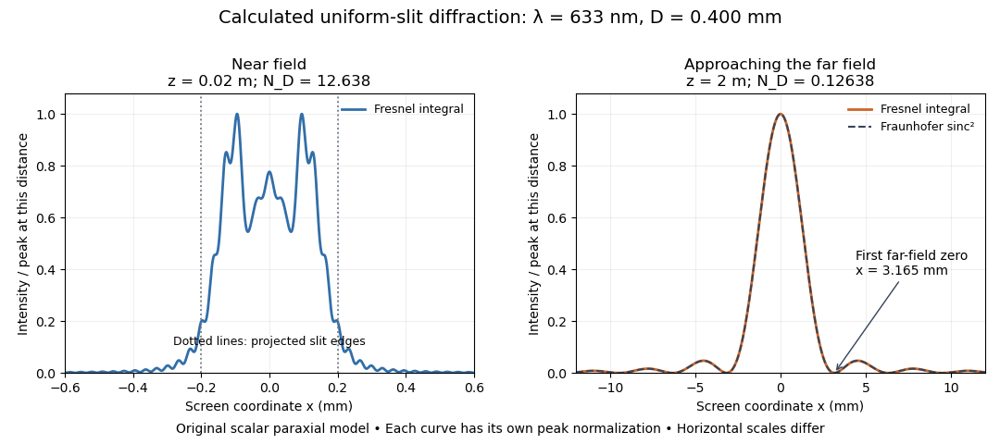

**[Figure 2](#image-original-calculated-fresnel-diffraction-profiles-of-a-0-400-mm-slit-at-633-nm-compared-with-the-fraunhofer-diffraction-shape). Original calculated Fresnel diffraction profiles of a 0.400 mm slit at 633 nm, compared with the Fraunhofer diffraction shape**.

These are numerical predictions from the displayed scalar [integral](integral.md), using the [composite trapezoidal rule](runge-kutta-method.md#composite-trapezoidal-rule), rather than measured profiles. Each curve is divided by its own peak [light intensity](wave.md#light-intensity); the two horizontal scales differ. At 2 cm the computed central [irradiance](radiometry.md#irradiance) is about $1.14812I_{\rm inc}$, with brighter off-axis maxima. At 2 m it is about $0.126272I_{\rm inc}$ and is the peak. The dashed [Fraunhofer diffraction](#fraunhofer-diffraction) curve has its own central normalization; its first zeros are at $x=\pm\lambda z/D=\pm3.165\,\mathrm{mm}$. The finite-distance [Fresnel diffraction](#fresnel-diffraction) curve remains slightly nonzero there.

Normalization hides the brightness change, but not the change in shape. The [Fourier transform](fourier-transform.md) propagation multiplier has unit [complex modulus](complex-analysis.md#complex-modulus), so [Plancherel theorem](fourier-analysis.md#plancherel-theorem) gives

$$
\int_{\mathbb R}\frac{I(x,z)}{I_{\rm inc}}dx=\int_{-D/2}^{D/2}1\,d\xi=D.
$$

This is conservation of transmitted [power](energy.md#power) per unit height in the ideal scalar model. An [integral](integral.md) over only the displayed screen [interval](real-analysis.md#interval-mathematics) misses the tails; a peak-normalized profile is not a unit-[integral](integral.md) [probability density](wave-function.md#probability-density). Spreading and decreasing brightness together preserve the transmitted [power](energy.md#power).

### Near-field diffraction laboratory experiment

↑ **Parent:** [Fresnel diffraction](#fresnel-diffraction)

A documented experiment uses curved illumination rather than the uniform [Fresnel slit propagation](#fresnel-slit-propagation) model. [Laboratory Exercise No. 4: Diffraction, MIT 6.237, Fall 2024](physics-bibliography.md#laboratory-exercise-no-4-diffraction-mit-6-237-fall-2024), printed pp. 5–6, gives a helium–neon [laser](laser.md) at $632.8\,\mathrm{nm}$, a microscope objective [optical lens](geometrical-optics.md#lens-optics), a circular [aperture](optics.md#aperture) and a screen 5–40 cm from the object. Preparation includes comparing central brightness in [Fresnel diffraction](#fresnel-diffraction) and [Fraunhofer diffraction](#fraunhofer-diffraction). A 40× objective produces a nonplanar incident [wavefront](#wavefront); the opening is placed less than 1 cm from it. With objective-to-screen distance fixed, students move the opening, sketch patterns, and record positions of consecutive central nulls to estimate aperture size. The [Fraunhofer diffraction](#fraunhofer-diffraction) pattern supplies a regime comparison. A separate spherical-obstacle task observes a bright centre inside the shadow. The handout supplies procedures, rather than measured distances or profiles.[p. 1 introduction; p. 2 PL4.1(d); p. 5 §B and Fig. 3; p. 6 §§4.9–4.10: wavelength, apparatus, fixed-distance comparison and readout](physics-bibliography.md#laboratory-exercise-no-4-diffraction-mit-6-237-fall-2024)

The circular-opening test probes cancellation of [complex amplitudes](wave.md#complex-amplitude) at the centre while the source [wavefront](#wavefront) curvature changes. To interpret it, include that curvature in the aperture field $U_0$ and use a circular [aperture](optics.md#aperture), rather than substituting the plane-illuminated [Fresnel slit propagation](#fresnel-slit-propagation) profile. Useful additional controls are to retain the same [laser](laser.md) and opening, centre the illumination, repeat position readings and check background with the beam blocked. If a camera replaces the visual screen readout, avoid saturation and calibrate its position scale. Alignment, imperfect aperture edges, illumination variation and limited contrast near a null constrain the inferred size. A bright central obstacle spot illustrates why the sharp shadows of [geometrical optics](geometrical-optics.md) can fail; it does not imply that every [Fresnel diffraction](#fresnel-diffraction) pattern has a bright centre.

## Gaussian beam

↑ **Parent:** [Physical optics](physical-optics.md)  
ⓦ [Wiki](https://en.wikipedia.org/wiki/Gaussian_beam)

A fundamental [Gaussian beam](#gaussian-beam) is an ideal beam of [light](optics.md#light) whose transverse [wave amplitude](wave.md#wave-amplitude) has a [Gaussian function](calculus.md#gaussian-function) profile. Here consider a circularly symmetric beam in [vacuum](physics.md#vacuum), with propagation along $z$, two transverse coordinates $x,y$, and [radius](topology.md#radius) $r=\sqrt{x^2+y^2}$ from the [optical axis](geometrical-optics.md#optical-axis). With the [beam waist](#beam-waist) at $z=0$, total [power](energy.md#power) $P>0$, and [vacuum](physics.md#vacuum) [wavelength](wave-equation.md#wavelength) $\lambda$, its time-averaged [light intensity](wave.md#light-intensity), meaning [irradiance](radiometry.md#irradiance) in $\mathrm{W\,m^{-2}}$, is

$$
I(r,z)=\frac{2P}{\pi w(z)^2}\exp\!\left(-\frac{2r^2}{w(z)^2}\right),
\qquad w(z)=w_0\sqrt{1+\left(\frac{z}{z_R}\right)^2},
\qquad z_R=\frac{\pi w_0^2}{\lambda}.
$$

Here $w_0$ is the minimum beam [radius](topology.md#radius), and $z_R$ is the [Rayleigh range](#rayleigh-length). Far from the [beam waist](#beam-waist), $w(z)\sim\theta|z|$ with [beam divergence](#beam-divergence) half-angle $\theta=\lambda/(\pi w_0)$. These are the fundamental circular [Gaussian beam](#gaussian-beam) laws within the scalar [paraxial approximation](partial-differential-equation.md#paraxial-approximation), appropriate when $w_0\gg\lambda$ and the [beam divergence](#beam-divergence) is small. The underlying envelope solves the [parabolic wave equation](partial-differential-equation.md#parabolic-wave-equation) exactly; this does not make it an exact vector solution of [Maxwell equations](maxwell-equations.md). [Franz Kärtner, MIT 6.974 notes, 2006, §2.4, equations 2.219 and 2.227–2.238](https://ocw.mit.edu/courses/6-974-fundamentals-of-photonics-quantum-electronics-spring-2006/8e54d1625e9e71eb5b4e4998e6967e4e_chapter2.pdf).

The [radius](topology.md#radius) convention matters. Writing $U$ for the complex [wave amplitude](wave.md#wave-amplitude) envelope, the same $w(z)$ is the [wave amplitude](wave.md#wave-amplitude) $1/e$ [radius](topology.md#radius) and the [light intensity](wave.md#light-intensity) $1/e^2$ [radius](topology.md#radius):

$$
\frac{|U(r,z)|}{|U(0,z)|}=e^{-r^2/w(z)^2},
\qquad \frac{I(r,z)}{I(0,z)}=e^{-2r^2/w(z)^2}.
$$

At $r=w(z)$ these ratios are $e^{-1}\approx0.367879$ and $e^{-2}\approx0.135335$, respectively. The [light intensity](wave.md#light-intensity) $1/e$ [radius](topology.md#radius) is instead $w(z)/\sqrt2$. None of these radii is a sharp edge: the ideal [Gaussian function](calculus.md#gaussian-function) has nonzero tails at every finite [radius](topology.md#radius). Kogelnik and Li explicitly use the [wave amplitude](wave.md#wave-amplitude) $1/e$ [radius](topology.md#radius) in their fundamental-mode treatment. [Herwig Kogelnik and Tingye Li, Laser Beams and Resonators, Applied Optics 5, 1550–1567, 1966, §3.2](https://dielslab.unm.edu/sites/default/files/Kogelnik66_0.pdf).

For a numerical example, take [vacuum](physics.md#vacuum) [wavelength](wave-equation.md#wavelength) $\lambda=632.8\,\mathrm{nm}$ and [beam waist](#beam-waist) [radius](topology.md#radius) $w_0=0.500\,\mathrm{mm}$. Substitution gives [Rayleigh range](#rayleigh-length) $z_R\approx1.24114754\,\mathrm m$ and far-field [beam divergence](#beam-divergence) half-angle $\theta\approx0.402852992\,\mathrm{mrad}$. At $z=z_R$, the beam [radius](topology.md#radius) is $w=\sqrt2w_0\approx0.707107\,\mathrm{mm}$ and the on-axis [irradiance](radiometry.md#irradiance) is half its waist value. At the same [wavelength](wave-equation.md#wavelength), halving the [beam waist](#beam-waist) [radius](topology.md#radius) to $0.250\,\mathrm{mm}$ quarters the [Rayleigh range](#rayleigh-length) to $0.310286885\,\mathrm m$ and doubles the [beam divergence](#beam-divergence) half-angle to $0.805705984\,\mathrm{mrad}$. At fixed [power](energy.md#power), that smaller [beam waist](#beam-waist) also quadruples the peak [irradiance](radiometry.md#irradiance).

**[Figure 3](#image-gaussian-beam-radii-at-632-8-nm-a-smaller-beam-waist-gives-a-shorter-rayleigh-range-and-greater-beam-divergence). Gaussian beam radii at 632.8 nm: a smaller beam waist gives a shorter Rayleigh range and greater beam divergence**.

The contours in the left panel are $r=\pm w(z)$ in a plane through the [optical axis](geometrical-optics.md#optical-axis); they mark an [light intensity](wave.md#light-intensity) level, not an outer boundary. The right panel compares the exact model radii with the far-field asymptotes $w=\theta z$. The horizontal and vertical axes use different length units, so the drawn slopes are not physical [angles](geometry-and-topology.md#angle).

The normalization expresses conserved [power](energy.md#power) during free propagation. In transverse [polar coordinates](multivariable-calculus.md#polar-coordinates), an [annulus](topology.md#annulus-mathematics) has [area](differential-geometry.md#surface-area) $2\pi r\,dr$, so

$$
\int_{\mathbb R^2}I\,dx\,dy
=2\pi\int_0^\infty I(r,z)r\,dr=P,
\qquad \frac{P(r<a)}{P}=1-e^{-2a^2/w(z)^2}.
$$

A proof outline is the substitution $s=2r^2/w(z)^2$ in this [integral](integral.md). Spreading reduces peak [irradiance](radiometry.md#irradiance) as $w^{-2}$ while increasing transverse [area](differential-geometry.md#surface-area) as $w^2$, leaving [power](energy.md#power) unchanged. In particular, the [disk](topology.md#disk-mathematics) of [radius](topology.md#radius) $w(z)$ contains $1-e^{-2}\approx0.8646647168$, or $86.4665\%$, of the total [power](energy.md#power); the local [light intensity](wave.md#light-intensity) at its rim is only $13.5335\%$ of the on-axis [light intensity](wave.md#light-intensity). These are different quantities.

**[Figure 4](#image-gaussian-beam-radius-conventions-and-the-fraction-of-power-inside-a-centered-disk). Gaussian beam radius conventions and the fraction of power inside a centered disk**.

The left panel compares normalized [wave amplitude](wave.md#wave-amplitude) magnitude and [irradiance](radiometry.md#irradiance); the right panel integrates the transverse [area](differential-geometry.md#surface-area) to show enclosed [power](energy.md#power). For an ideal absorbing circular [aperture](optics.md#aperture) of [radius](topology.md#radius) $a$ centered on the [optical axis](geometrical-optics.md#optical-axis), the same fraction gives the [power](energy.md#power) passing the [aperture](optics.md#aperture) at that plane. An [aperture](optics.md#aperture) of [radius](topology.md#radius) $w$ clips about $13.5335\%$ of the incident [power](energy.md#power); [radius](topology.md#radius) $2w$ clips only $e^{-8}\approx0.000335463$, or $0.0335463\%$. After clipping, extra [diffraction](quantum-scattering.md#diffraction) means the transmitted field no longer obeys the unmodified ideal [Gaussian beam](#gaussian-beam) law. Every finite [aperture](optics.md#aperture) cuts some ideal tail. Kogelnik and Li distinguish their large-[aperture](optics.md#aperture) beam analysis from their finite-[aperture](optics.md#aperture) [diffraction](quantum-scattering.md#diffraction) analysis. [Kogelnik and Li, 1966, §§3–4](https://dielslab.unm.edu/sites/default/files/Kogelnik66_0.pdf).

The useful tradeoff is that a small bright spot cannot remain narrow indefinitely. An [optical lens](geometrical-optics.md#lens-optics) can create a smaller [beam waist](#beam-waist), but [diffraction](quantum-scattering.md#diffraction) then makes the beam spread faster. The particularly simple relation $w_0\theta=\lambda/\pi$ ties localization directly to [beam divergence](#beam-divergence). A proof outline for the propagation law starts with $U(x,y,0)=U_0e^{-(x^2+y^2)/w_0^2}$. The [parabolic wave equation](partial-differential-equation.md#parabolic-wave-equation) separates into two transverse factors, and a [Gaussian integral](integral.md#gaussian-integral) in each coordinate gives

$$
U(x,y,z)=\frac{U_0}{q(z)}\exp\!\left(-\frac{x^2+y^2}{w_0^2q(z)}\right),
\qquad q(z)=1+i\frac{z}{z_R},\qquad k=\frac{2\pi}{\lambda}.
$$

Here $q$ is dimensionless and $k$ is the [wavenumber](wave-equation.md#wavenumber); the carrier convention is $e^{i(kz-\omega t)}$, with [angular frequency](lagrangian-mechanics.md#angular-frequency) $\omega$. Taking the squared [complex modulus](complex-analysis.md#complex-modulus) gives the stated $w(z)$ and its $w^{-2}$ [light intensity](wave.md#light-intensity) scaling. Each transverse factor contributes $q^{-1/2}$, explaining the $q^{-1}$ prefactor here and the different prefactor in the preserved [Gaussian beam with one transverse coordinate](#gaussian-beam-with-one-transverse-coordinate).

Historically, [Gaussian beam](#gaussian-beam) theory developed alongside early [laser](laser.md) resonator theory and lens-guided transmission. In their 1966 review, Kogelnik and Li credit Boyd and Gordon, and Goubau and Schwering, with early beam treatments; they summarize earlier work rather than claim the whole construction as a new discovery. Their paper brings beam propagation, focusing and finite-[aperture](optics.md#aperture) [diffraction](quantum-scattering.md#diffraction) into a common practical account. [Kogelnik and Li, 1966, introduction and §3](https://dielslab.unm.edu/sites/default/files/Kogelnik66_0.pdf).

### Beam waist

↑ **Parent:** [Gaussian beam](#gaussian-beam)

The [beam waist](#beam-waist) is the narrowest cross-section of a freely propagating [Gaussian beam](#gaussian-beam). Its [radius](topology.md#radius) $w_0$ uses the [wave amplitude](wave.md#wave-amplitude) $1/e$, or [light intensity](wave.md#light-intensity) $1/e^2$, convention; its [diameter](topological-analysis.md#diameter) is $2w_0$. Specifying a “spot size” without saying [radius](topology.md#radius) or [diameter](topological-analysis.md#diameter) can introduce a factor-of-two error. Within the scalar [paraxial approximation](partial-differential-equation.md#paraxial-approximation), the [wavefront](#wavefront) at the [beam waist](#beam-waist) is planar. The minimum [radius](topology.md#radius) sets both the [Rayleigh range](#rayleigh-length) and the far-field [beam divergence](#beam-divergence).

### Rayleigh length

↑ **Parent:** [Gaussian beam](#gaussian-beam)  
ⓦ [Wiki](https://en.wikipedia.org/wiki/Rayleigh_length)

The [Rayleigh range](#rayleigh-length) of a fundamental [Gaussian beam](#gaussian-beam) in [vacuum](physics.md#vacuum) is the positive axial distance from the [beam waist](#beam-waist) at which its [radius](topology.md#radius) grows from $w_0$ to $\sqrt2w_0$. Thus its contour [area](differential-geometry.md#surface-area) doubles and its peak [irradiance](radiometry.md#irradiance) halves. Within $|z|\leq z_R$, the [radius](topology.md#radius) stays at most $\sqrt2w_0$; for $|z|\gg z_R$, [beam divergence](#beam-divergence) dominates. At fixed [vacuum](physics.md#vacuum) [wavelength](wave-equation.md#wavelength), the [Rayleigh range](#rayleigh-length) scales quadratically with the [beam waist](#beam-waist) [radius](topology.md#radius). The formula here uses the [vacuum](physics.md#vacuum) [wavelength](wave-equation.md#wavelength), not an unlabelled [wavelength](wave-equation.md#wavelength) in a material.

### Gaussian beam with one transverse coordinate

↑ **Parent:** [Gaussian beam](#gaussian-beam)

For the free [parabolic wave equation](partial-differential-equation.md#parabolic-wave-equation) $E_x=iE_{zz}/(2k)$, input $E(0,z)=e^{-Az^2}$ with $\operatorname{Re}A>0$ propagates as

$$
 E(x,z)=q(x)^{-1/2}e^{-Az^2/q(x)},\qquad q(x)=1+2iAx/k.
$$

The branch is continuous from $q(0)^{-1/2}=1$. [One-dimensional transverse Fresnel propagation](partial-differential-equation.md#one-dimensional-transverse-fresnel-propagation) or two [Gaussian integrals](integral.md#gaussian-integral) prove the formula. With $A=D^{-2}+ik/(2F)$, the squared envelope is $|q|^{-1}\exp[-2z^2/(D^2|q|^2)]$. The amplitude power is $-1/2$ because there is only one transverse coordinate. A two-transverse-coordinate [Gaussian beam](#gaussian-beam) instead has power $-1$ when both coordinates share the same $q$.

## Beam divergence

↑ **Parent:** [Physical optics](physical-optics.md)  
ⓦ [Wiki](https://en.wikipedia.org/wiki/Beam_divergence)

[Beam divergence](#beam-divergence) describes the angular spread of a beam away from its [optical axis](geometrical-optics.md#optical-axis); specify the [radius](topology.md#radius) convention and whether the quoted [angle](geometry-and-topology.md#angle) is a half-angle or full [angle](geometry-and-topology.md#angle). For the fundamental [Gaussian beam](#gaussian-beam) in [vacuum](physics.md#vacuum), the far-field $1/e^2$ [light intensity](wave.md#light-intensity) [radius](topology.md#radius) obeys

$$
w(z)\sim\theta|z|,\qquad
\theta=\lim_{z\to\infty}\frac{w(z)}{z}=\frac{w_0}{z_R}=\frac{\lambda}{\pi w_0}.
$$

Here $\theta$ is the small-[angle](geometry-and-topology.md#angle) half-angle in radians under the [paraxial approximation](partial-differential-equation.md#paraxial-approximation); the full [angle](geometry-and-topology.md#angle) is $2\theta$. The geometric asymptote has [angle](geometry-and-topology.md#angle) $\arctan(w_0/z_R)$, approximated by $w_0/z_R$ in this regime. Other beam profiles need their own [beam divergence](#beam-divergence) definitions and propagation laws.

## Phase conjugation

↑ **Parent:** [Physical optics](physical-optics.md)  
ⓦ [Wiki](https://en.wikipedia.org/wiki/Phase_conjugation)

[Phase conjugation](#phase-conjugation) creates a returning [monochromatic wave](wave.md#monochromatic-wave) whose spatial [complex amplitude](wave.md#complex-amplitude) is proportional to the [complex conjugate](complex-analysis.md#complex-conjugate) of the incident field. Fix the time convention throughout:

$$
E(\mathbf r,t)=\operatorname{Re}\!\left\{U(\mathbf r)e^{-i\omega t}\right\},
\qquad U(\mathbf r)=A(\mathbf r)e^{i\phi(\mathbf r)},
\qquad U_{\mathrm c}(\mathbf r)=\gamma A(\mathbf r)e^{-i\phi(\mathbf r)}.
$$

Here $E$ is one scalar component of the [electric field](electric-field.md), $A\geq0$ is the [wave amplitude](wave.md#wave-amplitude), $\omega>0$ is the [angular frequency](lagrangian-mechanics.md#angular-frequency), and $\gamma$ is a spatially constant [complex number](complex-analysis.md#complex-number) setting the return strength and reference [wave phase](wave.md#phase-waves). The [complex conjugation](complex-analysis.md#complex-conjugation) acts on $U$, including its spatial carrier, while the time factor remains $e^{-i\omega t}$. Conjugating both factors would merely give another representation of the same real field. With $\gamma=1$, the new real field equals $E(\mathbf r,-t)$ in this ideal [monochromatic wave](wave.md#monochromatic-wave) model; that identity does not assert reversal of an arbitrary pulse or of the apparatus producing it.

The spatial [wave phase](wave.md#phase-waves) becomes $-\phi+\arg\gamma$, so the local [wavevector](elasticity-physics.md#wavevector) changes from $\nabla\phi$ to $-\nabla\phi$. For example, $U=Ae^{i(k_xx+k_zz)}$ with $k_z>0$ becomes $\gamma Ae^{-i(k_xx+k_zz)}$: both components of the [wavevector](elasticity-physics.md#wavevector) reverse. In a transparent stationary medium with [isotropy](continuum-mechanics.md#isotropy) and positive [refractive index](electromagnetic-wave.md#refractive-index), [light rays](geometrical-optics.md#light-ray) follow the [wavevector](elasticity-physics.md#wavevector), giving counterpropagation. The same [wavefronts](#wavefront) now have opposite propagation normals. This is why [phase conjugation](#phase-conjugation) can return a distorted beam toward its origin: it reverses the detailed spatial [wave phase](wave.md#phase-waves), rather than requiring that [wave phase](wave.md#phase-waves) to be flat.

The attractive application is correction of [optical aberrations](geometrical-optics.md#optical-aberration) accumulated on an outward trip. The return uses the distortion itself as the prescription for correction, as the original [thin phase-plate cancellation by phase conjugation](#thin-phase-plate-cancellation-by-phase-conjugation) example makes explicit. An experimentally accessible implementation measures the spatial [wave phase](wave.md#phase-waves) and uses a [spatial light modulator](optics.md#spatial-light-modulator) to generate its negative; [digital optical phase conjugation](#digital-optical-phase-conjugation) describes an inspected 2010 demonstration of recovery through [multiple scattering](wave.md#multiple-scattering).

### Phase-conjugate mirror

↑ **Parent:** [Phase conjugation](#phase-conjugation)

A [phase-conjugate mirror](#phase-conjugate-mirror) is an optical device that implements [phase conjugation](#phase-conjugation) at its return surface. It may generate the return using an independently supplied beam, as in [digital optical phase conjugation](#digital-optical-phase-conjugation); its name specifies the field transformation, rather than a particular reflecting material. Conjugating the transverse [complex amplitude](wave.md#complex-amplitude) and launching the returning longitudinal carrier produces the complete reversed [wavevector](elasticity-physics.md#wavevector). A spatially constant $\gamma$ leaves the shape of the [wavefront](#wavefront) unchanged; a spatially varying $\gamma$ would add its own [wavefront error](#wavefront-error).

An ordinary flat mirror obeys the [law of reflection](geometrical-optics.md#law-of-reflection). At a surface $z=L$, its reflected [plane wave](wave-function.md#plane-wave) has [wavevector](elasticity-physics.md#wavevector) $(k_x,k_y,-k_z)$, whereas a [phase-conjugate mirror](#phase-conjugate-mirror) returns $(-k_x,-k_y,-k_z)$. Ordinary [specular reflection](optics.md#specular-reflection) preserves the tangential [wavevector](elasticity-physics.md#wavevector). At normal incidence a single [plane wave](wave-function.md#plane-wave) can therefore look identical in the two cases, apart from an overall [wave phase](wave.md#phase-waves) and strength; oblique incidence or a curved [wavefront](#wavefront) reveals the distinction. In boundary-envelope notation an ideal ordinary mirror multiplies the incident [complex amplitude](wave.md#complex-amplitude) by a constant reflection factor $r$, while an ideal [phase-conjugate mirror](#phase-conjugate-mirror) returns its [complex conjugate](complex-analysis.md#complex-conjugate) times $\gamma$.

#### Phase-conjugate ray retracing

↑ **Parent:** [Phase-conjugate mirror](#phase-conjugate-mirror)

Consider an [optical point source](point-spread-function.md#optical-point-source) at $(z,x)=(0,0)$, a uniform transparent medium, and a flat return surface $z=L$. A [light ray](geometrical-optics.md#light-ray) with slope $s$ reaches $(L,sL)$. A [phase-conjugate mirror](#phase-conjugate-mirror) reverses its full direction and returns it to $(0,0)$. An ordinary mirror reverses only its normal direction; its returning [light ray](geometrical-optics.md#light-ray) reaches $x=2sL$ at $z=0$. Thus rays with $s=-1/4,0,1/4$ at $L=3$ return to $x=-3/2,0,3/2$ with ordinary [specular reflection](optics.md#specular-reflection), but all return to $x=0$ under ideal [phase conjugation](#phase-conjugation). These are stipulated geometric coordinates, not laboratory measurements.

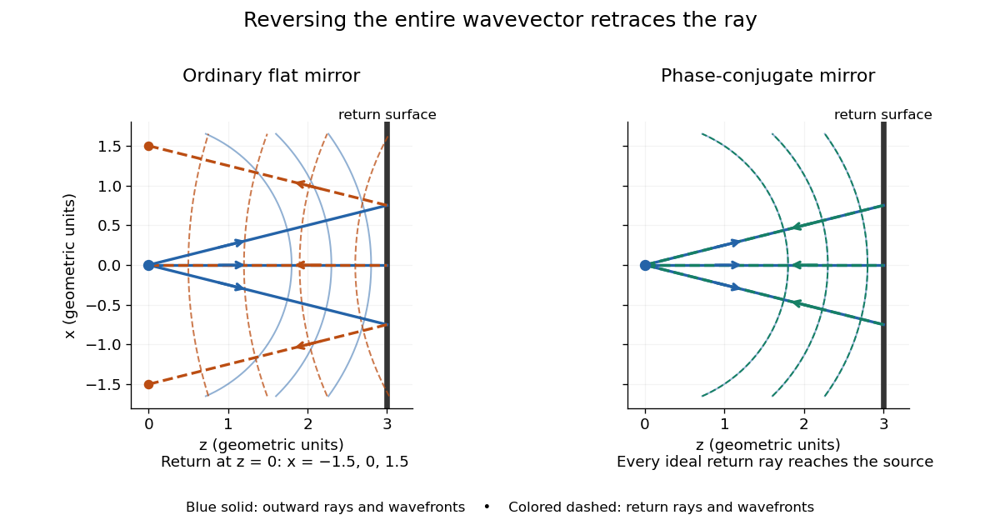

**[Figure 5](#phase-conjugate-wavefront-ray-retracing). Ordinary reflection and ideal phase conjugation: curved wavefronts and returning light rays**.

Solid blue curves mark outward [wavefronts](#wavefront); dashed curves mark returning [wavefronts](#wavefront). In the [phase-conjugate mirror](#phase-conjugate-mirror) panel the returning curves coincide with the outward ones, and the arrows reverse on the same [light rays](geometrical-optics.md#light-ray). The diagram uses equal spatial scales. In [geometrical optics](geometrical-optics.md), reversing each [light ray](geometrical-optics.md#light-ray) in an unchanged medium with [wave reciprocity](wave.md#wave-reciprocity) retraces its route. At the [optical point source](point-spread-function.md#optical-point-source) itself, the ray construction becomes singular and [diffraction](quantum-scattering.md#diffraction) sets the physical focal size.

A wave-level proof outline applies to a stationary scalar medium with real [refractive index](electromagnetic-wave.md#refractive-index) $n(\mathbf r)$ and no [wave absorption](wave.md#wave-absorption). Writing $c$ for the [vacuum](physics.md#vacuum) [speed of light](special-relativity.md#speed-of-light), its [Helmholtz equation](partial-differential-equation.md#helmholtz-equation) is

$$
\nabla^2U+k_0^2n(\mathbf r)^2U=0,\qquad k_0=\omega/c.
$$

All coefficients are real, so [complex conjugation](complex-analysis.md#complex-conjugation) gives the same [Helmholtz equation](partial-differential-equation.md#helmholtz-equation) for $U^*$. The conjugated outgoing boundary data select the incoming solution. This explains the connection between [phase conjugation](#phase-conjugation) and retracing, provided the required incoming field is supplied over the necessary [aperture](optics.md#aperture). It also exposes the limits: [wave reciprocity](wave.md#wave-reciprocity) alone does not imply absence of [wave absorption](wave.md#wave-absorption); conjugation of complex material coefficients would describe a different medium. Loss, an incomplete [aperture](optics.md#aperture), a changing medium or failure of [wave reciprocity](wave.md#wave-reciprocity) can prevent exact reconstruction. Intensity-dependent material changes need a separate analysis and are not covered by this linear proof.

### Thin phase-plate cancellation by phase conjugation

↑ **Parent:** [Phase conjugation](#phase-conjugation)

Model a thin transparent plate by a lossless reciprocal [phase screen](partial-differential-equation.md#phase-screen) with transmission $t(x)=e^{i\psi(x)}$ at the chosen [angular frequency](lagrangian-mechanics.md#angular-frequency). Both passages multiply the local field by the same $t(x)$: reversing travel does not by itself change the sign of an accumulated [optical path length](#optical-path-length). Assume the plate is stationary, the two passages use corresponding transverse positions, and the plate is adjacent to the return surface or perfectly reimaged onto it. Ignore propagation between these reference surfaces, [wave absorption](wave.md#wave-absorption), clipping and intensity-dependent changes. Take the incident boundary envelope to be $U_0(x)=A(x)e^{i\phi_0(x)}$. Outward transmission gives $tU_0$. Ideal [phase conjugation](#phase-conjugation) and the second transmission then give

$$
U_{\mathrm{return}}(x)=t(x)\gamma\bigl[t(x)U_0(x)\bigr]^*
=\gamma t(x)t(x)^*U_0(x)^*
=\gamma U_0(x)^*.
$$

This is a complete short proof of cancellation in the specified [phase screen](partial-differential-equation.md#phase-screen) model. For an ideal ordinary mirror with constant reflection factor $r$, the corresponding envelope is $rt(x)^2U_0(x)$: the extra [wave phase](wave.md#phase-waves) is $2\psi(x)$, rather than zero. A constant reflection [wave phase](wave.md#phase-waves) changes neither conclusion.

For an original toy [optical aberration](geometrical-optics.md#optical-aberration), let $\xi=x/a$ on $-1\leq\xi\leq1$, take $\phi_0=0$, and choose

$$
\psi(\xi)=\frac{\pi}{2}\xi^2+\frac{\pi}{4}\xi^3.
$$

The even term adds symmetric curvature and the odd term makes the two sides unequal. The outward [wave phase](wave.md#phase-waves) is $\psi$; immediately after ideal [phase conjugation](#phase-conjugation) it is $-\psi$; after the second passage it is zero. At $\xi=-1,0,1$, the outward values are $\pi/4,0,3\pi/4$, while an ordinary mirror's completed return has values $\pi/2,0,3\pi/2$. All [wave phases](wave.md#phase-waves) here are unwrapped relative to the central ray and are otherwise equivalent modulo $2\pi$. At a stipulated [vacuum](physics.md#vacuum) [wavelength](wave-equation.md#wavelength) $\lambda=532\,\mathrm{nm}$, these outward errors correspond to [optical path length](#optical-path-length) errors $h=\lambda\psi/(2\pi)$ of $66.5,0,199.5\,\mathrm{nm}$. These are chosen values; they are not observations or physical plate thicknesses.

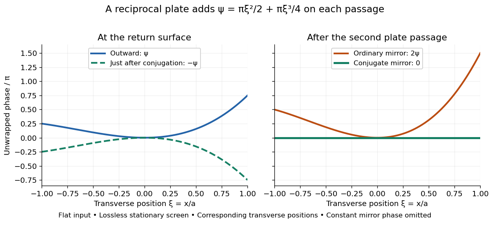

**[Figure 6](#phase-conjugate-phase-plate-profiles). Original thin phase screen example: sign reversal at conjugation and cancellation after the second passage**.

The [wave phase](wave.md#phase-waves) plots make a subtle distinction visible: the field is still curved immediately after [phase conjugation](#phase-conjugation), and becomes flat only after crossing the same plate again. More generally, conjugation restores $U_0^*$, not a universally flat [wavefront](#wavefront). If the plate instead has transmission $t=\alpha(x)e^{i\psi(x)}$ with real $0\leq\alpha\leq1$, the return is $\gamma\alpha(x)^2U_0^*$. Its plate-induced [wave phase](wave.md#phase-waves) cancels but its lost [wave amplitude](wave.md#wave-amplitude) does not recover. If the return plate has changed to [wave phase](wave.md#phase-waves) $\psi_{\mathrm r}$, the residual factor is $e^{i(\psi_{\mathrm r}-\psi)}$. Those two variations distinguish correction of a stationary [optical aberration](geometrical-optics.md#optical-aberration) from universal reversal of loss or material evolution.

### Digital optical phase conjugation

↑ **Parent:** [Phase conjugation](#phase-conjugation)

[Digital optical phase conjugation](#digital-optical-phase-conjugation) uses a [wavefront sensor](optical-instrument.md#wavefront-sensor) and a [spatial light modulator](optics.md#spatial-light-modulator) to measure an incident field and launch a beam with the opposite spatial [wave phase](wave.md#phase-waves). A phase-only [spatial light modulator](optics.md#spatial-light-modulator) illuminated uniformly generally does not reproduce the incident [wave amplitude](wave.md#wave-amplitude) as well; exact $\gamma U^*$ requires the appropriate [wave amplitude](wave.md#wave-amplitude) and [polarization of an electromagnetic wave](electromagnetic-wave.md#polarization-of-an-electromagnetic-wave) too. The experimentally useful question is how much of the original optical mode can be recovered with the measured and controlled field components.

In 2010, [Meng Cui](physicist.md#meng-cui) and [Changhuei Yang](electrical-engineering.md#changhuei-yang) demonstrated [digital optical phase conjugation](#digital-optical-phase-conjugation) through a prepared [multiple scattering](wave.md#multiple-scattering) sample. They dried mixed-size [polystyrene](polymer.md#polystyrene) microspheres on cover glass, added immersion oil, and sealed them with another cover glass. A 532 nm [laser](laser.md) supplied signal and reference beams. The signal crossed the sample between two objectives; the reference interfered with it on a [charge-coupled device](optical-instrument.md#charge-coupled-device). Phase-stepped [wave interference](#interference-wave-propagation) recovered the spatial [wave phase](wave.md#phase-waves); a calibrated [spatial light modulator](optics.md#spatial-light-modulator) imposed its negative on the reference-derived return beam. The reference supplied playback power, without nonlinear mixing pumps. An [optical camera](optical-instrument.md#optical-camera) read out the recovered signal. With the same sample and a zero-phase [spatial light modulator](optics.md#spatial-light-modulator) control, the return instead produced a [scattering of light](optics.md#scattering-of-light) pattern. This comparison supports mode recovery by spatial [wave phase](wave.md#phase-waves) control, not merely increased illumination. A separate ordinary-mirror control tested source displacements. Finite sampling and collection limited recovery; the system controlled [wave phase](wave.md#phase-waves) rather than the complete vector field. These restrictions distinguish demonstrated reconstruction from exact reversal of every scattered component.[Cui and Yang, 2010, §§2–3, Figs. 1–4; §4.2, Fig. 6(e–f); §§5.1–5.2, Fig. 7(a–c), printed pp. 3446–3453](physics-bibliography.md#implementation-of-a-digital-optical-phase-conjugation-system-and-its-application-to-study-the-robustness-of-turbidity-suppression-by-phase-conjugation-by-meng-cui-and-changhuei-yang)

## Wavefront

↑ **Parent:** [Physical optics](physical-optics.md)  
ⓦ [Wiki](https://en.wikipedia.org/wiki/Wavefront)

A [wavefront](#wavefront) connects points with the same [wave phase](wave.md#phase-waves) at one specified time. It is a surface, rather than the trajectory of a particular piece of [light](optics.md#light). For a scalar [monochromatic wave](wave.md#monochromatic-wave) written as $u(\mathbf r,t)=A(\mathbf r)\cos\Phi(\mathbf r,t)$, a [wavefront](#wavefront) is a connected [level set](topology.md#level-set) of the [phase function](distribution-theory.md#phase-function) $\Phi$; different surfaces can share the same [wave phase](wave.md#phase-waves) modulo $2\pi$. A [plane wave](wave-function.md#plane-wave) has planar [wavefronts](#wavefront). An outward wave from an ideal point source in a uniform medium has [spheres](euclidean-geometry.md#sphere) as [wavefronts](#wavefront), while an [optical lens](geometrical-optics.md#lens-optics) can turn nearly planar [wavefronts](#wavefront) into converging ones. The [wavefront](#wavefront) describes [wave phase](wave.md#phase-waves), not [wave amplitude](wave.md#wave-amplitude): drawing it does not say how bright the beam is. [Wavefronts](physics-bibliography.md#rp-photonics-encyclopedia-by-rudiger-paschotta/wavefronts)

The relation to [light rays](geometrical-optics.md#light-ray) becomes precise in a stationary medium with [isotropy](continuum-mechanics.md#isotropy), negligible loss and a real positive scalar [refractive index](electromagnetic-wave.md#refractive-index) $n(\mathbf r,\omega)$. In the [geometrical optics](geometrical-optics.md) limit, spatial changes in the [refractive index](electromagnetic-wave.md#refractive-index) and [wave amplitude](wave.md#wave-amplitude) are slow on the local [wavelength](wave-equation.md#wavelength) scale. For a single smooth propagation branch, write

$$
\Phi(\mathbf r,t)=k_0S(\mathbf r,\omega)-\omega t+\phi_0,\qquad k_0=\frac{\omega}{c},\qquad |\nabla S|^2=n^2.
$$

Here $\omega>0$ is the [angular frequency](lagrangian-mechanics.md#angular-frequency), $c$ is the [vacuum](physics.md#vacuum) [speed of light](special-relativity.md#speed-of-light), $S$ has units of length, and the last relation is the optical [eikonal equation](elasticity-physics.md#eikonal-equation). The local [wavevector](elasticity-physics.md#wavevector) is $\mathbf k=\nabla\Phi=k_0\nabla S$. Its direction is normal to a smooth [wavefront](#wavefront), since a [gradient](multivariable-calculus.md#gradient) is normal to its [level sets](topology.md#level-set). A forward [light ray](geometrical-optics.md#light-ray) has [unit tangent vector](tangent-vector.md#unit-tangent-vector) $d\mathbf r/ds=\nabla S/n$, so it follows this normal under the stated assumptions. Along that [light ray](geometrical-optics.md#light-ray), $dS/ds=\nabla S\cdot(d\mathbf r/ds)=n$: the change in $S$ is the [optical path length](#optical-path-length). This is the short geometric argument linking [wavefronts](#wavefront), [light rays](geometrical-optics.md#light-ray) and [optical path length](#optical-path-length). [Optics, Lecture 10: Eikonal Equations, Superposition of EM Waves](physics-bibliography.md#mit-2-71-and-2-710-optics-spring-2014-by-nicholas-x-fang/optics-lecture-10-eikonal-equations-superposition-of-em-waves)

**[Figure 7](#wavefront-refraction-phase-and-rays). Wavefronts and normal light rays at an interface: an original plane wave model of refraction**.

The diagram shows incident and transmitted branches separately, with the reflected branch omitted. Its stipulated [refractive indices](electromagnetic-wave.md#refractive-index) are $n_1=1$ and $n_2=3/2$, and its incident [angle](geometry-and-topology.md#angle) is $30^\circ$ to the interface normal. At a stationary interface, the [frequency](wave.md#frequency) and tangential [wavevector](elasticity-physics.md#wavevector) agree on the two sides: [Snell's law](partial-differential-equation.md#snell-s-law) gives $\sin\theta_2=1/3$, hence $\theta_2\approx19.4712^\circ$. The [wavefronts](#wavefront) turn while their normal spacing decreases from $\lambda_0$ to $2\lambda_0/3$, where $\lambda_0$ is the [vacuum](physics.md#vacuum) [wavelength](wave-equation.md#wavelength). More explicitly, with $x$ normal to the interface and $y$ tangential, take $S_1=\sqrt3x/2+y/2$ for $x<0$ and $S_2=\sqrt2x+y/2$ for $x>0$. These functions agree at $x=0$; the drawn [wavefronts](#wavefront) are $S_j=m\lambda_0$ at $t=0$ with $\phi_0=0$. This is an exact piecewise [plane wave](wave-function.md#plane-wave) phase construction for the stipulated transparent media, not measured material data. [Laws of Geometric Optics](physics-bibliography.md#electromagnetism-lecture-notes-by-richard-fitzpatrick/laws-of-geometric-optics)

The normal-to-[wavefront](#wavefront) rule requires its assumptions. In a medium with [anisotropy](continuum-mechanics.md#anisotropy), the [wavevector](elasticity-physics.md#wavevector) remains normal to a smooth [wavefront](#wavefront), but the [group velocity](dispersion-relation.md#group-velocity) and [energy flux](mathematical-physics.md#energy-flux) need not follow it. [Wavefronts](physics-bibliography.md#rp-photonics-encyclopedia-by-rudiger-paschotta/wavefronts) Near a [wave caustic](geometrical-optics.md#wave-caustic), where multiple [light rays](geometrical-optics.md#light-ray) meet, one smooth [phase function](distribution-theory.md#phase-function) may no longer describe the field; [diffraction](quantum-scattering.md#diffraction) and the full [wave amplitude](wave.md#wave-amplitude) matter. A [wavefront](#wavefront) is also not generally a surface of equal pulse arrival time. In a medium with [optical dispersion](geometrical-optics.md#dispersion-optics), a monochromatic [wave phase](wave.md#phase-waves) moves with the [phase velocity](dispersion-relation.md#phase-velocity), while a sufficiently narrow [wave packet](dispersion-relation.md#wave-packet) follows the [group velocity](dispersion-relation.md#group-velocity). Even identical [optical path lengths](#optical-path-length) at one [frequency](wave.md#frequency) can give different [group delays](#group-delay). The usual equal-travel-time picture needs a common launch reference and a nondispersive ray model; an arbitrary broadband disturbance has no single monochromatic [wavefront](#wavefront).[The Feynman Lectures on Physics, Volume I by Richard Feynman and others](physics-bibliography.md#the-feynman-lectures-on-physics-volume-i-by-richard-feynman-and-others)

### Optical path length

↑ **Parent:** [Wavefront](#wavefront)  
ⓦ [Wiki](https://en.wikipedia.org/wiki/Optical_path_length)

An [optical path length](#optical-path-length) measures how much propagation [wave phase](wave.md#phase-waves) a path accumulates, expressed as the distance that would accumulate the same [wave phase](wave.md#phase-waves) in [vacuum](physics.md#vacuum). A centimetre in a uniform medium with [refractive index](electromagnetic-wave.md#refractive-index) $3/2$ has [optical path length](#optical-path-length) $1.5\,\mathrm{cm}$, although its geometric length remains $1\,\mathrm{cm}$. This makes [optical path length](#optical-path-length) useful whenever two contributions must arrive with matching [wave phases](wave.md#phase-waves), from an [optical lens](geometrical-optics.md#lens-optics) to a [Michelson interferometer](#michelson-interferometer). [Optical Path Length](physics-bibliography.md#rp-photonics-encyclopedia-by-rudiger-paschotta/optical-path-length)

For a specified path $\gamma$ at fixed [angular frequency](lagrangian-mechanics.md#angular-frequency) $\omega$, the [optical path length](#optical-path-length) is the [line integral](multivariable-calculus.md#line-integral)

$$
\operatorname{OPL}_\gamma(\omega)=\int_\gamma n(\mathbf r,\omega)\,ds,\qquad
ds=|d\mathbf r|,\qquad
\operatorname{OPL}=\sum_j n_jL_j\ \text{for uniform segments}.
$$

Here $s$ is geometric [arc length](riemannian-geometry.md#arc-length), and $n$ is the phase [refractive index](electromagnetic-wave.md#refractive-index), evaluated at the same [frequency](wave.md#frequency) everywhere. The propagation interpretation assumes a stationary linear medium with [isotropy](continuum-mechanics.md#isotropy), a real positive scalar [refractive index](electromagnetic-wave.md#refractive-index) and negligible loss, on a valid [geometrical optics](geometrical-optics.md) branch. The path can curve; at sharp interfaces apply the appropriate matching conditions to each segment. A prescribed curve has a mathematical [line integral](multivariable-calculus.md#line-integral), but it predicts a propagation [wave phase](wave.md#phase-waves) only when it represents the physical branch. [Lecture Notes on Geometrical Optics](physics-bibliography.md#mit-2-71-and-2-710-optics-spring-2014-by-nicholas-x-fang/lecture-notes-on-geometrical-optics) [Optical fibers](optical-instrument.md#optical-fiber) can require a mode [wavenumber](wave-equation.md#wavenumber) rather than the bulk [refractive index](electromagnetic-wave.md#refractive-index) along a guessed [light ray](geometrical-optics.md#light-ray). [Optical Path Length](physics-bibliography.md#rp-photonics-encyclopedia-by-rudiger-paschotta/optical-path-length)

Fix the [vacuum](physics.md#vacuum) [wavelength](wave-equation.md#wavelength) $\lambda_0=c/f=2\pi c/\omega$, with [frequency](wave.md#frequency) $f=\omega/(2\pi)$ and [vacuum](physics.md#vacuum) [wavenumber](wave-equation.md#wavenumber) $k_0=2\pi/\lambda_0$. In a locally uniform medium the [wavelength](wave-equation.md#wavelength) is $\lambda=\lambda_0/n$, while the [frequency](wave.md#frequency) stays unchanged at a stationary interface. With the convention $\Phi=k_0S-\omega t+\phi_0$, propagation from a specified starting [wave phase](wave.md#phase-waves) contributes

$$
\phi_{\mathrm{prop}}=k_0\operatorname{OPL},\qquad
\delta=\delta_{\mathrm{ref}}+k_0\bigl(\operatorname{OPL}_2-\operatorname{OPL}_1\bigr)\pmod{2\pi}.
$$

The relative reference $\delta_{\mathrm{ref}}$ includes launch [wave phases](wave.md#phase-waves) and any extra [wave phase](wave.md#phase-waves) from mirrors, [beam splitters](optical-instrument.md#beam-splitter) or coatings. Thus $k_0\operatorname{OPL}$ is a propagation contribution, not an absolute detector [wave phase](wave.md#phase-waves) independent of the apparatus. If the reference contributions stay fixed, a change in [optical path difference](#optical-path-difference) $h$ changes the [phase difference](wave.md#phase-difference) by $2\pi h/\lambda_0$. Using the material [wavelength](wave-equation.md#wavelength) again in this formula would count the [refractive index](electromagnetic-wave.md#refractive-index) twice. [Laws of Geometric Optics](physics-bibliography.md#electromagnetism-lecture-notes-by-richard-fitzpatrick/laws-of-geometric-optics)

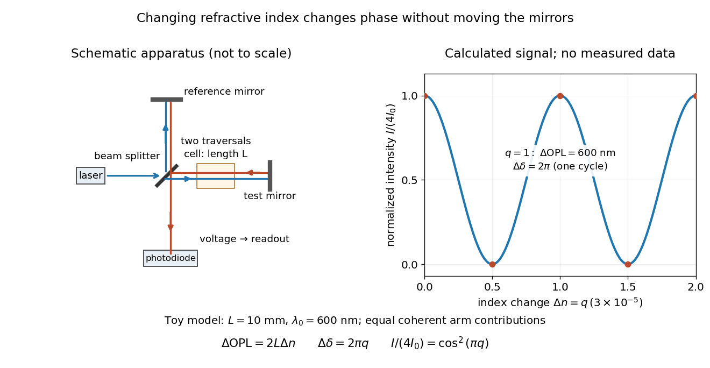

**[Figure 8](#optical-path-michelson-phase-readout). Optical path difference in a Michelson interferometer: apparatus schematic and a calculated phase difference readout**.

A motivating measurement turns invisible optical oscillations into a slowly changing electrical signal. MIT's teaching experiment uses a [laser](laser.md), a [beam splitter](optical-instrument.md#beam-splitter), two returning mirrors, an amplified [photodiode](optical-instrument.md#photodiode), an oscilloscope and a calibrated mirror actuator driven by a function generator. The returning beams overlap on the [photodiode](optical-instrument.md#photodiode); one channel records detector voltage and another the actuator drive. The measured observable is the changing [light intensity](wave.md#light-intensity), including its maxima and minima, rather than direct timing of an optical cycle. A calibrated displacement per drive voltage and the spacing of the extrema relate geometric motion to the [phase difference](wave.md#phase-difference). The guide infers the [laser](laser.md) [wavelength](wave-equation.md#wavelength) from known actuator calibration; conversely, with independently known [vacuum](physics.md#vacuum) [wavelength](wave-equation.md#wavelength) and ambient [refractive index](electromagnetic-wave.md#refractive-index), the same relation calibrates mirror motion. These two unknowns cannot both be inferred from fringe spacing alone. [Optical Interferometry](physics-bibliography.md#mit-8-13-14-experimental-physics-i-and-ii-junior-lab-fall-2016-spring-2017-by-mit-department-of-physics/optical-interferometry)

For a proposed change-of-medium measurement, keep the mirrors fixed and put a transparent cell of internal length $L$ in one arm. Compare its contents at [refractive indices](electromagnetic-wave.md#refractive-index) $n_a$ and $n_b$, leaving its windows in place. At normal incidence the two traversals give

$$
\Delta\operatorname{OPL}=2L(n_b-n_a),\qquad
\Delta\delta=\frac{4\pi L(n_b-n_a)}{\lambda_0},\qquad
N=\frac{\Delta\delta}{2\pi}=\frac{2L(n_b-n_a)}{\lambda_0}.
$$

Here $N$ is the signed number of whole [interference fringe](#interference-fringe) cycles plus any resolved fractional cycle, counted continuously. A mirror displacement $x$ instead gives $\Delta\operatorname{OPL}=2n_{\mathrm{amb}}x$; distinguish this double-pass factor from a single pass in a [Mach-Zehnder interferometer](optical-instrument.md#mach-zehnder-interferometer). OpenStax's gas-cell worked example provides the same double-pass reasoning; it is a teaching calculation rather than a published measurement dataset.[Example 3.6: mirror displacement and a gas cell](physics-bibliography.md#university-physics-volume-3-by-samuel-j-ling-and-others/3-5-the-michelson-interferometer)

An exact toy calculation makes the sensitivity visible. Stipulate $\lambda_0=600\,\mathrm{nm}$, $L=10\,\mathrm{mm}$ and $n_b-n_a=3/100000=0.00003$. Then $\Delta\operatorname{OPL}=600\,\mathrm{nm}$ and $\Delta\delta=2\pi$: a full [interference fringe](#interference-fringe) cycle, despite unchanged geometric lengths. For a continuous change $n_b-n_a=q(3/100000)$, let $0\leq q\leq2$ and choose the initial detector [phase difference](wave.md#phase-difference) to be zero. Equal coherent detected arm contributions of [light intensity](wave.md#light-intensity) $I_0$ predict

$$
\frac{I(q)}{4I_0}=\frac{1+\cos(2\pi q)}{2}=\cos^2(\pi q).
$$

The plot is this stipulated model: $q=1/2$ gives a minimum, $q=1$ restores a maximum, and the reference level is chosen by adjustment of the apparatus. It contains no measured values or assigned properties of a real gas. The equivalent mirror travel in [vacuum](physics.md#vacuum) is $300\,\mathrm{nm}$ per cycle. A single endpoint [light intensity](wave.md#light-intensity) cannot distinguish $q=0$ from $q=1$; the continuous fringe count carries the missing information.

For an interpretable cell measurement, establish the initial [phase difference](wave.md#phase-difference) with a small calibrated mirror scan, then track slow changes through successive [interference fringes](#interference-fringe). Measure the dark signal and each arm separately, keep [photodiode](optical-instrument.md#photodiode) gain within its linear range, align both beams on the same region and match their [linear polarizations](electromagnetic-wave.md#linear-polarization). Monitor [interferometric visibility](#interferometric-visibility) and keep arm delays within the useful [optical coherence time](#optical-coherence-time). Record cell length, contents, [pressure](pressure.md) and [temperature](temperature.md); return to the starting condition to check drift. Changes in window deformation, cell length, external air or mirror position also change [optical path length](#optical-path-length), so a reference cell or an independently monitored mechanical path is needed to isolate the contents' [refractive index](electromagnetic-wave.md#refractive-index). These controls are deductions from the model, not a claim that the illustrated apparatus was operated. Loss of fringe count leaves a whole-cycle ambiguity; at an intensity extremum the first [derivative](calculus.md#derivative) with respect to [phase difference](wave.md#phase-difference) vanishes, so a scan around [phase quadrature](wave.md#phase-quadrature) is more sensitive to small changes. Broadband illumination, unstable [optical coherence](#optical-coherence), vibration and strong loss can invalidate a simple one-[frequency](wave.md#frequency) inference.

#### Optical path difference

↑ **Parent:** [Optical path length](#optical-path-length)

An [optical path difference](#optical-path-difference) subtracts two [optical path lengths](#optical-path-length) at the same [frequency](wave.md#frequency) and with specified endpoints and sign. Its [phase difference](wave.md#phase-difference) contribution is $k_0h$, in addition to any apparatus reference [wave phase](wave.md#phase-waves). For [wavefront error](#wavefront-error), the comparison is usually between an actual [wavefront](#wavefront) and an ideal reference [wavefront](#wavefront).

##### Full-cycle phase-plate invisibility

↑ **Parent:** [Optical path difference](#optical-path-difference)

In a monochromatic two-path interferometer, an ideal [phase plate](optical-instrument.md#phase-plate) of thickness $t$ and [refractive index](electromagnetic-wave.md#refractive-index) $n$ adds [phase](wave.md#phase-waves) $2\pi(n-1)t/\lambda$ at normal incidence. The [interference](#interference-wave-propagation) pattern is unchanged when $(n-1)t=m\lambda$ for integer $m$, provided transmitted [amplitudes](wave.md#wave-amplitude) and alignment are unchanged. Calling the smallest index requires specifying the admissible range; $n>1$ excludes the optically null $n=1$ solution.

#### Group refractive index

↑ **Parent:** [Optical path length](#optical-path-length)

The [group refractive index](#group-refractive-index) is $n_g=c/v_g$ for a transparent [isotropic](continuum-mechanics.md#isotropy) propagation branch with forward [group velocity](dispersion-relation.md#group-velocity) $v_g=d\omega/dk>0$. Differentiating the local [wavenumber](wave-equation.md#wavenumber) $k=n(\omega)\omega/c$ gives

$$
n_g=n+\omega\frac{\partial n}{\partial\omega}=n-\lambda_0\frac{\partial n}{\partial\lambda_0},\qquad
\tau_g=\frac{\partial\phi_{\mathrm{prop}}}{\partial\omega}=\frac1c\int_\gamma n_g(\mathbf r,\omega)\,ds.
$$

The last formula gives the propagation [group delay](#group-delay) along a path whose geometry is fixed as [frequency](wave.md#frequency) varies; additional apparatus [wave phases](wave.md#phase-waves) require their own [frequency](wave.md#frequency) derivatives. For a narrow [wave packet](dispersion-relation.md#wave-packet) with little loss and negligible reshaping, it approximates the transit of its [wave envelope](dispersion-relation.md#envelope-waves). In the nondispersive case $\partial_\omega n=0$, it reduces to $\operatorname{OPL}/c$. An [optical path length](#optical-path-length) at one [frequency](wave.md#frequency) contains no information about $\partial_\omega n$, so in a medium with [optical dispersion](geometrical-optics.md#dispersion-optics) it cannot by itself determine the [group delay](#group-delay). [Group Index](physics-bibliography.md#rp-photonics-encyclopedia-by-rudiger-paschotta/group-index)

For an original local model near $\omega_*$, choose two equal geometric paths of length $L$, with $n_A(\omega)=3/2$ and $n_B(\omega)=3/2+(\omega-\omega_*)/(10\omega_*)$. At $\omega_*$ both [optical path lengths](#optical-path-length) equal $3L/2$, and matched launch and interface references give equal carrier [wave phases](wave.md#phase-waves). But $n_{g,A}=3/2$ and $n_{g,B}=8/5$, so their [group delays](#group-delay) differ by $L/(10c)$. This local stipulated model is a counterexample to identifying equal [wave phase](wave.md#phase-waves) with equal pulse arrival; it asserts no material response outside the narrow band considered. Strong loss or pulse reshaping requires a fuller propagation model, and [group delay](#group-delay) need not time the earliest causal response.

##### Group index from refracted-angle dispersion

↑ **Parent:** [Group refractive index](#group-refractive-index)

For vacuum incidence at fixed angle $\theta_i$ into a transparent [isotropic](continuum-mechanics.md#isotropy) medium, [Snell's law](partial-differential-equation.md#snell-s-law) gives $n(\lambda_0)=\sin\theta_i/\sin\theta_t(\lambda_0)$. Thus $dn/d\lambda_0=-n\cot\theta_t\,d\theta_t/d\lambda_0$, and

$$
n_g=n\left[1+\lambda_0\cot\theta_t\frac{d\theta_t}{d\lambda_0}\right],\qquad v_g=c/n_g.
$$

Angles must be differentiated in radians. This determines the local [group velocity](dispersion-relation.md#group-velocity) from a first derivative of measured refraction angles; pulse broadening needs further information about [group velocity dispersion](dispersion-relation.md#group-velocity-dispersion) and absorption.

##### Group delay

↑ **Parent:** [Group refractive index](#group-refractive-index)

The [group delay](#group-delay) is the [frequency](wave.md#frequency) derivative of an unwrapped transfer [wave phase](wave.md#phase-waves), using the $e^{-i\omega t}$ convention. It predicts the leading delay of a narrow [wave envelope](dispersion-relation.md#envelope-waves) when the transfer [wave amplitude](wave.md#wave-amplitude) and the delay vary little across its band; it is not generally a signal-front arrival time.

###### Group delay dispersion

↑ **Parent:** [Group delay](#group-delay)

The second [derivative](calculus.md#derivative) of [spectral phase](#spectral-phase) with respect to [angular frequency](lagrangian-mechanics.md#angular-frequency); it measures variation of [group delay](#group-delay) with [angular frequency](lagrangian-mechanics.md#angular-frequency).

###### Third-order dispersion

↑ **Parent:** [Group delay dispersion](#group-delay-dispersion)

The cubic term in a component's [spectral phase](#spectral-phase), conventionally written $\phi_3\Omega^3/6$, where $\Omega$ is an [angular frequency](lagrangian-mechanics.md#angular-frequency) offset.

### Wavefront error

↑ **Parent:** [Wavefront](#wavefront)

A wavefront error is the difference in [optical path length](#optical-path-length) from a reference wavefront, often an ideal plane or sphere. Its [root mean square](analysis.md#root-mean-square) should specify the illuminated pupil and which modes, such as constant phase or image displacement, have been removed.

#### Modal amplitude norm versus wavefront RMS

↑ **Parent:** [Wavefront error](#wavefront-error)

For a real [wavefront error](#wavefront-error) $h=\sum_k a_k s_k$, its squared spatial [root mean square](analysis.md#root-mean-square) is $\langle h^2\rangle=\sum_{k,l}a_ka_l\langle s_ks_l\rangle$. Orthogonal unit-peak [sine](geometry-and-topology.md#sine) modes have mean square $1/2$, so $h_{\rm rms}^2=\frac12\sum_k a_k^2$, whereas the coefficient norm is $\sqrt{\sum_k a_k^2}$. On a finite [optical pupil](optics.md#optical-pupil) [orthogonality](inner-product.md#orthogonal-vectors) needs checking; independent uniform random [wave phases](wave.md#phase-waves) give the same $1/2$ diagonal after [wave phase](wave.md#phase-waves) averaging. This normalization matters when a [speckle contrast of a sinusoidal wavefront error](#speckle-contrast-of-a-sinusoidal-wavefront-error) is specified by peak [wave amplitude](wave.md#wave-amplitude).

## Interference (wave propagation)

↑ **Parent:** [Physical optics](physical-optics.md)  
ⓦ [Wiki](https://en.wikipedia.org/wiki/Interference_(wave_propagation))

[Wave interference](#interference-wave-propagation) is the reinforcement or cancellation that occurs when overlapping [wave amplitudes](wave.md#wave-amplitude) add by the [superposition principle](vector-space.md#superposition-principle). For two [monochromatic waves](wave.md#monochromatic-wave) of the same [frequency](wave.md#frequency), mutual [optical coherence](#optical-coherence) means that their relative [wave phase](wave.md#phase-waves) is stable during the observation. Equal [wave phases](wave.md#phase-waves) give [constructive interference](fourier-analysis.md#constructive-interference); a half-cycle [phase difference](wave.md#phase-difference) gives the [destructive interference intensity](#destructive-interference-intensity) minimum. [Wave amplitudes](wave.md#wave-amplitude) add before their squares determine [wave intensity](wave.md#intensity-physics). [Ling, Sanny and Moebs, University Physics Volume 3, §3.1: coherent waves and interference](https://openstax.org/books/university-physics-volume-3/pages/3-1-youngs-double-slit-interference).

Consider two overlapping beams in a homogeneous medium, with the same [polarization of an electromagnetic wave](electromagnetic-wave.md#polarization-of-an-electromagnetic-wave) and individual local time-averaged [light intensities](wave.md#light-intensity) $I_1,I_2$. Their [phase difference](wave.md#phase-difference) $\delta$ is measured in [radians](geometry-and-topology.md#radian). In the scalar detection convention, the combined local time-averaged [wave intensity](wave.md#intensity-physics) is

$$
I=I_1+I_2+2\sqrt{I_1I_2}\cos\delta.
$$

The last term records [wave interference](#interference-wave-propagation); adding $I_1+I_2$ alone misses it. The formula describes [irradiance](radiometry.md#irradiance) when both fields propagate along the same direction, or when the same detector geometry factor is included in all three intensities. For crossing beams it describes the squared [electric field](electric-field.md) response, proportional to [scalar wave intensity](wave.md#scalar-wave-intensity); a specified component of the [Poynting vector](electromagnetic-wave.md#poynting-vector) also requires the propagation geometry. The ideal crossing [plane waves](wave-function.md#plane-wave) below make that distinction explicit.

For equal individual [light intensities](wave.md#light-intensity) $I_1=I_2=I_0>0$, the [cosine](geometry-and-topology.md#cosine) half-angle identity gives

$$
I=2I_0(1+\cos\delta)=4I_0\cos^2(\delta/2).
$$

The [constructive interference intensity](#constructive-interference-intensity) is $4I_0$ at $\delta=0$ modulo $2\pi$, and the [destructive interference intensity](#destructive-interference-intensity) is zero at $\delta=\pi$ modulo $2\pi$. At [phase quadrature](wave.md#phase-quadrature), $\delta=\pi/2$, it is $2I_0$. With $I_1=1$ and $I_2=0.25$ in the same arbitrary [wave intensity](wave.md#intensity-physics) unit, the maximum is $2.25$, the minimum is $0.25$, and the [phase quadrature](wave.md#phase-quadrature) value is $1.25$: unequal [wave amplitudes](wave.md#wave-amplitude) cannot cancel completely.

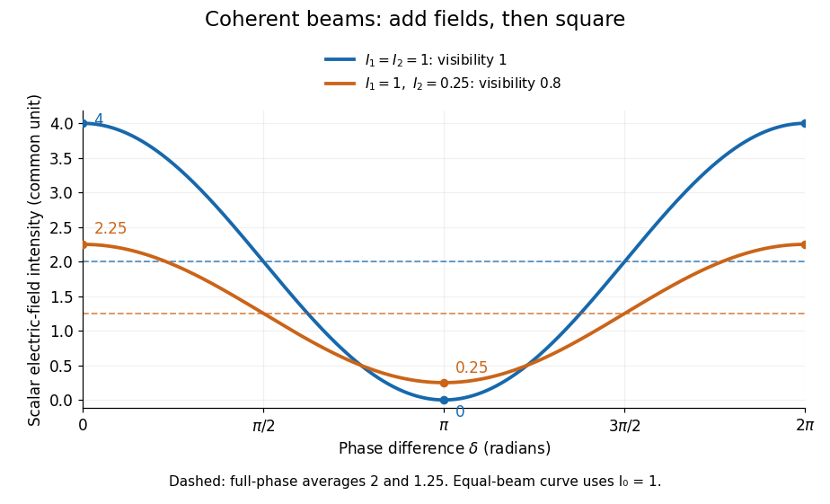

**[Figure 9](#image-two-beam-wave-intensity-versus-phase-difference-equal-beams-reach-4-and-0-unequal-beams-reach-2-25-and-0-25). Two-beam wave intensity versus phase difference: equal beams reach 4 and 0; unequal beams reach 2.25 and 0.25**.

Both curves use the same [wave intensity](wave.md#intensity-physics) unit and a horizontal [angle](geometry-and-topology.md#angle) in [radians](geometry-and-topology.md#radian). The dashed levels are the averages over a full [phase difference](wave.md#phase-difference) cycle. Equal beams have [interferometric visibility](#interferometric-visibility) one; the unequal example has [interferometric visibility](#interferometric-visibility) $0.8$.

A spatially varying [phase difference](wave.md#phase-difference) turns the same law into [interference fringes](#interference-fringe). Take two ideal [plane electromagnetic waves](electromagnetic-wave.md#plane-electromagnetic-wave) with common [wavelength](wave-equation.md#wavelength) $\lambda$, equal individual [light intensities](wave.md#light-intensity) $I_0$, and propagation directions at [angles](geometry-and-topology.md#angle) $+\theta$ and $-\theta$ from the $z$ axis in the $xz$ plane, with $0<\theta<\pi/2$. Both have [linear polarization](electromagnetic-wave.md#linear-polarization) along $y$, perpendicular to both propagation directions. Choose equal initial [wave phases](wave.md#phase-waves); their [wavevectors](elasticity-physics.md#wavevector) and [phase difference](wave.md#phase-difference) are

$$
\mathbf k_\pm=k(\pm\sin\theta,0,\cos\theta),\qquad k=\frac{2\pi}{\lambda},\qquad
\phi_\pm=\pm kx\sin\theta+kz\cos\theta-\omega t,\qquad
\delta=\phi_+-\phi_-=2kx\sin\theta.
$$

Here $k$ is the [wavenumber](wave-equation.md#wavenumber) and $\omega$ the [angular frequency](lagrangian-mechanics.md#angular-frequency). The common $z$ and time terms cancel, so the [interference fringes](#interference-fringe) stay at fixed $x$ for every $z$. Their [interference fringe spacing](#interference-fringe-spacing) is

$$
\Lambda=\frac{2\pi}{2k\sin\theta}=\frac{\lambda}{2\sin\theta},\qquad
\frac{I(x,z)}{I_0}=4\cos^2(kx\sin\theta).
$$

Set the length unit to $\lambda$, so that $\lambda=1$, and take $\theta=30^\circ=\pi/6$: then $\Lambda=1$. The [constructive interference intensity](#constructive-interference-intensity) bands lie at integer $x/\lambda$; the [destructive interference intensity](#destructive-interference-intensity) bands lie at half-integer $x/\lambda$.

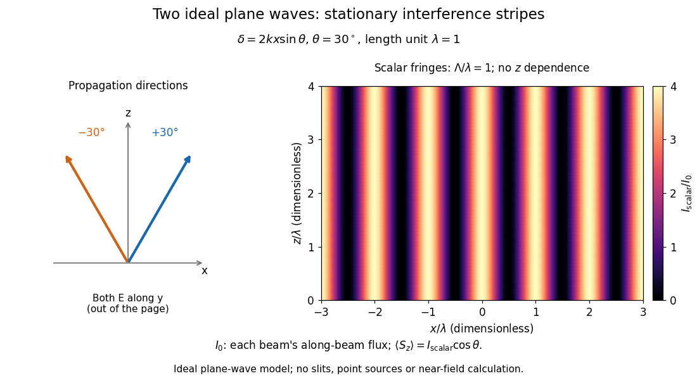

**[Figure 10](#image-ideal-crossing-plane-waves-at-pm30-circ-stationary-interference-fringes-with-spacing-one-wavelength). Ideal crossing plane waves at $\pm30^\circ$: stationary interference fringes with spacing one wavelength**.

The grid covers $-3\leq x/\lambda\leq3$ and $0\leq z/\lambda\leq4$; both axes are dimensionless lengths in [wavelength](wave-equation.md#wavelength) units. The colour scale is $I/I_0$ from zero to four, using the same single-beam normalization as the equal-beam curve above. This is an ideal [plane wave](wave-function.md#plane-wave) superposition, with no slits or point sources and no near-field approximation. For these $y$-polarized [plane electromagnetic waves](electromagnetic-wave.md#plane-electromagnetic-wave) in [vacuum](physics.md#vacuum), the longitudinal time-averaged [Poynting vector](electromagnetic-wave.md#poynting-vector) obeys $\langle S_z\rangle=I\cos\theta$; the plotted scalar $I$ therefore differs from the [irradiance](radiometry.md#irradiance) through a plane normal to $z$ by that common factor. This relation follows by adding the [magnetic fields](magnetic-field.md) as well as the [electric fields](electric-field.md).

The bright peaks do not create [energy](energy.md). Averaging over one [interference fringe spacing](#interference-fringe-spacing), or equivalently over one full [phase difference](wave.md#phase-difference) cycle, gives

$$
\frac1{2\pi}\int_0^{2\pi}I(\delta)\,d\delta=I_1+I_2,
$$

because the [integral](integral.md) of the [cosine](geometry-and-topology.md#cosine) is zero, with [sine](geometry-and-topology.md#sine) as its [antiderivative](integral.md#antiderivative). Equal beams thus average to $2I_0$, despite bright bands at $4I_0$. For the crossing-wave geometry, the average longitudinal [energy flux](mathematical-physics.md#energy-flux) is correspondingly $2I_0\cos\theta$. Bright and dark regions redistribute the incoming [energy](energy.md); [conservation of energy](mathematical-physics.md#conservation-of-energy) concerns the full [energy flux](mathematical-physics.md#energy-flux), rather than the height of one peak.

[Wave interference](#interference-wave-propagation) is useful because [phase differences](wave.md#phase-difference) convert small changes in [optical path length](#optical-path-length) into measurable changes of [wave intensity](wave.md#intensity-physics), as in a [Mach-Zehnder interferometer](optical-instrument.md#mach-zehnder-interferometer). Its beauty is that the same [superposition principle](vector-space.md#superposition-principle) produces both complete cancellation and fourfold brightening; adding more coherent contributions also produces the narrow peaks of a [diffraction grating](#diffraction-grating). Feynman's treatment connects this many-source pattern directly to addition of [complex amplitudes](wave.md#complex-amplitude). [Feynman, Leighton and Sands, The Feynman Lectures on Physics, I §30–1: the resultant amplitude of identical oscillators](https://www.feynmanlectures.caltech.edu/I_30.html#Ch30-S1).

A short proof outline uses local real fields $E_j(t)=A_j\cos(\omega t+\phi_j)$ with parallel [linear polarizations](electromagnetic-wave.md#linear-polarization). Write $I=C\langle(E_1+E_2)^2\rangle_t$ and $I_j=CA_j^2/2$ for the same positive conversion factor $C$. Averaging over many [wave periods](wave.md#wave-period) while the [phase difference](wave.md#phase-difference) stays fixed uses $\langle\cos^2(\omega t+\phi_j)\rangle_t=1/2$ and $\langle\cos(\omega t+\phi_1)\cos(\omega t+\phi_2)\rangle_t=\cos\delta/2$, giving the stated law. Equivalently, add the [complex amplitudes](wave.md#complex-amplitude) and take the squared [complex modulus](complex-analysis.md#complex-modulus). [Feynman, Leighton and Sands, The Feynman Lectures on Physics, I §29–5: the mathematics of interference](https://www.feynmanlectures.caltech.edu/I_29.html#Ch29-S5).

For different fixed [linear polarizations](electromagnetic-wave.md#linear-polarization) in a common transverse plane, the cross term acquires the [dot product](inner-product.md#dot-product) of their real [unit vectors](vector-space.md#unit-vector), equal to $\cos\alpha$ for relative [angle](geometry-and-topology.md#angle) $\alpha$. Orthogonal [linear polarizations](electromagnetic-wave.md#linear-polarization) remove the cross term in polarization-insensitive scalar detection; different orientations generally only reduce it. A common [polarizer](electromagnetic-wave.md#polarizer) can select overlapping components and recover [wave interference](#interference-wave-propagation). Likewise, rapid random variation of the [phase difference](wave.md#phase-difference) removes the observed cross term only when the detector's time average has $\langle e^{i\delta(t)}\rangle_t=0$. Slowly varying [wave phases](wave.md#phase-waves) can instead move resolved [interference fringes](#interference-fringe), and biased or incompletely sampled [wave phases](wave.md#phase-waves) can leave residual contrast. Finite [optical coherence](#optical-coherence) therefore depends on the observation time as well as the fields.

### Interferometry

↑ **Parent:** [Interference (wave propagation)](#interference-wave-propagation)  
ⓦ [Wiki](https://en.wikipedia.org/wiki/Interferometry)

Measurement using [wave interference](#interference-wave-propagation): relative path or phase changes are inferred from the resulting signal. The interacting fields must have sufficient [optical coherence](#optical-coherence) in the measured modes for the intended interference signal.

#### Optical interferometry

↑ **Parent:** [Interferometry](#interferometry)

Measurement using interfering [light](optics.md#light) fields. A [phase difference](wave.md#phase-difference) changes the detected [intensity](wave.md#intensity-physics), allowing measurements of displacement, [optical path length](#optical-path-length) or a spectrum. The [round-trip phase in a Michelson interferometer](#round-trip-phase-in-a-michelson-interferometer) gives one explicit path-to-phase calibration; [Fourier transform spectroscopy](optical-instrument.md#fourier-transform-spectroscopy) recovers spectral information from an interferogram.

##### Atmospheric piston in interferometry

↑ **Parent:** [Optical interferometry](#optical-interferometry)

A nearly uniform wavefront phase over one collector is called its piston. Differential atmospheric piston changes the pairwise optical phase without requiring a change in the source. Delay tracking and [closure phase](#closure-phase) address different consequences of this phase error; [intensity](wave.md#intensity-physics) correlations are unchanged by an ideal pure phase multiplication at either detector.

##### Fringe tracking

↑ **Parent:** [Optical interferometry](#optical-interferometry)

[fringe tracking](#fringe-tracking) estimates changing optical delay or phase and adjusts delay compensation to keep an [astronomical interferometer](#astronomical-interferometer) near a useful interference condition. The delay must first lie inside the finite-bandwidth coherence envelope; rapid tracking then controls atmospheric piston. This is optical-path stabilization, with sensitivity and reference-source limitations.

<h3 id="moire-pattern">Moiré pattern</h3>

↑ **Parent:** [Interference (wave propagation)](#interference-wave-propagation)  
ⓦ [Wiki](https://en.wikipedia.org/wiki/Moiré_pattern)

A [Moiré pattern](#moire-pattern) is a large-scale modulation produced by superposing similar periodic structures. Two identical two-dimensional lattices rotated by a small angle $\theta$ have geometric period $L=a/[2\sin(\theta/2)]\simeq a/|\theta|$ in the usual matching geometry. In layered crystals this modulation can act as an electronic [superlattice](bloch-s-theorem.md#superlattice); the actual bands additionally depend on interlayer coupling and orbital structure.

<h4 id="moire-fringe">Moiré fringe</h4>

↑ **Parent:** [Moiré pattern](#moire-pattern)

A slow spatial modulation produced by overlapping periodic structures with different projected spatial frequencies or orientations. Its spacing need not equal an atomic lattice spacing.

<h5 id="moire-fringe-spacing-formula">Moiré fringe spacing formula</h5>

↑ **Parent:** [Moiré fringe](#moire-fringe)

Subtract the phases $2\pi\mathbf g_1\cdot\mathbf r$ and $2\pi\mathbf g_2\cdot\mathbf r$ of two projected periodic structures. Their relative phase repeats along the difference vector after distance $D=1/|\mathbf g_1-\mathbf g_2|$. For magnitudes $1/d_1$ and $1/d_2$ separated by angle $\theta$, this gives $D=d_1d_2/\sqrt{d_1^2+d_2^2-2d_1d_2\cos\theta}$. At zero rotation it reduces to $d_1d_2/|d_1-d_2|$; equal spacings give $d/[2|\sin(\theta/2)|]$. Finite specimen extent limits how many periods can be observed.

### Destructive interference

↑ **Parent:** [Interference (wave propagation)](#interference-wave-propagation)

[Destructive interference](#destructive-interference) occurs when coherent contributions partially or completely cancel their [complex amplitudes](wave.md#complex-amplitude). For two equal contributions, a [phase difference](wave.md#phase-difference) of $\pi$ modulo $2\pi$ gives zero resultant [wave amplitude](wave.md#wave-amplitude). The missing local [light intensity](wave.md#light-intensity) is consistent with [conservation of energy](mathematical-physics.md#conservation-of-energy) because the full spatial [interference](#interference-wave-propagation) pattern redistributes [power](energy.md#power).

### Thin-film interference

↑ **Parent:** [Interference (wave propagation)](#interference-wave-propagation)  
ⓦ [Wiki](https://en.wikipedia.org/wiki/Thin-film_interference)

[Thin-film interference](#thin-film-interference) combines coherent [light](optics.md#light) contributions reflected or transmitted at the two surfaces of a layer. For a film of [refractive index](electromagnetic-wave.md#refractive-index) $n$, thickness $d$ and internal angle $\theta_t$, the round-trip [optical path difference](#optical-path-difference) is $2nd\cos\theta_t$. The relative reflection [phase shift](wave.md#phase-shift) must also be included. For a nonabsorbing higher-index film surrounded by air, one of the two leading reflected contributions has a $\pi$ [phase shift](wave.md#phase-shift) and the other does not. Reflection maxima therefore satisfy $2nd\cos\theta_t=(m+1/2)\lambda_0$. A smooth reflection spectrum filters many visible [wavelengths](wave-equation.md#wavelength) at once; varying thickness and angle produce spatially varying mixed colours.

#### Adjacent reflected minima of an air-film-air layer

↑ **Parent:** [Thin-film interference](#thin-film-interference)

With one reflection phase reversal and near-normal incidence, reflected minima satisfy $2nt=m\lambda$. Subtracting the reciprocal-wavelength conditions for consecutive minima gives the displayed thickness relation. A single maximum between two stated minima identifies the consecutive-order case. Wavelength-dependent refractive index or non-air surroundings can change the inference.

#### Antireflection coating

↑ **Parent:** [Thin-film interference](#thin-film-interference)

An optical coating designed to reduce reflection through refractive-index choice and [thin-film interference](#thin-film-interference). A quarter-wave design is a single-wavelength approximation, not broadband perfection.

##### Spectral colour of an antireflection coating

↑ **Parent:** [Antireflection coating](#antireflection-coating)

A thin-film design that suppresses reflected green light more strongly than red and blue can leave a purple residual [reflection](linear-algebra.md#reflection-mathematics). A single quarter-wave layer cancels [reflections](linear-algebra.md#reflection-mathematics) exactly only at its design [wavelength](wave-equation.md#wavelength) and angle under the ideal index-matching condition. [reflection](linear-algebra.md#reflection-mathematics) colour should be distinguished from the much smaller colour change of the transmitted beam; multilayer designs can broaden the low-reflectance band.

#### Angular fringe spacing of a transparent film

↑ **Parent:** [Thin-film interference](#thin-film-interference)

For a film of [refractive index](electromagnetic-wave.md#refractive-index) $n$ and thickness $d$ in air, its round-trip propagation [phase](wave.md#phase-waves) is $\delta=(4\pi d/\lambda_0)\sqrt{n^2-\sin^2\theta_i}$. Two neighbouring same-type [interference fringes](#interference-fringe) differ by $2\pi$. At small angular spacing in radians,

$$
\Delta\theta_i\simeq\frac{\lambda_0\sqrt{n^2-\sin^2\theta_i}}{2d\sin\theta_i\cos\theta_i}
=\frac{\lambda_0 n\cos\theta}{2d\sin\theta_i\cos\theta_i}.
$$

The relation assumes slowly varying interface [reflection coefficients](partial-differential-equation.md#reflection-coefficient) and no rapidly varying reflection phase. At normal incidence the first derivative vanishes, so a local linear angular-spacing formula must be replaced by a quadratic expansion.

<h4 id="newton-s-rings">Newton's rings</h4>

↑ **Parent:** [Thin-film interference](#thin-film-interference)

A curved transparent surface resting on a plane traps a thin film whose thickness increases radially, producing circular [interference fringes](#interference-fringe). For near-normal reflected [light](optics.md#light) and one relative $\pi$ reflection [wave phase](wave.md#phase-waves) change, contact is dark and bright rings obey $2nt=(m+1/2)\lambda_0$ for $m=0,1,\ldots$. Here $n$ is the film's [refractive index](electromagnetic-wave.md#refractive-index) and $\lambda_0$ the vacuum [wavelength](wave-equation.md#wavelength). For spherical curvature radius $R$, $t\simeq r^2/(2R)$ gives $r_m^2=R\lambda_0(m+1/2)/n$. Consequently $D_{m+s}^2-D_m^2=4sR\lambda_0/n$ for ring diameters $D_m=2r_m$. A contact gap, altered reflection phase, or significant oblique incidence changes the formula.

### Double-slit experiment

↑ **Parent:** [Interference (wave propagation)](#interference-wave-propagation)  
ⓦ [Wiki](https://en.wikipedia.org/wiki/Double-slit_experiment)

The [double-slit experiment](#double-slit-experiment) compares propagation through two openings. Coherent illumination gives [double-slit interference](#double-slit-interference); independent incoherent source patches contribute [light intensities](wave.md#light-intensity) whose displaced patterns can reduce the observed [interferometric visibility](#interferometric-visibility).

#### Incidence-independent adjacent-fringe wavelength

↑ **Parent:** [Double-slit experiment](#double-slit-experiment)

In oblique-incidence two-slit interference, the incident wave contributes a constant phase offset while changing observation angle changes the outgoing [optical path difference](#optical-path-difference) by $a\Delta\sin\theta$. Subtracting the phase conditions of an adjacent minimum and maximum cancels the unknown incidence angle and order and gives the displayed wavelength. Nonadjacent extrema need their intervening phase-order difference; angular spacing should not be replaced by a small-angle formula unless justified.

##### Unknown incidence offset in double-slit phase

↑ **Parent:** [Incidence-independent adjacent-fringe wavelength](#incidence-independent-adjacent-fringe-wavelength)

#### Single-electron interference pattern buildup

↑ **Parent:** [Double-slit experiment](#double-slit-experiment)

A sequence of individual localized [electron](physics.md#electron) detections can accumulate a two-path [interference](#interference-wave-propagation) distribution when the apparatus maintains coherence. The 1989 experiment led by [Akira Tonomura](physicist.md#akira-tonomura) used a field-emission source, an [electron](physics.md#electron) biprism, [electron](physics.md#electron) lenses and a position-sensitive [electron](physics.md#electron) counter. It realized two coherent paths without literal machined double slits. Low occupation of the instrument excludes interactions between different [electrons](physics.md#electron) as the origin of the fringes.[section III and conclusion](physics-bibliography.md#demonstration-of-single-electron-buildup-of-an-interference-pattern-by-akira-tonomura-and-others)

#### Double-slit interference

↑ **Parent:** [Double-slit experiment](#double-slit-experiment)

[Double-slit interference](#double-slit-interference) depends on the relative [wave phase](wave.md#phase-waves) and [first-order optical coherence](#first-order-optical-coherence) of two collected fields. For equal separately measured intensities, the [interferometric visibility](#interferometric-visibility) is $|\gamma_{12}|$. A small source direction change $\vartheta_x$ introduces [phase difference](wave.md#phase-difference) $2\pi D\vartheta_x/\lambda$ for projected [interferometric baseline](astrophysics.md#interferometric-baseline) $D$.

##### Fraunhofer diffraction of unequal slits

↑ **Parent:** [Double-slit interference](#double-slit-interference)

Two equally illuminated slits of different widths have field [amplitudes](wave.md#wave-amplitude) $A_j(\theta)\propto w_j\operatorname{sinc}(\pi w_j\sin\theta/\lambda)$. Their [interference](#interference-wave-propagation) [intensity](wave.md#intensity-physics) is $A_1^2+A_2^2+2A_1A_2\cos(2\pi d\sin\theta/\lambda+\delta)$. Near the centre, $A_2/A_1=w_2/w_1$, so the local maximum-to-minimum ratio is $(w_1+w_2)^2/(w_2-w_1)^2$. At one slit envelope's zero the [interference](#interference-wave-propagation) visibility vanishes even if the other slit still transmits.

###### Fringe-count convention inside a diffraction envelope

↑ **Parent:** [Fraunhofer diffraction of unequal slits](#fraunhofer-diffraction-of-unequal-slits)

The ratio of an envelope width to a fringe period counts spatial intervals. It need not equal the number of bright fringe centres strictly inside the envelope's zeros. For a symmetric overlap from [phase](wave.md#phase-waves) index $-25$ to $25$, the width spans 50 periods, but the strictly interior integer centres are $-24$ through $24$, totaling 49. Endpoints where one aperture [amplitude](wave.md#wave-amplitude) vanishes have no two-beam contrast. State the count convention rather than treating these as inconsistent answers.

##### Phase-reversed double-slit diffraction

↑ **Parent:** [Double-slit interference](#double-slit-interference)

Two equal rectangular apertures of width $a$, centre spacing $D$, and relative [phase](wave.md#phase-waves) $\pi$ have [Fraunhofer diffraction](#fraunhofer-diffraction) amplitude proportional to $2ia\operatorname{sinc}(qa/2)\sin(qD/2)$, with $q=(2\pi/\lambda)\sin\theta$ and $\operatorname{sinc}z=\sin z/z$. Hence

$$
I(\theta)\propto\sin^2(qD/2)\operatorname{sinc}^2(qa/2).
$$

The [interference](#interference-wave-propagation) zeros satisfy $D\sin\theta=m\lambda$, including the central dark fringe. The single-aperture envelope vanishes at $a\sin\theta=n\lambda$ for nonzero integer $n$. A uniform phase reversal translates the narrow-slit fringes by half a fringe without changing their spacing.

###### Half-slit phase-step diffraction factorization

↑ **Parent:** [Phase-reversed double-slit diffraction](#phase-reversed-double-slit-diffraction)

Two adjacent half-slits of width h with opposite field transmission have centres separated by h. The aperture transform is $h\operatorname{sinc}(qh/2)[e^{-iqh/2}-e^{iqh/2}]$. Thus the phase-reversed pair factor multiplies the finite-half-slit envelope, giving the displayed normalized intensity with $s=qh/2$ and $\operatorname{sinc}s=\sin s/s$. The on-axis field cancels. Positive side maxima satisfy $\tan s=2s$, and total integrated transmission is unchanged by a lossless phase plate even though the angular distribution changes.

### Phase matching

↑ **Parent:** [Interference (wave propagation)](#interference-wave-propagation)

A relation between [wave phases](wave.md#phase-waves) that lets contributions from successive interaction regions add coherently. In [Cherenkov radiation](electromagnetic-wave.md#cherenkov-radiation), the condition along the [particle](physics.md#particle-physics) trajectory is $\omega=\mathbf k\cdot\mathbf v$, relating [angular frequency](lagrangian-mechanics.md#angular-frequency), [wave vector](elasticity-physics.md#wavevector) and particle [velocity](classical-mechanics.md#velocity).

#### Type-II phase matching

↑ **Parent:** [Phase matching](#phase-matching)

The daughter [photons](quantum-mechanics.md#photon) occupy orthogonal ordinary and extraordinary polarization classes. Alternative assignments to two collected paths can interfere if timing, spectrum and spatial mode do not distinguish them. [spatial walk-off](optics.md#spatial-walk-off) and unequal group delays often require compensation.

#### Type-I phase matching

↑ **Parent:** [Phase matching](#phase-matching)

In a common birefringent down-conversion arrangement, the two daughter [photons](quantum-mechanics.md#photon) have the same polarization class, ordinarily both ordinary or both extraordinary relative to the crystal. The pump has a suitable different index for [phase matching](#phase-matching). This classification alone does not establish polarization entanglement.

#### Quasi-phase-matching

↑ **Parent:** [Phase matching](#phase-matching)  
ⓦ [Wiki](https://en.wikipedia.org/wiki/Quasi-phase-matching)

Compensation of [phase mismatch](#phase-mismatch) by a spatial modulation of the coupling coefficient. Write $d(z)=\sum_m d_m e^{imKz}$. The driven amplitude contains $e^{i(\Delta k+mK)z}$, so the selected Fourier component accumulates coherently when $\Delta k+mK=0$. For first-order compensation the full spatial period is $2\pi/|\Delta k|$, twice the [nonlinear optical coherence length](#nonlinear-optical-coherence-length).

An ideal equal-duty pattern alternating $+d$ and $-d$ has first Fourier coefficient of magnitude $2d/\pi$. Hence its conversion intensity is $4/\pi^2$ of a uniformly phase-matched crystal using that same coefficient, under the same undepleted plane-wave assumptions. The modulation can nevertheless allow a larger tensor coefficient or an otherwise inaccessible wavelength. [Periodically poled lithium niobate](#periodically-poled-lithium-niobate) implements such sign reversals using ferroelectric domains.

##### Periodically poled lithium niobate

↑ **Parent:** [Quasi-phase-matching](#quasi-phase-matching)

#### Phase mismatch

↑ **Parent:** [Phase matching](#phase-matching)

The residual [wave vector](elasticity-physics.md#wavevector) difference in a wave-conversion process. For collinear [sum-frequency generation](optics.md#sum-frequency-generation), choose $\Delta k=k_1+k_2-k_3$. Contributions separated by $z$ then differ by [wave phase](wave.md#phase-waves) $\Delta kz$. At [phase matching](#phase-matching) this residual is zero. The sign convention changes some amplitude phases but not the unseeded conversion factor $\operatorname{sinc}^2(\Delta kL/2)$.

##### Nonlinear optical coherence length

↑ **Parent:** [Phase mismatch](#phase-mismatch)

The distance over which a constant [phase mismatch](#phase-mismatch) accumulates [phase difference](wave.md#phase-difference) $\pi$. In unseeded, undepleted [sum-frequency generation](optics.md#sum-frequency-generation), the generated [intensity](wave.md#intensity-physics) first reaches a maximum at this length and returns to zero at $2\ell_c$. This length concerns relative phases of interacting waves, rather than the temporal [optical coherence length](#optical-coherence-length) of one source.

### Beat

↑ **Parent:** [Interference (wave propagation)](#interference-wave-propagation)

The slow change in the resultant [amplitude](wave.md#wave-amplitude) when two nearby [frequencies](wave.md#frequency) interfere. Two steady sinusoidal components at $f_1$ and $f_2$ produce successive amplitude maxima separated by $1/|f_1-f_2|$.

#### Two-tone output of a linear resonant circuit

↑ **Parent:** [Beat](#beat)

A linear time-invariant circuit sends each sinusoidal input to an output at the same [frequency](wave.md#frequency), multiplied by its complex transfer function. Two inputs therefore give the sum of two phase-shifted [sinusoids](geometry-and-topology.md#sinusoid). If their output [amplitudes](wave.md#wave-amplitude) are equal, the sum factors into a carrier at the mean [frequency](wave.md#frequency) and a signed cosine envelope at half the [frequency](wave.md#frequency) difference. The envelope magnitude repeats at the full difference [frequency](wave.md#frequency). Unequal [amplitudes](wave.md#wave-amplitude) give a nonzero minimum; a nonlinear detector is needed to generate a separate difference-frequency signal.

### Constructive interference intensity

↑ **Parent:** [Interference (wave propagation)](#interference-wave-propagation)

For mutually coherent [monochromatic waves](wave.md#monochromatic-wave) with the same [polarization of waves](wave.md#polarization-waves) in the scalar convention of [wave interference](#interference-wave-propagation), [constructive interference](fourier-analysis.md#constructive-interference) reaches its maximum at [phase difference](wave.md#phase-difference) $\delta=2\pi m$, with [integer](integer.md) $m$. The [wave amplitudes](wave.md#wave-amplitude) add, giving $I_{\max}=I_1+I_2+2\sqrt{I_1I_2}$. Equal individual [wave intensities](wave.md#intensity-physics) $I_0$ give $4I_0$; individual [wave intensities](wave.md#intensity-physics) $1$ and $0.25$ give $2.25$ in their common unit. This maximum assumes the [optical coherence](#optical-coherence) and detection conditions stated in [wave interference](#interference-wave-propagation).

### Destructive interference intensity

↑ **Parent:** [Interference (wave propagation)](#interference-wave-propagation)

For the same mutually coherent, equally polarized [monochromatic waves](wave.md#monochromatic-wave), the [wave interference](#interference-wave-propagation) minimum occurs at [phase difference](wave.md#phase-difference) $\delta=(2m+1)\pi$, with [integer](integer.md) $m$. The [wave amplitudes](wave.md#wave-amplitude) subtract, giving $I_{\min}=I_1+I_2-2\sqrt{I_1I_2}$. Complete cancellation requires equal individual [wave intensities](wave.md#intensity-physics); $1$ and $0.25$ leave $0.25$ in their common unit. A dark band is a local minimum, and the average across an [interference fringe spacing](#interference-fringe-spacing) still obeys [conservation of energy](mathematical-physics.md#conservation-of-energy).

### Interference fringe

↑ **Parent:** [Interference (wave propagation)](#interference-wave-propagation)

An [interference fringe](#interference-fringe) is a spatial band of enhanced or reduced [wave intensity](wave.md#intensity-physics) caused by a spatially varying [phase difference](wave.md#phase-difference). Uniform crossing [plane waves](wave-function.md#plane-wave) produce straight parallel [interference fringes](#interference-fringe); curved [wavefronts](#wavefront) can give curved bands. The [interference fringes](#interference-fringe) mark the relative [wave phase](wave.md#phase-waves), rather than the individual instantaneous [wavefronts](#wavefront).

#### Fringe shift

↑ **Parent:** [Interference fringe](#interference-fringe)

A [fringe shift](#fringe-shift) measures a change of relative [phase](wave.md#phase-waves) between interfering waves in units of a full fringe spacing. A changing optical path difference $\Delta\ell$ gives a shift $\Delta N=\Delta\ell/\lambda$ for monochromatic [light](optics.md#light).

#### Interference fringe spacing

↑ **Parent:** [Interference fringe](#interference-fringe)

The distance between adjacent bright [interference fringes](#interference-fringe), or between adjacent dark [interference fringes](#interference-fringe), measured along a specified direction. For the symmetric crossing [plane waves](wave-function.md#plane-wave) in [wave interference](#interference-wave-propagation), measured along $x$, $\Lambda=\lambda/(2\sin\theta)$. Bright-to-dark separation is $\Lambda/2$. As $\theta$ tends to zero the spacing diverges; at $\theta=0$ the [phase difference](wave.md#phase-difference) is spatially constant and there are no periodic bands.

### Which-path information

↑ **Parent:** [Interference (wave propagation)](#interference-wave-propagation)

If the two arms have internal marker states $|a\rangle,|b\rangle$, an interference cross term is multiplied by $\langle a|b\rangle$. Orthogonal markers remove interference from polarization-insensitive detection even if nobody reads the markers. Coherently making the two markers identical erases that distinguishing information and restores the cross term.

// Target: quantum-measurement.bigb

### Interferometric visibility

↑ **Parent:** [Interference (wave propagation)](#interference-wave-propagation)  
ⓦ [Wiki](https://en.wikipedia.org/wiki/Interferometric_visibility)

[Interferometric visibility](#interferometric-visibility) measures the contrast of a scanned [interference fringe](#interference-fringe). For the mutually coherent, equally polarized two-beam model in [wave interference](#interference-wave-propagation), with fixed individual [wave intensities](wave.md#intensity-physics) and $I_1+I_2>0$, the [constructive interference intensity](#constructive-interference-intensity) and [destructive interference intensity](#destructive-interference-intensity) give

$$
\mathcal V=\frac{I_{\max}-I_{\min}}{I_{\max}+I_{\min}}=\frac{2\sqrt{I_1I_2}}{I_1+I_2}.
$$

Equal nonzero [wave intensities](wave.md#intensity-physics) give $\mathcal V=1$; $I_1=1,I_2=0.25$ give $\mathcal V=0.8$. Unequal [wave intensities](wave.md#intensity-physics) can therefore reduce [interferometric visibility](#interferometric-visibility) even with perfect mutual [optical coherence](#optical-coherence). Random [phase differences](wave.md#phase-difference) or distinguishable [wave polarizations](wave.md#polarization-waves) can reduce it further; zero contrast alone does not identify the cause. Both intensities zero leave the ratio undefined.

For normalized paths with [complex amplitudes](wave.md#complex-amplitude) $\alpha,\beta$ and identical internal states, the output [probability](probability-theory.md#probability) is $1/2+\operatorname{Re}(\alpha^*\beta e^{i\theta})$, so $\mathcal V=2|\alpha\beta|$. A [photon polarization](quantum-mechanics.md#photon-polarization) fringe alone determines transverse [quantum coherence](density-matrix.md#quantum-coherence-in-a-specified-basis) but not the sign of the population difference.

// Target: optics.bigb

#### Signed coherence and fringe visibility

↑ **Parent:** [Interferometric visibility](#interferometric-visibility)

Combining equal-intensity beams with complex degree of first-order coherence $g$ gives a fringe modulation proportional to $\operatorname{Re}(e^{i\varphi}g)$. Maximizing and minimizing over observation [phase](wave.md#phase-waves) gives visibility $V=|g|$. A symmetric source can make $g$ real, but it may still be negative. Its sign changes fringe [phase](wave.md#phase-waves) by $\pi$; it does not represent negative physical contrast.

## Fraunhofer diffraction

↑ **Parent:** [Physical optics](physical-optics.md)  
ⓦ [Wiki](https://en.wikipedia.org/wiki/Fraunhofer_diffraction)

[Fraunhofer diffraction](#fraunhofer-diffraction) is the far-field approximation for [diffraction](quantum-scattering.md#diffraction): contributions from an [aperture](optics.md#aperture) reach a selected observation direction with approximately linear path-dependent [wave phases](wave.md#phase-waves). Adding their [complex amplitudes](wave.md#complex-amplitude) gives a [Fourier transform](fourier-transform.md) of the field across the [aperture](optics.md#aperture). It also describes the appropriate rear [focal plane](optical-instrument.md#focal-plane) of an ideal [optical lens](geometrical-optics.md#lens-optics) under coherent plane-wave illumination. The [diffraction grating](#diffraction-grating) examples use this regime. [Richard Fitzpatrick, Wave Optics, §10.9: Two-dimensional Fourier optics](physics-bibliography.md#oscillations-and-waves-by-richard-fitzpatrick/two-dimensional-fourier-optics); [MIT 2.71/2.710 Optics, The ideal thin lens as a Fourier transform engine, slides 12–14: back focal plane diffraction](https://web.mit.edu/2.710/Fall06/2.710-wk10-a-sl.pdf).

For a slit of width $a$, [wavelength](wave-equation.md#wavelength) $\lambda$ and screen distance $L$, sufficient conditions near the forward direction are

$$
L\gg a,\qquad L\gg\frac{a^2}{\lambda},\qquad \frac{a^2}{\lambda L}\ll1.
$$

The last two statements are equivalent: the important comparison is with $a^2/\lambda$, rather than just with the slit width. For a finite rectangular [aperture](optics.md#aperture), check the corresponding condition for both transverse dimensions. The [single-slit diffraction](#single-slit-diffraction) calculation treats the transverse cut associated with width $a$. [Richard Fitzpatrick, Wave Optics, §10.10, equations 10.93–10.96: far-field conditions](https://farside.ph.utexas.edu/teaching/315/Waves/node99.html).

A short explanation is that the distance from slit coordinate $x$ to an observation point at distance $R$ and [angle](geometry-and-topology.md#angle) $\theta$ is

$$
r(x)=\sqrt{R^2-2Rx\sin\theta+x^2}=R-x\sin\theta+\frac{x^2\cos^2\theta}{2R}+O(a^3/R^2).
$$

The linear term supplies the [phase difference](wave.md#phase-difference); the quadratic term supplies a [wave phase](wave.md#phase-waves) error of order $a^2/(\lambda R)$, since the [wavenumber](wave-equation.md#wavenumber) is $2\pi/\lambda$. Near the forward direction $R\approx L$, so the stated condition makes this error small. This is why a distant screen permits the simple [single-slit diffraction](#single-slit-diffraction) formula. [Fitzpatrick, §10.9, equations 10.70–10.74: path expansion and aperture superposition](physics-bibliography.md#oscillations-and-waves-by-richard-fitzpatrick/two-dimensional-fourier-optics).

### Whole-aperture Fraunhofer distance of a coherent array

↑ **Parent:** [Fraunhofer diffraction](#fraunhofer-diffraction)

The relevant [aperture](optics.md#aperture) size $b$ spans the entire coherent array, including the separated elements, rather than one element or a single baseline increment. A quadratic propagation-phase error is small only when $b^2/(\lambda R)\ll1$ under the [paraxial approximation](partial-differential-equation.md#paraxial-approximation). The often-used boundary $2b^2/\lambda$ is a convention for an allowed phase error, not a sharp physical transition. Individual-element patterns still supply an angular envelope in the far field.

### Reversing one slit at an array minimum

↑ **Parent:** [Fraunhofer diffraction](#fraunhofer-diffraction)

Let a coherent array of identical narrow slits have total far-field [complex amplitude](wave.md#complex-amplitude) zero at a chosen direction. Reversing one slit's [phase](wave.md#phase-waves) by $\pi$ changes its [amplitude](wave.md#wave-amplitude) from $a_j$ to $-a_j$, so the new total is $-2a_j$. Its [intensity](wave.md#intensity-physics) is four times the single-slit [intensity](wave.md#intensity-physics), independent of which slit was changed. For $N$ equally spaced slits, adjacent [phase](wave.md#phase-waves) step $2\pi m/N$ gives such a zero when $m$ is not a multiple of $N$. A finite slit envelope multiplies the common [intensity](wave.md#intensity-physics) factor.

### Side maximum of a finite-width double-slit pattern

↑ **Parent:** [Fraunhofer diffraction](#fraunhofer-diffraction)

The maxima of the full two-slit intensity need not lie at maxima of its cosine-squared interference factor, because the single-slit envelope has a nonzero slope. Differentiating its logarithm gives $[\pi w/(\lambda L)](\cot u-1/u)=[\pi d/(\lambda L)]\tan v$, where $u=\pi wX/(\lambda L)$ and $v=\pi dX/(\lambda L)$. Solving this equation in the appropriate fringe gives the true maximum. The usual fringe-center estimate is useful when the envelope varies slowly across a fringe.

### Half-slit phase-reversal diffraction

↑ **Parent:** [Fraunhofer diffraction](#fraunhofer-diffraction)

Reversing the phase on one half of an otherwise uniform slit makes its aperture transmission odd. Its Fourier amplitude is $4\sin^2(qb/4)/(iq)$, where $q=k\sin\theta$, so the axis is dark despite the removable denominator singularity. The largest symmetric lobes satisfy $\tan s=2s$, with first positive root approximately $1.16556$. Doubling an ideal half-wave layer restores equal phases and the ordinary bright-centred single-slit pattern. Total transmitted [power](energy.md#power) is conserved if the layer has no absorption or [reflection](linear-algebra.md#reflection-mathematics).

### Rectangular-aperture dimensions from diffraction zeros

↑ **Parent:** [Fraunhofer diffraction](#fraunhofer-diffraction)

A uniformly illuminated rectangle of width $w$ and height $h$ has field proportional to $\operatorname{sinc}(q_xw/2)\operatorname{sinc}(q_yh/2)$, with angular spatial [wavenumbers](wave-equation.md#wavenumber) $q_x,q_y$ measured in inverse length. The first envelope zeros give $w=2\pi/|q_{x,0}|$ and $h=2\pi/|q_{y,0}|$. Two identical rectangles with horizontal centre separation $s$ introduce an additional $\cos(q_xs/2)$ factor, so the interference period is $\Delta q_x=2\pi/s$.

The factors $2\pi$ depend on using angular spatial [frequency](wave.md#frequency); axes in cycles per length would use the reciprocal widths directly. Fourier [light intensity](wave.md#light-intensity) alone cannot determine an overall aperture translation or distinguish a mask from its inverted copy. Extra assumptions about shape and coherent illumination are necessary for a unique geometrical reconstruction.

### Four-slit Fraunhofer diffraction

↑ **Parent:** [Fraunhofer diffraction](#fraunhofer-diffraction)

For four identical long slits of width $a$ centred at $x=\pm D/2,\pm3D/2$, the aperture [Fourier transform](fourier-transform.md) gives

$$
\psi(q)\propto2a\operatorname{sinc}(qa/2)[\cos(qD/2)+\cos(3qD/2)],\qquad
q=\frac{2\pi\sin\theta}{\lambda}.
$$

Here $\operatorname{sinc}x=\sin x/x$. Normalized to the on-axis [light intensity](wave.md#light-intensity),

$$
I(q)/I(0)=\operatorname{sinc}^2(qa/2)\cos^2(qD/2)\cos^2(qD).
$$

Principal array directions have $qD=2\pi m$; a [single-slit diffraction](#single-slit-diffraction) envelope zero cancels such an order when $ma/D$ is a nonzero integer. The closest central array zeros satisfy $qD=\pm\pi/2$. Finite slit width generally shifts the actual maxima of the complete product slightly away from the nominal principal array directions.

### Single-slit diffraction

↑ **Parent:** [Fraunhofer diffraction](#fraunhofer-diffraction)

[Single-slit diffraction](#single-slit-diffraction) is the spreading of [light](optics.md#light) transmitted by one slit. Consider an ideal rectangular slit of width $a$, illuminated normally by a uniform [plane wave](wave-function.md#plane-wave) with a single [wavelength](wave-equation.md#wavelength) $\lambda$ in the surrounding medium. This [monochromatic wave](wave.md#monochromatic-wave) has uniform [wave amplitude](wave.md#wave-amplitude) and equal incident [wave phases](wave.md#phase-waves) across the slit, providing the required [optical coherence](#optical-coherence). In the scalar [Fraunhofer diffraction](#fraunhofer-diffraction) model, the normalized angular [wave intensity](wave.md#intensity-physics) is

$$
\frac{I(\theta)}{I_0}=\left(\frac{\sin u}{u}\right)^2,\qquad u=\frac{\pi a\sin\theta}{\lambda},\qquad I_0=I(0),\qquad \lim_{u\to0}\frac{\sin u}{u}=1.
$$

Here $\theta$ is measured from the forward normal in the plane across the slit width. The [sinc function](fourier-transform.md#sinc-function) uses the unnormalized convention $\operatorname{sinc}u=\sin u/u$. The [limit](calculus.md#limit-of-a-function) makes the central value one. This ideal envelope neglects additional direction-dependent propagation and detector factors; near the forward direction it describes the normalized screen [irradiance](radiometry.md#irradiance). [Ling, Sanny and Moebs, University Physics Volume 3, §4.2: single-slit intensity](https://openstax.org/books/university-physics-volume-3/pages/4-2-intensity-in-single-slit-diffraction).

The noncentral zeros satisfy

$$
a\sin\theta_m=m\lambda,\qquad m\in\mathbb Z\setminus\{0\},\qquad \left|\frac{m\lambda}{a}\right|\leq1.
$$

The restriction follows from the range of the [sine](geometry-and-topology.md#sine) of a real [angle](geometry-and-topology.md#angle). The first minima have $\sin\theta=\pm\lambda/a$ when $\lambda/a\leq1$. If $a<\lambda$, this model has no noncentral zero in the forward hemisphere; equality puts the first zeros at grazing directions, outside the [small-angle approximation](geometry-and-topology.md#small-angle-approximation) and off any finite perpendicular screen. [Ling, Sanny and Moebs, University Physics Volume 3, §4.1: positions of diffraction minima](https://openstax.org/books/university-physics-volume-3/pages/4-1-single-slit-diffraction).

For $0<\lambda/a<1$, define the central width as the separation between the two first minima. Its angular width and its width on a perpendicular screen are

$$
\Delta\theta=2\arcsin(\lambda/a)\approx\frac{2\lambda}{a},\qquad y=L\tan\theta,\qquad W=2L\tan\!\bigl(\arcsin(\lambda/a)\bigr)\approx\frac{2L\lambda}{a}.
$$

The angular approximation uses [radians](geometry-and-topology.md#radian) and requires $\lambda/a\ll1$; the screen approximation uses $y\approx L\theta$. The [tangent](geometry-and-topology.md#tangent) relation is exact straight-line geometry, even though the underlying [Fraunhofer diffraction](#fraunhofer-diffraction) field is approximate. This width is distinct from the [full width at half maximum](analysis.md#full-width-at-half-maximum).

For $\lambda=500\,\mathrm{nm}$, $a=0.1\,\mathrm{mm}$ and $L=1\,\mathrm m$, the positive first minimum is

$$
\theta_1=\arcsin(0.005)\approx0.286480^\circ,\qquad y_1=\frac{L(0.005)}{\sqrt{1-0.005^2}}\approx5.00006\,\mathrm{mm},\qquad W\approx10.0001\,\mathrm{mm}.
$$

The dimensionless far-field parameter is $a^2/(\lambda L)=0.02$. Doubling the slit width to $a=0.2\,\mathrm{mm}$ gives $W\approx5.00002\,\mathrm{mm}$ and parameter $0.08$; both curves below use the [Fraunhofer diffraction](#fraunhofer-diffraction) approximation. Choosing $L=2\,\mathrm m$ halves those parameters and doubles both screen widths.

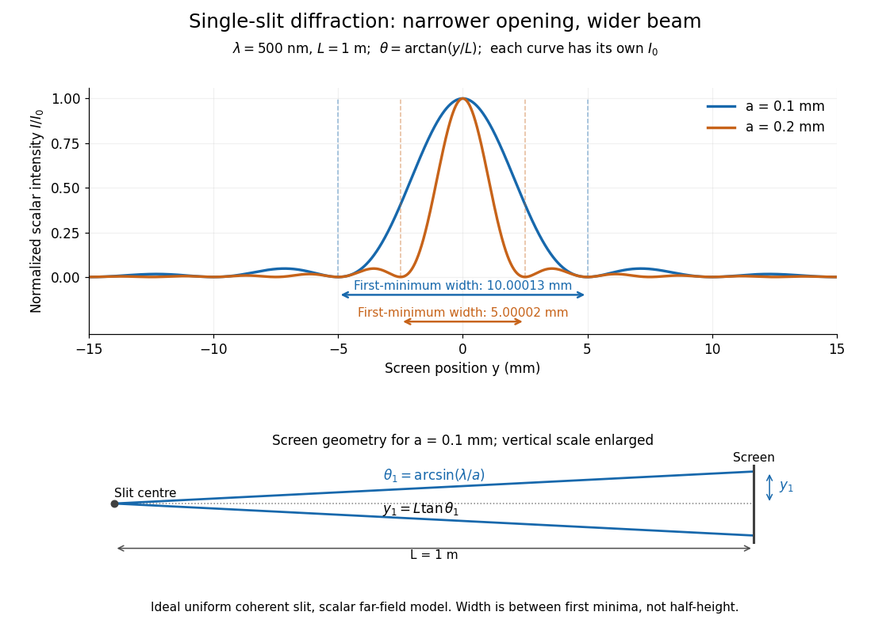

**[Figure 11](#image-normalized-single-slit-diffraction-on-a-screen-a-narrower-slit-produces-a-wider-central-maximum). Normalized single-slit diffraction on a screen: a narrower slit produces a wider central maximum**.

Each curve is normalized to its own $I_0$; the arrows measure between first minima. The calculation uses $\theta=\arctan(y/L)$ before evaluating the [sinc function](fourier-transform.md#sinc-function), rather than replacing $\sin\theta$ by $y/L$. The lower diagram shows the exact screen geometry with the vertical scale enlarged. Normalization removes the change in peak brightness when the slit width changes.

The [wave interference](#interference-wave-propagation) explanation is especially simple: divide the slit into equal narrow strips and add their [complex amplitudes](wave.md#complex-amplitude), rather than their [wave intensities](wave.md#intensity-physics). With [wavenumber](wave-equation.md#wavenumber) $k=2\pi/\lambda$, the continuous slit gives

$$
\frac{A(\theta)}{A(0)}=\frac1a\int_{-a/2}^{a/2}e^{ikx\sin\theta}\,dx=\frac{e^{iu}-e^{-iu}}{2iu}=\frac{\sin u}{u}.
$$

Integrating the [complex exponential](calculus.md#complex-exponential-function) gives the endpoint difference; its continuous value at zero is one. Taking the squared [complex modulus](complex-analysis.md#complex-modulus) gives the stated [wave intensity](wave.md#intensity-physics). This is the [Fourier transform of an interval indicator](fourier-transform.md#fourier-transform-of-an-interval-indicator) expressed in angular coordinates. Feynman's continuous-source argument obtains the same pattern by letting the number of sources tend to infinity. [Feynman, Leighton and Sands, I §30–2: continuous distributions of oscillators](https://www.feynmanlectures.caltech.edu/I_30.html#Ch30-S2).

At the positive first minimum, the [wave phases](wave.md#phase-waves) span exactly $2\pi$ across the slit. Every strip in one half has a partner $a/2$ away, with equal [wave amplitude](wave.md#wave-amplitude) and [phase difference](wave.md#phase-difference) $\pi$, so the pairs cancel. At $\theta=0$, all the [wave phases](wave.md#phase-waves) align instead. [Ling, Sanny and Moebs, §4.1: cancellation between the slit halves](https://openstax.org/books/university-physics-volume-3/pages/4-1-single-slit-diffraction).

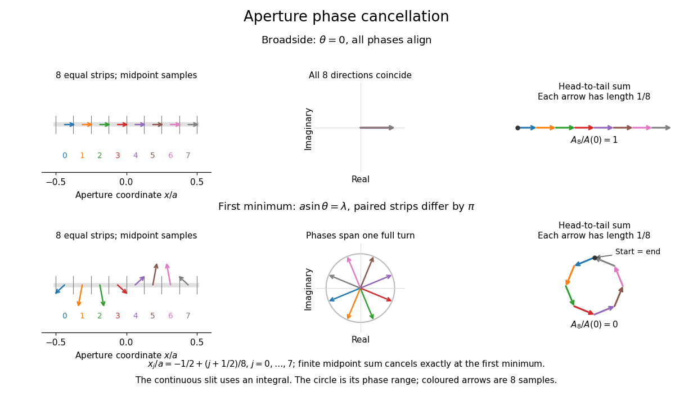

**[Figure 12](#image-complex-amplitudes-across-a-slit-aligned-contributions-at-broadside-and-cancellation-at-the-first-minimum). Complex amplitudes across a slit: aligned contributions at broadside and cancellation at the first minimum**.

The drawing uses $N=8$ equally weighted midpoint samples $x_j/a=-1/2+(j+1/2)/8$, with $j=0,\ldots,7$. At the first minimum their [complex amplitudes](wave.md#complex-amplitude) are a common rotation of the eight [roots of unity](algebra.md#root-of-unity), so their head-to-tail polygon closes exactly. This finite sum illustrates cancellation; the continuous [integral](integral.md), rather than eight point sources, defines the slit pattern at general [angles](geometry-and-topology.md#angle). The circle shows the continuous range of [wave phases](wave.md#phase-waves); coloured arrows show the eight samples.

A narrower [aperture](optics.md#aperture) requires a larger [angle](geometry-and-topology.md#angle) to accumulate the cancelling [phase difference](wave.md#phase-difference), so narrowing the slit widens the beam. This is a useful limit on [geometrical optics](geometrical-optics.md): confining [light](optics.md#light) more tightly at an opening increases its subsequent angular spread. At fixed incident [irradiance](radiometry.md#irradiance) and slit height, reducing $a$ also reduces transmitted [power](energy.md#power), exposing a practical balance between [diffraction-limited resolution](point-spread-function.md#diffraction-limited-resolution) and light throughput. In a [diffraction grating](#diffraction-grating), this [single-slit diffraction](#single-slit-diffraction) envelope modulates the [wave interference](#interference-wave-propagation) between different slits.

#### Polychromatic single-slit diffraction

↑ **Parent:** [Single-slit diffraction](#single-slit-diffraction)

For mutually incoherent [wavelengths](wave-equation.md#wavelength), [intensities](wave.md#intensity-physics) add rather than [amplitudes](wave.md#wave-amplitude): $I(\theta)=\int S(\lambda)\operatorname{sinc}^2[\pi a\sin\theta/\lambda]d\lambda$, where $\operatorname{sinc}q=\sin q/q$ and S includes source strength and detector response. All [wavelengths](wave-equation.md#wavelength) share the central maximum but their minima occur at different angles. A smooth white spectrum therefore has a white centre, wavelength-dependent edge colours, no common first dark minimum and increasingly overlapped, low-contrast outer fringes. A particular hue needs the actual spectrum and colour response.

#### Demagnifying a distant diffraction pattern

↑ **Parent:** [Single-slit diffraction](#single-slit-diffraction)

A [thin lens](geometrical-optics.md#thin-lens) placed immediately after an aperture can reproduce its free-propagated pattern from distance L on a nearer screen d if $1/f=1/d-1/L$. In the paraxial Fresnel integral, the lens changes the aperture's quadratic propagation [phase](wave.md#phase-waves) from $k x^2/(2d)$ to $kx^2(1/d-1/f)/2=kx^2/(2L)$. The cross term $-kxy/d$ then matches free propagation at the old-screen coordinate $Y=L y/d$. [Intensities](wave.md#intensity-physics) have the same shape under transverse scale d/L, with an overall brightness factor in a lossless lens of sufficient aperture. For a narrow uniformly illuminated slit, the far-field first-zero estimate on the new screen is $d\lambda/a$.

## Optical coherence

↑ **Parent:** [Physical optics](physical-optics.md)

[Optical coherence](#optical-coherence) describes correlations between the [wave amplitudes](wave.md#wave-amplitude) and [wave phases](wave.md#phase-waves) of [light](optics.md#light) sampled at different places or times. Its most direct classical test is [wave interference](#interference-wave-propagation): combine two samples of a field and see how much the detected [light intensity](wave.md#light-intensity) changes when their relative [wave phase](wave.md#phase-waves) is scanned. [First-order optical coherence](#first-order-optical-coherence) makes this statement quantitative; [temporal optical coherence](#temporal-optical-coherence) compares delayed samples, while [spatial optical coherence](#spatial-optical-coherence) compares different positions. These properties are relative to the samples and averaging procedure, rather than a single yes-or-no label for a source. [Rüdiger Paschotta, RP Photonics Encyclopedia, Coherence: field correlations and the two kinds of coherence](https://www.rp-photonics.com/coherence.html).

A useful surprise is that two copies of a fluctuating source can interfere strongly when they have matched delays: the copies share the fluctuations. Conversely, two individually steady-looking beams need not have correlated [wave phases](wave.md#phase-waves). The ideal [diffraction grating](#diffraction-grating) calculation requires [spatial optical coherence](#spatial-optical-coherence) across its illuminated elements; unequal-arm measurements with a [Michelson interferometer](#michelson-interferometer) test [temporal optical coherence](#temporal-optical-coherence).

### Broadband planetary coherence estimate

↑ **Parent:** [Optical coherence](#optical-coherence)

For an unresolved incoherent luminous disc of [angular diameter](geometry-and-topology.md#angular-diameter) $\alpha$, transverse optical coherence has scale $\lambda/\alpha$; a uniform circular brightness profile puts its first zero at $1.21967\lambda/\alpha$. A receiver transmitting a continuous [frequency](wave.md#frequency) band of width $\Delta\nu$ instead has [temporal coherence](#temporal-optical-coherence) scale $1/\Delta\nu$ and longitudinal length $c/\Delta\nu$. Angular source size and spectral filtering control different correlations. Atmospheric [phase](wave.md#phase-waves) fluctuations and instrument averaging can further reduce measured fringe visibility.

### Sunlight coherence comparison

↑ **Parent:** [Optical coherence](#optical-coherence)

Broadband sunlight has a short longitudinal [coherence length](#optical-coherence-length), controlled by spectral [bandwidth](electrical-engineering.md#bandwidth-signal-processing), but a wider transverse coherence region because the solar disk has a small angular size. The scales are $\ell_c\sim c/\Delta\nu$ and $w_c\sim\lambda/\delta$ for angular diameter $\delta$. Filtering changes the comparison.

### First-order optical coherence

↑ **Parent:** [Optical coherence](#optical-coherence)

Consider one selected [polarization of waves](wave.md#polarization-waves), represented by complex fields $E_1(t)$ and $E_2(t)$ at two sampling positions. Suppose their second moments are finite and stationary: $J_j=\langle|E_j(t)|^2\rangle$ and the following uncentered [wave-field correlation](wave.md#uncentered-wave-field-correlation) do not depend on the absolute time $t$. Define

$$
\Gamma_{12}(\tau)=\langle E_1^*(t)E_2(t+\tau)\rangle,
\qquad g^{(1)}_{12}(\tau)=\frac{\Gamma_{12}(\tau)}{\sqrt{J_1J_2}},
\qquad J_1,J_2>0.
$$

The star denotes the [complex conjugate](complex-analysis.md#complex-conjugate); brackets denote an [ensemble average](expected-value.md). A long detector average estimates this quantity only if it adequately samples the fluctuations. The superscript $1$ identifies a field correlation: it does not mean the [autocorrelation](time-series.md#autocorrelation) of the measured [light intensity](wave.md#light-intensity). The one-position version is $g^{(1)}(\tau)=\langle E^*(t)E(t+\tau)\rangle/\langle|E|^2\rangle$, so $g^{(1)}(0)=1$ for every nonzero field covered by this definition; this alone says nothing about its correlation at nonzero delay. [Rüdiger Paschotta, RP Photonics Encyclopedia, Coherence Time: stationary complex field correlation](https://www.rp-photonics.com/coherence_time.html).

The [Cauchy-Schwarz inequality](probability-and-statistics.md#cauchy-schwarz-inequality) gives $0\leq|g^{(1)}_{12}(\tau)|\leq1$. At a specified delay, magnitude one means $E_2(t+\tau)=aE_1(t)$ in mean square for a fixed nonzero complex $a$: the samples have a reproducible relation in both [wave amplitude](wave.md#wave-amplitude) and [wave phase](wave.md#phase-waves). Magnitude zero means the averaged field cross term vanishes. It need not mean statistical [independence](random-variable.md#independent-random-variables). A deterministic [phase difference](wave.md#phase-difference) changes the argument of $g^{(1)}$, not its [complex modulus](complex-analysis.md#complex-modulus); a distorted but fixed [wavefront](#wavefront) can therefore remain fully coherent. [Paschotta, Coherence: static distortions versus fluctuating distortions](https://www.rp-photonics.com/coherence.html).

To see the observable, recombine the samples in the same detected spatial mode with matched [wave polarizations](wave.md#polarization-waves). With a common positive conversion factor $C$, let $I_j=CJ_j$ be the single-arm [light intensities](wave.md#light-intensity) reaching that detector. Adding $E_1(t)+e^{i\phi}E_2(t+\tau)$ gives

$$
I(\phi,\tau)=I_1+I_2+2\sqrt{I_1I_2}\,\operatorname{Re}\!\left[e^{i\phi}g^{(1)}_{12}(\tau)\right],
\qquad \mathcal V(\tau)=\frac{2\sqrt{I_1I_2}}{I_1+I_2}|g^{(1)}_{12}(\tau)|.
$$

This follows simply by expanding the squared [complex modulus](complex-analysis.md#complex-modulus) and averaging, then taking the maximum and minimum as $\phi$ spans a full cycle. The extra [wave phase](wave.md#phase-waves) scan must leave $I_1,I_2$ and the magnitude of the correlation effectively unchanged. Thus [interferometric visibility](#interferometric-visibility) equals $|g^{(1)}|$ only for equal nonzero [light intensities](wave.md#light-intensity) and ideal mode matching. For $I_2/I_1=1/4$, perfectly coherent beams have [interferometric visibility](#interferometric-visibility) $0.8$; a measured value $0.4$ would imply $|g^{(1)}|=0.5$ under these assumptions. Orthogonal [linear polarizations](electromagnetic-wave.md#linear-polarization), background light, unresolved [interference fringes](#interference-fringe) or vibrations can reduce measured contrast further. One absent arm gives zero contrast and makes the normalized two-sample correlation undefined.

#### Polarization overlap in interferometric visibility

↑ **Parent:** [First-order optical coherence](#first-order-optical-coherence)

For perfectly temporally coherent beams with unit [Jones vectors](wave.md#jones-vector) $\mathbf e_1,\mathbf e_2$, their interference term is proportional to the complex inner product $\mathbf e_1^\dagger\mathbf e_2$. Their [interferometric visibility](#interferometric-visibility) is the displayed expression. Equal beam [light intensities](wave.md#light-intensity) reduce it to the magnitude of the polarization overlap. Two [linear polarizations](electromagnetic-wave.md#linear-polarization) at relative angle $\theta$ give $|\cos\theta|$; a linear and a [circular polarization](electromagnetic-wave.md#circular-polarization) give $1/\sqrt2$. Perfect coherence does not remove loss of contrast from unequal intensities or orthogonal polarizations.

#### Temporal optical coherence

↑ **Parent:** [First-order optical coherence](#first-order-optical-coherence)

[Temporal optical coherence](#temporal-optical-coherence) compares a field at one position with a delayed copy. In a [Michelson interferometer](#michelson-interferometer), unequal round-trip lengths supply this delay. Even a source with rapidly changing [wave phase](wave.md#phase-waves) can give high [interferometric visibility](#interferometric-visibility) close to zero delay, because both arms then deliver nearly the same source history. A source narrowed in [optical spectrum](optics.md#optical-spectrum) generally retains correlation over larger delays; a single width does not describe sources with several separated lines. [MIT 2.71/2.710, lecture 22, slides 2–5: temporal and spatial coherence](https://ocw.mit.edu/courses/2-71-optics-spring-2009/bebe78c6a2ae2603a0d1a3ea85e0b4ca_MIT2_71S09_lec22.pdf).

For a stationary scalar field, choose the carrier convention $e^{-i2\pi\nu t}$, with [frequency](wave.md#frequency) $\nu$ in cycles per second. Let $S(\nu)\geq0$ be its [spectral density](time-series.md#spectral-density-of-a-stationary-process) per unit [frequency](wave.md#frequency), with $0<\int S(\nu)\,d\nu<\infty$. Its normalized field correlation is the [Fourier transform](fourier-transform.md)

$$
g^{(1)}(\tau)=\frac{\int S(\nu)e^{-i2\pi\nu\tau}\,d\nu}{\int S(\nu)\,d\nu}.
$$

The [optical spectrum](optics.md#optical-spectrum) weights the rotating contributions; a broad spread of [frequencies](wave.md#frequency) allows them to cancel at short delays. This is the stationary field correlation–spectrum relation. The relevant spectrum is that of the optical field in the detected mode, rather than the low-frequency fluctuations of a detector's [light intensity](wave.md#light-intensity). [Rüdiger Paschotta, RP Photonics Encyclopedia, Optical Spectrum: optical field spectrum and temporal coherence](https://www.rp-photonics.com/optical_spectrum.html).

Here are two stipulated line profiles, each centered at $\nu_0$ with [full width at half maximum](analysis.md#full-width-at-half-maximum) $\Delta\nu>0$. Write $f=\nu-\nu_0$ and use normalized profiles on the whole detuning line:

$$
p_{\mathrm L}(f)=\frac{\Delta\nu/2}{\pi[f^2+(\Delta\nu/2)^2]},
\qquad p_{\mathrm G}(f)=\frac{2\sqrt{\ln2}}{\sqrt\pi\,\Delta\nu}\exp\!\left(-4\ln2\frac{f^2}{\Delta\nu^2}\right).
$$

The first is a Lorentzian, mathematically a [Cauchy distribution](probability-distribution.md#cauchy-distribution); the second is a [Gaussian function](calculus.md#gaussian-function). Taking their [Fourier transforms](fourier-transform.md) gives, with the carrier factor $e^{-i2\pi\nu_0\tau}$ omitted from the magnitudes,

$$
|g^{(1)}_{\mathrm L}(\tau)|=e^{-\pi\Delta\nu|\tau|},
\qquad |g^{(1)}_{\mathrm G}(\tau)|=\exp\!\left(-\frac{\pi^2\Delta\nu^2\tau^2}{4\ln2}\right).
$$

These are calculated model results, not measured line profiles. The detuning approximation treats the narrow line as extending to arbitrarily large positive and negative $f$; for optical applications require $\Delta\nu\ll\nu_0$. Exact spectra of the complex positive-frequency field have no negative absolute [frequencies](wave.md#frequency). Changing to [angular frequency](lagrangian-mechanics.md#angular-frequency) replaces $\Delta\nu$ by $\Delta\omega/(2\pi)$; it must not silently preserve the same numerical constant.

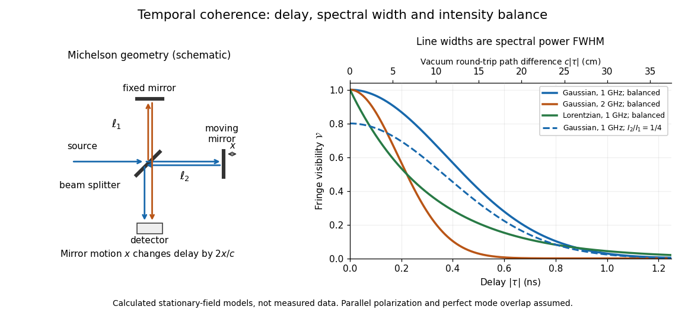

**[Figure 13](#image-michelson-interferometer-geometry-and-calculated-interferometric-visibility-versus-delay-for-stipulated-line-profiles). Michelson interferometer geometry and calculated interferometric visibility versus delay for stipulated line profiles**.

Equal detected single-arm [light intensities](wave.md#light-intensity) give [interferometric visibility](#interferometric-visibility) equal to the correlation magnitude. Doubling the Gaussian [full width at half maximum](analysis.md#full-width-at-half-maximum) from $1$ to $2\,\mathrm{GHz}$ halves every fixed-contrast delay. At $\tau=0.5\,\mathrm{ns}$ the model gives Gaussian [interferometric visibility](#interferometric-visibility) approximately $0.410686$ at $1\,\mathrm{GHz}$ and $0.0284471$ at $2\,\mathrm{GHz}$; the $1\,\mathrm{GHz}$ Lorentzian gives $0.207880$. The dashed curve instead keeps the $1\,\mathrm{GHz}$ Gaussian correlation and changes $I_2/I_1$ to $1/4$, multiplying all [interferometric visibilities](#interferometric-visibility) by $0.8$. Its lower contrast at zero delay therefore comes entirely from intensity imbalance.

##### Unequal-line visibility in a spectral doublet

↑ **Parent:** [Temporal optical coherence](#temporal-optical-coherence)

Two narrow incoherent lines of powers $J_1,J_2$ and wave-number difference $\Delta k$ give visibility $\sqrt{J_1^2+J_2^2+2J_1J_2\cos(2\Delta k\delta)}/(J_1+J_2)$ in a Michelson scan of one-way arm difference $\delta$. The minimum is $|J_1-J_2|/(J_1+J_2)$, and revivals repeat in $\pi/|\Delta k|$. Finite linewidth damps this envelope.

##### Delayed-fibre linewidth measurement

↑ **Parent:** [Temporal optical coherence](#temporal-optical-coherence)

Two delayed copies of the same laser field probe its [first-order optical coherence](#first-order-optical-coherence). With equal detected intensities and matched [polarizations](wave.md#polarization-waves), the [interferometric visibility](#interferometric-visibility) is $V=|g^{(1)}(\tau)|$. A [Lorentzian line shape](stellar-astrophysics.md#lorentzian-line-shape) of frequency full width at half maximum $\Delta\nu$ gives $V=e^{-\pi\Delta\nu|\tau|}$. For a fibre length difference $\Delta l$, the delay is $\tau=n_g\Delta l/c$, where $n_g$ is the [group index](#group-refractive-index). Hence $\Delta\nu=-\log V/(\pi|\tau|)$. Replacing $n_g$ by the effective phase index requires negligible dispersion. Polarization mismatch, unequal intensities and uncontrolled phase drift can reduce visibility independently of linewidth.

##### Two-line coherence beating

↑ **Parent:** [Temporal optical coherence](#temporal-optical-coherence)

Two equally intense monochromatic spectral components have normalized [first-order optical coherence](#first-order-optical-coherence)

$$
g^{(1)}(\tau)=\tfrac12(e^{-i\omega_1\tau}+e^{-i\omega_2\tau})
=e^{-i\bar\omega\tau}\cos(\Delta\omega\tau/2).
$$

The visibility zeros occur at $\tau=(2j+1)\pi/|\Delta\omega|$, while its revivals repeat every $2\pi/|\Delta\omega|=1/|\Delta\nu|$. This envelope describes self-interference of each spectral component after a delay, not a time-resolved measurement of inter-frequency beating at one fixed point. Unequal line intensities prevent complete cancellation at the minima.

###### Spectral doublet from Michelson visibility revivals

↑ **Parent:** [Two-line coherence beating](#two-line-coherence-beating)

For two equal-intensity mutually incoherent narrow spectral lines with [wavenumbers](wave-equation.md#wavenumber) $k_1,k_2$, a [Michelson interferometer](#michelson-interferometer) with [optical path difference](#optical-path-difference) $x$ has normalized intensity $I/I_0=1+\cos(\bar kx)\cos(\Delta kx/2)$, where $\bar k=(k_1+k_2)/2$ and $\Delta k=|k_1-k_2|$. With mirror displacement $d=x/2$, the fast period is $\pi/\bar k\simeq\bar\lambda/2$; successive [interference visibility](#interferometric-visibility) revivals are separated by $\pi/\Delta k\simeq\bar\lambda^2/(2\Delta\lambda)$. The first visibility zero is halfway to the first revival. A signed envelope has twice the period of its absolute value. Unequal line strengths prevent perfect zeros.

##### Temporal coherence from crossed beams

↑ **Parent:** [Temporal optical coherence](#temporal-optical-coherence)

Split one stationary scalar optical field into equal copies travelling at right angles with common transverse [linear polarization](electromagnetic-wave.md#linear-polarization). For wavevectors $k(\widehat{\mathbf x}\pm\widehat{\mathbf y})/\sqrt2$, the relative geometric delay is $\sqrt2y/c$ in [vacuum](physics.md#vacuum), while the delay on the $x$ bisector is zero. The electric-field intensity convention gives the displayed pattern and $I(x)=2I_0$. The mean [Poynting vector](electromagnetic-wave.md#poynting-vector) points along $+x$, with magnitude $I(y)/\sqrt2$ in that convention. A transverse detector can record the $y$ profile if it resolves the period $\lambda/\sqrt2$; a longitudinal $x$ profile is not a transverse camera image.

###### Optical path delay in crossed-beam interference

↑ **Parent:** [Temporal coherence from crossed beams](#temporal-coherence-from-crossed-beams)

For the right-angle geometry of [temporal coherence from crossed beams](#temporal-coherence-from-crossed-beams), a physical arm-path delay $\Delta\ell$ gives $I(y)=I_0+\operatorname{Re}\Gamma(\sqrt2y/c+\Delta\ell/c)$, with the sign set by the delayed arm. A quarter-cycle optical phase delay requires $\Delta\ell=\lambda/4$; it shifts the fringe pattern by a quarter of its period, $\lambda/(4\sqrt2)$. A path delay equal to that latter length is a different operation. Replacing the shifted correlation by a phase multiplier additionally requires the delay to be small compared with the envelope [optical coherence time](#optical-coherence-time).

##### Optical coherence time

↑ **Parent:** [Temporal optical coherence](#temporal-optical-coherence)

An [optical coherence time](#optical-coherence-time) summarizes the delay scale of [temporal optical coherence](#temporal-optical-coherence), but requires a convention. Two useful choices are the first positive delay $\tau_{1/e}$ where $|g^{(1)}|=e^{-1}$, for a monotonically decaying envelope, and the integral definition

$$
\tau_{\mathrm{int}}=\int_{-\infty}^{\infty}|g^{(1)}(\tau)|^2\,d\tau.
$$

The latter counts correlation over both signs of delay and may diverge for ideal discrete lines. [Paschotta, Coherence Time: exponential time constant and integral definition](https://www.rp-photonics.com/coherence_time.html).

For the stipulated Lorentzian and Gaussian profiles in [temporal optical coherence](#temporal-optical-coherence), direct substitution and a [Gaussian integral](integral.md#gaussian-integral) give

$$
\begin{array}{c|cc}
\text{profile}&\tau_{1/e}&\tau_{\mathrm{int}}\\
\hline
\text{Lorentzian}&1/(\pi\Delta\nu)&1/(\pi\Delta\nu)\\
\text{Gaussian}&2\sqrt{\ln2}/(\pi\Delta\nu)&\sqrt{2\ln2/\pi}/\Delta\nu
\end{array}
$$

The respective dimensionless coefficients are $0.318310$ for both Lorentzian conventions, and $0.530021$ and $0.664282$ for the Gaussian conventions. The familiar scale $1/\Delta\nu$ is consequently an estimate, not a convention-independent equality. A source with narrow discrete lines can have repeated revivals instead of one monotonically decaying envelope, so recording the full $|g^{(1)}(\tau)|$ can be more informative than one [optical coherence time](#optical-coherence-time).

###### Optical coherence length

↑ **Parent:** [Optical coherence time](#optical-coherence-time)

In this temporal sense, the [optical coherence length](#optical-coherence-length) is $L_c=c\tau_c$, where $c$ is the [vacuum](physics.md#vacuum) [speed of light](special-relativity.md#speed-of-light) and $\tau_c$ is an explicitly chosen [optical coherence time](#optical-coherence-time). It measures a delay as a vacuum-equivalent path difference; it does not measure transverse [spatial optical coherence](#spatial-optical-coherence). [Rüdiger Paschotta, RP Photonics Encyclopedia, Coherence Length: temporal definition and path difference](https://www.rp-photonics.com/coherence_length.html).

For the stipulated $1\,\mathrm{GHz}$ profiles, the $1/e$ convention gives $L_c\approx9.54269\,\mathrm{cm}$ for the Lorentzian and $15.8896\,\mathrm{cm}$ for the Gaussian. In a [vacuum](physics.md#vacuum) [Michelson interferometer](#michelson-interferometer), changing one mirror position by $x$ changes the round-trip delay by $2x/c$, so the mirror travel to either of these delays is $L_c/2$. In a medium, convert physical travel using the actual group delay, which can depend on [frequency](wave.md#frequency). For a narrow line centered at [vacuum](physics.md#vacuum) [wavelength](wave-equation.md#wavelength) $\lambda_0$, differentiating $\nu=c/\lambda$ gives $\Delta\nu\approx c\Delta\lambda/\lambda_0^2$; this small-width approximation must use consistently defined spectral widths.

###### Coherence length from a finite spectral band

↑ **Parent:** [Optical coherence length](#optical-coherence-length)

For [vacuum](physics.md#vacuum) [wavelength](wave-equation.md#wavelength) endpoints $\lambda_{\min}<\lambda_{\max}$, the corresponding [frequency](wave.md#frequency) span is $\Delta\nu=c(1/\lambda_{\min}-1/\lambda_{\max})$. The reciprocal-bandwidth estimate of [optical coherence time](#optical-coherence-time) is $\tau_c\sim1/\Delta\nu$, giving $\ell_c\sim c/\Delta\nu$. This endpoint conversion is valid even for a broad band, whereas $\ell_c\sim\lambda_0^2/\Delta\lambda$ requires a relatively narrow [optical spectrum](optics.md#optical-spectrum).

For constant spectral density per unit [frequency](wave.md#frequency) in the band, the normalized [first-order optical coherence](#first-order-optical-coherence) is $g^{(1)}(\tau)=e^{-i2\pi\nu_0\tau}\sin(\pi\Delta\nu\tau)/(\pi\Delta\nu\tau)$. Its first zero occurs at $\tau=1/\Delta\nu$. A different spectral shape or a different contrast criterion changes the numerical [optical coherence length](#optical-coherence-length); endpoints alone do not define an exact universal value.

##### Michelson interferometer

↑ **Parent:** [Temporal optical coherence](#temporal-optical-coherence)  
ⓦ [Wiki](https://en.wikipedia.org/wiki/Michelson_interferometer)

A [Michelson interferometer](#michelson-interferometer) divides [light](optics.md#light) at a [beam splitter](optical-instrument.md#beam-splitter), reflects the two arms at mirrors and recombines the returning fields. For [vacuum](physics.md#vacuum) arm lengths $\ell_1,\ell_2$, the delay magnitude is $|\tau|=2|\ell_2-\ell_1|/c$. At each coarse delay, a small mirror scan produces maxima and minima of the detected [light intensity](wave.md#light-intensity). A [photodiode](optical-instrument.md#photodiode) and its electrical readout resolve these changes; the scan should cover several carrier cycles while changing $|g^{(1)}|$ negligibly. MIT's laboratory guide uses a mirror actuator, [photodiode](optical-instrument.md#photodiode) and electrical drive to scan [interference fringes](#interference-fringe) and extract [interferometric visibility](#interferometric-visibility).[§§II–IV: apparatus and visibility measurement](physics-bibliography.md#mit-8-13-14-experimental-physics-i-and-ii-junior-lab-fall-2016-spring-2017-by-mit-department-of-physics/optical-interferometry)

A verified motivating experiment is Shaoul Ezekiel's MIT demonstration of source-spectrum control. A [polarizer](electromagnetic-wave.md#polarizer) selects one or several lines from a [laser](laser.md) whose adjacent lines have orthogonal [linear polarizations](electromagnetic-wave.md#linear-polarization). A sampled beam goes to a scanning [Fabry–Pérot interferometer](optical-instrument.md#fabry-perot-interferometer) to check the [optical spectrum](optics.md#optical-spectrum); the main beam enters a [Michelson interferometer](#michelson-interferometer), and a lens projects its [interference fringes](#interference-fringe) onto a screen. With one selected line the fringes retain good contrast through the demonstrated delay range. With several lines their contrast falls and returns as the arm length changes. At a fixed delay with poor contrast, selecting one line restores it; at matched arms both selections give good contrast. This control isolates the role of spectral composition rather than simply the arm position. The presentation is a qualitative demonstration, not a calibrated linewidth measurement. [Shaoul Ezekiel, MIT, Coherence length and source spectrum, demonstration transcript](https://ocw.mit.edu/courses/res-6-006-video-demonstrations-in-lasers-and-optics-spring-2008/203f69980203861f374be32d61f9940e_LixwAXsN8vg.pdf).

A deliberately simpler two-line model explains the return of contrast. Take two stationary, mutually uncorrelated monochromatic contributions of equal power at $\nu_0\pm\delta\nu/2$. Their normalized [wave-field correlation](wave.md#uncentered-wave-field-correlation) is

$$
g^{(1)}(\tau)=e^{-i2\pi\nu_0\tau}\cos(\pi\delta\nu\tau),
\qquad \mathcal V(\tau)=|\cos(\pi\delta\nu\tau)|
$$

for equal detected single-arm [light intensities](wave.md#light-intensity). At $\tau=1/(2\delta\nu)$ the two contributions' [interference fringes](#interference-fringe) cancel on averaging; at $\tau=1/\delta\nu$ they agree again. This is a deduction from the stipulated spectrum, not a fit to Ezekiel's two- or three-line source. Finite individual linewidths eventually damp these revivals.

For a quantitative version of the experiment, the visibility law suggests explicit controls. Measure each arm separately at every coarse delay, subtract the detector's dark signal and any measured background, then normalize by $2\sqrt{I_1I_2}/(I_1+I_2)$. Keep the returning beams aligned on the same detector region with parallel [linear polarizations](electromagnetic-wave.md#linear-polarization); keep detector gain fixed and avoid saturation. Resolve the small mirror scan electrically, rather than averaging over its moving [interference fringes](#interference-fringe). Repeat scans to identify vibration or drift. These controls follow from the averaging and mode-matching assumptions in [first-order optical coherence](#first-order-optical-coherence); loss of contrast alone cannot distinguish source decorrelation from apparatus motion, misalignment or insufficient spatial resolution. The finite travel range gives access only to a finite range of delays.

The practical gain is that [wave interference](#interference-wave-propagation) measures field correlations even when the detector cannot follow the optical oscillation itself. A long [optical coherence length](#optical-coherence-length) allows unequal-arm measurements; a short one localizes high contrast near matched delays. The beautiful feature is that both fading and reappearance of [interference fringes](#interference-fringe) are sums of the same rotating [complex amplitudes](wave.md#complex-amplitude).

###### Two-wavelength Michelson rephasing

↑ **Parent:** [Michelson interferometer](#michelson-interferometer)

Moving one mirror by $d$ changes the round-trip optical path by $2d$. Starting at a common bright centre for two commensurate [wavelengths](wave-equation.md#wavelength), the next common bright centre occurs when $2d=m\lambda_1=n\lambda_2$ for the smallest positive integers. This is a common-multiple condition on optical path, not on the mirror displacement itself. Incommensurate exact [wavelengths](wave-equation.md#wavelength) have no finite exact recurrence in the ideal model.

###### Common-arm phase cancellation in a balanced interferometer

↑ **Parent:** [Michelson interferometer](#michelson-interferometer)

Changing both arms of a balanced [Michelson interferometer](#michelson-interferometer) by the same length changes the common phase of both returning fields. Their relative phase and detector [intensity](wave.md#intensity-physics) remain unchanged at every frequency. Thus balanced interference cannot select a minimum positive common arm length.

###### Round-trip phase in a Michelson interferometer

↑ **Parent:** [Michelson interferometer](#michelson-interferometer)

A one-way arm-length difference $\delta$ gives optical path difference $2\delta$ and phase difference $2k\delta$. An ideal constructive output port has [intensity](wave.md#intensity-physics) $I=I_{\rm in}[1+\cos(2k\delta)]/2$. The other output is complementary.

###### Precision displacement measurement with a Michelson interferometer

↑ **Parent:** [Michelson interferometer](#michelson-interferometer)

A [Michelson interferometer](#michelson-interferometer) turns [displacement](classical-mechanics.md#displacement) into a count of [interference fringes](#interference-fringe): a moving mirror changes both the outward and return paths. This lets a [wavelength](wave-equation.md#wavelength) act as a ruler whose divisions need no engraving. Assume [normal incidence](optics.md#normal-incidence), a fixed reference arm, stable [refractive index](electromagnetic-wave.md#refractive-index) $n$ along the moving arm, and fixed [vacuum](physics.md#vacuum) [wavelength](wave-equation.md#wavelength) $\lambda_0$. Write $\lambda=\lambda_0/n$ for the [wavelength](wave-equation.md#wavelength) in that medium and take $\Delta L$ positive away from the [beam splitter](optical-instrument.md#beam-splitter). The change in [optical path difference](#optical-path-difference), the accumulated [phase difference](wave.md#phase-difference), and the signed number of complete [interference fringe](#interference-fringe) cycles are

$$
\Delta D=2n\Delta L,\qquad
\Delta\phi=\frac{2\pi\Delta D}{\lambda_0}=\frac{4\pi\Delta L}{\lambda},\qquad
\Delta N=\frac{\Delta\phi}{2\pi}=\frac{2\Delta L}{\lambda},\qquad
\Delta L=\frac{\lambda\Delta N}{2}.
$$

The factor two comes from propagation geometry: moving the mirror by $\Delta L$ adds $\Delta L$ before reflection and $\Delta L$ afterward. One bright-to-bright cycle means mirror travel $\lambda/2$; bright-to-dark means $\lambda/4$, half a cycle. All lengths must use compatible units, and $\Delta N$ is dimensionless. A constant reflection [phase difference](wave.md#phase-difference) changes the initial fringe position but cancels from this change formula.

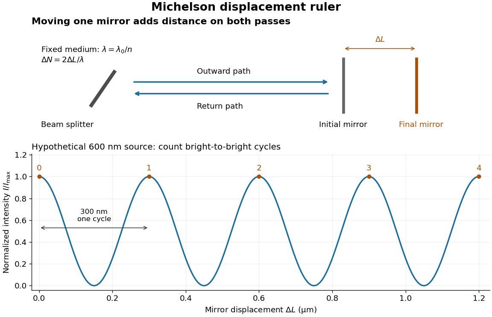

**[Figure 14](#image-mirror-displacement-doubled-optical-path-difference-and-counted-interference-fringes-for-a-hypothetical-michelson-interferometer). Mirror displacement, doubled optical path difference, and counted interference fringes for a hypothetical Michelson interferometer**.

For an original hypothetical example, suppose $\lambda=600\,\mathrm{nm}$ in the actual surrounding medium and a continuous scan gives $40.25$ cycles, including the final fractional cycle. Then $\Delta L=(600\,\mathrm{nm})(40.25)/2=12\,075\,\mathrm{nm}=12.075\,\mathrm{\mu m}$. With the [wavelength](wave-equation.md#wavelength) treated as exact, a fringe-reading [measurement uncertainty](physics.md#measurement-uncertainty) of $0.02$ cycle contributes $6\,\mathrm{nm}$ to the [displacement](classical-mechanics.md#displacement) [measurement uncertainty](physics.md#measurement-uncertainty). An uncertainty of $0.01\,\mathrm{rad}$ in a local [phase difference](wave.md#phase-difference) instead corresponds to $600(0.01)/(4\pi)\,\mathrm{nm}\approx0.477\,\mathrm{nm}$. This illustrates [measurement resolution](physics.md#measurement-resolution), not a complete claim of accuracy: [wavelength](wave-equation.md#wavelength) calibration, air changes, mirror tilt and missed cycles can dominate.

To separate the oscillating readout from its [optical coherence](#optical-coherence) envelope, use the local model

$$
I(D)=\bar I\left[1+\mathcal V(D)\cos\left(\frac{2\pi D}{\lambda_0}+\phi_b\right)\right],
\qquad D=2(n_2L_2-n_1L_1).
$$

Here $I$ is detected [light intensity](wave.md#light-intensity), $\bar I$ is the mean level, $\phi_b$ is a fixed bias [wave phase](wave.md#phase-waves), and $\mathcal V$ is [interferometric visibility](#interferometric-visibility). A fine scan of $D$ measures the carrier [phase difference](wave.md#phase-difference); a coarse scan can map the [temporal optical coherence](#temporal-optical-coherence) envelope through $\mathcal V(D)$. The envelope maximum locates matched delays only under the source and apparatus assumptions; it is not a bright fringe identifying an arbitrary mirror position. Even with known $\mathcal V$, one intensity reading leaves the [cosine](geometry-and-topology.md#cosine) sign and whole-cycle ambiguities. Continuous motion of known direction, or an independently obtained pair of signals in [phase quadrature](wave.md#phase-quadrature), is needed to recover signed travel through reversals.

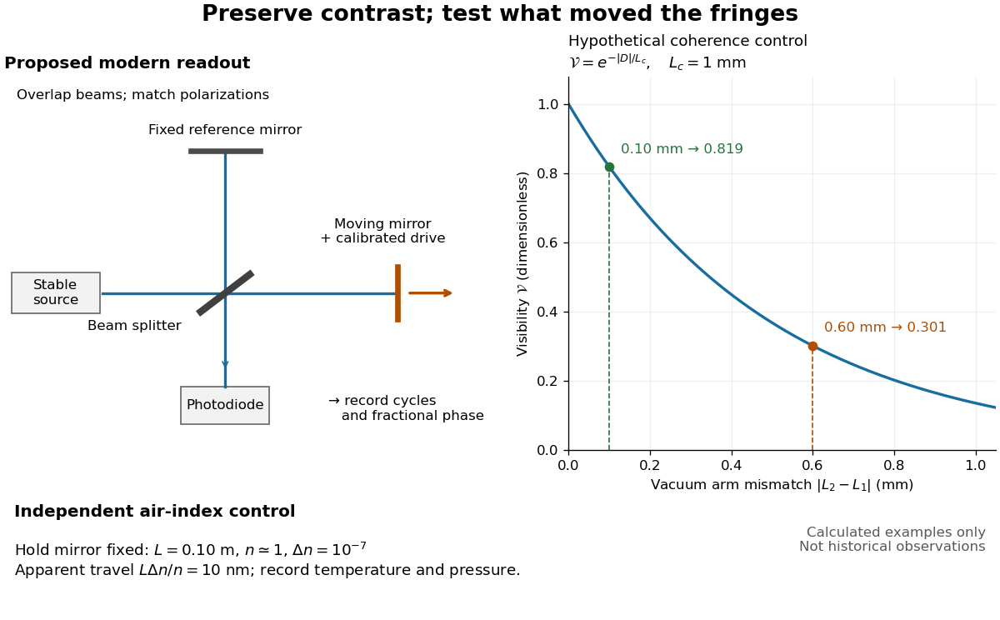

**[Figure 15](#image-proposed-michelson-interferometer-readout-and-hypothetical-optical-coherence-and-refractive-index-controls). Proposed Michelson interferometer readout and hypothetical optical coherence and refractive index controls**.

The figure's original control example stipulates equal arm [light intensities](wave.md#light-intensity), matching [linear polarizations](electromagnetic-wave.md#linear-polarization), and a Lorentzian [optical spectrum](optics.md#optical-spectrum) giving $\mathcal V(D)=\exp(-|D|/L_c)$ with $L_c=1\,\mathrm{mm}$. In [vacuum](physics.md#vacuum), arm mismatches $|L_2-L_1|=0.60\,\mathrm{mm}$ and $0.10\,\mathrm{mm}$ give $\mathcal V=e^{-1.2}\approx0.301$ and $e^{-0.2}\approx0.819$. Matching the arms improves the [phase difference](wave.md#phase-difference) readout without changing its $\lambda_0/2$ travel per cycle. A fine mirror scan of one cycle changes $D$ by only $600\,\mathrm{nm}$ for the stipulated $600\,\mathrm{nm}$ source, much less than $L_c$. These are calculated values, not historical data.

A proposed measurement sequence follows from this model. Overlap the returning beams, match their [linear polarizations](electromagnetic-wave.md#linear-polarization), find a high-contrast delay and use a small calibrated mirror scan to determine the sign and fringe period. Read a fixed spatial sample of the [interference fringes](#interference-fringe) with a [photodiode](optical-instrument.md#photodiode); record each arm separately and the dark signal, avoid detector saturation, and retain enough time resolution to count every cycle. Approach mechanical settings consistently and repeat the return scan to expose lost motion or drift. For very small changes, bias near [phase quadrature](wave.md#phase-quadrature), where $|dI/d\phi|=\bar I\mathcal V$ is largest; an intensity extremum has zero first-order sensitivity. A known drive voltage alone does not provide [measurement calibration](physics.md#measurement-calibration) for mirror travel: compare the actual travel with the fringe count using an independently known [wavelength](wave-equation.md#wavelength).

Control [temperature](temperature.md), [pressure](pressure.md), vibration and air currents because the instrument measures [optical path difference](#optical-path-difference), not mirror motion alone. For a fixed reference arm and fixed $\lambda_0$, the first-order change of the moving arm's round-trip path is $\Delta D\approx2n\Delta L+2L\Delta n$. Thus an unrecognized $\Delta n$ mimics $\Delta L_{\mathrm{app}}=L\Delta n/n$. A hypothetical $L=0.10\,\mathrm m$, $n\approx1$, and $\Delta n=10^{-7}$ give $10\,\mathrm{nm}$ apparent travel. Holding the mirror still while varying or monitoring the air conditions tests this confounder. Separate checks of alignment, [wavelength](wave-equation.md#wavelength) stability and [thermal expansion](thermodynamics.md#thermal-expansion) are necessary before sub-fringe [measurement resolution](physics.md#measurement-resolution) becomes a defensible [measurement uncertainty](physics.md#measurement-uncertainty).

###### Michelson measurement of length in cadmium wavelengths

↑ **Parent:** [Michelson interferometer](#michelson-interferometer)

[Albert Abraham Michelson](physicist.md#albert-abraham-michelson)'s 1907 lecture, [Recent Advances in Spectroscopy](https://www.nobelprize.org/uploads/2018/06/michelson-lecture.pdf), pp. 171–172, connects counting [interference fringes](#interference-fringe) with a reproducible length standard. Broad or multiple [spectral lines](stellar-astrophysics.md#spectral-line) obscured fringes at large path differences; red [cadmium](chemical-substance.md#cadmium) emission supplied a suitable source. His 1907 [Nobel Prize in Physics](nobel-prize-in-physics.md) recognized optical precision instruments and their [spectroscopy](physics.md#spectroscopy) and [metrology](physics.md#metrology) applications.[Nobel Lectures, Physics 1901–1921; Michelson, Nobel lecture, printed pp. 171–172; official prize motivation, printed p. 158](physics-bibliography.md#nobel-lectures-physics-1901-1921/recent-advances-in-spectroscopy-by-albert-abraham-michelson)

His authored account of the metre comparison at Sèvres describes a heated, evacuated [cadmium](chemical-substance.md#cadmium) discharge tube and a [spectrometer](optical-instrument.md#spectrometer) selecting one [spectral line](stellar-astrophysics.md#spectral-line). A movable reference mirror was compared with pairs of silvered parallel surfaces defining intermediate standards. Counted [interference fringes](#interference-fringe) established a short interval; repeated comparisons extended it to a decimetre and then a metre. White-light fringes located surface coincidence, while monochromatic fringes supplied counts and fractional orders. A thermally shielding box, firm pier, calibrated translation screw and tested [thermometers](temperature.md#thermometer) controlled drafts, vibration, travel and [temperature](temperature.md). Uniform [temperature](temperature.md) mattered in comparisons; the final standard required an absolute [temperature](temperature.md) reading. [Optical microscopes](optical-instrument.md#optical-microscope) made the final comparison to the marked metre bar, limiting the whole result.[Michelson, Light Waves and Their Uses (1903), Lecture V, Figs. 70–77: intermediate standards, counting, temperature controls and final microscope comparison](physics-bibliography.md#light-waves-and-their-uses-by-albert-abraham-michelson/lecture-v-light-waves-as-standards-of-length)

This is a measurement chain, rather than one enormous unchecked fringe count: short intervals establish whole orders; fractional-order readings refine each longer comparison. The [optical coherence](#optical-coherence) envelope helps locate white-light coincidence, whereas the carrier [phase difference](wave.md#phase-difference) measures small departures from it. Repetition checks counting mistakes, but agreement alone cannot exclude shared [systematic errors](physics.md#systematic-error). The general lesson of [metrology](physics.md#metrology) is to preserve the link from the optical ruler through each transfer and control to the final length.

#### Spatial optical coherence

↑ **Parent:** [First-order optical coherence](#first-order-optical-coherence)

[Spatial optical coherence](#spatial-optical-coherence) compares field samples at different positions, usually across a transverse plane at equal time. Two small openings separated by $d$ sample this correlation: recombine their [light](optics.md#light) with nearly matched travel times and measure [interferometric visibility](#interferometric-visibility) near the central [interference fringes](#interference-fringe). A narrow opening in front of a broad-spectrum lamp can improve transverse [spatial optical coherence](#spatial-optical-coherence) while leaving its short [temporal optical coherence](#temporal-optical-coherence). These are separate controls: narrow spectral selection by itself need not make an extended source spatially coherent. MIT's lecture notes illustrate the two-opening test and these contrasting source preparations. [MIT 2.71/2.710, lecture 22, slides 3–5: spatial sampling and source examples](https://ocw.mit.edu/courses/2-71-optics-spring-2009/bebe78c6a2ae2603a0d1a3ea85e0b4ca_MIT2_71S09_lec22.pdf).

To isolate source width, stipulate a distant, narrowband source with uniform angular brightness on $-\Theta/2\leq\alpha\leq\Theta/2$, and mutually uncorrelated emission from distinct source directions. Here $\Theta\ll1$ is the full angular width in [radians](geometry-and-topology.md#radian), $\lambda$ the common [wavelength](wave-equation.md#wavelength), and the two openings are separated by $d$ along the same transverse direction as the source extent. Neglect amplitude differences across the openings. Each source direction contributes a [phase difference](wave.md#phase-difference) approximately $2\pi d\alpha/\lambda$. Averaging its complex cross term gives

$$
g^{(1)}_{12}(0)=\frac1\Theta\int_{-\Theta/2}^{\Theta/2}e^{i2\pi d\alpha/\lambda}\,d\alpha
=\frac{\sin(\pi d\Theta/\lambda)}{\pi d\Theta/\lambda},
\qquad \mathcal V=\left|\frac{\sin(\pi q)}{\pi q}\right|,
\qquad q=\frac{d\Theta}{\lambda}.
$$

The [sinc function](fourier-transform.md#sinc-function) is extended continuously to one at $q=0$. The sign convention in the exponential depends on which opening is numbered first; the symmetric model gives the same real result either way. Equal detected single-opening [light intensities](wave.md#light-intensity) make the magnitude equal to [interferometric visibility](#interferometric-visibility). A displaced source center adds a deterministic [wave phase](wave.md#phase-waves), shifting the [interference fringes](#interference-fringe) without changing their contrast.

**[Figure 16](#image-calculated-spatial-optical-coherence-for-a-stipulated-uniform-incoherent-angular-source-wider-sources-wash-out-and-invert-interference-fringes). Calculated spatial optical coherence for a stipulated uniform incoherent angular source: wider sources wash out and invert interference fringes**.

The strips show $I/(I_1+I_2)=1+g^{(1)}_{12}(0)\cos\phi$ with equal single-opening [light intensities](wave.md#light-intensity), a common [phase difference](wave.md#phase-difference) coordinate $\phi$ and no [single-slit diffraction](#single-slit-diffraction) envelope. At $q=1/2$, contrast is $2/\pi\approx0.636620$; at $q=1$, it vanishes. At $q=3/2$, the correlation is $-2/(3\pi)\approx-0.212207$: weak fringes return with bright and dark positions exchanged. For $\lambda=500\,\mathrm{nm}$ and $d=0.5\,\mathrm{mm}$, the first zero occurs at $\Theta=1\,\mathrm{mrad}$. This is a calculated example, not an experimental measurement or a universal source-width law.

A proposed source-width control follows directly from this model: illuminate two fixed openings with a distant adjustable luminous slit of full width $w$ at distance $R$, so $\Theta\approx w/R$ under the [small-angle approximation](geometry-and-topology.md#small-angle-approximation), and hold $d$ and the spectral selection fixed. Increasing $w$ overlays more mutually incoherent, displaced [interference fringe](#interference-fringe) patterns. Record profiles over several near-central fringes, measure each opening separately and correct intensity imbalance as in [first-order optical coherence](#first-order-optical-coherence). Restrict the recorded region so the path difference stays small compared with the [optical coherence length](#optical-coherence-length), and resolve the fringes with the detector. Real source nonuniformity, finite opening widths and spectral spread modify the stipulated [sinc function](fourier-transform.md#sinc-function) law. This protocol is a model-based extension of the verified two-opening method, not a claim that the plotted curves were measured.

Thus an extended incoherent source can give locally excellent [wave interference](#interference-wave-propagation) when the sampled separation is small, and almost none when it is larger. The useful scale $d\Theta\sim\lambda$ expresses how source extent limits the aperture over which coherent addition is available. The same angular averaging explains why narrowing a source opening can recover visible [interference fringes](#interference-fringe), even without narrowing its [optical spectrum](optics.md#optical-spectrum).

##### Van Cittert-Zernike theorem

↑ **Parent:** [Spatial optical coherence](#spatial-optical-coherence)

For a distant spatially incoherent quasimonochromatic source in the small-angle regime, the equal-delay mutual coherence across projected baseline $\mathbf b$ is the [Fourier transform](fourier-transform.md) of its angular [intensity](wave.md#intensity-physics). With matched collector response, the normalized degree is $g(\mathbf b)=\int I(\boldsymbol\theta)e^{-i2\pi\mathbf b\cdot\boldsymbol\theta/\lambda}d^2\theta/\int I(\boldsymbol\theta)d^2\theta$. Equal collector [intensities](wave.md#intensity-physics) and matched polarizations make fringe visibility $|g|$. Finite bandwidth and unmatched optical paths introduce additional temporal-coherence averaging.

##### Uniform-disk spatial coherence

↑ **Parent:** [Spatial optical coherence](#spatial-optical-coherence)

For a monochromatic uniformly bright incoherent disk of angular diameter $\delta$, the mutual coherence at baseline $b$ is proportional to $2J_1(\pi\delta b/\lambda)/(\pi\delta b/\lambda)$. The first zero is $b\simeq1.22\lambda/\delta$. A nonuniform disk or finite spectral band changes the detailed curve.

##### Transverse optical coherence length

↑ **Parent:** [Spatial optical coherence](#spatial-optical-coherence)

The [transverse optical coherence length](#transverse-optical-coherence-length) summarizes the separation over which equal-time [spatial optical coherence](#spatial-optical-coherence) remains appreciable. It depends on a contrast criterion and on the source brightness profile. For a distant incoherent source of angular diameter $\Theta$, its characteristic scale is $\lambda/\Theta$. A uniform circular source gives [uniform-disk stellar visibility](quantum-optics.md#uniform-disk-stellar-visibility) $2J_1(x)/x$, with $x=\pi b\Theta/\lambda$ and baseline $b$. Its first zero is $b=1.21967\lambda/\Theta$. A uniformly bright one-dimensional strip instead has its first zero at $\lambda/\Theta$; the numerical factor is a source-model choice, not a universal constant.

## Diffraction grating

↑ **Parent:** [Physical optics](physical-optics.md)  
ⓦ [Wiki](https://en.wikipedia.org/wiki/Diffraction_grating)

A diffraction grating is a periodic optical structure whose repeated slits or grooves direct [light](optics.md#light) into [diffraction orders](#diffraction-order) through [wave interference](#interference-wave-propagation). Its beauty is that many individually broad contributions cooperate to select narrow directions: the spacing determines where the principal peaks occur, while the number of illuminated elements determines how sharply they are selected. This makes a [diffraction grating](#diffraction-grating) useful in a [spectrometer](optical-instrument.md#spectrometer), where separating [wavelengths](wave-equation.md#wavelength) spatially lets us examine an [optical spectrum](optics.md#optical-spectrum). [MIT 6.007: Multiple-slit diffraction and spectrometer application, slides 5-6](https://ocw.mit.edu/courses/6-007-electromagnetic-energy-from-motors-to-lasers-spring-2011/4835d62777f42e82a40c319defcc80a6_MIT6_007S11_lec28.pdf).

Consider a transmission [diffraction grating](#diffraction-grating) in air, illuminated at normal incidence by a [plane wave](wave-function.md#plane-wave). Let $d$ be the centre-to-centre slit spacing, $\lambda$ the [wavelength](wave-equation.md#wavelength) in the surrounding medium, and $\theta$ the signed outgoing [angle](geometry-and-topology.md#angle) from the forward normal. In [Fraunhofer diffraction](#fraunhofer-diffraction), where observation directions specify the far-field pattern, adjacent contributions have path difference $d\sin\theta$ and [phase difference](wave.md#phase-difference) $\delta=2\pi d\sin\theta/\lambda$. Their [wave amplitudes](wave.md#wave-amplitude) reinforce whenever $\delta=2\pi m$, giving $d\sin\theta=m\lambda$. This normal-incidence geometry should be kept distinct from the incident and reflected [angle](geometry-and-topology.md#angle) convention in the [grating equation](#grating-equation) below. [MIT: Interference and diffraction, section 14.8](https://www.mit.edu/course/other/viz/EM/visualizations/notes/modules/guide14.pdf).

Angular colour separation follows immediately. At fixed nonzero [diffraction order](#diffraction-order), increasing the [wavelength](wave-equation.md#wavelength) moves the peak farther from the normal. With $d=2\,\mathrm{\mu m}$, first-order [light](optics.md#light) at $450\,\mathrm{nm}$ leaves at $13.003^\circ$, whereas $650\,\mathrm{nm}$ leaves at $18.966^\circ$: a separation of $5.963^\circ$. The zero [diffraction order](#diffraction-order) stays at $0^\circ$ for both [wavelengths](wave-equation.md#wavelength). Thus [grating dispersion](#grating-dispersion) comes from an orderly dependence of [wave interference](#interference-wave-propagation) on [wavelength](wave-equation.md#wavelength), rather than an arbitrary assignment of colours to directions.

**[Figure 17](#image-normal-incidence-diffraction-orders-at-600-mathrm-nm-and-first-order-angular-colour-separation). Normal-incidence diffraction orders at $600\,\mathrm{nm}$ and first-order angular colour separation**.

For $N$ identical slits with uniform coherent illumination, meaning stable relative [wave phases](wave.md#phase-waves) across the array, the normalized [wave interference](#interference-wave-propagation) factor is

$$
F_N(\theta)=\left|\frac1N\sum_{j=0}^{N-1}e^{ij\delta}\right|^2=\left[\frac{\sin(N\delta/2)}{N\sin(\delta/2)}\right]^2,\qquad \delta=\frac{2\pi d\sin\theta}{\lambda}.
$$

The apparent $0/0$ at a principal peak has limiting value one. A short explanation uses the [geometric series](sequence-and-series.md#geometric-series): equal [wave phases](wave.md#phase-waves) add $N$ equal [complex amplitudes](wave.md#complex-amplitude); a small directional change distributes those contributions around the complex plane and allows cancellation. With each slit's contribution held fixed, peak [scalar wave intensity](wave.md#scalar-wave-intensity) scales as $N^2$. The normalized plots remove that height change to make the narrowing visible. Stable relative [wave phases](wave.md#phase-waves), or [optical coherence](#optical-coherence), are essential; a sum of independent intensities would lose this array structure. [Richard Fitzpatrick, University of Texas: Multi-slit interference, equations 10.38-10.40](https://farside.ph.utexas.edu/teaching/315/Waveshtml/node93.html).

For finite slit width $a$, the ideal rectangular-slit model multiplies $F_N$ by a broad [single-slit diffraction](#single-slit-diffraction) envelope:

$$
\frac{I(\theta)}{I(0)}=\left[\frac{\sin u}{u}\right]^2F_N(\theta),\qquad u=\frac{\pi a\sin\theta}{\lambda}.
$$

The [sinc function](fourier-transform.md#sinc-function) factor, extended continuously at $u=0$, controls the brightness available to the narrow peaks. For example, $a=0.5\,\mathrm{\mu m}$ gives envelope values about $0.811$, $0.405$, and $0.090$ at [diffraction orders](#diffraction-order) $1$, $2$, and $3$ in the $600\,\mathrm{nm}$ example. If an envelope zero coincides with an allowed [diffraction order](#diffraction-order), that peak disappears. A permitted direction therefore need not produce a visible bright spot. [MIT: Single-slit envelope and absent interference maxima, sections 14.6-14.7](https://www.mit.edu/course/other/viz/EM/visualizations/notes/modules/guide14.pdf).

Historically, [Joseph von Fraunhofer](physicist.md#joseph-von-fraunhofer) used fine parallel wires stretched between threaded rods to make [diffraction gratings](#diffraction-grating). Kenyon's historical apparatus account describes both this construction and a later reconstruction with visible [light](optics.md#light). The example makes the governing idea tangible: regular spacing can turn a simple array of obstacles into an instrument for distinguishing [wavelengths](wave-equation.md#wavelength). [Thomas B. Greenslade Jr., Kenyon College: Diffraction grating](https://physics.kenyon.edu/EarlyApparatus/Optics/Diffraction_Grating/Diffraction_Grating.html).

### Fixed-illumination grating peak change with slit width

↑ **Parent:** [Diffraction grating](#diffraction-grating)

For a uniformly illuminated grating of $N$ identical slits, width $w$ and pitch $p$, the amplitude is a [single-slit diffraction](#single-slit-diffraction) factor times the coherent array sum. At integer order $m$, the array amplitude is $N$, giving the displayed peak [intensity](wave.md#intensity-physics) at fixed incoming [intensity](wave.md#intensity-physics). Changing $w$ can increase the central [intensity](wave.md#intensity-physics) while suppressing a higher order through its envelope. Renormalizing both patterns to unit central [intensity](wave.md#intensity-physics) removes the information needed for that comparison.

### First subsidiary maximum of a large slit array

↑ **Parent:** [Diffraction grating](#diffraction-grating)

For $N$ equal narrow slits, adjacent [phase](wave.md#phase-waves) increment $\delta$ gives [amplitude](wave.md#wave-amplitude) $\sin(N\delta/2)/\sin(\delta/2)$ relative to one slit. Near a principal maximum, set $u=N\delta/2$; for large $N$ the normalized [intensity](wave.md#intensity-physics) approaches $(\sin u/u)^2$. Approximating the first subsidiary maximum by $u=3\pi/2$ gives principal-to-subsidiary [intensity](wave.md#intensity-physics) ratio $9\pi^2/4$. The exact large-array extremum satisfies $\tan u=u$ in $(\pi,2\pi)$ and gives a slightly different ratio, about $21.2$. The slit envelope can further modify observed peak heights.

### First minimum of a finite slit array

↑ **Parent:** [Diffraction grating](#diffraction-grating)

For $N$ equally spaced, coherently illuminated narrow slits at normal incidence, the [phasor](wave.md#phasor) sum is proportional to $\sin(N\delta/2)/\sin(\delta/2)$, where $\delta=2\pi d\sin\theta/\lambda$. The first zero around the central maximum has $d\sin\theta=\lambda/N$. Principal maxima are removable zero-over-zero limits, not [intensity](wave.md#intensity-physics) zeros.

### Pixel sampling of a grating spectrum

↑ **Parent:** [Diffraction grating](#diffraction-grating)

A normal-incidence [diffraction grating](#diffraction-grating) of pitch $D$ has order $m$ at $D\sin\theta=m\lambda$ and angular separation $\Delta\theta\simeq m\Delta\lambda/(D\cos\theta)$. A lens whose axis follows the selected order maps a small angular interval to $\Delta x\simeq f\Delta\theta$. Detector pixels substantially smaller than this separation are needed; two pixels per resolution interval correspond to $t\lesssim\Delta x/2$. If instead detector coordinates obey $x=f\tan\theta$ relative to the original axis, the scale is $\Delta x\simeq f\sec^2\theta\,\Delta\theta$. A numerical pixel limit therefore requires an optical layout and a sampling criterion as well as the [resolving power of a diffraction grating](#resolving-power-of-a-diffraction-grating).

### Resolving power of a diffraction grating

↑ **Parent:** [Diffraction grating](#diffraction-grating)

For $N$ coherently illuminated grating lines used in [diffraction order](#diffraction-order) $m$, the [Rayleigh criterion](point-spread-function.md#rayleigh-criterion) yields the displayed ideal [resolving power of a diffraction grating](#resolving-power-of-a-diffraction-grating). The angular maximum-to-first-zero separation is $\lambda/(ND\cos\theta_m)$, while nearby wavelengths are separated by $|m|\delta\lambda/(D\cos\theta_m)$. The order must exist, carry appreciable [light intensity](wave.md#light-intensity) and remain free from dominant instrumental broadening. Line count alone therefore does not determine whether a particular instrument resolves a specified doublet.

#### Finite-grating incoherent doublet profile

↑ **Parent:** [Resolving power of a diffraction grating](#resolving-power-of-a-diffraction-grating)

For narrow slits and equally bright mutually incoherent spectral lines, $u_j=\pi p\sin\theta/\lambda_j$ and the [intensities](wave.md#intensity-physics) add as displayed. The [Rayleigh criterion](point-spread-function.md#rayleigh-criterion) uses a main-peak-to-first-zero separation $\delta\lambda\simeq\lambda/(|m|N)$. A slightly sub-Rayleigh doublet can still have two local maxima: the criterion is not a theorem of statistical non-identifiability. [photon](quantum-mechanics.md#photon) counts, background, unequal strengths and uncertainty in the instrumental profile govern actual inference.

#### Normal-incidence grating width bound

↑ **Parent:** [Resolving power of a diffraction grating](#resolving-power-of-a-diffraction-grating)

At normal incidence, an ideal grating of $N$ lines and period $d$ resolves a small [wavelength](wave-equation.md#wavelength) separation $\delta\lambda$ in order $m$ by the Rayleigh condition $|m|N\gtrsim\lambda/\delta\lambda$. Combining this with $|m|\lambda=d|\sin\theta|$ yields $W=Nd\gtrsim\lambda^2/(\delta\lambda|\sin\theta|)\ge\lambda^2/\delta\lambda$. The final expression is a limiting lower bound as diffraction approaches grazing. Finite usable diffraction angle, unequal line strengths, aberrations and intrinsic linewidth can all demand a larger instrument or a more detailed criterion.

### Diffraction order

↑ **Parent:** [Diffraction grating](#diffraction-grating)

A diffraction order is the [integer](integer.md) $m$ labeling a principal [constructive interference](fourier-analysis.md#constructive-interference) direction of a [diffraction grating](#diffraction-grating): adjacent elements differ in path length by $m$ [wavelengths](wave-equation.md#wavelength). In the normal-incidence transmission geometry described above,

$$
\sin\theta_m=\frac{m\lambda}{d},\qquad \left|\frac{m\lambda}{d}\right|\leq1.
$$

Positive and negative [diffraction orders](#diffraction-order) lie on opposite sides of the forward normal. The condition expresses the range of the [sine](geometry-and-topology.md#sine) of a real [angle](geometry-and-topology.md#angle), so it also limits the propagating [diffraction orders](#diffraction-order).

For $\lambda=600\,\mathrm{nm}$ and $d=2\,\mathrm{\mu m}$, $\sin\theta_m=0.3m$. Taking the [inverse sine](geometry-and-topology.md#inverse-sine) gives

$$
\begin{aligned}
m=0 &: \quad \theta_0=0^\circ,\\
m=\pm1 &: \quad \theta_m=\pm17.458^\circ,\\
m=\pm2 &: \quad \theta_m=\pm36.870^\circ,\\
m=\pm3 &: \quad \theta_m=\pm64.158^\circ.
\end{aligned}
$$

These are seven allowed propagating [diffraction orders](#diffraction-order). Order $m=4$ would require $\sin\theta_4=1.2$, and $m=-4$ would require $-1.2$, so neither has a propagating far-field direction. The allowed [diffraction orders](#diffraction-order) are equally spaced in $\sin\theta$, while their actual [angles](geometry-and-topology.md#angle) become farther apart toward grazing propagation.

Each principal peak has finite width. For the ideal uniform coherent array, the nearest zeros around order $m$ obey

$$
\sin\theta_{m,\pm}=\frac{m\lambda}{d}\pm\frac{\lambda}{Nd}.
$$

Thus the one-sided distance from the order direction to the first zero is $\Delta(\sin\theta)=\lambda/(Nd)$. Near the first [diffraction order](#diffraction-order) in our example, $N=10$ puts the zeros at $0.27$ and $0.33$, while $N=40$ puts them at $0.2925$ and $0.3075$. The respective one-sided widths are $0.03$ and $0.0075$; the full zero-to-zero widths are $0.06$ and $0.015$. These are calculated coherent peak widths, with the slit envelope omitted, and do not describe a measured instrument response. [Richard Fitzpatrick: Principal maxima and their neighbouring zeros, equations 10.39-10.42](https://farside.ph.utexas.edu/teaching/315/Waveshtml/node93.html).

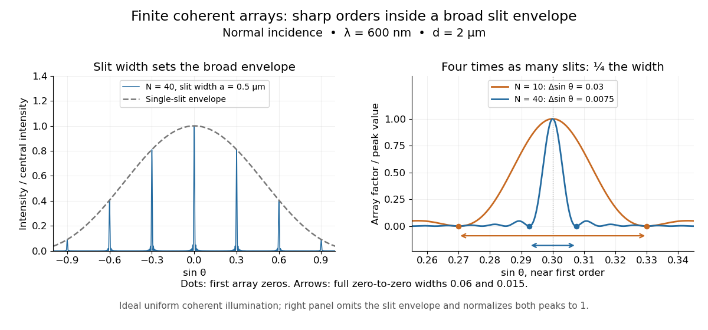

**[Figure 18](#image-single-slit-diffraction-envelope-and-calculated-first-order-peak-widths-for-n-10-and-n-40). Single-slit diffraction envelope and calculated first-order peak widths for $N=10$ and $N=40$**.

Four times as many illuminated slits therefore give a fourfold narrowing in this coordinate without moving the [diffraction order](#diffraction-order). That sharper directional selection helps distinguish nearby [wavelengths](wave-equation.md#wavelength) in a [spectrograph](optical-instrument.md#spectrograph). Actual performance also depends on illumination, [optical coherence](#optical-coherence), and source width; the separate [slit-limited resolving power of a grating](#slit-limited-resolving-power-of-a-grating) describes the contribution of the entrance slit.

#### Missing diffraction order

↑ **Parent:** [Diffraction order](#diffraction-order)

A [missing diffraction order](#missing-diffraction-order) occurs when a principal maximum of an array factor coincides with a zero of the individual aperture's [diffraction](quantum-scattering.md#diffraction) envelope. For identical slits of width $a$ and centre spacing $D$, order $m$ has $\sin\theta_m=m\lambda/D$. It is missing if $ma/D$ is a nonzero integer. This is cancellation of field contributions, not loss of the incident [wavelength](wave-equation.md#wavelength) or a failure of the [grating equation](#grating-equation).

### Grating equation

↑ **Parent:** [Diffraction grating](#diffraction-grating)

For a reflection [diffraction grating](#diffraction-grating) with both ray directions measured on the same side of its normal, adjacent grooves have path difference $d(\sin\alpha+\sin\beta)$. [Constructive interference](fourier-analysis.md#constructive-interference) requires this to be an integer multiple $m\lambda$. Signed-angle conventions can turn the sum into a difference; the physical path difference is unchanged.

#### Diffraction-order feasibility

↑ **Parent:** [Grating equation](#grating-equation)

A formal grating order must have a real outgoing angle. For [normal incidence](optics.md#normal-incidence), $|m|\lambda\le d$ is necessary. Oblique incidence can access orders outside that normal-incidence range; reflection Littrow geometry has $m\lambda=2d\sin\theta$. The ideal [resolving power of a diffraction grating](#resolving-power-of-a-diffraction-grating) applies only to an order that exists and has sufficient signal.

#### Grating dispersion

↑ **Parent:** [Grating equation](#grating-equation)

At fixed incidence angle, differentiating the [grating equation](#grating-equation) gives $d\beta/d\lambda=m/(d\cos\beta)$. A camera with [focal length](geometrical-optics.md#focal-length) $f$ therefore has local focal-plane dispersion $q=fm/(d\cos\beta)$ near its optical axis. With coordinate $X=f\tan(\beta-\beta_0)$, the full derivative is $q=f\sec^2(\beta-\beta_0)m/(d\cos\beta)$.

#### Anamorphic magnification of a grating

↑ **Parent:** [Grating equation](#grating-equation)

At fixed [wavelength](wave-equation.md#wavelength), the [grating equation](#grating-equation) gives $d\beta/d\alpha=-\cos\alpha/\cos\beta$. Thus an incident angular width is magnified by $\cos\alpha/\cos\beta$ in the dispersion direction. Including the ratio of camera and [collimator](optical-instrument.md#collimator) [focal lengths](geometrical-optics.md#focal-length) gives the projected slit width. The [ESO B&C operating manual, Appendix A](https://www.eso.org/sci/libraries/historicaldocuments/Operating_Manuals/Operating_Manual_No.9_A1b.pdf) explicitly includes this anamorphic factor.

##### Slit-limited resolving power of a grating

↑ **Parent:** [Anamorphic magnification of a grating](#anamorphic-magnification-of-a-grating)

A slit of width $x$ at the focus of a [collimator](optical-instrument.md#collimator) subtends $x/f_{\rm coll}$. Its projected width is $x f_{\rm cam}\cos\alpha/(f_{\rm coll}\cos\beta)$. Dividing this width by the [grating dispersion](#grating-dispersion) gives $\Delta\lambda=xd\cos\alpha/(mf_{\rm coll})$. Thus the [spectral resolving power](optical-instrument.md#spectral-resolving-power) is $R=m\lambda f_{\rm coll}/(xd\cos\alpha)$. Omitting the anamorphic factor gives a denominator $\cos\beta$ instead; these agree in the [Littrow configuration](#littrow-configuration).

### Littrow configuration

↑ **Parent:** [Diffraction grating](#diffraction-grating)

In the Littrow configuration the selected diffracted ray retraces the incident ray, so $\alpha=\beta$ and the [grating equation](#grating-equation) becomes $m\lambda=2d\sin\alpha$.

### Echelle grating

↑ **Parent:** [Diffraction grating](#diffraction-grating)  
ⓦ [Wiki](https://en.wikipedia.org/wiki/Echelle_grating)

An echelle grating works in high [diffraction orders](#diffraction-order). A separate [cross-disperser](optical-instrument.md#cross-disperser) separates their overlapping [optical spectra](optics.md#optical-spectrum) on a two-dimensional detector.

## Free spectral range

↑ **Parent:** [Physical optics](physical-optics.md)  
ⓦ [Wiki](https://en.wikipedia.org/wiki/Free_spectral_range)

The [free spectral range](#free-spectral-range) is the [wavelength](wave-equation.md#wavelength) or [frequency](wave.md#frequency) spacing between adjacent orders or resonances of an [optical instrument](optical-instrument.md). It identifies when different orders can overlap. Always specify the coordinate: a uniform spacing in [frequency](wave.md#frequency) need not be uniform in [wavelength](wave-equation.md#wavelength). For an ideal [Fabry–Pérot interferometer](optical-instrument.md#fabry-perot-interferometer) at [normal incidence](optics.md#normal-incidence), with mirror separation $d$ and constant [refractive index](electromagnetic-wave.md#refractive-index) $n$, [Fabry–Pérot resonance spacing](optical-instrument.md#fabry-perot-resonance-spacing) gives $\Delta\nu_{\rm FSR}=c/(2nd)$, where $c$ is the [speed of light](special-relativity.md#speed-of-light) in [vacuum](physics.md#vacuum). The [free spectral range of an echelle grating](#free-spectral-range-of-an-echelle-grating) follows a different order condition.

### Free spectral range of an echelle grating

↑ **Parent:** [Free spectral range](#free-spectral-range)

At fixed incident and central outgoing angles, the [grating equation](#grating-equation) gives $m\lambda_m=K=d(\sin\alpha+\sin\beta_0)$. Adjacent central wavelengths are separated by

$$
\lambda_m-\lambda_{m+1}=\frac K{m(m+1)}\sim\frac{\lambda_m}m.
$$

This is the usual adjacent-order [free spectral range](#free-spectral-range). A detector width of approximately $q\Delta\lambda_{\rm FSR}$, where $q$ is the [grating dispersion](#grating-dispersion), covers one such interval.

#### Adjacent-order spacing versus nearest-axis echelle interval

↑ **Parent:** [Free spectral range of an echelle grating](#free-spectral-range-of-an-echelle-grating)

At a fixed camera-axis direction, the [grating equation](#grating-equation) gives $m\lambda_m=K=d(\sin\alpha+\sin\beta_0)$, so adjacent central [wavelengths](wave-equation.md#wavelength) differ by $K/[m(m+1)]$. This differs from the exact [wavelength](wave-equation.md#wavelength) cell where an order is nearest the [optical camera](optical-instrument.md#optical-camera) axis. For $\beta_0=0$ and $x=f\tan\beta$, equal distances of orders $m$ and $m+1$ mean opposite [diffraction](quantum-scattering.md#diffraction) [angles](geometry-and-topology.md#angle); adding their [diffraction grating](#diffraction-grating) equations gives $\lambda=K/(m+1/2)$. The full order-$m$ cell is bounded by $K/(m+1/2)$ and $K/(m-1/2)$, hence has width $K/(m^2-1/4)$ for $m\ge2$ and accessible neighbouring orders. Both widths approach $K/m^2$ at high order.

## Fluorescence

↑ **Parent:** [Physical optics](physical-optics.md)

[This section is present in another page, follow this link to view it.](fluorescence.md)

## Point spread function

↑ **Parent:** [Physical optics](physical-optics.md)

[This section is present in another page, follow this link to view it.](point-spread-function.md)

## Speckle pattern

↑ **Parent:** [Physical optics](physical-optics.md)  
ⓦ [Wiki](https://en.wikipedia.org/wiki/Speckle_pattern)

A speckle pattern is a granular intensity pattern from coherent [wave interference](#interference-wave-propagation). In stellar imaging, residual [wavefront errors](#wavefront-error) produce speckles around the central [point spread function](point-spread-function.md).

### Speckle contrast of a sinusoidal wavefront error

↑ **Parent:** [Speckle pattern](#speckle-pattern)

For a small sinusoidal [optical path length](#optical-path-length) error $h_0\cos(2\pi x/\Lambda)$, expand its phase factor to first order. The two exponential harmonics each have field amplitude $i\pi h_0/\lambda$ relative to the unperturbed field, so each speckle has contrast $C=(\pi h_0/\lambda)^2$. Its angular displacement is $\lambda/\Lambda$. Here $h_0$ is optical path error, not physical mirror displacement; a reflecting mirror introduces twice its surface displacement in the near-normal limit.

## Amplitude transmittance

↑ **Parent:** [Physical optics](physical-optics.md)

[Amplitude transmittance](#amplitude-transmittance) is the local ratio of transmitted to incident [complex amplitude](wave.md#complex-amplitude) in a thin optical-element model. It includes [wave phase](wave.md#phase-waves) as well as attenuation. For identical incident and transmitted media at normal incidence, the corresponding intensity [transmittance](radiometry.md#transmittance) is $|t|^2$; $t$ itself is not the transmitted [power](energy.md#power) fraction. A pure [phase screen](partial-differential-equation.md#phase-screen) has $|t|=1$.

## Holography

↑ **Parent:** [Physical optics](physical-optics.md)  
ⓦ [Wiki](https://en.wikipedia.org/wiki/Holography)

[Holography](#holography) records the [wave interference](#interference-wave-propagation) between a [holographic object wave](#holographic-object-wave) and a known [holographic reference wave](#holographic-reference-wave), then uses that record to reconstruct a [wavefront](#wavefront). The record is a [hologram](#hologram). A [photographic plate](optical-instrument.md#photographic-plate) or [photodetector](optical-instrument.md#photodetector) measures [light intensity](wave.md#light-intensity); the relative [wave phase](wave.md#phase-waves) is encoded in the positions and contrast of [interference fringes](#interference-fringe), rather than measured directly as an optical oscillation. Reillumination makes the recorded pattern act as a [diffraction grating](#diffraction-grating) that produces an image-bearing field.

The useful change of viewpoint is to preserve a field that can propagate again, instead of only a focused brightness picture. Recovered [complex amplitude](wave.md#complex-amplitude) permits refocusing with the [Fresnel propagator](partial-differential-equation.md#fresnel-propagator); a spatially extended [hologram](#hologram) can also supply different viewing directions. The recoverable information is limited by the collected [aperture](optics.md#aperture), recorded [spatial frequencies](fourier-analysis.md#spatial-frequency), [optical coherence](#optical-coherence) and separation of unwanted [diffraction orders](#diffraction-order).

### Electron holography

↑ **Parent:** [Holography](#holography)

[Electron holography](#electron-holography) uses [electron](physics.md#electron) object and reference waves to encode their relative [wave phase](wave.md#phase-waves) in a [hologram](#hologram).[Electron holography: object and reference waves](physics-bibliography.md#electron-holography-by-jeol-ltd)

### Hologram

↑ **Parent:** [Holography](#holography)

A [hologram](#hologram) is the recorded [wave interference](#interference-wave-propagation) pattern used for [holographic wavefront reconstruction](#holographic-wavefront-reconstruction). The pattern need not resemble the object. A [photographic emulsion](photography.md#photographic-emulsion) stores a material change produced by exposure; a digital intensity record instead requires numerical reconstruction or a device that displays the corresponding optical modulation.

### Holographic reference wave

↑ **Parent:** [Holography](#holography)

A [holographic reference wave](#holographic-reference-wave) is a known coherent comparison field at the recording surface. Its [wave phase](wave.md#phase-waves) supplies the standard against which the [holographic object wave](#holographic-object-wave) is encoded. In [in-line holography](#in-line-holography), the undiffracted part of the illumination can supply this field; in [off-axis holography](#off-axis-holography), a separate tilted beam supplies it.

### Holographic object wave

↑ **Parent:** [Holography](#holography)

A [holographic object wave](#holographic-object-wave) is the object-dependent field arriving at the recording surface, including the propagation from the object. Its [complex amplitude](wave.md#complex-amplitude) generally differs from the transmission function at the object itself. Distinguishing these two planes is essential when refocusing a [hologram](#hologram).

### Holographic wavefront reconstruction

↑ **Parent:** [Holography](#holography)

Take stationary scalar [monochromatic waves](wave.md#monochromatic-wave) of the same [frequency](wave.md#frequency) and [polarization of an electromagnetic wave](electromagnetic-wave.md#polarization-of-an-electromagnetic-wave), with time convention $e^{-i\omega t}$. Write their [complex amplitudes](wave.md#complex-amplitude) at the recording plane as $R=A_R e^{i\phi_R}$ and $O=A_O e^{i\phi_O}$, absorbing the common conversion to [irradiance](radiometry.md#irradiance) into the units. An exposure short enough to avoid fringe motion but long compared with an optical period records

$$
I=|R+O|^2=|R|^2+|O|^2+R^*O+RO^*
=A_R^2+A_O^2+2A_RA_O\cos(\phi_O-\phi_R).
$$

The two cross terms are where relative [wave phase](wave.md#phase-waves) enters the measured [light intensity](wave.md#light-intensity). Blocking the [holographic reference wave](#holographic-reference-wave) leaves $|O|^2$ and removes them. Loss of mutual [optical coherence](#optical-coherence), incompatible [polarization of an electromagnetic wave](electromagnetic-wave.md#polarization-of-an-electromagnetic-wave) or motion that averages the relative [wave phase](wave.md#phase-waves) similarly reduces fringe contrast. These are useful controls for distinguishing a [hologram](#hologram) from an ordinary brightness record. One local cosine value does not uniquely determine a [wave phase](wave.md#phase-waves); known reference structure and separation of the cross terms supply the additional information in the example below.

Model a thin weakly modulated recording by its [amplitude transmittance](#amplitude-transmittance)

$$
t=t_0+\beta I,\qquad |\beta I|\ll|t_0|.
$$

Here $t_0$ and $\beta$ are real constants in a local linear response to exposure at a fixed exposure time. They describe a chosen [amplitude modulation](electrical-engineering.md#amplitude-modulation) model, not a universal photographic response; an absorbing negative may have $\beta<0$. Keep $0\leq t\leq1$ for this passive real-transmission model. Ignore material thickness, saturation, shrinking, clipping and changes of [wavelength](wave-equation.md#wavelength). Illuminating the processed record with the original $R$ gives, immediately after the plate,

$$
Rt=\underbrace{\bigl[t_0+\beta(|R|^2+|O|^2)\bigr]R}_{\text{zero-order background}}
+\underbrace{\beta|R|^2O}_{\text{desired object field}}
+\underbrace{\beta R^2O^*}_{\text{conjugate field}}.
$$

This follows by multiplying the preceding identity by $R$; no [wave phase](wave.md#phase-waves) detector has been assumed. If $|R|$ is uniform, the desired term reproduces $O$ up to a constant. A nonuniform $|R|^2$ weights the recovered field. With a strong [holographic reference wave](#holographic-reference-wave), the $|O|^2R$ contamination is small relative to $|R|^2R$, but it is retained in this identity. Subsequent [diffraction](quantum-scattering.md#diffraction) propagates each term: reproduction at the plate is the starting boundary field, not yet a focused image.

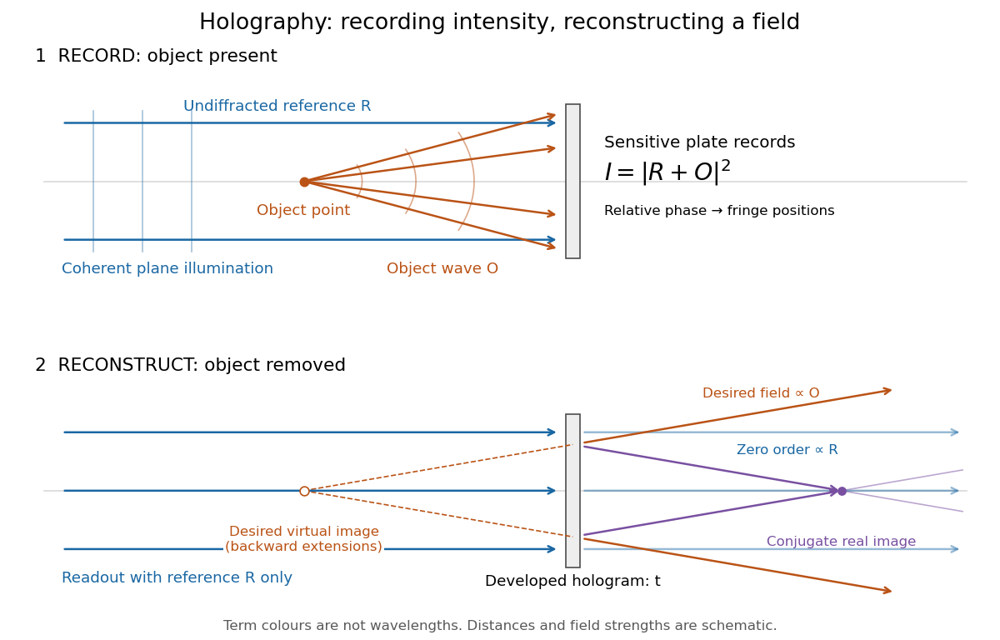

**[Figure 19](#image-recording-light-intensity-and-reconstructing-wavefronts-original-functional-geometry-for-in-line-holography). Recording light intensity and reconstructing wavefronts: original functional geometry for in-line holography**.

The schematic uses a [plane wave](wave-function.md#plane-wave) reference and one [optical point source](point-spread-function.md#optical-point-source) to separate the functions. The top row records $R+O$; the bottom removes the object and illuminates the developed [hologram](#hologram) with $R$. Dashed extensions identify the desired [virtual image](optics.md#virtual-image); the conjugate component converges toward a [real image](optics.md#real-image). All three outgoing components coexist. The coloured paths distinguish terms, not different [wavelengths](wave-equation.md#wavelength); distances and strengths are schematic. This functional drawing is not a reconstruction of the historical apparatus.

### In-line holography

↑ **Parent:** [Holography](#holography)

[In-line holography](#in-line-holography) uses nearly the same direction for the [holographic reference wave](#holographic-reference-wave) and [holographic object wave](#holographic-object-wave). In a transmission geometry, the undiffracted illumination supplies $R$ while the object supplies the scattered component $O$. This makes small [optical path differences](#optical-path-difference) possible, but leaves the desired image, its [twin image in holography](#twin-image-in-holography) and the bright background sharing an axis.

[Dennis Gabor](physicist.md#dennis-gabor)'s electron-microscopy motivation led to optical tests: one line of a high-pressure [mercury-vapor lamp](electrical-circuit.md#mercury-vapor-lamp) illuminated a 3 μm [pinhole](optics.md#optical-pinhole), then approximately 1 mm [microphotographs](photography.md#microphotograph), recording approximately 1 cm [holograms](#hologram) on sensitive [photographic emulsions](photography.md#photographic-emulsion) with minute-scale exposures. The roughly 0.1 mm [optical coherence length](#optical-coherence-length) favoured an in-line arrangement. Reillumination reconstructed images; focusing separated their depths incompletely. Distorted letters and random optical disturbances limited the results. These were optical demonstrations, not an operating [electron microscope](optics.md#electron-microscope).[Gabor, Holography, 1948-1971, Nobel lecture, Figs. 2–6 and accompanying optical-experiment account; authored transcription inspected at [https://studylib.net/doc/28317456/dennis-gabor-nobel-lecture](https://studylib.net/doc/28317456/dennis-gabor-nobel-lecture)](physics-bibliography.md#holography-1948-1971-by-dennis-gabor)

The recorded [microphotograph](photography.md#microphotograph) and its reconstructed lettering provide an object-to-image comparison in that account. The blocked-reference control described above is an explanatory control for the model; it is not a claim about an additional historical measurement.

#### Twin image in holography

↑ **Parent:** [In-line holography](#in-line-holography)

For a uniform on-axis [plane wave](wave-function.md#plane-wave) reference, choose its constant [wave phase](wave.md#phase-waves) to be zero, so $R=A_R>0$. The reconstructed cross terms are then proportional to $O$ and its [complex conjugate](complex-analysis.md#complex-conjugate) $O^*$. This pair creates the [twin image in holography](#twin-image-in-holography). An outgoing curved [wavefront](#wavefront) and its conjugate have opposite curvature: under forward propagation, one can appear to diverge from a [virtual image](optics.md#virtual-image) while the other converges to a real image. In [in-line holography](#in-line-holography) their depths differ, but a defocused member still overlaps the other. This is the same conjugation of spatial [wave phase](wave.md#phase-waves) used in [phase conjugation](#phase-conjugation), although a transmission [hologram](#hologram) here launches both components forward rather than automatically creating a returning [phase-conjugate mirror](#phase-conjugate-mirror).

### Off-axis holography

↑ **Parent:** [Holography](#holography)

[Off-axis holography](#off-axis-holography) tilts the [holographic reference wave](#holographic-reference-wave) relative to the [holographic object wave](#holographic-object-wave). Its [interference fringes](#interference-fringe) acquire a carrier [spatial frequency](fourier-analysis.md#spatial-frequency); the two cross terms occupy different [spatial frequency](fourier-analysis.md#spatial-frequency) regions when the carrier is sufficiently large compared with the object's [signal bandwidth](electrical-engineering.md#signal-bandwidth). This permits filtering a single image term.

Gabor's lecture credits [Emmett Leith](electrical-engineering.md#emmett-leith) and [Juris Upatnieks](physicist.md#juris-upatnieks) with the later skew-reference method using helium–neon [laser](laser.md) illumination, separating reconstructed images angularly.[Gabor, Nobel lecture, Fig. 8 and surrounding account of the 1962–1963 laser work](physics-bibliography.md#holography-1948-1971-by-dennis-gabor)

For an original periodic calculation, let $x$ run over a unit-length [interval](real-analysis.md#interval-mathematics) and choose

$$
O(x)=0.2e^{2\pi i3x}+0.1e^{-2\pi i5x},\qquad R(x)=e^{2\pi i20x}.
$$

All [spatial frequencies](fourier-analysis.md#spatial-frequency) here are cycles per unit length; the data are a chosen field at the recording plane, not measurements or a physical object profile. Direct expansion gives

$$
I(x)=1.05+0.04\cos(2\pi8x)+0.4\cos(2\pi17x)+0.2\cos(2\pi25x).
$$

Consequently its [Fourier series](fourier-series.md) coefficients are $1.05$ at zero, $0.02$ at $\pm8$, $0.2$ at $\pm17$ and $0.1$ at $\pm25$. The $R^*O$ component lies at $-17,-25$; the $RO^*$ component lies at $17,25$; the background lies at $0,\pm8$. Filtering the negative-frequency cross term and multiplying by $R$ recovers $O$, including its relative [wave phase](wave.md#phase-waves).

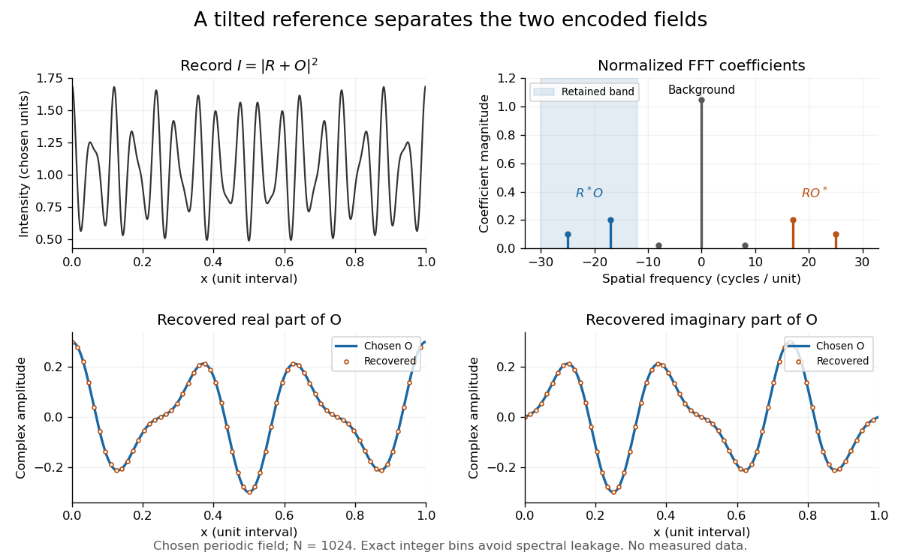

**[Figure 20](#image-original-periodic-off-axis-holography-calculation-separated-cross-terms-and-recovered-complex-amplitude). Original periodic off-axis holography calculation: separated cross terms and recovered complex amplitude**.

The figure samples $N=1024$ equally spaced positions with the endpoint excluded, computes a normalized [discrete Fourier transform](discrete-fourier-transform.md) using a [Fast Fourier transform](discrete-fourier-transform.md#fast-fourier-transform), retains bins $-30\leq m\leq-12$, then applies the [inverse discrete Fourier transform](discrete-fourier-transform.md#inverse-discrete-fourier-transform) and multiplies by $R$. The recovered real and imaginary parts coincide with the chosen $O$ to numerical precision. This exact periodic example avoids leakage by placing every frequency on an integer bin; finite nonperiodic records need allowance for broadening and an [aperture](optics.md#aperture).

For a continuous object field with [Fourier transform](fourier-transform.md) confined to $|f|\leq B$, the background $|O|^2$ occupies $|f|\leq2B$. A carrier $f_c>3B$ is a sufficient separation condition for the sideband centred at $-f_c$, and $f_c+B$ must remain below the [Nyquist spatial frequency](fourier-analysis.md#nyquist-spatial-frequency). Here $B=5$, $f_c=20$ and the [Nyquist spatial frequency](fourier-analysis.md#nyquist-spatial-frequency) is $512$. This sufficient bound describes a whole bandwidth, rather than exploiting the gaps in this particular two-component field.

The same example also makes optical playback explicit. Choose $t_0=0.3$ and $\beta=0.01$. Since $|O|\leq0.3$, the bounds $0.49\leq I\leq1.69$ imply $0.3049\leq t\leq0.3169$, and $|\beta I|/t_0\leq0.0564$. The affine response is stipulated; its weak-modulation interpretation is approximate. In $Rt$, the desired field $0.01O$ has frequencies $3,-5$; the conjugate term $0.01R^2O^*$ has frequencies $37,45$; the background has frequencies $20,12,28$. Thus the same carrier that separates the recorded cross terms separates the playback components. Reillumination restores a field through [diffraction](quantum-scattering.md#diffraction); computational filtering extracts the corresponding encoded field through [Fourier analysis](fourier-analysis.md).

## ↑ Ancestors (4)

1. [Optics](optics.md)
2. [Branches of physics](physics.md#branches-of-physics)
3. [Physics](physics.md)
4. [Codex Wiki](README.md)

## ← Incoming links (7)

- [Etendue concentration limit](geometrical-optics.md#etendue-concentration-limit)
- [Geometrical optics](geometrical-optics.md)
- [Optical aberration](geometrical-optics.md#optical-aberration)
- [Optical fiber acceptance angle](optical-instrument.md#optical-fiber-acceptance-angle)
- [Optical tweezers](optics.md#optical-tweezers)
- [Optics](optics.md)
- [Seidel coma pupil mapping](geometrical-optics.md#seidel-coma-pupil-mapping)
