# Physics

↑ **Parent:** [Codex Wiki](README.md)  
ⓦ [Wiki](https://en.wikipedia.org/wiki/Physics)

Physics investigates matter, motion, and interactions by building [mathematical models](mathematics.md#mathematical-model) and testing their consequences against observations. A [physical law](#physical-law) supplies a relation; a model specifies the objects, conditions, and approximations used to apply it. [Classical mechanics](classical-mechanics.md), [electromagnetism](electromagnetism.md), [thermodynamics](thermodynamics.md), and [quantum mechanics](quantum-mechanics.md) organize different aspects of these investigations. Their usefulness comes from turning measurements into predictions that can be checked and refined.

Consider a [simple pendulum](simple-pendulum.md): how does its [oscillation period](classical-mechanics.md#period-of-an-oscillation) change when its [length](#length) changes? For small [amplitude](wave.md#wave-amplitude), the ideal model gives $T_0=2\pi\sqrt{\ell/g}$, where $g$ is [gravitational acceleration](newton-s-law-of-universal-gravitation.md#gravitational-acceleration). Taking $g=9.81\,\mathrm{m/s^2}$ as the model parameter, a one-metre pendulum has predicted period $2.0061\,\mathrm s$. Increasing its [length](#length) to four metres gives $4.0121\,\mathrm s$: quadrupling the length doubles the period. The point mass cancels from the equation, so changing it alone does not change this model's answer.

The prediction identifies a mechanism and a way to challenge it. The [small-angle approximation](geometry-and-topology.md#small-angle-approximation) replaces $\sin\theta$ by $\theta$; the full ideal equation predicts a longer period at large [amplitude](wave.md#wave-amplitude). At $60^\circ$, its period is about $1.07318T_0$, already a $7.3\%$ change. Measurements at such amplitudes can reveal the limit of the approximation, while appreciable drag requires a [damped pendulum](simple-pendulum.md#damped-pendulum). These distinctions are developed in [simple pendulum](simple-pendulum.md) and [dimensional analysis](mathematical-physics.md#dimensional-analysis). The small-amplitude model is also derived in [Ling, Sanny and Moebs, University Physics, pendulums](https://openstax.org/books/university-physics-volume-1/pages/15-4-pendulums).

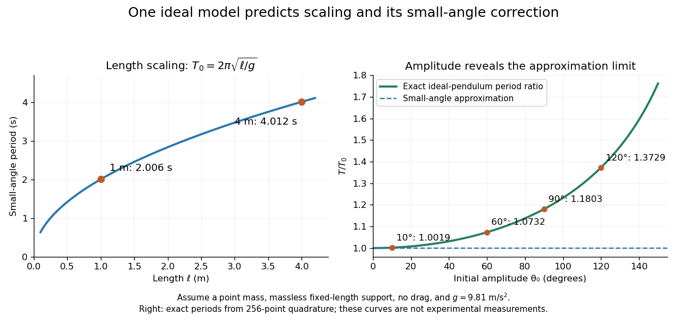

**[Figure 1](#image-pendulum-predictions-connect-a-measurable-scaling-law-with-the-limit-of-a-small-angle-approximation). Pendulum predictions connect a measurable scaling law with the limit of a small-angle approximation**.

Several different experiments can become one calculation. [Nondimensionalization](mathematical-physics.md#nondimensionalization) rewrites the pendulum equation using $\tau=t\sqrt{g/\ell}$, leaving $d^2\theta/d\tau^2+\sin\theta=0$. All lengths share that dimensionless equation; the [amplitude](wave.md#wave-amplitude) remains a parameter. Similarly, [conservation laws](mathematical-physics.md#conservation-law) and [symmetry](#symmetry-physics) reveal features that many models share. This is one source of the subject's beauty: a compact relation can organize a large range of phenomena.

The connection to evidence remains essential when a model is elegant. In his introductory lectures, [Richard Feynman](particle-physicist.md#richard-feynman) emphasizes testing proposed relations by experiment and using idealizations whose accuracy depends on the conditions. [Feynman, Leighton and Sands, Atoms in motion, section 1–1](https://www.feynmanlectures.caltech.edu/I_01.html) A discrepancy can motivate a better measurement, a better approximation, or a different physical model; the mathematical calculation and the empirical assessment are both part of the explanation.

**Table of contents**

- [Physics author](physics-author.md)
- [Physics bibliography](physics-bibliography.md)
- [Medical imaging](#medical-imaging)
- [Scattering](#scattering)
- [Matter](#matter)
- [NA48 Collaboration](#na48-collaboration)
- [HFLAV](#hflav)
- [AMS Collaboration](#ams-collaboration)
- [Irradiation](#irradiation)
- [Radiation](#radiation)
- [Quantum information science](#quantum-information-science)
- [Virgo Collaboration](#virgo-collaboration)
- [LIGO](#ligo)
- [Cross section (physics)](#cross-section-physics)
- [Many-body problem](#many-body-problem)
- [Scintillation (physics)](#scintillation-physics)
- [Thought experiment](#thought-experiment)
- [Luminiferous aether](#luminiferous-aether)
- [Vacuum](#vacuum)
- [Physical law](#physical-law)
- [Gravity](#gravity)
- [Metrology](#metrology)
- [Physicist](physicist.md)
- [Plasma (physics)](#plasma-physics)
- [System of units](#system-of-units)
- [Physical quantity](#physical-quantity)
- [Theoretical physics](#theoretical-physics)
- [Philosophy of physics](#philosophy-of-physics)
- [Atom (Physics)](#atom-physics)
- [Nuclear physics](#nuclear-physics)
- [Semiconductor](semiconductor.md)
- [Acoustics](#acoustics)
- [Atomic physics](atomic-physics.md)
- [Multipole moment](#multipole-moment)
- [Mathematical physics](mathematical-physics.md)
- [Particle detection](particle-detection.md)
- [Subatomic particle](#subatomic-particle)
- [Inverse-square law](#inverse-square-law)
- [Symmetry (physics)](#symmetry-physics)
- [Wave](wave.md)
- [Time evolution](#time-evolution)
- [Spectroscopy](#spectroscopy)
- [Experimental apparatus](#experimental-apparatus)
- [History of physics](#history-of-physics)
- [Branches of physics](#branches-of-physics)
- [Particle (physics)](#particle-physics)

## Physics author

↑ **Parent:** [Physics](physics.md)

[This section is present in another page, follow this link to view it.](physics-author.md)

## Physics bibliography

↑ **Parent:** [Physics](physics.md)

[This section is present in another page, follow this link to view it.](physics-bibliography.md)

## Medical imaging

↑ **Parent:** [Physics](physics.md)

Methods that infer internal biological structure or function from measured signals. [Computed tomography](inverse-problem.md#computed-tomography), [positron emission tomography](inverse-problem.md#positron-emission-tomography) and [single-photon emission computed tomography](inverse-problem.md#single-photon-emission-computed-tomography) use different signal-generation and reconstruction physics.

### Pelvic ultrasonography

↑ **Parent:** [Medical imaging](#medical-imaging)

### Endoscopic ultrasonography

↑ **Parent:** [Medical imaging](#medical-imaging)

### Magnetic resonance cholangiopancreatography

↑ **Parent:** [Medical imaging](#medical-imaging)

### Transillumination

↑ **Parent:** [Medical imaging](#medical-imaging)

### Ultrasonography

↑ **Parent:** [Medical imaging](#medical-imaging)

#### Bladder ultrasonography

↑ **Parent:** [Ultrasonography](#ultrasonography)

Use of [ultrasonography](#ultrasonography) to examine the [urinary bladder](anatomy.md#urinary-bladder), including assessment of its distension in suspected [urinary retention](biology.md#urinary-retention).

#### Transvaginal ultrasound

↑ **Parent:** [Ultrasonography](#ultrasonography)

#### Doppler ultrasonography

↑ **Parent:** [Ultrasonography](#ultrasonography)

#### Compression ultrasonography

↑ **Parent:** [Ultrasonography](#ultrasonography)

### Attenuation correction

↑ **Parent:** [Medical imaging](#medical-imaging)

Compensation for photons lost along an emission-imaging path. In PET/CT or SPECT/CT, a registered [computed tomography](inverse-problem.md#computed-tomography) attenuation map supplies information for this correction.

### Nuclear medicine

↑ **Parent:** [Medical imaging](#medical-imaging)  
ⓦ [Wiki](https://en.wikipedia.org/wiki/Nuclear_medicine)

Imaging or therapy using administered [radiopharmaceuticals](#radiopharmaceutical). The distribution of the labelled compound selects biological function or tissue, while emitted radiation provides a measurement or deposited [energy](energy.md).

#### Radiation therapy

↑ **Parent:** [Nuclear medicine](#nuclear-medicine)  
ⓦ [Wiki](https://en.wikipedia.org/wiki/Radiation_therapy)

Treatment through controlled deposition of ionizing [absorbed dose](#absorbed-dose). External beams and internal [radiopharmaceuticals](#radiopharmaceutical) require different delivery and [radiation dosimetry](#radiation-dosimetry) models.

##### Biologically effective dose

↑ **Parent:** [Radiation therapy](#radiation-therapy)

An effect-equivalent dose derived from the [linear-quadratic radiobiology model](#linear-quadratic-radiobiology-model), with a subscript often indicating the tissue's assumed $\alpha/\beta$ in gray. It is distinct from the physical total [absorbed dose](#absorbed-dose) $Nd$. Increasing fraction size at fixed tumour BED can increase the normal-tissue BED when the latter has smaller $\alpha/\beta$.

##### Linear-quadratic radiobiology model

↑ **Parent:** [Radiation therapy](#radiation-therapy)

A model for surviving fraction $S$ after radiation dose $d$. Independent fully repaired fractions add their logarithmic effects. For $N$ equal fractions and no repopulation, dividing the total log kill by $\alpha$ gives the [biologically effective dose](#biologically-effective-dose) $Nd(1+d/(\alpha/\beta))$. Comparing tissue types requires their own parameters and the same stated repair assumptions.

##### Depth-dose curve

↑ **Parent:** [Radiation therapy](#radiation-therapy)

The variation of [absorbed dose](#absorbed-dose) with depth for a specified beam, geometry and medium. A megavoltage photon beam has a secondary-electron buildup region followed by gradual dose reduction. A nearly monoenergetic proton beam instead exhibits a [Bragg peak](particle-detection.md#bragg-peak) near the end of its range.

##### Treatment plan

↑ **Parent:** [Radiation therapy](#radiation-therapy)

A specified geometry, beam configuration and dose prescription intended to cover a target while limiting normal-tissue dose. Robustness to setup, motion and anatomy changes is part of assessing a plan.

##### Proton therapy

↑ **Parent:** [Radiation therapy](#radiation-therapy)  
ⓦ [Wiki](https://en.wikipedia.org/wiki/Proton_therapy)

Treatment using proton beams with controllable finite range and a [Bragg peak](particle-detection.md#bragg-peak). Potential normal-tissue sparing must be assessed against [range uncertainty](#range-uncertainty), motion and biological-effect uncertainties.

###### Range uncertainty

↑ **Parent:** [Proton therapy](#proton-therapy)

Uncertainty in where a charged-particle beam stops because of material conversion, anatomy, motion or delivery errors. A steep distal dose gradient makes it particularly consequential for target coverage and nearby tissue.

##### Photon radiotherapy

↑ **Parent:** [Radiation therapy](#radiation-therapy)

External-beam treatment using photons that create secondary charged particles in tissue. Megavoltage depth-dose curves usually show build-up followed by an extended fall-off and exit dose.

###### Intensity-modulated radiotherapy

↑ **Parent:** [Photon radiotherapy](#photon-radiotherapy)  
ⓦ [Wiki](https://en.wikipedia.org/wiki/Intensity-modulated_radiotherapy)

Treatment using spatially varying beam fluence to shape the combined three-dimensional dose distribution. Improved target conformity may come with dose distributed through a larger volume at lower levels.

#### Bone scintigraphy

↑ **Parent:** [Nuclear medicine](#nuclear-medicine)  
ⓦ [Wiki](https://en.wikipedia.org/wiki/Bone_scintigraphy)

Functional imaging of bone-seeking tracer uptake with a [gamma camera](#gamma-camera) or [single-photon emission computed tomography](inverse-problem.md#single-photon-emission-computed-tomography). Uptake patterns can reveal abnormal bone turnover.

#### Gamma camera

↑ **Parent:** [Nuclear medicine](#nuclear-medicine)  
ⓦ [Wiki](https://en.wikipedia.org/wiki/Gamma_camera)

A position-sensitive detector, usually using a [collimator](optical-instrument.md#collimator), [scintillator](#scintillator) and light sensors, that forms a projection image of a gamma-emitting tracer. Energy selection reduces scattered-photon contamination.

#### Radiopharmaceutical

↑ **Parent:** [Nuclear medicine](#nuclear-medicine)  
ⓦ [Wiki](https://en.wikipedia.org/wiki/Radiopharmaceutical)

A pharmaceutical containing a [radionuclide](#radionuclide), with uptake and clearance chosen for imaging or treatment. Biological targeting and [radioactive decay](#radioactive-decay) jointly determine its useful signal and tissue dose.

##### Iodine-131

↑ **Parent:** [Radiopharmaceutical](#radiopharmaceutical)  
ⓦ [Wiki](https://en.wikipedia.org/wiki/Iodine-131)

An iodine [radionuclide](#radionuclide) with approximately eight-day [half-life](analysis.md#half-life), emitting [beta particles](#beta-particle) and [gamma rays](quantum-mechanics.md#gamma-ray). Its uptake and retention depend strongly on the carrier and tissue physiology.

##### Sodium iodide iodine-131

↑ **Parent:** [Radiopharmaceutical](#radiopharmaceutical)

Radioiodide used in selected thyroid treatments because iodine uptake localizes activity in thyroid tissue. [Iodine-131](#iodine-131) supplies local beta radiation and imageable gamma emission.

##### Technetium-99m methylene diphosphonate

↑ **Parent:** [Radiopharmaceutical](#radiopharmaceutical)

A diagnostic bone tracer combining [technetium-99m](#technetium-99m) with a diphosphonate carrier. Uptake reflects bone turnover and delivery, rather than a unique disease diagnosis.

##### Technetium-99m

↑ **Parent:** [Radiopharmaceutical](#radiopharmaceutical)  
ⓦ [Wiki](https://en.wikipedia.org/wiki/Technetium-99m)

A metastable nuclear isomer used in diagnostic tracers, with approximately six-hour [half-life](analysis.md#half-life) and $140\,\mathrm{keV}$ imageable [gamma rays](quantum-mechanics.md#gamma-ray). Its chemical carrier determines biological uptake.

## Scattering

↑ **Parent:** [Physics](physics.md)  
ⓦ [Wiki](https://en.wikipedia.org/wiki/Scattering)

An interaction that changes the state or propagation of an incident [particle](#particle-physics) or [wave](wave.md). Distinguish [elastic scattering](quantum-scattering.md#elastic-scattering) from [inelastic scattering](quantum-scattering.md#inelastic-scattering), and the general concept from its specifically quantum treatment in [quantum scattering](quantum-scattering.md).

## Matter

↑ **Parent:** [Physics](physics.md)  
ⓦ [Wiki](https://en.wikipedia.org/wiki/Matter)

Material constituents such as [particles](#particle-physics) and their composites. In [cosmology](cosmology.md), the narrower phrase [pressureless matter](cosmology.md#pressureless-matter) usually refers to nonrelativistic components whose [rest energy](special-relativity.md#rest-energy) dominates their random [kinetic energy](energy.md#kinetic-energy), giving negligible [pressure](pressure.md) and density proportional to the inverse cube of the [scale factor](cosmology.md#scale-factor-cosmology). This usage distinguishes the matter contribution from relativistic [radiation in cosmology](cosmology.md#radiation-in-cosmology) and [vacuum energy](perturbative-quantum-field-theory.md#vacuum-energy).

## NA48 Collaboration

↑ **Parent:** [Physics](physics.md)

### Work by NA48 Collaboration

↑ **Parent:** [NA48 Collaboration](#na48-collaboration)

## HFLAV

↑ **Parent:** [Physics](physics.md)

An experimental averaging collaboration. The cited hadronic-decay average specifies its treatment of electromagnetic final-state radiation, which matters when comparing measured [branching fractions](relativistic-quantum-field.md#branching-fraction).

### Work by HFLAV

↑ **Parent:** [HFLAV](#hflav)

## AMS Collaboration

↑ **Parent:** [Physics](physics.md)

### Work by AMS Collaboration

↑ **Parent:** [AMS Collaboration](#ams-collaboration)

## Irradiation

↑ **Parent:** [Physics](physics.md)  
ⓦ [Wiki](https://en.wikipedia.org/wiki/Irradiation)

## Radiation

↑ **Parent:** [Physics](physics.md)

### Ionizing radiation

↑ **Parent:** [Radiation](#radiation)

Radiation energetic enough to ionize matter. Its biological effects can include direct molecular damage and indirect chemical changes, with consequences depending on dose, timing and cellular context.

#### Radiation protection

↑ **Parent:** [Ionizing radiation](#ionizing-radiation)

Control of exposure to [ionizing radiation](#ionizing-radiation). Basic physical measures include reducing time near a source, increasing distance and using [radiation shielding](engineering.md#radiation-shielding); confinement of radioactive material addresses contamination.

#### Radiation dosimetry

↑ **Parent:** [Ionizing radiation](#ionizing-radiation)

Measurement or calculation of energy imparted by [ionizing radiation](#ionizing-radiation), together with explicitly specified weighting conventions. [Absorbed dose](#absorbed-dose), [equivalent dose](#equivalent-dose) and [effective dose](#effective-dose) are different quantities.

##### Relative biological effectiveness

↑ **Parent:** [Radiation dosimetry](#radiation-dosimetry)  
ⓦ [Wiki](https://en.wikipedia.org/wiki/Relative_biological_effectiveness)

The reference radiation dose divided by the test radiation dose giving the same specified biological endpoint. It depends on radiation quality, tissue, endpoint and dose, rather than being an immutable particle constant.

##### Effective dose

↑ **Parent:** [Radiation dosimetry](#radiation-dosimetry)

A [tissue weighting factor](#tissue-weighting-factor) weighted sum of [equivalent doses](#equivalent-dose). Its unit is the [sievert](#sievert).

###### Tissue weighting factor

↑ **Parent:** [Effective dose](#effective-dose)

A dimensionless weight in [effective dose](#effective-dose); the weights over the reference tissues sum to one.

##### Equivalent dose

↑ **Parent:** [Radiation dosimetry](#radiation-dosimetry)

A [radiation weighting factor](#radiation-weighting-factor) weighted sum of mean [absorbed doses](#absorbed-dose) for a specified organ or tissue. Its unit is the [sievert](#sievert).

###### Radiation weighting factor

↑ **Parent:** [Equivalent dose](#equivalent-dose)

A dimensionless factor used to convert a specified radiation component's [absorbed dose](#absorbed-dose) into its contribution to [equivalent dose](#equivalent-dose).

##### Absorbed dose

↑ **Parent:** [Radiation dosimetry](#radiation-dosimetry)

Mean energy imparted by [ionizing radiation](#ionizing-radiation) per unit [mass](classical-mechanics.md#mass); its unit is the [gray](#gray).

###### Charged-particle equilibrium

↑ **Parent:** [Absorbed dose](#absorbed-dose)

A dosimetric condition in which the charged-particle energy entering a small region balances the corresponding energy leaving it. Under appropriate equilibrium conditions, photon collision kerma equals [absorbed dose](#absorbed-dose). It can fail near material boundaries or in the buildup region of a high-energy photon beam.

## Quantum information science

↑ **Parent:** [Physics](physics.md)

[Quantum information science](#quantum-information-science) studies the storage, processing and transmission of [quantum information](quantum-information-theory.md#quantum-information), including the physical implementation of the tasks described by [quantum information theory](quantum-information-theory.md).

## Virgo Collaboration

↑ **Parent:** [Physics](physics.md)

The scientific collaboration associated with the Virgo gravitational-wave detector.

## LIGO

↑ **Parent:** [Physics](physics.md)  
ⓦ [Wiki](https://en.wikipedia.org/wiki/LIGO)

Laser Interferometer Gravitational-Wave Observatory: an experimental project operating widely separated laser interferometers for [gravitational wave](gravitational-wave.md) detection.

### LIGO Scientific Collaboration

↑ **Parent:** [LIGO](#ligo)  
ⓦ [Wiki](https://en.wikipedia.org/wiki/LIGO_Scientific_Collaboration)

A scientific collaboration, not an individual person.

## Cross section (physics)

↑ **Parent:** [Physics](physics.md)  
ⓦ [Wiki](https://en.wikipedia.org/wiki/Cross_section_(physics))

An effective [area](differential-geometry.md#surface-area) describing the strength of a specified interaction. With an incident [particle flux](#particle-flux) $j$ and $N_T$ independent target particles, the ideal event rate for that channel is $jN_T\sigma$.

### Unpolarized cross section

↑ **Parent:** [Cross section (physics)](#cross-section-physics)

For uncorrelated incoming beams with equally populated [spin](angular-momentum-operator.md#spin) states, the measured [cross section](#cross-section-physics) averages over initial [polarizations](wave.md#polarization-waves) and sums over unobserved final [polarizations](wave.md#polarization-waves). The displayed average applies to two massive incoming particles with spins $s_1,s_2$. It is distinct from a prepared-polarization channel and from the final-state [identical-particle factor in a final-state phase-space integral](quantum-scattering.md#identical-particle-factor-in-a-final-state-phase-space-integral). A polarization channel with an amplitude that grows faster than the others can reach a perturbative bound before the averaged quantity does.

### Two-body scattering cross section

↑ **Parent:** [Cross section (physics)](#cross-section-physics)

For distinguishable final particles, the [centre-of-momentum frame](special-relativity.md#center-of-momentum-frame) cross section is the displayed product of the invariant amplitude, incoming flux and [relativistic two-body phase space](quantum-scattering.md#relativistic-two-body-phase-space). Initial unpolarized states are averaged; unobserved final polarizations are summed. An isotropic amplitude integrates to $\sigma=(|\mathbf k_f|/|\mathbf p_i|)\overline{|\mathcal M|^2}/(16\pi s)$. A full-solid-angle integral for identical final particles additionally needs its symmetry factor.

## Many-body problem

↑ **Parent:** [Physics](physics.md)  
ⓦ [Wiki](https://en.wikipedia.org/wiki/Many-body_problem)

### Elementary excitation

↑ **Parent:** [Many-body problem](#many-body-problem)

An approximately independent low-energy excitation above a many-body equilibrium state, characterized by energy, momentum and other quantum numbers. Collective sound and dressed particle-like excitations are examples; the relevant modes depend on the phase and approximation.

## Scintillation (physics)

↑ **Parent:** [Physics](physics.md)  
ⓦ [Wiki](https://en.wikipedia.org/wiki/Scintillation_(physics))

A brief flash of [light](optics.md#light) produced when an energetic [particle](#particle-physics) deposits [energy](energy.md) in a material. Counting resolved flashes can count individual incident [particles](#particle-physics); this differs from [atmospheric scintillation](optics.md#scintillation-astronomy).

### Scintillator

↑ **Parent:** [Scintillation (physics)](#scintillation-physics)  
ⓦ [Wiki](https://en.wikipedia.org/wiki/Scintillator)

A material that emits optical [photons](quantum-mechanics.md#photon) after an ionizing particle deposits [energy](energy.md). Coupling it to [photomultipliers](particle-detection.md#photomultiplier) or other light sensors converts deposited energy into an electrical pulse.

### Liquid scintillator

↑ **Parent:** [Scintillation (physics)](#scintillation-physics)

A [liquid](thermodynamics.md#liquid) that produces [particle scintillation](#scintillation-physics) when deposited [energy](energy.md) excites its components. [Photomultipliers](particle-detection.md#photomultiplier) can convert the emitted [light](optics.md#light) into detector pulses.

## Thought experiment

↑ **Parent:** [Physics](physics.md)  
ⓦ [Wiki](https://en.wikipedia.org/wiki/Thought_experiment)

A [thought experiment](#thought-experiment) explores the consequences of a specified hypothetical setup using physical or logical assumptions.

## Luminiferous aether

↑ **Parent:** [Physics](physics.md)  
ⓦ [Wiki](https://en.wikipedia.org/wiki/Luminiferous_aether)

A historical proposed medium for the propagation of [light](optics.md#light). The [Fizeau experiment](special-relativity.md#fizeau-experiment) tested how moving transparent matter affects light propagation; its positive signal did not uniquely establish such a medium.

## Vacuum

↑ **Parent:** [Physics](physics.md)  
ⓦ [Wiki](https://en.wikipedia.org/wiki/Vacuum)

## Physical law

↑ **Parent:** [Physics](physics.md)

A physical law expresses a reproducible relation used to describe or predict physical phenomena within its domain of applicability. Applying it requires a model specifying the system and conditions: [Newton's second law](force.md#newton-s-second-law), together with a [force](force.md) model, predicts a body's [acceleration](classical-mechanics.md#acceleration); [conservation of energy](mathematical-physics.md#conservation-of-energy) constrains exchanges within a specified system. Its predictions must be compared with physical observations.

## Gravity

↑ **Parent:** [Physics](physics.md)  
ⓦ [Wiki](https://en.wikipedia.org/wiki/Gravity)

Gravity governs falling bodies and [orbits](dynamical-systems.md#orbit-dynamical-system). [Newtonian gravity](newton-s-law-of-universal-gravitation.md#gravitational-acceleration) describes it through a [gravitational field](#gravitational-field) acting on masses; [general relativity](general-relativity.md) instead relates matter and radiation to the geometry of [spacetime](special-relativity.md#spacetime) through the [Einstein field equations](einstein-field-equations.md).

### Gravitational force

↑ **Parent:** [Gravity](#gravity)

The [force](force.md) exerted through [gravity](#gravity). In a Newtonian [gravitational potential](newton-s-law-of-universal-gravitation.md#newtonian-potential-of-a-point-mass) $\Phi$ per unit [mass](classical-mechanics.md#mass), a [point mass](classical-mechanics.md#point-mass) $m$ experiences the displayed [force](force.md), while a continuous [mass density](fluid-mechanics.md#density) $\rho$ experiences force density $-\rho\nabla\Phi$.

### Gravitational field

↑ **Parent:** [Gravity](#gravity)  
ⓦ [Wiki](https://en.wikipedia.org/wiki/Gravitational_field)

In [Newtonian gravity](newton-s-law-of-universal-gravitation.md#gravitational-acceleration), the gravitational field $\mathbf g$ specifies the [acceleration](classical-mechanics.md#acceleration) of a freely falling [test particle](classical-mechanics.md#test-particle) at each position. A [gravitational potential](newton-s-law-of-universal-gravitation.md#newtonian-potential-of-a-point-mass) $\Phi$ gives $\mathbf g=-\nabla\Phi$, with the [gradient](multivariable-calculus.md#gradient) taken in the spatial geometry of the model. In [general relativity](general-relativity.md), the [metric tensor](general-relativity.md#metric-tensor) describes gravitational effects, and [tidal forces](newton-s-law-of-universal-gravitation.md#tidal-force) are encoded by [spacetime](special-relativity.md#spacetime) curvature.

## Metrology

↑ **Parent:** [Physics](physics.md)  
ⓦ [Wiki](https://en.wikipedia.org/wiki/Metrology)

[Metrology](#metrology) asks what a measurement means and how closely it can be reproduced. An instrument reading becomes useful when it is related to a reference through [measurement calibration](#measurement-calibration), with a stated [measurement uncertainty](#measurement-uncertainty). Measuring a changing object against a changing ruler makes the problem especially clear: an observed difference contains the responses of both.

### Scientific instrument maker

↑ **Parent:** [Metrology](#metrology)

#### List of scientific instrument makers

↑ **Parent:** [Scientific instrument maker](#scientific-instrument-maker)

##### Jean Nicolas Fortin

↑ **Parent:** [List of scientific instrument makers](#list-of-scientific-instrument-makers)  
ⓦ [Wiki](https://en.wikipedia.org/wiki/Jean_Nicolas_Fortin)

Instrument maker associated with the [Fortin barometer](pressure.md#fortin-barometer).

### Measurement

↑ **Parent:** [Metrology](#metrology)  
ⓦ [Wiki](https://en.wikipedia.org/wiki/Measurement)

A process for determining the value of a [physical quantity](#physical-quantity) relative to a reference and a stated model. A reported result must distinguish its numerical value, units and [measurement uncertainty](#measurement-uncertainty).

### Measurement accuracy

↑ **Parent:** [Metrology](#metrology)

[measurement accuracy](#measurement-accuracy) concerns closeness to the value of the specified [measurand](#measurand); high repeatability alone does not establish it. [calibration](differential-geometry.md#calibration-differential-geometry), an adequate response model and assessment of residual systematic effects are required alongside statistical precision.

### Measurand

↑ **Parent:** [Metrology](#metrology)

The [measurand](#measurand) is the quantity intended to be measured, specified with enough detail about the system, conditions and averaging convention to distinguish it from instrument output or a different derived quantity.

### International Association for the Properties of Water and Steam

↑ **Parent:** [Metrology](#metrology)

An organization publishing internationally coordinated formulations and reference data for the physical properties of [water](chemical-substance.md#water) and steam.

Official website: [https://iapws.org](https://iapws.org)

#### Work by International Association for the Properties of Water and Steam

↑ **Parent:** [International Association for the Properties of Water and Steam](#international-association-for-the-properties-of-water-and-steam)

### Dimensional metrology

↑ **Parent:** [Metrology](#metrology)

Measurement of [length](#length) and geometrical dimensions. A [length standard](#length-standard) supplies a reference; a [differential length comparator](#differential-length-comparator) measures the difference between two lengths rather than treating its own structure as perfectly invariant.

#### Length standard

↑ **Parent:** [Dimensional metrology](#dimensional-metrology)

A reference realizing a specified [length](#length), under specified conditions. The [temperature](temperature.md) and mechanical constraints belong to the specification when [thermal expansion](thermodynamics.md#thermal-expansion) changes the reference's dimensions.

#### Differential length comparator

↑ **Parent:** [Dimensional metrology](#dimensional-metrology)

An instrument for comparing two [lengths](#length) through their difference. Suppose a test rod and reference both have length $L_0$ at [temperature](temperature.md) $T_0$, and have constant [linear thermal expansion coefficients](thermodynamics.md#linear-thermal-expansion-coefficient) $\alpha_s$ and $\alpha_r$ over a small interval. Their first-order models give

$$
L_s(T)=L_0[1+\alpha_s(T-T_0)],\qquad L_r(T)=L_0[1+\alpha_r(T-T_0)].
$$

For the observed difference $D(T)=L_s(T)-L_r(T)$, the [derivative](calculus.md#derivative) $b=dD/dT$ therefore determines

$$
\boxed{\alpha_s=\alpha_r+\frac{b}{L_0}}.
$$

The reference's independently calibrated [linear thermal expansion coefficient](thermodynamics.md#linear-thermal-expansion-coefficient) is essential: the difference alone identifies $\alpha_s-\alpha_r$, not either coefficient separately.

For an original numerical example, stipulate $L_0=1.00\,\mathrm m$, $\alpha_s=1.0\times10^{-6}\,\mathrm{K^{-1}}$ and $\alpha_r=9.0\times10^{-6}\,\mathrm{K^{-1}}$. Heating both by $10\,\mathrm K$ gives sample and reference increases of $10\,\mu\mathrm m$ and $90\,\mu\mathrm m$. Thus **the sample expands even though its measured difference decreases** by $80\,\mu\mathrm m$. These are chosen model parameters, not measured values for a historical [Invar](chemical-substance.md#invar) specimen or reference.

If $\alpha_r$ and $b$ have independent [standard uncertainties](#standard-uncertainty) $0.2\times10^{-6}\,\mathrm{K^{-1}}$ and $0.3\,\mu\mathrm{m\,K^{-1}}$, and uncertainty in $L_0$ is negligible, [variance additivity for independent random variables](variance.md#variance-additivity-for-independent-random-variables) gives

$$
u(\alpha_s)=\sqrt{u(\alpha_r)^2+\frac{u(b)^2}{L_0^2}}
\simeq0.36\times10^{-6}\,\mathrm{K^{-1}}.
$$

Repeating the difference measurement can reduce its random contribution; it does not remove uncertainty in the reference. A [temperature gradient](heat.md#temperature-gradient) or unequal rod [temperatures](temperature.md) also breaks the common-temperature model and can introduce a [systematic error](#systematic-error).

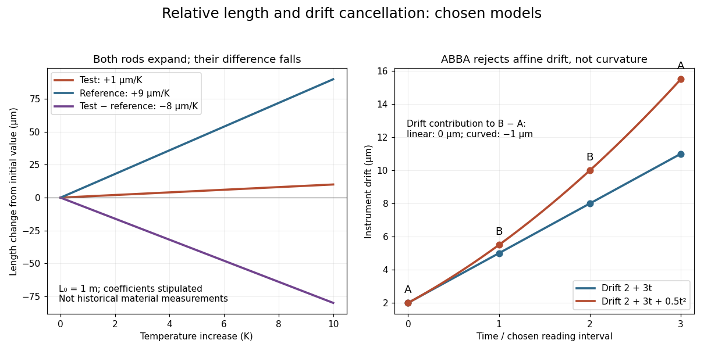

**[Figure 2](#image-chosen-rod-expansion-and-instrument-drift-models-a-negative-length-difference-need-not-imply-contraction). Chosen rod expansion and instrument drift models: a negative length difference need not imply contraction**.

##### ABBA measurement sequence

↑ **Parent:** [Differential length comparator](#differential-length-comparator)

Alternating sample and reference readings can suppress instrument drift. In this original four-reading model, measure objects $A,B,B,A$ at equally spaced times $0,\Delta t,2\Delta t,3\Delta t$. Assume the objects are stable during that short sequence and each reading is its object's [length](#length) plus the same [affine function](vector-space.md#affine-function) of time, $a+bt$. Then

$$
\widehat{B-A}=\frac{y_1+y_2-y_0-y_3}{2}=L_B-L_A,
$$

because both pairs have mean time $3\Delta t/2$. The constant offset and linear drift cancel. With a further drift term $ct^2$, direct substitution instead leaves bias $-2c\Delta t^2$. A shorter sequence reduces that term, but neither this ordering nor averaging corrects unequal [temperatures](temperature.md), sample changes or reference [measurement uncertainty](#measurement-uncertainty). This is a modern illustrative protocol; the historical account below establishes alternation, without attributing this particular four-reading sequence to [Charles-Édouard Guillaume](condensed-matter-physicist.md#charles-edouard-guillaume).

#### Guillaume thermal expansion experiment

↑ **Parent:** [Dimensional metrology](#dimensional-metrology)

[Charles-Édouard Guillaume](condensed-matter-physicist.md#charles-edouard-guillaume) sought affordable, stable [length standards](#length-standard). His 1920 lecture describes two micrometer [microscopes](#microscope) on stone supports sighting marks on a rod immersed in water. Their separation was not fixed: one method alternated the sample with a reference in a second trough at nearly constant [temperature](temperature.md). His relative method compared sample and [platinum](chemical-substance.md#platinum)–[iridium](chemical-substance.md#iridium) reference in the same bath, adding the reference's known expansion to the measured difference. Composition and treatment affected the nickel–iron alloys; low expansion held over a limited [temperature](temperature.md) range.[Nobel Lectures, Physics 1901–1921; Invar and elinvar, lecture 11 December 1920, pp. 444–448: motivation and comparator; pp. 451–453: composition, treatment and temperature limits](physics-bibliography.md#nobel-lectures-physics-1901-1921/invar-and-elinvar-by-charles-edouard-guillaume)

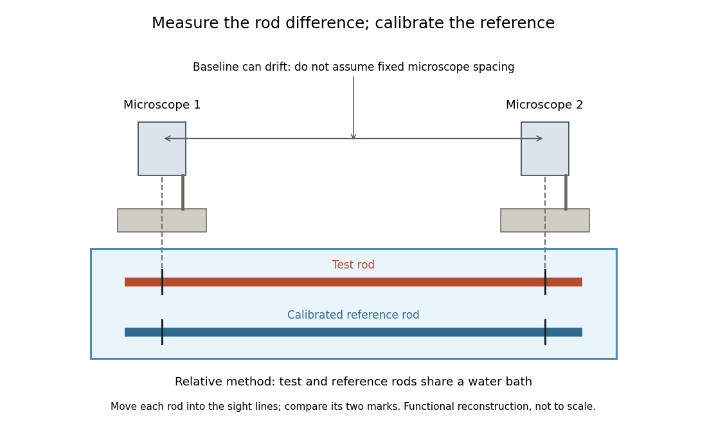

**[Figure 3](#image-functional-reconstruction-of-the-water-bath-comparison-described-by-charles-edouard-guillaume-with-movable-rods-and-an-instrument-baseline-that-can-drift). Functional reconstruction of the water-bath comparison described by Charles-Édouard Guillaume, with movable rods and an instrument baseline that can drift**.

The [differential length comparator](#differential-length-comparator) calculation explains why a calibrated reference is needed even when its expansion is larger than the sample's. Keeping both rods in the same bath targets one source of [systematic error](#systematic-error); allowing for changes in the instrument baseline targets another. Discovering a low-expansion [alloy](chemical-substance.md#alloy) and demonstrating its dimensional stability are connected experimental tasks.

### Measurement uncertainty

↑ **Parent:** [Metrology](#metrology)  
ⓦ [Wiki](https://en.wikipedia.org/wiki/Measurement_uncertainty)

A quantified spread of values attributable to a measured quantity, accounting for relevant measurement information and corrections.

#### Measurement uncertainty budget

↑ **Parent:** [Measurement uncertainty](#measurement-uncertainty)

A record of uncertainty contributions in a specified measurement model, their evaluation methods, sensitivity coefficients and relevant [correlations](variance.md#pearson-correlation-coefficient). For $y=g(x_1,\ldots,x_n)$, first-order [propagation of uncertainty](wave-equation.md#propagation-of-uncertainty) gives $u_y^2=\sum_{ij}(\partial_i g)(\partial_j g)\operatorname{Cov}(x_i,x_j)$. A correction for a known [systematic error](#systematic-error) can itself have uncertainty; applying the correction does not remove that contribution.[sections 4–5 and Appendix A](physics-bibliography.md#guidelines-for-evaluating-and-expressing-the-uncertainty-of-nist-measurement-results-by-barry-n-taylor-and-chris-e-kuyatt)

#### Standard uncertainty

↑ **Parent:** [Measurement uncertainty](#measurement-uncertainty)

### Systematic error

↑ **Parent:** [Metrology](#metrology)  
🏷️ **Tags:** [Measurement error](probability-and-statistics.md#measurement-error)

#### Systematic uncertainty

↑ **Parent:** [Systematic error](#systematic-error)

Uncertainty associated with imperfect knowledge of [calibration](differential-geometry.md#calibration-differential-geometry), efficiency, backgrounds or other persistent model inputs. Repeating the same measurement does not necessarily average it away. Correlated [nuisance parameters](statistical-model.md#nuisance-parameter) can propagate it through a [likelihood](maximum-likelihood-estimation.md#likelihood-function); estimating such an uncertainty is distinct from asserting that the systematic error has a known sign and magnitude.

#### Common-offset cancellation by signal reversal

↑ **Parent:** [Systematic error](#systematic-error)

If a controlled reversal changes the desired [signal](electrical-engineering.md#signal)'s sign while leaving an additive offset unchanged, readings $y_+=S+b$ and $y_-=-S+b$ separate them by half-difference and half-sum. Offset drift, gain changes, hysteresis or a background that also reverses violate the simple cancellation. Interleaving polarities and independent blank measurements test those assumptions; [signal](electrical-engineering.md#signal) reversal does not cancel an arbitrary [systematic error](#systematic-error).

#### Systematic-error cancellation by reversal

↑ **Parent:** [Systematic error](#systematic-error)

If a wanted response changes sign on reversing a controlled setting while an offset remains unchanged, the difference of the reversed readings isolates the response. For $V_\pm=\pm RI+V_0$, the estimator $(V_+-V_-)/(2I)$ cancels $V_0$. The method requires offset stability between readings. It does not cancel a common current-scale [calibration](differential-geometry.md#calibration-differential-geometry) error, and it does not remove even-in-current [Joule heating](electric-charge.md#joule-heating). A useful reversal test specifies which physical effects change sign, then tests the remaining effects independently.

### Measurement calibration

↑ **Parent:** [Metrology](#metrology)

Comparing an instrument indication with a reference of known value to establish their relation and its [measurement uncertainty](#measurement-uncertainty).

#### Measurement zero offset

↑ **Parent:** [Measurement calibration](#measurement-calibration)

A constant additive contribution $b$ to an instrument reading is a zero offset. A blank or zero-signal reading can estimate it, and a [systematic-error cancellation by reversal](#systematic-error-cancellation-by-reversal) can cancel it if it remains unchanged while the desired signal changes sign. The residual correction uncertainty remains part of the [measurement uncertainty](#measurement-uncertainty).

#### Instrumental drift

↑ **Parent:** [Measurement calibration](#measurement-calibration)

A change in an instrument's response or zero point with time. A reference measured alongside the target can track the component shared by reference and target light.

### Force probe

↑ **Parent:** [Metrology](#metrology)

A [force probe](#force-probe) measures an applied [force](force.md) through a calibrated response. A bending beam with [strain gauges](electric-charge.md#strain-gauge) is one realization; orientation and [measurement calibration](#measurement-calibration) matter.

### Force-restoration balance

↑ **Parent:** [Metrology](#metrology)

A balance that applies a compensating [force](force.md) to hold its load support near a reference position; the compensation [signal](electrical-engineering.md#signal) measures the applied [force](force.md).

### Metrologist

↑ **Parent:** [Metrology](#metrology)

#### List of metrologists

↑ **Parent:** [Metrologist](#metrologist)

##### J. L. Cross

↑ **Parent:** [List of metrologists](#list-of-metrologists)

An author credited on [Mercury Barometers and Manometers by W. G. Brombacher and others](physics-bibliography.md#mercury-barometers-and-manometers-by-w-g-brombacher-and-others).

###### Work by J. L. Cross

↑ **Parent:** [J. L. Cross](#j-l-cross)

##### D. P. Johnson

↑ **Parent:** [List of metrologists](#list-of-metrologists)

An author credited on [Mercury Barometers and Manometers by W. G. Brombacher and others](physics-bibliography.md#mercury-barometers-and-manometers-by-w-g-brombacher-and-others).

###### Work by D. P. Johnson

↑ **Parent:** [D. P. Johnson](#d-p-johnson)

##### W. G. Brombacher

↑ **Parent:** [List of metrologists](#list-of-metrologists)

An author credited on [Mercury Barometers and Manometers by W. G. Brombacher and others](physics-bibliography.md#mercury-barometers-and-manometers-by-w-g-brombacher-and-others).

###### Work by W. G. Brombacher

↑ **Parent:** [W. G. Brombacher](#w-g-brombacher)

##### Christina D. Cross

↑ **Parent:** [List of metrologists](#list-of-metrologists)

Coauthor of [Maintenance and Validation of Liquid-in-Glass Thermometers by Christina D. Cross and others](physics-bibliography.md#maintenance-and-validation-of-liquid-in-glass-thermometers-by-christina-d-cross-and-others).

###### Work by Christina D. Cross

↑ **Parent:** [Christina D. Cross](#christina-d-cross)

##### Paul A. Williams

↑ **Parent:** [List of metrologists](#list-of-metrologists)

Identity: [https://www.nist.gov/people/paul-williams](https://www.nist.gov/people/paul-williams)

###### Work by Paul A. Williams

↑ **Parent:** [Paul A. Williams](#paul-a-williams)

##### Joshua A. Hadler

↑ **Parent:** [List of metrologists](#list-of-metrologists)

Identity: [https://www.nist.gov/people/joshua-hadler](https://www.nist.gov/people/joshua-hadler)

###### Work by Joshua A. Hadler

↑ **Parent:** [Joshua A. Hadler](#joshua-a-hadler)

##### Robert Lee (optical and force metrology)

↑ **Parent:** [List of metrologists](#list-of-metrologists)

Identity: [https://tsapps.nist.gov/publication/get_pdf.cfm?pub_id=914101](https://tsapps.nist.gov/publication/get_pdf.cfm?pub_id=914101)

###### Work by Robert Lee

↑ **Parent:** [Robert Lee (optical and force metrology)](#robert-lee-optical-and-force-metrology)

##### Frank C. Maring

↑ **Parent:** [List of metrologists](#list-of-metrologists)

Identity: [https://tsapps.nist.gov/publication/get_pdf.cfm?pub_id=914101](https://tsapps.nist.gov/publication/get_pdf.cfm?pub_id=914101)

###### Work by Frank C. Maring

↑ **Parent:** [Frank C. Maring](#frank-c-maring)

##### John H. Lehman

↑ **Parent:** [List of metrologists](#list-of-metrologists)

Identity: [https://www.nist.gov/people/john-h-lehman](https://www.nist.gov/people/john-h-lehman)

###### Work by John H. Lehman

↑ **Parent:** [John H. Lehman](#john-h-lehman)

##### David J. Livigni

↑ **Parent:** [List of metrologists](#list-of-metrologists)

###### Work by David J. Livigni

↑ **Parent:** [David J. Livigni](#david-j-livigni)

##### Gregory F. Strouse

↑ **Parent:** [List of metrologists](#list-of-metrologists)

Homepage: [https://www.nist.gov/people/gregory-f-strouse](https://www.nist.gov/people/gregory-f-strouse)

###### Work by Gregory F. Strouse

↑ **Parent:** [Gregory F. Strouse](#gregory-f-strouse)

##### Billy W. Mangum

↑ **Parent:** [List of metrologists](#list-of-metrologists)

Homepage: [https://www.nist.gov/publications/new-nist-automated-calibration-system-industrial-grade-platinum-resistance-thermometers](https://www.nist.gov/publications/new-nist-automated-calibration-system-industrial-grade-platinum-resistance-thermometers)

###### Work by Billy W. Mangum

↑ **Parent:** [Billy W. Mangum](#billy-w-mangum)

##### C. D. Vaughn

↑ **Parent:** [List of metrologists](#list-of-metrologists)

Homepage: [https://tsapps.nist.gov/publication/get_pdf.cfm?pub_id=830609](https://tsapps.nist.gov/publication/get_pdf.cfm?pub_id=830609)

###### Work by C. D. Vaughn

↑ **Parent:** [C. D. Vaughn](#c-d-vaughn)

##### E. Y. Xu

↑ **Parent:** [List of metrologists](#list-of-metrologists)

Homepage: [https://tsapps.nist.gov/publication/get_pdf.cfm?pub_id=830609](https://tsapps.nist.gov/publication/get_pdf.cfm?pub_id=830609)

###### Work by E. Y. Xu

↑ **Parent:** [E. Y. Xu](#e-y-xu)

##### Jonathan Pearce

↑ **Parent:** [List of metrologists](#list-of-metrologists)

Homepage: [https://www.npl.co.uk/our-people/jonathan-pearce](https://www.npl.co.uk/our-people/jonathan-pearce)

**[Figure 4](#image-portrait-of-jonathan-pearce). Portrait of Jonathan Pearce**. Portrait identified on the [National Physical Laboratory profile](https://www.npl.co.uk/our-people/jonathan-pearce).

###### Work by Jonathan Pearce

↑ **Parent:** [Jonathan Pearce](#jonathan-pearce)

##### Richard Rusby

↑ **Parent:** [List of metrologists](#list-of-metrologists)

Homepage: [https://www.npl.co.uk/our-people/richard-rusby](https://www.npl.co.uk/our-people/richard-rusby)

###### Work by Richard Rusby

↑ **Parent:** [Richard Rusby](#richard-rusby)

##### Kazuaki Yamazawa

↑ **Parent:** [List of metrologists](#list-of-metrologists)

Homepage: [https://www.nist.gov/publications/guide-secondary-thermometry-industrial-platinum-resistance-thermometers](https://www.nist.gov/publications/guide-secondary-thermometry-industrial-platinum-resistance-thermometers)

###### Work by Kazuaki Yamazawa

↑ **Parent:** [Kazuaki Yamazawa](#kazuaki-yamazawa)

##### Steffen Rudtsch

↑ **Parent:** [List of metrologists](#list-of-metrologists)

Homepage: [https://www.ptb.de/cms/ptb/fachabteilungen/abt7/abteilungsbericht2021.html](https://www.ptb.de/cms/ptb/fachabteilungen/abt7/abteilungsbericht2021.html)

###### Work by Steffen Rudtsch

↑ **Parent:** [Steffen Rudtsch](#steffen-rudtsch)

##### Luigi Iacomini

↑ **Parent:** [List of metrologists](#list-of-metrologists)

Homepage: [https://www.inrim.it/en/contacts/luigi-iacomini](https://www.inrim.it/en/contacts/luigi-iacomini)

###### Work by Luigi Iacomini

↑ **Parent:** [Luigi Iacomini](#luigi-iacomini)

##### Giuseppina Lopardo

↑ **Parent:** [List of metrologists](#list-of-metrologists)

Homepage: [https://www.inrim.it/en/contacts/giuseppina-lopardo](https://www.inrim.it/en/contacts/giuseppina-lopardo)

###### Work by Giuseppina Lopardo

↑ **Parent:** [Giuseppina Lopardo](#giuseppina-lopardo)

##### D. R. White

↑ **Parent:** [List of metrologists](#list-of-metrologists)

Homepage: [https://www.nist.gov/publications/guide-secondary-thermometry-industrial-platinum-resistance-thermometers](https://www.nist.gov/publications/guide-secondary-thermometry-industrial-platinum-resistance-thermometers)

###### Work by D. R. White

↑ **Parent:** [D. R. White](#d-r-white)

##### Weston L. Tew

↑ **Parent:** [List of metrologists](#list-of-metrologists)

Homepage: [https://www.nist.gov/news-events/news/2016/05/sf6-shows-promise-mercury-substitute](https://www.nist.gov/news-events/news/2016/05/sf6-shows-promise-mercury-substitute)

###### Work by Weston L. Tew

↑ **Parent:** [Weston L. Tew](#weston-l-tew)

##### Randall M. Schoonover

↑ **Parent:** [List of metrologists](#list-of-metrologists)

A [metrologist](#metrologist).[Printed p. 299 byline and affiliations; report cover also names all four authors; PDF link fragment page=5](physics-bibliography.md#the-electronic-balance-and-some-gravimetric-applications-the-density-of-solids-and-liquids-pycnometry-and-mass-by-randall-m-schoonover-and-others)

###### Work by Randall M. Schoonover

↑ **Parent:** [Randall M. Schoonover](#randall-m-schoonover)

##### James Taylor (metrologist)

↑ **Parent:** [List of metrologists](#list-of-metrologists)

A [metrologist](#metrologist).[Printed p. 299 byline and affiliations; report cover also names all four authors; PDF link fragment page=5](physics-bibliography.md#the-electronic-balance-and-some-gravimetric-applications-the-density-of-solids-and-liquids-pycnometry-and-mass-by-randall-m-schoonover-and-others)

###### Work by James Taylor (metrologist)

↑ **Parent:** [James Taylor (metrologist)](#james-taylor-metrologist)

### Pycnometer

↑ **Parent:** [Metrology](#metrology)

A calibrated vessel used to infer a liquid's [mass density](fluid-mechanics.md#density) from its [mass](classical-mechanics.md#mass) and filled [volume](thermodynamics.md#volume-thermodynamics); see [pycnometer density measurement](thermodynamics.md#pycnometer-density-measurement) for an inspected experiment and the accounting formula.

### Measurement resolution

↑ **Parent:** [Metrology](#metrology)

[Measurement resolution](#measurement-resolution) is the smallest change in an instrument indication that its reading method can distinguish. It contributes to [measurement uncertainty](#measurement-uncertainty), but does not by itself establish accuracy or remove [systematic error](#systematic-error). The [manometer height-to-pressure calibration](fluid-mechanics.md#manometer-height-to-pressure-calibration) shows how a height scale affects the inferred [pressure](pressure.md).

### Unit of measurement

↑ **Parent:** [Metrology](#metrology)

A [unit of measurement](#unit-of-measurement) is a chosen reference for comparing magnitudes of a [physical quantity](#physical-quantity). A value written as a number times a [measurement unit](#unit-of-measurement) changes its numerical part when the [measurement unit](#unit-of-measurement) changes, while representing the same [physical quantity](#physical-quantity).

#### Unit of volume

↑ **Parent:** [Unit of measurement](#unit-of-measurement)

#### Unit of mass

↑ **Parent:** [Unit of measurement](#unit-of-measurement)

#### Millilitre

↑ **Parent:** [Unit of measurement](#unit-of-measurement)

One thousandth of a [litre](#litre), equal to one cubic centimetre.

#### Litre

↑ **Parent:** [Unit of measurement](#unit-of-measurement)

A [unit of volume](#unit-of-volume) equal to one cubic decimetre.

#### Fluid drachm

↑ **Parent:** [Unit of measurement](#unit-of-measurement)

The British pharmaceutical volume of 60 [minims](geometry-and-topology.md#minim-unit); 8 make an Imperial [fluid ounce](#fluid-ounce).

#### Fluid ounce

↑ **Parent:** [Unit of measurement](#unit-of-measurement)

A [unit of volume](#unit-of-volume); the Imperial and United States measures differ. An Imperial [fluid ounce](#fluid-ounce) contains 8 [fluid drachms](#fluid-drachm).

#### Imperial pint

↑ **Parent:** [Unit of measurement](#unit-of-measurement)

One eighth of an [Imperial gallon](#imperial-gallon), containing 20 [fluid ounces](#fluid-ounce).

#### Imperial gallon

↑ **Parent:** [Unit of measurement](#unit-of-measurement)

A [unit of volume](#unit-of-volume) containing 8 [Imperial pints](#imperial-pint).

#### Avoirdupois ounce

↑ **Parent:** [Unit of measurement](#unit-of-measurement)

One sixteenth of an [avoirdupois pound](#avoirdupois-pound), containing 437.5 [grains](classical-mechanics.md#grain-unit).

#### Avoirdupois pound

↑ **Parent:** [Unit of measurement](#unit-of-measurement)

A [unit of mass](#unit-of-mass) containing 16 [avoirdupois ounces](#avoirdupois-ounce) or 7000 [grains](classical-mechanics.md#grain-unit).

#### Day

↑ **Parent:** [Unit of measurement](#unit-of-measurement)

A unit of [time](classical-mechanics.md#time-in-physics) equal to $86400$ [seconds](#second).

#### Barn (unit)

↑ **Parent:** [Unit of measurement](#unit-of-measurement)  
ⓦ [Wiki](https://en.wikipedia.org/wiki/Barn_(unit))

A unit of [area](differential-geometry.md#surface-area) used for scattering cross-sections.

#### Second

↑ **Parent:** [Unit of measurement](#unit-of-measurement)

The [International System of Units](#international-system-of-units) base [unit of measurement](#unit-of-measurement) of [time](classical-mechanics.md#time-in-physics).

##### Attosecond

↑ **Parent:** [Second](#second)

An [attosecond](#attosecond) is one quintillionth of a [second](#second).

## Physicist

↑ **Parent:** [Physics](physics.md)

[This section is present in another page, follow this link to view it.](physicist.md)

## Plasma (physics)

↑ **Parent:** [Physics](physics.md)  
ⓦ [Wiki](https://en.wikipedia.org/wiki/Plasma_(physics))

A [plasma](#plasma-physics) is a gas of mobile charged particles whose collective electromagnetic response is important to its dynamics. It commonly contains [ions](chemistry.md#ion) and [electrons](#electron), and may also contain a neutral component: complete [ionization](atomic-physics.md#ionization) is not required. A multi-species fluid description has [current density](electric-charge.md#current-density) $\mathbf J=\sum_s q_s n_s\mathbf u_s$. The relative motion of the species can matter even when a single-fluid [magnetohydrodynamics](magnetohydrodynamics.md) approximation describes the large-scale dynamics.

### Tokamak

↑ **Parent:** [Plasma (physics)](#plasma-physics)  
ⓦ [Wiki](https://en.wikipedia.org/wiki/Tokamak)

A toroidal magnetic-confinement system combining an externally imposed toroidal field with a poloidal field supplied largely by toroidal plasma current. The resulting helical field-line winding supports nested [magnetic flux surfaces](magnetohydrodynamics.md#magnetic-flux-surface) and improves orbit confinement compared with a purely toroidal field. Confinement remains limited by orbit effects, collisions and instabilities.

#### Tokamak safety factor

↑ **Parent:** [Tokamak](#tokamak)

A measure of toroidal field-line turns per poloidal turn. In the circular large-aspect-ratio approximation, geometry gives $q_s\simeq rB_\phi/(R_0B_\theta)$. With [Ampère's law](maxwell-equations.md#ampere-s-circuital-law), $B_\theta(a)\simeq\mu_0I_p/(2\pi a)$, so the edge value relates the field-line pitch to the toroidal plasma current. This geometrical estimate alone does not establish stability for a complete current profile.

### Inverse bremsstrahlung

↑ **Parent:** [Plasma (physics)](#plasma-physics)

Collisional absorption of electromagnetic wave energy by charged particles scattering from other charges. In a weakly collisional unmagnetized [Drude model](electric-charge.md#drude-model), with $X=\omega_p^2/\omega^2<1$, the intensity absorption coefficient is $\alpha_I\simeq(\nu_{ei}/c)X/\sqrt{1-X}$. The corresponding electric-field amplitude decays at half that rate.

### Critical plasma density

↑ **Parent:** [Plasma (physics)](#plasma-physics)

The [electron density](chemistry.md#electron-density) at which the cold unmagnetized [electron](#electron) [plasma frequency](#plasma-frequency) equals an applied electromagnetic [frequency](wave.md#frequency). In the collisionless linear model, transverse radiation below this cutoff does not propagate in a uniform bulk [plasma](#plasma-physics).

### Coulomb logarithm

↑ **Parent:** [Plasma (physics)](#plasma-physics)

The [logarithm](calculus.md#logarithm) of the ratio of effective maximum to minimum impact parameter in weakly coupled Coulomb collision transport. Screening and short-distance scattering determine the cutoffs; it encodes many small-angle encounters.

### Coulomb coupling

↑ **Parent:** [Plasma (physics)](#plasma-physics)

The importance of electrostatic interaction energy compared with thermal energy. For mean separation $a$, a common measure is $\Gamma=e^2/(4\pi\epsilon_0ak_BT)$; the weakly coupled regime has $\Gamma\ll1$.

### Plasma parameter

↑ **Parent:** [Plasma (physics)](#plasma-physics)  
ⓦ [Wiki](https://en.wikipedia.org/wiki/Plasma_parameter)

The number of electrons in a [Debye sphere](#debye-sphere), here $N_D=(4\pi/3)n_e\lambda_D^3$. A large value characterizes weak fluctuations and weak coupling in the ordinary collective-screening regime.

### Stochastic heating

↑ **Parent:** [Plasma (physics)](#plasma-physics)

Increase of particle random [kinetic energy](energy.md#kinetic-energy) due to decorrelating electromagnetic kicks. In the simple unscreened electrostatic [white noise](time-series.md#white-noise) limit it is [velocity-space diffusion](kinetic-theory.md#velocity-space-diffusion) with constant coefficient and heating rate $mnD$. In other [plasma](#plasma-physics) settings the same term can refer to orbit stochasticity produced by spatial structure or overlapping [resonances](dynamical-systems.md#resonance); its precise mechanism must be stated.

### Resonant heating

↑ **Parent:** [Plasma (physics)](#plasma-physics)

Transfer of fluctuation [energy](energy.md) to particles selected by a wave-particle [resonance](dynamical-systems.md#resonance). For a weakly damped [Langmuir wave](#langmuir-wave), particles near its [phase velocity](dispersion-relation.md#phase-velocity) absorb net [energy](energy.md) from a stable distribution by [Landau damping](#landau-damping). Under weak random forcing, a smaller damping rate produces a larger stationary wave intensity; a very long waiting time may be required before that stationary balance holds.

### Ion-temperature-gradient instability

↑ **Parent:** [Plasma (physics)](#plasma-physics)

A drift-scale [plasma](#plasma-physics) instability fed by an [ion temperature gradient](heat.md#ion-temperature-gradient). In common electrostatic limits, [Boltzmann electron response](#boltzmann-electron-response), [ion](chemistry.md#ion) temperature evolution, magnetic drifts and [polarization drift](kinetic-theory.md#polarization-drift) determine the dynamics. Unfavorable [magnetic field-line curvature](magnetic-field.md#magnetic-field-line-curvature) can drive a toroidal branch; straight-field branches can involve parallel compression. The threshold depends on the equilibrium gradients and geometry.

### Electrostatic plasma wave

↑ **Parent:** [Plasma (physics)](#plasma-physics)

A [plasma](#plasma-physics) [wave](wave.md) dominated by a longitudinal [electric field](electric-field.md). The leading [dispersion relation](dispersion-relation.md) is $\mathbf k\cdot\boldsymbol\epsilon\cdot\mathbf k=0$. In a [cold magnetized plasma](#cold-magnetized-plasma), this becomes $k_\perp^2S+k_\parallel^2P=0$. An exactly longitudinal finite-[wavenumber](wave-equation.md#wavenumber) solution must also satisfy the full [Maxwell equations](maxwell-equations.md); the oblique electrostatic condition is usually an asymptotic large-[refractive index](electromagnetic-wave.md#refractive-index) approximation.

#### Degenerate-plasma dielectric response

↑ **Parent:** [Electrostatic plasma wave](#electrostatic-plasma-wave)

For an isotropic completely degenerate nonrelativistic [Fermi gas](quantum-ideal-gas-statistics.md#fermi-gas) in classical-trajectory collisionless [kinetic theory](kinetic-theory.md), the parallel [marginal distribution](probability-distribution.md#marginal-distribution) is $F(u)=3n(v_F^2-u^2)\mathbf1_{|u|<v_F}/(4v_F^3)$. Integrating $F'(u)/(u-\omega/k)$ yields the electron [dielectric function](quantum-mechanics.md#dielectric-function) in the title for fixed ions. Its real roots outside the occupied interval have no [Landau damping](#landau-damping). Quantum recoil, collisions and finite-temperature tails require an enlarged model.

##### Degenerate-plasma zero-point sound

↑ **Parent:** [Degenerate-plasma dielectric response](#degenerate-plasma-dielectric-response)

The short-[wavelength](wave-equation.md#wavelength) root of the [degenerate-plasma dielectric response](#degenerate-plasma-dielectric-response), approaching the edge of the occupied parallel [velocity](classical-mechanics.md#velocity) interval from outside. Writing $s=1+\delta$ makes its logarithmic singularity give the exponentially small positive correction in the title. It is the high-[wavenumber](wave-equation.md#wavenumber) limit of the charged [Langmuir wave](#langmuir-wave) branch in this approximation; neutral [zero sound](fermi-liquid.md#zero-sound) has a different interaction and long-[wavelength](wave-equation.md#wavelength) limit.

#### Boltzmann electron response

↑ **Parent:** [Electrostatic plasma wave](#electrostatic-plasma-wave)

Rapid parallel thermal [electron](#electron) streaming can approximately balance electrostatic and isothermal [pressure](pressure.md) forces, giving $n_e\propto e^{e\phi/T_e}$ and its linear form in the title. This assumes a suitable connection along the [magnetic field](magnetic-field.md), $|\omega|\ll k_\parallel v_{\mathrm{th},e}$, and an approximately electrostatic branch. A spatially constant potential on a closed line requires its own particle-number constraint.

### Cold magnetized plasma

↑ **Parent:** [Plasma (physics)](#plasma-physics)

A [plasma](#plasma-physics) whose linear [wave](wave.md) response retains the equilibrium [magnetic field](magnetic-field.md) and particle inertia but neglects [pressure](pressure.md) forces, thermal dispersion and [collisions](classical-mechanics.md#collision). Its applicability requires $kv_{\mathrm{th},s}\ll|\omega|$ and separate care near [cyclotron resonances](quantum-theory.md#cyclotron-resonance).

#### Plasma wave resonance

↑ **Parent:** [Cold magnetized plasma](#cold-magnetized-plasma)

A limiting point of a [plasma](#plasma-physics) [wave](wave.md) branch with divergent [refractive index](electromagnetic-wave.md#refractive-index). At finite coefficients of the [magnetized cold-plasma dielectric tensor](#magnetized-cold-plasma-dielectric-tensor), the generic condition is $S\sin^2\theta+P\cos^2\theta=0$. Poles of that [magnetized cold-plasma dielectric tensor](#magnetized-cold-plasma-dielectric-tensor) require a separate limiting analysis. [Collisions](classical-mechanics.md#collision), thermal dispersion or [mode conversion](wave.md#mode-conversion) can regularize a singular cold prediction.

#### Plasma wave cutoff

↑ **Parent:** [Cold magnetized plasma](#cold-magnetized-plasma)

A point on a [plasma](#plasma-physics) [wave](wave.md) branch where the local [wavenumber](wave-equation.md#wavenumber) tends to zero at finite [frequency](wave.md#frequency). The mode may change between propagation and evanescence. For a finite [magnetized cold-plasma dielectric tensor](#magnetized-cold-plasma-dielectric-tensor), candidate cutoffs satisfy $PRL=0$; special propagation angles require checking which factor belongs to the chosen branch.

#### Extraordinary plasma wave

↑ **Parent:** [Cold magnetized plasma](#cold-magnetized-plasma)

For propagation perpendicular to the equilibrium [magnetic field](magnetic-field.md), this [plasma](#plasma-physics) [wave](wave.md) has its [electric field](electric-field.md) perpendicular to that [magnetic field](magnetic-field.md) and generally both parallel and perpendicular to its [wavevector](elasticity-physics.md#wavevector). Its [dispersion relation](dispersion-relation.md) is $n^2=RL/S$, using the [magnetized cold-plasma dielectric tensor](#magnetized-cold-plasma-dielectric-tensor) conventions $R=S-g$, $L=S+g$.

#### Ordinary plasma wave

↑ **Parent:** [Cold magnetized plasma](#cold-magnetized-plasma)

For propagation perpendicular to an equilibrium [magnetic field](magnetic-field.md), an ordinary [plasma](#plasma-physics) [wave](wave.md) has its [electric field](electric-field.md) parallel to that [magnetic field](magnetic-field.md), so the particle response involves no magnetic deflection. With immobile [ions](chemistry.md#ion), the [dispersion relation](dispersion-relation.md) is $\omega^2=\omega_{pe}^2+c^2k^2$. It is a transverse [electromagnetic wave](electromagnetic-wave.md), despite its parallel particle motion.

#### Cold-plasma left-handed wave

↑ **Parent:** [Cold magnetized plasma](#cold-magnetized-plasma)

With the same conventions as the [cold-plasma right-handed wave](#cold-plasma-right-handed-wave), this transverse [electromagnetic wave](electromagnetic-wave.md) has $E_y=-iE_x$ and [refractive index](electromagnetic-wave.md#refractive-index) $n^2=S+g$. With immobile [ions](chemistry.md#ion), $L=1-\omega_{pe}^2/[\omega(\omega+\Omega_e)]$.

#### Cold-plasma right-handed wave

↑ **Parent:** [Cold magnetized plasma](#cold-magnetized-plasma)

For propagation along $+\mathbf B_0$, use $e^{ikz-i\omega t}$ and $\epsilon_{xy}=ig$. This transverse [electromagnetic wave](electromagnetic-wave.md) has $E_y=iE_x$ and [refractive index](electromagnetic-wave.md#refractive-index) $n^2=S-g$. Its real [electric field](electric-field.md) rotates in the sense of [electron](#electron) gyration. With immobile [ions](chemistry.md#ion) and positive [electron](#electron) [cyclotron frequency](quantum-theory.md#cyclotron-frequency) magnitude $\Omega_e$, $R=1-\omega_{pe}^2/[\omega(\omega-\Omega_e)]$.

#### Magnetized cold-plasma dielectric tensor

↑ **Parent:** [Cold magnetized plasma](#cold-magnetized-plasma)

For $e^{-i\omega t}$, [Gaussian units](electromagnetism.md#gaussian-units) give $\boldsymbol\epsilon=\mathbf I+4\pi i\boldsymbol\sigma/\omega$, where $\boldsymbol\sigma$ is the summed [conductivity tensor](electric-charge.md#conductivity-tensor). With the equilibrium [magnetic field](magnetic-field.md) along $z$, write $\epsilon_{xx}=\epsilon_{yy}=S$, $\epsilon_{zz}=P$, and $\epsilon_{xy}=-\epsilon_{yx}=ig$. For signed [cyclotron frequencies](quantum-theory.md#cyclotron-frequency) $\Omega_s=q_sB/(m_sc)$,

$$
S=1-\sum_s\frac{\omega_{ps}^2}{\omega^2-\Omega_s^2},\quad P=1-\sum_s\frac{\omega_{ps}^2}{\omega^2},\quad g=-\sum_s\frac{\omega_{ps}^2\Omega_s}{\omega(\omega^2-\Omega_s^2)}.
$$

Here $\omega_{ps}$ is the species [plasma frequency](#plasma-frequency). The two circular eigenvalues are $S\mp g$; defining the sign convention before naming their [polarizations](wave.md#polarization-waves) prevents ambiguity.

### Landau damping

↑ **Parent:** [Plasma (physics)](#plasma-physics)  
ⓦ [Wiki](https://en.wikipedia.org/wiki/Landau_damping)

Collisionless damping of a collective [plasma](#plasma-physics) perturbation by phase mixing and resonant exchange with particles near its [phase velocity](dispersion-relation.md#phase-velocity). In linear electrostatic response, the imaginary part of the [dielectric function](quantum-mechanics.md#dielectric-function) at real [frequency](wave.md#frequency) is proportional to the derivative of the equilibrium [phase-space distribution function](statistical-physics.md#phase-space-distribution-function) at resonance. A [velocity plateau](statistical-physics.md#velocity-plateau) removes this contribution on an interval; compact velocity support also permits undamped waves whose [phase velocities](dispersion-relation.md#phase-velocity) lie outside that support.

#### Collisionless phase mixing

↑ **Parent:** [Landau damping](#landau-damping)

For freely streaming particles, a spatial Fourier perturbation of a [velocity distribution](kinetic-theory.md#velocity-distribution) evolves with factors $e^{-ikvt}$. Contributions from different velocities acquire different phases and can cancel in a density or field moment even while the fine-grained distribution retains structure. In a self-consistent plasma, resonant field–particle exchange gives [Landau damping](#landau-damping). This is distinct from collisional thermalization and from orbital phase mixing in a planetary ensemble.

#### Maxwellian beam threshold for a positive velocity slope

↑ **Parent:** [Landau damping](#landau-damping)

A broad electron [Maxwell-Boltzmann distribution](quantum-ideal-gas-statistics.md#maxwell-boltzmann-distribution) of width $\sigma_p$ plus a narrow beam of width $\sigma_b$ centred at speed $V$ can have a positive resonant velocity slope. The beam slope is largest at $V-\sigma_b$. Treating the background slope as constant over the beam width gives the displayed density threshold. Replacing the Maxwellian tail at $V-\sigma_b$ by its value at $V$ also requires $V\sigma_b/\sigma_p^2\ll1$; width separation alone does not ensure that exponentially sensitive approximation. A positive slope is the local resonant-drive criterion, while an exact unstable mode also requires the kinetic dispersion relation.

#### Landau mode

↑ **Parent:** [Landau damping](#landau-damping)

A pole of the causally continued collective kinetic response, usually a zero of its scalar response denominator or response-matrix determinant. With time dependence $e^{-i\omega_jt}$, negative imaginary part gives damping, positive imaginary part growth, and zero imaginary part an undamped oscillation. Damped poles need not be regular discrete eigenmodes of the original collisionless operator: their contribution is obtained by continuing the initial-value response. The least damped excited pole can set the waiting time for a stationary forced response.

#### Landau contour

↑ **Parent:** [Landau damping](#landau-damping)

The velocity-integration contour implementing causal continuation of a kinetic response from the upper complex [phase velocity](dispersion-relation.md#phase-velocity) half-plane. As a pole approaches the real axis, the contour passes below it. With denominator $v-u$, the real-axis limit is $\operatorname{PV}\int f_0'(v)/(v-u)\,dv+i\pi f_0'(u)$. Continuing the pole below the axis keeps this causal prescription rather than simply replacing the contour by an undeformed real-axis integral.

### Inductively coupled plasma

↑ **Parent:** [Plasma (physics)](#plasma-physics)

A [plasma](#plasma-physics) maintained by [energy](energy.md) transfer from a time-varying magnetic field.

### Quasineutrality

↑ **Parent:** [Plasma (physics)](#plasma-physics)

On spatial scales much larger than the [Debye length](#debye-length), a [plasma](#plasma-physics) may have nearly cancelling positive and negative [electric charge](electric-charge.md) densities while still carrying an [electric current](electric-charge.md#electric-current) and having a nonzero [electric field](electric-field.md). Quasineutrality is an approximation on appropriate slow macroscopic scales, not an assertion that each fluid element has exactly zero charge or that charge separation can be ignored at every boundary.

### Plasmon

↑ **Parent:** [Plasma (physics)](#plasma-physics)  
ⓦ [Wiki](https://en.wikipedia.org/wiki/Plasmon)

A [plasmon](#plasmon) is a quantum of a collective oscillation of [electric charge](electric-charge.md) density in a [plasma](#plasma-physics) or conducting material. Long-range [Coulomb interaction](electrostatics.md#coulomb-interaction) can give its long-wavelength longitudinal mode a nonzero frequency.

#### Plasma oscillation

↑ **Parent:** [Plasmon](#plasmon)

A [plasma oscillation](#plasma-oscillation) is a collective oscillation of charge density and its restoring electric field. In a three-dimensional bulk charged superfluid, long-range Coulomb forces give the longitudinal collective mode a nonzero long-wave plasma [frequency](wave.md#frequency). Different geometry and electromagnetic [boundary conditions](differential-equation.md#boundary-condition) can change that limit.

##### Ion-acoustic wave

↑ **Parent:** [Plasma oscillation](#plasma-oscillation)

A low-[frequency](wave.md#frequency) electrostatic [plasma](#plasma-physics) wave with ion inertia and a pressure restoring force, usually dominated by electron [pressure](pressure.md). Weak ion [Landau damping](#landau-damping) requires the [phase velocity](dispersion-relation.md#phase-velocity) to exceed typical ion [speeds](classical-mechanics.md#speed). Electron [Landau damping](#landau-damping) depends on the electron parallel [marginal distribution](probability-distribution.md#marginal-distribution) and need not vanish even when ion damping is absent.

###### Degenerate ion-acoustic wave

↑ **Parent:** [Ion-acoustic wave](#ion-acoustic-wave)

For equal densities of singly charged ions and electrons, a completely degenerate electron equation of state gives $dP_e/dn_e=m_ev_{Fe}^2/3$. Coupling this restoring force to ion inertia yields the sound speed in the title. If both species are degenerate and $m_e\ll m_i$, then $v_{Fi}\ll c_s\ll v_{Fe}$. Ion resonances are absent, while the electron parallel [marginal distribution](probability-distribution.md#marginal-distribution) has a small slope at the [phase velocity](dispersion-relation.md#phase-velocity), producing relative [Landau damping](#landau-damping) of order $\sqrt{m_e/m_i}$.

##### Electron acoustic wave

↑ **Parent:** [Plasma oscillation](#plasma-oscillation)

An electron-supported electrostatic branch with approximately linear small-[wavenumber](wave-equation.md#wavenumber) [dispersion relation](dispersion-relation.md) $\omega\simeq ku_a$. A [velocity plateau](statistical-physics.md#velocity-plateau) can support such a completely undamped mode even when ion response is neglected. A single [Maxwellian](boltzmann-equation.md#local-maxwellian) electron population generally damps the corresponding acoustic response strongly. Distinct electron populations provide another setting for electron acoustic behavior, with different assumptions and damping properties.

##### Langmuir wave

↑ **Parent:** [Plasma oscillation](#plasma-oscillation)

A longitudinal electron [plasma oscillation](#plasma-oscillation) whose long-wavelength [frequency](wave.md#frequency) approaches the electron [plasma frequency](#plasma-frequency) when ions can be treated as stationary. Its [dispersion relation](dispersion-relation.md) and [Landau damping](#landau-damping) depend on the electron [phase-space distribution function](statistical-physics.md#phase-space-distribution-function). Compact velocity support can permit exactly undamped branches outside the support.

###### Degenerate-plasma Langmuir dispersion

↑ **Parent:** [Langmuir wave](#langmuir-wave)

The long-[wavelength](wave-equation.md#wavelength) root of the [degenerate-plasma dielectric response](#degenerate-plasma-dielectric-response). Expanding its [logarithm](calculus.md#logarithm) at large $s=\omega/(kv_F)$ gives $\epsilon=1-\omega_p^2/\omega^2-3\omega_p^2k^2v_F^2/(5\omega^4)+\cdots$. The occupied [Fermi sphere](fermi-liquid.md#fermi-sphere) has $\langle v_\parallel^2\rangle=v_F^2/5$, accounting for the dispersive coefficient. The static electron response instead defines the [Thomas-Fermi screening length](quantum-mechanics.md#thomas-fermi-screening-length) $v_F/(\sqrt3\omega_p)$.

#### Surface plasmon polariton

↑ **Parent:** [Plasmon](#plasmon)

A [transverse magnetic polarization](electromagnetic-wave.md#transverse-magnetic-polarization) [electromagnetic wave](electromagnetic-wave.md) bound to an interface through coupling to the material's collective charge response. Its fields propagate along the interface and decay away from it on both sides. In an ideal nonmagnetic lossless planar vacuum-material interface, a real negative relative [permittivity](permittivity.md) below $-1$ supports the bound branch described by the [lossless planar surface-plasmon dispersion](#lossless-planar-surface-plasmon-dispersion). Material losses generally make the propagation constant complex.

##### Lossless planar surface-plasmon dispersion

↑ **Parent:** [Surface plasmon polariton](#surface-plasmon-polariton)

For a vacuum-material interface at $z=0$, write the magnetic phasor as $H_y e^{ikx-\beta_jz}$, with $\beta_1>0$ in vacuum and $\beta_2<0$ in the material. The [Ampere-Maxwell law](maxwell-equations.md#ampere-s-circuital-law) gives $E_x=i\beta_jH_y/(\omega\varepsilon_0\epsilon_j)$ and $E_z=-kH_y/(\omega\varepsilon_0\epsilon_j)$. Tangential field continuity gives $\beta_2=\epsilon\beta_1$. Together with $k^2-\beta_j^2=\epsilon_j\omega^2/c^2$, this gives the displayed relation and requires $\epsilon<-1$ for real propagating $k$ and decay on both sides. For $\epsilon=1-\omega_p^2/\omega^2$, the branch has $0<\omega<\omega_p/\sqrt2$ and approaches that upper frequency only as $k\to\infty$. At low frequency, $k=(\omega/c)[1+\omega^2/(2\omega_p^2)+O(\omega^4/\omega_p^4)]$.

### Plasma screening

↑ **Parent:** [Plasma (physics)](#plasma-physics)

Collective [electric charge](electric-charge.md) rearrangement modifies particle interactions in a [plasma](#plasma-physics). In [stellar nuclear fusion](stellar-astrophysics.md#stellar-nuclear-fusion), this response can alter the [Coulomb barrier](#coulomb-barrier) used to infer a [thermonuclear reaction rate](stellar-astrophysics.md#thermonuclear-reaction-rate).

#### Debye length

↑ **Parent:** [Plasma screening](#plasma-screening)  
ⓦ [Wiki](https://en.wikipedia.org/wiki/Debye_length)

For mobile thermal [electrons](#electron) with a fixed neutralizing background, the Debye length is the characteristic distance over which [plasma screening](#plasma-screening) suppresses an electrostatic perturbation. Linearizing the Boltzmann density response and using [Poisson's equation](partial-differential-equation.md#poisson-s-equation) gives the displayed scale. Other mobile species contribute additively to $\lambda_D^{-2}$ through $n_s q_s^2/(\epsilon_0k_BT_s)$.

##### Debye sphere

↑ **Parent:** [Debye length](#debye-length)

A sphere of radius equal to the [Debye length](#debye-length). Its particle count defines one common normalization of the [plasma parameter](#plasma-parameter).

###### Number of electrons in a Debye sphere from a plasmon energy ratio

↑ **Parent:** [Debye sphere](#debye-sphere)

For a three-dimensional ideal degenerate electron gas, let $r=\hbar\omega_{\rm pe}/E_F$. If one heuristically defines a [Debye length](#debye-length) by replacing $k_{\rm B}T$ with the [Fermi energy](quantum-ideal-gas-statistics.md#fermi-energy), then $k_F\lambda_D=\sqrt2/r$ and the associated electron count is the displayed expression. A count below one signals failure of the classical many-particle screening interpretation. It does not prohibit plasmons. The zero-temperature compressibility instead gives the [Thomas-Fermi screening](quantum-mechanics.md#thomas-fermi-screening) length squared $2\epsilon_0E_F/(3n_ee^2)$.

### Plasma frequency

↑ **Parent:** [Plasma (physics)](#plasma-physics)

The plasma frequency is the characteristic electrostatic oscillation frequency of a charged species displaced against a neutralizing background. For number density $n_s$, charge $q_s$ and mass $m_s$, the displayed formula uses SI units; in [Gaussian units](electromagnetism.md#gaussian-units) it is $\omega_{ps}=\sqrt{4\pi n_sq_s^2/m_s}$. The [ion skin depth](#ion-skin-depth) is $c/\omega_{pi}$ for the ion species. Different species have different plasma frequencies.

#### Transverse wave cutoff in a cold unmagnetized plasma

↑ **Parent:** [Plasma frequency](#plasma-frequency)

With immobile ions, negligible collisions and electron density $n_e$, the [plasma frequency](#plasma-frequency) is $\omega_p^2=n_ee^2/(m_e\epsilon_0)$. Combining inertial electron current with vacuum [displacement current](maxwell-equations.md#displacement-current) gives $\omega^2=\omega_p^2+c^2k^2$. Transverse fields are evanescent below $\omega_p$ and propagate above it.

##### Carrier-current double counting in effective permittivity

↑ **Parent:** [Transverse wave cutoff in a cold unmagnetized plasma](#transverse-wave-cutoff-in-a-cold-unmagnetized-plasma)

#### Cold collisionless plasma dielectric response

↑ **Parent:** [Plasma frequency](#plasma-frequency)

In an unmagnetized [plasma](#plasma-physics), an electron displacement driven by $\mathbf E e^{-i\omega t}$ obeys $-m_e\omega^2\mathbf x_e=-e\mathbf E$. Its dipole moment is $-e\mathbf x_e$, giving [electric polarization](electromagnetism.md#polarization-density) $\mathbf P=-ne^2\mathbf E/(m_e\omega^2)$. With $\mathbf D=\varepsilon_0\mathbf E+\mathbf P$, this yields the displayed [relative permittivity](quantum-mechanics.md#relative-permittivity) and $\omega_p^2=ne^2/(m_e\varepsilon_0)$. Ions contribute a further negative term smaller by $Zm_e/m_i$ for one ion species of charge $Ze$. Neglecting it requires heavy ions at electron-wave frequencies; collisions, background magnetization and pressure dispersion are excluded. The transverse [electromagnetic wave](electromagnetic-wave.md) relation is $c^2k^2=\omega^2-\omega_p^2$.

##### Inferring incident power from a transmitted plasma field

↑ **Parent:** [Cold collisionless plasma dielectric response](#cold-collisionless-plasma-dielectric-response)

For a downward transverse wave in an isotropic [plasma](#plasma-physics), $E_z/E_x=\tan\theta_t$ fixes the transmitted direction. Tangential [phase matching](physical-optics.md#phase-matching) gives $\sin\theta_i=n_p\sin\theta_t$. Continuity of tangential electric and [magnetic fields](magnetic-field.md) then separates incident and reflected amplitudes. A measured transmitted electric amplitude alone cannot be identified with the incident one; mean [power](energy.md#power) for peak phasors includes a factor of one half, and interface-normal flux includes a cosine.

##### Oblique total reflection at an unmagnetized plasma

↑ **Parent:** [Cold collisionless plasma dielectric response](#cold-collisionless-plasma-dielectric-response)

For vacuum incidence on a sharp planar, collisionless [plasma](#plasma-physics) interface, the transmitted normal [wavenumber](wave-equation.md#wavenumber) obeys $k_z^2=(\omega^2/c^2)(\cos^2\theta-\omega_p^2/\omega^2)$. Negative $k_z^2$ produces an evanescent field and total reflection in this lossless model.

### Ion skin depth

↑ **Parent:** [Plasma (physics)](#plasma-physics)

For a singly charged ion species in [Gaussian units](electromagnetism.md#gaussian-units), $\omega_{pi}=(4\pi ne^2/m_i)^{1/2}$ is its [plasma frequency](#plasma-frequency) and $d_i=c\sqrt{m_i/(4\pi ne^2)}$. The ion skin depth marks a characteristic scale below which ion and electron motion can separate in a magnetized [plasma](#plasma-physics). Together with the [Alfvén speed](ideal-magnetohydrodynamics.md#alfven-speed), it satisfies $v_Ad_i=cB_0/(4\pi en)$, the coefficient of guide-field propagation in [electron magnetohydrodynamics](magnetohydrodynamics.md#electron-magnetohydrodynamics).

## System of units

↑ **Parent:** [Physics](physics.md)

### Atomic units

↑ **Parent:** [System of units](#system-of-units)  
ⓦ [Wiki](https://en.wikipedia.org/wiki/Atomic_units)

The convention used here chooses units in which the numerical values of the [reduced Planck constant](quantum-mechanics.md#reduced-planck-constant), [electron mass](#electron-mass), [elementary charge](electric-charge.md#elementary-charge) and $4\pi$ times the [vacuum permittivity](permittivity.md#vacuum-permittivity) are one.

#### Hartree energy

↑ **Parent:** [Atomic units](#atomic-units)

The atomic unit of energy, $E_h=\hbar^2/(m_ea_0^2)$, approximately $27.2$ eV. The hydrogen-atom ground-state energy is $-E_h/2$.

### International System of Units

↑ **Parent:** [System of units](#system-of-units)

The International System of Units defines a common system for expressing [physical quantities](#physical-quantity). Its base units include the [kelvin](temperature.md#kelvin) for [thermodynamic temperature](second-law-of-thermodynamics.md#thermodynamic-temperature); derived units combine them to describe quantities such as [force](force.md) and [energy](energy.md).[The International System of Units (SI), ninth edition, SI Brochure](physics-bibliography.md#the-international-system-of-units-si-ninth-edition-si-brochure)

#### Sievert

↑ **Parent:** [International System of Units](#international-system-of-units)

The SI unit used for [equivalent dose](#equivalent-dose) and [effective dose](#effective-dose). Sharing dimensions with the [gray](#gray) does not make the quantities interchangeable.[Appendix 1, 16th CGPM (1979), Resolution 5; CIPM Recommendation 1 (1984)](physics-bibliography.md#the-international-system-of-units-si-ninth-edition-si-brochure)

#### Gray

↑ **Parent:** [International System of Units](#international-system-of-units)

The SI unit of [absorbed dose](#absorbed-dose).[Appendix 1, 15th CGPM (1975), Resolution 9, special name gray](physics-bibliography.md#the-international-system-of-units-si-ninth-edition-si-brochure)

#### Mole (unit)

↑ **Parent:** [International System of Units](#international-system-of-units)  
ⓦ [Wiki](https://en.wikipedia.org/wiki/Mole_(unit))

The mole is the [SI](#international-system-of-units) base unit of [amount of substance](#amount-of-substance). One mole contains exactly $6.02214076\times10^{23}$ specified entities, as fixed by the [Avogadro constant](#avogadro-constant). It counts entities rather than a fixed [mass](classical-mechanics.md#mass) or volume. [BIPM, SI base unit: mole](https://www.bipm.org/en/si-base-units/mole)

#### Newton (unit)

↑ **Parent:** [International System of Units](#international-system-of-units)  
ⓦ [Wiki](https://en.wikipedia.org/wiki/Newton_(unit))

The [newton](#newton-unit) is the [SI](#international-system-of-units) unit of [force](force.md):

$$
1\,\mathrm N=1\,\mathrm{kg\,m\,s^{-2}}.
$$

This combines the units of [mass](classical-mechanics.md#mass) and [acceleration](classical-mechanics.md#acceleration) in [Newton's second law](force.md#newton-s-second-law). [The International System of Units (SI), ninth edition, SI Brochure](physics-bibliography.md#the-international-system-of-units-si-ninth-edition-si-brochure).

#### Pascal (unit)

↑ **Parent:** [International System of Units](#international-system-of-units)  
ⓦ [Wiki](https://en.wikipedia.org/wiki/Pascal_(unit))

The [pascal](#pascal-unit) is the [SI](#international-system-of-units) unit of [pressure](pressure.md):

$$
1\,\mathrm{Pa}=1\,\mathrm{N\,m^{-2}}=1\,\mathrm{kg\,m^{-1}\,s^{-2}}.
$$

For a uniform normal [force](force.md) of $10\,\mathrm N$ over [area](differential-geometry.md#surface-area) $0.02\,\mathrm{m^2}$, the [pressure](pressure.md) is $500\,\mathrm{Pa}$. The unit expresses a [force](force.md) per [area](differential-geometry.md#surface-area), rather than the total [force](force.md) alone. [The International System of Units (SI), ninth edition, SI Brochure](physics-bibliography.md#the-international-system-of-units-si-ninth-edition-si-brochure).

#### Joule

↑ **Parent:** [International System of Units](#international-system-of-units)  
ⓦ [Wiki](https://en.wikipedia.org/wiki/Joule)

The [joule](#joule) is the [SI](#international-system-of-units) unit of [energy](energy.md), [work](energy.md#work), and [heat](heat.md). One [newton](#newton-unit) of [force](force.md) acting along one metre of [displacement](classical-mechanics.md#displacement) does one joule of [work](energy.md#work). The relation $1\,\mathrm J=1\,\mathrm{N\,m}$ makes mechanical and electrical transfers comparable in the same energy unit. [The International System of Units (SI), ninth edition, SI Brochure](physics-bibliography.md#the-international-system-of-units-si-ninth-edition-si-brochure)

#### Coulomb

↑ **Parent:** [International System of Units](#international-system-of-units)  
ⓦ [Wiki](https://en.wikipedia.org/wiki/Coulomb)

The [coulomb](#coulomb) is the [SI](#international-system-of-units) unit of [electric charge](electric-charge.md). A constant [electric current](electric-charge.md#electric-current) of $1\,\mathrm A$ transports $1\,\mathrm C$ in a [time](classical-mechanics.md#time-in-physics) of $1\,\mathrm s$; a constant current of $2\,\mathrm A$ for $3\,\mathrm s$ transports $6\,\mathrm C$. The prefix in $1\,\mathrm{nC}=10^{-9}\,\mathrm C$ explains the much smaller charge scale used in the worked [Coulomb's law](electrostatics.md#coulomb-s-law) example. [The International System of Units (SI), ninth edition, SI Brochure](physics-bibliography.md#the-international-system-of-units-si-ninth-edition-si-brochure)

#### Volt

↑ **Parent:** [International System of Units](#international-system-of-units)  
ⓦ [Wiki](https://en.wikipedia.org/wiki/Volt)

The [volt](#volt) is the [SI](#international-system-of-units) unit of [electric potential](electric-field.md#electric-potential) and [electric potential difference](electric-field.md#electric-potential-difference): $1\,\mathrm V=1\,\mathrm{J/C}$, one [joule](#joule) per [coulomb](#coulomb). A positive [electric charge](electric-charge.md) of $2\,\mathrm C$ moved through a potential increase of $3\,\mathrm V$ gains $\Delta U=q\Delta\Phi=6\,\mathrm J$ of [potential energy](energy.md#potential-energy); the [electric field](electric-field.md) does $-6\,\mathrm J$ of [work](energy.md#work). [The International System of Units (SI), ninth edition, SI Brochure](physics-bibliography.md#the-international-system-of-units-si-ninth-edition-si-brochure).

### Decibel

↑ **Parent:** [System of units](#system-of-units)  
ⓦ [Wiki](https://en.wikipedia.org/wiki/Decibel)

A comparison using a [logarithm](calculus.md#logarithm) of two [powers](energy.md#power) is expressed as $10\log_{10}(P_2/P_1)\,\mathrm{dB}$. Positive loss instead uses $10\log_{10}(P_{\rm in}/P_{\rm out})\,\mathrm{dB}$. For [wave amplitudes](wave.md#wave-amplitude), a factor twenty is appropriate only when the corresponding [power](energy.md#power) ratio equals the square of the amplitude ratio.

## Physical quantity

↑ **Parent:** [Physics](physics.md)  
ⓦ [Wiki](https://en.wikipedia.org/wiki/Physical_quantity)

### Amount of substance

↑ **Parent:** [Physical quantity](#physical-quantity)  
ⓦ [Wiki](https://en.wikipedia.org/wiki/Amount_of_substance)

Amount of substance measures a count of specified entities, such as [chemical atoms](#atom-physics), [molecules](molecule.md), [ions](chemistry.md#ion), or [electrons](#electron), using the [mole](#mole-unit) as its [SI](#international-system-of-units) base unit. It differs from [mass](classical-mechanics.md#mass): equal amounts of substance of different [chemical substances](chemical-substance.md) contain equal entity counts but generally have different [masses](classical-mechanics.md#mass). If $N$ entities are present, $n=N/N_{\mathrm A}$, where $N_{\mathrm A}$ is the [Avogadro constant](#avogadro-constant). The specified entity matters: one [mole](#mole-unit) of [water](chemical-substance.md#water) [molecules](molecule.md) contains two [moles](#mole-unit) of [hydrogen](chemical-substance.md#hydrogen) [chemical atoms](#atom-physics). [BIPM, definition of amount of substance and the mole](https://www.bipm.org/en/si-base-units/mole)

#### Avogadro constant

↑ **Parent:** [Amount of substance](#amount-of-substance)  
ⓦ [Wiki](https://en.wikipedia.org/wiki/Avogadro_constant)

The Avogadro constant converts [amount of substance](#amount-of-substance) into a [dimensionless](#dimensionless-quantity) entity count: $N=nN_{\mathrm A}$. Its value is exact under the [SI](#international-system-of-units) definition of the [mole](#mole-unit). [BIPM, exact Avogadro constant](https://www.bipm.org/en/si-base-units/mole)

#### Faraday constant

↑ **Parent:** [Amount of substance](#amount-of-substance)  
ⓦ [Wiki](https://en.wikipedia.org/wiki/Faraday_constant)

The [Faraday constant](#faraday-constant) is the [electric charge](electric-charge.md) associated with one [mole](#mole-unit) of [elementary charges](electric-charge.md#elementary-charge), $F=N_{\mathrm A}e\approx96485.33212\,\mathrm{C\,mol^{-1}}$. The product of the [Avogadro constant](#avogadro-constant) and [elementary charge](electric-charge.md#elementary-charge) is exact under the [SI](#international-system-of-units) definitions; the displayed decimal is rounded. For [ions](chemistry.md#ion) with signed charge number $z$, the molar electrical contribution to an [electrochemical potential](chemical-potential.md#electrochemical-potential) is $zF\psi$, where $\psi$ is [electric potential](electric-field.md#electric-potential). [NIST, CODATA 2022: Faraday constant and defining constants](physics-bibliography.md#codata-recommended-values-of-the-fundamental-physical-constants-2022-by-national-institute-of-standards-and-technology).

### Dimensionless quantity

↑ **Parent:** [Physical quantity](#physical-quantity)

A dimensionless quantity has zero exponent for every base physical dimension. It can be formed by dividing two quantities with the same dimensions, such as $x=r/R$ or $q=m/M$. Its value is independent of the choice of units for those dimensions. The quantities $GM^2/R$ and $Lt$ both have dimensions of energy, so $RLt/(GM^2)$ is dimensionless. A [dimensionless variable](mathematics.md#dimensionless-variable) is such a quantity used as an unknown or independent variable in an equation.

#### Aspect ratio

↑ **Parent:** [Dimensionless quantity](#dimensionless-quantity)

A ratio of characteristic dimensions of a shape, with the dimension pair stated. For a [nanowire](engineering.md#nanowire) it usually means length divided by diameter. A high [aspect ratio](#aspect-ratio) can promote spanning connectivity at low projected metal coverage.

### Length

↑ **Parent:** [Physical quantity](#physical-quantity)  
ⓦ [Wiki](https://en.wikipedia.org/wiki/Length)

Length measures spatial extent or separation. It is a base [physical dimension](mathematical-physics.md#physical-dimension) in [dimensional analysis](mathematical-physics.md#dimensional-analysis), distinguished from the choice of units used to express a particular value.

#### Thickness

↑ **Parent:** [Length](#length)

The separation between two bounding surfaces, specified along a stated direction or local surface normal.

#### Measuring rod

↑ **Parent:** [Length](#length)

A material standard used to compare spatial separations. In [special relativity](special-relativity.md), a stationary equilibrium rod defines a [proper length](special-relativity.md#proper-length); measurements in another [inertial frame](mathematical-physics.md#inertial-frame) require simultaneous endpoints in that frame. Geometry alone does not establish that arbitrary matter forms a stable length standard.

#### Metre

↑ **Parent:** [Length](#length)  
ⓦ [Wiki](https://en.wikipedia.org/wiki/Metre)

##### Femtometre

↑ **Parent:** [Metre](#metre)  
ⓦ [Wiki](https://en.wikipedia.org/wiki/Femtometre)

<h4 id="angstrom">Ångström</h4>

↑ **Parent:** [Length](#length)

An [ångström](#angstrom) is a unit of [length](#length) equal to $10^{-10}\,\mathrm m$.

## Theoretical physics

↑ **Parent:** [Physics](physics.md)

## Philosophy of physics

↑ **Parent:** [Physics](physics.md)  
ⓦ [Wiki](https://en.wikipedia.org/wiki/Philosophy_of_physics)

[Philosophy of physics](#philosophy-of-physics) studies the interpretation and explanatory structure of physical theories, including the relation between mathematical models, observable phenomena and claims about what exists. Its questions include [theoretical reduction](#theoretical-reduction), [emergence](#emergence) and competing formulations of physical locality.

### Primitive ontology

↑ **Parent:** [Philosophy of physics](#philosophy-of-physics)

The material variables that a physical theory identifies with the distribution of stuff in ordinary space or spacetime, and through which it describes apparatus and recorded events. In particle [Bohmian mechanics](foundations-of-quantum-mechanics.md#de-broglie-bohm-theory), actual particle configurations play this role; the [wave function](wave-function.md) guides them. This is a way to specify an interpretation's account of matter, rather than a theorem that only particle ontologies are admissible.[On the Common Structure of Bohmian Mechanics and the Ghirardi-Rimini-Weber Theory by Valia Allori and others](physics-bibliography.md#on-the-common-structure-of-bohmian-mechanics-and-the-ghirardi-rimini-weber-theory-by-valia-allori-and-others)

### Presentism (philosophy of time)

↑ **Parent:** [Philosophy of physics](#philosophy-of-physics)

### Eternalism (philosophy of time)

↑ **Parent:** [Philosophy of physics](#philosophy-of-physics)

### Constructive theory

↑ **Parent:** [Philosophy of physics](#philosophy-of-physics)

An account that builds macroscopic processes from specified constituent systems and their interactions. [Kinetic theory](kinetic-theory.md) explaining thermal behavior through molecular motion is a standard example. A [constructive theory](#constructive-theory) and a [principle theory](#principle-theory) can address the same phenomena at different explanatory levels.[1919 contrast between molecular kinetic theory and thermodynamic constraints](physics-bibliography.md#what-is-the-theory-of-relativity-by-albert-einstein)

### Principle theory

↑ **Parent:** [Philosophy of physics](#philosophy-of-physics)

A physical theory organized around general empirical constraints on admissible processes, rather than a specified microscopic mechanism. [Albert Einstein](physicist.md#albert-einstein) used [thermodynamics](thermodynamics.md) and [special relativity](special-relativity.md) as examples. This classification concerns the explanatory strategy; a [principle theory](#principle-theory) can constrain possible [constructive theories](#constructive-theory).[1919 discussion of constructive theories and principle-theories](physics-bibliography.md#what-is-the-theory-of-relativity-by-albert-einstein)

### Stochastic Einstein locality

↑ **Parent:** [Philosophy of physics](#philosophy-of-physics)

A formulation of [stochastic Einstein locality](#stochastic-einstein-locality) restricts an event's objective chance to its relevant causal past, rather than spacelike-separated interventions or facts. Different versions constrain either marginal chances or joint conditional probabilities. A one-wing marginal condition alone does not supply [outcome independence](foundations-of-quantum-mechanics.md#outcome-independence). To derive a [Bell theorem](foundations-of-quantum-mechanics.md#bell-theorem) by this route, the proposed locality assumptions must include the appropriate screening-off relation for the two outcomes, together with a common setting-independent past distribution.

### Reichenbach common cause principle

↑ **Parent:** [Philosophy of physics](#philosophy-of-physics)

A classical common-cause explanation seeks past variables which screen off a correlation: conditioned on a sufficiently complete common cause, the correlated events become independent. A [Bell local causality](foundations-of-quantum-mechanics.md#bell-local-causality) model adds local dependence on settings and a single compatible past-variable distribution for all measurement contexts. Providing a different setting-dependent screening variable for each pair of settings does not establish that stronger Bell model. The distinction between a causal mechanism and a purely probabilistic screening construction matters when interpreting this principle.

### Emergence

↑ **Parent:** [Philosophy of physics](#philosophy-of-physics)  
ⓦ [Wiki](https://en.wikipedia.org/wiki/Emergence)

[Emergence](#emergence) concerns novel collective patterns or explanatory structures relative to a lower-level description. Robust effective behaviour can emerge through coarse-graining or singular limits while remaining derivable from the microscopic theory. The stronger claim that genuinely new causal powers cannot be reduced to that theory requires an additional argument; nonanalyticity of a limiting function alone does not establish it.

### Theoretical reduction

↑ **Parent:** [Philosophy of physics](#philosophy-of-physics)

[Theoretical reduction](#theoretical-reduction) relates theories by deriving the laws or predictions of one from another together with explicit identifications of quantities and appropriate domain assumptions. A reduction can require approximation, coarse-graining or a limiting construction. Deduction of an ideal limiting model is different from exact deduction of the same properties for every finite member of a model sequence.

## Atom (Physics)

↑ **Parent:** [Physics](physics.md)  
ⓦ [Wiki](https://en.wikipedia.org/wiki/Atom)

### Quaternary carbon

↑ **Parent:** [Atom (Physics)](#atom-physics)

A [carbon](chemical-substance.md#carbon) [chemical atom](#atom-physics) bonded to four other [carbon](chemical-substance.md#carbon) [chemical atoms](#atom-physics).

### Muonic atom

↑ **Parent:** [Atom (Physics)](#atom-physics)

A [muonic atom](#muonic-atom) has a negative [muon](standard-model.md#muon) bound in the [Coulomb potential](electrostatics.md#coulomb-potential-energy) of an [atomic nucleus](atomic-nucleus.md). Its much larger [reduced mass](classical-mechanics.md#reduced-mass) than in an electronic [chemical atom](#atom-physics) greatly reduces the orbital scale, increasing sensitivity of transition [energies](energy.md) to the [nuclear charge radius](atomic-nucleus.md#nuclear-charge-radius) and [nuclear charge distribution](atomic-nucleus.md#nuclear-charge-distribution). Measuring muonic X-ray transitions therefore complements [electron scattering](#electron-scattering). Strong relativistic and nuclear-size effects in heavy systems require a treatment beyond a point-nucleus nonrelativistic Coulomb spectrum.

#### Muon capture

↑ **Parent:** [Muonic atom](#muonic-atom)

A bound negative [muon](standard-model.md#muon) can be absorbed by a [nucleus](atomic-nucleus.md) through the [weak charged current](standard-model.md#charged-current), changing a [proton](#proton) into a [neutron](neutron.md) and emitting a [muon neutrino](standard-model.md#muon-neutrino). This competes with ordinary [muon decay](standard-model.md#muon-decay) and changes the observable disappearance lifetime in a [muonic atom](#muonic-atom).

### Monovalent atom

↑ **Parent:** [Atom (Physics)](#atom-physics)

An atom is monovalent in a specified bonding or conduction model when its relevant valence is one. In the simple metallic [free electron model](#free-electron-model), one [monovalent atom](#monovalent-atom) per primitive [unit cell](quantum-scattering.md#unit-cell) supplies one conduction [electron](#electron) per cell. Counting the two [spin](angular-momentum-operator.md#spin) states then fills half of a single [energy band](bloch-s-theorem.md#energy-band) at zero [temperature](temperature.md).

### Screening effect

↑ **Parent:** [Atom (Physics)](#atom-physics)

[Electrons](#electron) partially shield an [atomic nucleus](atomic-nucleus.md) [electric charge](electric-charge.md). At large distances a neutral [chemical atom](#atom-physics) therefore does not generate the unscreened [Coulomb potential](electrostatics.md#coulomb-potential-energy) of its bare [atomic nucleus](atomic-nucleus.md).

## Nuclear physics

↑ **Parent:** [Physics](physics.md)  
ⓦ [Wiki](https://en.wikipedia.org/wiki/Nuclear_physics)

The study of [atomic nuclei](atomic-nucleus.md), their structure, reactions and interactions. [Nuclear forces](nuclear-force.md) between [nucleons](#nucleon) and [nuclear binding energies](atomic-nucleus.md#nuclear-binding-energy) connect it to the low-energy consequences of [Quantum chromodynamics](standard-model.md#quantum-chromodynamics).

### Nuclear physicist

↑ **Parent:** [Nuclear physics](#nuclear-physics)

[This section is present in another page, follow this link to view it.](nuclear-physicist.md)

### Nuclear transition

↑ **Parent:** [Nuclear physics](#nuclear-physics)

A transition between states of an [atomic nucleus](atomic-nucleus.md), potentially releasing a [gamma ray](quantum-mechanics.md#gamma-ray) or transferring energy to a bound [electron](#electron) by internal conversion.

### Symmetry energy

↑ **Parent:** [Nuclear physics](#nuclear-physics)  
ⓦ [Wiki](https://en.wikipedia.org/wiki/Symmetry_energy)

[Nuclear symmetry energy](#symmetry-energy) is the energy cost associated with proton-neutron imbalance in nuclear matter or finite [nuclei](atomic-nucleus.md). A finite-nucleus [semi-empirical mass formula](atomic-nucleus.md#semi-empirical-mass-formula) includes the positive asymmetry term $a_A(N-Z)^2/A$. The [Pauli exclusion principle](tensor-product-of-quantum-systems.md#pauli-exclusion-principle) and strong-interaction dynamics both contribute.

### Nuclear polarization

↑ **Parent:** [Nuclear physics](#nuclear-physics)

The mean orientation of nuclear [spin angular momentum](angular-momentum-operator.md#spin) in a chosen direction. For nuclei with nonzero [spin](angular-momentum-operator.md#spin) quantum number $I$, the vector-polarization component is $P=\langle J_z\rangle/(I\hbar)$ and lies between $-1$ and $1$. Equal populations of all projections give $P=0$; complete alignment gives $P=1$.

### Nuclear fission

↑ **Parent:** [Nuclear physics](#nuclear-physics)  
ⓦ [Wiki](https://en.wikipedia.org/wiki/Nuclear_fission)

#### Fast fission

↑ **Parent:** [Nuclear fission](#nuclear-fission)

[Nuclear fission](#nuclear-fission) induced before the incident [neutron](neutron.md) has slowed to thermal energies. It allows otherwise non-thermal-fissile fuel constituents such as [uranium-238](chemical-substance.md#uranium-238) to contribute to fission power. A change in their fission fraction need not mean a change in total power.

#### Fission product

↑ **Parent:** [Nuclear fission](#nuclear-fission)

A nuclide formed in or descended from [nuclear fission](#nuclear-fission). The inventory includes unstable species and their decay products and evolves with irradiation and elapsed time.

#### Nuclear chain reaction

↑ **Parent:** [Nuclear fission](#nuclear-fission)  
ⓦ [Wiki](https://en.wikipedia.org/wiki/Nuclear_chain_reaction)

A sequence in which particles released by one [nuclear reaction](#nuclear-reaction) induce further reactions. In a neutron-driven fission chain, [neutron capture](#neutron-capture), leakage and non-fission absorption compete with neutron production. A sustained chain requires an effective reproduction factor of one; whether material is [fissile material](#fissile-material) cannot be determined from a single positive fission [Q value](energy.md#q-value).

#### Fertile material

↑ **Parent:** [Nuclear fission](#nuclear-fission)  
ⓦ [Wiki](https://en.wikipedia.org/wiki/Fertile_material)

Material convertible into a [fissile material](#fissile-material) by [neutron capture](#neutron-capture) followed by nuclear transformations. A central example is [uranium-238](chemical-substance.md#uranium-238) capturing a neutron and undergoing two [beta-minus decays](#beta-minus-decay) to [plutonium-239](chemical-substance.md#plutonium-239). Fertile does not mean that thermal-neutron capture immediately causes fission.

#### Fissile material

↑ **Parent:** [Nuclear fission](#nuclear-fission)  
ⓦ [Wiki](https://en.wikipedia.org/wiki/Fissile_material)

Material capable of sustaining a [nuclear chain reaction](#nuclear-chain-reaction) with slow neutrons in a suitable configuration. Fissility involves capture and fission probabilities, neutron production and losses, rather than positive fission [Q value](energy.md#q-value) alone. [Uranium-235](chemical-substance.md#uranium-235) and [plutonium-239](chemical-substance.md#plutonium-239) are common examples; fissile is more specific than fissionable by sufficiently energetic neutrons.

#### Neutron-induced fission threshold

↑ **Parent:** [Nuclear fission](#nuclear-fission)

In a simple compound-nucleus picture, compare the [neutron-capture excitation energy](#neutron-capture-excitation-energy) to the [fission barrier](#fission-barrier) of the capture product. If its [neutron separation energy](atomic-nucleus.md#neutron-separation-energy) already exceeds the barrier, slow-neutron capture can lead to prompt fission without a positive kinetic-energy threshold. If it lies below, finite neutron kinetic energy is needed for appreciable over-barrier fission; sub-barrier tunnelling and detailed resonance widths soften a literal sharp-threshold picture.

#### Fission-fragment mass distribution

↑ **Parent:** [Nuclear fission](#nuclear-fission)

The yield of fragments as a function of fragment [mass number](chemical-substance.md#mass-number) or mass fraction. Low-excitation actinide [nuclear fission](#nuclear-fission) commonly gives two peaks, corresponding to complementary lighter and heavier fragments. Smooth [liquid-drop fission energy](#liquid-drop-fission-energy) by itself does not predict this yield: nuclear-shell structure and the dynamics of the descent toward scission matter. Increasing excitation can weaken shell effects and change the distribution. A two-peaked illustrative curve is therefore not a universal measured spectrum.

#### Spontaneous fission

↑ **Parent:** [Nuclear fission](#nuclear-fission)  
ⓦ [Wiki](https://en.wikipedia.org/wiki/Spontaneous_fission)

[Nuclear fission](#nuclear-fission) without an incoming particle supplying the activation energy. A metastable [atomic nucleus](atomic-nucleus.md) can tunnel through a [fission barrier](#fission-barrier) along collective deformation coordinates. The rate depends exponentially on a barrier action involving its height, width and collective inertia, so positive [liquid-drop fission energy](#liquid-drop-fission-energy) alone does not imply an observable rate.

#### Fission barrier

↑ **Parent:** [Nuclear fission](#nuclear-fission)

The increase in a nucleus's collective deformation [potential energy](energy.md#potential-energy) between a local minimum and a saddle on a path toward separated fragments. A positive final-state [Q value](energy.md#q-value) does not remove this intermediate barrier. A nucleus can cross it after sufficient [excitation energy](quantum-mechanics.md#excitation-energy), or undergo [quantum tunnelling](quantum-mechanics.md#quantum-tunnelling). The relevant barrier for neutron-induced fission belongs to the compound nucleus formed after capture, not automatically to the target before capture.

#### Liquid-drop fission energy

↑ **Parent:** [Nuclear fission](#nuclear-fission)

For two spherical fragments with the same proton fraction as the parent, let $(A_1,Z_1)=y(A,Z)$ and $(A_2,Z_2)=(1-y)(A,Z)$. In the [semi-empirical mass formula](atomic-nucleus.md#semi-empirical-mass-formula) without [nuclear pairing](atomic-nucleus.md#nuclear-pairing), nucleon rest energies, the volume term and the [nuclear symmetry energy](#symmetry-energy) cancel in the parent-minus-fragment mass difference. The remaining [Q value](energy.md#q-value) is the displayed competition between increased surface energy and reduced [nuclear Coulomb energy](atomic-nucleus.md#nuclear-coulomb-energy). Its symmetric value is positive when

$$
\frac{Z^2}{A}>\frac{a_S}{a_C}\frac{2^{1/3}-1}{1-2^{-2/3}}.
$$

This is an energy-release condition, not the disappearance of a [fission barrier](#fission-barrier) or a prediction of a short [mean lifetime](relativistic-quantum-field.md#mean-lifetime-physics).

##### Symmetric fission maximizes the positive liquid-drop energy release

↑ **Parent:** [Liquid-drop fission energy](#liquid-drop-fission-energy)

Ignore [nuclear pairing](atomic-nucleus.md#nuclear-pairing) and use the continuous proportional-fragment model of [liquid-drop fission energy](#liquid-drop-fission-energy). Put $S=a_SA^{2/3}$, $x=a_CZ^2/(a_SA)$ and $t=y^{1/3}+(1-y)^{1/3}$. As $y$ runs from zero to $1/2$, $t$ rises from $1$ to $2^{2/3}$. The identity $u^3+v^3=1$ with $u=y^{1/3}$ and $v=(1-y)^{1/3}$ gives

$$
\frac QS=1+x-\frac{t^2+2/t}{3}+\frac{x}{9}(t^5-5t^2-5/t),\qquad
\frac{d(Q/S)}{dt}=\frac{t^3-1}{9t^2}[5x(t^3-1)-6].
$$

The derivative changes sign at most once, from negative to positive. Thus the global maximum on the closed continuous interval occurs at either the no-split endpoint $Q=0$ or the symmetric split. If positive fission energy is available, the symmetric value is the global maximum. This qualification matters: symmetry alone makes $y=1/2$ stationary but does not make it a maximum for all parameters. In fact, $Q''(1/2)<0$ requires $Z^2/A>(2/5)a_S/a_C$; below that value the symmetric split is a local minimum. Real discrete fragments and nuclear-shell corrections are outside this continuous smooth model.

#### Nuclear reactor

↑ **Parent:** [Nuclear fission](#nuclear-fission)  
ⓦ [Wiki](https://en.wikipedia.org/wiki/Nuclear_reactor)

##### Nuclear criticality

↑ **Parent:** [Nuclear reactor](#nuclear-reactor)

A self-sustaining neutron balance in which production offsets absorption and leakage. In a steady [one-group neutron diffusion equation](thermodynamics.md#one-group-neutron-diffusion-equation), criticality is a compatibility condition between material parameters and the allowed spatial mode.

##### Neutron leakage

↑ **Parent:** [Nuclear reactor](#nuclear-reactor)

Escape of [neutrons](neutron.md) from a specified region before they participate in further reactions there. A leakage fraction depends on the region's geometry, surrounding materials and energy-dependent transport and absorption, rather than its dimensions alone.

##### Under-moderated reactor

↑ **Parent:** [Nuclear reactor](#nuclear-reactor)

A [nuclear reactor](#nuclear-reactor) on the side of a specified moderation optimum where adding moderator increases neutron multiplication. Removing water then tends to reduce [reactor reactivity](#reactivity-nuclear-engineering), under the comparison's other fixed conditions. The optimum and the derivative depend on composition, geometry and operating state.[Module NP-03, pp.24–25, Moderator Effects](engineering.md#nuclear-physics-and-reactor-theory-volume-2-by-the-united-states-department-of-energy)

##### Neutron poison

↑ **Parent:** [Nuclear reactor](#nuclear-reactor)

A constituent that absorbs [neutrons](neutron.md) and thereby reduces their availability for a [nuclear fission](#nuclear-fission) chain reaction. Effectiveness depends on [isotope](chemical-substance.md#isotope), [neutron](neutron.md) spectrum and spatial distribution, not just one thermal cross section.

###### Xenon poisoning

↑ **Parent:** [Neutron poison](#neutron-poison)

The reduction of [reactor reactivity](#reactivity-nuclear-engineering) caused by neutron absorption by xenon-135. In a simplified model its abundance is fed by radioactive iodine decay, while its removal is by [radioactive decay](#radioactive-decay) and [neutron capture](#neutron-capture). Changes in these pathways can delay its response to a change of [neutron flux](neutron.md#neutron-flux).

##### Capacity factor

↑ **Parent:** [Nuclear reactor](#nuclear-reactor)

Energy generated in a period divided by rated power times elapsed time. At fixed efficiency, it scales annual thermal energy and fuel consumption.

##### Conversion ratio

↑ **Parent:** [Nuclear reactor](#nuclear-reactor)

The ratio of the rate of formation of fissile nuclei to the rate at which the specified fissile inventory is consumed, under stated reaction and accounting conventions. A [conversion ratio](#conversion-ratio) below one indicates a replacement shortfall in that inventory. It is distinct from neutron multiplication: a reactor's instantaneous neutron balance and its long-term fuel-inventory balance are different questions.

##### Point kinetics model

↑ **Parent:** [Nuclear reactor](#nuclear-reactor)

A reduced time-dependent model for a [neutron](neutron.md) population amplitude coupled to [delayed neutron precursor](neutron.md#delayed-neutron-precursor) populations. Spatial and spectral shape changes are neglected or represented through prescribed effective coefficients. Such a model illustrates timescale separation without establishing the spatial behaviour or operating limits of an actual reactor.

###### Prompt neutron generation time

↑ **Parent:** [Point kinetics model](#point-kinetics-model)

The effective time associated with successive prompt fission generations in a specified [point kinetics model](#point-kinetics-model). It is distinct from a macroscopic population growth period, which also depends on [reactor reactivity](#reactivity-nuclear-engineering) and [delayed neutrons](neutron.md#delayed-neutron).

###### Prompt jump approximation

↑ **Parent:** [Point kinetics model](#point-kinetics-model)

A timescale-separation approximation that eliminates the rapidly adjusting neutron amplitude in favour of the slower [delayed neutron precursor](neutron.md#delayed-neutron-precursor) reservoir. It describes behaviour after the short prompt transient and need not resolve the initial adjustment.

###### Inhour equation

↑ **Parent:** [Point kinetics model](#point-kinetics-model)

The characteristic relation between imposed [reactor reactivity](#reactivity-nuclear-engineering) and exponential growth or decay rates in a [point kinetics model](#point-kinetics-model). Several kinetic modes can coexist; the late-time behaviour is determined by the mode with greatest real growth rate that is actually excited.

##### Reactivity (nuclear engineering)

↑ **Parent:** [Nuclear reactor](#nuclear-reactor)

A dimensionless measure of deviation from critical neutron multiplication. Positive [reactivity](#reactivity-nuclear-engineering) indicates a supercritical neutron balance; zero gives criticality. The population's actual time evolution also depends on delayed-neutron and feedback dynamics.

###### Temperature coefficient of reactivity

↑ **Parent:** [Reactivity (nuclear engineering)](#reactivity-nuclear-engineering)

The change of [reactor reactivity](#reactivity-nuclear-engineering) with a specified material [temperature](temperature.md), with the other variables held as stated. Several component coefficients need not have the same sign.

###### Power coefficient of reactivity

↑ **Parent:** [Temperature coefficient of reactivity](#temperature-coefficient-of-reactivity)

The change of [reactor reactivity](#reactivity-nuclear-engineering) with thermal [power](energy.md#power) along a specified family of states. In a [quasistatic process](thermodynamics.md#quasistatic-process), the [chain rule](calculus.md#chain-rule) weights each [temperature coefficient of reactivity](#temperature-coefficient-of-reactivity) by that component's temperature response to [power](energy.md#power).

###### Doppler coefficient of reactivity

↑ **Parent:** [Reactivity (nuclear engineering)](#reactivity-nuclear-engineering)

The fuel-temperature derivative of [reactor reactivity](#reactivity-nuclear-engineering) associated with thermal broadening of nuclear resonances, with the other state variables specified. In ordinary uranium-fueled water reactors it is negative: heating the fuel increases effective resonance capture. Its magnitude depends on spectrum, fuel state and resonance self-shielding, so its sign does not determine how its magnitude changes under a lattice redesign.[Doppler coefficient entry](engineering.md#reactor-glossary-by-the-united-states-nuclear-regulatory-commission)

##### Control rod

↑ **Parent:** [Nuclear reactor](#nuclear-reactor)  
ⓦ [Wiki](https://en.wikipedia.org/wiki/Control_rod)

A movable neutron-absorbing component used to change reactor [reactivity](#reactivity-nuclear-engineering). Insertion can make the fission chain reaction subcritical; residual radioactive-decay heat still requires cooling.

##### Pressurized water reactor

↑ **Parent:** [Nuclear reactor](#nuclear-reactor)

A water-cooled and water-moderated [nuclear reactor](#nuclear-reactor) whose primary coolant is pressurized to suppress bulk boiling in the core. Heat is transferred to a secondary circuit through steam generators.

### Radioactive decay

↑ **Parent:** [Nuclear physics](#nuclear-physics)  
ⓦ [Wiki](https://en.wikipedia.org/wiki/Radioactive_decay)

[Radioactive decay](#radioactive-decay) is the spontaneous transformation of an unstable [atomic nucleus](atomic-nucleus.md) or nuclear state. Its timing can be unpredictable for an individual [atomic nucleus](atomic-nucleus.md) while a large population has a reproducible average behavior. A constant [nuclear decay constant](#nuclear-decay-constant) $\lambda>0$ gives the familiar [exponential decay](analysis.md#exponential-decay) law. The [half-life](analysis.md#half-life) describes how quickly the parent population falls, while [radioactive activity](#radioactive-activity) describes its rate of transformations.[University Physics Volume 3 by Samuel J. Ling and others; Radioactive Decay Law, equations 10.7–10.20: decay constant, half-life and activity](physics-bibliography.md#university-physics-volume-3-by-samuel-j-ling-and-others/10-3-radioactive-decay)

This connection between randomness and a regular population law makes [radioactive decay](#radioactive-decay) useful for measuring elapsed time and for understanding sources of [radiogenic heating](#radiogenic-heating). It also distinguishes two questions in an experiment: what the source emits, and what an instrument records. [Becquerel's uranium-radiation experiment](#becquerel-s-uranium-radiation-experiment) used a [photographic plate](optical-instrument.md#photographic-plate); the [Curie ionization-current measurement](#curie-ionization-current-measurement) measured an electrical consequence of radiation. Their readouts reveal different aspects of the same investigation.

#### Radioactive decay constant

↑ **Parent:** [Radioactive decay](#radioactive-decay)

The probability rate for decay of a nucleus in a simple exponential-decay model.

#### Decay chain

↑ **Parent:** [Radioactive decay](#radioactive-decay)  
ⓦ [Wiki](https://en.wikipedia.org/wiki/Decay_chain)

A succession of [radioactive decays](#radioactive-decay) in which a daughter can itself be unstable. For a closed unit-branching chain $a\to b\to c$ with stable $c$, the population [rate equations](mathematical-biology.md#rate-equation) are $\dot N_a=-\lambda_aN_a$, $\dot N_b=\lambda_aN_a-\lambda_bN_b$ and $\dot N_c=\lambda_bN_b$. They conserve $N_a+N_b+N_c$. [Sequential radioactive decay](#sequential-radioactive-decay) gives the two-member transient solution; coincident [nuclear decay constants](#nuclear-decay-constant) require the continuous limit containing $te^{-\lambda t}$.

#### Alpha-decay event rate density

↑ **Parent:** [Radioactive decay](#radioactive-decay)

The expected number of [alpha decay](#alpha-decay) events per bulk material volume per unit time. Its units are events per cubic metre per second, distinct from absorbed radiation dose or total activity.

#### Decay heat

↑ **Parent:** [Radioactive decay](#radioactive-decay)

Heat deposited by the [radioactive decay](#radioactive-decay) of radioactive constituents. It persists after a reactor stops sustaining a [nuclear fission](#nuclear-fission) chain reaction and affects spent-fuel and waste management.

#### Radionuclide

↑ **Parent:** [Radioactive decay](#radioactive-decay)  
ⓦ [Wiki](https://en.wikipedia.org/wiki/Radionuclide)

A radionuclide is a species of [atomic nucleus](atomic-nucleus.md) with an unstable nuclear state that undergoes [radioactive decay](#radioactive-decay). A sample's expected surviving population decreases with its [nuclear decay constant](#nuclear-decay-constant). [Carbon-14](chemical-substance.md#carbon-14) is the [radioisotope](#radionuclide) used in [radiocarbon dating](#radiocarbon-dating).

#### Radiometric dating

↑ **Parent:** [Radioactive decay](#radioactive-decay)  
ⓦ [Wiki](https://en.wikipedia.org/wiki/Radiometric_dating)

[Radiometric dating](#radiometric-dating) estimates elapsed time from changes in [radionuclide](#radionuclide) populations, using a known [nuclear decay constant](#nuclear-decay-constant) and assumptions about the initial composition and subsequent closure to matter exchange.

##### Uranium-lead dating

↑ **Parent:** [Radiometric dating](#radiometric-dating)

Age determination from uranium decay to lead, commonly in [zircon](planetary-science.md#zircon); initial lead, inheritance and later loss or growth must be assessed.

##### Potassium-argon dating

↑ **Parent:** [Radiometric dating](#radiometric-dating)  
ⓦ [Wiki](https://en.wikipedia.org/wiki/Potassium–argon_dating)

With no initial radiogenic [argon-40](chemical-substance.md#argon-40) and complete daughter retention, the surviving [potassium-40](chemical-substance.md#potassium-40) population is $N_K=N_{K,0}e^{-\lambda t}$ and the accumulated daughter population is $N_{\mathrm{Ar}}=b(N_{K,0}-N_K)$. Here $\lambda$ is the total [nuclear decay constant](#nuclear-decay-constant) and $b$ is the argon-producing [branching fraction](relativistic-quantum-field.md#branching-fraction). Their ratio gives the displayed age. The result measures closure of the mineral's isotope system under those assumptions.

##### Radiocarbon dating

↑ **Parent:** [Radiometric dating](#radiometric-dating)  
ⓦ [Wiki](https://en.wikipedia.org/wiki/Radiocarbon_dating)

[Radiocarbon dating](#radiocarbon-dating) uses the loss of [carbon-14](chemical-substance.md#carbon-14) relative to stable carbon after carbon exchange stops. It can measure either an isotope ratio by [accelerator mass spectrometry](chemistry.md#accelerator-mass-spectrometry) or [radioactive activity](#radioactive-activity) per fixed carbon content. Interpreting an age requires [radiocarbon calibration](#radiocarbon-calibration) and control of contamination and reservoir differences.

###### Radiocarbon age

↑ **Parent:** [Radiocarbon dating](#radiocarbon-dating)

A radiocarbon age estimates elapsed time from a measured [carbon-14](chemical-substance.md#carbon-14) ratio $R$, an assumed initial ratio $R_0$ and a specified [nuclear decay constant](#nuclear-decay-constant) $\lambda$. The displayed [exponential decay](analysis.md#exponential-decay) inversion gives the age on that model's timescale. A conventional radiocarbon age uses a prescribed reference and decay convention; it is not generally a calendar age. [Radiocarbon calibration](#radiocarbon-calibration) accounts for changes in the atmospheric isotope ratio and maps the measurement to a calendar-age estimate.

###### Radiocarbon calibration

↑ **Parent:** [Radiocarbon dating](#radiocarbon-dating)  
ⓦ [Wiki](https://en.wikipedia.org/wiki/Radiocarbon_calibration)

[Radiocarbon calibration](#radiocarbon-calibration) converts conventional [radiocarbon ages](#radiocarbon-age) into calendar-age information using independently dated material and models of changes in reservoir isotope ratios. Conventional ages use the historical $5568$-year [half-life](analysis.md#half-life), whereas the physical [carbon-14](chemical-substance.md#carbon-14) [half-life](analysis.md#half-life) is about $5730$ years.[Half-life conventions, changing atmospheric ratios and tree-ring calibration](physics-bibliography.md#radiocarbon-calibration-by-oxford-radiocarbon-accelerator-unit)

#### Alpha decay

↑ **Parent:** [Radioactive decay](#radioactive-decay)  
ⓦ [Wiki](https://en.wikipedia.org/wiki/Alpha_decay)

[Radioactive decay](#radioactive-decay) by emission of an [alpha particle](atomic-nucleus.md#alpha-particle), leaving a daughter [atomic nucleus](atomic-nucleus.md) with two fewer [protons](#proton) and two fewer [neutrons](neutron.md).

##### Alpha preformation probability

↑ **Parent:** [Alpha decay](#alpha-decay)

The [alpha preformation probability](#alpha-preformation-probability) is a model-dependent nuclear-structure factor multiplying an interior assault [frequency](wave.md#frequency) and barrier [transmission probability](quantum-scattering.md#transmission-probability) in an alpha-decay rate estimate. It accounts for the availability of an alpha-like cluster at the matching surface. It is not fixed by the exterior Coulomb tunnelling exponent alone.

##### Alpha-particle assault frequency

↑ **Parent:** [Alpha decay](#alpha-decay)

In a semiclassical escape model, an [alpha-particle assault frequency](#alpha-particle-assault-frequency) is the interior rate scale multiplying the barrier [transmission probability](quantum-scattering.md#transmission-probability). Confinement alone gives $p\sim\hbar/L$ and hence $\nu\sim\hbar/(m_\alpha L^2)$ up to geometric factors. Counting encounters with either wall differs by a factor of two from returns to one wall. A stationary bound [wavefunction](wave-function.md) does not itself follow a classical collisional trajectory.

##### Nuclear alpha-decay recoil correction

↑ **Parent:** [Alpha decay](#alpha-decay)

In two-body [alpha decay](#alpha-decay) of a parent at rest, [momentum conservation](momentum.md#momentum-conservation) makes daughter and alpha momenta equal and opposite. The nonrelativistic kinetic [energies](energy.md) therefore satisfy $T_d/T_\alpha=m_\alpha/M_d$, giving

$$
T_\alpha=Q_\alpha\frac{M_d}{M_d+m_\alpha},\qquad T_d=Q_\alpha\frac{m_\alpha}{M_d+m_\alpha}.
$$

An excited daughter reduces the available [Q value](energy.md#q-value). To leading recoil order, an alpha line separation $\Delta T_\alpha$ corresponds to excitation $E_x=(1+m_\alpha/M_d)\Delta T_\alpha$. Thus ratios of excitation energies inferred from line separations do not need the common recoil factor. These formulas assume kinetic energies small compared with rest [masses](classical-mechanics.md#mass); an exact [relativistic two-body decay](special-relativity.md#relativistic-two-body-decay) calculation can replace them when necessary.

##### Alpha-decay angular-momentum and parity selection rule

↑ **Parent:** [Alpha decay](#alpha-decay)

The [ground state](quantum-mechanics.md#ground-state) of an [even-even nucleus](atomic-nucleus.md#even-even-nucleus) has $J^P=0^+$, and the emitted [alpha particle](atomic-nucleus.md#alpha-particle) also has $0^+$. In an [alpha decay](#alpha-decay) to daughter [spin](angular-momentum-operator.md#spin) $J_Y$, [addition of angular momentum](angular-momentum-operator.md#addition-of-angular-momentum) permits total zero only when the relative [orbital angular momentum](quantum-mechanics.md#orbital-angular-momentum) is $L=J_Y$. [Parity conservation](quantum-mechanics.md#parity-conservation) gives $+1=\pi_Y(-1)^L$, hence the daughter has [natural parity](quantum-mechanics.md#natural-parity), $0^+,1^-,2^+,3^-,\ldots$. This rule does not itself restrict $J_Y$ to even integers. An even-$J$ sequence such as $0^+,2^+,4^+$ requires additional nuclear structure, for example a positive-parity ground-state [nuclear rotational band](atomic-nucleus.md#nuclear-rotational-band).

##### Geiger-Nuttall law

↑ **Parent:** [Alpha decay](#alpha-decay)

The [Geiger-Nuttall law](#geiger-nuttall-law) expresses the extreme sensitivity of an [alpha decay](#alpha-decay) [half-life](analysis.md#half-life) to its [Q value](energy.md#q-value). In a restricted range of heavy [nuclei](atomic-nucleus.md), a useful local form is $\log_{10}[T_{1/2}/T_*]\simeq aZ_d/\sqrt{Q_\alpha}+b$, where $Z_d$ is the daughter [atomic number](chemical-substance.md#atomic-number), and the constants depend on the chosen units and nuclear family. It is named for [Hans Geiger](nuclear-physicist.md#hans-geiger) and [John Mitchell Nuttall](nuclear-physicist.md#john-mitchell-nuttall).

The [Coulomb barrier](#coulomb-barrier) outside the daughter has $V(r)=2Z_d\alpha/r$ in [natural units](mathematical-physics.md#natural-units). Its outer turning point is $r_t=2Z_d\alpha/Q_\alpha$. The [WKB approximation](analysis.md#wkb-approximation) gives a penetration probability

$$
P\simeq\exp\left[-2\int_R^{r_t}\sqrt{2\mu\,[V(r)-Q_\alpha]}\,dr\right],
$$

where $\mu$ is the daughter-alpha [reduced mass](classical-mechanics.md#reduced-mass). The leading large-barrier exponent is $2\pi(2Z_d\alpha)\sqrt{\mu/(2Q_\alpha)}$, producing the approximate $Z_d/\sqrt{Q_\alpha}$ dependence. Finite nuclear size modifies the exponent and the slowly varying intercept. The [nuclear decay constant](#nuclear-decay-constant) also contains an assault frequency and an alpha-cluster formation probability. Extra [orbital angular momentum](quantum-mechanics.md#orbital-angular-momentum) raises the barrier further, and odd-nucleon structure can introduce substantial hindrance. Thus extrapolation from even-even decays gives an order-of-magnitude reference rather than a precision prediction for an odd-odd [nucleus](atomic-nucleus.md).

#### Beta decay

↑ **Parent:** [Radioactive decay](#radioactive-decay)  
ⓦ [Wiki](https://en.wikipedia.org/wiki/Beta_decay)

##### Atomic and nuclear beta-decay energy conventions

↑ **Parent:** [Beta decay](#beta-decay)

For ground-to-ground beta-minus decay of bare [nuclei](atomic-nucleus.md), the nuclear [mass](classical-mechanics.md#mass) difference supplies the [electron](#electron) rest [energy](energy.md) as well as the [kinetic energy](energy.md#kinetic-energy) shared among products. Neglecting recoil and [neutrino](standard-model.md#neutrino) [mass](classical-mechanics.md#mass), $T_{\max}=Q_{\beta^-}$. For neutral atomic [masses](classical-mechanics.md#mass) the additional final atomic [electron](#electron) cancels the emitted [electron](#electron) rest-mass subtraction, giving $Q\simeq[M_{\rm atom}(i)-M_{\rm atom}(f)]c^2$ up to electron-binding corrections. A daughter excitation reduces the endpoint by its [excitation energy](quantum-mechanics.md#excitation-energy).

##### Kurie plot

↑ **Parent:** [Beta decay](#beta-decay)

A [kurie plot](#kurie-plot) removes known [electron](#electron) phase-space and Coulomb factors from a beta spectrum and takes a square root. For negligible [neutrino](standard-model.md#neutrino) [mass](classical-mechanics.md#mass)/recoil and constant nuclear shape factor, its ordinate is proportional to $Q-T$, giving a straight line whose kinetic-energy intercept is the beta endpoint. The precise factors depend on whether the measured spectrum is per [momentum](momentum.md) or per [energy](energy.md). Forbidden transitions generally need an additional shape correction.

###### Shape-corrected Kurie plot

↑ **Parent:** [Kurie plot](#kurie-plot)

If a beta spectrum has nonconstant shape factor $C(T)$, divide by it as well as by the Coulomb and phase-space factors before taking a square root. A leading unique first-forbidden shape contains $p_e^2+p_\nu^2$ in [natural units](mathematical-physics.md#natural-units), with Coulomb and nuclear corrections. Dividing only by a Coulomb [Fermi function](#fermi-function) does not remove that shape. A straight uncorrected line must therefore be treated as an approximation, not an exact consequence of forbidden-transition [selection rules](atomic-physics.md#selection-rule).

###### Momentum-bin Kurie ordinate

↑ **Parent:** [Kurie plot](#kurie-plot)

For counts $N(p)dp$ per [electron](#electron) [momentum](momentum.md) interval, the allowed spectrum is proportional to $p^2F(p)(Q-T)^2dp$ when recoil and [neutrino](standard-model.md#neutrino) [mass](classical-mechanics.md#mass) are neglected. Thus the displayed ordinate is linear in [kinetic energy](energy.md#kinetic-energy) under a constant-shape assumption. Counts per kinetic-energy interval instead have the factor $pE_e$ in [natural units](mathematical-physics.md#natural-units); the Jacobian $dT/dp=p/E_e$ accounts for the difference. Mixing those two binning conventions changes the inferred ordinate.

##### Beta decay transition

↑ **Parent:** [Beta decay](#beta-decay)  
ⓦ [Wiki](https://en.wikipedia.org/wiki/Beta_decay_transition)

A nuclear [beta decay](#beta-decay) connects initial and final [quantum states](quantum-system.md#quantum-state) through vector and axial-vector parts of the [weak charged current](standard-model.md#charged-current). At leading order in the lepton wavelength expansion, [Fermi transitions](#fermi-transition) carry lepton-pair [spin](angular-momentum-operator.md#spin) $S=0$, while [Gamow-Teller transitions](#gamow-teller-transition) carry $S=1$. If the lepton pair carries [orbital angular momentum](quantum-mechanics.md#orbital-angular-momentum) $l$, its total [angular momentum](momentum.md#angular-momentum) is $J=l$ for $S=0$, or $J=|l-1|,\ldots,l+1$ for $S=1$. The nuclear states must obey $|J_i-J_f|\leq J\leq J_i+J_f$, and their [parities](quantum-mechanics.md#parity) satisfy $\pi_f/\pi_i=(-1)^l$ in this leading orbital classification. The least permitted $l$ labels the degree of forbiddenness. Real forbidden transitions involve several weak multipole operators; the elementary spin classification does not assert that only one operator or nuclear matrix element exists.

###### Comparative half-life

↑ **Parent:** [Beta decay transition](#beta-decay-transition)

The product of a dimensionless beta-decay statistical phase-space factor $f$ and the partial [half-life](analysis.md#half-life) $t$ for the transition. The tabulated $\log ft$ normally means $\log_{10}[ft/(1\,\mathrm s)]$. Factoring out this approximate [phase space](hamiltonian-mechanics.md#phase-space) dependence allows comparisons of nuclear weak matrix elements. Strong superallowed [Fermi transitions](#fermi-transition) have small $\log ft$; [forbidden beta decays](#forbidden-beta-decay) generally have larger values, with nuclear-structure exceptions and overlaps between categories.

###### Forbidden beta decay

↑ **Parent:** [Beta decay transition](#beta-decay-transition)

A [beta decay transition](#beta-decay-transition) for which the leading $l=0$ lepton orbital term vanishes by the [angular momentum](momentum.md#angular-momentum) or [parity](quantum-mechanics.md#parity) selection rules. The least contributing orbital order $l=n\geq1$ gives the name $n$th forbidden. First-forbidden transitions change [parity](quantum-mechanics.md#parity) and can carry total lepton [angular momentum](momentum.md#angular-momentum) $0,1,2$; second-forbidden transitions preserve [parity](quantum-mechanics.md#parity) and can carry $1,2,3$, with Fermi-type $S=0$ contributions restricted to $J=l$. Forbidden is suppression by higher powers of lepton momentum times nuclear size, rather than an absolute prohibition.

###### Unique forbidden beta decay

↑ **Parent:** [Forbidden beta decay](#forbidden-beta-decay)

An $l$th-forbidden [beta decay transition](#beta-decay-transition) with the maximal leading angular-momentum transfer $l+1$. Only the spin-dependent $S=1$ coupling can attain that transfer at this orbital order. Thus a $0^+\to2^-$ transition is first-forbidden unique, whereas a same-parity $\Delta J=2$ transition is second-forbidden nonunique. Unique refers to the leading weak multipole structure, not a claim that every correction to the decay vanishes.

###### Shell-model prediction for yttrium-91 beta decay

↑ **Parent:** [Unique forbidden beta decay](#unique-forbidden-beta-decay)

Using the orbital order after 28 supplied in the simple shell model, [proton](#proton) counts 32 and 38 fill $2p_{3/2}$ and $1f_{5/2}$, so the odd 39th [proton](#proton) occupies $2p_{1/2}$. With paired valence [neutrons](neutron.md) this gives a $1/2^-$ yttrium-91 ground-state prediction. The daughter has paired 40 [protons](#proton) and one [neutron](neutron.md) beyond the 50-neutron closure in $2d_{5/2}$, giving $5/2^+$. The inferred ground-state beta transition is therefore first-forbidden unique. This is a stated paired-shell model deduction; an endpoint diagram alone does not determine the [spin](angular-momentum-operator.md#spin) assignment or an evaluated [isotope](chemical-substance.md#isotope) [mass](classical-mechanics.md#mass).

###### First-forbidden unique beta-decay phase space

↑ **Parent:** [Unique forbidden beta decay](#unique-forbidden-beta-decay)

A first-forbidden unique [beta decay](#beta-decay) has $|\Delta J|=2$ with a [parity](quantum-mechanics.md#parity) change. Its leading lepton shape factor contains two additional powers of momentum relative to an [allowed beta decay](#allowed-beta-decay). In the massless, no-Coulomb limit, $\int_0^Q E^2(Q-E)^2[E^2+(Q-E)^2]dE=2Q^7/105$. Thus its microscopic reduced nuclear matrix element multiplies a seventh-power phase-space factor, rather than the fifth power in the [Sargent rule](#sargent-rule). A fifth-power comparison across different forbiddenness classes instead extracts convention-dependent effective strengths.

###### Allowed beta decay

↑ **Parent:** [Beta decay transition](#beta-decay-transition)

A [beta decay transition](#beta-decay-transition) whose leading lepton orbital term has $l=0$. [Fermi transitions](#fermi-transition) allow $\Delta J=0$ and [Gamow-Teller transitions](#gamow-teller-transition) allow $\Delta J=0,1$, excluding a Gamow-Teller $0\to0$ transition. Both preserve nuclear [parity](quantum-mechanics.md#parity). Allowed describes the selection rules; cancellations in the nuclear matrix element can still make an allowed transition slow.

###### Sargent rule

↑ **Parent:** [Allowed beta decay](#allowed-beta-decay)

The approximate fifth-power scaling of an allowed [beta decay](#beta-decay) rate with available [energy](energy.md) when [electron](#electron) [mass](classical-mechanics.md#mass) and Coulomb distortion are negligible and the nuclear [matrix element](vector-space.md#matrix-element) is held fixed. It follows from $\int_0^Qp^2(Q-p)^2dp=Q^5/30$. Different nuclear [matrix elements](vector-space.md#matrix-element) or nonrelativistic [electron](#electron) kinematics spoil an exact universal law.

###### Allowed beta-decay momentum spectrum

↑ **Parent:** [Allowed beta decay](#allowed-beta-decay)

With a momentum-independent allowed nuclear [matrix element](vector-space.md#matrix-element), negligible [nuclear recoil](atomic-nucleus.md#nuclear-recoil) and negligible [neutrino mass](standard-model.md#neutrino-mass), the [electron](#electron) spectrum in [natural units](mathematical-physics.md#natural-units) is $d\Gamma/dp=C F(Z,E)p^2(E_0-E)^2$, where $E=\sqrt{p^2+m_e^2}$. Transforming to an [energy](energy.md) spectrum requires the [Jacobian determinant](multivariable-calculus.md#jacobian-determinant) $dp/dE=E/p$.

###### Fermi function

↑ **Parent:** [Allowed beta decay](#allowed-beta-decay)

The electron-nucleus Coulomb-distortion factor multiplying an otherwise plane-wave [beta decay](#beta-decay) spectrum. It depends on daughter charge, [lepton](standard-model.md#lepton) charge and [lepton](standard-model.md#lepton) [energy](energy.md). Its [energy](energy.md) dependence means that a pure fifth-power phase-space rule is not generally exact.

###### Superallowed beta decay

↑ **Parent:** [Allowed beta decay](#allowed-beta-decay)

An especially strong [allowed beta decay](#allowed-beta-decay), conventionally including pure [Fermi transitions](#fermi-transition) between $0^+$ [isobaric analog states](standard-model.md#isobaric-analog-state). Those states have closely related spatial and spin structure, so the [isospin](standard-model.md#isospin) ladder operator has a large overlap. A $0^+\to0^+$ assignment alone fixes the allowed Fermi character, but does not establish analog-state overlap or a large rate; a small [comparative half-life](#comparative-half-life) supplies additional evidence.

###### Gamow-Teller transition

↑ **Parent:** [Beta decay transition](#beta-decay-transition)

The spin-dependent axial-vector contribution to an [allowed beta decay](#allowed-beta-decay). Its rotational rank is one, permitting $\Delta J=0,1$ with unchanged [parity](quantum-mechanics.md#parity), but excluding $0\to0$. Here $\boldsymbol\sigma_k$ acts on [nucleon](#nucleon) [spin](angular-momentum-operator.md#spin) and $\tau_k^\pm$ on [isospin](standard-model.md#isospin). Higher-orbital spin-dependent contributions are conventionally described as Gamow-Teller-type forbidden transitions.

###### Fermi transition

↑ **Parent:** [Beta decay transition](#beta-decay-transition)

The spin-independent vector contribution to an [allowed beta decay](#allowed-beta-decay). The [isospin](standard-model.md#isospin) operator $\tau_k^\pm$ changes a [neutron](neutron.md) into a [proton](#proton) or the reverse; the sign convention depends on the assigned nucleon isospin projection. Its rotational rank is zero, so $J_f=J_i$ and the [parity](quantum-mechanics.md#parity) is unchanged. The phrase Fermi-type forbidden contribution extends the $S=0$ classification to higher [orbital angular momentum](quantum-mechanics.md#orbital-angular-momentum).

###### Isospin ladder strength in analogue beta decay

↑ **Parent:** [Fermi transition](#fermi-transition)

The [Fermi transition](#fermi-transition) operator is an [isospin](standard-model.md#isospin) ladder operator. Acting between normalized members of one [isospin multiplet](standard-model.md#isospin-multiplet) gives the displayed squared [matrix element](vector-space.md#matrix-element). An edge transition in a $T=3/2$ multiplet has Fermi strength three, whereas the transition between the two $T=1/2$ mirror members has strength one. This fixes the vector contribution; nonzero-spin analogue transitions can also have a [Gamow-Teller transition](#gamow-teller-transition) contribution that is not fixed by this counting.

##### Beta stability

↑ **Parent:** [Beta decay](#beta-decay)

A [nuclide](chemical-substance.md#nuclide) is beta-stable if it has no energetically allowed single [beta-minus decay](#beta-minus-decay), [beta-plus decay](#beta-plus-decay), or [electron capture](#electron-capture) to a lower-mass neighboring [nuclear isobar](atomic-nucleus.md#isobar-nuclide), with electron thresholds treated consistently. Beta stability need not imply stability against [alpha decay](#alpha-decay), [double beta decay](#double-beta-decay), or [nuclear fission](#nuclear-fission).

###### Valley of stability

↑ **Parent:** [Beta stability](#beta-stability)  
ⓦ [Wiki](https://en.wikipedia.org/wiki/Valley_of_stability)

The [valley of stability](#valley-of-stability) is the region of nuclear [masses](classical-mechanics.md#mass) near the minima with respect to proton-neutron imbalance. Its beta-stable band bends toward neutron excess for heavier [nuclei](atomic-nucleus.md), as [nuclear Coulomb energy](atomic-nucleus.md#nuclear-coulomb-energy) competes with the cost of neutron-proton asymmetry. The band is distinct from the particle-emission boundaries set by [nuclear separation energies](atomic-nucleus.md#nuclear-separation-energy).

##### Double beta decay

↑ **Parent:** [Beta decay](#beta-decay)  
ⓦ [Wiki](https://en.wikipedia.org/wiki/Double_beta_decay)

[Double beta decay](#double-beta-decay) changes the [atomic number](chemical-substance.md#atomic-number) of a [nucleus](atomic-nucleus.md) by two while preserving its [mass number](chemical-substance.md#mass-number). The ordinary two-neutrino process can connect even-even [nuclear isobars](atomic-nucleus.md#isobar-nuclide) when the intermediate odd-odd [nucleus](atomic-nucleus.md) is too heavy for a single [beta decay](#beta-decay). Neutrinoless variants would violate [lepton number](standard-model.md#lepton-number) and require additional physics.

###### Neutrinoless double beta decay

↑ **Parent:** [Double beta decay](#double-beta-decay)

A lepton-number-violating nuclear transformation emitting two electrons without [neutrinos](standard-model.md#neutrino). A signal appears near the nuclear [Q value](energy.md#q-value) in summed electron [energy](energy.md), after recoil and detector response are accounted for. Its interpretation requires the decay mechanism and nuclear [matrix elements](vector-space.md#matrix-element).

###### Light-Majorana exchange in neutrinoless double beta decay

↑ **Parent:** [Neutrinoless double beta decay](#neutrinoless-double-beta-decay)

Two charged-current beta vertices can be connected by a virtual [Majorana neutrino](standard-model.md#majorana-neutrino). With light exchanged [masses](classical-mechanics.md#mass) relative to nuclear [momentum](momentum.md) scales, the [chirality](relativistic-quantum-field.md#chirality-physics) connection makes the amplitude proportional to $\sum_iU_{ei}^2m_i$, not an incoherent [mass](classical-mechanics.md#mass) average. Squaring introduces the [effective Majorana mass](#effective-majorana-mass), [nuclear matrix elements](atomic-nucleus.md#nuclear-matrix-element) and [phase space](hamiltonian-mechanics.md#phase-space). Other lepton-number-violating operators can also mediate the same final state, so translating a rate into a [mass](classical-mechanics.md#mass) requires the stated mechanism.

###### Double-beta summed-electron-energy signature

↑ **Parent:** [Neutrinoless double beta decay](#neutrinoless-double-beta-decay)

A contained neutrinoless event deposits approximately the nuclear Q-value in the two-electron sum, apart from recoil and losses. Ordinary two-neutrino [double beta decay](#double-beta-decay) has a continuous electron-sum [radiation spectrum](electromagnetic-radiation.md#radiation-spectrum). Resolution, escape losses and backgrounds broaden or mimic features, so a peak assignment requires calibrated response, sidebands and appropriate event topology. A null peak search is a limit on a [decay rate](relativistic-quantum-field.md#decay-width) under an efficiency/background model, not proof of Dirac [neutrinos](standard-model.md#neutrino).

###### Semiconductor source-detector double-beta search

↑ **Parent:** [Neutrinoless double beta decay](#neutrinoless-double-beta-decay)

A search in which isotope-enriched detector material is also the decay source. [germanium](chemical-substance.md#germanium) detectors combine a contained [energy](energy.md) deposit with [energy](energy.md) resolution, pulse information and material-background controls. Background peaks and resolution tails must be tested before assigning a signal.

###### Effective Majorana mass

↑ **Parent:** [Neutrinoless double beta decay](#neutrinoless-double-beta-decay)

The coherent electron-flavor [mass](classical-mechanics.md#mass) combination entering the usual light-neutrino-exchange amplitude. Its phases can cancel contributions, so a null double-beta result does not imply vanishing individual [masses](classical-mechanics.md#mass).

##### Beta particle

↑ **Parent:** [Beta decay](#beta-decay)  
ⓦ [Wiki](https://en.wikipedia.org/wiki/Beta_particle)

An [electron](#electron) or [Positron](#positron) emitted in [beta decay](#beta-decay).

##### Inverse beta decay

↑ **Parent:** [Beta decay](#beta-decay)  
ⓦ [Wiki](https://en.wikipedia.org/wiki/Inverse_beta_decay)

In the reaction displayed here, an [electron antineutrino](standard-model.md#electron-antineutrino) interacts with a [proton](#proton) to produce a [Positron](#positron) and a [neutron](neutron.md). It turns an otherwise hard-to-observe incident particle into two products with different detection signatures. A prompt [Positron](#positron) signal followed by [neutron capture](#neutron-capture) can identify a candidate much more selectively than a single energy deposit. [Inverse beta decay](#inverse-beta-decay) is a [weak interaction](standard-model.md#weak-interaction); the incident [electron antineutrino](standard-model.md#electron-antineutrino) is detected through its reaction products.

###### Inverse beta decay threshold

↑ **Parent:** [Inverse beta decay](#inverse-beta-decay)

The [neutron](neutron.md) and [Positron](#positron) together have more rest [mass](classical-mechanics.md#mass) than the initial [proton](#proton), so a finite incident [energy](energy.md) is necessary even before recoil is considered. In the [proton](#proton)'s [rest frame](mathematical-physics.md#rest-frame), use [four-momentum](special-relativity.md#four-momentum) conservation and a negligible [neutrino mass](standard-model.md#neutrino-mass). The initial squared center-of-mass [energy](energy.md) is $m_p^2c^4+2m_pc^2E_\nu$; the least final squared center-of-mass [energy](energy.md) is $(m_n+m_e)^2c^4$. Equating them gives the threshold above. At threshold the final particles share one center-of-mass [velocity](classical-mechanics.md#velocity); they are not both at rest in the laboratory.

Writing $\Delta=m_n-m_p$, the result separates into

$$
E_{\nu,\mathrm{thr}}=(\Delta+m_e)c^2+\frac{(\Delta+m_e)^2}{2m_p}c^2.
$$

The positive second term is the laboratory recoil correction. With rounded rest [energies](energy.md) $m_pc^2=938.272\,\mathrm{MeV}$, $m_nc^2=939.565\,\mathrm{MeV}$ and $m_ec^2=0.511\,\mathrm{MeV}$, the calculated threshold is about $1.806\,\mathrm{MeV}$. These rounded inputs follow the recommended particle [masses](classical-mechanics.md#mass).[2022 CODATA adjustment, proton, neutron and electron mass-energy equivalents in MeV](chemistry-bibliography.md#fundamental-physical-constants-complete-listing-by-national-institute-of-standards-and-technology-and-others)

As a further ideal [energy](energy.md) balance, suppose the [Positron](#positron) stops and annihilates with an [electron](#electron), and all prompt annihilation [gamma rays](quantum-mechanics.md#gamma-ray) are contained. Its prompt visible [energy](energy.md) is $T_{e^+}+2m_ec^2$. Neglecting [neutron](neutron.md) recoil gives $E_{\rm vis}\simeq E_\nu-(m_n-m_p)c^2+m_ec^2\simeq E_\nu-0.782\,\mathrm{MeV}$. Escaping [gamma rays](quantum-mechanics.md#gamma-ray), detector response and recoil change that measured sum. The delayed capture signal is a separate energy deposit, not an extra contribution to the incident [electron antineutrino](standard-model.md#electron-antineutrino)'s prompt energy reconstruction.

###### Cowan-Reines reactor antineutrino experiment

↑ **Parent:** [Inverse beta decay](#inverse-beta-decay)

[Clyde Cowan](particle-physicist.md#clyde-cowan), [Frederick Reines](particle-physicist.md#frederick-reines) and collaborators tested whether a particle produced by a [nuclear reactor](#nuclear-reactor) could interact again after leaving its source. At Savannah River, [water](chemical-substance.md#water) targets containing [cadmium chloride](chemical-substance.md#cadmium-chloride) lay between [liquid scintillators](#liquid-scintillator). Opposite detectors recorded prompt [positron annihilation](relativistic-quantum-field.md#electron-positron-annihilation) [gamma rays](quantum-mechanics.md#gamma-ray); [Neutron moderation](neutron.md#neutron-moderation) preceded delayed [neutron capture](#neutron-capture) signals in [cadmium](chemical-substance.md#cadmium). The arrangement used two target layers and three scintillator layers, with the middle scintillator shared.[Printed pp. 210–212, Figs. 4–5; individual Washington reproduction](physics-bibliography.md#the-neutrino-from-poltergeist-to-particle-by-frederick-reines)

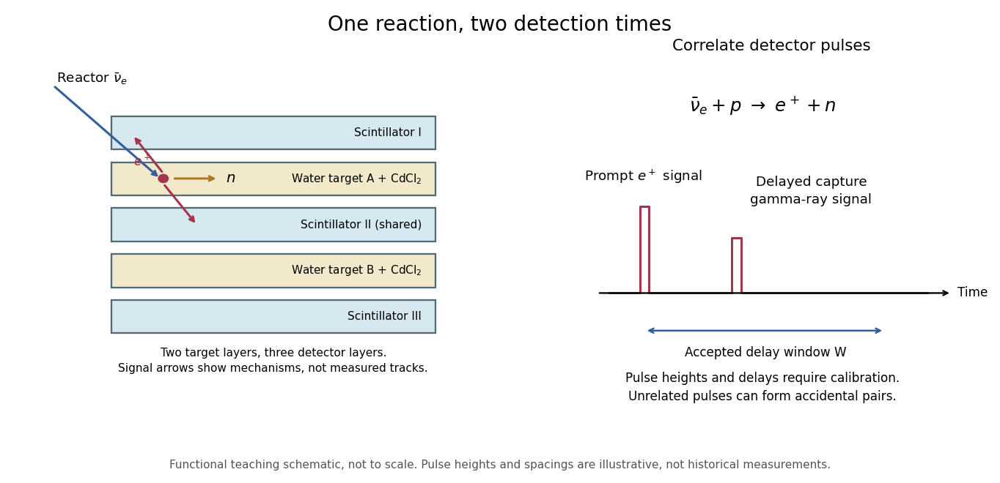

**[Figure 5](#image-separate-prompt-and-delayed-readouts-of-an-antineutrino-interaction). Separate prompt and delayed readouts of an antineutrino interaction**.

The original functional diagram separates the two signal mechanisms and their timing. It omits dimensions and phototube counts, and is not a reproduction of a historical drawing. The measured objects are detector pulses; identifying their common cause also requires calibration and background tests.

The 1956 paper describes positron-source and neutron-source calibrations, pulse-height gates and photographic pulse records. Diluting the target with [heavy water](ionic-bonding.md#heavy-water) halved the proton density and reactor signal while preserving neutron-detection efficiency. Changing the [cadmium](chemical-substance.md#cadmium) concentration altered capture timing; removing it removed the reactor signal. Added shielding tested competing external radiation. These interventions tested the reaction's ingredients, beyond simply observing a reactor-dependent count rate.[pp. 103–104, detector analysis and Experimental Results, tests 2–5](physics-bibliography.md#detection-of-the-free-neutrino-a-confirmation-by-clyde-cowan-and-others)

###### Delayed neutron-capture coincidence window

↑ **Parent:** [Cowan-Reines reactor antineutrino experiment](#cowan-reines-reactor-antineutrino-experiment)

Why not accept every delayed pulse? A longer window captures more genuine [neutron capture](#neutron-capture) signals, but also admits more [accidental coincidences](particle-detection.md#accidental-coincidence). Consider an original model with a capture waiting [time](classical-mechanics.md#time-in-physics) following an [exponential distribution](continuous-probability-distribution.md#exponential-distribution) of [mean](expected-value.md) $\tau>0$. Assume detection after a prompt signal accepts $0<t<W$, with perfect time measurement and no lower cut. Integrating the normalized density gives

$$
\epsilon(W)=\int_0^W\frac{e^{-t/\tau}}{\tau}\,dt=1-e^{-W/\tau}.
$$

This assumes that moderation, competing capture channels, boundaries and electronic recovery can be represented or neglected in a single effective waiting-time model. It is not a fitted historical capture law.

Let independent prompt-like and delayed-like background streams have [Poisson process](poisson-process.md) rates $R_p$ and $R_d$. The [accidental coincidence](particle-detection.md#accidental-coincidence) pair rate in a directed window of full width $W$ is $R_pR_dW$. Electronics producing at most one accepted delayed match per prompt instead give $R_p(1-e^{-R_dW})$. These definitions coincide to first order when $R_dW\ll1$. Correlated backgrounds, such as one external [neutron](neutron.md) producing both a prompt recoil and a later capture, require separate controls; an independent-stream estimate cannot remove them.

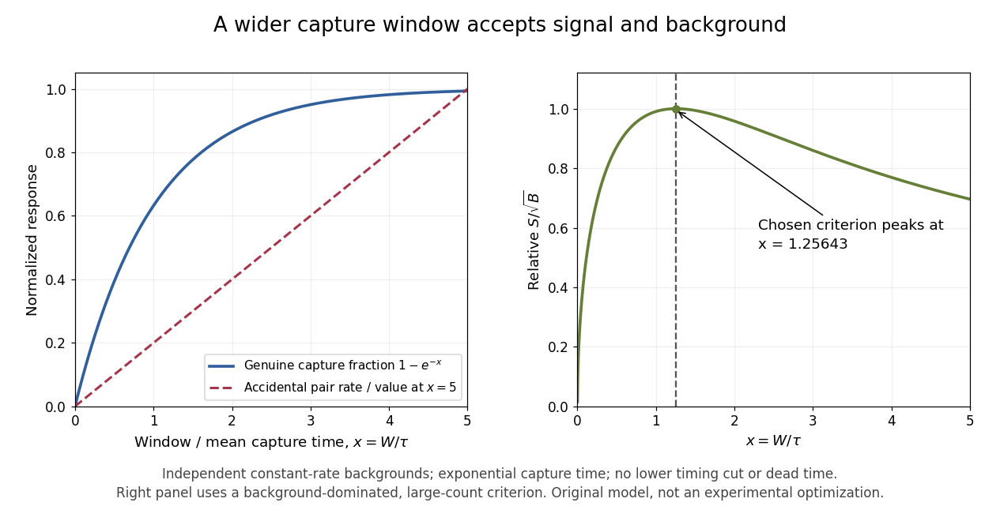

**[Figure 6](#image-longer-capture-windows-trade-signal-acceptance-for-accidental-background). Longer capture windows trade signal acceptance for accidental background**.

For chosen $\tau=20\,\mu\mathrm s$ and $W=50\,\mu\mathrm s$, the accepted fraction is $1-e^{-2.5}\simeq0.918$. With chosen $R_p=40\,\mathrm{s^{-1}}$ and $R_d=30\,\mathrm{s^{-1}}$, the pair rate is $0.0600\,\mathrm{s^{-1}}$, while the at-most-one rate is approximately $0.05996\,\mathrm{s^{-1}}$. These are teaching parameters, not reported Savannah River rates. A measured uncorrelated background can be tested using displaced time windows; a reactor-off measurement addresses a different question and cannot by itself characterize every reactor-correlated background.

###### Optimum capture window in a background-dominated model

↑ **Parent:** [Delayed neutron-capture coincidence window](#delayed-neutron-capture-coincidence-window)

If genuine pairs arrive at rate $S_0$ before the timing cut, an exposure $T$ gives $S=S_0T(1-e^{-W/\tau})$ and expected accidental pairs $B=R_pR_dWT$. In a background-dominated large-count approximation, maximizing $S/\sqrt B$ reduces to maximizing $f(x)=(1-e^{-x})/\sqrt x$ for $x=W/\tau>0$. Differentiation gives the positive stationary solution $e^x=1+2x$, or $x\simeq1.25643$. The endpoint $x=0$ solves the rearranged equation but is outside the domain of this derivative calculation; $f(x)$ tends to zero at both positive-domain extremes.

Thus the chosen $\tau=20\,\mu\mathrm s$ gives $W\simeq25.13\,\mu\mathrm s$ for this particular criterion, accepting about $0.715$ of genuine delayed signals. This differs from maximizing signal counts alone, which would favor longer windows. Small samples, appreciable signal fluctuations, unknown background, dead time and multiple-candidate vetoes require a fuller [likelihood](maximum-likelihood-estimation.md#likelihood-function) model. The calculation isolates a tradeoff rather than prescribing an experimental cut.

#### Nuclear decay constant

↑ **Parent:** [Radioactive decay](#radioactive-decay)

In the constant-rate [mathematical model](mathematics.md#mathematical-model), an undecayed [atomic nucleus](atomic-nucleus.md) has conditional probability

$$
\Pr(T\le t+\Delta t\mid T>t)=1-e^{-\lambda\Delta t}
=\lambda\Delta t+O((\lambda\Delta t)^2)
$$

of decaying during the next positive interval $\Delta t$. The [nuclear decay constant](#nuclear-decay-constant) has units of inverse [time](classical-mechanics.md#time-in-physics). Its value describes a rate; it does not specify a scheduled death time for one [atomic nucleus](atomic-nucleus.md). The conditional probability is independent of the age $t$, the [memorylessness of the exponential distribution](continuous-probability-distribution.md#memorylessness-of-the-exponential-distribution).

#### Finite-population radioactive decay

↑ **Parent:** [Radioactive decay](#radioactive-decay)

Take $N_0$ independently decaying [atomic nuclei](atomic-nucleus.md), each with lifetime $T_i$ drawn from an [exponential distribution](continuous-probability-distribution.md#exponential-distribution) of rate $\lambda$. With no replenishment, the survivor count is

$$
N(t)=\sum_{i=1}^{N_0}\mathbf1_{\{T_i>t\}},\qquad
p(t)=e^{-\lambda t}.
$$

Each [indicator variable](statistical-modelling.md#indicator-variable) has success probability $p(t)$, so the [binomial distribution](discrete-probability-distribution.md#binomial-distribution) gives

$$
\boxed{\mathbb E[N(t)]=N_0p(t),\qquad
\operatorname{Var}(N(t))=N_0p(t)(1-p(t)).}
$$

The smooth population law is the [expected value](expected-value.md) $\overline N(t)=\mathbb E[N(t)]$, satisfying $\overline N'=-\lambda\overline N$. One realization instead loses whole [atomic nuclei](atomic-nucleus.md) at discrete times. An observed count above the smooth curve need not contradict the [mathematical model](mathematics.md#mathematical-model).

For an original chosen example, let $N_0=1000$ and [half-life](analysis.md#half-life) $3\,\mathrm h$. Then $\lambda=\log2/(3\,\mathrm h)$. After $9\,\mathrm h$, the survival probability is $1/8$, giving

$$
\boxed{\mathbb E[N(9\,\mathrm h)]=125,\qquad
\operatorname{SD}(N(9\,\mathrm h))=\sqrt{109.375}\simeq10.46.}
$$

The [standard deviation](variance.md#standard-deviation) describes variation between repeated populations governed by these assumptions. It is not an uncertainty interval for a noiseless deterministic curve.

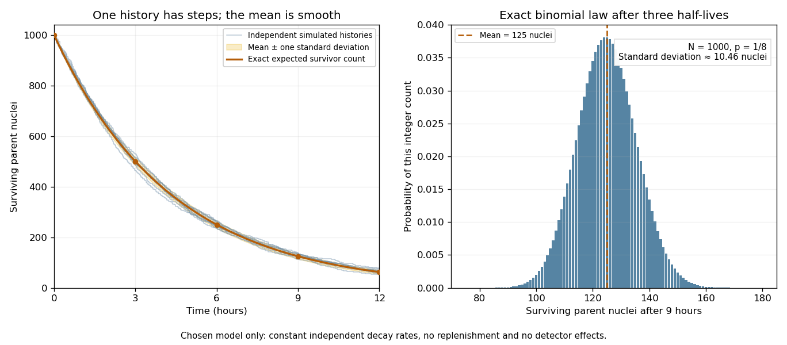

**[Figure 7](#image-random-survivor-counts-and-the-smooth-radioactive-decay-law). Random survivor counts and the smooth radioactive-decay law**. Original constant-rate model with $1000$ independent parent [atomic nuclei](atomic-nucleus.md) and a $3\,\mathrm h$ [half-life](analysis.md#half-life). Simulated histories are compared with their exact [expected value](expected-value.md) and a one-[standard deviation](variance.md#standard-deviation) band. The second panel shows the exact [binomial distribution](discrete-probability-distribution.md#binomial-distribution) after three half-lives. These are model calculations, not measurements from a historical sample.

The [half-life](analysis.md#half-life) and the mean lifetime answer different questions:

$$
t_{1/2}=\frac{\log2}{\lambda},\qquad
\mathbb E[T_i]=\frac1\lambda.
$$

The first is the [median](probability-distribution.md#median) of one lifetime, or the time when half the population survives on average. The second is the lifetime's [expected value](expected-value.md). In this example they are $3\,\mathrm h$ and approximately $4.33\,\mathrm h$.

#### Radioactive activity

↑ **Parent:** [Radioactive decay](#radioactive-decay)

With $n$ parent [atomic nuclei](atomic-nucleus.md) present, the conditional expected number of transformations in a short interval is approximately $\lambda n\Delta t$. The corresponding [radioactive activity](#radioactive-activity) is $A=\lambda n$. Averaging over the [finite-population radioactive decay](#finite-population-radioactive-decay) model gives $\overline A(t)=\lambda\overline N(t)$. Its unit is the [becquerel](#becquerel).[University Physics Volume 3 by Samuel J. Ling and others; Equations 10.17–10.20 and the following becquerel definition](physics-bibliography.md#university-physics-volume-3-by-samuel-j-ling-and-others/10-3-radioactive-decay)

For a finite counting interval, depletion matters. Suppose each transformation is recorded independently with [detection efficiency](#detection-efficiency) $\varepsilon$, with at most one count per transformation and no background. The [expected value](expected-value.md) of the count between $t$ and $t+\Delta t$ is

$$
\mathbb E[C]=\varepsilon\overline N(t)(1-e^{-\lambda\Delta t}).
$$

Only when $\lambda\Delta t\ll1$ does this become approximately $\varepsilon\overline A(t)\Delta t$. A count rate therefore needs a detector model before it can be interpreted as the source's [radioactive activity](#radioactive-activity).

##### Radioactive activity concentration

↑ **Parent:** [Radioactive activity](#radioactive-activity)

[radioactive activity](#radioactive-activity) per volume, in $\mathrm{Bq\,m^{-3}}$. This differs from mass-specific [radioactive activity](#radioactive-activity), usually expressed per kilogram.

##### Becquerel

↑ **Parent:** [Radioactive activity](#radioactive-activity)  
ⓦ [Wiki](https://en.wikipedia.org/wiki/Becquerel)

One [becquerel](#becquerel) is a [radioactive activity](#radioactive-activity) of one nuclear transformation per [second](#second).

##### Detection efficiency

↑ **Parent:** [Radioactive activity](#radioactive-activity)

The probability that an event of a specified kind produces a registered count in a specified arrangement. For a radiation detector, geometry, intervening material and the detector response can all affect [detection efficiency](#detection-efficiency).

<h4 id="becquerel-s-uranium-radiation-experiment">Becquerel's uranium-radiation experiment</h4>

↑ **Parent:** [Radioactive decay](#radioactive-decay)

In his 2 March 1896 report, [Henri Becquerel](nuclear-physicist.md#henri-becquerel) described [uranium](chemical-substance.md#uranium) salt crystals acting on a [photographic plate](optical-instrument.md#photographic-plate) through opaque wrapping. A [copper](chemical-substance.md#copper) cross weakened the exposure behind it. Plates prepared during intermittent sunshine were left in a drawer and developed on 1 March; unexpectedly strong images prompted deliberate dark tests. He placed a plate and crystals inside two opaque boxes in a drawer; one crystal was separated from the emulsion by glass. After five hours, both produced images. The separation tested transmission without direct chemical contact.[2 March 1896 communication: copper screen, delayed development, deliberate dark exposure and glass-separated crystal](physics-bibliography.md#sur-les-radiations-invisibles-emises-par-les-corps-phosphorescents-by-henri-becquerel)

The result challenged a dependence on immediate illumination. [Henri Becquerel](nuclear-physicist.md#henri-becquerel) still considered long-lasting invisible [phosphorescence](optics.md#phosphorescence) a possibility, and explicitly withheld a final explanation. The photographic readout established an effect through intervening material; it did not count nuclear transformations or measure a [nuclear decay constant](#nuclear-decay-constant).[Final two paragraphs: tentative invisible-phosphorescence hypothesis and limits of the inference](physics-bibliography.md#sur-les-radiations-invisibles-emises-par-les-corps-phosphorescents-by-henri-becquerel)

#### Curie ionization-current measurement

↑ **Parent:** [Radioactive decay](#radioactive-decay)

[Marie Curie](nuclear-physicist.md#marie-curie)'s thesis describes powdered material on the lower plate of a [capacitor](electromagnetism.md#capacitor), biased by a battery. Radiation made the intervening air conduct. The upper plate connected to an [electrometer](electric-charge.md#electrometer) and a loaded [piezoelectric crystal](quantum-mechanics.md#piezoelectric-crystal) of [quartz](chemical-substance.md#quartz). Adjusting the load supplied a known compensating [electric charge](electric-charge.md) while keeping the [electrometer](electric-charge.md#electrometer) at zero; charge divided by elapsed [time](classical-mechanics.md#time-in-physics) determined the [electric current](electric-charge.md#electric-current). Voltage scans identified a collection plateau. Contact potentials affected weak-field readings; excessively strong fields could instead introduce additional [ionization](atomic-physics.md#ionization). Fixed geometry and plateau operation made comparisons meaningful.[Chapter I(b), Messung der Strahlungsintensität, figures 1–3: apparatus, null compensation, saturation and field-dependent limitations](physics-bibliography.md#untersuchungen-uber-die-radioaktiven-substanzen-by-marie-curie)

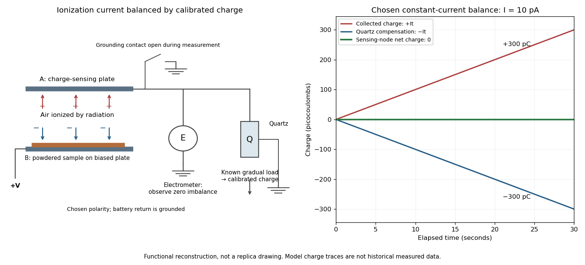

**[Figure 8](#image-the-functional-measurement-chain-in-curie-s-ionization-experiment). The functional measurement chain in Curie's ionization experiment**. Original schematic of the plate, [electrometer](electric-charge.md#electrometer) and compensation by [piezoelectricity](quantum-mechanics.md#piezoelectricity) in the [Curie ionization-current measurement](#curie-ionization-current-measurement). The charge traces use a stipulated constant $10\,\mathrm{pA}$ signal and an exactly opposing compensation ramp; they are not historical measured traces.

The null method turns a weak signal into a balance against a known quantity. In the diagram's chosen constant-current model, $I=10\,\mathrm{pA}$ for $\Delta t=30\,\mathrm s$ gives

$$
\boxed{Q=I\Delta t=300\,\mathrm{pC}.}
$$

Supplying $-300\,\mathrm{pC}$ over the same interval leaves zero net [electric charge](electric-charge.md) at the sensing node. The [electrometer](electric-charge.md#electrometer) detects imbalance; the compensating-charge calibration supplies the numerical measurement.

This [electric current](electric-charge.md#electric-current) measures collected charge produced by [ionization](atomic-physics.md#ionization). Converting it to [becquerels](#becquerel) additionally requires the energy deposition and charge-collection response per transformation. The apparatus can compare preparations without already possessing that complete source-to-signal calibration.

#### Radiogenic heating

↑ **Parent:** [Radioactive decay](#radioactive-decay)

Radiogenic heating is thermal energy deposited by [radioactive decay](#radioactive-decay). If its specific heating rate is $Q$ in watts per kilogram, the volumetric rate is $\rho Q$ and the heat input per horizontal area to a column of depth $H$ is $\rho QH$. The distinction between specific and volumetric rates matters in [dimensional analysis](mathematical-physics.md#dimensional-analysis) of a convective [heat flux](heat.md#heat-flux-density) law.

#### Sequential radioactive decay

↑ **Parent:** [Radioactive decay](#radioactive-decay)

In a chain $N_1\to N_2\to N_3$ with distinct decay constants, the [Bateman equation](#bateman-equation) expresses each population as a [linear combination](vector-space.md#linear-combination) of the [exponential functions](calculus.md#exponential-function) $e^{-\lambda_i t}$. When two consecutive constants coalesce to $\lambda$, the repeated [Laplace transform](integral-transform.md#laplace-transform) pole produces a term proportional to $t e^{-\lambda t}$.

##### Bateman equation

↑ **Parent:** [Sequential radioactive decay](#sequential-radioactive-decay)  
ⓦ [Wiki](https://en.wikipedia.org/wiki/Bateman_equation)

The Bateman equation gives the populations in a sequential [radioactive decay](#radioactive-decay) chain. For a parent with population $N_1(0)$ and an initially absent daughter, distinct decay constants give $N_2(t)=N_1(0)\lambda_1(e^{-\lambda_1t}-e^{-\lambda_2t})/(\lambda_2-\lambda_1)$; the first population satisfies $N_1'=-\lambda_1N_1$.

<h3 id="mossbauer-effect">Mössbauer effect</h3>

↑ **Parent:** [Nuclear physics](#nuclear-physics)

[This section is present in another page, follow this link to view it.](mossbauer-effect.md)

### Nuclear statistical equilibrium

↑ **Parent:** [Nuclear physics](#nuclear-physics)  
ⓦ [Wiki](https://en.wikipedia.org/wiki/Nuclear_statistical_equilibrium)

At sufficiently high temperature and density, forward and inverse nuclear reactions can balance so that abundances are determined by thermodynamic conditions, nuclear binding and conserved quantities. [Silicon burning](stellar-astrophysics.md#silicon-burning) approaches such an equilibrium among iron-group nuclei. Weak reactions can separately change the electron fraction, so the favored mixture need not be pure [iron](chemical-substance.md#iron).

<h4 id="nickel-iron-nuclear-equilibrium-ratio">Nickel–iron nuclear equilibrium ratio</h4>

↑ **Parent:** [Nuclear statistical equilibrium](#nuclear-statistical-equilibrium)

Nickel-56 and iron-54 have the same [neutron](neutron.md) number and differ by two [protons](#proton). Dividing their [nuclear statistical equilibrium](#nuclear-statistical-equilibrium) abundance formulas cancels the [neutron](neutron.md) density and leaves the displayed ratio, with $\Delta B=B_{56}-B_{54}$ and $K$ containing temperature-independent statistical and [mass](classical-mechanics.md#mass) factors in the simplified model. For material with equal total [proton](#proton) and [neutron](neutron.md) numbers and only these nuclei plus free [protons](#proton), charge balance gives $n_p=2n_{54}$. Thus $n_{56}/n_{54}^3\propto T^{-3}e^{\Delta B/(kT)}$. This has a finite [temperature](temperature.md) maximum only if the signed energy difference is negative; conventional positive total nuclear binding energies for these two actual isotopes instead give a positive difference.

#### Electron fraction in stellar matter

↑ **Parent:** [Nuclear statistical equilibrium](#nuclear-statistical-equilibrium)

For electrically neutral fully ionized matter, $Y_e$ is the number of electrons, or total [protons](#proton), per baryon. With isotope [mass](classical-mechanics.md#mass) fractions $X_i$, charge numbers $Z_i$ and [mass](classical-mechanics.md#mass) numbers $A_i$, the displayed sum neglects small nuclear mass-defect corrections. Strong and electromagnetic reactions preserve it, while [electron capture](#electron-capture) and [beta-plus decay](#beta-plus-decay) reduce it. The proton-to-neutron number ratio is $Y_e/(1-Y_e)$.

##### Neutron excess

↑ **Parent:** [Electron fraction in stellar matter](#electron-fraction-in-stellar-matter)

The [neutron excess](#neutron-excess) is the number of [neutrons](neutron.md) minus [protons](#proton) per baryon. A mixture of carbon-12 and oxygen-16 has zero [neutron excess](#neutron-excess), while neon-22 contributes $2/22$ per baryon in that isotope. Thus a neon-22 [mass](classical-mechanics.md#mass) fraction $X_{22}$ gives $\eta=X_{22}/11$. A nonzero excess shifts iron-group ashes from symmetric nickel-56 toward neutron-rich isotopes, even before additional weak reactions occur.

### Neutron capture

↑ **Parent:** [Nuclear physics](#nuclear-physics)  
ⓦ [Wiki](https://en.wikipedia.org/wiki/Neutron_capture)

Capture of a neutron increases mass number without immediately changing atomic number. It avoids the charged-particle [Coulomb barrier](#coulomb-barrier). Subsequent [beta-minus decay](#beta-minus-decay) can increase atomic number. Whether capture is slow or fast compared with relevant beta decays distinguishes the [slow neutron-capture process](stellar-astrophysics.md#s-process) from the [rapid neutron-capture process](#r-process).

#### Neutron-capture excitation energy

↑ **Parent:** [Neutron capture](#neutron-capture)

After neutron capture on $(A,Z)$, the compound nucleus is $(A+1,Z)$. With negligible incoming kinetic energy, conservation of [energy](energy.md) gives $E^*=M(A,Z)+m_n-M(A+1,Z)$ in [natural units](mathematical-physics.md#natural-units). This is the [neutron separation energy](atomic-nucleus.md#neutron-separation-energy) of the compound nucleus. At finite incident energy, add the kinetic energy in the initial [centre-of-momentum frame](special-relativity.md#center-of-momentum-frame); in a nonrelativistic heavy-target approximation it is $A/(A+1)$ times the laboratory neutron kinetic energy. [Nuclear pairing](atomic-nucleus.md#nuclear-pairing) can significantly change capture excitation between neighboring even- and odd-mass targets.

### Nucleosynthesis

↑ **Parent:** [Nuclear physics](#nuclear-physics)  
ⓦ [Wiki](https://en.wikipedia.org/wiki/Nucleosynthesis)

[Nucleosynthesis](#nucleosynthesis) is the production of [atomic nuclei](atomic-nucleus.md) through [nuclear reactions](#nuclear-reaction). It includes [Big Bang nucleosynthesis](cosmology.md#big-bang-nucleosynthesis), [stellar nucleosynthesis](#stellar-nucleosynthesis) and production in explosive or compact-remnant environments. Making nuclei and delivering them to the [interstellar medium](galaxy.md#interstellar-medium) are separate steps in chemical enrichment.

#### Stellar nucleosynthesis

↑ **Parent:** [Nucleosynthesis](#nucleosynthesis)  
ⓦ [Wiki](https://en.wikipedia.org/wiki/Stellar_nucleosynthesis)

[Stellar nucleosynthesis](#stellar-nucleosynthesis) encompasses nuclear production during stellar evolution and explosions, including [hydrogen burning](stellar-astrophysics.md#hydrogen-burning), [core helium burning](stellar-astrophysics.md#core-helium-burning), advanced burning and neutron-capture processes. Stellar mass, composition, mixing and mass loss govern which nuclei form and which eventually escape. [Slow neutron-capture process](stellar-astrophysics.md#s-process) and [rapid neutron-capture process](#r-process) build many nuclei beyond the iron group.

##### Neon-22 neutron excess from nitrogen-14

↑ **Parent:** [Stellar nucleosynthesis](#stellar-nucleosynthesis)

Two alpha captures and an intervening [beta-plus decay](#beta-plus-decay) turn each nitrogen-14 nucleus into neon-22, incorporating eight baryons from [helium](chemical-substance.md#helium) and converting one [proton](#proton) to a [neutron](neutron.md). With no loss or dilution and nuclear [mass](classical-mechanics.md#mass) defects neglected, a nitrogen-14 [mass](classical-mechanics.md#mass) fraction $X_{14}$ therefore yields neon-22 [mass](classical-mechanics.md#mass) fraction $(22/14)X_{14}$, not $X_{14}$. In otherwise symmetric carbon-oxygen matter this gives the displayed [electron fraction in stellar matter](#electron-fraction-in-stellar-matter). A final [neon](chemical-substance.md#neon) [mass](classical-mechanics.md#mass) fraction and a pre-helium-burning metallicity must not silently be treated as identical.

##### Gamma-process nucleosynthesis

↑ **Parent:** [Stellar nucleosynthesis](#stellar-nucleosynthesis)

Hot explosive material can use [photodisintegration](#nuclear-photodisintegration) on pre-existing heavy seed nuclei through neutron, proton and alpha emission. This gamma process supplies some proton-rich isotopes that the principal neutron-capture paths bypass. It is a particular mechanism, rather than a synonym for every proposed proton-rich nucleosynthetic process.

##### r-process

↑ **Parent:** [Stellar nucleosynthesis](#stellar-nucleosynthesis)  
ⓦ [Wiki](https://en.wikipedia.org/wiki/r-process)

At sufficiently large neutron density, successive [neutron captures](#neutron-capture) outrun relevant beta decays and produce very neutron-rich nuclei. Decay toward stability afterward yields many heavy isotopes, including some actinides. Neutron-rich ejecta from [neutron star mergers](stellar-astrophysics.md#neutron-star-merger) provide an established site; particular magnetically driven collapse outflows are additional candidates. This does not imply that every ordinary [core-collapse supernova](stellar-astrophysics.md#core-collapse-supernova) produces a complete heavy-element pattern.

### Nuclear reaction

↑ **Parent:** [Nuclear physics](#nuclear-physics)  
ⓦ [Wiki](https://en.wikipedia.org/wiki/Nuclear_reaction)

A [nuclear reaction](#nuclear-reaction) transforms one or more [atomic nuclei](atomic-nucleus.md) through interactions with particles or other nuclei. Total energy, momentum, electric charge and nucleon number constrain ordinary low-energy reaction bookkeeping. [Nuclear fusion](#nuclear-fusion), [alpha capture](#alpha-capture), [neutron capture](#neutron-capture) and [photodisintegration](#nuclear-photodisintegration) are important examples in [stellar nucleosynthesis](#stellar-nucleosynthesis). Weak processes can also change the proton-to-neutron ratio.

#### Photonuclear reaction

↑ **Parent:** [Nuclear reaction](#nuclear-reaction)

A nuclear reaction initiated by absorption or scattering of a [photon](quantum-mechanics.md#photon). Such channels may contribute to attenuation at photon energies above their relevant nuclear thresholds; they are distinct from atomic [photoelectric absorption](quantum-mechanics.md#photoelectric-absorption) and electron–positron [pair production](perturbative-quantum-field-theory.md#pair-production).

#### Compound nucleus

↑ **Parent:** [Nuclear reaction](#nuclear-reaction)

An intermediate excited [atomic nucleus](atomic-nucleus.md) formed when the reactants' available [energy](energy.md) is redistributed among nuclear degrees of freedom before decay. Its resolved levels can appear as resonances. An isolated level's formation and decay into particular channels are described by [partial decay widths](relativistic-quantum-field.md#partial-decay-width) in the [Breit-Wigner resonance cross section](quantum-scattering.md#breit-wigner-resonance-cross-section); direct reactions and overlapping resonances need not obey that simple one-level description.

#### Nuclear reaction cross-section

↑ **Parent:** [Nuclear reaction](#nuclear-reaction)

The effective [area](differential-geometry.md#surface-area) for a specified [nuclear reaction](#nuclear-reaction) channel at given incident [energy](energy.md). Multiplying incident [particle flux](#particle-flux), target count and this [cross section](#cross-section-physics) gives an ideal event rate; target losses and [detection efficiency](#detection-efficiency) require separate corrections.

##### Macroscopic nuclear reaction cross section

↑ **Parent:** [Nuclear reaction cross-section](#nuclear-reaction-cross-section)

A reaction coefficient formed from target [number densities](statistical-physics.md#number-density) and microscopic [nuclear reaction cross-sections](#nuclear-reaction-cross-section). It has inverse-length units. Multiplying it by the scalar [neutron flux](neutron.md#neutron-flux) gives the corresponding reaction rate per volume, under the stated energy averaging.

##### Neutron absorption cross section

↑ **Parent:** [Nuclear reaction cross-section](#nuclear-reaction-cross-section)

A cross section for removal of an incident neutron by absorption, including capture and neutron-induced fission where relevant. Its value depends on nuclide and neutron energy.

#### Nuclear reaction Q-value

↑ **Parent:** [Nuclear reaction](#nuclear-reaction)

The initial minus final rest [energy](energy.md) in a [nuclear reaction](#nuclear-reaction); positive values represent [energy](energy.md) available for outgoing [kinetic energy](energy.md#kinetic-energy) in addition to the incident [kinetic energy](energy.md#kinetic-energy).

##### Resonance channel threshold conversion

↑ **Parent:** [Nuclear reaction Q-value](#nuclear-reaction-q-value)

The same compound-state [energy](energy.md) is measured from different rest-energy thresholds in different entrance channels. Subtracting those thresholds converts the required centre-of-momentum [kinetic energies](energy.md#kinetic-energy). For a stationary target and nonrelativistic projectile, the laboratory [kinetic energy](energy.md#kinetic-energy) is $T_{\rm lab}=T^*(m_{\rm projectile}+m_{\rm target})/m_{\rm target}$. A negative converted $T^*$ means that entrance channel is closed at that resonance [energy](energy.md).

### Beta-minus decay

↑ **Parent:** [Nuclear physics](#nuclear-physics)

An energetically allowed weak transition converts a neutron into a proton, emitting an electron and an electron antineutrino. Free [neutron](neutron.md) decay is an example; in nuclei, the nuclear binding energy determines whether the transition is possible.

### Nuclear fusion

↑ **Parent:** [Nuclear physics](#nuclear-physics)

Fusion combines nuclear reactants into heavier compound nuclei or products. A net decrease in rest mass releases energy; heavier fusion reactions can instead require energy. [Stellar nuclear fusion](stellar-astrophysics.md#stellar-nuclear-fusion) uses exothermic networks to power stars, and [quantum tunnelling](quantum-mechanics.md#quantum-tunnelling) through the [Coulomb barrier](#coulomb-barrier) permits many charged-particle reactions at stellar temperatures.

#### Lawson criterion

↑ **Parent:** [Nuclear fusion](#nuclear-fusion)  
ⓦ [Wiki](https://en.wikipedia.org/wiki/Lawson_criterion)

A fusion energy-balance requirement on [density](fluid-mechanics.md#density), confinement time and [temperature](temperature.md) under a stated loss and reaction model. A numerical density-time threshold is conditional on fuel and [temperature](temperature.md); it must not be silently identified with an alpha-stopping areal-density threshold.

#### Alpha capture

↑ **Parent:** [Nuclear fusion](#nuclear-fusion)

Capture of an [alpha particle](atomic-nucleus.md#alpha-particle) increases the mass number by four and atomic number by two. Radiative alpha capture releases a photon, while reactions such as $(\alpha,n)$ can instead emit a neutron. [Carbon-12 alpha capture](#carbon-12-alpha-capture) competes with helium production of carbon during [core helium burning](stellar-astrophysics.md#core-helium-burning).

##### Carbon-12 alpha capture

↑ **Parent:** [Alpha capture](#alpha-capture)

Capture of an [alpha particle](atomic-nucleus.md#alpha-particle) by [carbon](chemical-substance.md#carbon)-12 makes [oxygen](chemical-substance.md#oxygen)-16. Competition between this reaction and the [Triple-alpha process](stellar-astrophysics.md#triple-alpha-process) helps determine the carbon-to-oxygen ratio after [core helium burning](stellar-astrophysics.md#core-helium-burning).

#### Coulomb barrier

↑ **Parent:** [Nuclear fusion](#nuclear-fusion)

Repulsion between positively charged nuclei creates this electrostatic energy barrier outside the short-range nuclear interaction. [Quantum tunnelling](quantum-mechanics.md#quantum-tunnelling) allows reaction at thermal energies below its classical height and contributes the penetration factor in the [Gamow peak](stellar-astrophysics.md#gamow-peak).

##### Gamow factor

↑ **Parent:** [Coulomb barrier](#coulomb-barrier)

The semiclassical penetration factor for two repelling point charges is approximately $\exp(-2\pi\eta)$, where $\eta=Z_1Z_2\alpha_{\rm fs}\sqrt{\mu c^2/(2E)}$. It represents the long-range Coulomb suppression, not the [nuclear reaction](#nuclear-reaction) probability after penetration.

### Nuclear photodisintegration

↑ **Parent:** [Nuclear physics](#nuclear-physics)

A sufficiently energetic photon can break up a nucleus, consuming energy for an endothermic breakup. In [neon burning](stellar-astrophysics.md#neon-burning) and [silicon burning](stellar-astrophysics.md#silicon-burning), such steps combine with captures to form a larger reaction network whose net energy balance can be positive.

### Beta-plus decay

↑ **Parent:** [Nuclear physics](#nuclear-physics)

An energetically allowed weak nuclear transition converts a proton into a neutron, emitting a positron and electron [neutrino](standard-model.md#neutrino). Positron annihilation deposits additional electromagnetic energy, while the [neutrino](standard-model.md#neutrino) can escape. These transitions are steps of the [CNO cycle](stellar-astrophysics.md#cno-cycle) and the pp III branch; an isolated free proton cannot undergo this decay.

### Electron capture

↑ **Parent:** [Nuclear physics](#nuclear-physics)

A nucleus can capture an electron when energetically allowed, converting a proton into a neutron and emitting an electron [neutrino](standard-model.md#neutrino). Beryllium-7 [electron capture](#electron-capture) participates in one of the [proton-proton chain branches](stellar-astrophysics.md#proton-proton-chain-branches). Stellar capture rates depend on ionization, [mass density](fluid-mechanics.md#density) and electron phase space.

### Nuclear force

↑ **Parent:** [Nuclear physics](#nuclear-physics)

[This section is present in another page, follow this link to view it.](nuclear-force.md)

### Atomic nucleus

↑ **Parent:** [Nuclear physics](#nuclear-physics)

[This section is present in another page, follow this link to view it.](atomic-nucleus.md)

## Semiconductor

↑ **Parent:** [Physics](physics.md)

[This section is present in another page, follow this link to view it.](semiconductor.md)

## Acoustics

↑ **Parent:** [Physics](physics.md)  
ⓦ [Wiki](https://en.wikipedia.org/wiki/Acoustics)

### Sound spectrum

↑ **Parent:** [Acoustics](#acoustics)

Distribution of the components of [sound waves](fluid-mechanics.md#acoustic-wave) over [frequency](wave.md#frequency). The relative amplitudes and their evolution contribute to [timbre](neuroscience.md#timbre); a spectrum is distinct from a statement of the fundamental pitch alone.

### Free reed aerophone

↑ **Parent:** [Acoustics](#acoustics)  
ⓦ [Wiki](https://en.wikipedia.org/wiki/Free_reed_aerophone)

#### Free reed

↑ **Parent:** [Free reed aerophone](#free-reed-aerophone)

An elastic tongue fixed at one end and moving through a close-fitting opening without regularly striking its frame. An airflow can maintain oscillation by exchanging [energy](energy.md) with the reed's elastic motion. This mechanism is an analogy for some aspects of [phonation](anatomy.md#phonation), not an anatomical identity.

### Sonification

↑ **Parent:** [Acoustics](#acoustics)

Representation of data through sound. In an image encoder, [frequency](wave.md#frequency), [amplitude](wave.md#wave-amplitude), time and spatial auditory cues can label different image properties. Assigning several independent quantities to one auditory dimension can lose information unless the code supplies a way to separate them.

### Reverberation time

↑ **Parent:** [Acoustics](#acoustics)

The conventional [reverberation time](#reverberation-time) $T_{60}$ is the time for the level of decaying acoustic [energy](energy.md) to decrease by $60$ [decibels](#decibel), a factor $10^6$ in [energy](energy.md) or $10^3$ in pressure [wave amplitude](wave.md#wave-amplitude). For exponential [energy](energy.md) decay $E(t)=E(0)e^{-t/\tau_E}$, $T_{60}=6\ln(10)\tau_E$. It is not the [exponential relaxation time](differential-equation.md#exponential-relaxation-time) itself and cannot be inferred exactly from an unspecified audibility threshold.

### Reverberation

↑ **Parent:** [Acoustics](#acoustics)  
ⓦ [Wiki](https://en.wikipedia.org/wiki/Reverberation)

[Reverberation](#reverberation) is the persistence of [acoustic waves](fluid-mechanics.md#acoustic-wave) after a source stops, produced by repeated reflections in an enclosure. A diffuse-room approximation gives an approximately exponential decay of mean acoustic [energy](energy.md); an individual [normal mode](wave-equation.md#normal-mode) may instead be described as a damped [resonator](dynamical-systems.md#resonator).

### Acoustic attenuation

↑ **Parent:** [Acoustics](#acoustics)

### First sound

↑ **Parent:** [Acoustics](#acoustics)

An ordinary [acoustic wave](fluid-mechanics.md#acoustic-wave) involving a [pressure](pressure.md) and [density](fluid-mechanics.md#density) oscillation in local thermodynamic equilibrium. In a [Fermi liquid](fermi-liquid.md), this hydrodynamic response requires collisions fast compared with the oscillation period; [zero sound](fermi-liquid.md#zero-sound) instead describes a collisionless collective mode.

### Acoustic eikonal equation in a shear flow

↑ **Parent:** [Acoustics](#acoustics)

For a slowly varying parallel [shear flow](fluid-mechanics.md#shear-flow) $U(y)\mathbf e_x$, the leading [WKB method](elasticity-physics.md#wkb-method) neglects mean-velocity gradients while retaining local advection. The [continuity equation](mathematical-physics.md#continuity-equation) and [linearized Euler equations](euler-equations-for-an-inviscid-fluid.md#linearized-euler-equations) then give the displayed acoustic [dispersion relation](dispersion-relation.md). On the positive intrinsic-frequency branch, $\omega=Uk_x+c_0|\mathbf k|$ and the [group velocity](dispersion-relation.md#group-velocity) is $U\mathbf e_x+c_0\mathbf k/|\mathbf k|$. A [wavefront](physical-optics.md#wavefront) normal is parallel to $\mathbf k$; the acoustic energy-ray direction generally differs because of the advection term.

#### Ray turning in a wall shear layer

↑ **Parent:** [Acoustic eikonal equation in a shear flow](#acoustic-eikonal-equation-in-a-shear-flow)

In a stationary, horizontally homogeneous wall [boundary layer](continuum-mechanics.md#boundary-layer), [Hamiltonian ray-tracing equations](elasticity-physics.md#hamiltonian-ray-tracing-equations) conserve $\omega$ and $k_x$. If $U$ increases away from the wall, downstream-oriented $k_x>0$ waves have decreasing positive intrinsic [frequency](wave.md#frequency) and decreasing $k_y^2$. At $U=\omega/k_x-c_0$, the transverse [wavenumber](wave-equation.md#wavenumber) vanishes and the acoustic ray turns. For $U(0)=0$, a downstream launch angle $\beta_0$ above the wall can reach a uniform stream of [Mach number](compressible-flow.md#mach-number) $M_\infty$ only if $\cos\beta_0\le(1+M_\infty)^{-1}$. This uses the positive acoustic branch, constant [sound speed](compressible-flow.md#speed-of-sound) and no intervening critical layer; a turning point itself requires a uniform local approximation rather than the ordinary [WKB method](elasticity-physics.md#wkb-method).

### Small-height Neumann scattering

↑ **Parent:** [Acoustics](#acoustics)

For a rigid rough boundary and incident pressure $Ae^{i\alpha x-i\beta z}$, use time dependence $e^{-i\omega t}$ and $\alpha^2+\beta^2=k^2$. The flat reflected wave is $Ae^{i\alpha x+i\beta z}$. Expanding the [Neumann boundary condition](differential-equation.md#neumann-boundary-condition) at $z=0$ gives $\partial_z\psi_1=2Ae^{i\alpha x}(\beta^2h+i\alpha h')$. For height transform $\widehat h(q)=\int h(x)e^{-iqx}dx$, the outgoing correction is $(2A/(2\pi i))\int (k^2-\alpha q)\widehat h(q-\alpha)e^{iqx+i\beta(q)z}/\beta(q)\,dq$, with $\beta(q)=\sqrt{k^2-q^2}$ on the outgoing sheet. Controlled height expansions also require adequate slope and spectral regularity; small incident phase displacement alone does not bound every normal-derivative correction.

#### Oblique coherent reflection from a stationary rigid rough surface

↑ **Parent:** [Small-height Neumann scattering](#small-height-neumann-scattering)

For a zero-mean stationary rough height, the mean first-order correction vanishes. At second order, the boundary derivative is $-h\partial_z^2\psi_1+h'\partial_x\psi_1$. Averaging this expression using the [power spectrum of surface height](#power-spectrum-of-surface-height) gives the displayed coherent reflection coefficient. Thus the [root mean square](analysis.md#root-mean-square) height alone does not fix the coherent mean: the height correlation spectrum matters. For roughness varying slowly enough that $q\simeq\alpha$ in the integral, $r_N\simeq1-2\beta^2\sigma^2$. A local random-height phase average needs this additional approximation and is not a general consequence of stationarity.

### Sonar

↑ **Parent:** [Acoustics](#acoustics)  
ⓦ [Wiki](https://en.wikipedia.org/wiki/Sonar)

Sonar uses sound propagation and reflected signals to detect objects or measure distances. Upward-looking sonar can record [sea-ice draft](geophysics.md#sea-ice-draft) along a moving platform's track; beam width, return selection and processing affect the inferred profile.

### Acoustic waveguide

↑ **Parent:** [Acoustics](#acoustics)

An acoustic waveguide confines sound transversely while allowing longitudinal propagation. Rigid walls impose a homogeneous normal-velocity condition, producing Neumann transverse modes. Each transverse eigenvalue gives a longitudinal wave number: modes below their cutoff decay evanescently, while cut-on modes carry outgoing sound. An open semi-infinite guide can be studied with the [Wiener-Hopf method](boundary-value-problem.md#wiener-hopf-method).

#### Independent-edge radiation from an open planar duct

↑ **Parent:** [Acoustic waveguide](#acoustic-waveguide)

For the even [acoustic waveguide](#acoustic-waveguide) mode $\cos(n\pi y/h)e^{-ikx}$, set $\sin\alpha=n\pi/(k_0h)$ and $k=k_0\cos\alpha>0$. At leading independent-edge order for large $k_0h$, the two incident travelling constituents each have amplitude $(-1)^n/2$ at the relevant wall endpoint. Reflecting the upper-edge coordinates reverses the edge-wave sign. Their path phases are $e^{\pm ik_0h\sin\theta}$. Thus [Sommerfeld half-plane diffraction](partial-differential-equation.md#sommerfeld-half-plane-diffraction) gives the displayed sum, where $D(r)=\sqrt{2/(\pi k_0r)}e^{-ik_0r-i\pi/4}$. For $n>0$, the apparent poles at $\theta=\pm\alpha$ are removable in the combined expression, with limit $ikhD(r)/2$. Single-edge nonuniform far-field poles are not physical infinities. This combined far-field limit assumes a radiation distance beyond the aperture's near field and neglects further edge interactions; it is not uniform at duct cutoff.

#### Wiener-Hopf solution for an open parallel-plate waveguide

↑ **Parent:** [Acoustic waveguide](#acoustic-waveguide)

For rigid plates $x>0$, $y=\pm b$, an even incident plane wave travelling toward the opening can be scattered using [Wiener-Hopf factorization](boundary-value-problem.md#wiener-hopf-factorization). With time dependence $e^{i\omega t}$ and transform $\Phi(k)=\int\phi(x)e^{ikx}dx$, take $\gamma=\sqrt{k^2-k_0^2}$ on the outgoing sheet. The common normal derivative on $y=b$ is supported on $x<0$; its transform is $D^-=iL^+(-k_0)L^-(k)/(k+k_0)$. The interior transform is $D^-\cosh(\gamma y)/(\gamma\sinh(\gamma b))$, while the exterior transform is $-D^-e^{-\gamma(|y|-b)}/\gamma$. These follow from continuity of normal velocity and the half-line pressure jump, followed by [pole subtraction in a Wiener-Hopf equation](boundary-value-problem.md#pole-subtraction-in-a-wiener-hopf-equation) and a finite-energy edge condition.

##### Upstream decay of an open parallel-plate waveguide

↑ **Parent:** [Wiener-Hopf solution for an open parallel-plate waveguide](#wiener-hopf-solution-for-an-open-parallel-plate-waveguide)

For fixed $|y|<b$ and $x\to-\infty$, the incident pole in the scattered transform cancels the analytic continuation of the incident plane wave. Near $k=-k_0$, the remaining transform is proportional to $(k+k_0)^{-1/2}$, so the total outgoing field has the displayed inverse-square-root cylindrical decay. A claim of square-root growth at negative infinity is incompatible with this outgoing solution.

#### Acoustic equipartition in a rigid waveguide

↑ **Parent:** [Acoustic waveguide](#acoustic-waveguide)

For a separated acoustic potential with transverse Neumann eigenvalue $\kappa^2$, integration by parts gives $\int|\nabla_\perp F|^2=\kappa^2\int F^2$. The time-averaged kinetic energy is proportional to $(k^2+\kappa^2)\int F^2$, while compression energy is proportional to $\omega^2\int F^2/c_0^2$. The dispersion relation $\omega^2=c_0^2(k^2+\kappa^2)$ proves equality. At a ray speed below $c_0$, nondegenerate stationary phase gives dispersive amplitudes of order $t^{-1/2}$; the zero transverse mode instead preserves an undispersed pulse on the sound-speed ray.

#### Outgoing modes of an open rigid acoustic waveguide

↑ **Parent:** [Acoustic waveguide](#acoustic-waveguide)

For an even field between rigid plates at $y=\pm b$, the transverse modes are $\cos(n\pi y/b)$, with longitudinal wave numbers $k_n=\sqrt{k_0^2-(n\pi/b)^2}$. With time dependence $e^{i\omega t}$, outgoing modes into $x>0$ use $e^{-ik_nx}$: choose positive real $k_n$ for cut-on modes and negative imaginary $k_n$ for cut-off modes. A lower-half-plane [Fourier inversion](fourier-analysis.md#fourier-inversion-theorem) extracts these modes by [residues](analysis.md#residue). Their decaying components are [evanescent waves](elasticity-physics.md#evanescent-wave), not backward-propagating waves. At an exact cutoff one takes the radiation continuation before its limit.

### Acoustic analogy

↑ **Parent:** [Acoustics](#acoustics)

An acoustic analogy rearranges fluid conservation equations into a chosen linear acoustic propagation operator plus effective forcing. The rearrangement can be exact before source approximations are made. A term classified as forcing can also contain propagation effects omitted from the reference operator; this produces [propagation-source ambiguity in an acoustic analogy](#propagation-source-ambiguity-in-an-acoustic-analogy). The [Lighthill acoustic analogy](linear-acoustics.md#lighthill-acoustic-analogy) is a familiar homogeneous reference-medium example.

#### Propagation-source ambiguity in an acoustic analogy

↑ **Parent:** [Acoustic analogy](#acoustic-analogy)

The distinction between generation and propagation depends partly on the reference operator chosen in an [acoustic analogy](#acoustic-analogy). For example, a homogeneous-Laplacian operator with spatially varying reference sound speed omits the first-gradient terms of the [stratified acoustic pressure equation](linear-acoustics.md#stratified-acoustic-pressure-equation). These terms then reappear as effective forcing, even for a freely propagating small disturbance in a static medium. A right-hand-side term is therefore not automatically an independent physical noise source.

#### Pressure-based acoustic analogy with a potential body force

↑ **Parent:** [Acoustic analogy](#acoustic-analogy)

Eliminating momentum between the [continuity equation](mathematical-physics.md#continuity-equation) and [conservation of momentum](momentum.md#momentum-conservation) gives $\rho_{tt}=\partial_i\partial_j(\rho u_i u_j-\sigma_{ij})+\nabla^2(p+\chi)$ when the force density is $-\nabla\chi$. For $q=p-(P-\chi)$ and time-independent reference fields,

$$
(\widehat c_0^{-2}\partial_t^2-\nabla^2)q=\partial_i\partial_jW_{ij}+Q_{tt},\qquad
W_{ij}=\rho u_i u_j-\sigma_{ij},\qquad Q=q/\widehat c_0^2-(\rho-\widehat\rho_0).
$$

No energy equation is needed for this identity. The arbitrary reference fields should match the stationary medium where the outgoing sound is evaluated.

### Small-height Dirichlet scattering

↑ **Parent:** [Acoustics](#acoustics)

[Small-height Dirichlet scattering](#small-height-dirichlet-scattering) expands the acoustic boundary condition about a mean plane for a fixed regular surface profile. The zeroth-order field includes the flat reflection; higher orders solve outgoing [Helmholtz equation](partial-differential-equation.md#helmholtz-equation) problems with induced boundary data. Small $|kh|$ controls the incident-field Taylor expansion, but rapidly varying roughness can require additional control of normal derivatives and spectral moments.

#### Coherent reflection from a stationary rough surface

↑ **Parent:** [Small-height Dirichlet scattering](#small-height-dirichlet-scattering)

Through second order in height, a normally incident acoustic plane wave has the displayed mean reflected [amplitude](wave.md#wave-amplitude) for a Dirichlet boundary. The propagating part of the [power spectrum of surface height](#power-spectrum-of-surface-height) contributes a positive real correction to the negative flat reflection coefficient, while the evanescent part contributes an imaginary correction. The mean linear rough correction is zero.

##### Height-correlation dependence of coherent reflection

↑ **Parent:** [Coherent reflection from a stationary rough surface](#coherent-reflection-from-a-stationary-rough-surface)

The quadratic coherent correction weights the [power spectrum of surface height](#power-spectrum-of-surface-height) by $\beta(q)$, so equal [root mean square](analysis.md#root-mean-square) heights can give different mean fields. Only an additional long-spatial-scale approximation, with spectrum concentrated at $|q|\ll k$, reduces it to $2k^2\sigma^2$. Second-order surface scattering therefore contains information absent from first-order coherent reflection.

#### Power spectrum of surface height

↑ **Parent:** [Small-height Dirichlet scattering](#small-height-dirichlet-scattering)

For a real zero-mean stationary height process, its [power spectrum of surface height](#power-spectrum-of-surface-height) is the [Fourier transform](fourier-transform.md) of the height [covariance function](stochastic-process.md#covariance-function). It is even and nonnegative, and $\sigma^2=(2\pi)^{-1}\int S_h(q)dq$. More general stationary processes have a spectral measure rather than a density. Weighted spectral moments control the existence of boundary derivatives and second-order mean scattering corrections.

#### Physical surface trace and reference-plane trace

↑ **Parent:** [Small-height Dirichlet scattering](#small-height-dirichlet-scattering)

For normal incidence on a Dirichlet rough surface, the scattered trace on the moving boundary is exactly $-e^{-ikh(x)}$. Its trace on the mean plane is instead $-1+2ikh+2k h\mathcal B h+\cdots$. The two traces are related by a normal Taylor expansion and must not be identified. Their ensemble averages can therefore have different quadratic coefficients without inconsistency.

#### Second-order rough-surface scattered field

↑ **Parent:** [Small-height Dirichlet scattering](#small-height-dirichlet-scattering)

For normal plane-wave incidence, the second-order [Dirichlet boundary condition](differential-equation.md#dirichlet-boundary-condition) gives $\psi_s^{[2]}=-h\partial_z\psi_s^{[1]}$ at the mean plane, since $\partial_z^2\psi^{[0]}$ vanishes there. The [Dirichlet-to-Neumann map for a Helmholtz half-space](partial-differential-equation.md#dirichlet-to-neumann-map-for-a-helmholtz-half-space) then yields $2k h\mathcal B h$. This nonlocal expression is not generally $2k^2h^2$; that local limit needs roughness varying slowly compared with the wavelength.

#### First-order rough-surface scattered field

↑ **Parent:** [Small-height Dirichlet scattering](#small-height-dirichlet-scattering)

Taylor expansion of the [Dirichlet boundary condition](differential-equation.md#dirichlet-boundary-condition) gives the first-order boundary trace $-h\partial_z\psi^{[0]}$ at the mean plane. The [outgoing angular spectrum](#outgoing-angular-spectrum) then propagates it. A zero-mean surface gives zero mean for this linear rough correction, while the complete [scattered field](wave.md#scattered-wave) still contains its nonzero flat reflection.

##### Specular first-order mean reflection

↑ **Parent:** [First-order rough-surface scattered field](#first-order-rough-surface-scattered-field)

For incident amplitude one, $\psi_i=e^{ip_ix-iq_iz}$ with $q_i>0$, Taylor expansion of a small-height [Dirichlet boundary condition](differential-equation.md#dirichlet-boundary-condition) gives $\psi_{\rm sc}^{[1]}(x,0)=2iq_if(x)e^{ip_ix}$. If the mean height is constant, its mean transform is supported only at tangential wavenumber $p_i$, giving the displayed specular mean through first order. Small height alone is insufficient: deterministic mean height $a\cos Kx$ produces mean sidebands $p_i\pm K$. Stationary roughness has constant mean and therefore satisfies the first-order requirement.

##### Rough-surface far-field intensity per illuminated length

↑ **Parent:** [First-order rough-surface scattered field](#first-order-rough-surface-scattered-field)

First-order Dirichlet roughness has mean-plane trace $2iq_iA_i h(x)e^{ip_ix}$, where $p_i^2+q_i^2=k^2$ and $q_i>0$. [Stationary phase](analysis.md#stationary-phase-method) applied to the [outgoing angular spectrum](#outgoing-angular-spectrum) evaluates the far-field amplitude at tangential wavenumber $k\sin\theta_s$. For a stationary surface illuminated over length $D$, the mean squared height transform divided by $D$ tends to its [power spectrum of surface height](#power-spectrum-of-surface-height). Thus the diffuse intensity samples the spectrum at the tangential momentum transfer. An infinite stationary surface has no finite total far-field amplitude without a window or an intensity-density convention.

#### Outgoing angular spectrum

↑ **Parent:** [Small-height Dirichlet scattering](#small-height-dirichlet-scattering)

The [outgoing angular spectrum](#outgoing-angular-spectrum) propagates prescribed scalar boundary data into a half-space. For $e^{-i\omega t}$ time dependence, $\beta(q)=\sqrt{k^2-q^2}$ has nonnegative real part on propagating modes and nonnegative imaginary part on evanescent modes. Its trace at the boundary is $g$, and each mode solves the [Helmholtz equation](partial-differential-equation.md#helmholtz-equation). The spectral representation can be interpreted through distributions for nondecaying plane-wave data.

##### Height propagation of an angular-spectrum correlation

↑ **Parent:** [Outgoing angular spectrum](#outgoing-angular-spectrum)

Use $\widehat\psi(\nu)=\int\psi(x,0)e^{-i\nu x}dx$ and $q(\nu)=\sqrt{k^2-\nu^2}$ on the upward branch. If the uncentered field correlation is translationally homogeneous and $\langle\widehat\psi(\nu)\widehat\psi(\nu')^*\rangle=2\pi S(\nu)\delta(\nu-\nu')$, its correlation at height $z$ is the displayed integral. The propagating spectrum is unchanged; evanescent contributions decrease as $e^{-2\sqrt{\nu^2-k^2}z}$. A [spectral measure of a stationary random field](time-series.md#spectral-measure-of-a-stationary-random-field) permits discrete coherent components. Without correlation homogeneity a double spectral covariance integral depends on both observation coordinates rather than only their separation.

##### Reference-plane validity of a rough-surface angular spectrum

↑ **Parent:** [Outgoing angular spectrum](#outgoing-angular-spectrum)

An upward [angular spectrum](wave.md#angular-spectrum) obtained from a horizontal field trace is exact in the homogeneous half-space above that reference plane. For a rough boundary $z=f(x)$, choose the plane above $\sup f$. A trace at $z=0$ is not physically defined in the medium if any part of the surface lies above it. Using such a mean-plane trace requires an analytic continuation convention; convergence of the continued spectrum down to the rough boundary is an additional hypothesis. Small-height boundary perturbation uses the reference plane formally order by order and is distinct from an exact expansion throughout an arbitrary rough domain.

### Acoustic plane wave

↑ **Parent:** [Acoustics](#acoustics)

A progressive small-amplitude pressure perturbation in a uniform inviscid fluid depends on one travelling coordinate. Linear momentum balance gives its velocity parallel to propagation and proportional to pressure with impedance $\rho_0c_0$.

### Acoustic inverse source problem

↑ **Parent:** [Acoustics](#acoustics)

Recover a compactly supported acoustic source $Q$ from measurements of its outgoing field, such as its [far-field pattern](inverse-problem.md#far-field-pattern). The [Helmholtz equation](partial-differential-equation.md#helmholtz-equation) forward problem is specified with the [Sommerfeld radiation condition](inverse-problem.md#sommerfeld-radiation-condition). At a single frequency, the [source-to-far-field operator at fixed frequency](#source-to-far-field-operator-at-fixed-frequency) has invisible [fixed-frequency nonradiating sources](#fixed-frequency-nonradiating-source), and its compactness makes recovery of the visible component unstable.

#### Fixed-frequency nonradiating source

↑ **Parent:** [Acoustic inverse source problem](#acoustic-inverse-source-problem)

A source is nonradiating at frequency $k$ if its outgoing field has zero [far-field pattern](inverse-problem.md#far-field-pattern). For every $\chi\in C_c^\infty(A)$, the source $Q=(\Delta+k^2)\chi$ has outgoing field $\psi=\chi$ and is invisible outside $A$. Integration by parts shows that its [Fourier transform](fourier-transform.md) vanishes on $|\boldsymbol\xi|=k$, so it belongs to the [kernel of a linear map](kernel-of-a-linear-map.md) defined by the [source-to-far-field operator at fixed frequency](#source-to-far-field-operator-at-fixed-frequency). This family proves nonuniqueness independently of the instability of the inverse.

#### Source-to-far-field operator at fixed frequency

↑ **Parent:** [Acoustic inverse source problem](#acoustic-inverse-source-problem)

For $(\Delta+k^2)\psi=Q$, the [outgoing Green function for the three-dimensional Helmholtz equation](partial-differential-equation.md#outgoing-green-function-for-the-three-dimensional-helmholtz-equation) yields the [far-field pattern](inverse-problem.md#far-field-pattern)

$$
(T_kQ)(\boldsymbol\theta)=-\frac1{4\pi}\int_A e^{-ik\boldsymbol\theta\cdot\mathbf r}Q(\mathbf r)\,d^3\mathbf r,\qquad |\boldsymbol\theta|=1.
$$

The sign corresponds to the Green function satisfying $(\Delta+k^2)G=-\delta$. This [Hilbert-Schmidt operator](compact-operator.md#hilbert-schmidt-operator) samples the source [Fourier transform](fourier-transform.md) on the sphere $|\boldsymbol\xi|=k$; for a ball of radius $r_0$, its squared Hilbert-Schmidt norm is $r_0^3/3$.

##### Normal kernel of the source-to-far-field operator

↑ **Parent:** [Source-to-far-field operator at fixed frequency](#source-to-far-field-operator-at-fixed-frequency)

The [adjoint source-to-far-field operator](#adjoint-source-to-far-field-operator) composed with the [source-to-far-field operator at fixed frequency](#source-to-far-field-operator-at-fixed-frequency) has volume kernel $K(\mathbf r,\mathbf r')=(4\pi)^{-1}\operatorname{sinc}(k|\mathbf r-\mathbf r'|)$, where $\operatorname{sinc}(s)=\sin(s)/s$ and $\operatorname{sinc}(0)=1$. This follows from $\int_{S_1}e^{ik\boldsymbol\theta\cdot\mathbf d}dS=4\pi\operatorname{sinc}(k|\mathbf d|)$. Its smoothing action helps explain the unstable [normal equation for a linear inverse problem](inverse-problem.md#normal-equation-for-a-linear-inverse-problem).

##### Adjoint source-to-far-field operator

↑ **Parent:** [Source-to-far-field operator at fixed frequency](#source-to-far-field-operator-at-fixed-frequency)

With complex [inner products](inner-product.md) linear in the first argument, the [adjoint operator](hilbert-space.md#adjoint-operator) of the [source-to-far-field operator at fixed frequency](#source-to-far-field-operator-at-fixed-frequency) is

$$
(T_k^*g)(\mathbf r)=-\frac1{4\pi}\int_{S_1}g(\boldsymbol\theta)e^{ik\boldsymbol\theta\cdot\mathbf r}\,dS(\boldsymbol\theta).
$$

It is a normalized [Herglotz wave function](inverse-problem.md#herglotz-wave-function). Complex conjugation reverses the phase sign, while retaining the real factor $-1/(4\pi)$.

### Acoustic point source

↑ **Parent:** [Acoustics](#acoustics)

### Acoustic transducer

↑ **Parent:** [Acoustics](#acoustics)

#### Loudspeaker

↑ **Parent:** [Acoustic transducer](#acoustic-transducer)  
ⓦ [Wiki](https://en.wikipedia.org/wiki/Loudspeaker)

A [loudspeaker](#loudspeaker) converts an electrical [signal](electrical-engineering.md#signal) into [sound](mathematical-logic.md#soundness). It can drive an [acoustic wave](fluid-mechanics.md#acoustic-wave) whose [frequency](wave.md#frequency) is controlled independently of the spatial measurement.

### Time reversal acoustics

↑ **Parent:** [Acoustics](#acoustics)

#### Effective aperture in time reversal

↑ **Parent:** [Time reversal acoustics](#time-reversal-acoustics)

[Multiple scattering](wave.md#multiple-scattering) can enlarge the angular diversity reaching a receiver array. Reversing the paths then makes the array act like a larger [aperture](optics.md#aperture), improving the focus in appropriate regimes of [wave propagation in a random medium](wave.md#wave-propagation-in-a-random-medium).

#### Time reversal operator

↑ **Parent:** [Time reversal acoustics](#time-reversal-acoustics)

For a [linear operator](vector-space.md#linear-operator) $H$ mapping transmitted signals to recorded signals, the [positive operator](hilbert-space.md#positive-operator) $H^*H$ describes adjoint back-propagation after recording. In a reciprocal array, physical [time reversal acoustics](#time-reversal-acoustics) implements this operation up to a final [complex conjugation](complex-analysis.md#complex-conjugation) and the chosen signal conventions.

##### DORT method

↑ **Parent:** [Time reversal operator](#time-reversal-operator)

The DORT method uses [eigenvectors](linear-operator-theory.md#eigenvector) of a [time reversal operator](#time-reversal-operator) to focus on individual [point scatterers](wave.md#point-scatterer). A separate nonzero [eigenvalue](linear-operator-theory.md#eigenvalue) corresponds to each scatterer in the ideal weak-scattering, well-resolved limit; coherent overlap and [multiple scattering](wave.md#multiple-scattering) can change this correspondence.

## Atomic physics

↑ **Parent:** [Physics](physics.md)

[This section is present in another page, follow this link to view it.](atomic-physics.md)

## Multipole moment

↑ **Parent:** [Physics](physics.md)

A multipole moment is a coefficient in the far-field angular expansion of a localized source. Successive moments describe progressively finer departures from spherical symmetry.

## Mathematical physics

↑ **Parent:** [Physics](physics.md)

[This section is present in another page, follow this link to view it.](mathematical-physics.md)

## Particle detection

↑ **Parent:** [Physics](physics.md)

[This section is present in another page, follow this link to view it.](particle-detection.md)

### Mass multipole moment

↑ **Parent:** [Multipole moment](#multipole-moment)

Spatial moments of a [mass density](fluid-mechanics.md#density) distribution organize its far [gravitational field](#gravitational-field). Symmetric trace-free parts isolate angular multipoles; the second moment gives the [mass quadrupole moment](gravitational-wave.md#mass-quadrupole-moment). In slow-motion [linearized gravity](linearized-gravity.md), changes of the quadrupole produce the leading [gravitational radiation](gravitational-wave.md); the conserved monopole and centre-of-mass dipole do not radiate independently.

## Subatomic particle

↑ **Parent:** [Physics](physics.md)  
ⓦ [Wiki](https://en.wikipedia.org/wiki/Subatomic_particle)

A subatomic particle is a constituent of matter or radiation smaller than an atom. It may be elementary or composite.

### Particle decay

↑ **Parent:** [Subatomic particle](#subatomic-particle)  
ⓦ [Wiki](https://en.wikipedia.org/wiki/Particle_decay)

#### Two-photon decay

↑ **Parent:** [Particle decay](#particle-decay)

Decay of a massive parent into exactly two [photons](quantum-mechanics.md#photon). In its rest frame, [momentum conservation](momentum.md#momentum-conservation) requires opposite photon momenta of equal magnitude, so each photon has energy $Mc^2/2$. A boost along their common axis gives laboratory photon energies $\gamma Mc^2(1\pm\beta)/2$. Their product stays $(Mc^2/2)^2$ in that collinear configuration; other emission angles require the corresponding angular [Lorentz transformation](special-relativity.md#lorentz-transformation).

#### Decay threshold

↑ **Parent:** [Particle decay](#particle-decay)

A parent of [rest mass](special-relativity.md#invariant-mass) $M$ can decay to on-shell daughters of [rest masses](special-relativity.md#invariant-mass) $m_i$ only if $M\geq\sum_i m_i$. In the parent [rest frame](mathematical-physics.md#rest-frame), each daughter [energy](energy.md) is at least its [rest energy](special-relativity.md#rest-energy), so [four-momentum conservation](special-relativity.md#four-momentum-conservation) proves necessity. The excess [energy](energy.md) controls the available [Lorentz-invariant phase space](relativistic-quantum-field.md#lorentz-invariant-phase-space). A [two-body decay threshold](special-relativity.md#two-body-decay-threshold) is the two-daughter special case; spin and other [selection rules](atomic-physics.md#selection-rule) can still forbid an energetically allowed channel.

#### Equal-energy two-photon decay of a moving particle

↑ **Parent:** [Particle decay](#particle-decay)

For a parent moving at $\beta c$ and decaying into two [photons](quantum-mechanics.md#photon) of equal laboratory energies, [momentum conservation](momentum.md#momentum-conservation) gives [photon](quantum-mechanics.md#photon) directions symmetric about the parent direction with $\cos\theta=\beta$. The opening [angle](geometry-and-topology.md#angle) is $2\arccos\beta$. In the parent [rest frame](mathematical-physics.md#rest-frame) the [photons](quantum-mechanics.md#photon) are opposite and perpendicular to the boost direction.

#### Inclusive spectator model

↑ **Parent:** [Particle decay](#particle-decay)

An approximation to a heavy-hadron decay in which one heavy [quark](standard-model.md#quark) undergoes a weak decay and the other constituents are treated as spectators. The inclusive leading width is approximated by a free-quark width, summed over allowed final states. [confinement](standard-model.md#confinement), final-state masses, strong-interaction corrections and interactions with spectator constituents limit quantitative lifetime predictions.

##### Weak-decay channel counting

↑ **Parent:** [Inclusive spectator model](#inclusive-spectator-model)

In a massless [Fermi interaction](quantum-field-theory.md#fermi-interaction) approximation, a charged-current decay channel contributes a common mass-to-the-fifth width multiplied by its mixing and final-state multiplicity factors. A final quark-antiquark pair has three color choices, while a [lepton](standard-model.md#lepton) pair has one. An initial [quark](standard-model.md#quark) does not acquire a factor of three in its lifetime merely from its possible initial colors.

#### Relativistic three-body decay

↑ **Parent:** [Particle decay](#particle-decay)

A [particle decay](#particle-decay) into three daughter particles subject to [four-momentum conservation](special-relativity.md#four-momentum-conservation) and the [relativistic energy-momentum relation](special-relativity.md#energy-momentum-relation). The daughter [energies](energy.md) generally vary continuously even in the parent's [rest frame](mathematical-physics.md#rest-frame). Grouping two daughters into a recoil system of variable [invariant mass](special-relativity.md#invariant-mass) turns the remaining kinematics into a [relativistic two-body decay](special-relativity.md#relativistic-two-body-decay).

##### Soft-particle endpoint

↑ **Parent:** [Relativistic three-body decay](#relativistic-three-body-decay)

A boundary of [phase space](hamiltonian-mechanics.md#phase-space) approached as a massless outgoing particle's [energy](energy.md) tends to zero. A zero four-vector is not a physical positive-energy one-particle state. An energy bound requiring such a particle is a [supremum](real-analysis.md#supremum) or [infimum](real-analysis.md#infimum), even when the closed kinematic interval is conventionally described using minimum and maximum. This distinction can matter when applying three-body formulas at mixed massive-massless recoil thresholds.

##### Three-body decay energy endpoints

↑ **Parent:** [Relativistic three-body decay](#relativistic-three-body-decay)

Use [natural units](mathematical-physics.md#natural-units) $c=1$ and assume open [phase space](hamiltonian-mechanics.md#phase-space), $M>m_1+m_2+m_3$. In the parent's [rest frame](mathematical-physics.md#rest-frame), define $s_{23}=(p_2+p_3)^2$. [Four-momentum conservation](special-relativity.md#four-momentum-conservation) gives

$$
E_1=\frac{M^2+m_1^2-s_{23}}{2M},\qquad (m_2+m_3)^2\leq s_{23}\leq(M-m_1)^2.
$$

The upper recoil-mass limit follows from $E_1\geq m_1$. For positive $m_2,m_3$, the lower recoil-mass limit follows in their pair [rest frame](mathematical-physics.md#rest-frame) and is attained when their relative momentum vanishes. If both recoil particles are massless, $s_{23}=2E_2E_3(1-\cos\theta_{23})$ reaches zero with nonzero parallel momenta. If exactly one is massless, $s_{23}$ approaches the nonzero daughter's squared mass only when the massless particle becomes soft. Thus that upper $E_1$ bound is a supremum for a genuine three-body event with all massless particles of positive energy. If $m_1=0$, the lower endpoint is likewise a soft limit. Multiplying the mass expressions for $E_1$ by $c^2$ restores energy units.

#### Nonleptonic baryon decay

↑ **Parent:** [Particle decay](#particle-decay)

A [weak interaction](standard-model.md#weak-interaction) decay of a [baryon](#baryon) into final [hadrons](#hadron) without final [leptons](standard-model.md#lepton). A [weak charged current](standard-model.md#charged-current) changes [quark flavour](standard-model.md#quark-flavor), while [spectator quarks](standard-model.md#spectator-quark) and the produced [quarks](standard-model.md#quark) undergo [hadronization](standard-model.md#hadronization). A quark-flow [Feynman diagram](perturbative-quantum-field-theory.md#feynman-diagram) specifies a possible weak topology; it does not calculate the full hadronic [decay amplitude](relativistic-quantum-field.md#decay-amplitude).

#### Nonleptonic meson decay

↑ **Parent:** [Particle decay](#particle-decay)

A [nonleptonic meson decay](#nonleptonic-meson-decay) contains final [hadrons](#hadron) and no final [leptons](standard-model.md#lepton). Weak quark transitions set flavour factors, but strong [hadronization](standard-model.md#hadronization) and additional hadronic matrix elements are needed to determine exclusive rates.

##### Ds nonleptonic tree amplitudes

↑ **Parent:** [Nonleptonic meson decay](#nonleptonic-meson-decay)

For [Ds meson](#ds-meson) spectator decays, $c\to sW^+$ followed by $W^+\to u\bar d$ carries CKM magnitude $|V_{cs}V_{ud}|$ and can form either $\phi\pi^+$ or $K^+\bar K^0$. Replacing $c\to s$ by $c\to d$ carries $|V_{cd}V_{ud}|$ and can form $K^+\pi^0$ through the $-d\bar d/\sqrt2$ pion component. With otherwise equal reduced hadronic strengths, the last channel's rate is suppressed relative to the neutral-antikaon channel by $|V_{cd}/V_{cs}|^2/2$. Actual [branching fractions](relativistic-quantum-field.md#branching-fraction) also depend on phase space, colour contractions and strong final-state interactions; the CKM factors do not determine exact exclusive rates.

#### Leptonic decay

↑ **Parent:** [Particle decay](#particle-decay)

A leptonic decay has only [leptons](standard-model.md#lepton) in its non-radiative final state. For example, a charged [pion](standard-model.md#pion) can decay as $\pi^+\to\mu^+\nu_\mu$. A [semileptonic decay](#semileptonic-decay) instead retains at least one [hadron](#hadron) alongside the leptons. This classification concerns the final particles, not whether the initial particle is a hadron or a lepton.

##### Leptonic three-body mass correction

↑ **Parent:** [Leptonic decay](#leptonic-decay)

At tree level in a local [Fermi interaction](quantum-field-theory.md#fermi-interaction) with negligible neutrino masses, the charged daughter mass modifies the integrated three-body [V-A interaction](standard-model.md#v-a-interaction) rate by $f(m_a^2/m_l^2)$. The function tends to one at zero daughter mass and to zero at threshold. It includes both the [phase space](hamiltonian-mechanics.md#phase-space) restriction and the momentum dependence of the [matrix element](vector-space.md#matrix-element).

#### Particle decay cascade

↑ **Parent:** [Particle decay](#particle-decay)

A [particle decay cascade](#particle-decay-cascade) follows successive unstable daughters to longer-lived or stable particles. Probabilities of specified independent decay paths multiply their [branching fractions](relativistic-quantum-field.md#branching-fraction). Waiting times are governed by each particle's [mean lifetime](relativistic-quantum-field.md#mean-lifetime-physics), with [time dilation](special-relativity.md#time-dilation) relating proper and laboratory times. A particle which appears stable on one observation timescale can be an intermediate on another.

#### Semileptonic decay

↑ **Parent:** [Particle decay](#particle-decay)  
ⓦ [Wiki](https://en.wikipedia.org/wiki/Semileptonic_decay)

A [semileptonic decay](#semileptonic-decay) contains both final-state [hadrons](#hadron) and [leptons](standard-model.md#lepton), typically through a [weak charged current](standard-model.md#charged-current). This distinguishes it from a purely [leptonic decay](#leptonic-decay).

##### Pion beta decay

↑ **Parent:** [Semileptonic decay](#semileptonic-decay)  
🏷️ **Tags:** [Pion](standard-model.md#pion)

[Pion beta decay](#pion-beta-decay) changes a charged [pion](standard-model.md#pion) into a [neutral pion](standard-model.md#neutral-pion) and a lepton pair through the [weak charged current](standard-model.md#charged-current). The small charged-neutral pion mass gap severely restricts [phase space](hamiltonian-mechanics.md#phase-space), giving an approximately fifth-power dependence on that gap. It does not have the charged-lepton mass suppression of direct [leptonic pion decay](standard-model.md#leptonic-pion-decay).

#### Dalitz decay

↑ **Parent:** [Particle decay](#particle-decay)  
ⓦ [Wiki](https://en.wikipedia.org/wiki/Dalitz_decay)

A [Dalitz decay](#dalitz-decay) replaces a radiated real [photon](quantum-mechanics.md#photon) with a virtual [photon](quantum-mechanics.md#photon) converting to a charged-lepton pair. The neutral-[pion](standard-model.md#pion) example is $\pi^0\to\gamma e^+e^-$. [Double Dalitz decay](#double-dalitz-decay) converts both virtual photons in the two-photon mode.

##### Double Dalitz decay

↑ **Parent:** [Dalitz decay](#dalitz-decay)

[Double Dalitz decay](#double-dalitz-decay) converts both virtual [photons](quantum-mechanics.md#photon) from a two-photon hadronic transition into charged-lepton pairs. The neutral-[pion](standard-model.md#pion) four-electron final state avoids the specific two-lepton [helicity suppression](standard-model.md#helicity-suppression) of $\pi^0\to e^+e^-$, despite its more restricted [phase space](hamiltonian-mechanics.md#phase-space).

#### Decay channel

↑ **Parent:** [Particle decay](#particle-decay)

### Elementary particle

↑ **Parent:** [Subatomic particle](#subatomic-particle)  
ⓦ [Wiki](https://en.wikipedia.org/wiki/Elementary_particle)

### Tachyon

↑ **Parent:** [Subatomic particle](#subatomic-particle)  
ⓦ [Wiki](https://en.wikipedia.org/wiki/Tachyon)

A negative squared [mass](classical-mechanics.md#mass) in a relativistic field spectrum signals instability of the background about which the field is expanded. The [bosonic string mass spectrum](bosonic-string-theory.md#bosonic-string-mass-spectrum) contains such an unexcited state.

### Hadron

↑ **Parent:** [Subatomic particle](#subatomic-particle)  
ⓦ [Wiki](https://en.wikipedia.org/wiki/Hadron)

A hadron is a composite [subatomic particle](#subatomic-particle) bound by the strong interaction.

#### Hadronic form factor

↑ **Parent:** [Hadron](#hadron)

A [hadronic form factor](#hadronic-form-factor) parametrizes a current [matrix element](vector-space.md#matrix-element) between [hadron](#hadron) states, separating allowed [Lorentz covariant](special-relativity.md#lorentz-covariance) [tensor](multilinear-algebra.md#tensor) structures from [scalar-valued functions](function.md#scalar-valued-function) of [Lorentz invariant](special-relativity.md#lorentz-invariance) combinations of [momentum transfer](quantum-scattering.md#momentum-transfer). These functions encode composite structure and [strong interaction](standard-model.md#strong-interaction) dynamics. Equal kinematic [phase space](hamiltonian-mechanics.md#phase-space) does not imply equal form factors for different [weak interaction](standard-model.md#weak-interaction) transitions.

#### Quark model

↑ **Parent:** [Hadron](#hadron)  
ⓦ [Wiki](https://en.wikipedia.org/wiki/Quark_model)

Ordinary [baryons](#baryon) have three valence [quarks](standard-model.md#quark), and ordinary [mesons](#meson) have a [quark](standard-model.md#quark) and an [antiquark](standard-model.md#antiquark). Additive quantum numbers such as [electric charge](electric-charge.md), [baryon number](standard-model.md#baryon-number) and [strangeness](standard-model.md#strangeness) are sums of constituent values. This valence description organizes [flavor symmetry](standard-model.md#flavor-symmetry) multiplets while allowing sea constituents and gluons.

The [quark model](#quark-model) makes a large catalogue manageable: the same few [quark flavors](standard-model.md#quark-flavor) generate many different [hadrons](#hadron). It predicts relations between [electric charge](electric-charge.md), [strangeness](standard-model.md#strangeness) and [isospin](standard-model.md#isospin), rather than assigning these independently to each new particle. It is especially useful for asking which combinations are possible and which additional measurements could distinguish them. A constituent list alone does not determine a [mass](classical-mechanics.md#mass), a decay rate or whether a proposed combination forms a [bound state](quantum-system.md#bound-state).

##### Four-flavour meson multiplet

↑ **Parent:** [Quark model](#quark-model)

Four [quark flavours](standard-model.md#quark-flavor) in the defining [representation](representation-theory.md#group-representation) of flavour [SU(4)](topological-group.md#su-4-group) and their [antiquarks](standard-model.md#antiquark) give sixteen [meson](#meson) flavour states. The [trace](linear-algebra.md#matrix-trace) of $M^i{}_j=q^i\bar q_j$ is the [trivial representation](representation-theory.md#trivial-representation); its traceless part is the [Adjoint representation](lie-algebra.md#adjoint-representation-of-a-lie-algebra). Under light-flavour [SU(3)](topological-group.md#su-3-group), the full content is $\mathbf8\oplus\mathbf3\oplus\overline{\mathbf3}\oplus2\mathbf1$. Relative to the light-flavour nonet, the new states are $u\bar c,d\bar c,s\bar c,c\bar u,c\bar d,c\bar s,c\bar c$. Inside the traceless fifteen-dimensional multiplet the additional singlet is instead $(u\bar u+d\bar d+s\bar s-3c\bar c)/\sqrt{12}$. The pure $c\bar c$ state is a linear combination of this state and the full [SU(4)](topological-group.md#su-4-group) singlet. The classification concerns flavour; it does not imply degenerate physical [masses](classical-mechanics.md#mass) or fix spin.

##### Spin-flavour symmetry

↑ **Parent:** [Quark model](#quark-model)

For three light flavours and two spin states, an approximate $SU(6)$ [spin-flavour symmetry](#spin-flavour-symmetry) acts on the six-dimensional single-quark spin-flavour space. A spatial ground-state three-quark [colour singlet](standard-model.md#colour-singlet) requires the symmetric representation of dimension $56$. Under [flavour symmetry](standard-model.md#flavor-symmetry) and ordinary spin rotations, it decomposes as $(\mathbf{10},\mathbf4)\oplus(\mathbf8,\mathbf2)$: the [baryon decuplet](standard-model.md#baryon-decuplet) has spin $3/2$ and the [baryon octet](standard-model.md#baryon-octet) spin $1/2$. The product of spin and flavour factors can require a correlated sum, rather than a single unentangled product.

##### Constituent-quark model

↑ **Parent:** [Quark model](#quark-model)

The [constituent-quark model](#constituent-quark-model) describes a low-energy [hadron](#hadron) using effective massive [quarks](standard-model.md#quark) and phenomenological interactions. Its [constituent quark masses](standard-model.md#constituent-quark-mass) include strong-interaction dressing and differ from short-distance running [quark masses](standard-model.md#quark-mass).

###### Baryon hyperfine mass formula

↑ **Parent:** [Constituent-quark model](#constituent-quark-model)

This effective [baryon](#baryon) mass model adds a colour-magnetic [spin-spin interaction](angular-momentum-operator.md#spin-spin-interaction) to a sum of [constituent quark masses](standard-model.md#constituent-quark-mass). The common coefficient $A'$ absorbs a spatial contact density, colour factors, and the strong coupling. $A'$ has dimensions of [energy](energy.md) cubed in [natural units](mathematical-physics.md#natural-units). A shared coefficient is an approximation because different flavour configurations can have different spatial [wavefunctions](wave-function.md).

###### Equal Sigma and Xi hyperfine splittings

↑ **Parent:** [Baryon hyperfine mass formula](#baryon-hyperfine-mass-formula)

Use dimensionless [spin angular momentum](angular-momentum-operator.md#spin) operators with $\hbar=1$ and the common-coefficient [baryon hyperfine mass formula](#baryon-hyperfine-mass-formula). The identical pair has total spin one, so its pair expectation is $1/4$. For total baryon spin $1/2$, the two mixed-flavour pair expectations sum to $-1$; for total spin $3/2$, they sum to $1/2$. Their difference is $3/2$, giving the title formula for either repeated-flavour choice. The equality assumes the same effective coefficient $A'$ in the two flavour configurations; different spatial overlaps can change it.

##### Quark-model constituent bookkeeping

↑ **Parent:** [Quark model](#quark-model)

For a three-light-flavor example, take [up quarks](standard-model.md#up-quark), [down quarks](standard-model.md#down-quark) and [strange quarks](standard-model.md#strange-quark) with the following additive [quantum numbers](quantum-system.md#quantum-number). Here $Q$ denotes [electric charge](electric-charge.md) in units of the positive [elementary charge](electric-charge.md#elementary-charge) $e$, $B$ is [baryon number](standard-model.md#baryon-number), $S$ is [strangeness](standard-model.md#strangeness), $I_3$ is the third component of [isospin](standard-model.md#isospin), and $Y=B+S$ is [flavor hypercharge](standard-model.md#flavor-hypercharge). An [antiquark](standard-model.md#antiquark) reverses all five displayed values. These are flavor coordinates, not spatial coordinates or [electroweak hypercharge](standard-model.md#hypercharge).

| [Quark flavor](standard-model.md#quark-flavor) | $Q$ | $B$ | $S$ | $I_3$ | $Y$ | $u$ | $2/3$ | $1/3$ | $0$ | $1/2$ | $1/3$ | $d$ | $-1/3$ | $1/3$ | $0$ | $-1/2$ | $1/3$ | $s$ | $-1/3$ | $1/3$ | $-1$ | $0$ | $-2/3$ |
| --- | --- | --- | --- | --- | --- | --- | --- | --- | --- | --- | --- | --- | --- | --- | --- | --- | --- | --- | --- | --- | --- | --- | --- |

Adding these columns immediately explains familiar [hadrons](#hadron). A [proton](#proton) with [valence quarks](standard-model.md#valence-quark) $uud$ has $Q=2/3+2/3-1/3=1$ and $B=1$; a [neutron](neutron.md) with $udd$ has $Q=0$ and $B=1$. A positive [kaon](#kaon) with $u\bar s$ has $Q=2/3+1/3=1$, $B=0$ and $S=+1$. Thus the same constituent rules describe both [baryons](#baryon) and [mesons](#meson).

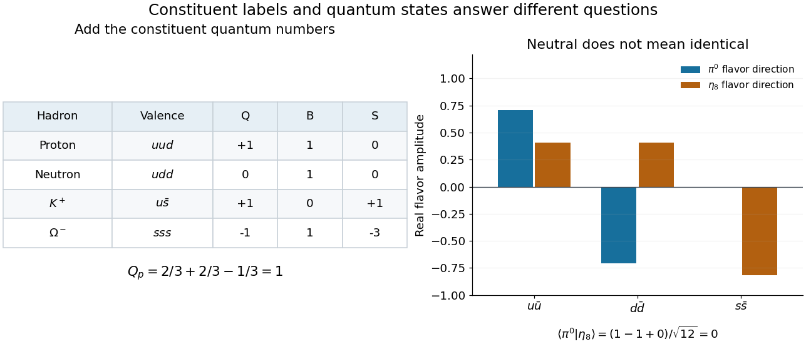

**[Figure 9](#image-adding-constituent-quantum-numbers-distinguishes-charged-and-neutral-hadrons). Adding constituent quantum numbers distinguishes charged and neutral hadrons**. Original arithmetic examples for the three-light-flavor [quark model](#quark-model). The lower panel contrasts two orthogonal neutral flavor combinations: identical total [electric charge](electric-charge.md) does not make two states identical. These are ideal flavor basis states, not a mass fit or a reconstruction of an experimental event.

Two [hadrons](#hadron) can have identical additive labels while differing in their internal state. The [Lambda baryon](#lambda-baryon) and neutral [Sigma baryon](#sigma-baryon) both have valence content $uds$, yet their total [isospin](standard-model.md#isospin) differs. Likewise, the neutral [pion](standard-model.md#pion) flavor direction $(u\bar u-d\bar d)/\sqrt2$ and the [Eta octet state](standard-model.md#eta-octet-state) $(u\bar u+d\bar d-2s\bar s)/\sqrt6$ both have $Q=Y=0$, but their [inner product](inner-product.md) vanishes. Expanding that [inner product](inner-product.md) gives $(1-1+0)/\sqrt{12}=0$. Constituent counting must therefore be supplemented by [quantum superposition](quantum-system.md#quantum-superposition) and the [symmetry](#symmetry-physics) of the state.

###### Quark-model baryon-decuplet construction

↑ **Parent:** [Quark-model constituent bookkeeping](#quark-model-constituent-bookkeeping)

A particularly economical example is the [baryon decuplet](standard-model.md#baryon-decuplet). Restrict to fully symmetric three-[quark](standard-model.md#quark) flavor states. The nonnegative occupation numbers satisfy $n_u+n_d+n_s=3$, giving $\binom{3+3-1}{3}=10$ possibilities by [stars and bars](combinatorics.md#stars-and-bars-combinatorics). Their additive labels are

$$
Q=n_u-1,\qquad I_3=\frac{n_u-n_d}{2},\qquad Y=1-n_s.
$$

These formulas follow directly from the constituent table. With fixed $n_s$, there are $4-n_s$ possible values of $n_u$, so the [weight diagram](semisimple-lie-algebra.md#weight-diagram) has rows of four, three, two and one states. Its outer triangle is therefore a consequence of the constituent construction, rather than an arbitrary drawing convention.

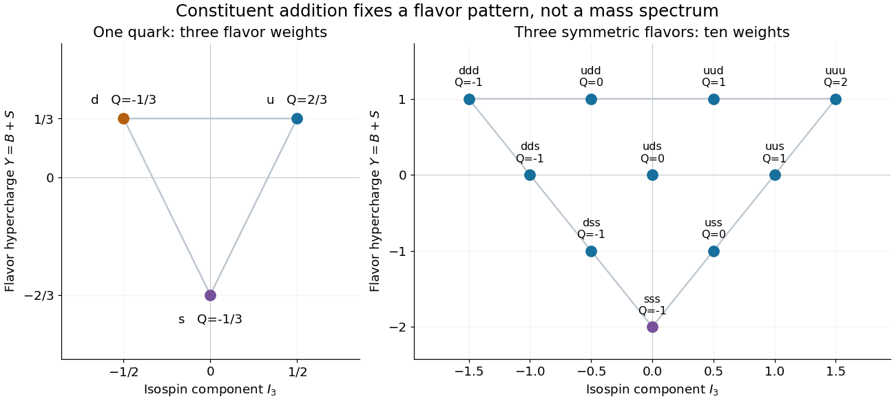

**[Figure 10](#image-three-light-flavor-weights-generate-the-triangular-baryon-decuplet). Three light-flavor weights generate the triangular baryon decuplet**. Original exact constituent calculation using $Y=B+S$. The left panel shows the fundamental flavor triplet. The right panel adds three such weights in fully symmetric flavor states; every point is labelled by its constituent content and [electric charge](electric-charge.md). No measured masses or event counts are plotted.

The bottom corner has $n_s=3$, hence $I_3=0$, $Y=-2$ and $Q=-1$: the [Omega baryon](#omega-baryon) position. The top-right corner has $uuu$ and $Q=2$, corresponding to the doubly charged [Delta baryon](#delta-baryon). Every point satisfies the [Gell-Mann--Nishijima formula](standard-model.md#gell-mann-nishijima-formula) $Q=I_3+Y/2$.

The flavor construction is only part of the state. The [Pauli constraint on three-quark flavour multiplets](#pauli-constraint-on-three-quark-flavour-multiplets) also involves [spin angular momentum](angular-momentum-operator.md#spin), the spatial [wavefunction](wave-function.md) and [color charge](standard-model.md#color-charge). In particular, three identical [fermions](tensor-product-of-quantum-systems.md#fermion) cannot be assigned a completely symmetric total state merely because the flavor diagram is symmetric. Nor does the same flavor diagram determine the [hadron](#hadron) [masses](classical-mechanics.md#mass): an approximate [flavor symmetry](standard-model.md#flavor-symmetry) can organize a spectrum without making all its members degenerate.

##### Gell-Mann and Zweig quark models

↑ **Parent:** [Quark model](#quark-model)

In his 1964 paper, [Murray Gell-Mann](particle-physicist.md#murray-gell-mann) proposed fractional-charge [quarks](standard-model.md#quark), constructing [baryons](#baryon) and [mesons](#meson) from them. He also distinguished a mathematical constituent model from the hypothesis of finite-mass physical particles. The successful bookkeeping did not itself settle that distinction.[pp.214–215: triplet construction and discussion of physical versus mathematical quarks](physics-bibliography.md#a-schematic-model-of-baryons-and-mesons-by-murray-gell-mann)

[George Zweig](particle-physicist.md#george-zweig)'s 1964 CERN model used three constituents called aces, with fractional [electric charge](electric-charge.md) and [baryon number](standard-model.md#baryon-number) $1/3$. Its abstract also proposed an experimental search.[Version2 title page and abstract, dated21February1964](physics-bibliography.md#an-su3-model-for-strong-interaction-symmetry-and-its-breaking-version-2-by-george-zweig) The theoretical construction and the experiment that might discriminate between interpretations are separate parts of the argument. The [Omega baryon discovery experiment](#omega-baryon-discovery-experiment) illustrates the power of testing an incomplete particle pattern against new observations.

##### Diquark

↑ **Parent:** [Quark model](#quark-model)  
ⓦ [Wiki](https://en.wikipedia.org/wiki/Diquark)

A correlated pair of [quarks](standard-model.md#quark). Its color, flavor, spin and orbital states are separate degrees of freedom and must collectively satisfy [Fermi statistics](tensor-product-of-quantum-systems.md#fermi-dirac-statistics). In flavor [SU(3)](topological-group.md#su-3-group), the antisymmetric pair space is $\Lambda^2\mathbf3\cong\overline{\mathbf3}$; contraction with the invariant [Levi-Civita symbol](multivariable-calculus.md#levi-civita-symbol) realizes the isomorphism. The antisymmetric $ud$ flavor pair is an [isospin](standard-model.md#isospin) singlet with [flavor hypercharge](standard-model.md#flavor-hypercharge) $2/3$. Combining two such flavor-antitriplet pairs with a strange [antiquark](standard-model.md#antiquark) permits the highest weight of the [pentaquark antidecuplet](#pentaquark-antidecuplet); this flavor construction does not itself establish a bound state.

#### Meson

↑ **Parent:** [Hadron](#hadron)  
ⓦ [Wiki](https://en.wikipedia.org/wiki/Meson)

A [hadron](#hadron) with integer spin. An ordinary [meson](#meson) has valence content consisting of a [quark](standard-model.md#quark) and an [antiquark](standard-model.md#antiquark).

##### Meson hyperfine mass splitting

↑ **Parent:** [Meson](#meson)

In a simple constituent [quark model](#quark-model), a spin-dependent contribution $A\mathbf S_1\cdot\mathbf S_2/(m_1m_2)$ splits a spin-zero and spin-one [meson](#meson) having the same spatial configuration. For two spin-half constituents, [addition of angular momentum](angular-momentum-operator.md#addition-of-angular-momentum) gives $\mathbf S_1\cdot\mathbf S_2=[S(S+1)-3/2]/2$, equal to $-3/4$ for $S=0$ and $+1/4$ for $S=1$. Thus

$$
M_0=M_{\rm base}-\frac{3A}{4m_1m_2},\qquad M_1=M_{\rm base}+\frac{A}{4m_1m_2},\qquad M_1-M_0=\frac{A}{m_1m_2}.
$$

The spin-averaged mass is $(M_0+3M_1)/4=M_{\rm base}$. Positive $A$ places the vector state above the pseudoscalar. Determining $A$ from just $M_0$ needs an additional assumption about $M_{\rm base}$; setting it equal to $m_1+m_2$ neglects all other spin-independent binding terms. A splitting below the [pion](standard-model.md#pion) mass closes a one-pion strong decay to the lower meson, often making the allowed electromagnetic transition with [photon](quantum-mechanics.md#photon) emission dominant.

##### Quarkonium

↑ **Parent:** [Meson](#meson)

A [quarkonium](#quarkonium) is a [bound state](quantum-system.md#bound-state) of a heavy [quark](standard-model.md#quark) and its own [antiquark](standard-model.md#antiquark). Examples are [charmonium](#charmonium) and the bottom-antibottom states called [Upsilon mesons](#upsilon-meson). Spectroscopic labels $n\,{}^{2S+1}L_J$ distinguish radial excitation, total quark [spin](angular-momentum-operator.md#spin), relative [orbital angular momentum](quantum-mechanics.md#orbital-angular-momentum) and total [angular momentum](momentum.md#angular-momentum).

###### Eta b meson

↑ **Parent:** [Quarkonium](#quarkonium)

A hidden-bottom [pseudoscalar meson](#pseudoscalar-meson), with leading [quark model](#quark-model) content $b\bar b$. Its lowest configuration has $L=S=J=0$ and $J^{PC}=0^{-+}$. Its net bottom flavor is zero, so annihilation into [gluons](standard-model.md#gluon) is possible.

###### Eta c meson

↑ **Parent:** [Quarkonium](#quarkonium)

The ground-state [pseudoscalar meson](#pseudoscalar-meson) with [quark model](#quark-model) content $c\bar c$ is denoted $\eta_c(1S)$. It is a hidden-charm [quarkonium](#quarkonium) state, with zero net charm, rather than an open-charm [D meson](#d-meson).

###### Electromagnetic production and decay of vector quarkonium

↑ **Parent:** [Quarkonium](#quarkonium)

Single-photon [electron-positron annihilation](relativistic-quantum-field.md#electron-positron-annihilation) can directly form [quarkonium](#quarkonium) with $J^{PC}=1^{--}$. A vector S-wave [quarkonium](#quarkonium) can annihilate back through a virtual [photon](quantum-mechanics.md#photon) into a charged-lepton pair. At leading nonrelativistic order, its electronic partial [decay width](relativistic-quantum-field.md#decay-width) is proportional to $\alpha^2Q_q^2|\psi(0)|^2/M^2$, where the wavefunction at the origin describes the quark-antiquark annihilation overlap.

Below the threshold for a pair of heavy-light [mesons](#meson), hadronic decays require annihilation, primarily into three [gluons](standard-model.md#gluon) for a color-singlet $1^{--}$ state. One gluon cannot carry a color-singlet initial state, and two gluons have the wrong charge-conjugation parity. Above the heavy-light pair threshold, a [strong interaction](standard-model.md#strong-interaction) can instead separate the heavy quark and antiquark into different mesons after creating a light pair. This can greatly increase the total [decay width](relativistic-quantum-field.md#decay-width) without comparably changing the short-distance electronic partial width. A specific example is the contrast between the first three [Upsilon mesons](#upsilon-meson) and the $4S$ state. Higher radial states can additionally undergo hadronic or radiative transitions to lower quarkonium states.

##### B meson

↑ **Parent:** [Meson](#meson)  
ⓦ [Wiki](https://en.wikipedia.org/wiki/B_meson)

A [meson](#meson) containing a [bottom quark](standard-model.md#bottom-quark) or its [antiquark](standard-model.md#antiquark) partner. The neutral pair $B^0=d\bar b$ and $\bar B^0=\bar d b$ undergoes [neutral meson mixing](#neutral-meson-mixing).

###### Neutral strange B meson

↑ **Parent:** [B meson](#b-meson)

A [neutral strange B meson](#neutral-strange-b-meson) has valence content $\bar bs$ in the conventional $B_s^0$ assignment; its antiparticle has $b\bar s$. In its charged-current spectator amplitude for $J/\psi\,\phi$, $\bar b\to\bar cW^+$ and $W^+\to c\bar s$, while the original [strange quark](standard-model.md#strange-quark) is carried into the final strange pair. This is one Standard-Model contribution, not a complete treatment of mixing, loop amplitudes or [hadronization](standard-model.md#hadronization).

##### Upsilon meson

↑ **Parent:** [Meson](#meson)  
ⓦ [Wiki](https://en.wikipedia.org/wiki/Upsilon_meson)

A [bottom quark](standard-model.md#bottom-quark)-[antiquark](standard-model.md#antiquark) bound state. Its $4S$ resonance provides a source of [B meson](#b-meson) pairs.

##### Charmonium

↑ **Parent:** [Meson](#meson)

A [bound state](quantum-system.md#bound-state) of a [charm quark](standard-model.md#charm-quark) and its [antiquark](standard-model.md#antiquark).

###### Chi c meson

↑ **Parent:** [Charmonium](#charmonium)

The spin-triplet P-wave [charmonium](#charmonium) multiplet $1\,{}^3P_J$, with $J=0,1,2$ and $J^{PC}=0^{++},1^{++},2^{++}$. Radiative cascades between S-wave [vector mesons](#vector-meson) and these states generate bands in three-body [Dalitz plots](relativistic-quantum-field.md#dalitz-plot).

<h6 id="j-psi-meson">J/psi meson</h6>

↑ **Parent:** [Charmonium](#charmonium)  
ⓦ [Wiki](https://en.wikipedia.org/wiki/J/psi_meson)

A [charmonium](#charmonium) state independently discovered in 1974 through the [Richter-Ting independent J/psi discovery experiments](particle-detection.md#richter-ting-independent-j-psi-discovery-experiments).

##### Meson doublets with one isospin-singlet quark

↑ **Parent:** [Meson](#meson)

An isospin-zero [quark](standard-model.md#quark) $h$ paired with $\overline u$ or $\overline d$ gives a [meson](#meson) [isospin](standard-model.md#isospin) doublet of charges $q_h-2/3,q_h+1/3$. Spin addition at zero [orbital angular momentum](quantum-mechanics.md#orbital-angular-momentum) gives both [pseudoscalar mesons](#pseudoscalar-meson) and [vector mesons](#vector-meson). Pairing the new [antiquark](standard-model.md#antiquark) with $u,d$ gives the charge-conjugate doublets. For strange or charm flavour these are the kaon or D-meson families and their vector partners.

##### Meson parity and charge conjugation

↑ **Parent:** [Meson](#meson)

For an ordinary [quark](standard-model.md#quark)-[antiquark](standard-model.md#antiquark) [meson](#meson), opposite [intrinsic parities](quantum-field-theory.md#intrinsic-parity) and [orbital parity](quantum-mechanics.md#orbital-parity) give $P=(-1)^{L+1}$. For a self-conjugate flavor state, [charge conjugation](quantum-field-theory.md#charge-conjugation) exchanges the two constituents. Reversal of their relative momentum gives $(-1)^L$, spin exchange gives $(-1)^{S+1}$, and reordering the two fermionic creation operators gives one extra minus sign. Their product is $C=(-1)^{L+S}$. Electrical neutrality alone does not imply that a state is an eigenstate of charge conjugation; charged mesons have no individual C eigenvalue.

##### Omega meson

↑ **Parent:** [Meson](#meson)  
ⓦ [Wiki](https://en.wikipedia.org/wiki/Omega_meson)

The [omega meson](#omega-meson) is an isospin-zero vector [meson](#meson) with [charge conjugation](quantum-field-theory.md#charge-conjugation) value minus one and consequently [G parity](standard-model.md#g-parity) minus one. Three-pion decay is compatible with the isospin-symmetric [strong interaction](standard-model.md#strong-interaction), whereas two-pion decay violates its G-parity rule.

##### Rho meson

↑ **Parent:** [Meson](#meson)  
ⓦ [Wiki](https://en.wikipedia.org/wiki/Rho_meson)

The [rho meson](#rho-meson) is an isospin-one vector [meson](#meson). Its neutral member has [charge conjugation](quantum-field-theory.md#charge-conjugation) value minus one, so all three charge states have [G parity](standard-model.md#g-parity) plus one. The two-pion decay is allowed by G parity, whereas a purely strong isospin-conserving three-pion decay is excluded.

##### Vector meson

↑ **Parent:** [Meson](#meson)  
ⓦ [Wiki](https://en.wikipedia.org/wiki/Vector_meson)

A [meson](#meson) with total angular momentum one and negative [parity](quantum-mechanics.md#parity). In the ordinary [quark model](#quark-model), a [quark](standard-model.md#quark)-[antiquark](standard-model.md#antiquark) pair with [orbital angular momentum](quantum-mechanics.md#orbital-angular-momentum) zero and total [spin](angular-momentum-operator.md#spin) one has these quantum numbers; its neutral self-conjugate states have [charge conjugation](quantum-field-theory.md#charge-conjugation) $C=-1$. The light-flavour tensor product gives an octet and a singlet, forming a vector nonet, just as spin-zero negative-parity pairs form a [pseudoscalar meson nonet](#pseudoscalar-meson-nonet). Nonzero orbital excitations can also produce vector states.

###### Ideal vector-meson mixing

↑ **Parent:** [Vector meson](#vector-meson)

Mixing of the [flavour](standard-model.md#quark-flavor) [singlet](representation-theory.md#singlet-representation) and isoscalar [octet](representation-theory.md#octet-representation) vector states so that the [mass eigenstates](finite-element-method.md#mass-eigenstate) separate into nonstrange and strange [flavour](standard-model.md#quark-flavor). In the basis $|1\rangle=(u\bar u+d\bar d+s\bar s)/\sqrt3$, $|8_0\rangle=(2s\bar s-u\bar u-d\bar d)/\sqrt6$, the determinant-one rotation to $(\omega,\phi)$ has angle $-\arctan(1/\sqrt2)$. Basis phases change the quoted angle but not the [flavour](standard-model.md#quark-flavor) content.

###### Phi meson

↑ **Parent:** [Vector meson](#vector-meson)  
ⓦ [Wiki](https://en.wikipedia.org/wiki/Phi_meson)

A neutral [vector meson](#vector-meson) of spin-parity $1^-$, predominantly $s\bar s$ in the ideal quark-flavour description. A pseudoscalar decaying to this meson and a [pion](standard-model.md#pion) requires relative orbital angular momentum one if total angular momentum is zero.

##### Pseudoscalar meson

↑ **Parent:** [Meson](#meson)  
ⓦ [Wiki](https://en.wikipedia.org/wiki/Pseudoscalar_meson)

A [meson](#meson) with zero [spin angular momentum](angular-momentum-operator.md#spin) and negative [parity](quantum-mechanics.md#parity). The [pion](standard-model.md#pion) and [kaon](#kaon) are familiar examples. Between two [pseudoscalar mesons](#pseudoscalar-meson), [parity conservation](quantum-mechanics.md#parity-conservation) in the strong interaction forces the [axial current](relativistic-quantum-field.md#axial-current) matrix element to vanish, while the [vector current](relativistic-quantum-field.md#vector-current) has [pseudoscalar-to-pseudoscalar form factors](#pseudoscalar-to-pseudoscalar-form-factor). The weak decay as a whole need not conserve [parity](quantum-mechanics.md#parity).

###### Pseudoscalar decay constant

↑ **Parent:** [Pseudoscalar meson](#pseudoscalar-meson)

The vacuum-to-meson axial-current normalization defined by $\langle0|\bar q_1\gamma^\mu\gamma^5q_2|P(p)\rangle=if_Pp^\mu$. It controls exclusive weak annihilation rates. Ratios of [tau lepton](standard-model.md#tau-particle) decays into [kaons](#kaon) and [pions](standard-model.md#pion) determine $f_K|V_{us}|/(f_\pi|V_{ud}|)$; extracting the [Cabibbo-Kobayashi-Maskawa matrix](standard-model.md#cabibbo-kobayashi-maskawa-matrix) ratio alone requires independent hadronic input.

###### Pseudoscalar meson nonet

↑ **Parent:** [Pseudoscalar meson](#pseudoscalar-meson)

In the [quark model](#quark-model), the light-flavour triplet and its antiquark conjugate give an octet and a singlet. A colour-singlet pair with orbital angular momentum zero and total spin zero has parity minus one, giving a pseudoscalar nonet. Its six outer weights are charged [pions](standard-model.md#pion) and four [kaons](#kaon). At the centre the octet contains the neutral pion and octet eta direction; the additional singlet direction gives a third state at the same weight.

###### Eta and eta prime mesons

↑ **Parent:** [Pseudoscalar meson nonet](#pseudoscalar-meson-nonet)

These neutral isospin-zero [pseudoscalar mesons](#pseudoscalar-meson) have $J^{PC}=0^{-+}$. Their light-quark components mix the [Eta octet state](standard-model.md#eta-octet-state) and [eta singlet state](#eta-singlet-state). The singlet axial anomaly contributes to the unusually large eta-prime mass, while flavour breaking also affects both masses and the mixing. The simple orthogonal one-angle flavour model is useful for explaining the nonet; detailed decay-constant descriptions can require more than one parameter.

###### Eta prime meson

↑ **Parent:** [Eta and eta prime mesons](#eta-and-eta-prime-mesons)

The heavier physical isoscalar member of the light [pseudoscalar meson nonet](#pseudoscalar-meson-nonet). It mixes the octet and singlet flavor directions, and is distinct from the lighter [eta meson](#eta-meson); both occupy the central flavor weight.

###### Eta mixing

↑ **Parent:** [Eta and eta prime mesons](#eta-and-eta-prime-mesons)

Mixing of the [Eta octet state](standard-model.md#eta-octet-state) and [eta singlet state](#eta-singlet-state) to produce physical neutral pseudoscalar [mass](classical-mechanics.md#mass) eigenstates. It limits [mass](classical-mechanics.md#mass) identities derived by treating the physical [eta meson](#eta-meson) as a pure octet state.

###### Eta meson

↑ **Parent:** [Eta and eta prime mesons](#eta-and-eta-prime-mesons)

The lighter physical neutral [pseudoscalar meson](#pseudoscalar-meson) in the [eta and eta prime mesons](#eta-and-eta-prime-mesons) system. The pure [Eta octet state](standard-model.md#eta-octet-state) is a useful approximation to its flavor content, not its exact physical [mass](classical-mechanics.md#mass) eigenstate.

###### Eta singlet state

↑ **Parent:** [Pseudoscalar meson nonet](#pseudoscalar-meson-nonet)

This flavour combination is the invariant scalar in the [octet and singlet in a fundamental SU3 tensor product](representation-theory.md#octet-and-singlet-in-a-fundamental-su3-tensor-product). Its isospin and flavour hypercharge vanish. Although it shares the central weight with the [Eta octet state](standard-model.md#eta-octet-state), it lies in a different [irreducible representation](representation-theory.md#irreducible-representation). Physical eta mixing and the singlet axial anomaly distinguish the mass eigenstates from the pure flavour directions.

##### Pseudoscalar-to-pseudoscalar form factor

↑ **Parent:** [Meson](#meson)

Between spin-zero [pseudoscalars](quantum-mechanics.md#pseudoscalar), [Lorentz covariance](special-relativity.md#lorentz-covariance) decomposes a [vector current](relativistic-quantum-field.md#vector-current) [matrix element](vector-space.md#matrix-element) into $(p+k)^\mu f_+(q^2)+(p-k)^\mu f_-(q^2)$, with $q=p-k$. [Strong interaction](standard-model.md#strong-interaction) [parity symmetry in quantum field theory](quantum-field-theory.md#parity-symmetry-in-quantum-field-theory) makes the corresponding [axial current](relativistic-quantum-field.md#axial-current) matrix element vanish.

##### Neutral meson mixing

↑ **Parent:** [Meson](#meson)

Transitions between a neutral [meson](#meson) carrying flavour and its [antiparticle](relativistic-quantum-field.md#antiparticle). Decays are described on this two-state subspace by an effective [Hamiltonian operator](quantum-system.md#hamiltonian-quantum-mechanics) $M-i\Gamma/2$ with [Hermitian matrices](hilbert-space.md#hermitian-operator) $M,\Gamma$.

###### Right-sign denominator correction in neutral-meson mixing

↑ **Parent:** [Neutral meson mixing](#neutral-meson-mixing)

If a wrong-sign amplitude is $r e^{-i\delta}g_++g_-$, the same final state's right-sign amplitude is $g_++r e^{-i\delta}g_-$. Their ratio is not exactly obtained by replacing the right-sign rate with a pure exponential. For series $N=n_0+n_1t+n_2t^2$ and $D=1+d_1t+d_2t^2$, division gives $N/D=n_0+(n_1-n_0d_1)t+[n_2-n_1d_1+n_0(d_1^2-d_2)]t^2+O(t^3)$.

###### CP-conjugate decay-amplitude ratio

↑ **Parent:** [Neutral meson mixing](#neutral-meson-mixing)

For $\lambda_f=(q/p)\bar A_f/A_f$, exchanging both initial [flavour](quantum-system.md#flavor-eigenstate) and final-state labels defines $\bar\lambda_{\bar f}=(p/q)A_{\bar f}/\bar A_{\bar f}$. It equals $\lambda_f^{-1}$ exactly when $A_{\bar f}/\bar A_{\bar f}=A_f/\bar A_f$. This holds for a common [CP eigenstate](quantum-field-theory.md#cp-eigenstate) final ray. [CP symmetry](quantum-field-theory.md#cp-symmetry) of paired amplitudes alone does not imply it for distinct final states: $p=q$, $A_f=\bar A_{\bar f}=2$, $\bar A_f=A_{\bar f}=1$ gives both ratios $1/2$.

###### CP violation in neutral-meson mixing

↑ **Parent:** [Neutral meson mixing](#neutral-meson-mixing)

For [mass eigenstates](finite-element-method.md#mass-eigenstate) $p|M\rangle\pm q|\bar M\rangle$, unequal forward and reverse [flavour](quantum-system.md#flavor-eigenstate) transition probabilities occur when $|q/p|\ne1$. They are proportional to $|q/p|^2|g_-|^2$ and $|p/q|^2|g_-|^2$. This diagnostic is invariant under rephasing the two [flavour eigenstates](quantum-system.md#flavor-eigenstate).

###### Semileptonic wrong-sign mixing asymmetry

↑ **Parent:** [CP violation in neutral-meson mixing](#cp-violation-in-neutral-meson-mixing)

If [semileptonic decay](#semileptonic-decay) tags the decaying [flavour](quantum-system.md#flavor-eigenstate), wrong-sign decays require [neutral meson mixing](#neutral-meson-mixing). With no direct [CP violation](quantum-field-theory.md#cp-violation) and no wrong-sign direct [decay amplitudes](relativistic-quantum-field.md#decay-amplitude), their rate asymmetry is $(|p/q|^2-|q/p|^2)/(|p/q|^2+|q/p|^2)=(1-|q/p|^4)/(1+|q/p|^4)$. The common time dependence cancels; contaminating direct amplitudes invalidate that isolation.

###### Neutral B meson mixing

↑ **Parent:** [Neutral meson mixing](#neutral-meson-mixing)

Weak box diagrams change neutral bottom-meson [flavour](standard-model.md#quark-flavor). The propagating eigenstates are combinations $p|B^0\rangle\pm q|\bar B^0\rangle$. For a shared final state, interference is governed by $\lambda_f=(q/p)(\bar A_f/A_f)$; in the dominant charmonium-kaon mode this yields the CKM angle through $\lambda_f\simeq-e^{-2i\beta}$, with stated meson and kaon phase conventions.

###### Effective Hamiltonian for neutral-meson mixing

↑ **Parent:** [Neutral meson mixing](#neutral-meson-mixing)

A decaying particle-antiparticle pair is described by a two-dimensional [effective Hamiltonian for neutral-meson mixing](#effective-hamiltonian-for-neutral-meson-mixing) with dispersive matrix $M$ and decay matrix $\Gamma$, both [Hermitian matrices](hilbert-space.md#hermitian-operator). The [effective Hamiltonian for neutral-meson mixing](#effective-hamiltonian-for-neutral-meson-mixing) itself is generally not a [Hermitian matrix](hilbert-space.md#hermitian-operator). [CPT](quantum-field-theory.md#cpt-symmetry) symmetry equates its diagonal entries, by separately equating diagonal [masses](classical-mechanics.md#mass) and [decay widths](relativistic-quantum-field.md#decay-width). For $H_{\rm eff}=\begin{pmatrix}a&b\\c&a\end{pmatrix}$ the [eigenvalues](linear-operator-theory.md#eigenvalue) are $a\pm\sqrt{bc}$ and generic [eigenvectors](linear-operator-theory.md#eigenvector) are $(\sqrt b,\pm\sqrt c)^T$, with correlated square-root branches. Complex [eigenvalues](linear-operator-theory.md#eigenvalue) give [masses](classical-mechanics.md#mass) and [decay widths](relativistic-quantum-field.md#decay-width) through $\mu=m-i\Gamma/2$.

###### CPT constraints on neutral-meson mixing

↑ **Parent:** [Neutral meson mixing](#neutral-meson-mixing)

[CPT symmetry](quantum-field-theory.md#cpt-symmetry) equates the diagonal entries of the decay-effective [Hamiltonian operator](quantum-system.md#hamiltonian-quantum-mechanics). It does not make this effective matrix [Hermitian operator](hilbert-space.md#hermitian-operator); its imaginary diagonal part describes a total decay width.

###### Neutral D-meson mixing

↑ **Parent:** [Neutral meson mixing](#neutral-meson-mixing)

##### Kaon

↑ **Parent:** [Meson](#meson)  
ⓦ [Wiki](https://en.wikipedia.org/wiki/Kaon)

###### Antikaon

↑ **Parent:** [Kaon](#kaon)

The [antiparticle](relativistic-quantum-field.md#antiparticle) of a [kaon](#kaon), such as $K^-=s\bar u$ and $\bar K^0=s\bar d$.

###### Neutral antikaon

↑ **Parent:** [Kaon](#kaon)

The neutral strange [meson](#meson) with [strangeness](standard-model.md#strangeness) $-1$ and valence content $s\bar d$. It is distinct from the neutral kaon flavour state $K^0=d\bar s$, which has strangeness $+1$. These are flavour eigenstates, not the weak-interaction propagation eigenstates of [neutral kaon mixing](#neutral-kaon-mixing).

###### Neutral kaon mixing

↑ **Parent:** [Kaon](#kaon)

The neutral flavour states $d\bar s$ and $s\bar d$ can mix through second-order weak interactions. Box diagrams with [W bosons](standard-model.md#w-boson) and internal up-type quarks induce a strangeness-changing-by-two four-quark operator. The [GIM mechanism](standard-model.md#gim-mechanism) removes its flavour-independent part.

###### Neutral-kaon projection interference asymmetry

↑ **Parent:** [Neutral kaon mixing](#neutral-kaon-mixing)

In the [exchange-positive CP convention for neutral kaon mixing](#exchange-positive-cp-convention-for-neutral-kaon-mixing), a coherent source with [decay amplitudes](relativistic-quantum-field.md#decay-amplitude) $A$ and $B$ for $K^0$ and $\bar K^0$ has projected amplitudes $(A+B)/\sqrt2$ and $(A-B)/\sqrt2$. For equal [phase space](hamiltonian-mechanics.md#phase-space), their [decay-rate asymmetry](relativistic-quantum-field.md#decay-rate-asymmetry) is $\mathcal R=2\operatorname{Re}r/(1+|r|^2)$, $r=B/A$. Expanding the squared moduli proves the identity. Knowledge of $|r|$ alone cannot fix the asymmetry: $r=i|r|$ gives zero, whereas $r=|r|$ gives constructive interference in the symmetric channel.

###### Kaon CP eigenstates

↑ **Parent:** [Neutral kaon mixing](#neutral-kaon-mixing)

The [CP eigenstates](quantum-field-theory.md#cp-eigenstate) of neutral [kaons](#kaon) depend on a flavor-state phase convention. Using $CP|K^0\rangle=-|\bar K^0\rangle$, set $|K_1\rangle=(|K^0\rangle-|\bar K^0\rangle)/\sqrt2$ and $|K_2\rangle=(|K^0\rangle+|\bar K^0\rangle)/\sqrt2$. They are respectively [CP](quantum-field-theory.md#cp-symmetry) even and odd. Reversing the flavor-exchange sign reverses which written sum is even; it does not change the [CP](quantum-field-theory.md#cp-symmetry) eigenvalues. With [CP violation](quantum-field-theory.md#cp-violation), the physical short- and long-lived states need not equal these [CP eigenstates](quantum-field-theory.md#cp-eigenstate); [kaon CP mixing parameter](#kaon-cp-mixing-parameter) and [neutral-kaon CP impurity and two-pion decay](quantum-field-theory.md#neutral-kaon-cp-impurity-and-two-pion-decay) describe the mixtures.

###### Kaon CP mixing parameter

↑ **Parent:** [Neutral kaon mixing](#neutral-kaon-mixing)

In the flavor convention $K_1=(K^0-\bar K^0)/\sqrt2$ and $K_2=(K^0+\bar K^0)/\sqrt2$, the parameter $\epsilon=(a-b)/(a+b)$ writes normalized [mass](classical-mechanics.md#mass) states as $(K_1+\epsilon K_2)/\sqrt{1+|\epsilon|^2}$ and $(K_2+\epsilon K_1)/\sqrt{1+|\epsilon|^2}$. In the Hermitian [mass](classical-mechanics.md#mass)-only approximation with correlated roots, $\epsilon=i\tan(\varphi/2)$ and the states are [orthogonal](inner-product.md#orthogonal-vectors). For the full non-Hermitian decay matrix the real part need not vanish. The parameter depends on the flavor-state phase convention; observable [CP violation](quantum-field-theory.md#cp-violation) involves convention-invariant combinations with decay amplitudes.

###### Exchange-positive CP convention for neutral kaon mixing

↑ **Parent:** [Kaon CP mixing parameter](#kaon-cp-mixing-parameter)

In the phase convention $CP|K^0\rangle=|\bar K^0\rangle$, the symmetric flavor combination is CP even and the antisymmetric one CP odd. For an equal-diagonal effective matrix with entries b,c off diagonal, choose correlated roots r,s with $r^2=b$, $s^2=c$ and eigenvalues $a\pm rs$. Its eigenvectors are $(r,\pm s)^T$. Writing $\epsilon=(r-s)/(r+s)$ gives the displayed CP-basis mixtures, up to an overall phase. Their deviation is small only if $|\epsilon|\ll1$; noninvariance alone does not guarantee that. This convention must not be mixed with one in which flavor exchange carries a minus sign.

###### Neutral-kaon mass matrix diagonalization

↑ **Parent:** [Neutral kaon mixing](#neutral-kaon-mixing)

With [CPT symmetry](quantum-field-theory.md#cpt-symmetry), a Hermitian [kaon](#kaon) [mass matrix](finite-element-method.md#mass-matrix) is $M=\left(\begin{smallmatrix}r_0&z\\z^*&r_0\end{smallmatrix}\right)$. Its [eigenvalues](linear-operator-theory.md#eigenvalue) are $r_0\pm|z|$. For correlated roots $a^2=z$, $b^2=z^*$ and $ab=|z|$, the normalized lower and upper [eigenvectors](linear-operator-theory.md#eigenvector) are $(a,-b)/\sqrt{2|z|}$ and $(a,b)/\sqrt{2|z|}$. They are [orthogonal](inner-product.md#orthogonal-vectors). This is a [mass](classical-mechanics.md#mass)-only result; including decay requires the generally non-Hermitian effective matrix $M-i\Gamma/2$.

###### Kaon mixing square-root branch convention

↑ **Parent:** [Neutral-kaon mass matrix diagonalization](#neutral-kaon-mass-matrix-diagonalization)

In a Hermitian neutral-[kaon](#kaon) [mass matrix](finite-element-method.md#mass-matrix), independently choosing square-root signs of $z$ and $z^*$ can interchange the [eigenvalue](linear-operator-theory.md#eigenvalue) labels. Choose $z=re^{i\varphi}$, $a=\sqrt r e^{i\varphi/2}$ and $b=\sqrt r e^{-i\varphi/2}$, so $ab=r>0$, continuously from the desired [CP](quantum-field-theory.md#cp-symmetry)-conserving limit. Then $(a,-b)$ is the lower-[mass](classical-mechanics.md#mass) [eigenvector](linear-operator-theory.md#eigenvector). At a degenerate off-diagonal zero the [mass](classical-mechanics.md#mass) eigenbasis is not fixed by diagonalization alone.

###### Charged weak box contribution to kaon mixing

↑ **Parent:** [Neutral kaon mixing](#neutral-kaon-mixing)

A [Standard Model](standard-model.md) charged-current [box diagram](perturbative-quantum-field-theory.md#box-diagram) converts $d\bar s$ into $s\bar d$. Internal [quarks](standard-model.md#quark) run over $u,c,t$, and the flavor sum contains $\lambda_i\lambda_j$ with $\lambda_i=V_{is}^*V_{id}$. The loop function depends on internal masses; [CKM matrix](standard-model.md#cabibbo-kobayashi-maskawa-matrix) unitarity gives $\sum_i\lambda_i=0$, producing the [GIM mechanism](standard-model.md#gim-mechanism) cancellation of flavor-independent terms. The amplitude is of order $g^4$ and second order in the [weak interaction](standard-model.md#weak-interaction).

###### Kaon bag parameter

↑ **Parent:** [Charged weak box contribution to kaon mixing](#charged-weak-box-contribution-to-kaon-mixing)

For relativistically normalized [kaon](#kaon) states and $Q=(\bar s\gamma_\mu(1-\gamma^5)d)(\bar s\gamma^\mu(1-\gamma^5)d)$, define $\langle\bar K^0|Q|K^0\rangle=(8/3)f_K^2m_K^2B_K$. The dimensionless kaon bag parameter measures [strong interaction](standard-model.md#strong-interaction) corrections to the vacuum-insertion normalization. The coefficient and [matrix element](vector-space.md#matrix-element) must be defined in the same [renormalization scheme](perturbative-quantum-field-theory.md#renormalization-scheme) and at the same scale. Dividing by $2m_K$ gives the corresponding two-state mixing-Hamiltonian normalization.

##### D meson

↑ **Parent:** [Meson](#meson)  
ⓦ [Wiki](https://en.wikipedia.org/wiki/D_meson)

###### Ds meson

↑ **Parent:** [D meson](#d-meson)  
ⓦ [Wiki](https://en.wikipedia.org/wiki/D_s_meson)

A charmed strange [meson](#meson). Its ground-state charged particle has valence content $c\bar s$ and spin-parity $0^-$. Its [antiparticle](relativistic-quantum-field.md#antiparticle) has the conjugate valence content. Nonleptonic decays are governed by [weak charged currents](standard-model.md#charged-current) and hadronic transition matrix elements.

#### Baryon

↑ **Parent:** [Hadron](#hadron)  
ⓦ [Wiki](https://en.wikipedia.org/wiki/Baryon)

A baryon is a hadron with half-integer spin and baryon number one; ordinary baryons consist of three valence quarks.

##### Baryon magnetic moment

↑ **Parent:** [Baryon](#baryon)

In the additive ground-state [quark model](#quark-model), a [baryon](#baryon) [magnetic moment](electromagnetism.md#magnetic-dipole-moment) is the expectation of $\sum_i Q_i e\boldsymbol\sigma_i/(2m_i)$ in its spin-and-flavor [wavefunction](wave-function.md), with constituent [quark masses](standard-model.md#quark-mass) $m_i$. For a spin-up [proton](#proton) and [neutron](neutron.md) this gives $\mu_p=(4\mu_u-\mu_d)/3$ and $\mu_n=(4\mu_d-\mu_u)/3$. Approximately equal up and down constituent [masses](classical-mechanics.md#mass) imply $\mu_u\simeq-2\mu_d$ and $\mu_p/\mu_n\simeq-3/2$. This is evidence for the [valence quark](standard-model.md#valence-quark) model, not proof that sea [quark](standard-model.md#quark)-[antiquark](standard-model.md#antiquark) pairs are absent.

##### Hyperon

↑ **Parent:** [Baryon](#baryon)

A [baryon](#baryon) containing one or more [strange quarks](standard-model.md#strange-quark) and no heavier [quark](standard-model.md#quark). The light [hyperon](#hyperon) multiplets include lambda, sigma, xi and omega baryons. Strong and [electromagnetic interactions](electromagnetism.md#electromagnetic-interaction) conserve [strangeness](standard-model.md#strangeness), whereas a [weak interaction](standard-model.md#weak-interaction) can change it; a [photon](quantum-mechanics.md#photon) in the final state does not by itself make a [hyperon](#hyperon) decay electromagnetic.

##### Open strong-decay thresholds for baryons

↑ **Parent:** [Baryon](#baryon)

A [strong interaction](standard-model.md#strong-interaction) decay must conserve quark flavour and have final rest energy below the initial [mass](classical-mechanics.md#mass). An excited light baryon can often decay to a lighter baryon plus a [pion](standard-model.md#pion). A ground-state strange baryon may lack any such open flavour-conserving channel even when its spin permits one. In particular, the [Omega baryon](#omega-baryon) cannot decay strongly to a [Xi baryon](#xi-baryon) plus a [pion](standard-model.md#pion) because that changes [strangeness](standard-model.md#strangeness); its flavour-conserving Xi-kaon channel is closed by the mass threshold. A spin-three-half assignment alone does not imply a strong decay.

##### Antibaryon

↑ **Parent:** [Baryon](#baryon)

An [antibaryon](#antibaryon) is the [antiparticle](relativistic-quantum-field.md#antiparticle) of a [baryon](#baryon). In the valence [quark model](#quark-model) it consists of three [antiquarks](standard-model.md#antiquark) in a colour singlet. Charge conjugation reverses its additive charges and third component of [isospin](standard-model.md#isospin), preserving total [isospin](standard-model.md#isospin) and spin.

##### Charmed baryon

↑ **Parent:** [Baryon](#baryon)

A [baryon](#baryon) containing a [charm quark](standard-model.md#charm-quark). For one charm and two up/down [quarks](standard-model.md#quark) in the spatial ground state, [light-diquark spin-isospin correlation](#light-diquark-spin-isospin-correlation) gives the isosinglet [Lambda c baryon](#lambda-c-baryon) and the isotriplet [Sigma c baryon](#sigma-c-baryon) families.

###### Sigma c baryon

↑ **Parent:** [Charmed baryon](#charmed-baryon)

The symmetric light pairs $uu,\{ud\},dd$ with one [charm quark](standard-model.md#charm-quark) give [isospin](standard-model.md#isospin) one and charges $2,1,0$. Their light spin is one; coupling the charm spin gives the $J=1/2$ [Sigma c baryon](#sigma-c-baryon) triplet and $J=3/2$ excited-spin triplet conventionally marked by a star.

###### Lambda c baryon

↑ **Parent:** [Charmed baryon](#charmed-baryon)

The lowest [Lambda c baryon](#lambda-c-baryon) has valence content $cud$, [electric charge](electric-charge.md) $+1$, [isospin](standard-model.md#isospin) zero and [spin angular momentum](angular-momentum-operator.md#spin) $1/2$. Its light pair has antisymmetric flavour and spin zero. This is the charm analogue of the [Lambda baryon](#lambda-baryon).

##### Omega baryon

↑ **Parent:** [Baryon](#baryon)  
ⓦ [Wiki](https://en.wikipedia.org/wiki/Omega_baryon)

The light-quark $sss$ member of the spin-three-halves [baryon decuplet](standard-model.md#baryon-decuplet) has [strangeness](standard-model.md#strangeness) $S=-3$, [baryon number](standard-model.md#baryon-number) $B=1$, [flavor hypercharge](standard-model.md#flavor-hypercharge) $Y=-2$, and [isospin](standard-model.md#isospin) zero. The [Gell-Mann--Nishijima formula](standard-model.md#gell-mann-nishijima-formula) gives electric charge minus one. Its position at the bottom of the decuplet's triangular [weight diagram](semisimple-lie-algebra.md#weight-diagram) follows by replacing all three up or down quarks with strange quarks.

###### Omega baryon discovery experiment

↑ **Parent:** [Omega baryon](#omega-baryon)

The 1964 report exposed Brookhaven's 80-inch hydrogen [bubble chamber](particle-detection.md#bubble-chamber) to a mass-separated $5.0\,\mathrm{GeV}/c$ negative-[kaon](#kaon) beam. A photographed decay chain, track [momenta](momentum.md) and bubble density supported the [particle identification](particle-detection.md#particle-identification). Two converted [photons](quantum-mechanics.md#photon) helped reconstruct a neutral [pion](standard-model.md#pion). Alternative assignments were tested kinematically. The authors reported an [Omega baryon](#omega-baryon) candidate with $Q=-1$, $S=-3$ and [mass](classical-mechanics.md#mass) $1686\pm12\,\mathrm{MeV}/c^2$, reserving a detailed systematic-error discussion for further events.[Original Barnes et al. letter, Phys.Rev.Lett.12(1964), pp.204–206: Fig.2, TableI and final identification](physics-bibliography.md#observation-of-a-hyperon-with-strangeness-minus-three-by-v-e-barnes)

This is an inference from several linked observations. A [charged particle](electric-charge.md#charged-particle) can leave a visible [bubble-chamber track](particle-detection.md#bubble-chamber-track), while a neutral segment must be reconstructed from its production and decay products. Agreement between possible [decay channels](#decay-channel), [electric charge](electric-charge.md), [momentum conservation](momentum.md#momentum-conservation) and the reconstructed [mass](classical-mechanics.md#mass) is stronger evidence than a suggestive track shape alone. The event tests a predicted [hadron](#hadron) pattern; it does not photograph the three [strange quarks](standard-model.md#strange-quark) individually.

For example, an independently constructed two-body kinematic check uses

$$
M^2c^4=(E_1+E_2)^2-c^2|\mathbf p_1+\mathbf p_2|^2.
$$

In a parent rest frame with equal and opposite daughter [momenta](momentum.md), the momentum sum vanishes, giving $Mc^2=E_1+E_2$. In units $c=1$, stipulated daughter [masses](classical-mechanics.md#mass) $m_1=1$, $m_2=1/4$ and momentum magnitude $p=3/4$ give $E_1=5/4$, $E_2=\sqrt{10}/4$ and $M=(5+\sqrt{10})/4\simeq2.04057$. A common [Lorentz boost](special-relativity.md#lorentz-boost) changes the daughter [energies](energy.md) and [momenta](momentum.md) while preserving this reconstructed [invariant mass](special-relativity.md#invariant-mass). These chosen units and numbers are an illustration, not a reanalysis of the 1964 event.

##### Pentaquark

↑ **Parent:** [Baryon](#baryon)

A [baryon](#baryon) with constituent content four [quarks](standard-model.md#quark) and one [antiquark](standard-model.md#antiquark), whose net [baryon number](standard-model.md#baryon-number) is one. Such content admits more flavour representations than three quarks alone. A representation in the tensor product is not evidence by itself of a bound state.

###### Light pentaquark strong-decay channels

↑ **Parent:** [Pentaquark](#pentaquark)

Exotic flavour weights can decay into a [baryon](#baryon) and a [meson](#meson) while preserving every strong quantum number: $uudd\bar s\to pK^0$ or $nK^+$, $ddss\bar u\to\Xi^-\pi^-$, and $uuss\bar d\to\Xi^0\pi^+$. These are quark rearrangements. If above threshold with unsuppressed couplings, such states are short-lived strong resonances. Flavour symmetry alone fixes neither masses nor widths.

###### Pentaquark antidecuplet

↑ **Parent:** [Pentaquark](#pentaquark)

Two antisymmetric flavour quark pairs can each transform in $\overline{\mathbf3}$, combine into $\overline{\mathbf6}$, and with an [antiquark](standard-model.md#antiquark) give $\overline{\mathbf6}\otimes\overline{\mathbf3}=\overline{\mathbf{10}}\oplus\mathbf8$. The antidecuplet rows are $(Y,I)=(2,0),(1,1/2),(0,1),(-1,3/2)$. Exactly three weights are absent from all three-quark states: $(I_3,Y)=(0,2)$ and $(\pm3/2,-1)$.

##### Pauli constraint on three-quark flavour multiplets

↑ **Parent:** [Baryon](#baryon)

In a [three-quark colour singlet](#three-quark-colour-singlet), a symmetric spatial state requires symmetric spin-flavour symmetry. Completely symmetric decuplet flavour couples to symmetric spin $3/2$; mixed octet flavour couples to mixed spin $1/2$ in the symmetric permutation combination. Antisymmetric singlet flavour cannot have a symmetric S-wave orbital state, since $\bigwedge^3\mathbb C^2=0$ forbids a completely antisymmetric state of three spin-$1/2$ quarks. Mixed orbital and spin states can instead realize the required antisymmetry.

###### Light-diquark spin-isospin correlation

↑ **Parent:** [Pauli constraint on three-quark flavour multiplets](#pauli-constraint-on-three-quark-flavour-multiplets)

Two light [quarks](standard-model.md#quark) in a symmetric spatial state and the antisymmetric colour pair inside a [three-quark colour singlet](#three-quark-colour-singlet) require symmetric spin-flavour symmetry. Their [isospin](standard-model.md#isospin) singlet and spin singlet are both antisymmetric, while their respective triplets are symmetric. Thus the allowed pairs have $(I,S_{ud})=(0,0)$ or $(1,1)$; opposite exchange parities are excluded. Coupling an isospin-zero spin-one-half [quark](standard-model.md#quark) gives an $I=0,J=1/2$ [baryon](#baryon) or $I=1,J=1/2,3/2$ [baryons](#baryon).

###### Baryons with one isospin-singlet quark

↑ **Parent:** [Light-diquark spin-isospin correlation](#light-diquark-spin-isospin-correlation)

For an [isospin](standard-model.md#isospin) singlet [quark](standard-model.md#quark) $h$ of charge $q_h$, the antisymmetric light-flavour pair gives an $I=0,J=1/2$ state with charge $q_h+1/3$. The symmetric light-flavour pairs $uu,\{ud\},dd$ give $I=1$ triplets of spins $1/2$ and $3/2$, with charges $q_h+4/3,q_h+1/3,q_h-2/3$. These follow from [light-diquark spin-isospin correlation](#light-diquark-spin-isospin-correlation) and addition of constituent [electric charges](electric-charge.md), with zero [orbital angular momentum](quantum-mechanics.md#orbital-angular-momentum).

###### Symmetric spin-flavour SU6 representation

↑ **Parent:** [Pauli constraint on three-quark flavour multiplets](#pauli-constraint-on-three-quark-flavour-multiplets)

Three light [quarks](standard-model.md#quark) have a six-dimensional single-quark spin-flavour space $\mathbb C^3\otimes\mathbb C^2$. A symmetric spatial ground state and the antisymmetric [three-quark colour singlet](#three-quark-colour-singlet) require the symmetric cube of that space. Its dimension is $\binom83=56$, and restriction to flavour $SU(3)$ and spin $SU(2)$ gives a [baryon decuplet](standard-model.md#baryon-decuplet) of spin $3/2$ and a [baryon octet](standard-model.md#baryon-octet) of spin $1/2$. The two mixed-permutation multiplicity spaces pair once in the symmetric sector, explaining why the two flavour-octet copies in the unconstrained [tensor](multilinear-algebra.md#tensor) cube do not represent two distinct ground-state octets.

##### Three-quark colour singlet

↑ **Parent:** [Baryon](#baryon)

The invariant colour state of three fundamental [quarks](standard-model.md#quark) is the normalized completely antisymmetric tensor $\epsilon_{abc}/\sqrt6$. With this colour factor, the [Pauli exclusion principle](tensor-product-of-quantum-systems.md#pauli-exclusion-principle) requires the remaining spatial-spin-flavour wavefunction to be symmetric. Colour and approximate [flavour symmetry](standard-model.md#flavor-symmetry) are distinct SU(3) actions.

###### Flavour singlet of three scalar quarks

↑ **Parent:** [Three-quark colour singlet](#three-quark-colour-singlet)

If three [quarks](standard-model.md#quark) are hypothetically spin-zero [bosons](tensor-product-of-quantum-systems.md#boson), their total state is symmetric under particle exchange. In an $L=0$ symmetric spatial state, the unchanged antisymmetric [three-quark colour singlet](#three-quark-colour-singlet) therefore requires an antisymmetric [quark flavour](standard-model.md#quark-flavor) state. With three flavours its space is $\bigwedge^3\mathbb C^3$, of dimension one. The sole flavour state contains one quark of each flavour and has total [angular momentum](momentum.md#angular-momentum) zero.

###### Identical-quark pair spin in a ground-state baryon

↑ **Parent:** [Three-quark colour singlet](#three-quark-colour-singlet)

For an identical-flavour pair in the symmetric spatial ground state of a [baryon](#baryon), the flavour factor is symmetric and the [three-quark colour singlet](#three-quark-colour-singlet) is antisymmetric under their exchange. The [Pauli exclusion principle](tensor-product-of-quantum-systems.md#pauli-exclusion-principle) therefore requires a symmetric pair [spin](angular-momentum-operator.md#spin) factor. Two spin-one-half [quarks](standard-model.md#quark) then form a [triplet state](angular-momentum-operator.md#spin-one-half-triplet-state), $S_{qq}=1$, rather than a spin singlet. The conclusion applies to the identical pair in both spin-one-half and spin-three-half ground-state baryons.

##### Xi baryon

↑ **Parent:** [Baryon](#baryon)  
ⓦ [Wiki](https://en.wikipedia.org/wiki/Xi_baryon)

The [baryon octet](standard-model.md#baryon-octet) contains the [isospin](standard-model.md#isospin) doublet $\Xi^0,\Xi^-$. Each has [strangeness](standard-model.md#strangeness) $-2$, with valence [quark](standard-model.md#quark) content $uss$, $dss$.

##### Sigma baryon

↑ **Parent:** [Baryon](#baryon)  
ⓦ [Wiki](https://en.wikipedia.org/wiki/Sigma_baryon)

The [baryon octet](standard-model.md#baryon-octet) contains an [isospin](standard-model.md#isospin) triplet $\Sigma^+,\Sigma^0,\Sigma^-$. Each has [strangeness](standard-model.md#strangeness) $-1$; their valence [quark](standard-model.md#quark) contents are $uus$, $uds$, $dds$.

###### Radiative Sigma-to-Lambda transition

↑ **Parent:** [Sigma baryon](#sigma-baryon)

The neutral [Sigma baryon](#sigma-baryon) and [Lambda baryon](#lambda-baryon) both have valence content $uds$, but different spin-isospin couplings. An electromagnetic transition changes those internal couplings without changing any quark flavour. In the simple ground-state quark model, the nonzero magnetic transition is associated with the up- and down-quark electromagnetic currents; the strange-quark spin operator alone cannot change the $ud$ pair from spin one to spin zero. [Four-momentum conservation](special-relativity.md#four-momentum-conservation) gives photon energy $E_\gamma=(M_\Sigma^2-M_\Lambda^2)/(2M_\Sigma)$ in [natural units](mathematical-physics.md#natural-units).

##### Lambda baryon

↑ **Parent:** [Baryon](#baryon)  
ⓦ [Wiki](https://en.wikipedia.org/wiki/Lambda_baryon)

The $\Lambda^0$ in the [baryon octet](standard-model.md#baryon-octet) is an [isospin](standard-model.md#isospin) singlet with [strangeness](standard-model.md#strangeness) $-1$ and zero [electric charge](electric-charge.md). Its ordinary valence [quark](standard-model.md#quark) content is $uds$.

##### Nucleon

↑ **Parent:** [Baryon](#baryon)  
ⓦ [Wiki](https://en.wikipedia.org/wiki/Nucleon)

The proton and neutron form the nucleon [isospin](standard-model.md#isospin) doublet, with [spin angular momentum](angular-momentum-operator.md#spin) $1/2$ and [baryon number](standard-model.md#baryon-number) one. A unit [Skyrmion](classical-field-theory-soliton.md#skyrmion) with the fermionic [Finkelstein-Rubinstein constraints](classical-field-theory-soliton.md#finkelstein-rubinstein-constraints) gives these quantum numbers in its lowest rotational multiplet.

###### Proton

↑ **Parent:** [Nucleon](#nucleon)  
ⓦ [Wiki](https://en.wikipedia.org/wiki/Proton)

The proton is the positively charged spin-one-half baryon found in atomic nuclei. Its mass is approximately $1836$ times the [electron](#electron) mass.

###### Neutron

↑ **Parent:** [Nucleon](#nucleon)

[This section is present in another page, follow this link to view it.](neutron.md)

###### Proton charge radius

↑ **Parent:** [Proton](#proton)

The root mean square radius of the [proton](#proton) charge distribution. Finite nuclear size changes [hydrogen atom](mathematical-physics.md#hydrogen-atom) [energy levels](quantum-mechanics.md#energy-level) and enters precision predictions for the [Lamb shift](atomic-physics.md#lamb-shift).[§V A, Eq. (45) and definition of the root mean square nuclear charge radius](physics-bibliography.md#theory-of-the-lamb-shift-in-hydrogen-and-light-hydrogen-like-ions-by-vladimir-yerokhin-and-others)

##### Delta baryon

↑ **Parent:** [Baryon](#baryon)  
ⓦ [Wiki](https://en.wikipedia.org/wiki/Delta_baryon)

A Delta baryon is a short-lived spin-three-halves baryon resonance.

###### Delta baryon pion branching ratios

↑ **Parent:** [Delta baryon](#delta-baryon)

Couple the nucleon [isospin](standard-model.md#isospin) $1/2$ to the [pion](standard-model.md#pion) isospin $1$. The highest state $|3/2,3/2\rangle=|p\pi^+\rangle$ is normalized. One application of the total [isospin](standard-model.md#isospin) lowering operator gives $|3/2,1/2\rangle=\sqrt{2/3}|p\pi^0\rangle+\sqrt{1/3}|n\pi^+\rangle$. For a common [isospin-invariant two-body decay amplitude](standard-model.md#isospin-invariant-two-body-decay-amplitude), the partial [decay rates](relativistic-quantum-field.md#decay-width) relative to the $\Delta^{++}$ channel are $2/3$ and $1/3$. The lowest state gives $\Delta^-\to n\pi^-$. Exact relations assume isospin-degenerate masses and common kinematic factors; electromagnetic and quark-mass differences cause corrections.

###### Delta-plus baryon

↑ **Parent:** [Delta baryon](#delta-baryon)

The Delta-plus baryon is the electrically charged $+1$ member of the [Delta baryon](#delta-baryon) multiplet.

### Electron

↑ **Parent:** [Subatomic particle](#subatomic-particle)  
ⓦ [Wiki](https://en.wikipedia.org/wiki/Electron)

The electron is a negatively charged elementary lepton of mass $m_e$.

#### Solvated electron

↑ **Parent:** [Electron](#electron)

An excess [electron](#electron) stabilized by its surrounding solvent. It can be a highly reactive reducing species.

##### Hydrated electron

↑ **Parent:** [Solvated electron](#solvated-electron)

A [solvated electron](#solvated-electron) in water, conventionally $e^-_{\rm aq}$. Its lifetime and reactions depend on scavengers, acidity and dissolved gases.

#### Classical electron radius

↑ **Parent:** [Electron](#electron)  
ⓦ [Wiki](https://en.wikipedia.org/wiki/Classical_electron_radius)

The [classical electron radius](#classical-electron-radius) is the length scale $r_e=e^2/(4\pi\epsilon_0m_ec^2)$ formed from the [elementary charge](electric-charge.md#elementary-charge), [vacuum permittivity](permittivity.md#vacuum-permittivity), [electron mass](#electron-mass) and [speed of light](special-relativity.md#speed-of-light). It is not a measured material radius of an [electron](#electron). In the classical low-energy scattering model it sets the [Thomson cross-section](cosmic-microwave-background-anisotropy.md#thomson-cross-section), $\sigma_T=8\pi r_e^2/3$.

#### Electron gas

↑ **Parent:** [Electron](#electron)

A collection of mobile [electrons](#electron) treated statistically. A dense [electron gas](#electron-gas) in a [metal](chemical-substance.md#metal) generally requires [Fermi-Dirac statistics](tensor-product-of-quantum-systems.md#fermi-dirac-statistics).

##### Wigner crystal

↑ **Parent:** [Electron gas](#electron-gas)  
ⓦ [Wiki](https://en.wikipedia.org/wiki/Wigner_crystal)

A Wigner crystal is an ordered arrangement of electrons stabilized by their mutual repulsion when localization costs sufficiently little kinetic or thermal energy. In a degenerate low-density gas, the [Coulomb-to-kinetic energy ratio of an electron gas](#coulomb-to-kinetic-energy-ratio-of-an-electron-gas) increases with mean spacing. Classical electrons can also order at large Coulomb-to-thermal coupling, as in [electron crystallization on liquid helium](#electron-crystallization-on-liquid-helium). A neutralizing background or confining environment is needed to discuss a stable electron assembly. Dimension, screening and disorder affect the transition.

###### Electron crystallization on liquid helium

↑ **Parent:** [Wigner crystal](#wigner-crystal)

The 1979 experiment of [C. C. Grimes](condensed-matter-physicist.md#c-c-grimes) and colleagues studied a two-dimensional sheet of electrons above liquid helium. It reported crystallization at densities $3\times10^8$ to $9\times10^8\,\mathrm{cm}^{-2}$, with melting temperatures $0.35$ to $0.65\,\mathrm K$. The sheet was classical: Coulomb energy competed with thermal motion, unlike the kinetic-energy comparison used for a zero-temperature degenerate [Wigner crystal](#wigner-crystal). It supplies evidence for electron ordering while keeping these two physical regimes distinct.[Physical Review Letters 42, pp. 795–798, abstract: classical sheet and reported density and melting-temperature intervals](physics-bibliography.md#evidence-for-a-liquid-to-crystal-phase-transition-in-a-classical-two-dimensional-sheet-of-electrons-by-c-c-grimes-and-others)

###### Coulomb-to-kinetic energy ratio of an electron gas

↑ **Parent:** [Wigner crystal](#wigner-crystal)

In three dimensions, let $a=(3/4\pi n)^{1/3}$ be the mean-spacing radius and $a_B^*=4\pi\varepsilon\hbar^2/(m^*e^2)$ the effective Bohr radius. The Coulomb scale is $E_C\sim e^2/(4\pi\varepsilon a)$ and the [Fermi energy](quantum-ideal-gas-statistics.md#fermi-energy) scale is $E_F\sim\hbar^2/(m^*a^2)$, so $E_C/E_F\sim a/a_B^*=r_s$. Decreasing density favors repulsion relative to delocalization energy, motivating a [Wigner crystal](#wigner-crystal). This scaling does not determine the numerical quantum melting value of $r_s$. A classical nondegenerate gas instead compares Coulomb energy with $k_BT$.

##### Free electron model

↑ **Parent:** [Electron gas](#electron-gas)  
ⓦ [Wiki](https://en.wikipedia.org/wiki/Free_electron_model)

The [free electron model](#free-electron-model) approximates conduction [electrons](#electron) by noninteracting particles with the displayed parabolic [dispersion relation](dispersion-relation.md), filling one-particle states according to [Fermi-Dirac distribution](quantum-ideal-gas-statistics.md#fermi-dirac-distribution). A uniform positive background supplies [charge neutrality](electric-charge.md#charge-neutrality). [Periodic boundary conditions](differential-equation.md#periodic-boundary-conditions) give one spatial state per $k$-space volume $(2\pi)^d/V_d$ in $d$ dimensions; the physical [spin](angular-momentum-operator.md#spin) degeneracy is two. The model captures basic state counting and degeneracy but omits the periodic lattice potential, interaction corrections and detailed [electronic band structure](bloch-s-theorem.md#electronic-band-structure).

###### Neutral one-dimensional metal equilibrium density

↑ **Parent:** [Free electron model](#free-electron-model)

A spin-degenerate one-dimensional gas has $k_F=\pi n_e/2$ and kinetic energy $N_eE_F/3$. For ions $+Ze$ spaced by $2R$, charge neutrality gives $n_e=Z/(2R)$. If the model assigns electrostatic energy $-\alpha Z^2e^2/(4\pi\epsilon_0R)$ per ion, the total is $-\alpha Ze^2n_e/(2\pi\epsilon_0)+Z\pi^2\hbar^2n_e^2/(24m_e)$. Minimizing gives the displayed density, independent of $Z$ within this specific effective energy; the ion spacing still depends on $Z$. This is not a universal equilibrium density for real one-dimensional materials.

###### Conduction-electron count in the molar electronic heat capacity

↑ **Parent:** [Free electron model](#free-electron-model)

The low-temperature [heat capacity](heat.md#heat-capacity) of a three-dimensional [free electron gas](#free-electron-model) is $(\pi^2/2)N_ekT/T_F$. Expressed per mole of metal atoms with $z$ model conduction electrons each, this becomes the displayed result. Expressed per mole of conduction electrons, set $z=1$. A thermal-window counting argument predicts the $T/T_F$ scaling but gives only an order-one coefficient; it must still retain the number of electrons when changing the molar basis.

#### Electron mass

↑ **Parent:** [Electron](#electron)

The [rest mass](special-relativity.md#invariant-mass) of an [electron](#electron).

#### Electron scattering

↑ **Parent:** [Electron](#electron)

A change of direction of an [electron](#electron) through interaction with matter. It can redistribute a transmitted beam outside a detector's collection region without stopping every diverted [electron](#electron).

##### Quantum lifetime

↑ **Parent:** [Electron scattering](#electron-scattering)

The [quantum lifetime](#quantum-lifetime) determines the broadening of a single-particle spectral level by scattering. It need not equal the [momentum relaxation time](electric-charge.md#momentum-relaxation-time): small-angle scattering broadens levels while relaxing current weakly. A common Lorentzian broadening convention is a half-width $\Gamma=\hbar/(2\tau_q)$.

#### Electron stopping power

↑ **Parent:** [Electron](#electron)

The average loss of [electron](#electron) [kinetic energy](energy.md#kinetic-energy) per path length, including collisional and radiative contributions.

##### Continuous slowing-down approximation range

↑ **Parent:** [Electron stopping power](#electron-stopping-power)

An approximation to mean travelled path length, obtained by integrating reciprocal total [electron stopping power](#electron-stopping-power) and neglecting energy-loss fluctuations. It differs from mean forward penetration depth when [electrons](#electron) change direction.

#### Backscattered electron

↑ **Parent:** [Electron](#electron)

An incident [electron](#electron) that returns out of the entrance side of a specimen after scattering.

#### Secondary electron

↑ **Parent:** [Electron](#electron)

An [electron](#electron) emitted from a material after excitation by incident radiation or particles.

##### Electron multiplier

↑ **Parent:** [Secondary electron](#secondary-electron)  
🏷️ **Tags:** [Electronic amplifier](electrical-circuit.md#electronic-amplifier)  
ⓦ [Wiki](https://en.wikipedia.org/wiki/Electron_multiplier)

A device that amplifies a particle signal through repeated production of [secondary electrons](#secondary-electron).

#### Electron gun

↑ **Parent:** [Electron](#electron)

A device that produces and accelerates a directed beam of [electrons](#electron).

##### Cold cathode

↑ **Parent:** [Electron gun](#electron-gun)

An emitter that supplies [electrons](#electron) without intentional heating.

#### Thermionic emission

↑ **Parent:** [Electron](#electron)

[This section is present in another page, follow this link to view it.](thermionic-emission.md)

#### Cathode ray

↑ **Parent:** [Electron](#electron)

A beam of [electrons](#electron) in a partially evacuated tube, studied in the [Thomson charge-to-mass experiment](relativistic-electromagnetism.md#thomson-charge-to-mass-experiment).

#### Positron

↑ **Parent:** [Electron](#electron)  
ⓦ [Wiki](https://en.wikipedia.org/wiki/Positron)

The positron is the positively charged antiparticle of the [electron](#electron).

## Inverse-square law

↑ **Parent:** [Physics](physics.md)  
ⓦ [Wiki](https://en.wikipedia.org/wiki/Inverse-square_law)

For isotropic propagation in three spatial dimensions, a conserved flux from a point source decreases as the reciprocal square of distance. A source of luminosity $L$ produces flux $f=L/(4\pi r^2)$.

## Symmetry (physics)

↑ **Parent:** [Physics](physics.md)  
ⓦ [Wiki](https://en.wikipedia.org/wiki/Symmetry_(physics))

A symmetry is a transformation that leaves specified physical laws or observables invariant.

### Spacetime symmetry

↑ **Parent:** [Symmetry (physics)](#symmetry-physics)

An automorphism preserving the physically specified background structure of [spacetime](special-relativity.md#spacetime). With only a [Minkowski metric](special-relativity.md#minkowski-metric) and fixed orientations, the appropriate external symmetries are the corresponding [Poincaré group](special-relativity.md#poincare-group) elements. An added preferred [vector field](multivariable-calculus.md#vector-field) reduces this group. This is distinct from merely changing coordinates.

### Dynamical symmetry

↑ **Parent:** [Symmetry (physics)](#symmetry-physics)

A transformation taking solutions of a specified set of dynamical equations into solutions, with the theory's fixed background data held fixed. For a [Lagrangian](calculus-of-variations.md#lagrangian), invariance of the [action](lagrangian-mechanics.md#action) up to a boundary term is a useful sufficient criterion. Symmetry of the equations does not imply that every individual solution has that symmetry: initial data and boundary conditions can select a direction or state of motion.

### Reflection symmetry

↑ **Parent:** [Symmetry (physics)](#symmetry-physics)

Invariance under a spatial [reflection](linear-algebra.md#reflection-mathematics). A one-dimensional [Quantum Hamiltonian](quantum-system.md#hamiltonian-quantum-mechanics) invariant under $x\mapsto a-x$ admits [energy eigenfunctions](energy-eigenvalue.md#energy-eigenfunction) of definite even or odd midpoint [parity](quantum-mechanics.md#parity). Even and odd functions are [orthogonal](inner-product.md#orthogonal-vectors) on a reflection-symmetric interval.

#### Mirror plane

↑ **Parent:** [Reflection symmetry](#reflection-symmetry)

A plane through which reflection leaves an object unchanged. In a molecular skeleton, sites exchanged by a symmetry preserving all substituent identities can be chemically equivalent in an achiral [NMR spectroscopy](nuclear-magnetic-resonance.md) experiment.

### Inversion centre

↑ **Parent:** [Symmetry (physics)](#symmetry-physics)

A point such that replacing every position $\mathbf r$ relative to it by $-\mathbf r$ leaves the structure unchanged. Molecular orbitals can then be classified as $g$ or $u$ according to their [parity](quantum-mechanics.md#parity).

### Translational symmetry

↑ **Parent:** [Symmetry (physics)](#symmetry-physics)  
ⓦ [Wiki](https://en.wikipedia.org/wiki/Translational_symmetry)

Invariance of an action, equation or configuration under a [translation](geometry-and-topology.md#translation-geometry). For a continuous spatial translation symmetry, [Noether's theorem](calculus-of-variations.md#noether-conserved-quantity-for-a-mechanical-point-symmetry) supplies the conserved [momentum](momentum.md); spacetime translation gives the [canonical stress-energy tensor](classical-field-theory.md#canonical-stress-energy-tensor).

#### Translational symmetry parallel to a plane

↑ **Parent:** [Translational symmetry](#translational-symmetry)

A scalar field unchanged by every [translation](geometry-and-topology.md#translation-geometry) parallel to a specified [plane](geometry-and-topology.md#plane) depends only on the coordinate normal to that plane. For [electrostatics](electrostatics.md) between ideal infinite parallel plates, this reduces [Laplace's equation](partial-differential-equation.md#laplace-equation) to $d^2V/dz^2=0$. Finite plate edges break the exact symmetry and produce [fringing field](electric-field.md#fringing-field).

### Discrete symmetry

↑ **Parent:** [Symmetry (physics)](#symmetry-physics)  
ⓦ [Wiki](https://en.wikipedia.org/wiki/Discrete_symmetry)

A discrete symmetry has transformations separated from the identity rather than connected to it by continuously varying symmetry parameters.

### Continuous symmetry

↑ **Parent:** [Symmetry (physics)](#symmetry-physics)  
ⓦ [Wiki](https://en.wikipedia.org/wiki/Continuous_symmetry)

A continuous symmetry belongs to a group whose parameters can vary continuously. Spontaneous breaking of such a symmetry can produce [Goldstone bosons](critical-phenomenon.md#goldstone-boson).

#### Helical symmetry

↑ **Parent:** [Continuous symmetry](#continuous-symmetry)

A [helical symmetry](#helical-symmetry) combines an axial [rotation](riemannian-geometry.md#rotation-mathematics) and a proportional axial [translation](geometry-and-topology.md#translation-geometry). A [helix](topology.md#helix) with $z=b\theta$ is unchanged as a set by this transformation. If a mechanical [Lagrangian](calculus-of-variations.md#lagrangian) is invariant, the [Noether conserved quantity for a mechanical point symmetry](calculus-of-variations.md#noether-conserved-quantity-for-a-mechanical-point-symmetry) is $L_z+bP_z$, where the two momenta include all moving components. Pure axial [rotation](riemannian-geometry.md#rotation-mathematics) and pure axial [translation](geometry-and-topology.md#translation-geometry) need not separately be [symmetries](#symmetry-physics). The [helical symmetry of a potential](lagrangian-mechanics.md#helical-symmetry-of-a-potential) is a related special case in which the constraint is replaced by an invariant potential.[online chapter 2, §2.4.1, conserved momentum for a continuous coordinate transformation](physics-bibliography.md#classical-dynamics-by-david-tong)

##### Signed-area displacement under a helical constraint

↑ **Parent:** [Helical symmetry](#helical-symmetry)

If zero conserved helical momentum reduces to $r^2\dot\theta+b\dot z=0$, a closed transverse projection $C$ has axial displacement $\Delta z=-b^{-1}\oint_C(x\,dy-y\,dx)=-2A/b$. Here $b\ne0$ and $A$ is the [signed area](differential-geometry.md#signed-area), with winding multiplicity for self-intersections. This is a path-dependent displacement even when the transverse coordinates return to their initial values. It follows from the momentum constraint and [Green's theorem](multivariable-calculus.md#green-theorem); it is not a prediction that every chosen closed curve is dynamically realizable.

#### Translation invariance

↑ **Parent:** [Continuous symmetry](#continuous-symmetry)

Translation invariance means that shifting every position by the same constant vector leaves the system unchanged. It prevents an isolated interface or localized solution in a homogeneous infinite domain from having a preferred absolute position.

## Wave

↑ **Parent:** [Physics](physics.md)

[This section is present in another page, follow this link to view it.](wave.md)

## Time evolution

↑ **Parent:** [Physics](physics.md)  
ⓦ [Wiki](https://en.wikipedia.org/wiki/Time_evolution)

[Time evolution](#time-evolution) describes the change of a physical system's state with time. A closed quantum system has [unitary time evolution](quantum-system.md#unitary-time-evolution); dissipative dynamics need not be unitary.

## Spectroscopy

↑ **Parent:** [Physics](physics.md)

### Emission spectrum

↑ **Parent:** [Spectroscopy](#spectroscopy)

The distribution of emitted radiation with [wavelength](wave-equation.md#wavelength) or [frequency](wave.md#frequency). Resolved atomic [spectral lines](stellar-astrophysics.md#spectral-line) correspond to transitions between energy levels; a source's excitation and optical depth affect the observed intensities.

### Spectrum analysis

↑ **Parent:** [Spectroscopy](#spectroscopy)

Identification of constituents from characteristic [emission lines](stellar-astrophysics.md#emission-line) or [absorption lines](stellar-astrophysics.md#absorption-line) in a resolved spectrum. Historical prism instruments used a narrow slit, collimator, prism and observing telescope.

### Absorption spectrum

↑ **Parent:** [Spectroscopy](#spectroscopy)

The wavelength- or frequency-dependent absorption of a specified specimen. Composition, [optical path length](physical-optics.md#optical-path-length), [concentration](mathematical-physics.md#concentration), linewidths and illumination determine its transmitted colour; a single [band gap](bloch-s-theorem.md#band-gap) does not specify that colour.

#### Fraunhofer lines

↑ **Parent:** [Absorption spectrum](#absorption-spectrum)  
ⓦ [Wiki](https://en.wikipedia.org/wiki/Fraunhofer_lines)

Dark absorption features in the solar [spectrum](linear-operator-theory.md#spectrum-functional-analysis), mapped and labelled by [Joseph von Fraunhofer](optical-physicist.md#joseph-von-fraunhofer). They give reproducible wavelength landmarks for [spectroscopy](#spectroscopy) and optical measurements. Solar and terrestrial absorbers contribute different features to a ground-observed solar spectrum.

### Sum-frequency generation spectroscopy

↑ **Parent:** [Spectroscopy](#spectroscopy)

A coherent second-order optical method generating light at the sum of two incident frequencies. Its electric-dipole response is sensitive to broken inversion symmetry and molecular orientation at interfaces.

### Electron paramagnetic resonance

↑ **Parent:** [Spectroscopy](#spectroscopy)

[electron paramagnetic resonance](#electron-paramagnetic-resonance) measures resonant transitions involving unpaired [electron](#electron) magnetic moments. A spin label attached to a [protein](protein.md) or [lipid](chemical-substance.md#lipid) can report local motion or distances under appropriately designed pulse experiments.

#### Axial spin-three-halves resonance coincidence

↑ **Parent:** [Electron paramagnetic resonance](#electron-paramagnetic-resonance)

For $H=DS_z^2+g\mu_BBS_z$ with $D>0$ and a transverse oscillating field, the allowed gaps are $g\mu_BB$, $|g\mu_BB-2D|$ and $g\mu_BB+2D$. Below $h\nu=2D$, the positive-field solutions are $h\nu$, $2D-h\nu$ and $2D+h\nu$ in units of $g\mu_BB$. At $h\nu=D$ two transitions coincide, leaving two distinct resonance fields. At $h\nu=2D$ a zero-field resonance must be counted separately.

### Inverse photoemission spectroscopy

↑ **Parent:** [Spectroscopy](#spectroscopy)

[Inverse photoemission spectroscopy](#inverse-photoemission-spectroscopy) injects an [electron](#electron) of known [kinetic energy](energy.md#kinetic-energy) into a sample and detects the [photon](quantum-mechanics.md#photon) emitted as it enters an unoccupied electronic state. [Conservation of energy](mathematical-physics.md#conservation-of-energy), together with incident-angle information and an appropriate surface model, probes the unoccupied [electronic band structure](bloch-s-theorem.md#electronic-band-structure). Ordinary [angle-resolved photoemission spectroscopy](physical-chemistry.md#angle-resolved-photoemission-spectroscopy) instead removes [electrons](#electron) from occupied states.

### Energy resolution

↑ **Parent:** [Spectroscopy](#spectroscopy)

[Energy resolution](#energy-resolution) specifies the characteristic [energy](energy.md) separation or broadening that an instrument can distinguish, with a stated width convention and measurement geometry. Resolving a [phonon](quantum-ideal-gas-statistics.md#phonon) in [inelastic scattering](quantum-scattering.md#inelastic-scattering) requires measuring a small energy transfer as well as [momentum](momentum.md) transfer. It is distinct from the incident beam's central [energy](energy.md).

### Spectral cross-correlation

↑ **Parent:** [Spectroscopy](#spectroscopy)

Comparison of an observed spectrum with a shifted template or line mask as a function of trial Doppler velocity. The fitted correlation centre combines the position information from many spectral lines; its sign convention can produce a peak or a dip.

### Wavelength calibration

↑ **Parent:** [Spectroscopy](#spectroscopy)

Assigning wavelengths to detector positions using reference features, so a change in a spectral-line position can be interpreted as a physical wavelength shift.

### Atomic spectroscopy

↑ **Parent:** [Spectroscopy](#spectroscopy)

#### Solar spectrum

↑ **Parent:** [Atomic spectroscopy](#atomic-spectroscopy)

The wavelength-dependent distribution of sunlight, including [absorption lines](stellar-astrophysics.md#absorption-line) used to investigate the solar atmosphere.

#### Isotope shift

↑ **Parent:** [Atomic spectroscopy](#atomic-spectroscopy)

An [isotope shift](#isotope-shift) is a difference between corresponding atomic transition [frequencies](wave.md#frequency) in different [isotopes](chemical-substance.md#isotope). One contribution comes from nuclear [mass](classical-mechanics.md#mass), through recoil and electron correlations; another comes from the changing [nuclear charge distribution](atomic-nucleus.md#nuclear-charge-distribution). For a specified transition, the leading finite-size contribution is often written $\delta\nu_{\rm field}=F\,\delta\langle r^2\rangle$, with an electronic factor $F$. Extracting changes of [nuclear charge radius](atomic-nucleus.md#nuclear-charge-radius) therefore requires separating mass and finite-size contributions rather than identifying the entire shift with radius.

### Electron spectroscopy

↑ **Parent:** [Spectroscopy](#spectroscopy)

[Spectroscopy](#spectroscopy) based on the [energy](energy.md) distribution of [electrons](#electron), including [photoemission spectroscopy](physical-chemistry.md#photoemission-spectroscopy).

#### Energy-dispersive X-ray spectroscopy

↑ **Parent:** [Electron spectroscopy](#electron-spectroscopy)

Elemental analysis using [Characteristic X-rays](electromagnetic-radiation.md#characteristic-x-ray), commonly excited by an [electron](#electron) beam.

#### Electron energy loss spectroscopy

↑ **Parent:** [Electron spectroscopy](#electron-spectroscopy)

Measurement of the [energy](energy.md) lost by transmitted [electrons](#electron) to electronic, vibrational or other excitations.

##### Energy-loss near-edge structure

↑ **Parent:** [Electron energy loss spectroscopy](#electron-energy-loss-spectroscopy)

Fine structure near a core-loss edge that reflects unoccupied electronic states and local bonding.

### Microwave spectroscopy

↑ **Parent:** [Spectroscopy](#spectroscopy)

### X-ray spectroscopy

↑ **Parent:** [Spectroscopy](#spectroscopy)

[Spectroscopy](#spectroscopy) using [X-rays](electromagnetic-radiation.md#x-ray), including [X-ray emission spectroscopy](electromagnetic-radiation.md#x-ray-emission-spectroscopy).

#### X-ray absorption spectroscopy

↑ **Parent:** [X-ray spectroscopy](#x-ray-spectroscopy)

##### X-ray absorption fine structure

↑ **Parent:** [X-ray absorption spectroscopy](#x-ray-absorption-spectroscopy)  
ⓦ [Wiki](https://en.wikipedia.org/wiki/X-ray_absorption_fine_structure)

###### Extended X-ray absorption fine structure

↑ **Parent:** [X-ray absorption fine structure](#x-ray-absorption-fine-structure)  
ⓦ [Wiki](https://en.wikipedia.org/wiki/Extended_X-ray_absorption_fine_structure)

Oscillatory absorption above a core-ionization edge caused by [interference](physical-optics.md#interference-wave-propagation) between outgoing and neighbor-scattered [photoelectron](atomic-physics.md#photoelectron) waves. It probes local coordination, distances and disorder. The high-energy shell expansion is distinct from the more complicated near-edge regime; phase corrections are required before interpreting Fourier-transform peaks as bond lengths.

###### Mean-square relative displacement in EXAFS

↑ **Parent:** [Extended X-ray absorption fine structure](#extended-x-ray-absorption-fine-structure)

The bond-direction [variance](variance.md) of relative atomic displacement. A Gaussian distance distribution damps the coherent round-trip phase by $e^{-2k^2\sigma^2}$. Correlated atomic motion and static bond disorder contribute, so this is not generally a single atom's mean-square displacement about its lattice site.

###### Near-edge X-ray absorption fine structure

↑ **Parent:** [X-ray absorption fine structure](#x-ray-absorption-fine-structure)

An [absorption](radiometry.md#absorption-electromagnetic-radiation) spectrum close to a core-level ionization threshold. Polarization-dependent core-to-unoccupied-state transitions probe orbital orientation and [adsorbate](physical-chemistry.md#adsorbate) geometry.

###### NEXAFS linear dichroism

↑ **Parent:** [Near-edge X-ray absorption fine structure](#near-edge-x-ray-absorption-fine-structure)

Variation of [absorption](radiometry.md#absorption-electromagnetic-radiation) with incident electric-field direction. For a localized $1s\to\pi^*$ transition the dipole [matrix](vector-space.md#matrix) element is proportional to the component of the field along the pi-orbital normal.

###### NEXAFS orientation dependence of a diatomic molecule

↑ **Parent:** [NEXAFS linear dichroism](#nexafs-linear-dichroism)

For a diatomic molecular axis $\mathbf n$ and unit electric-field polarization $\mathbf e$, the axial and summed two transverse dipole transition directions have the displayed geometrical factors. Radial matrix elements differ between resonances. If axes have polar tilt $\beta$ and random azimuth, with electric-field angle $\alpha$ to the surface normal, the mean axial factor is $\cos^2\beta\cos^2\alpha+\tfrac12\sin^2\beta\sin^2\alpha$. Polarization-dependent near-edge absorption therefore constrains an orientation distribution, subject to substrate hybridization and instrumental normalization.

<h3 id="moseley-s-law">Moseley's law</h3>

↑ **Parent:** [Spectroscopy](#spectroscopy)  
ⓦ [Wiki](https://en.wikipedia.org/wiki/Moseley's_law)

## Experimental apparatus

↑ **Parent:** [Physics](physics.md)

### Particle accelerator

↑ **Parent:** [Experimental apparatus](#experimental-apparatus)

[This section is present in another page, follow this link to view it.](particle-accelerator.md)

### Weighing balance

↑ **Parent:** [Experimental apparatus](#experimental-apparatus)

An instrument that compares quantities through their mechanical effects, historically central to quantitative [chemistry](chemistry.md). Material accounting requires including all relevant substances, not merely weighing a visible solid.

### Particle beam

↑ **Parent:** [Experimental apparatus](#experimental-apparatus)  
ⓦ [Wiki](https://en.wikipedia.org/wiki/Particle_beam)

#### Neutrino beam

↑ **Parent:** [Particle beam](#particle-beam)

A [particle beam](#particle-beam) dominated by [neutrinos](standard-model.md#neutrino). Accelerator beams can use [particle decay](#particle-decay) of focused charged [pions](standard-model.md#pion) and [kaons](#kaon), followed by shielding that suppresses other beam components.

##### Decay tunnel

↑ **Parent:** [Neutrino beam](#neutrino-beam)

A [decay tunnel](#decay-tunnel) provides a low-density flight region where selected unstable particles decay before remaining charged particles are removed or absorbed. For a pion-produced [neutrino beam](#neutrino-beam), its length balances pion decay probability against backgrounds from longer-lived daughters.

##### Magnetic horn

↑ **Parent:** [Neutrino beam](#neutrino-beam)  
ⓦ [Wiki](https://en.wikipedia.org/wiki/Magnetic_horn)

A [magnetic horn](#magnetic-horn) uses a pulsed magnetic field around a high-current conductor to focus charged secondary [pions](standard-model.md#pion) and [kaons](#kaon) of a selected sign. Their decays then create a directed [neutrino beam](#neutrino-beam). The field acts on the charged parents, not on the neutral [neutrinos](standard-model.md#neutrino).

#### Particle flux

↑ **Parent:** [Particle beam](#particle-beam)

Here [particle flux](#particle-flux) means the number of [particles](#particle-physics) crossing a surface per unit [area](differential-geometry.md#surface-area) and unit [time](classical-mechanics.md#time-in-physics), with the area taken perpendicular to the incident [particle beam](#particle-beam). Multiplying by the target interaction [cross section](#cross-section-physics) gives an event rate per target particle in the ideal independent-target model.

##### Neutrino flux

↑ **Parent:** [Particle flux](#particle-flux)

The [particle flux](#particle-flux) of [neutrinos](standard-model.md#neutrino) through a specified surface; an incident-energy distribution may also be specified.

#### Ion source

↑ **Parent:** [Particle beam](#particle-beam)  
ⓦ [Wiki](https://en.wikipedia.org/wiki/Ion_source)

#### Anode ray

↑ **Parent:** [Particle beam](#particle-beam)  
ⓦ [Wiki](https://en.wikipedia.org/wiki/Anode_ray)

A stream of positive [ions](chemistry.md#ion) in a gas discharge. Historical canal rays pass through holes in the [cathode](electrochemistry.md#cathode); collisions can also produce moving neutral [chemical atoms](#atom-physics).

### Molecular beam

↑ **Parent:** [Experimental apparatus](#experimental-apparatus)  
ⓦ [Wiki](https://en.wikipedia.org/wiki/Molecular_beam)

A directed stream of [molecules](molecule.md) used to prepare samples for [spectroscopy](#spectroscopy).

A [molecular beam](#molecular-beam) also includes a stream of [chemical atoms](#atom-physics), then called an [atomic beam](#atomic-beam). An oven supplies particles; aligned slits restrict their directions, and a [vacuum](#vacuum) limits subsequent [collisions](classical-mechanics.md#collision). Narrowing the directions does not by itself make every particle's [speed](classical-mechanics.md#speed) equal. This gives a useful separation of tasks: prepare a path, select or measure [speed](classical-mechanics.md#speed), apply an interaction, and read the resulting [particle](#particle-physics) counts or deflection.

The advantage is unusually tangible. A [magnetic field](magnetic-field.md) can separate [spin](angular-momentum-operator.md#spin) components in the [Stern-Gerlach experiment](angular-momentum-operator.md#stern-gerlach-experiment); even [gravity](#gravity) can sort a beam by flight time. The [effusive beam speed distribution](#effusive-beam-speed-distribution) explains which particles leave the source, while [gravity deflection of an atomic beam](#gravity-deflection-of-an-atomic-beam) explains how that distribution becomes a pattern on a detector.

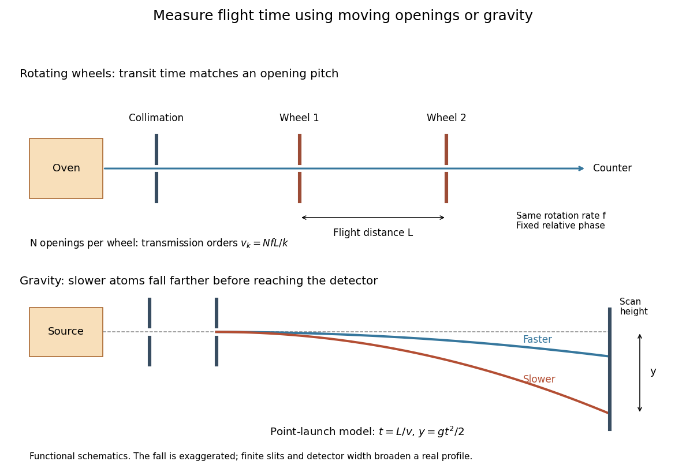

**[Figure 11](#image-two-ways-of-measuring-molecular-beam-speeds-rotating-openings-and-gravitational-flight). Two ways of measuring molecular beam speeds: rotating openings and gravitational flight**. Original functional schematics, not historical apparatus drawings. The lower panel exaggerates the fall for visibility; all numerical settings used in the text are chosen model inputs.

#### Dunoyer molecular-beam experiment

↑ **Parent:** [Molecular beam](#molecular-beam)

In 1911, [Louis Dunoyer de Segonzac](atomic-physicist.md#louis-dunoyer-de-segonzac) formed a [sodium](chemical-substance.md#sodium) beam in [vacuum](#vacuum) and collected a deposit on a surface cooled with liquid air. Its shape agreed with straight paths through the slits.[The method of molecular rays, lecture 12 December 1946, pp. 8–9: Dunoyer's sodium beam, collimation and cooled collector](physics-bibliography.md#the-method-of-molecular-rays-by-otto-stern) A deposit tests the geometry of the surviving paths. A clock or a calibrated deflection is needed to turn their travel into a [speed](classical-mechanics.md#speed) measurement.

#### Effusive beam speed distribution

↑ **Parent:** [Molecular beam](#molecular-beam)

Which [speed distribution](kinetic-theory.md#speed-distribution) does an arrival counter measure? Suppose an equilibrium, nonrelativistic [ideal gas](ideal-gas.md) escapes by [effusion](kinetic-theory.md#effusion) through a thin opening into [vacuum](#vacuum). The opening is small compared with the [mean free path](ideal-gas.md#mean-free-path); the reservoir remains at [temperature](temperature.md) $T$. Let $f(v)$ denote its normalized [Maxwell speed distribution](quantum-ideal-gas-statistics.md#maxwell-speed-distribution), with [mass](classical-mechanics.md#mass) $m$ and $a=m/(2k_BT)$:

$$
f(v)=\frac{4a^{3/2}}{\sqrt\pi}v^2e^{-av^2},\qquad v>0.
$$

At a given direction toward the opening, the number crossing per unit time is proportional to the normal component $v\cos\theta$. Integrating over a fixed accepted cone contributes an angular factor independent of $v$. Thus the normalized [probability density function](continuous-probability-distribution.md#probability-density-function) for speeds among arriving particles is

$$
\boxed{g(v)=\frac{vf(v)}{\langle v\rangle}=2a^2v^3e^{-av^2}}.
$$

Its [integral](integral.md) is one because $\int_0^\infty v^3e^{-av^2}\,dv=1/(2a^2)$. The reservoir [mode](probability-and-statistics.md#mode-statistics) is $v=\sqrt{2k_BT/m}$; the arrival [mode](probability-and-statistics.md#mode-statistics) is $\sqrt{3k_BT/m}$. Faster particles get more opportunities to cross the opening. This is a selection effect, not heating after emission.

Specify the observable before applying the formula. An instantaneous count in a fixed segment of the beam weights the arrival flux by the time spent there, proportional to $1/v$; in this ideal model its normalized speed law returns to $f(v)$. A detector's speed-dependent efficiency, source [collisions](classical-mechanics.md#collision) or a velocity selector changes the arriving law again. **Counting arrivals and counting particles currently present are different measurements.**

#### Rotating-wheel molecular velocity selector

↑ **Parent:** [Molecular beam](#molecular-beam)

[Otto Stern](atomic-physicist.md#otto-stern)'s lecture describes two co-rotating toothed wheels: transit between them must match an advance between openings. He explicitly distinguishes this method from the first historical speed measurement.[The method of molecular rays, lecture 12 December 1946, p. 9: rotating-wheel timing, transmission and limited accuracy](physics-bibliography.md#the-method-of-molecular-rays-by-otto-stern)

For an idealized example, let aligned wheels have $N$ equally spaced openings, separation $L$, and rotation rate $f$ in revolutions per second. A particle with constant longitudinal [speed](classical-mechanics.md#speed) $v$ takes $L/v$ between them. The second wheel advances through $fL/v$ revolutions; transmission peaks when that advance is an integer number $k$ of opening pitches:

$$
\boxed{v_k=\frac{NfL}{k}},\qquad k=1,2,\ldots.
$$

With chosen $N=60$, $f=50\,\mathrm{Hz}$ and $L=0.080\,\mathrm m$, the first two orders select $240$ and $120\,\mathrm{m\,s^{-1}}$. A second transmission maximum therefore need not represent a second source [temperature](temperature.md). Finite opening widths admit speed intervals around each order, and an additional measurement is needed to distinguish orders. The ideal expression assumes negligible [acceleration](classical-mechanics.md#acceleration) and constant rotation rate during a flight, with a fixed relative phase between the wheels.

#### Gravity deflection of an atomic beam

↑ **Parent:** [Molecular beam](#molecular-beam)

[Immanuel Estermann](atomic-physicist.md#immanuel-estermann), [O. C. Simpson](condensed-matter-physicist.md#oliver-cecil-simpson) and [Otto Stern](atomic-physicist.md#otto-stern) used gravitational deflection to measure atomic speeds. Stern describes scanning a hot-wire [surface ionization detector](#surface-ionization-detector) through a [cesium](chemical-substance.md#caesium) beam and recording [ion](chemistry.md#ion) [electric current](electric-charge.md#electric-current).[The method of molecular rays, lecture 12 December 1946, pp. 9–11: collaborators, falling beam and ion-current readout](physics-bibliography.md#the-method-of-molecular-rays-by-otto-stern) Their 1947 paper reports [potassium](chemical-substance.md#potassium) and [cesium](chemical-substance.md#caesium) beams; a deficit of slow arrivals increased with oven [pressure](pressure.md), supporting a source-slit [collision](classical-mechanics.md#collision) explanation.[Estermann, Simpson and Stern, Physical Review 71 (15 February 1947), p. 238, abstract: gravity deflection, modified Maxwellian distribution and pressure-dependent slow-atom deficit](physics-bibliography.md#the-free-fall-of-atoms-and-the-measurement-of-the-velocity-distribution-in-a-molecular-beam-of-cesium-atoms-by-immanuel-estermann-oliver-cecil-simpson-and-otto-stern)

First consider an original point-launch model, with horizontal [speed](classical-mechanics.md#speed) $v>0$, zero initial vertical [velocity](classical-mechanics.md#velocity), flight distance $L$, and uniform [gravitational acceleration](newton-s-law-of-universal-gravitation.md#gravitational-acceleration) $g$. Downward displacement $y$ follows from flight time $t=L/v$:

$$
y=\frac{gL^2}{2v^2}=\frac{C}{v^2},\qquad C=\frac{gL^2}{2}.
$$

Slow particles fall farther. However, a detector scan counts arrivals per interval of height, not per interval of [speed](classical-mechanics.md#speed). [Change of variables for probability densities](continuous-probability-distribution.md#change-of-variables-for-probability-densities) supplies the [Jacobian determinant](multivariable-calculus.md#jacobian-determinant):

$$
p_y(y)=g\!\left(\sqrt{C/y}\right)\frac{\sqrt C}{2y^{3/2}}
=\frac{b^2}{y^3}e^{-b/y},\qquad b=aC=\frac{mgL^2}{4k_BT},\qquad y>0.
$$

Here $g(v)$ denotes the [effusive beam speed distribution](#effusive-beam-speed-distribution); the unadorned constant $g$ in $C$ denotes [gravitational acceleration](newton-s-law-of-universal-gravitation.md#gravitational-acceleration). The [integral](integral.md) of $p_y$ is one: substituting $u=b/y$ reduces it to $\int_0^\infty ue^{-u}\,du=1$. Its [mode](probability-and-statistics.md#mode-statistics) is $y=b/3$. Simply mapping the most probable arrival [speed](classical-mechanics.md#speed) into a fall distance instead gives $2b/3$. The peaks differ because equal height bins cover unequal speed intervals.

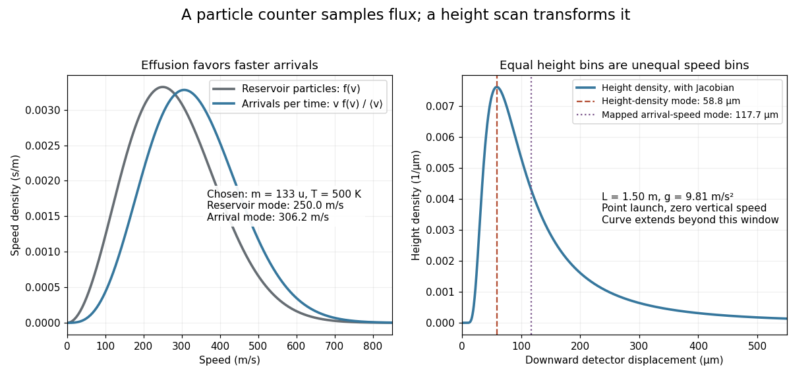

**[Figure 12](#image-effusion-changes-the-arrival-speed-distribution-and-a-detector-height-scan-requires-another-jacobian-determinant). Effusion changes the arrival speed distribution, and a detector-height scan requires another Jacobian determinant**. Original calculated distributions with chosen $m=133\,\mathrm u$, $T=500\,\mathrm K$, $L=1.50\,\mathrm m$ and $g=9.81\,\mathrm{m\,s^{-2}}$. These are not historical measurements.

For those chosen parameters, $b\simeq176.54\,\mu\mathrm m$, so the detector-height [probability density](wave-function.md#probability-density) peaks near $58.85\,\mu\mathrm m$. A detector covering only $0<y<Y$ accepts the fraction

$$
F(Y)=\int_0^Yp_y(y)\,dy=e^{-b/Y}\left(1+\frac bY\right).
$$

At $Y=0.80\,\mathrm{mm}$ this is about $97.9\%$, even before allowing for imperfect detection. Discarding the remainder changes the observed normalization.

Real slits transmit a range of launch heights and vertical [velocities](classical-mechanics.md#velocity). Their geometrical response must be combined with the gravitational deflection and detector width; the point-launch formula is not an exact reduction of the historical apparatus. In the point-launch model, an initial vertical [velocity](classical-mechanics.md#velocity) $w$ would add $wL/v$ to $y$. Source [collisions](classical-mechanics.md#collision), detector efficiency and alignment can also distort a profile. Varying oven [pressure](pressure.md) helps distinguish such source losses from an incorrect thermal distribution; inferring a source [temperature](temperature.md) from the peak alone ignores both selection and the detector's coordinate transformation.

#### Atomic beam

↑ **Parent:** [Molecular beam](#molecular-beam)

A directed stream of [chemical atoms](#atom-physics), such as the neutral [silver](chemical-substance.md#silver) stream in the [Stern-Gerlach experiment](angular-momentum-operator.md#stern-gerlach-experiment).

#### Surface ionization detector

↑ **Parent:** [Molecular beam](#molecular-beam)

#### Molecular beam skimmer

↑ **Parent:** [Molecular beam](#molecular-beam)

### Scientific instrument

↑ **Parent:** [Experimental apparatus](#experimental-apparatus)  
ⓦ [Wiki](https://en.wikipedia.org/wiki/Scientific_instrument)

#### Load cell

↑ **Parent:** [Scientific instrument](#scientific-instrument)  
ⓦ [Wiki](https://en.wikipedia.org/wiki/Load_cell)

A [load cell](#load-cell) is a calibrated device for measuring [force](force.md). In a [tensile modulus experiment](elasticity-physics.md#tensile-modulus-experiment) its output supplies the axial load used to calculate [engineering stress](continuum-mechanics.md#engineering-stress).

#### Telescope

↑ **Parent:** [Scientific instrument](#scientific-instrument)  
ⓦ [Wiki](https://en.wikipedia.org/wiki/Telescope)

##### Chandra X-ray Observatory

↑ **Parent:** [Telescope](#telescope)

An [X-ray](electromagnetic-radiation.md#x-ray) observatory used for high-resolution imaging and spectroscopy of astronomical sources. Its observations of the [Perseus cluster](large-scale-structure-of-the-universe.md#perseus-cluster) reveal structure in the emitting intracluster [gas](thermodynamics.md#gas) around radio bubbles.[2003, abstract](physics-bibliography.md#a-deep-chandra-observation-of-the-perseus-cluster-shocks-and-ripples-by-a-c-fabian-and-others)

##### Kepler space telescope

↑ **Parent:** [Telescope](#telescope)

A space observatory that measured stellar [light curves](astrophysics.md#light-curve) to discover [exoplanets](exoplanet.md) and constrain their [exoplanet occurrence rate](exoplanet.md#exoplanet-occurrence-rate) through [exoplanet transit photometry](exoplanet.md#exoplanet-transit-photometry).

#### Faraday cup

↑ **Parent:** [Scientific instrument](#scientific-instrument)  
ⓦ [Wiki](https://en.wikipedia.org/wiki/Faraday_cup)

A collector that measures incident charged-particle [electric charge](electric-charge.md).

#### Oscillograph

↑ **Parent:** [Scientific instrument](#scientific-instrument)  
ⓦ [Wiki](https://en.wikipedia.org/wiki/Oscillograph)

An instrument that records a time-varying electrical [signal](electrical-engineering.md#signal).

#### Microscope

↑ **Parent:** [Scientific instrument](#scientific-instrument)  
ⓦ [Wiki](https://en.wikipedia.org/wiki/Microscope)

##### Microscope slide

↑ **Parent:** [Microscope](#microscope)

#### Dounce homogenizer

↑ **Parent:** [Scientific instrument](#scientific-instrument)

#### Cathetometer

↑ **Parent:** [Scientific instrument](#scientific-instrument)  
ⓦ [Wiki](https://en.wikipedia.org/wiki/Cathetometer)

#### Photogate

↑ **Parent:** [Scientific instrument](#scientific-instrument)

A [photogate](#photogate) detects interruption of a light beam. Timing that interruption and independently measuring the flag length gives its average [speed](classical-mechanics.md#speed) during passage; the direction must be assigned separately.

#### Ionization chamber

↑ **Parent:** [Scientific instrument](#scientific-instrument)

#### Proportional counter

↑ **Parent:** [Scientific instrument](#scientific-instrument)  
ⓦ [Wiki](https://en.wikipedia.org/wiki/Proportional_counter)

A gas-filled [particle detector](particle-detection.md#particle-detector) using [electron avalanche](atomic-physics.md#electron-avalanche) multiplication. Within its proportional operating range, the collected [electric charge](electric-charge.md) tracks the initial [ionization](atomic-physics.md#ionization), allowing more than a yes-or-no count.

#### Potter-Elvehjem homogenizer

↑ **Parent:** [Scientific instrument](#scientific-instrument)

A [Potter-Elvehjem homogenizer](#potter-elvehjem-homogenizer) mechanically disrupts [biological tissue](anatomy.md#tissue-biology) between a pestle and a surrounding tube.

### Capillary tube

↑ **Parent:** [Experimental apparatus](#experimental-apparatus)

## History of physics

↑ **Parent:** [Physics](physics.md)  
ⓦ [Wiki](https://en.wikipedia.org/wiki/History_of_physics)

A discovery becomes more intelligible when its motivating question, proposed explanation and actual measurement can be followed together. The [photoelectric effect](quantum-mechanics.md#photoelectric-effect) connects [Albert Einstein](physicist.md#albert-einstein)'s light-quantum reasoning with the [Millikan photoelectric experiment](quantum-mechanics.md#millikan-photoelectric-experiment). The [Schrödinger equation](mathematical-physics.md#schrodinger-equation) and the [Davisson–Germer experiment](quantum-scattering.md#davisson-germer-experiment) connect mathematical [wave mechanics](quantum-mechanics.md#wave-mechanics) with a laboratory test of [matter waves](wave-function.md#matter-wave).

The [Nobel Prize in Physics](nobel-prize-in-physics.md) provides one route through these subjects. Following the original papers and the people who built the apparatus also brings collaborators into view: [Lester Halbert Germer](physics-author.md#lester-germer) appears alongside [Clinton J. Davisson](condensed-matter-physicist.md#clinton-davisson) in the [Davisson–Germer experiment](quantum-scattering.md#davisson-germer-experiment). The history belongs in the articles on those people and concepts as well as in award records.

### Big science

↑ **Parent:** [History of physics](#history-of-physics)

Research organized around expensive shared facilities, large coordinated teams and sustained institutional funding. Large instruments can enable new questions while introducing management, budget and access constraints.

### Cartesian vortices

↑ **Parent:** [History of physics](#history-of-physics)

A material circulation used in [René Descartes](mathematics.md#rene-descartes)'s natural philosophy to account for celestial motions. [Isaac Newton](mathematics.md#isaac-newton)'s criticism concerned the compatibility of such circulation with observed orbital periods and cometary paths, not the impossibility of every modern fluid [vortex](critical-phenomenon.md#phase-vortex).[opening discussion of the vortex hypothesis](physics-bibliography.md#general-scholium-by-isaac-newton)

### Historian of physics

↑ **Parent:** [History of physics](#history-of-physics)

#### List of historians of physics

↑ **Parent:** [Historian of physics](#historian-of-physics)

##### A. J. Kox

↑ **Parent:** [List of historians of physics](#list-of-historians-of-physics)

A [historian of physics](#historian-of-physics).[Independent professional biography and identity](https://www.einstein.caltech.edu/who-we-are/a-j-kox)

###### Work by A. J. Kox

↑ **Parent:** [A. J. Kox](#a-j-kox)

### Nobel Prize in Physics

↑ **Parent:** [History of physics](#history-of-physics)

[This section is present in another page, follow this link to view it.](nobel-prize-in-physics.md)

## Branches of physics

↑ **Parent:** [Physics](physics.md)  
ⓦ [Wiki](https://en.wikipedia.org/wiki/Branches_of_physics)

### Astrophysics

↑ **Parent:** [Branches of physics](#branches-of-physics)

[This section is present in another page, follow this link to view it.](astrophysics.md)

### Classical mechanics

↑ **Parent:** [Branches of physics](#branches-of-physics)

[This section is present in another page, follow this link to view it.](classical-mechanics.md)

### Continuum mechanics

↑ **Parent:** [Branches of physics](#branches-of-physics)

[This section is present in another page, follow this link to view it.](continuum-mechanics.md)

### Cosmology

↑ **Parent:** [Branches of physics](#branches-of-physics)

[This section is present in another page, follow this link to view it.](cosmology.md)

### Dynamical systems

↑ **Parent:** [Branches of physics](#branches-of-physics)

[This section is present in another page, follow this link to view it.](dynamical-systems.md)

### Electromagnetism

↑ **Parent:** [Branches of physics](#branches-of-physics)

[This section is present in another page, follow this link to view it.](electromagnetism.md)

### Fluid mechanics

↑ **Parent:** [Branches of physics](#branches-of-physics)

[This section is present in another page, follow this link to view it.](fluid-mechanics.md)

### General relativity

↑ **Parent:** [Branches of physics](#branches-of-physics)

[This section is present in another page, follow this link to view it.](general-relativity.md)

### Geophysics

↑ **Parent:** [Branches of physics](#branches-of-physics)

[This section is present in another page, follow this link to view it.](geophysics.md)

### Integrable systems

↑ **Parent:** [Branches of physics](#branches-of-physics)

[This section is present in another page, follow this link to view it.](integrable-systems.md)

### Mathematical biology

↑ **Parent:** [Branches of physics](#branches-of-physics)

[This section is present in another page, follow this link to view it.](mathematical-biology.md)

### Optics

↑ **Parent:** [Branches of physics](#branches-of-physics)

[This section is present in another page, follow this link to view it.](optics.md)

### Quantum field theory

↑ **Parent:** [Branches of physics](#branches-of-physics)

[This section is present in another page, follow this link to view it.](quantum-field-theory.md)

### Quantum mechanics

↑ **Parent:** [Branches of physics](#branches-of-physics)

[This section is present in another page, follow this link to view it.](quantum-mechanics.md)

### Quantum theory

↑ **Parent:** [Branches of physics](#branches-of-physics)

[This section is present in another page, follow this link to view it.](quantum-theory.md)

### Special relativity

↑ **Parent:** [Branches of physics](#branches-of-physics)

[This section is present in another page, follow this link to view it.](special-relativity.md)

### Statistical physics

↑ **Parent:** [Branches of physics](#branches-of-physics)

[This section is present in another page, follow this link to view it.](statistical-physics.md)

### String theory

↑ **Parent:** [Branches of physics](#branches-of-physics)

[This section is present in another page, follow this link to view it.](string-theory.md)

### Supersymmetry

↑ **Parent:** [Branches of physics](#branches-of-physics)

[This section is present in another page, follow this link to view it.](supersymmetry.md)

### Mechanics

↑ **Parent:** [Branches of physics](#branches-of-physics)  
ⓦ [Wiki](https://en.wikipedia.org/wiki/Mechanics)

Study of physical [motion](classical-mechanics.md#motion), interactions and their dynamical laws. [Classical mechanics](classical-mechanics.md) and [quantum mechanics](quantum-mechanics.md) give different descriptions within this broad subject.

#### Dynamics (mechanics)

↑ **Parent:** [Mechanics](#mechanics)  
ⓦ [Wiki](https://en.wikipedia.org/wiki/Dynamics_(mechanics))

The study of physical evolution through [dynamical equations](dynamical-systems.md#dynamical-equation), including how [forces](force.md) affect [motion](classical-mechanics.md#motion). A law relating [force](force.md) to [acceleration](classical-mechanics.md#acceleration) must be combined with an interaction law and [initial conditions](differential-equation.md#initial-condition) to predict a history.

### Condensed matter physics

↑ **Parent:** [Branches of physics](#branches-of-physics)  
ⓦ [Wiki](https://en.wikipedia.org/wiki/Condensed_matter_physics)

#### Condensed matter physicist

↑ **Parent:** [Condensed matter physics](#condensed-matter-physics)

[This section is present in another page, follow this link to view it.](condensed-matter-physicist.md)

#### Charge density wave

↑ **Parent:** [Condensed matter physics](#condensed-matter-physics)  
ⓦ [Wiki](https://en.wikipedia.org/wiki/Charge_density_wave)

A periodic modulation of electronic [charge density](electric-charge.md#charge-density), often coupled to a lattice distortion. In a one-dimensional metal, a [Peierls distortion](quantum-ideal-gas-statistics.md#peierls-distortion) with $Q=2k_F$ can open a gap at opposite [Fermi points](fermi-liquid.md#fermi-point), lowering the occupied electron [energy](energy.md) at an elastic energy cost. A charge modulation and a [spin density wave](#spin-density-wave) are distinct: the latter can modulate spin while leaving the total charge nearly uniform.

#### Spin density wave

↑ **Parent:** [Condensed matter physics](#condensed-matter-physics)

A spatially modulated spin density, distinct from a [charge density wave](#charge-density-wave). Opposite modulations of spin-up and spin-down occupations can give a periodically varying [magnetization](electromagnetism.md#magnetization) while their total [charge density](electric-charge.md#charge-density) stays uniform.

#### Electron correlation

↑ **Parent:** [Condensed matter physics](#condensed-matter-physics)

##### Electron-gas correlation energy

↑ **Parent:** [Electron correlation](#electron-correlation)

The exact ground-state [energy](energy.md) minus the minimum Hartree-Fock [energy](energy.md) for the same Hamiltonian and variational constraints. It is nonpositive when compared with the unrestricted variational minimum. Correlations beyond a single determinant can substantially change phase boundaries at low density.

##### Dissociation error of a doubly occupied bonding orbital

↑ **Parent:** [Electron correlation](#electron-correlation)

A normalized product of two identical bonding orbitals built from separated orthogonal centers has finite weight in configurations with both [electrons](#electron) on one center. Repulsion penalizes that ionic weight even when hopping disappears. Mixing configurations can instead approach one [electron](#electron) per center while preserving the required [spin](angular-momentum-operator.md#spin) and exchange symmetries.

##### Dynamic electron correlation

↑ **Parent:** [Electron correlation](#electron-correlation)

The correlated instantaneous avoidance of [electrons](#electron) beyond a single [Slater determinant](tensor-product-of-quantum-systems.md#slater-determinant). It can remain important even when one configuration dominates, as for an isolated closed-shell helium atom; it is distinct from the near-degeneracy problem of [static electron correlation](#static-electron-correlation).

##### Static electron correlation

↑ **Parent:** [Electron correlation](#electron-correlation)

[Electron correlation](#electron-correlation) caused by the need for multiple important configurations, often when several [molecular orbitals](chemistry.md#molecular-orbital) are nearly degenerate. Stretching a homonuclear two-electron bond makes a single doubly occupied orbital retain unphysical ionic contributions; a suitable combination of configurations cancels them.

##### Heavy fermion material

↑ **Parent:** [Electron correlation](#electron-correlation)  
ⓦ [Wiki](https://en.wikipedia.org/wiki/Heavy_fermion_material)

A strongly correlated material whose low-energy electronic [quasiparticles](quantum-mechanics.md#quasiparticle) have a very large thermodynamic [effective mass](bloch-s-theorem.md#band-effective-mass). An enhanced [electronic heat capacity coefficient](heat.md#electronic-heat-capacity-coefficient), spin susceptibility and quantum-oscillation [cyclotron effective mass](bloch-s-theorem.md#cyclotron-effective-mass) are complementary signatures; they need not all be related by a single isotropic band mass. A [Kondo lattice](#kondo-lattice) is an important setting for such behaviour. In [CeAl3](chemical-substance.md#ceal3), low-temperature specific heat and quadratic resistivity provided an early quantitative example.[Abstract: low-temperature electronic heat capacity and electrical resistivity](physics-bibliography.md#4f-virtual-bound-state-formation-in-ceal3-at-low-temperatures-by-klaus-andres-and-others)

###### Electronic heat capacity of a heavy Fermi liquid

↑ **Parent:** [Heavy fermion material](#heavy-fermion-material)

For [quasiparticles](quantum-mechanics.md#quasiparticle) with [density of states](quantum-ideal-gas-statistics.md#density-of-states) $g(E_F)$ including both spins, the leading [electronic heat capacity](heat.md#electronic-heat-capacity) is $C=\gamma T$ with $\gamma=\pi^2k_B^2g(E_F)/3$. A narrow heavy band makes this coefficient large. The [density of states](quantum-ideal-gas-statistics.md#density-of-states) and heat capacity must use consistent extensive, molar or volumetric normalization.

###### Low-temperature calorimetry and resistivity of CeAl3

↑ **Parent:** [Heavy fermion material](#heavy-fermion-material)

The 1975 measurements of [CeAl3](chemical-substance.md#ceal3) below $0.2\,\mathrm K$ found an [electronic heat capacity coefficient](heat.md#electronic-heat-capacity-coefficient) of $1.62\,\mathrm{J\,mol^{-1}\,K^{-2}}$ and a quadratic electrical-resistivity coefficient of $35\,\mathrm{\mu\Omega\,cm\,K^{-2}}$. These are complementary thermal and transport signatures of an unusually dense low-energy electronic spectrum.[Abstract: the two measured coefficients and low-temperature range](physics-bibliography.md#4f-virtual-bound-state-formation-in-ceal3-at-low-temperatures-by-klaus-andres-and-others) A temperature sweep and a $C/T$ versus $T^2$ fit separate the electronic intercept from a Debye lattice term; the transport comparison tests a [Fermi liquid](fermi-liquid.md) temperature law.

##### Kondo effect

↑ **Parent:** [Electron correlation](#electron-correlation)  
ⓦ [Wiki](https://en.wikipedia.org/wiki/Kondo_effect)

Antiferromagnetic exchange between a localized magnetic moment and conduction [electrons](#electron) produces strong low-energy correlations and screening of the moment. In a dilute magnetic-impurity metal, a resistance minimum and a low-temperature logarithmic increase are characteristic signatures over an appropriate temperature range. The strong-coupling low-temperature regime cannot be obtained by extending the logarithm indefinitely.

###### Kondo lattice

↑ **Parent:** [Kondo effect](#kondo-effect)

A periodic array of local moments coupled to conduction [electrons](#electron). Competition between screening, coherent hybridization and intersite magnetic interactions can produce a [heavy fermion material](#heavy-fermion-material), magnetic order or a correlated insulating state.

###### Kondo-lattice coherence temperature

↑ **Parent:** [Kondo lattice](#kondo-lattice)

A [Kondo lattice](#kondo-lattice) develops coherent low-energy [quasiparticle](quantum-mechanics.md#quasiparticle) bands below a material-dependent coherence scale. This lattice scale need not equal the single-impurity Kondo screening scale. Coherence can produce a heavy [Fermi liquid](fermi-liquid.md) with narrow bands, large [electronic heat capacity](heat.md#electronic-heat-capacity) and low-[temperature](temperature.md) quadratic resistivity.

#### Condensed matter

↑ **Parent:** [Condensed matter physics](#condensed-matter-physics)

### Soft matter

↑ **Parent:** [Branches of physics](#branches-of-physics)  
ⓦ [Wiki](https://en.wikipedia.org/wiki/Soft_matter)

[Soft matter](#soft-matter) studies materials whose large-scale structures respond strongly to modest mechanical or thermal disturbances, including [polymers](polymer.md), [liquid crystals](critical-phenomenon.md#liquid-crystal) and [colloids](mixture.md#colloid). [Polymer physics](polymer.md#polymer-physics) connects chain conformations to material response; the [coil-stretch transition](polymer.md#coil-stretch-transition) is one example.

#### Synthetic fluid membrane

↑ **Parent:** [Soft matter](#soft-matter)

A [synthetic fluid membrane](#synthetic-fluid-membrane) is a thin self-assembled sheet of synthetic [amphiphiles](physical-chemistry.md#amphiphile), fluid under static in-plane shear while resisting [area](differential-geometry.md#surface-area) changes and bending. It provides a nonbiological realization of a two-dimensional fluid interface with [curvature](differential-geometry.md#curvature) [elasticity](elasticity-physics.md). A [Helfrich energy](mathematical-biology.md#helfrich-energy) describes long-wavelength shape costs; its material parameters and any [spontaneous curvature](mathematical-biology.md#spontaneous-curvature) depend on composition and conditions. Lateral fluidity does not eliminate [membrane bending rigidity](mathematical-biology.md#membrane-bending-rigidity) or [membrane tension](mathematical-biology.md#membrane-tension). The [membrane fluctuation spectrum under tension](mathematical-biology.md#membrane-fluctuation-spectrum-under-tension) separates bending-dominated and tension-dominated [length](#length) scales.

#### Soft matter physics

↑ **Parent:** [Soft matter](#soft-matter)

[Soft matter physics](#soft-matter-physics) studies the physical behaviour of [soft matter](#soft-matter), including its response to mechanical and thermal perturbations.

### Physical oceanography

↑ **Parent:** [Branches of physics](#branches-of-physics)  
ⓦ [Wiki](https://en.wikipedia.org/wiki/Physical_oceanography)

The study of physical properties and processes in the oceans, including [fluid flow](fluid-mechanics.md#fluid-flow), [waves](wave.md) and transport of [heat](heat.md).

#### Oceanographer

↑ **Parent:** [Physical oceanography](#physical-oceanography)

##### List of oceanographers

↑ **Parent:** [Oceanographer](#oceanographer)

###### Michael J. McPhaden

↑ **Parent:** [List of oceanographers](#list-of-oceanographers)

A physical oceanographer whose work includes tropical Pacific observations and [El Niño–Southern Oscillation](#el-nino-southern-oscillation) dynamics. Author of [El Niño and La Niña: Causes and Global Consequences by Michael J. McPhaden](physics-bibliography.md#el-nino-and-la-nina-causes-and-global-consequences-by-michael-j-mcphaden).

###### Work by Michael J. McPhaden

↑ **Parent:** [Michael J. McPhaden](#michael-j-mcphaden)

<h4 id="el-nino-southern-oscillation">El Niño–Southern Oscillation</h4>

↑ **Parent:** [Physical oceanography](#physical-oceanography)  
ⓦ [Wiki](https://en.wikipedia.org/wiki/El_Niño–Southern_Oscillation)

Coupled variability of the tropical Pacific ocean and [terrestrial atmosphere](planetary-science.md#terrestrial-atmosphere), including the warm [El Niño](#el-nino) phase, the cold [La Niña](#la-nina) phase, and associated changes in surface [pressure](pressure.md), [trade winds](planetary-science.md#trade-winds) and the [thermocline](#thermocline).

<h5 id="la-nina">La Niña</h5>

↑ **Parent:** [El Niño–Southern Oscillation](#el-nino-southern-oscillation)

The cold phase of [El Niño–Southern Oscillation](#el-nino-southern-oscillation), with central and eastern equatorial Pacific surface cooling.

<h5 id="el-nino">El Niño</h5>

↑ **Parent:** [El Niño–Southern Oscillation](#el-nino-southern-oscillation)

The warm phase of the coupled tropical Pacific [El Niño–Southern Oscillation](#el-nino-southern-oscillation), with central and eastern equatorial Pacific surface warming and a weakened [Walker circulation](planetary-science.md#walker-circulation). Changes of [trade winds](planetary-science.md#trade-winds), [thermocline](#thermocline) depth, and [equatorial Kelvin waves](geophysical-fluid-dynamics.md#equatorial-kelvin-wave) and [equatorial Rossby waves](geophysical-fluid-dynamics.md#equatorial-rossby-wave) participate in its evolution.

#### Thermocline

↑ **Parent:** [Physical oceanography](#physical-oceanography)  
ⓦ [Wiki](https://en.wikipedia.org/wiki/Thermocline)

A water layer across which [temperature](temperature.md) changes rapidly with depth. In a [reduced gravity](reduced-gravity.md) description of the upper ocean, its displacement is represented by the interface between warm surface water and colder deep water. Deepening the eastern tropical Pacific thermocline makes [upwelling](geophysical-fluid-dynamics.md#upwelling) less effective at cooling the surface during [El Niño](#el-nino).

#### Physical oceanographer

↑ **Parent:** [Physical oceanography](#physical-oceanography)

##### List of physical oceanographers

↑ **Parent:** [Physical oceanographer](#physical-oceanographer)

###### James F. Price

↑ **Parent:** [List of physical oceanographers](#list-of-physical-oceanographers)

A [physical oceanographer](#physical-oceanographer) and author of the tank-draining discussion cited in [Torricelli's law](fluid-mechanics.md#torricelli-s-law).[Institutional profile: Dr. James F. Price, Physical Oceanography Department](https://www2.whoi.edu/staff/jprice/)[Curriculum vitae: personal history gives birth on 9 September 1948](https://www2.whoi.edu/staff/jprice/curriculum-vitae/)

###### Work by James F. Price

↑ **Parent:** [James F. Price](#james-f-price)

### Particle physics (discipline)

↑ **Parent:** [Branches of physics](#branches-of-physics)  
ⓦ [Wiki](https://en.wikipedia.org/wiki/Particle_physics)

#### Particle physicist

↑ **Parent:** [Particle physics (discipline)](#particle-physics-discipline)

[This section is present in another page, follow this link to view it.](particle-physicist.md)

## Particle (physics)

↑ **Parent:** [Physics](physics.md)

### Scalar particle

↑ **Parent:** [Particle (physics)](#particle-physics)

A [scalar](classical-field-theory.md#scalar-field) particle has zero intrinsic [spin](angular-momentum-operator.md#spin). A scalar-field [excitation](#elementary-excitation) provides its relativistic description. [Spin](angular-momentum-operator.md#spin) zero alone does not force its decay [matrix element](vector-space.md#matrix-element) to be independent of internal [invariant masses](special-relativity.md#invariant-mass); [resonance](dynamical-systems.md#resonance) dynamics can still produce a nonuniform three-body distribution.

### Massless particle

↑ **Parent:** [Particle (physics)](#particle-physics)  
ⓦ [Wiki](https://en.wikipedia.org/wiki/Massless_particle)

A [particle](#particle-physics) with zero invariant rest [mass](classical-mechanics.md#mass). A positive-energy [massless](#massless-particle) state has $E=|\mathbf p|$ in natural units and has no rest frame. Its finite-helicity representations differ from massive spin representations.

### Massive particle

↑ **Parent:** [Particle (physics)](#particle-physics)

A [particle](#particle-physics) with strictly positive [rest mass](special-relativity.md#invariant-mass). Its relativistic [energy](energy.md) obeys $E^2=p^2c^2+m^2c^4$, and its speed in an inertial frame is below the [speed of light](special-relativity.md#speed-of-light).

### Neutral particle

↑ **Parent:** [Particle (physics)](#particle-physics)

A [particle](#particle-physics) with zero net [electric charge](electric-charge.md).

### Particle number

↑ **Parent:** [Particle (physics)](#particle-physics)

A [particle number](#particle-number) counts the [particles](#particle-physics) of a specified kind in a system. For a fixed collection, $N$ is a nonnegative [integer](integer.md). In a variable-number [quantum system](quantum-system.md), distinguish a measured [particle number](#particle-number), the [particle number operator](quantum-harmonic-oscillator.md#number-operator), and its [expected value](expected-value.md).

#### Particle current

↑ **Parent:** [Particle number](#particle-number)

The rate at which particles cross an oriented surface, measured as particle count per unit time. If a local [continuity equation](mathematical-physics.md#continuity-equation) has number density $n$ and current density $\mathbf j_N$, then $\partial_t n+\nabla\cdot\mathbf j_N=0$ and $J_N=\int_S\mathbf j_N\cdot d\mathbf S$. In a closed two-reservoir system, a left-to-right [particle current](#particle-current) is $-dN_L/dt=dN_R/dt$. Neutral particles carry this current without an associated [electric current](electric-charge.md#electric-current).

## ↑ Ancestors (1)

1. [Codex Wiki](README.md)

## ← Incoming links (27)

- [Astronomy](astronomy.md)
- [Astrophysics](astrophysics.md)
- [Clifford Shull](condensed-matter-physicist.md#clifford-shull)
- [Clinton Davisson](condensed-matter-physicist.md#clinton-davisson)
- [Gamma function](complex-analysis.md#gamma-function)
- [Geophysics](geophysics.md)
- [Henri Becquerel](nuclear-physicist.md#henri-becquerel)
- [Henry Michael Foley](atomic-physicist.md#henry-michael-foley)
- [John William Strutt, 3rd Baron Rayleigh](physicist.md#john-william-strutt-3rd-baron-rayleigh)
- [Lippmann plate](optics.md#lippmann-plate)
- [Marie Curie](nuclear-physicist.md#marie-curie)
- [Natural philosopher](history-of-science.md#natural-philosopher)
- [Nobel Prize in Physics in 1978](nobel-prize-in-physics.md#nobel-prize-in-physics-in-1978)
- [Nobel Prize in Physics in 2008](nobel-prize-in-physics.md#nobel-prize-in-physics-in-2008)
- [Solution](past-exam-of-the-history-of-science-supplementary-subject-of-the-university-of-oxford/2016.md#4/solution)
- [Solution](past-exam-of-the-history-of-science-supplementary-subject-of-the-university-of-oxford/2018.md#2/solution)
- [Solution](past-exam-of-the-philosophy-of-science-supplementary-subject-of-the-university-of-oxford/2022.md#1/solution)
- [Samuel Jackson Barnett](condensed-matter-physicist.md#samuel-jackson-barnett)
- [Special relativity](special-relativity.md)
- [Thermal physics course of the University of Oxford](university-of-oxford.md#thermal-physics-course-of-the-university-of-oxford)
- [University of Oxford](university-of-oxford.md)
- [Year 1 of the physics and philosophy course of the University of Oxford](university-of-oxford.md#year-1-of-the-physics-and-philosophy-course-of-the-university-of-oxford)
- [Year 2 of the physics and philosophy course of the University of Oxford](university-of-oxford.md#year-2-of-the-physics-and-philosophy-course-of-the-university-of-oxford)
- [Year 2 of the physics course of the University of Oxford](university-of-oxford.md#year-2-of-the-physics-course-of-the-university-of-oxford)
- [Year 3 of the physics and philosophy course of the University of Oxford](university-of-oxford.md#year-3-of-the-physics-and-philosophy-course-of-the-university-of-oxford)
- [Year 3 of the physics course of the University of Oxford](university-of-oxford.md#year-3-of-the-physics-course-of-the-university-of-oxford)
- [Year 4 of the physics and philosophy course of the University of Oxford](university-of-oxford.md#year-4-of-the-physics-and-philosophy-course-of-the-university-of-oxford)
