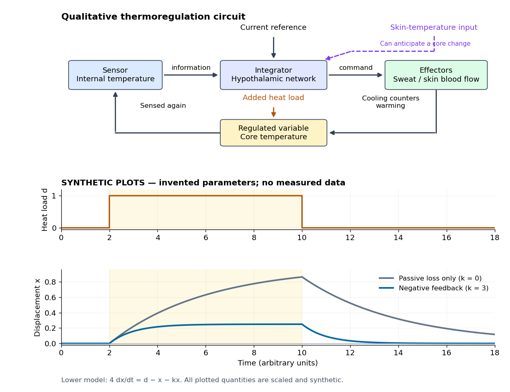
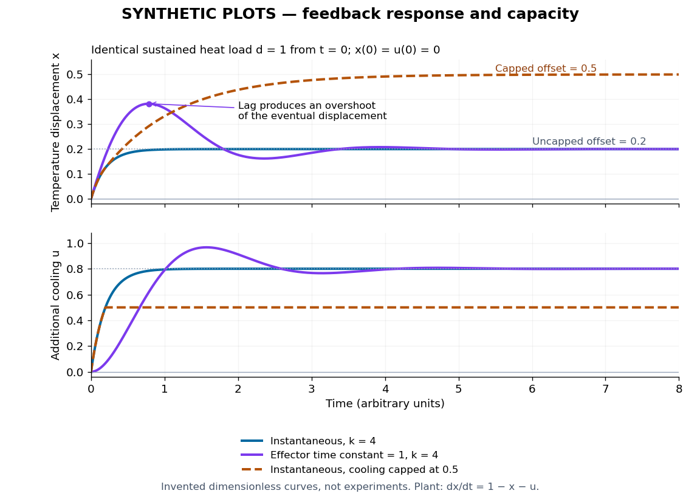
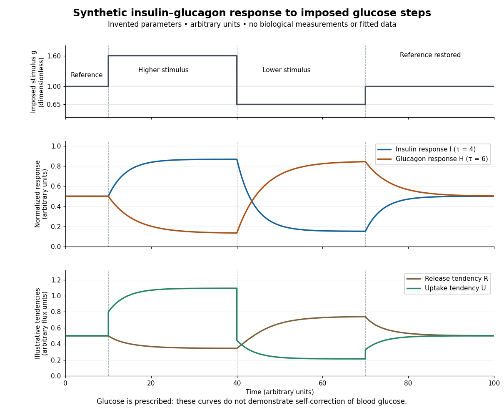
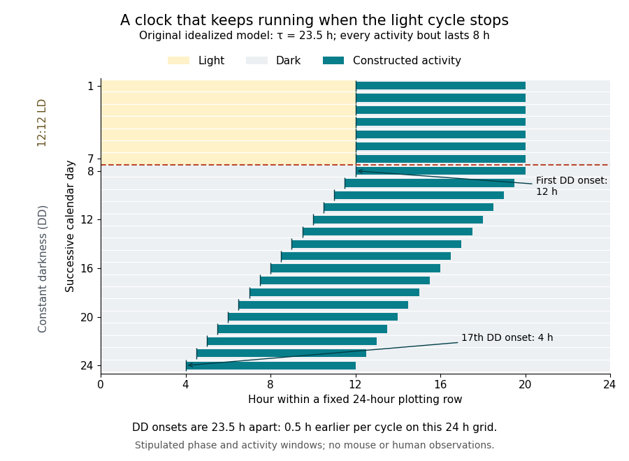
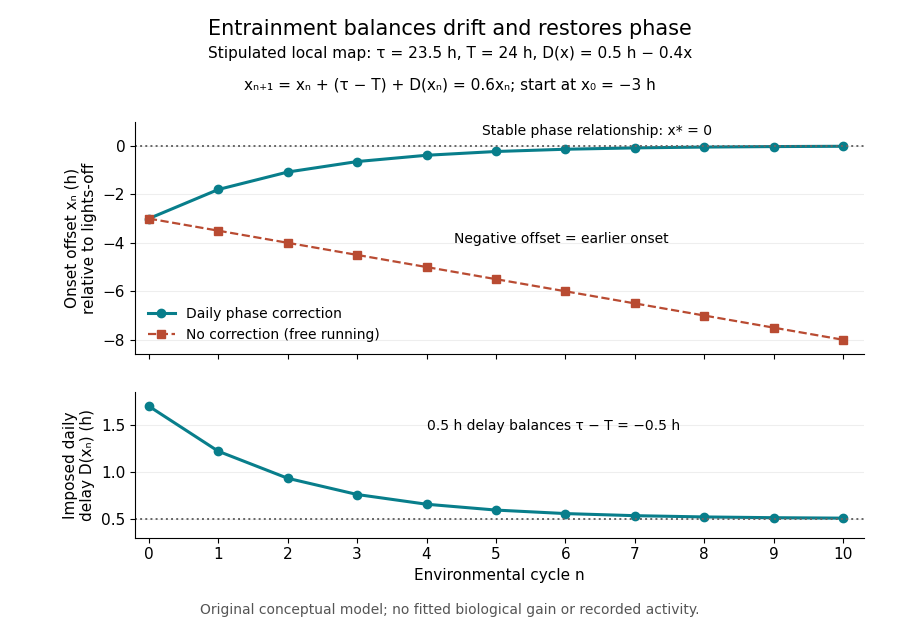

# Physiology

↑ **Parent:** [Biology](biology.md)  
ⓦ [Wiki](https://en.wikipedia.org/wiki/Physiology)

**Table of contents**

- [Chemoreceptor](#chemoreceptor)
- [Thirst](#thirst)
  - [Polydipsia](#polydipsia)
- [Urinary system](#urinary-system)
  - [Urethra](#urethra)
- [Secretion](#secretion)
  - [Glandular secretion](#glandular-secretion)
- [Nutrition](#nutrition)
  - [Nitrogen balance](#nitrogen-balance)
  - [Dietary fibre](#dietary-fibre)
  - [Iodine deficiency](#iodine-deficiency)
  - [Malnutrition](#malnutrition)
    - [Nutrient deficiency](#nutrient-deficiency)
      - [Vitamin C deficiency](#vitamin-c-deficiency)
        - [Scurvy](#scurvy)
- [Serum urate](#serum-urate)
- [Physiological response](#physiological-response)
- [Gas exchange](#gas-exchange)
- [Oxygen saturation](#oxygen-saturation)
- [Mucus](#mucus)
- [Lymphatic system](#lymphatic-system)
  - [Lymphatic drainage](#lymphatic-drainage)
  - [Lymphatic vessel](#lymphatic-vessel)
    - [Lymphatic valve](#lymphatic-valve)
  - [Thoracic duct](#thoracic-duct)
    - [Cisterna chyli](#cisterna-chyli)
  - [Lacteal](#lacteal)
  - [Spleen](#spleen)
    - [Splenic white pulp](#splenic-white-pulp)
  - [Lymphoid organ](#lymphoid-organ)
  - [Lymph node](#lymph-node)
    - [Paracortex](#paracortex)
    - [Germinal centre](#germinal-centre)
    - [Mesenteric lymph node](#mesenteric-lymph-node)
  - [Lymph](#lymph)
    - [Chyle](#chyle)
- [Urine](#urine)
  - [Polyuria](#polyuria)
- [Heart](#heart)
  - [Cardiac ventricle](#cardiac-ventricle)
  - [Atrioventricular node](#atrioventricular-node)
  - [Pericardium](#pericardium)
  - [Heart valve](#heart-valve)
    - [Mitral valve](#mitral-valve)
  - [Left ventricle](#left-ventricle)
    - [Ventricular elastance](#ventricular-elastance)
      - [Rapid artery-ventricle pressure equilibration](#rapid-artery-ventricle-pressure-equilibration)
      - [Ventricular ejection pressure and stroke-volume approximation](#ventricular-ejection-pressure-and-stroke-volume-approximation)
  - [Cardiac output](#cardiac-output)
    - [Stroke volume](#stroke-volume)
  - [Aortic valve](#aortic-valve)
  - [Cardiac cycle](#cardiac-cycle)
    - [Isovolumetric contraction](#isovolumetric-contraction)
    - [Diastole](#diastole)
    - [Systole](#systole)
- [Perfusion](#perfusion)
- [Pulmonary ventilation](#pulmonary-ventilation)
  - [Delayed carbon-dioxide ventilation feedback](#delayed-carbon-dioxide-ventilation-feedback)
    - [Sigmoidal delayed ventilation threshold](#sigmoidal-delayed-ventilation-threshold)
  - [Apnoea](#apnoea)
  - [Alveolar ventilation](#alveolar-ventilation)
  - [Hyperventilation](#hyperventilation)
  - [Artificial respiration](#artificial-respiration)
  - [Hering-Breuer inflation reflex](#hering-breuer-inflation-reflex)
  - [Airway](#airway)
  - [Aspiration](#aspiration)
  - [Tracheal cannula](#tracheal-cannula)
  - [Respiratory mechanics](#respiratory-mechanics)
    - [Transpulmonary pressure](#transpulmonary-pressure)
    - [Alveolar pressure](#alveolar-pressure)
    - [Pleural pressure](#pleural-pressure)
- [Electromyography](#electromyography)
  - [Motor-evoked potential](#motor-evoked-potential)
  - [Facial electromyography](#facial-electromyography)
- [Arousal](#arousal)
- [Physiological arousal](#physiological-arousal)
- [Heart rate](#heart-rate)
  - [Heart rate variability](#heart-rate-variability)
- [Wound healing](#wound-healing)
  - [Scar](#scar)
  - [Granulation tissue](#granulation-tissue)
- [Electrophysiology](#electrophysiology)
  - [Fast-scan cyclic voltammetry](#fast-scan-cyclic-voltammetry)
- [Physiological stress](#physiological-stress)
- [Aerobic capacity](#aerobic-capacity)
- [Muscle tissue](#muscle-tissue)
  - [Muscle cell](#muscle-cell)
    - [Smooth muscle cell](#smooth-muscle-cell)
  - [Muscle atrophy](#muscle-atrophy)
  - [Muscle tone](#muscle-tone)
  - [Smooth muscle](#smooth-muscle)
- [Digestive system](#digestive-system)
  - [Large intestine](#large-intestine)
    - [Caecum](#caecum)
  - [Faeces](#faeces)
    - [Excretin](#excretin)
  - [Intestinal motility](#intestinal-motility)
  - [Regurgitation](#regurgitation)
  - [Lower oesophageal sphincter](#lower-oesophageal-sphincter)
  - [Gastrointestinal tract](#gastrointestinal-tract)
  - [Gallbladder](#gallbladder)
  - [Belching](#belching)
  - [Stomach](#stomach)
    - [Pylorus](#pylorus)
    - [Gastric outlet obstruction](#gastric-outlet-obstruction)
    - [Gastritis](#gastritis)
    - [Gastric acid secretion](#gastric-acid-secretion)
  - [Digestion](#digestion)
    - [Lipid digestion](#lipid-digestion)
      - [Mixed micelle](#mixed-micelle)
    - [Nutrient absorption](#nutrient-absorption)
  - [Bile](#bile)
    - [Bile pigment](#bile-pigment)
      - [Biliverdin](#biliverdin)
    - [Biliary fistula](#biliary-fistula)
    - [Bilirubin](#bilirubin)
      - [Haematoidin](#haematoidin)
    - [Bile salt](#bile-salt)
      - [Taurocholic acid](#taurocholic-acid)
  - [Vomiting](#vomiting)
    - [Retching](#retching)
    - [Pregnancy-associated vomiting](#pregnancy-associated-vomiting)
  - [Intestine](#intestine)
    - [Intestinal lumen](#intestinal-lumen)
    - [Rectum](#rectum)
    - [Muscularis mucosae](#muscularis-mucosae)
    - [Lamina propria](#lamina-propria)
    - [Peyer's patch](#peyer-s-patch)
    - [Intestinal obstruction](#intestinal-obstruction)
    - [Colon](#colon)
    - [Bowel](#bowel)
    - [Gut granule](#gut-granule)
    - [Small intestine](#small-intestine)
      - [Ileum](#ileum)
      - [Duodenum](#duodenum)
        - [Brunner gland](#brunner-gland)
    - [Intestinal crypt](#intestinal-crypt)
    - [Intestinal villus](#intestinal-villus)
- [Microbial digestion](#microbial-digestion)
- [Diet](#diet)
  - [Wine](#wine)
    - [Sherry](#sherry)
  - [Food](#food)
    - [Bread](#bread)
  - [Fallback food](#fallback-food)
- [Circulatory system](#circulatory-system)
  - [Pulmonary circulation](#pulmonary-circulation)
  - [Arterial pulse](#arterial-pulse)
    - [Pulse wave velocity](#pulse-wave-velocity)
  - [Vein](#vein)
    - [Venous reservoir](#venous-reservoir)
    - [Vena cava](#vena-cava)
    - [Dural venous sinus](#dural-venous-sinus)
    - [Deep dorsal vein of the penis](#deep-dorsal-vein-of-the-penis)
    - [Subclavian vein](#subclavian-vein)
      - [Left subclavian vein](#left-subclavian-vein)
    - [Azygos vein](#azygos-vein)
    - [Phlebitis](#phlebitis)
    - [Pterygoid plexus](#pterygoid-plexus)
    - [Cavernous sinus](#cavernous-sinus)
    - [Inferior ophthalmic vein](#inferior-ophthalmic-vein)
    - [Superior ophthalmic vein](#superior-ophthalmic-vein)
    - [Venous valve](#venous-valve)
  - [Blood vessel](#blood-vessel)
    - [Vasa vasorum](#vasa-vasorum)
    - [Tunica adventitia](#tunica-adventitia)
    - [Tunica media](#tunica-media)
    - [Tunica intima](#tunica-intima)
    - [Internal pudendal vessels](#internal-pudendal-vessels)
    - [Obturator vessels](#obturator-vessels)
    - [Anastomosis](#anastomosis)
    - [Aneurysm](#aneurysm)
      - [Femoral aneurysm](#femoral-aneurysm)
      - [Aortic aneurysm](#aortic-aneurysm)
    - [Vascular compliance](#vascular-compliance)
    - [Artery](#artery)
      - [Arterial reservoir](#arterial-reservoir)
      - [Anterior spinal artery](#anterior-spinal-artery)
      - [Atherosclerosis](#atherosclerosis)
        - [Coronary atherosclerosis](#coronary-atherosclerosis)
      - [Popliteal artery](#popliteal-artery)
      - [Basilar artery](#basilar-artery)
      - [Vertebral artery](#vertebral-artery)
      - [Internal pudendal artery](#internal-pudendal-artery)
        - [Artery of the bulb of the penis](#artery-of-the-bulb-of-the-penis)
        - [Perineal artery](#perineal-artery)
      - [Profunda brachii artery](#profunda-brachii-artery)
      - [Arteriole](#arteriole)
      - [Pulmonary artery](#pulmonary-artery)
      - [Axillary artery](#axillary-artery)
      - [Internal carotid artery](#internal-carotid-artery)
        - [Carotid sinus](#carotid-sinus)
          - [Carotid body](#carotid-body)
      - [Ophthalmic artery](#ophthalmic-artery)
        - [Posterior ethmoidal artery](#posterior-ethmoidal-artery)
        - [Anterior ethmoidal artery](#anterior-ethmoidal-artery)
        - [Supraorbital artery](#supraorbital-artery)
        - [Posterior ciliary arteries](#posterior-ciliary-arteries)
        - [Lacrimal artery](#lacrimal-artery)
        - [Central retinal artery](#central-retinal-artery)
      - [Aorta](#aorta)
        - [Aortic arch](#aortic-arch)
          - [Ligamentum arteriosum](#ligamentum-arteriosum)
  - [Capillary](#capillary)
    - [Alveolar capillary](#alveolar-capillary)
  - [Blood circulation](#blood-circulation)
    - [Three-compartment ventricular circulation model](#three-compartment-ventricular-circulation-model)
    - [Fetal circulation](#fetal-circulation)
    - [Cerebral circulation](#cerebral-circulation)
      - [Blood-brain barrier](#blood-brain-barrier)
      - [Cerebral perfusion pressure](#cerebral-perfusion-pressure)
      - [Cerebral arterial circle](#cerebral-arterial-circle)
      - [Cerebral autoregulation](#cerebral-autoregulation)
    - [Blood flow](#blood-flow)
      - [Coronary blood flow](#coronary-blood-flow)
      - [Splanchnic blood flow](#splanchnic-blood-flow)
    - [Haemostasis](#haemostasis)
    - [Vascular resistance](#vascular-resistance)
    - [Venous return](#venous-return)
      - [Muscle pump](#muscle-pump)
  - [Blood](#blood)
    - [Platelet](#platelet)
    - [Haematopoiesis](#haematopoiesis)
      - [Megakaryocyte](#megakaryocyte)
      - [Erythropoiesis](#erythropoiesis)
        - [Delayed negative feedback in red-cell production](#delayed-negative-feedback-in-red-cell-production)
        - [Reticulocyte](#reticulocyte)
        - [Erythroblast](#erythroblast)
    - [Blood plasma](#blood-plasma)
      - [Plasma protein](#plasma-protein)
        - [Coagulation factor](#coagulation-factor)
        - [Albumin](#albumin)
- [Homeostasis](#homeostasis)
  - [Osmoregulation](#osmoregulation)
    - [Compatible solute](#compatible-solute)
  - [Tissue homeostasis](#tissue-homeostasis)
  - [Regulated physiological variable](#regulated-physiological-variable)
    - [Blood pressure](#blood-pressure)
      - [Mean arterial pressure](#mean-arterial-pressure)
    - [Osmolality](#osmolality)
  - [Physiological sensor](#physiological-sensor)
  - [Physiological integrator](#physiological-integrator)
    - [Hypothalamus](#hypothalamus)
      - [Mammillary body](#mammillary-body)
  - [Physiological effector](#physiological-effector)
    - [Effector saturation](#effector-saturation)
  - [Physiological set point](#physiological-set-point)
  - [Homeostatic temperature model](#homeostatic-temperature-model)
  - [Thermoregulation](#thermoregulation)
    - [Thermal conductance of an animal](#thermal-conductance-of-an-animal)
    - [Thermogenesis](#thermogenesis)
      - [Non-shivering thermogenesis](#non-shivering-thermogenesis)
        - [Brown adipose tissue](#brown-adipose-tissue)
      - [Shivering thermogenesis](#shivering-thermogenesis)
    - [Heterothermy](#heterothermy)
    - [Ectothermy](#ectothermy)
    - [Homeothermy](#homeothermy)
    - [Core body temperature](#core-body-temperature)
    - [Skin-temperature perturbation experiment](#skin-temperature-perturbation-experiment)
    - [Sweating](#sweating)
      - [Sweat](#sweat)
      - [Sweat gland](#sweat-gland)
    - [Shivering](#shivering)
    - [Vasoconstriction](#vasoconstriction)
    - [Vasodilation](#vasodilation)
    - [Fever](#fever)
      - [Continued fever](#continued-fever)
    - [Humidity](#humidity)
      - [Psychrometer](#psychrometer)
      - [Relative humidity](#relative-humidity)
  - [Blood sugar](#blood-sugar)
    - [Hyperglycaemia](#hyperglycaemia)
  - [Synthetic insulin-glucagon response model](#synthetic-insulin-glucagon-response-model)
- [Skin](#skin)
  - [Hair follicle](#hair-follicle)
  - [Molluscum contagiosum](#molluscum-contagiosum)
  - [Pustule](#pustule)
  - [Erythema](#erythema)
  - [Blister](#blister)
  - [Epidermis](#epidermis)
    - [Stratum corneum](#stratum-corneum)
    - [Epidermal cell](#epidermal-cell)
    - [Acantholysis](#acantholysis)
    - [Interfollicular epidermis](#interfollicular-epidermis)
    - [Epidermal proliferative unit](#epidermal-proliferative-unit)
- [Extracellular fluid](#extracellular-fluid)
- [Circadian rhythm](#circadian-rhythm)
  - [Circadian gating](#circadian-gating)
  - [Free-running circadian rhythm](#free-running-circadian-rhythm)
  - [Entrainment of circadian rhythm](#entrainment-of-circadian-rhythm)
    - [Zeitgeber](#zeitgeber)
  - [Circadian clock](#circadian-clock)
    - [Plant circadian clock](#plant-circadian-clock)
      - [TOC1](#toc1)
      - [LHY](#lhy)
      - [CCA1](#cca1)
  - [Circadian phase](#circadian-phase)
  - [Masking of circadian rhythm](#masking-of-circadian-rhythm)
  - [Actogram](#actogram)
- [Physiologist](#physiologist)
  - [List of physiologists](#list-of-physiologists)
    - [Marshall Hall](#marshall-hall)
      - [Work by Marshall Hall](#work-by-marshall-hall)
    - [William Marcet](#william-marcet)
      - [Work by William Marcet](#work-by-william-marcet)
    - [Ludwig Julius Budge](#ludwig-julius-budge)
    - [Marilyn J. Cipolla](#marilyn-j-cipolla)
    - [Charles-Édouard Brown-Séquard](#charles-edouard-brown-sequard)
    - [Claude Bernard](#claude-bernard)
    - [Ewald Hering](#ewald-hering)
    - [William Senhouse Kirkes](#william-senhouse-kirkes)
    - [Ivan Pavlov](#ivan-pavlov)
    - [Jan Evangelista Purkyně](#jan-evangelista-purkyne)
    - [William Harvey](#william-harvey)
    - [Thomas W. Burns](#thomas-w-burns)
      - [Work by Thomas W. Burns](#work-by-thomas-w-burns)
    - [Paul E. Langley](#paul-e-langley)
      - [Work by Paul E. Langley](#work-by-paul-e-langley)
    - [Boyd E. Terry](#boyd-e-terry)
      - [Work by Boyd E. Terry](#work-by-boyd-e-terry)
    - [David B. Bylund](#david-b-bylund)
      - [Work by David B. Bylund](#work-by-david-b-bylund)
    - [Brian B. Hoffman](#brian-b-hoffman)
      - [Work by Brian B. Hoffman](#work-by-brian-b-hoffman)
    - [Michael D. Tharp](#michael-d-tharp)
      - [Work by Michael D. Tharp](#work-by-michael-d-tharp)
    - [Robert Lefkowitz](#robert-lefkowitz)
      - [Work by Robert J. Lefkowitz](#work-by-robert-j-lefkowitz)
    - [J. Adolfo García-Saínz](#j-adolfo-garcia-sainz)
      - [Work by J. Adolfo García-Saínz](#work-by-j-adolfo-garcia-sainz)
    - [John N. Fain](#john-n-fain)
      - [Work by John N. Fain](#work-by-john-n-fain)
    - [H. Streb](#h-streb)
      - [Work by H. Streb](#work-by-h-streb)
    - [E. Bayerdörffer](#e-bayerdorffer)
      - [Work by E. Bayerdörffer](#work-by-e-bayerdorffer)
    - [Irene Schulz-Hofer](#irene-schulz-hofer)
      - [Work by Irene Schulz-Hofer](#work-by-irene-schulz-hofer)
    - [Walter Bradford Cannon](#walter-bradford-cannon)
      - [Work by Walter Bradford Cannon](#work-by-walter-bradford-cannon)
    - [Martha Hotz Vitaterna](#martha-hotz-vitaterna)
      - [Work by Martha Hotz Vitaterna](#work-by-martha-hotz-vitaterna)
    - [David P. King](#david-p-king)
      - [Work by David P. King](#work-by-david-p-king)
    - [Anne-Marie Chang](#anne-marie-chang)
      - [Work by Anne-Marie Chang](#work-by-anne-marie-chang)
    - [Jon M. Kornhauser](#jon-m-kornhauser)
      - [Work by Jon M. Kornhauser](#work-by-jon-m-kornhauser)
    - [Phillip L. Lowrey](#phillip-l-lowrey)
      - [Work by Phillip L. Lowrey](#work-by-phillip-l-lowrey)
    - [Lawrence H. Pinto](#lawrence-h-pinto)
      - [Work by Lawrence H. Pinto](#work-by-lawrence-h-pinto)
    - [Fred W. Turek](#fred-w-turek)
      - [Work by Fred W. Turek](#work-by-fred-w-turek)
    - [Joseph S. Takahashi](#joseph-s-takahashi)
      - [Work by Joseph S. Takahashi](#work-by-joseph-s-takahashi)
    - [Alan Hodgkin](#alan-hodgkin)
      - [Work by Alan Hodgkin](#work-by-alan-hodgkin)
    - [Andrew Huxley](#andrew-huxley)
      - [Work by Andrew Huxley](#work-by-andrew-huxley)
    - [Ian R. Lanza](#ian-r-lanza)
      - [Work by Ian R. Lanza](#work-by-ian-r-lanza)
- [Adrenal gland](#adrenal-gland)
  - [Adrenal medulla](#adrenal-medulla)
- [Sympathetic nervous system](#sympathetic-nervous-system)
  - [Sympathetic trunk](#sympathetic-trunk)
    - [Superior cervical ganglion](#superior-cervical-ganglion)
  - [Sympathetic](#sympathetic)
- [Pancreas](#pancreas)
  - [Pancreatic acinar cell](#pancreatic-acinar-cell)
  - [Pancreatic islets](#pancreatic-islets)
    - [Alpha cell](#alpha-cell)
    - [Beta cell](#beta-cell)
    - [Delta cell](#delta-cell)
- [Liver](#liver)
  - [Liver failure](#liver-failure)
  - [Enterohepatic circulation](#enterohepatic-circulation)
  - [Portal venous blood](#portal-venous-blood)
  - [Portal vein](#portal-vein)
  - [Bile duct](#bile-duct)
  - [Bile canaliculus](#bile-canaliculus)
    - [Bile canaliculi](#bile-canaliculi)
  - [Kupffer cell](#kupffer-cell)
  - [Hepatic artery](#hepatic-artery)
  - [Hepatic sinusoid](#hepatic-sinusoid)
  - [Hepatocyte](#hepatocyte)
- [Skeletal muscle](#skeletal-muscle)
  - [Triceps brachii](#triceps-brachii)
  - [Brachialis](#brachialis)
  - [Biceps brachii](#biceps-brachii)
  - [Deltoid muscle](#deltoid-muscle)
  - [Rotator cuff](#rotator-cuff)
- [Adipose tissue](#adipose-tissue)
  - [Adipocyte](#adipocyte)
- [Endocrinology](#endocrinology)
  - [Hypoglycaemia](#hypoglycaemia)
  - [Thyroid-stimulating hormone](#thyroid-stimulating-hormone)
  - [Thyroid disease](#thyroid-disease)
    - [Hypothyroidism](#hypothyroidism)
      - [Myxoedema](#myxoedema)
  - [Prolactin](#prolactin)
  - [Hyperprolactinaemia](#hyperprolactinaemia)
  - [Hypothalamic–pituitary–ovarian axis](#hypothalamic-pituitary-ovarian-axis)
  - [Neuroendocrine signalling](#neuroendocrine-signalling)
  - [Endocrinologist](#endocrinologist)
    - [List of endocrinologists](#list-of-endocrinologists)
      - [K. Sreekumaran Nair](#k-sreekumaran-nair)
        - [Work by K. Sreekumaran Nair](#work-by-k-sreekumaran-nair)

## Chemoreceptor

↑ **Parent:** [Physiology](physiology.md)

A [chemoreceptor](#chemoreceptor) is a sensory cell or receptor system responding to chemical composition. In respiratory regulation, carbon-dioxide-related chemical signals contribute to feedback controlling [ventilation](#pulmonary-ventilation). Blood transport and neural response introduce delays, so a lumped [ventilation](#pulmonary-ventilation) model may respond to past rather than present [carbon-dioxide](chemical-substance.md#carbon-dioxide) [partial pressure](ideal-gas.md#partial-pressure).

## Thirst

↑ **Parent:** [Physiology](physiology.md)

### Polydipsia

↑ **Parent:** [Thirst](#thirst)

## Urinary system

↑ **Parent:** [Physiology](physiology.md)

### Urethra

↑ **Parent:** [Urinary system](#urinary-system)

## Secretion

↑ **Parent:** [Physiology](physiology.md)

### Glandular secretion

↑ **Parent:** [Secretion](#secretion)

## Nutrition

↑ **Parent:** [Physiology](physiology.md)

### Nitrogen balance

↑ **Parent:** [Nutrition](#nutrition)

The difference between total nitrogen intake and loss over a stated interval, equal to the change of nitrogen retained in the body when all routes are counted.

### Dietary fibre

↑ **Parent:** [Nutrition](#nutrition)

### Iodine deficiency

↑ **Parent:** [Nutrition](#nutrition)

Deficiency of [iodine](chemical-substance.md#iodine) that can affect [thyroid](anatomy.md#thyroid) function.

### Malnutrition

↑ **Parent:** [Nutrition](#nutrition)

#### Nutrient deficiency

↑ **Parent:** [Malnutrition](#malnutrition)

##### Vitamin C deficiency

↑ **Parent:** [Nutrient deficiency](#nutrient-deficiency)

Insufficient [vitamin C](biology.md#vitamin-c) can produce the clinical syndrome [scurvy](#scurvy). [Vitamin C Deficiency](clinical-medicine-bibliography.md#vitamin-c-fact-sheet-for-health-professionals-by-nih)

###### Scurvy

↑ **Parent:** [Vitamin C deficiency](#vitamin-c-deficiency)

A clinical consequence of [vitamin C](biology.md#vitamin-c) deficiency, with impaired [collagen](protein.md#collagen) formation and fragile [connective tissue](anatomy.md#connective-tissue). [Vitamin C Deficiency](clinical-medicine-bibliography.md#vitamin-c-fact-sheet-for-health-professionals-by-nih)

## Serum urate

↑ **Parent:** [Physiology](physiology.md)

## Physiological response

↑ **Parent:** [Physiology](physiology.md)

A functional change in an organism following a stimulus. The response can occur remotely through [reflexes](neuroscience.md#reflex) without transport of the original stimulus to the responding tissue.

## Gas exchange

↑ **Parent:** [Physiology](physiology.md)

## Oxygen saturation

↑ **Parent:** [Physiology](physiology.md)

## Mucus

↑ **Parent:** [Physiology](physiology.md)

## Lymphatic system

↑ **Parent:** [Physiology](physiology.md)

### Lymphatic drainage

↑ **Parent:** [Lymphatic system](#lymphatic-system)

### Lymphatic vessel

↑ **Parent:** [Lymphatic system](#lymphatic-system)

#### Lymphatic valve

↑ **Parent:** [Lymphatic vessel](#lymphatic-vessel)

A valve limiting backward movement of [lymph](#lymph).

### Thoracic duct

↑ **Parent:** [Lymphatic system](#lymphatic-system)

The main lymphatic channel delivering intestinal [chyle](#chyle) and other [lymph](#lymph) to the left jugulosubclavian region.

#### Cisterna chyli

↑ **Parent:** [Thoracic duct](#thoracic-duct)

An inconstant enlarged origin of the [thoracic duct](#thoracic-duct) in the upper lumbar region.

### Lacteal

↑ **Parent:** [Lymphatic system](#lymphatic-system)

A central lymphatic capillary within an [intestinal villus](#intestinal-villus), receiving [chylomicrons](metabolism.md#chylomicron) from intestinal absorption.

### Spleen

↑ **Parent:** [Lymphatic system](#lymphatic-system)

#### Splenic white pulp

↑ **Parent:** [Spleen](#spleen)

### Lymphoid organ

↑ **Parent:** [Lymphatic system](#lymphatic-system)

### Lymph node

↑ **Parent:** [Lymphatic system](#lymphatic-system)

#### Paracortex

↑ **Parent:** [Lymph node](#lymph-node)

#### Germinal centre

↑ **Parent:** [Lymph node](#lymph-node)

A region of an activated secondary lymphoid follicle in which [B cells](biological-cell.md#b-cell) proliferate and undergo selection.

#### Mesenteric lymph node

↑ **Parent:** [Lymph node](#lymph-node)

### Lymph

↑ **Parent:** [Lymphatic system](#lymphatic-system)

#### Chyle

↑ **Parent:** [Lymph](#lymph)

Lipid-rich intestinal [lymph](#lymph).

## Urine

↑ **Parent:** [Physiology](physiology.md)

### Polyuria

↑ **Parent:** [Urine](#urine)

## Heart

↑ **Parent:** [Physiology](physiology.md)

A muscular pump supporting blood circulation. Electrical activity, mechanical contraction and [perception](neuroscience.md#perception) of heartbeat-related signals are distinguishable measurements.

### Cardiac ventricle

↑ **Parent:** [Heart](#heart)

### Atrioventricular node

↑ **Parent:** [Heart](#heart)

### Pericardium

↑ **Parent:** [Heart](#heart)

### Heart valve

↑ **Parent:** [Heart](#heart)

#### Mitral valve

↑ **Parent:** [Heart valve](#heart-valve)  
ⓦ [Wiki](https://en.wikipedia.org/wiki/Mitral_valve)

The [mitral valve](#mitral-valve) separates the left atrium from the [left ventricle](#left-ventricle). In a reservoir model with the atrium incorporated into the venous filling compartment, ideal one-way flow is $Q_v=[p_v-p_{LV}]_+/R_v$, where $[x]_+=\max(x,0)$ and $R_v$ is open-valve [hydraulic resistance](fluid-mechanics.md#hydraulic-resistance). The positive-part rule prevents reverse flow in this idealization.

### Left ventricle

↑ **Parent:** [Heart](#heart)

#### Ventricular elastance

↑ **Parent:** [Left ventricle](#left-ventricle)

Time-dependent elastance models the [pressure](pressure.md) generated by a [cardiac ventricle](#cardiac-ventricle) at its current stressed volume. The reference $V_0$ is its zero-[pressure](pressure.md) volume. The inverse of elastance is compliance at fixed time. Rising elastance increases [pressure](pressure.md) without volume change during [isovolumetric contraction](#isovolumetric-contraction); an approximately constant systolic value $E_S$ gives compliance $C_s=1/E_S$ during a simplified ejection stage.

##### Rapid artery-ventricle pressure equilibration

↑ **Parent:** [Ventricular elastance](#ventricular-elastance)

If an open aortic valve equilibrates pressure much faster than peripheral outflow, the arteries and ventricle share a common pressure while their combined blood volume is conserved during the short adjustment. Let arterial [vascular compliance](#vascular-compliance) be $C_a$ and systolic [ventricular elastance](#ventricular-elastance) be $E_s$. Equating the initial and final arterial-plus-ventricular stored volumes gives the displayed pressure. Subsequent peripheral drainage sees the combined compliance $C_a+1/E_s$; during filling a closed aortic valve removes the ventricular contribution.

##### Ventricular ejection pressure and stroke-volume approximation

↑ **Parent:** [Ventricular elastance](#ventricular-elastance)

After a rapid switch to systolic compliance $C_s$, negligible valve resistance equalizes arterial and ventricular pressures. Neglecting runoff during this short stage conserves combined stored volume and gives the displayed [pressure](pressure.md). Thereafter, with closed [mitral valve](#mitral-valve), negligible venous [pressure](pressure.md) and constant $C_s$, the [pressure](pressure.md) decays as $\widehat p_a e^{-t/[R_c(C_a+C_s)]}$. At firing duration $\Delta t_F$, the [stroke volume](#stroke-volume) is $V^+-V_0-C_s\widehat p_a e^{-\Delta t_F/[R_c(C_a+C_s)]}$. Each approximation follows from an explicit valve or time-scale separation condition.

### Cardiac output

↑ **Parent:** [Heart](#heart)

#### Stroke volume

↑ **Parent:** [Cardiac output](#cardiac-output)  
ⓦ [Wiki](https://en.wikipedia.org/wiki/Stroke_volume)

[Stroke volume](#stroke-volume) is the volume expelled by a ventricle in one contraction. In a time-dependent [ventricular elastance](#ventricular-elastance) model, if end-ejection [pressure](pressure.md) is $p$ and systolic compliance is $C_s$, the remaining ventricular volume is $V_0+C_sp$. Subtracting that from the end-filling volume gives the ejected volume.

### Aortic valve

↑ **Parent:** [Heart](#heart)

### Cardiac cycle

↑ **Parent:** [Heart](#heart)

The recurrent sequence of contraction and relaxation during a heartbeat. Electrical activity, mechanical contraction and sensory afferent signals have related but different timings.

#### Isovolumetric contraction

↑ **Parent:** [Cardiac cycle](#cardiac-cycle)

During this stage of the [cardiac cycle](#cardiac-cycle), the ventricular inlet and outlet valves are both closed. Ventricular volume is fixed at its end-filling value $V^+$, while increasing [ventricular elastance](#ventricular-elastance) raises [pressure](pressure.md) as $p_{LV}=E_{LV}(t)(V^+-V_0)$. Arterial and venous pressures remain approximately fixed when the stage is short relative to their systemic resistance–compliance times.

#### Diastole

↑ **Parent:** [Cardiac cycle](#cardiac-cycle)

The relaxation and filling phase of a [cardiac cycle](#cardiac-cycle). In cardiac-phase experiments it provides a comparison period with different [baroreceptor](neuroscience.md#baroreceptor) signalling.

#### Systole

↑ **Parent:** [Cardiac cycle](#cardiac-cycle)

The contraction phase of a [cardiac cycle](#cardiac-cycle); ventricular [systole](#systole) includes ejection of blood. Timing a stimulus to [systole](#systole) can change its relation to cardiovascular afferent signals.

## Perfusion

↑ **Parent:** [Physiology](physiology.md)

Delivery of blood through a tissue. Changes in [perfusion](#perfusion) can influence functional imaging and must be separated from changes in the computation of interest.

## Pulmonary ventilation

↑ **Parent:** [Physiology](physiology.md)

Movement of air into and out of the lungs. Changes in breathing can influence cardiac timing and can accompany [emotion](psychology.md#emotion) or nonemotional physical demands. Breathing must therefore be measured or controlled when interpreting appropriate [psychophysiology](psychology.md#psychophysiology) recordings.

### Delayed carbon-dioxide ventilation feedback

↑ **Parent:** [Pulmonary ventilation](#pulmonary-ventilation)

A one-compartment [carbon-dioxide](chemical-substance.md#carbon-dioxide) balance couples metabolic production with pressure-dependent ventilatory removal. A [positive-part](function.md#positive-part-of-a-real-valued-function) response models a nonnegative threshold-linear respiratory drive, and a transport/response delay can destabilize [negative feedback](signal-transduction.md#negative-feedback). With $T=t/\tau$, $P=P_0+[M/(GP_0)]p$, the scaled law is $p'=\alpha[1-(1+\mu p)[p(T-1)]_+]$, where $\alpha=\tau GP_0/K$ and $\mu=M/(GP_0^2)$. Its positive [equilibrium](dynamical-systems.md#equilibrium-point-of-a-dynamical-system) is $2/[1+\sqrt{1+4\mu}]$; $1/(1+\mu)$ is only its first-order small-$\mu$ approximation.

#### Sigmoidal delayed ventilation threshold

↑ **Parent:** [Delayed carbon-dioxide ventilation feedback](#delayed-carbon-dioxide-ventilation-feedback)

For $K\dot p=M-pV(p(t-\tau))$ and a positive steady state, [linearization](algebra.md#linearization) gives $\dot z=-Az-Bz(t-\tau)$, where $A=V(p^*)/K$ and $B=p^*V'(p^*)/K$. Splitting the [characteristic equation of a delay differential equation](mathematical-biology.md#characteristic-equation-of-a-delay-differential-equation) at an imaginary root yields $\omega^2=B^2-A^2$ and the displayed first critical delay. The root crosses into the unstable half-plane with real derivative $\omega^2/[(1+A\tau_c)^2+\omega^2\tau_c^2]>0$. If $A\ll B$, the period near onset is approximately $4\tau_c$. For a [Hill equation](protein.md#hill-equation) response, $B/A=n\theta^n/(\theta^n+(p^*)^n)$ identifies whether delayed gain can exceed instantaneous damping.

A longer circulation time increases the delay between gas exchange and its sensed feedback. The American Thoracic Society's documented case relates a change in breathing pattern during one night to a longer estimated circulation time; the simple scalar model isolates a possible feedback mechanism rather than representing every determinant of that observation.[American Thoracic Society, Circulation Time and Sleep-Disordered Breathing: case discussion and circulation-time/volume/cardiac-output relation](https://www.thoracic.org/professionals/clinical-resources/sleep/sleep-fragments/circulation-time-and-sleep-disordered-breathing.php)

### Apnoea

↑ **Parent:** [Pulmonary ventilation](#pulmonary-ventilation)

Suspension of [breathing](#pulmonary-ventilation). In nineteenth-century accounts it can include the developing asphyxial condition; its meaning must be established from context rather than automatically identified with a modern sleep-disorder diagnosis.

### Alveolar ventilation

↑ **Parent:** [Pulmonary ventilation](#pulmonary-ventilation)

### Hyperventilation

↑ **Parent:** [Pulmonary ventilation](#pulmonary-ventilation)

### Artificial respiration

↑ **Parent:** [Pulmonary ventilation](#pulmonary-ventilation)

### Hering-Breuer inflation reflex

↑ **Parent:** [Pulmonary ventilation](#pulmonary-ventilation)

A lung-inflation [reflex](neuroscience.md#reflex) carried through [vagus nerve](neuroscience.md#vagus-nerve) sensory pathways that inhibits inspiration. It was described in 1868 by [Ewald Hering](#ewald-hering) and [Josef Breuer](physician.md#josef-breuer), after the 1867 examination.

### Airway

↑ **Parent:** [Pulmonary ventilation](#pulmonary-ventilation)

### Aspiration

↑ **Parent:** [Pulmonary ventilation](#pulmonary-ventilation)

Entry of material into the [airways](#airway) from the mouth, [pharynx](anatomy.md#pharynx) or [stomach](#stomach).

### Tracheal cannula

↑ **Parent:** [Pulmonary ventilation](#pulmonary-ventilation)

A tube placed in the [trachea](anatomy.md#trachea) to provide an airway or a connection to respiratory recording apparatus.

### Respiratory mechanics

↑ **Parent:** [Pulmonary ventilation](#pulmonary-ventilation)

[Respiratory mechanics](#respiratory-mechanics) relates the movements of the [thorax](anatomy.md#thorax) and [respiratory diaphragm](anatomy.md#respiratory-diaphragm) to [pressure](pressure.md) changes and airflow.

#### Transpulmonary pressure

↑ **Parent:** [Respiratory mechanics](#respiratory-mechanics)

Distending [pressure](pressure.md) difference between [alveolar pressure](#alveolar-pressure) and [pleural pressure](#pleural-pressure).

#### Alveolar pressure

↑ **Parent:** [Respiratory mechanics](#respiratory-mechanics)

Air [pressure](pressure.md) inside a pulmonary [alveolus](anatomy.md#alveolus).

#### Pleural pressure

↑ **Parent:** [Respiratory mechanics](#respiratory-mechanics)

[Pressure](pressure.md) within the [pleural cavity](anatomy.md#pleural-cavity); it is distinct from [alveolar pressure](#alveolar-pressure).

## Electromyography

↑ **Parent:** [Physiology](physiology.md)

Recording electrical activity associated with [muscle](anatomy.md#muscle) activation. Surface recording electrodes sample activity near the skin; electrode position and movement affect the signal.

### Motor-evoked potential

↑ **Parent:** [Electromyography](#electromyography)

A muscle response following stimulation of a motor pathway. Its amplitude indexes excitability under specified recording conditions, rather than directly measuring the activity of a single [mirror neuron](neuron.md#mirror-neuron).

### Facial electromyography

↑ **Parent:** [Electromyography](#electromyography)

Recording electrical activity over facial [muscle](anatomy.md#muscle) regions, such as the cheek and brow. It can detect small facial responses that are not obvious to an observer. A response compatible with a smile or frown does not by itself establish the corresponding subjective [emotion](psychology.md#emotion).

## Arousal

↑ **Parent:** [Physiology](physiology.md)

A state variable involving activation and responsiveness. Its sensory, motor, autonomic and cognitive components need not vary together, and it can confound an interpretation based on reward or threat alone.

## Physiological arousal

↑ **Parent:** [Physiology](physiology.md)

Bodily activation measured through specified physiological variables, such as [heart rate](#heart-rate) or [skin](#skin) conductance. [Physiological arousal](#physiological-arousal), subjective distress and catastrophic interpretation are distinct measurements.

## Heart rate

↑ **Parent:** [Physiology](physiology.md)

### Heart rate variability

↑ **Parent:** [Heart rate](#heart-rate)

Variation in the intervals between successive heartbeats. Its interpretation depends on the time scale, [breathing](#pulmonary-ventilation) and recording conditions; it is not a context-free measure of a particular [emotion](psychology.md#emotion).

## Wound healing

↑ **Parent:** [Physiology](physiology.md)

Coordinated tissue repair involving growth, migration, matrix remodelling and immune responses. Persistent deployment of related activities can support a [tumour](biology.md#tumour) without constituting productive repair.

### Scar

↑ **Parent:** [Wound healing](#wound-healing)

### Granulation tissue

↑ **Parent:** [Wound healing](#wound-healing)

## Electrophysiology

↑ **Parent:** [Physiology](physiology.md)

### Fast-scan cyclic voltammetry

↑ **Parent:** [Electrophysiology](#electrophysiology)

An electrochemical approach measuring rapid changes in oxidation/reduction currents. Chemical identification, calibration and electroactive interferents matter when interpreting a signal as a particular [neurotransmitter](neuron.md#neurotransmitter).

## Physiological stress

↑ **Parent:** [Physiology](physiology.md)

A physiological response to challenge or disturbance. Its cause, duration and measured consequences should be specified rather than inferred from one behavioural change.

## Aerobic capacity

↑ **Parent:** [Physiology](physiology.md)

Capacity to sustain oxygen-dependent energy [metabolism](metabolism.md), commonly assessed through maximum oxygen consumption in a specified activity or condition.

## Muscle tissue

↑ **Parent:** [Physiology](physiology.md)

### Muscle cell

↑ **Parent:** [Muscle tissue](#muscle-tissue)

#### Smooth muscle cell

↑ **Parent:** [Muscle cell](#muscle-cell)

### Muscle atrophy

↑ **Parent:** [Muscle tissue](#muscle-tissue)

### Muscle tone

↑ **Parent:** [Muscle tissue](#muscle-tissue)

### Smooth muscle

↑ **Parent:** [Muscle tissue](#muscle-tissue)

A contractile muscle class whose cells lack the conspicuous sarcomeric striations of skeletal and cardiac muscle. Differentiated smooth-muscle layers can also mechanically constrain neighbouring growing tissues.

## Digestive system

↑ **Parent:** [Physiology](physiology.md)

### Large intestine

↑ **Parent:** [Digestive system](#digestive-system)

#### Caecum

↑ **Parent:** [Large intestine](#large-intestine)

### Faeces

↑ **Parent:** [Digestive system](#digestive-system)

#### Excretin

↑ **Parent:** [Faeces](#faeces)

A historical name for a crystalline material isolated from human [faeces](#faeces). Early descriptions and formulas are not sufficient to establish that every preparation was one pure modern compound.

### Intestinal motility

↑ **Parent:** [Digestive system](#digestive-system)

### Regurgitation

↑ **Parent:** [Digestive system](#digestive-system)

### Lower oesophageal sphincter

↑ **Parent:** [Digestive system](#digestive-system)

### Gastrointestinal tract

↑ **Parent:** [Digestive system](#digestive-system)

The continuous digestive passage through which ingested material travels.

### Gallbladder

↑ **Parent:** [Digestive system](#digestive-system)

### Belching

↑ **Parent:** [Digestive system](#digestive-system)

### Stomach

↑ **Parent:** [Digestive system](#digestive-system)

#### Pylorus

↑ **Parent:** [Stomach](#stomach)

#### Gastric outlet obstruction

↑ **Parent:** [Stomach](#stomach)

#### Gastritis

↑ **Parent:** [Stomach](#stomach)

#### Gastric acid secretion

↑ **Parent:** [Stomach](#stomach)

Production of the acidic component of gastric fluid. [Vagus nerve](neuroscience.md#vagus-nerve) activity is one of several regulatory influences.

### Digestion

↑ **Parent:** [Digestive system](#digestive-system)

Processing [food](#food) into forms suitable for use by an [organism](organism.md). Historical explanations by [digestive heat](biology.md#digestive-heat) must be distinguished from modern [physiology](physiology.md).

#### Lipid digestion

↑ **Parent:** [Digestion](#digestion)

##### Mixed micelle

↑ **Parent:** [Lipid digestion](#lipid-digestion)

An aggregate containing amphipathic molecules such as [bile salts](#bile-salt) and products of [lipid digestion](#lipid-digestion), helping deliver poorly water-soluble lipids to intestinal absorptive surfaces.

#### Nutrient absorption

↑ **Parent:** [Digestion](#digestion)

Transfer of digested [nutrients](biology.md#nutrient) across absorptive surfaces, especially the [small intestine](#small-intestine). This is distinct from optical absorption.

### Bile

↑ **Parent:** [Digestive system](#digestive-system)

#### Bile pigment

↑ **Parent:** [Bile](#bile)

Pigmented products associated with haem breakdown and [bile](#bile), including [bilirubin](#bilirubin).

##### Biliverdin

↑ **Parent:** [Bile pigment](#bile-pigment)

#### Biliary fistula

↑ **Parent:** [Bile](#bile)

An opening through which [bile](#bile) drains by an abnormal or experimentally created route. Historical external collection was used to investigate [bile](#bile) secretion and digestive function.

#### Bilirubin

↑ **Parent:** [Bile](#bile)

##### Haematoidin

↑ **Parent:** [Bilirubin](#bilirubin)

A historical tissue-pigment name associated with iron-free [bilirubin](#bilirubin), often encountered as crystals in older haemorrhages. Appearance alone need not establish the detailed composition of every tissue deposit.

#### Bile salt

↑ **Parent:** [Bile](#bile)

##### Taurocholic acid

↑ **Parent:** [Bile salt](#bile-salt)

### Vomiting

↑ **Parent:** [Digestive system](#digestive-system)

#### Retching

↑ **Parent:** [Vomiting](#vomiting)

#### Pregnancy-associated vomiting

↑ **Parent:** [Vomiting](#vomiting)

### Intestine

↑ **Parent:** [Digestive system](#digestive-system)

The digestive-tract region containing specialized absorptive and secretory [epithelium](anatomy.md#epithelium). Architecture differs between intestinal regions and species.

#### Intestinal lumen

↑ **Parent:** [Intestine](#intestine)

#### Rectum

↑ **Parent:** [Intestine](#intestine)

#### Muscularis mucosae

↑ **Parent:** [Intestine](#intestine)

#### Lamina propria

↑ **Parent:** [Intestine](#intestine)

<h4 id="peyer-s-patch">Peyer's patch</h4>

↑ **Parent:** [Intestine](#intestine)

#### Intestinal obstruction

↑ **Parent:** [Intestine](#intestine)

#### Colon

↑ **Parent:** [Intestine](#intestine)

#### Bowel

↑ **Parent:** [Intestine](#intestine)

#### Gut granule

↑ **Parent:** [Intestine](#intestine)

A [lysosome](biological-cell.md#lysosome)-related [organelle](biological-cell.md#organelle) of the [Caenorhabditis elegans](organism.md#caenorhabditis-elegans) intestine. Loss of granule formation can alter a gut-marker assay without eliminating the intestinal founder lineage.

#### Small intestine

↑ **Parent:** [Intestine](#intestine)

##### Ileum

↑ **Parent:** [Small intestine](#small-intestine)

##### Duodenum

↑ **Parent:** [Small intestine](#small-intestine)

###### Brunner gland

↑ **Parent:** [Duodenum](#duodenum)

A predominantly mucous gland of the [duodenum](#duodenum) whose ducts communicate with [intestinal crypts](#intestinal-crypt).

#### Intestinal crypt

↑ **Parent:** [Intestine](#intestine)

An epithelial invagination housing proliferative populations in the adult mammalian intestinal lining. Crypt structure, supporting cells and developmental timing vary with region and species.

#### Intestinal villus

↑ **Parent:** [Intestine](#intestine)

A projection of the intestinal lining that increases exposed absorptive surface. Mammalian small-intestinal villi must be distinguished from microscopic microvilli on individual epithelial cells and from the normally non-villous colon.

## Microbial digestion

↑ **Parent:** [Physiology](physiology.md)

Processing of food by microorganisms associated with a host. Measuring the resulting nutrients and their absorption helps establish the benefit to the host.

## Diet

↑ **Parent:** [Physiology](physiology.md)

The food consumed by an organism. Realized diet, short-term feeding observations and the diet inferred from inherited anatomy are different kinds of evidence.

### Wine

↑ **Parent:** [Diet](#diet)

#### Sherry

↑ **Parent:** [Wine](#wine)

### Food

↑ **Parent:** [Diet](#diet)

#### Bread

↑ **Parent:** [Food](#food)

### Fallback food

↑ **Parent:** [Diet](#diet)

A food relied on when preferred resources are unavailable. Selection associated with difficult periods can shape anatomy without making that food dominant in short-term observations.

## Circulatory system

↑ **Parent:** [Physiology](physiology.md)  
ⓦ [Wiki](https://en.wikipedia.org/wiki/Circulatory_system)

### Pulmonary circulation

↑ **Parent:** [Circulatory system](#circulatory-system)

### Arterial pulse

↑ **Parent:** [Circulatory system](#circulatory-system)

A travelling [pressure](pressure.md) disturbance produced by cardiac ejection in the coupled [blood](#blood) and arterial wall. Its propagation is distinct from the transport of individual blood cells.

#### Pulse wave velocity

↑ **Parent:** [Arterial pulse](#arterial-pulse)

The propagation speed inferred from an effective path distance and the travel-time difference of corresponding features in two arterial waveforms. Path definition, synchronized timing and reflections matter; a pulse peak need not track an unchanged waveform.[Pressure-waveform acquisition and transit-time estimation](anatomy-and-physiology-bibliography.md#2024-recommendations-for-validation-of-noninvasive-arterial-pulse-wave-velocity-measurement-devices)

### Vein

↑ **Parent:** [Circulatory system](#circulatory-system)

#### Venous reservoir

↑ **Parent:** [Vein](#vein)

A lumped [venous reservoir](#venous-reservoir) stores [blood](#blood) at a [pressure](pressure.md) determined by its volume and [vascular compliance](#vascular-compliance). If its inflow and outflow are $Q_{\mathrm{in}}$, $Q_{\mathrm{out}}$, the constant-compliance approximation gives $C_v\dot p_v=Q_{\mathrm{in}}-Q_{\mathrm{out}}$. It forms the filling side of a [three-compartment ventricular circulation model](#three-compartment-ventricular-circulation-model).

#### Vena cava

↑ **Parent:** [Vein](#vein)

#### Dural venous sinus

↑ **Parent:** [Vein](#vein)

#### Deep dorsal vein of the penis

↑ **Parent:** [Vein](#vein)

#### Subclavian vein

↑ **Parent:** [Vein](#vein)

##### Left subclavian vein

↑ **Parent:** [Subclavian vein](#subclavian-vein)

#### Azygos vein

↑ **Parent:** [Vein](#vein)

#### Phlebitis

↑ **Parent:** [Vein](#vein)

#### Pterygoid plexus

↑ **Parent:** [Vein](#vein)

#### Cavernous sinus

↑ **Parent:** [Vein](#vein)

#### Inferior ophthalmic vein

↑ **Parent:** [Vein](#vein)

#### Superior ophthalmic vein

↑ **Parent:** [Vein](#vein)

#### Venous valve

↑ **Parent:** [Vein](#vein)

A structure within a [vein](#vein) that helps oppose backward movement of [blood](#blood). [William Harvey](#william-harvey) used observations of these structures and experiments with ligatures in his argument for [blood circulation](#blood-circulation). [chapter XIII](history-of-science.md#on-the-motion-of-the-heart-and-blood-in-animals-by-william-harvey)

### Blood vessel

↑ **Parent:** [Circulatory system](#circulatory-system)

#### Vasa vasorum

↑ **Parent:** [Blood vessel](#blood-vessel)

#### Tunica adventitia

↑ **Parent:** [Blood vessel](#blood-vessel)

#### Tunica media

↑ **Parent:** [Blood vessel](#blood-vessel)

#### Tunica intima

↑ **Parent:** [Blood vessel](#blood-vessel)

#### Internal pudendal vessels

↑ **Parent:** [Blood vessel](#blood-vessel)

#### Obturator vessels

↑ **Parent:** [Blood vessel](#blood-vessel)

Arterial and venous vessels accompanying the [obturator nerve](neuroscience.md#obturator-nerve) through the [obturator canal](anatomy.md#obturator-canal).

#### Anastomosis

↑ **Parent:** [Blood vessel](#blood-vessel)

A connection between [blood vessels](#blood-vessel) through which flow can pass. In [angiogenesis](developmental-biology.md#angiogenesis), joining sprouts helps turn isolated extensions into a connected circulation.[Chapter 6, sprouting and connections between vessels](cell-biology-bibliography.md#angiogenesis-in-inflammation-and-the-microcirculation)

#### Aneurysm

↑ **Parent:** [Blood vessel](#blood-vessel)

##### Femoral aneurysm

↑ **Parent:** [Aneurysm](#aneurysm)

##### Aortic aneurysm

↑ **Parent:** [Aneurysm](#aneurysm)

#### Vascular compliance

↑ **Parent:** [Blood vessel](#blood-vessel)

Change in vascular volume per change in distending [pressure](pressure.md); it describes storage rather than an independent source of [energy](energy.md).

#### Artery

↑ **Parent:** [Blood vessel](#blood-vessel)

##### Arterial reservoir

↑ **Parent:** [Artery](#artery)

A lumped [arterial reservoir](#arterial-reservoir) stores [blood](#blood) by elastic expansion. Its [vascular compliance](#vascular-compliance) relates volume and [pressure](pressure.md) changes, while [mass conservation](continuum-mechanics.md#mass-conservation) gives $C_a\dot p_a=Q_{\mathrm{in}}-Q_{\mathrm{out}}$. This storage smooths intermittent ventricular input into continuing peripheral flow.

##### Anterior spinal artery

↑ **Parent:** [Artery](#artery)

##### Atherosclerosis

↑ **Parent:** [Artery](#artery)

Disease with plaque formation in arterial walls; plaque can restrict flow or provide a site of [thrombosis](biology.md#thrombosis).

###### Coronary atherosclerosis

↑ **Parent:** [Atherosclerosis](#atherosclerosis)

##### Popliteal artery

↑ **Parent:** [Artery](#artery)

##### Basilar artery

↑ **Parent:** [Artery](#artery)

##### Vertebral artery

↑ **Parent:** [Artery](#artery)

##### Internal pudendal artery

↑ **Parent:** [Artery](#artery)

###### Artery of the bulb of the penis

↑ **Parent:** [Internal pudendal artery](#internal-pudendal-artery)

###### Perineal artery

↑ **Parent:** [Internal pudendal artery](#internal-pudendal-artery)

##### Profunda brachii artery

↑ **Parent:** [Artery](#artery)

##### Arteriole

↑ **Parent:** [Artery](#artery)

##### Pulmonary artery

↑ **Parent:** [Artery](#artery)

##### Axillary artery

↑ **Parent:** [Artery](#artery)

##### Internal carotid artery

↑ **Parent:** [Artery](#artery)

###### Carotid sinus

↑ **Parent:** [Internal carotid artery](#internal-carotid-artery)

###### Carotid body

↑ **Parent:** [Carotid sinus](#carotid-sinus)

##### Ophthalmic artery

↑ **Parent:** [Artery](#artery)

###### Posterior ethmoidal artery

↑ **Parent:** [Ophthalmic artery](#ophthalmic-artery)

###### Anterior ethmoidal artery

↑ **Parent:** [Ophthalmic artery](#ophthalmic-artery)

###### Supraorbital artery

↑ **Parent:** [Ophthalmic artery](#ophthalmic-artery)

###### Posterior ciliary arteries

↑ **Parent:** [Ophthalmic artery](#ophthalmic-artery)

###### Lacrimal artery

↑ **Parent:** [Ophthalmic artery](#ophthalmic-artery)

###### Central retinal artery

↑ **Parent:** [Ophthalmic artery](#ophthalmic-artery)

##### Aorta

↑ **Parent:** [Artery](#artery)

###### Aortic arch

↑ **Parent:** [Aorta](#aorta)

###### Ligamentum arteriosum

↑ **Parent:** [Aortic arch](#aortic-arch)

### Capillary

↑ **Parent:** [Circulatory system](#circulatory-system)

#### Alveolar capillary

↑ **Parent:** [Capillary](#capillary)

### Blood circulation

↑ **Parent:** [Circulatory system](#circulatory-system)

The repeated transport of [blood](#blood) through connected pathways. An argument based on cardiac throughput compares the amount propelled over many beats with the amount which could be newly supplied; throughput is not the instantaneous [blood](#blood) stock.

#### Three-compartment ventricular circulation model

↑ **Parent:** [Blood circulation](#blood-circulation)

An [arterial reservoir](#arterial-reservoir), [venous reservoir](#venous-reservoir) and a [left ventricle](#left-ventricle) exchange flows $Q_a,Q_v,Q_c$. Their volume balances are $C_a\dot p_a=Q_a-Q_c$, $C_v\dot p_v=Q_c-Q_v$, and $d(p_{LV}/E_{LV})/dt=Q_v-Q_a$. Ideal one-way valves give $Q_a=[p_{LV}-p_a]_+/R_a$, $Q_v=[p_v-p_{LV}]_+/R_v$; systemic resistance gives $Q_c=(p_a-p_v)/R_c$. Summing the three equations verifies total [mass conservation](continuum-mechanics.md#mass-conservation) for incompressible [blood](#blood).

#### Fetal circulation

↑ **Parent:** [Blood circulation](#blood-circulation)

The fetal vascular arrangement, with placental [gas exchange](#gas-exchange) and shunts including the ductus venosus, foramen ovale and ductus arteriosus. It differs from established postnatal pulmonary circulation.

#### Cerebral circulation

↑ **Parent:** [Blood circulation](#blood-circulation)

##### Blood-brain barrier

↑ **Parent:** [Cerebral circulation](#cerebral-circulation)

##### Cerebral perfusion pressure

↑ **Parent:** [Cerebral circulation](#cerebral-circulation)

##### Cerebral arterial circle

↑ **Parent:** [Cerebral circulation](#cerebral-circulation)

An arterial connection at the base of the [brain](neuroscience.md#brain) linking anterior and posterior circulations; anatomical variants affect its collateral capacity.

##### Cerebral autoregulation

↑ **Parent:** [Cerebral circulation](#cerebral-circulation)

Adjustment of cerebral [vascular resistance](#vascular-resistance) that moderates changes in [blood flow](#blood-flow) as perfusion pressure varies. It has finite physiological limits and is not a guarantee of constant flow.

#### Blood flow

↑ **Parent:** [Blood circulation](#blood-circulation)

##### Coronary blood flow

↑ **Parent:** [Blood flow](#blood-flow)

##### Splanchnic blood flow

↑ **Parent:** [Blood flow](#blood-flow)

#### Haemostasis

↑ **Parent:** [Blood circulation](#blood-circulation)

#### Vascular resistance

↑ **Parent:** [Blood circulation](#blood-circulation)

#### Venous return

↑ **Parent:** [Blood circulation](#blood-circulation)

##### Muscle pump

↑ **Parent:** [Venous return](#venous-return)

Compression of [veins](#vein) by [skeletal muscles](#skeletal-muscle), with [venous valves](#venous-valve) favouring forward flow.

### Blood

↑ **Parent:** [Circulatory system](#circulatory-system)  
ⓦ [Wiki](https://en.wikipedia.org/wiki/Blood)

Blood is a fluid containing [biological cells](biological-cell.md) that transports substances through a [circulatory system](#circulatory-system). Its [viscosity](dynamic-viscosity.md) depends on its cellular content and deformation rate. Treating it as a [Newtonian fluid](viscous-fluid-flow.md#newtonian-fluid) in the [Hagen-Poiseuille equation](viscous-fluid-flow.md#hagen-poiseuille-equation) is an approximation that depends on the vessel size and flow conditions.

#### Platelet

↑ **Parent:** [Blood](#blood)

A small cellular fragment produced by a [megakaryocyte](#megakaryocyte).

#### Haematopoiesis

↑ **Parent:** [Blood](#blood)

Formation of the cellular constituents of [blood](#blood); normal adult production is chiefly associated with [bone marrow](anatomy.md#bone-marrow).

##### Megakaryocyte

↑ **Parent:** [Haematopoiesis](#haematopoiesis)

##### Erythropoiesis

↑ **Parent:** [Haematopoiesis](#haematopoiesis)

Production of [red blood cells](biological-cell.md#red-blood-cell) from dividing precursors, distinguished from division of mature mammalian [red blood cells](biological-cell.md#red-blood-cell).

###### Delayed negative feedback in red-cell production

↑ **Parent:** [Erythropoiesis](#erythropoiesis)

The decreasing production function and increasing linear loss have one positive constant [equilibrium](dynamical-systems.md#equilibrium-point-of-a-dynamical-system) $u_*$. It scales as $\delta^{-1/(n+1)}$ for small loss and $\delta^{-1}$ for large loss. With $a=nu_*^{n-1}/(1+u_*^n)^2>0$, the linear [characteristic equation](linear-ordinary-differential-equation.md#characteristic-equation-of-a-constant-coefficient-differential-equation) is $\sigma+\delta+ae^{-\sigma d}=0$. It has no real nonnegative root, and zero is never a root. Thus loss of stability from the zero-delay stable state must occur through a nonzero imaginary conjugate pair.

If $a>\delta$, the first crossing has $\omega=\sqrt{a^2-\delta^2}$ and $d_c=\arccos(-\delta/a)/\omega$. Differentiation of the [characteristic equation](linear-ordinary-differential-equation.md#characteristic-equation-of-a-constant-coefficient-differential-equation) gives $\operatorname{Re}\sigma'(d_c)=\omega^2/[(1+\delta d_c)^2+\omega^2d_c^2]>0$, proving transversality. If $a\leq\delta$, the magnitude inequality $|\sigma+\delta|=a|e^{-\sigma d}|$ rules out a root in the closed right half-[plane](geometry-and-topology.md#plane). The model needs an initial history on the whole delay interval. The delay represents a production/maturation lag rather than instantaneous production controlled by the current cell count.

###### Reticulocyte

↑ **Parent:** [Erythropoiesis](#erythropoiesis)

###### Erythroblast

↑ **Parent:** [Erythropoiesis](#erythropoiesis)

#### Blood plasma

↑ **Parent:** [Blood](#blood)

##### Plasma protein

↑ **Parent:** [Blood plasma](#blood-plasma)

###### Coagulation factor

↑ **Parent:** [Plasma protein](#plasma-protein)

###### Albumin

↑ **Parent:** [Plasma protein](#plasma-protein)

## Homeostasis

↑ **Parent:** [Physiology](physiology.md)  
ⓦ [Wiki](https://en.wikipedia.org/wiki/Homeostasis)

[Homeostasis](#homeostasis) is the maintenance of usable internal conditions despite disturbances. It concerns selected [regulated physiological variables](#regulated-physiological-variable), rather than keeping every part of an organism unchanged: [core body temperature](#core-body-temperature) may remain near its usual range while [skin](#skin) [temperature](temperature.md), [sweating](#sweating) and [blood pressure](#blood-pressure) change. Regulation makes a relatively dependable environment for [biological cells](biological-cell.md) out of a changing external world. [§1.5, opening paragraphs and Negative Feedback: normal ranges and compensatory responses](anatomy-and-physiology-bibliography.md#anatomy-and-physiology-2e-by-j-gordon-betts-and-others/1-5-homeostasis)

A useful causal description separates a [physiological sensor](#physiological-sensor), a [physiological integrator](#physiological-integrator) and a [physiological effector](#physiological-effector). The return from the [physiological effector](#physiological-effector)'s action to the sensed [regulated physiological variable](#regulated-physiological-variable) closes a [feedback control](control-theory.md#closed-loop-control) loop. In [negative feedback](signal-transduction.md#negative-feedback), that return opposes the disturbance. The [insulin](protein.md#insulin) and [glucagon](signal-transduction.md#glucagon) articles already trace the [blood glucose](#blood-sugar) example; [synaptic integration](neuron.md#synaptic-integration) explains how several inputs can jointly influence a [neuron](neuron.md). These are implementations and ingredients, not a requirement that every regulatory loop use one anatomical control center. [§1.5, Negative Feedback, Figure 1.10: sensor, control center and effector](anatomy-and-physiology-bibliography.md#anatomy-and-physiology-2e-by-j-gordon-betts-and-others/1-5-homeostasis)

**[Figure 1](#image-homeostasis-sensing-integration-and-action-with-a-synthetic-disturbance-response). Homeostasis: sensing, integration and action, with a synthetic disturbance response**. Original qualitative [thermoregulation](#thermoregulation) circuit above an explicitly synthetic plot from the [homeostatic temperature model](#homeostatic-temperature-model). The solid return represents [negative feedback](signal-transduction.md#negative-feedback) from [core body temperature](#core-body-temperature); the dashed [skin](#skin) input can anticipate a core change. The lower curves use invented [dimensionless variables](mathematics.md#dimensionless-variable) and arbitrary time units. They are neither experimental measurements nor fitted human responses.

[Homeostasis](#homeostasis) is useful precisely because internal activity can change: a nearly steady [temperature](temperature.md) can conceal a large increase in [heat transfer](heat.md#heat-transfer). Conversely, observing a flat trace alone does not identify a regulatory mechanism. The environment might simply be constant, or the measuring instrument too insensitive; a perturbation and an independent response readout provide stronger evidence. The [skin-temperature perturbation experiment](#skin-temperature-perturbation-experiment) below makes that distinction tangible.

The historical motivation was the puzzle of stability in changing living material. In his 1932 [The Wisdom of the Body](https://www.panarchy.org/cannon/homeostasis.1932.html), [Walter Bradford Cannon](#walter-bradford-cannon) emphasized that an organism exchanges material with its surroundings and continually replaces its own structure, yet maintains relatively steady internal conditions. This authored excerpt presents [homeostasis](#homeostasis) as active compensation for external and internal disturbances, rather than a static body. [Homeostasis excerpt, paragraphs beginning The wonder increases, Resistance to changes and In short; hosting page identifies book and 1932 date](anatomy-and-physiology-bibliography.md#the-wisdom-of-the-body-by-walter-bradford-cannon/homeostasis-excerpt-from-the-wisdom-of-the-body)

### Osmoregulation

↑ **Parent:** [Homeostasis](#homeostasis)

Regulation of cellular water balance, solute content and pressure in response to external osmotic conditions.

#### Compatible solute

↑ **Parent:** [Osmoregulation](#osmoregulation)

An accumulated small solute that helps balance osmotic pressure with relatively limited interference with cellular macromolecules.

### Tissue homeostasis

↑ **Parent:** [Homeostasis](#homeostasis)

Maintenance of a tissue's organization and function despite continuing cell production and loss. Stable population size need not imply that its individual cells or constituent clones persist.

### Regulated physiological variable

↑ **Parent:** [Homeostasis](#homeostasis)

A [regulated physiological variable](#regulated-physiological-variable) is a specified internal quantity whose departures elicit actions tending to restore an appropriate range. Examples include [core body temperature](#core-body-temperature), [blood glucose](#blood-sugar) [concentration](mathematical-physics.md#concentration), [blood pressure](#blood-pressure), and the [pH](acid-base-chemistry.md#ph) and [osmolality](#osmolality) of [extracellular fluid](#extracellular-fluid). Specify the compartment and readout: [skin](#skin) [temperature](temperature.md) and [core body temperature](#core-body-temperature) are different quantities, and an [insulin](protein.md#insulin) [concentration](mathematical-physics.md#concentration) is a regulatory message rather than the [blood glucose](#blood-sugar) it helps control.

#### Blood pressure

↑ **Parent:** [Regulated physiological variable](#regulated-physiological-variable)  
ⓦ [Wiki](https://en.wikipedia.org/wiki/Blood_pressure)

##### Mean arterial pressure

↑ **Parent:** [Blood pressure](#blood-pressure)

#### Osmolality

↑ **Parent:** [Regulated physiological variable](#regulated-physiological-variable)

[Osmolality](#osmolality) counts dissolved particles per mass of [solvent](mixture.md#solvent); it characterizes a [chemical solution](mixture.md#solution-chemistry), rather than the total amount of [water](chemical-substance.md#water) in an organism.

### Physiological sensor

↑ **Parent:** [Homeostasis](#homeostasis)

A [physiological sensor](#physiological-sensor) detects a relevant condition and changes a signal. In [thermoregulation](#thermoregulation), temperature-sensitive [neurons](neuron.md) supply information about internal and [skin](#skin) [temperature](temperature.md). Sensing a disturbance and sensing its internal consequence need not be the same operation.

### Physiological integrator

↑ **Parent:** [Homeostasis](#homeostasis)

A [physiological integrator](#physiological-integrator) combines regulatory inputs to select a response; it need not perform the mathematical [integral action](control-theory.md#integral-action) used in [control theory](control-theory.md). In [thermoregulation](#thermoregulation), the [hypothalamus](#hypothalamus) participates in combining internal and [skin](#skin) signals. The term describes a role, which can be distributed across interacting [biological cells](biological-cell.md), rather than a mandatory single comparator.

#### Hypothalamus

↑ **Parent:** [Physiological integrator](#physiological-integrator)  
ⓦ [Wiki](https://en.wikipedia.org/wiki/Hypothalamus)

##### Mammillary body

↑ **Parent:** [Hypothalamus](#hypothalamus)

A paired hypothalamic structure with hippocampal and brainstem inputs and outputs to the [anterior thalamic nuclei](neuroscience.md#anterior-thalamic-nuclei). It can contribute actively to memory processing rather than merely relay hippocampal output.

### Physiological effector

↑ **Parent:** [Homeostasis](#homeostasis)

A [physiological effector](#physiological-effector) performs the action that changes the [regulated physiological variable](#regulated-physiological-variable). In [thermoregulation](#thermoregulation), [sweat glands](#sweat-gland), changes in [skin](#skin) blood flow, and [skeletal muscle](#skeletal-muscle) [shivering](#shivering) contribute different actions. The command, the action and the resulting [temperature](temperature.md) are three distinct readouts. [§1.5, Figure 1.10 and thermoregulatory examples following it](anatomy-and-physiology-bibliography.md#anatomy-and-physiology-2e-by-j-gordon-betts-and-others/1-5-homeostasis)

#### Effector saturation

↑ **Parent:** [Physiological effector](#physiological-effector)

[Effector saturation](#effector-saturation) is a capacity limit beyond which a larger command cannot produce a larger corrective action. In the [homeostatic temperature model](#homeostatic-temperature-model), take $u=\min(4x,1/2)$ during the sustained unit disturbance. Before reaching the cap, $x=(1-e^{-5t})/5$. The cap is reached at $t_c=\log(8/3)/5$, when $x=1/8$. Thereafter

$$
x(t)=\frac12-\frac38e^{-(t-t_c)},\qquad u(t)=\frac12.
$$

The lasting displacement is now $1/2$, compared with $1/5$ without the cap. The [negative feedback](signal-transduction.md#negative-feedback) command still asks for more cooling, but the action cannot supply it. This illustrates a capacity limit without predicting a human [temperature](temperature.md) limit. Increasing [feedback gain](control-theory.md#feedback-gain) cannot remove a binding cap; [integral action](control-theory.md#integral-action) cannot overcome inadequate physical capacity either.

### Physiological set point

↑ **Parent:** [Homeostasis](#homeostasis)

A [physiological set point](#physiological-set-point) is a reference around which regulation is organized, analogous to a [reference signal](control-theory.md#reference-signal). An observed average is not automatically a separately encoded target. A range of acceptable values and different response thresholds can be more informative than a single exact number. [Negative feedback](signal-transduction.md#negative-feedback) describes a causal sign; neither perfect constancy nor complete restoration follows from that sign alone.

For [core body temperature](#core-body-temperature), [circadian rhythms](#circadian-rhythm) and [fever](#fever) can change the defended level. Thus a response toward the current [physiological set point](#physiological-set-point) need not restore yesterday's [temperature](temperature.md). A drifting target and imperfect tracking of a fixed target are different explanations for a changing readout. [§2.3.1, Figure 1 and following paragraphs: circadian and pyrogen-related changes of the temperature set point](anatomy-and-physiology-bibliography.md#fundamental-concepts-of-human-thermoregulation-and-adaptation-to-heat-a-review-in-the-context-of-global-warming-by-chin-leong-lim)

### Homeostatic temperature model

↑ **Parent:** [Homeostasis](#homeostasis)

Here is an explicitly synthetic [mathematical model](mathematics.md#mathematical-model) of a warming disturbance and its compensatory cooling. It is a teaching analogy for [thermoregulation](#thermoregulation), not a measured human heat budget. Write $x=(T-T_r)/\Delta T$, where $T$ is a lumped internal [temperature](temperature.md), $T_r$ is a fixed reference and $\Delta T>0$ is a chosen [temperature](temperature.md) scale. Let $d$ be an additional heating rate and $u$ an additional cooling rate, both scaled to the same reference rate. All three are [dimensionless variables](mathematics.md#dimensionless-variable), while $\tau>0$ is a [time constant](analysis.md#time-constant) in the chosen time units. The [ordinary differential equation](differential-equation.md#ordinary-differential-equation) is

$$
\tau\dot x=d-x-u,\qquad u=kx,\qquad k\geq0.
$$

The term $-x$ idealizes increased passive [heat transfer](heat.md#heat-transfer) with increased internal [temperature](temperature.md), around the baseline. The term $-u$ opposes warming through [proportional control](control-theory.md#proportional-control) with [feedback gain](control-theory.md#feedback-gain) $k$. This local signed model does not treat a negative $u$ as negative [sweating](#sweating): it would represent decreased cooling relative to baseline. Changes of the environment and multiple body compartments are omitted.

For a constant disturbance $d=D$ and [initial condition](differential-equation.md#initial-condition) $x(0)=0$, the [exponential function](calculus.md#exponential-function) solution is

$$
x(t)=\frac{D}{1+k}\left(1-e^{-(1+k)t/\tau}\right),\qquad x_*=\frac{D}{1+k},\qquad u_*=\frac{kD}{1+k}.
$$

Substitution checks the [ordinary differential equation](differential-equation.md#ordinary-differential-equation) directly. Increasing $k$ reduces the lasting offset and, in this instantaneous model, shortens the response [time constant](analysis.md#time-constant) to $\tau/(1+k)$. It does not make $x_*$ zero for a nonzero disturbance and finite $k$: a persistent cooling command requires a persistent displacement under [proportional control](control-theory.md#proportional-control). At the [equilibrium point](dynamical-systems.md#equilibrium-point-of-a-dynamical-system), the extra heating is balanced by passive loss $x_*$ plus active cooling $u_*$. Zero change of [temperature](temperature.md) means balanced rates, rather than zero rates, consistent with [conservation of energy](mathematical-physics.md#conservation-of-energy).

The first diagram uses $D=1$, $\tau=4$, and a pulse from $t=2$ to $t=10$, comparing $k=0$ with $k=3$. The latter approaches $x_*=1/4$ during the pulse, compared with $1$ without active [feedback control](control-theory.md#closed-loop-control). After the pulse ends, each displacement decays as $x(10)e^{-(1+k)(t-10)/\tau}$. These are computed curves, not physiological measurements. The $k=0$ curve still has passive loss; it is not a claim that an unregulated body warms without limit.

Real [physiological effectors](#physiological-effector) take time to respond. To isolate that issue, set $\tau=1$ and replace the instantaneous command by another [ordinary differential equation](differential-equation.md#ordinary-differential-equation):

$$
\dot x=1-x-u,\qquad \dot u=4x-u,\qquad x(0)=u(0)=0.
$$

Here the disturbance remains $1$ from $t=0$ onward and the effector [time constant](analysis.md#time-constant) is also $1$. The [equilibrium point](dynamical-systems.md#equilibrium-point-of-a-dynamical-system) is still $(x_*,u_*)=(1/5,4/5)$, but the [characteristic polynomial](linear-operator-theory.md#characteristic-polynomial) is $(\lambda+1)^2+4$. Its [eigenvalues](linear-operator-theory.md#eigenvalue) $-1\pm2i$ give decaying [oscillations](wave.md#oscillation) and [asymptotic stability](dynamical-systems.md#asymptotic-stability). The exact response is

$$
x(t)=\frac15+e^{-t}\left(-\frac15\cos(2t)+\frac25\sin(2t)\right),\qquad u(t)=\frac45+e^{-t}\left(-\frac45\cos(2t)-\frac25\sin(2t)\right).
$$

In particular, $\dot x=e^{-t}\cos(2t)$, so the first maximum occurs at $t=\pi/4$, with $x=1/5+(2/5)e^{-\pi/4}\simeq0.3824$. The response exceeds its eventual displacement while remaining above its baseline. The return has the same negative sign as before; the extra state changes the timing. A finite effector [time constant](analysis.md#time-constant) is distinct from the fixed time lag in the [delayed negative feedback model](signal-transduction.md#delayed-negative-feedback-model).

**[Figure 2](#image-synthetic-homeostasis-responses-offset-lag-and-limited-effector-capacity). Synthetic homeostasis responses: offset, lag and limited effector capacity**. Original computed plots from the [homeostatic temperature model](#homeostatic-temperature-model), all in arbitrary units and explicitly labelled synthetic. Upper panel: displacement under the same sustained disturbance. Lower panel: corresponding cooling command. Instantaneous [proportional control](control-theory.md#proportional-control), a finite effector [time constant](analysis.md#time-constant), and [effector saturation](#effector-saturation) give different responses despite opposing the same disturbance. No experimental data or clinical limits are shown.

### Thermoregulation

↑ **Parent:** [Homeostasis](#homeostasis)  
ⓦ [Wiki](https://en.wikipedia.org/wiki/Thermoregulation)

[Thermoregulation](#thermoregulation) regulates body [temperature](temperature.md). [Skin](#skin) signals can anticipate a change of [core body temperature](#core-body-temperature), so a response need not wait for an internal error. [Introduction, paragraphs beginning The reflex regulation and In humans, the contribution from skin temperature: thermoregulatory effectors and feedforward skin input](neuroscience-bibliography.md#cortical-thalamic-and-hypothalamic-responses-to-cooling-and-warming-the-skin-in-awake-humans-a-positron-emission-tomography-study-by-gary-f-egan-and-others)

These responses have costs and environmental limits. [Shivering](#shivering) consumes metabolic resources; cooling through [sweating](#sweating) removes [water](chemical-substance.md#water) that must eventually be replaced. High [humidity](#humidity) restricts [evaporation](critical-phenomenon.md#evaporation), so secreted sweat and successful cooling are not interchangeable. Maintaining [core body temperature](#core-body-temperature) also depends on maintaining circulation: depleted blood volume can compromise [skin](#skin) blood flow and [heat transfer](heat.md#heat-transfer). Seeking shade or reducing work changes the disturbance itself, whereas a larger regulatory command merely attempts to counter it. [§2.2.4, Evaporation: sweat secretion versus evaporation and blood-volume depletion; §2.3.1: behavioral heat conservation and dissipation](anatomy-and-physiology-bibliography.md#fundamental-concepts-of-human-thermoregulation-and-adaptation-to-heat-a-review-in-the-context-of-global-warming-by-chin-leong-lim)

#### Thermal conductance of an animal

↑ **Parent:** [Thermoregulation](#thermoregulation)

The effective rate of [heat](heat.md) transfer per body-to-environment [temperature](temperature.md) difference. Insulation, posture and perfusion can change it.

#### Thermogenesis

↑ **Parent:** [Thermoregulation](#thermoregulation)

Production of [heat](heat.md) through metabolic processes.

##### Non-shivering thermogenesis

↑ **Parent:** [Thermogenesis](#thermogenesis)

[heat](heat.md) production through mechanisms other than shivering. A mechanism found in living placentals need not have originated with early synapsid [endothermy](metabolism.md#endothermy).

###### Brown adipose tissue

↑ **Parent:** [Non-shivering thermogenesis](#non-shivering-thermogenesis)

A thermogenic tissue of many placental [mammals](organism.md#mammal). It should not be assumed to be the ancestral heat-producing mechanism in every synapsid.

##### Shivering thermogenesis

↑ **Parent:** [Thermogenesis](#thermogenesis)

[heat](heat.md) generation through muscle activity associated with shivering.

#### Heterothermy

↑ **Parent:** [Thermoregulation](#thermoregulation)

Variation of body [temperature](temperature.md) across times or body regions. An endothermic animal need not maintain one constant [temperature](temperature.md) continuously.

#### Ectothermy

↑ **Parent:** [Thermoregulation](#thermoregulation)

Dependence primarily on external [heat](heat.md) sources for body-temperature regulation, without implying an inability to regulate [temperature](temperature.md) behaviourally.

#### Homeothermy

↑ **Parent:** [Thermoregulation](#thermoregulation)

Maintenance of a relatively constant body [temperature](temperature.md). It differs from the metabolic source of [heat](heat.md) described by [endothermy](metabolism.md#endothermy).

#### Core body temperature

↑ **Parent:** [Thermoregulation](#thermoregulation)

[Core body temperature](#core-body-temperature) refers to internal [temperature](temperature.md), distinguished from [skin](#skin) [temperature](temperature.md). Different measurement sites are proxies with their own limitations, not interchangeable readings of a perfectly uniform interior. [§2.1.1, Core Temperature: internal sites and indirect measurement](anatomy-and-physiology-bibliography.md#fundamental-concepts-of-human-thermoregulation-and-adaptation-to-heat-a-review-in-the-context-of-global-warming-by-chin-leong-lim)

#### Skin-temperature perturbation experiment

↑ **Parent:** [Thermoregulation](#thermoregulation)

Twelve resting volunteers wore a water-perfused suit. Tubes covered the torso, upper arms and legs; the right forearm remained uncovered for laser Doppler blood-flow measurement. Six [thermocouples](thermoelectric-effect.md#thermocouple) estimated mean [skin](#skin) [temperature](temperature.md); a sublingual [thermocouple](thermoelectric-effect.md#thermocouple) measured oral [temperature](temperature.md). A dry-air capsule measured local sweat output from outgoing air moisture. [Methods, Temperature-Control Procedures: garment, uncovered forearm, blood-flow probe, ventilated capsule and thermocouples](neuroscience-bibliography.md#cortical-thalamic-and-hypothalamic-responses-to-cooling-and-warming-the-skin-in-awake-humans-a-positron-emission-tomography-study-by-gary-f-egan-and-others)

After two control scans near $34\,{}^\circ\mathrm C$ [skin](#skin) [temperature](temperature.md), the suit cooled and then warmed the [skin](#skin). Mean oral [temperature](temperature.md) was $36.6\,{}^\circ\mathrm C$ during both cooling and early warming; mean [skin](#skin) readings were $30.5$ and $38.2\,{}^\circ\mathrm C$. Cutaneous vascular conductance fell during cooling and rose during warming. The inference is that compensatory blood-flow responses can precede an appreciable internal [temperature](temperature.md) change. [Methods, Experimental Protocol; Results, Body Temperature and Hemodynamic Responses; Table 1, SC1 and H1](neuroscience-bibliography.md#cortical-thalamic-and-hypothalamic-responses-to-cooling-and-warming-the-skin-in-awake-humans-a-positron-emission-tomography-study-by-gary-f-egan-and-others)

Repeated baselines controlled comparison within participants; closed mouths reduced oral-probe cooling artifacts. A later control with reduced oral [temperature](temperature.md) was excluded. Oral [temperature](temperature.md) is a proxy, local flow is not whole-body [heat transfer](heat.md#heat-transfer), and the fixed condition order leaves time effects possible. Brain imaging measured regional blood flow, not direct [neuron](neuron.md) firing or causal necessity. [Methods, Temperature-Control Procedures, Experimental Protocol and Imaging Procedures; Results, exclusion of C3; Table 1](neuroscience-bibliography.md#cortical-thalamic-and-hypothalamic-responses-to-cooling-and-warming-the-skin-in-awake-humans-a-positron-emission-tomography-study-by-gary-f-egan-and-others)

#### Sweating

↑ **Parent:** [Thermoregulation](#thermoregulation)  
ⓦ [Wiki](https://en.wikipedia.org/wiki/Sweating)

[Sweating](#sweating) supports [thermoregulation](#thermoregulation) through [evaporation](critical-phenomenon.md#evaporation) of [water](chemical-substance.md#water), which carries away [latent heat](thermodynamic-potential.md#latent-heat).

##### Sweat

↑ **Parent:** [Sweating](#sweating)

##### Sweat gland

↑ **Parent:** [Sweating](#sweating)  
ⓦ [Wiki](https://en.wikipedia.org/wiki/Sweat_gland)

#### Shivering

↑ **Parent:** [Thermoregulation](#thermoregulation)  
ⓦ [Wiki](https://en.wikipedia.org/wiki/Shivering)

#### Vasoconstriction

↑ **Parent:** [Thermoregulation](#thermoregulation)  
ⓦ [Wiki](https://en.wikipedia.org/wiki/Vasoconstriction)

#### Vasodilation

↑ **Parent:** [Thermoregulation](#thermoregulation)  
ⓦ [Wiki](https://en.wikipedia.org/wiki/Vasodilation)

#### Fever

↑ **Parent:** [Thermoregulation](#thermoregulation)  
ⓦ [Wiki](https://en.wikipedia.org/wiki/Fever)

##### Continued fever

↑ **Parent:** [Fever](#fever)

Historical grouping of sustained febrile illnesses. It is broader than [typhoid fever](biology.md#typhoid-fever); characteristic enteric lesions cannot be assigned to every illness historically placed in the group.

#### Humidity

↑ **Parent:** [Thermoregulation](#thermoregulation)  
ⓦ [Wiki](https://en.wikipedia.org/wiki/Humidity)

##### Psychrometer

↑ **Parent:** [Humidity](#humidity)

An instrument comparing dry-bulb and wet-bulb [temperature](temperature.md) to investigate atmospheric [humidity](#humidity).

##### Relative humidity

↑ **Parent:** [Humidity](#humidity)

[Relative humidity](#relative-humidity) is the ratio of the [partial pressure](ideal-gas.md#partial-pressure) of [water vapor](chemical-substance.md#water-vapor) to its saturation [vapor pressure](thermodynamic-potential.md#vapor-pressure) at the same [temperature](temperature.md), usually expressed as a percentage.

### Blood sugar

↑ **Parent:** [Homeostasis](#homeostasis)

The [glucose](chemical-substance.md#glucose) present in blood; in [insulin](protein.md#insulin) and [glucagon](signal-transduction.md#glucagon) control, the sensed quantity is its [concentration](mathematical-physics.md#concentration), not total [glucose](chemical-substance.md#glucose) in every organ.

#### Hyperglycaemia

↑ **Parent:** [Blood sugar](#blood-sugar)

### Synthetic insulin-glucagon response model

↑ **Parent:** [Homeostasis](#homeostasis)

This deliberately synthetic [differential equation](differential-equation.md) model illustrates response direction and lag. Every plotted number is chosen for teaching; none is a biological measurement or a fitted human parameter. Let externally prescribed, [dimensionless](physics.md#dimensionless-quantity) $g>0$ represent a [glucose](chemical-substance.md#glucose) stimulus relative to a reference. Let $I$ and $H$ be normalized [insulin](protein.md#insulin) and [glucagon](signal-transduction.md#glucagon) response variables, with independently chosen [time constants](analysis.md#time-constant) $\tau_I=4$ and $\tau_H=6$ in arbitrary time units:

$$
I_\infty(g)=\frac{g^4}{1+g^4},\qquad H_\infty(g)=\frac{1}{1+g^4},\qquad \tau_I\dot I=I_\infty(g)-I,\qquad \tau_H\dot H=H_\infty(g)-H.
$$

Here $I_\infty$ rises and $H_\infty$ falls with $g$. Their targets add to one by construction; the evolving $I+H$ need not equal one because their [time constants](analysis.md#time-constant) differ. Start with $g=1$ and $I=H=1/2$. Set $g=1.6$ from $t=10$ to $40$, $g=0.65$ from $t=40$ to $70$, and $g=1$ otherwise. Within a constant-input interval beginning at $t_0$, the [exponential decay](analysis.md#exponential-decay) solution is

$$
I(t)=I_\infty+[I(t_0)-I_\infty]e^{-(t-t_0)/\tau_I},\qquad H(t)=H_\infty+[H(t_0)-H_\infty]e^{-(t-t_0)/\tau_H}.
$$

Each response is a [continuous function](calculus.md#continuous-function) of time even when the imposed stimulus jumps. The chosen starting values stay between zero and one, since each solution is a [weighted arithmetic mean](arithmetic.md#weighted-arithmetic-mean) of its interval's starting value and target.

**[Figure 3](#image-synthetic-insulin-and-glucagon-responses-to-imposed-glucose-steps). Synthetic insulin and glucagon responses to imposed glucose steps**. Original illustration of the [synthetic insulin-glucagon response model](#synthetic-insulin-glucagon-response-model). All curves are constructed examples in arbitrary units. Top: imposed [dimensionless](physics.md#dimensionless-quantity) stimulus. Middle: responses with unequal [time constants](analysis.md#time-constant). Bottom: illustrative [liver](#liver) release and tissue uptake tendencies, which do not determine the imposed stimulus. No experimental data or clinical ranges are represented.

For an illustrative downstream comparison, define release tendency $R=0.3+0.6H/(1+I)$ and uptake tendency $U=(0.25+0.5I)g$, in the same arbitrary flux units. At the reference target, $R=U=0.5$. At the high-stimulus targets, $R\approx0.343$ and $U\approx1.094$; at the low-stimulus targets, $R\approx0.742$ and $U\approx0.212$. These chosen functions encode greater uptake with [insulin](protein.md#insulin) and greater release with [glucagon](signal-transduction.md#glucagon), moderated by [insulin](protein.md#insulin); they are not established [enzyme kinetics](mathematical-biology.md#enzyme-kinetics). The $g$ trace is imposed externally, so the figure does not demonstrate self-correction of [blood glucose](#blood-sugar). A closed model would also need a [conservation of mass](continuum-mechanics.md#mass-conservation) equation, nutrient input, finite [glycogen](metabolism.md#glycogen) stores, and additional tissue interactions. The qualitative restoring loops are shown separately in the [insulin](protein.md#insulin) circuit.

## Skin

↑ **Parent:** [Physiology](physiology.md)  
ⓦ [Wiki](https://en.wikipedia.org/wiki/Skin)

### Hair follicle

↑ **Parent:** [Skin](#skin)

### Molluscum contagiosum

↑ **Parent:** [Skin](#skin)

A viral skin disease; a current approved topical [cantharidin](pharmacology.md#cantharidin) indication, distinct from the remote diseases for which historical [counterirritation](biology.md#counterirritation) was advocated.

### Pustule

↑ **Parent:** [Skin](#skin)

A small elevated lesion containing pus; it must be distinguished from a [blister](#blister) containing predominantly clear fluid.

### Erythema

↑ **Parent:** [Skin](#skin)

Visible reddening of [skin](#skin), typically associated with increased superficial blood flow.

### Blister

↑ **Parent:** [Skin](#skin)

A cavity containing fluid produced by separation within or beneath the [epidermis](#epidermis).

### Epidermis

↑ **Parent:** [Skin](#skin)

#### Stratum corneum

↑ **Parent:** [Epidermis](#epidermis)

#### Epidermal cell

↑ **Parent:** [Epidermis](#epidermis)

A cell of the [epidermis](#epidermis).

#### Acantholysis

↑ **Parent:** [Epidermis](#epidermis)

Loss of adhesion between [epidermal cells](#epidermal-cell). It is one mechanism of intraepidermal [blister](#blister) formation.

#### Interfollicular epidermis

↑ **Parent:** [Epidermis](#epidermis)

[epidermis](#epidermis) between hair follicles. Its renewal dynamics and lineage contributions vary with anatomical site and injury context.

#### Epidermal proliferative unit

↑ **Parent:** [Epidermis](#epidermis)

A historical organizational model linking a spatial column of differentiated cells to a local basal renewing unit. Spatial appearance alone does not establish its lineage hierarchy.

## Extracellular fluid

↑ **Parent:** [Physiology](physiology.md)  
ⓦ [Wiki](https://en.wikipedia.org/wiki/Extracellular_fluid)

## Circadian rhythm

↑ **Parent:** [Physiology](physiology.md)  
ⓦ [Wiki](https://en.wikipedia.org/wiki/Circadian_rhythm)

A [circadian rhythm](#circadian-rhythm) is an endogenous biological [oscillation](wave.md#oscillation) with a [period](mathematics.md#period-of-a-function) near 24 hours, persisting without a repeating external signal. A [circadian clock](#circadian-clock) times biological activities and anticipates daily changes without continual external instructions. A [free-running circadian rhythm](#free-running-circadian-rhythm) reveals its intrinsic [period](mathematics.md#period-of-a-function); [entrainment of circadian rhythm](#entrainment-of-circadian-rhythm) coordinates it with an external cycle.[Vitaterna, Takahashi and Turek (2001), Overview of Circadian Rhythms, pp. 85–86, Biological Rhythms and Basic Properties of Circadian Rhythms](neuroscience-bibliography.md#overview-of-circadian-rhythms-by-martha-hotz-vitaterna-and-others)

In 1994, [Martha Hotz Vitaterna](#martha-hotz-vitaterna) and colleagues screened offspring of mutagen-treated C57BL/6J mice (the [house mouse](organism.md#house-mouse)). Each mouse lived in a cage with a running wheel, inside a ventilated, light-tight chamber with timer-controlled lighting. Wheel revolutions were recorded electronically or on an event recorder. The initial screen used 14:10 LD for the first 41 animals and 12:12 LD thereafter; LD denotes hours of light and darkness. Transfer to constant darkness, DD, omitted the next scheduled lights-on; recording continued for at least three weeks. The first 41 animals also received brief light pulses, so those records were not uninterrupted DD.[Vitaterna and others (1994), Mutagenesis and Mapping of a Mouse Gene, Clock, Essential for Circadian Behavior, Figure 1 and References and Notes 6–10](neuroscience-bibliography.md#mutagenesis-and-mapping-of-a-mouse-gene-clock-essential-for-circadian-behavior-by-martha-hotz-vitaterna-and-others)

The subsequent-generation comparison in Figure 2 used 12:12 LD before DD. Animals without the [Clock mutation](genetics.md#clock-mutation-mouse) and with mutant [genotypes](genetics.md#genotype) supplied the comparison: the B6 examples in panels A–C had initial DD [periods](mathematics.md#period-of-a-function) of 23.6, 24.8 and 27.1 hours, respectively; the [homozygote](genetics.md#homozygote) later lost its sustained [circadian rhythm](#circadian-rhythm). Total activity remained comparable across [genotypes](genetics.md#genotype) in the interstrain comparison. The [mutation](genetics.md#mutation) therefore altered timing, beyond merely reducing running. Wheel activity is a behavioral readout; it does not directly measure every [circadian clock](#circadian-clock) or establish a human [period](mathematics.md#period-of-a-function).[Figure 2A–C; Table 2 and discussion of activity counts and loss of rhythmicity; References and Notes 10 and 14](neuroscience-bibliography.md#mutagenesis-and-mapping-of-a-mouse-gene-clock-essential-for-circadian-behavior-by-martha-hotz-vitaterna-and-others)

Daily activity under LD alone cannot establish [entrainment of circadian rhythm](#entrainment-of-circadian-rhythm). Light can directly change activity without resetting the [circadian clock](#circadian-clock): [masking of circadian rhythm](#masking-of-circadian-rhythm). Removing the light cycle helps distinguish these effects; they can coexist.[p. 92, glossary entries Entrainment, Free running and Masking](neuroscience-bibliography.md#overview-of-circadian-rhythms-by-martha-hotz-vitaterna-and-others) In an experiment, other repeating inputs must also be controlled: a nominally dark room with daily handling is not automatically an environment without timing cues.

### Circadian gating

↑ **Parent:** [Circadian rhythm](#circadian-rhythm)

Dependence of a stimulus-response relationship on internal [circadian phase](#circadian-phase). A rhythmic baseline or a daily change in stimulus availability alone does not demonstrate gating.

### Free-running circadian rhythm

↑ **Parent:** [Circadian rhythm](#circadian-rhythm)

A [free-running circadian rhythm](#free-running-circadian-rhythm) persists without an entraining cycle. Its [period](mathematics.md#period-of-a-function) $\tau$ separates corresponding [circadian phases](#circadian-phase), such as successive activity onsets, under specified constant conditions.[pp. 86–87, Figure 1A; p. 92, Free running](neuroscience-bibliography.md#overview-of-circadian-rhythms-by-martha-hotz-vitaterna-and-others) A [circadian phase](#circadian-phase) tells where the system is within its cycle; a [period](mathematics.md#period-of-a-function) tells how long one cycle takes. Choosing onset rather than peak as the reference changes the phase label, not the [period](mathematics.md#period-of-a-function) of an ideal repeating signal.

Consider an original, deliberately idealized model with $\tau=23.5\,\mathrm h$. For seven days prescribe a 12:12 LD cycle with activity starting at hour 12 of each 24-hour day. Then omit the next scheduled dawn and keep the environment dark. Stipulate that the first DD onset retains hour 12, and that every later onset is exactly $23.5\,\mathrm h$ after the previous one. Activity lasts eight hours after each onset. These are chosen model values, not recorded mouse or human data, and the fixed activity window represents an output of the model rather than the molecular mechanism of a [circadian clock](#circadian-clock).

**[Figure 4](#image-circadian-free-running-actogram). An idealized circadian rhythm under 12:12 LD followed by constant darkness**. Original stipulated [actogram](#actogram): each row is a fixed 24-hour calendar day, with successive days running downwards. Yellow denotes light, pale gray denotes darkness, and teal denotes the chosen activity window. The DD [period](mathematics.md#period-of-a-function) is $23.5\,\mathrm h$, so successive activity onsets move earlier on the plotting grid. No biological measurements are plotted.

An [actogram](#actogram) displays activity against time in successive rows. Here each row spans $T=24\,\mathrm h$, regardless of the [circadian rhythm](#circadian-rhythm)'s [period](mathematics.md#period-of-a-function). If $t_0$ is the first DD onset and $n$ counts completed free-running cycles, then

$$
t_n=t_0+n\tau,\qquad t_{n+1}-t_n=\tau,\qquad x_n=t_n-(t_0+nT)=n(\tau-T).
$$

The unwrapped onset displacement $x_n$ is therefore $-0.5n\,\mathrm h$. After eight cycles the onset is four hours earlier than a 24-hour continuation would predict; after sixteen cycles it is eight hours earlier. Because these onsets remain within successive calendar rows in the displayed interval, their row positions are $12,11.5,11,\ldots,4$ hours. The visual slant comes from comparing two different [periods](mathematics.md#period-of-a-function), not from cessation of the [oscillation](wave.md#oscillation).

An alternative [phase oscillator](dynamical-systems.md#phase-oscillator) description makes the same distinction explicit. Set the [circadian phase](#circadian-phase) to zero at $t_0$ and define

$$
\theta(t)=\frac{2\pi(t-t_0)}{\tau}\pmod{2\pi},\qquad \omega=\frac{2\pi}{\tau}.
$$

The [angular frequency](lagrangian-mechanics.md#angular-frequency) $\omega$ is constant in this model. Onset occurs whenever the unwrapped [circadian phase](#circadian-phase) completes another turn. A [period](mathematics.md#period-of-a-function) longer than $T$ would instead produce later onsets; equality would produce aligned rows even without [entrainment of circadian rhythm](#entrainment-of-circadian-rhythm). Thus aligned rows by themselves do not identify the cause of a daily pattern. Real activity can be noisy, and a [free-running circadian rhythm](#free-running-circadian-rhythm)'s [period](mathematics.md#period-of-a-function) can vary with conditions or with time after release; the stipulated straight line assumes a stationary [period](mathematics.md#period-of-a-function).

### Entrainment of circadian rhythm

↑ **Parent:** [Circadian rhythm](#circadian-rhythm)

[Entrainment of circadian rhythm](#entrainment-of-circadian-rhythm) synchronizes a [circadian clock](#circadian-clock) to a repeating cue, a [zeitgeber](#zeitgeber). One-to-one [entrainment of circadian rhythm](#entrainment-of-circadian-rhythm) gives one cycle per environmental cycle with a stable relative [circadian phase](#circadian-phase).[pp. 86–87, synchronization to external cues; p. 92, Entrainment and Zeitgeber](neuroscience-bibliography.md#overview-of-circadian-rhythms-by-martha-hotz-vitaterna-and-others) The stable relation need not put an activity onset exactly at lights-off: a constant offset also expresses [phase locking](dynamical-systems.md#phase-locking).

For an original local model, let $x_n$ be the activity-onset offset from lights-off on environmental cycle $n$, with a negative value meaning an earlier onset. Choose an intrinsic [period](mathematics.md#period-of-a-function) $\tau=23.5\,\mathrm h$ and environmental [period](mathematics.md#period-of-a-function) $T=24\,\mathrm h$. Let $D(x)$ be a stipulated daily delay, measured in hours; positive $D$ moves the next onset later. The [recurrence relation](sequence-and-series.md#recurrence-relation) is

$$
x_{n+1}=x_n+(\tau-T)+D(x_n).
$$

A fixed phase relationship $x_*$ requires $D(x_*)=T-\tau$: here a half-hour delay balances the half-hour intrinsic advance each cycle. This equality alone describes balance; restoration after a small disturbance also requires [fixed point stability for an iteration](dynamical-systems.md#fixed-point-stability-for-an-iteration).

Choose the illustrative local law $D(x)=0.5\,\mathrm h-0.4x$. Then

$$
x_{n+1}=0.6x_n,\qquad x_* =0,\qquad x_n=-3(0.6)^n\,\mathrm h
$$

for the chosen starting offset $x_0=-3\,\mathrm h$. The error shrinks by a factor of $0.6$ each cycle, proving [fixed point stability for an iteration](dynamical-systems.md#fixed-point-stability-for-an-iteration) in this model. After five cycles $x_5=-0.23328\,\mathrm h$, about fourteen minutes early. At the [fixed point](function.md#fixed-point), the imposed delay is $0.5\,\mathrm h$ and the corrected onset interval is $\tau+D(x_*)=24\,\mathrm h$, although the uncoupled [period](mathematics.md#period-of-a-function) remains $23.5\,\mathrm h$.

**[Figure 5](#image-circadian-entrainment-phase-correction). Daily phase correction restores a stable relation in an idealized entrainment of circadian rhythm model**. Original conceptual [circadian phase](#circadian-phase) traces from the stated [recurrence relation](sequence-and-series.md#recurrence-relation). With the stipulated delay law, the offset approaches zero and the delay approaches half an hour. With no correction, the offset drifts earlier. The coefficient $0.4$ and starting offset are selected for explanation, not measured biological parameters. Lines join discrete cycle values.

The uncorrected comparison has $D=0$ and $x_n=-3\,\mathrm h+n(\tau-T)$, so after five cycles it is $5.5$ hours early. The two traces separate ongoing timekeeping from adjustment to a [zeitgeber](#zeitgeber). The chosen linear delay law is only a local teaching construction: it is not a measured response to light, does not account for wrapping of [circadian phase](#circadian-phase), and does not predict an organism's entrainment range. Nor does it include [masking of circadian rhythm](#masking-of-circadian-rhythm). In a real study, tracking several cycles after removal of the cue or after a timed perturbation supplies information that a single activity value under illumination cannot provide.

#### Zeitgeber

↑ **Parent:** [Entrainment of circadian rhythm](#entrainment-of-circadian-rhythm)  
ⓦ [Wiki](https://en.wikipedia.org/wiki/Zeitgeber)

A [zeitgeber](#zeitgeber) is an external timing cue capable of entraining a [circadian rhythm](#circadian-rhythm).

### Circadian clock

↑ **Parent:** [Circadian rhythm](#circadian-rhythm)  
ⓦ [Wiki](https://en.wikipedia.org/wiki/Circadian_clock)

A [circadian clock](#circadian-clock) is an endogenous timekeeping system that generates [circadian rhythms](#circadian-rhythm).

#### Plant circadian clock

↑ **Parent:** [Circadian clock](#circadian-clock)

A plant timekeeping network with interacting transcriptional and post-translational processes. Light and temperature entrain its phase, and its outputs regulate physiology and development.

##### TOC1

↑ **Parent:** [Plant circadian clock](#plant-circadian-clock)

TIMING OF CAB EXPRESSION 1, also called PRR1, an evening-associated transcriptional regulator in the Arabidopsis circadian network.

##### LHY

↑ **Parent:** [Plant circadian clock](#plant-circadian-clock)

LATE ELONGATED HYPOCOTYL, a morning-associated transcriptional regulator in the Arabidopsis circadian network.

##### CCA1

↑ **Parent:** [Plant circadian clock](#plant-circadian-clock)

CIRCADIAN CLOCK ASSOCIATED 1, a morning-associated transcriptional regulator in the Arabidopsis circadian network.

### Circadian phase

↑ **Parent:** [Circadian rhythm](#circadian-rhythm)

A [circadian phase](#circadian-phase) specifies position within a [circadian rhythm](#circadian-rhythm)'s cycle relative to a chosen reference event.

### Masking of circadian rhythm

↑ **Parent:** [Circadian rhythm](#circadian-rhythm)

In [masking of circadian rhythm](#masking-of-circadian-rhythm), an external condition changes the observed output without necessarily changing the underlying [circadian clock](#circadian-clock).

### Actogram

↑ **Parent:** [Circadian rhythm](#circadian-rhythm)

An [actogram](#actogram) displays activity across successive time intervals, commonly in one row per calendar day.

## Physiologist

↑ **Parent:** [Physiology](physiology.md)

### List of physiologists

↑ **Parent:** [Physiologist](#physiologist)

#### Marshall Hall

↑ **Parent:** [List of physiologists](#list-of-physiologists)

External portrait: [Wellcome Collection, identified reproduction of a portrait of Marshall Hall](https://wellcomecollection.org/works/nfnusbnm).

##### Work by Marshall Hall

↑ **Parent:** [Marshall Hall](#marshall-hall)

#### William Marcet

↑ **Parent:** [List of physiologists](#list-of-physiologists)

Author of [On Excretine by William Marcet](biochemistry-and-biophysics-bibliography.md#on-excretine-by-william-marcet). Contemporary identification: [On the immediate principles of human excrements in the healthy state, 1857](https://doi.org/10.1098/rstl.1857.0020).

##### Work by William Marcet

↑ **Parent:** [William Marcet](#william-marcet)

#### Ludwig Julius Budge

↑ **Parent:** [List of physiologists](#list-of-physiologists)

Identity and early work: [Wellcome catalogue: Neue Untersuchungen über das Nervensystem, 1851, identifying Budge as a contributor](https://wellcomecollection.org/works/hshy3cfn).

#### Marilyn J. Cipolla

↑ **Parent:** [List of physiologists](#list-of-physiologists)

[University of Vermont profile with a labelled photograph of Marilyn Cipolla](https://www.uvm.edu/larnermed/research/my-why-your-story)

Author of [The Cerebral Circulation by Marilyn J. Cipolla](neuroscience-bibliography.md#the-cerebral-circulation-by-marilyn-j-cipolla), published in 2009.

<h4 id="charles-edouard-brown-sequard">Charles-Édouard Brown-Séquard</h4>

↑ **Parent:** [List of physiologists](#list-of-physiologists)

[Royal College of Physicians biography and identified portrait, circa 1885](https://history.rcp.ac.uk/inspiring-physicians/charles-edouard-brown-sequard)

#### Claude Bernard

↑ **Parent:** [List of physiologists](#list-of-physiologists)

[Portrait photograph held by the Wellcome Collection](https://wellcomecollection.org/works/ry6e4q6k)

#### Ewald Hering

↑ **Parent:** [List of physiologists](#list-of-physiologists)

Physiologist associated with the 1868 [Hering-Breuer inflation reflex](#hering-breuer-inflation-reflex).

Identity: [https://wellcomecollection.org/concepts/dxyaxkrh](https://wellcomecollection.org/concepts/dxyaxkrh)

Verified external portrait record: [https://commons.wikimedia.org/wiki/Category:Ewald_Hering](https://commons.wikimedia.org/wiki/Category:Ewald_Hering)

#### William Senhouse Kirkes

↑ **Parent:** [List of physiologists](#list-of-physiologists)

Physiologist and author of a widely used nineteenth-century physiology handbook.

Identity: [https://wellcomecollection.org/concepts/u2chmb2j](https://wellcomecollection.org/concepts/u2chmb2j)

Verified external portrait record: [https://commons.wikimedia.org/wiki/File:William_Senhouse_Kirkes00.jpg](https://commons.wikimedia.org/wiki/File:William_Senhouse_Kirkes00.jpg)

#### Ivan Pavlov

↑ **Parent:** [List of physiologists](#list-of-physiologists)

A [physiologist](#physiologist) associated with the experimental development of [classical conditioning](animal-behaviour.md#classical-conditioning).[Identity and authorship record](https://commons.wikimedia.org/wiki/File:Ivan_Pavlov_nobel.jpg)

**[Figure 6](#image-portrait-of-ivan-pavlov). Portrait of Ivan Pavlov**. [Source](https://commons.wikimedia.org/wiki/File:Ivan\_Pavlov\_nobel.jpg). Official Nobel photograph, circa 1904; photographer unknown. Commons identifies the photograph as public domain.

<h4 id="jan-evangelista-purkyne">Jan Evangelista Purkyně</h4>

↑ **Parent:** [List of physiologists](#list-of-physiologists)  
ⓦ [Wiki](https://en.wikipedia.org/wiki/Jan_Evangelista_Purkyně)

A [physiologist](#physiologist) commemorated in the name [Purkinje cell](neuron.md#purkinje-cell).

**[Figure 7](#image-historical-portrait-of-jan-evangelista-purkyne). Historical portrait of Jan Evangelista Purkyně**. [Source](https://commons.wikimedia.org/wiki/File:Jan\_Evangelista\_Purkyn%C4%9B,\_Czech\_physiologist.jpg). Anonymous portrait, published in The Sokols, a 1926 supplement to The Central European Observer. Source: Wikimedia Commons.

#### William Harvey

↑ **Parent:** [List of physiologists](#list-of-physiologists)  
ⓦ [Wiki](https://en.wikipedia.org/wiki/William_Harvey)

A [physiologist](#physiologist) whose [On the Motion of the Heart and Blood in Animals by William Harvey](history-of-science.md#on-the-motion-of-the-heart-and-blood-in-animals-by-william-harvey) develops an experimental and quantitative argument for [blood circulation](#blood-circulation).

**[Figure 8](#image-portrait-of-william-harvey). Portrait of William Harvey**. [Source](https://commons.wikimedia.org/wiki/File:Portrait\_of\_William\_Harvey\_(1578\_-\_1657),\_surgeon\_Wellcome\_V0017909.jpg). Anonymous painting; Wellcome Collection / Wellcome Library, London, V0017909. Creative Commons Attribution 4.0 International, [https://creativecommons.org/licenses/by/4.0/](https://creativecommons.org/licenses/by/4.0/) . No alteration other than display scaling.

#### Thomas W. Burns

↑ **Parent:** [List of physiologists](#list-of-physiologists)

##### Work by Thomas W. Burns

↑ **Parent:** [Thomas W. Burns](#thomas-w-burns)

#### Paul E. Langley

↑ **Parent:** [List of physiologists](#list-of-physiologists)

##### Work by Paul E. Langley

↑ **Parent:** [Paul E. Langley](#paul-e-langley)

#### Boyd E. Terry

↑ **Parent:** [List of physiologists](#list-of-physiologists)

##### Work by Boyd E. Terry

↑ **Parent:** [Boyd E. Terry](#boyd-e-terry)

#### David B. Bylund

↑ **Parent:** [List of physiologists](#list-of-physiologists)

##### Work by David B. Bylund

↑ **Parent:** [David B. Bylund](#david-b-bylund)

#### Brian B. Hoffman

↑ **Parent:** [List of physiologists](#list-of-physiologists)

##### Work by Brian B. Hoffman

↑ **Parent:** [Brian B. Hoffman](#brian-b-hoffman)

#### Michael D. Tharp

↑ **Parent:** [List of physiologists](#list-of-physiologists)

##### Work by Michael D. Tharp

↑ **Parent:** [Michael D. Tharp](#michael-d-tharp)

#### Robert Lefkowitz

↑ **Parent:** [List of physiologists](#list-of-physiologists)  
ⓦ [Wiki](https://en.wikipedia.org/wiki/Robert_Lefkowitz)

**[Figure 9](#image-portrait-of-robert-lefkowitz). Portrait of Robert Lefkowitz**. [Source](https://commons.wikimedia.org/wiki/File:Robert\_J.\_Lefkowitz\_%2850367963397%29.jpg). Bengt Nyman, Flickr photograph, 7 December 2012; Commons Flickr-license review confirmed CC BY 2.0. [Creative Commons Attribution 2.0 Generic.](https://creativecommons.org/licenses/by/2.0/), via Wikimedia Commons.

##### Work by Robert J. Lefkowitz

↑ **Parent:** [Robert Lefkowitz](#robert-lefkowitz)

<h4 id="j-adolfo-garcia-sainz">J. Adolfo García-Saínz</h4>

↑ **Parent:** [List of physiologists](#list-of-physiologists)

<h5 id="work-by-j-adolfo-garcia-sainz">Work by J. Adolfo García-Saínz</h5>

↑ **Parent:** [J. Adolfo García-Saínz](#j-adolfo-garcia-sainz)

#### John N. Fain

↑ **Parent:** [List of physiologists](#list-of-physiologists)

##### Work by John N. Fain

↑ **Parent:** [John N. Fain](#john-n-fain)

#### H. Streb

↑ **Parent:** [List of physiologists](#list-of-physiologists)

Publication record: [https://pubmed.ncbi.nlm.nih.gov/6334162/](https://pubmed.ncbi.nlm.nih.gov/6334162/)

##### Work by H. Streb

↑ **Parent:** [H. Streb](#h-streb)

<h4 id="e-bayerdorffer">E. Bayerdörffer</h4>

↑ **Parent:** [List of physiologists](#list-of-physiologists)

Publication record: [https://pubmed.ncbi.nlm.nih.gov/6334162/](https://pubmed.ncbi.nlm.nih.gov/6334162/)

<h5 id="work-by-e-bayerdorffer">Work by E. Bayerdörffer</h5>

↑ **Parent:** [E. Bayerdörffer](#e-bayerdorffer)

#### Irene Schulz-Hofer

↑ **Parent:** [List of physiologists](#list-of-physiologists)

Homepage: [https://www.ae-info.org/ae/Member/Schulz-Hofer_Irene](https://www.ae-info.org/ae/Member/Schulz-Hofer_Irene)

##### Work by Irene Schulz-Hofer

↑ **Parent:** [Irene Schulz-Hofer](#irene-schulz-hofer)

#### Walter Bradford Cannon

↑ **Parent:** [List of physiologists](#list-of-physiologists)  
ⓦ [Wiki](https://en.wikipedia.org/wiki/Walter_Bradford_Cannon)

**[Figure 10](#image-portrait-of-walter-bradford-cannon). Portrait of Walter Bradford Cannon**. [Source](https://commons.wikimedia.org/wiki/File:Portrait\_of\_Walter\_Bradford\_Cannon\_Wellcome\_M0020243.jpg). Wellcome Library, London / Wellcome Collection. [CC BY 4.0](https://creativecommons.org/licenses/by/4.0/), via Wikimedia Commons.

##### Work by Walter Bradford Cannon

↑ **Parent:** [Walter Bradford Cannon](#walter-bradford-cannon)

#### Martha Hotz Vitaterna

↑ **Parent:** [List of physiologists](#list-of-physiologists)

Identity source: [https://neurobiology.northwestern.edu/people/research-teaching-faculty/vitaterna-martha-hotz.html](https://neurobiology.northwestern.edu/people/research-teaching-faculty/vitaterna-martha-hotz.html)

##### Work by Martha Hotz Vitaterna

↑ **Parent:** [Martha Hotz Vitaterna](#martha-hotz-vitaterna)

#### David P. King

↑ **Parent:** [List of physiologists](#list-of-physiologists)

Identity source: [https://pmc.ncbi.nlm.nih.gov/articles/PMC3839659/](https://pmc.ncbi.nlm.nih.gov/articles/PMC3839659/)

##### Work by David P. King

↑ **Parent:** [David P. King](#david-p-king)

#### Anne-Marie Chang

↑ **Parent:** [List of physiologists](#list-of-physiologists)

Identity source: [https://hhd.psu.edu/contact/anne-marie-chang](https://hhd.psu.edu/contact/anne-marie-chang)

##### Work by Anne-Marie Chang

↑ **Parent:** [Anne-Marie Chang](#anne-marie-chang)

#### Jon M. Kornhauser

↑ **Parent:** [List of physiologists](#list-of-physiologists)

Identity source: [https://pmc.ncbi.nlm.nih.gov/articles/PMC3839659/](https://pmc.ncbi.nlm.nih.gov/articles/PMC3839659/)

##### Work by Jon M. Kornhauser

↑ **Parent:** [Jon M. Kornhauser](#jon-m-kornhauser)

#### Phillip L. Lowrey

↑ **Parent:** [List of physiologists](#list-of-physiologists)

Identity source: [https://pmc.ncbi.nlm.nih.gov/articles/PMC3839659/](https://pmc.ncbi.nlm.nih.gov/articles/PMC3839659/)

##### Work by Phillip L. Lowrey

↑ **Parent:** [Phillip L. Lowrey](#phillip-l-lowrey)

#### Lawrence H. Pinto

↑ **Parent:** [List of physiologists](#list-of-physiologists)

Identity source: [https://pmc.ncbi.nlm.nih.gov/articles/PMC3839659/](https://pmc.ncbi.nlm.nih.gov/articles/PMC3839659/)

##### Work by Lawrence H. Pinto

↑ **Parent:** [Lawrence H. Pinto](#lawrence-h-pinto)

#### Fred W. Turek

↑ **Parent:** [List of physiologists](#list-of-physiologists)  
ⓦ [Wiki](https://en.wikipedia.org/wiki/Fred_W._Turek)

Identity source: [https://neurobiology.northwestern.edu/people/core-faculty/turek-fred.html](https://neurobiology.northwestern.edu/people/core-faculty/turek-fred.html)

**[Figure 11](#image-portrait-of-fred-w-turek). Portrait of Fred W. Turek**. [Source](https://commons.wikimedia.org/wiki/File:Fred\_Turek\_presidential\_lecture\_%22The\_Molecular\_Circadian\_Clock\_and\_its\_Impact\_on\_Health\_and\_Disease%22\_(48763092126).jpg). OIST from Onna Village, Japan. [CC BY 2.0](https://creativecommons.org/licenses/by/2.0/), via Wikimedia Commons.

##### Work by Fred W. Turek

↑ **Parent:** [Fred W. Turek](#fred-w-turek)

#### Joseph S. Takahashi

↑ **Parent:** [List of physiologists](#list-of-physiologists)

Identity source: [https://profiles.utsouthwestern.edu/profile/105885/joseph-takahashi.html](https://profiles.utsouthwestern.edu/profile/105885/joseph-takahashi.html)

**[Figure 12](#image-portrait-of-joseph-s-takahashi). Portrait of Joseph S. Takahashi**. Portrait linked from the [official named profile](https://profiles.utsouthwestern.edu/profile/105885/joseph-takahashi.html).

##### Work by Joseph S. Takahashi

↑ **Parent:** [Joseph S. Takahashi](#joseph-s-takahashi)

#### Alan Hodgkin

↑ **Parent:** [List of physiologists](#list-of-physiologists)  
ⓦ [Wiki](https://en.wikipedia.org/wiki/Alan_Hodgkin)

A [physiologist](#physiologist) who studied [membrane potentials](membrane-potential.md) and [action potentials](neuron.md#action-potential).

Institutional biography: [https://www.physoc.org/blog/prize-lecture-memoria-alan-hodgkin/](https://www.physoc.org/blog/prize-lecture-memoria-alan-hodgkin/)

**[Figure 13](#image-portrait-of-alan-hodgkin). Portrait of Alan Hodgkin**. [Source](https://commons.wikimedia.org/wiki/File:Alan\_Lloyd\_Hodgkin\_nobel\_(cropped).jpg). Photographer unknown; Nobel Foundation archive, Nobel Prize in Physiology or Medicine 1963; existing crop. Public domain in Sweden (Commons PD-Sweden); U.S. tag absent on file. Source and usage information on the linked Wikimedia file page.

##### Work by Alan Hodgkin

↑ **Parent:** [Alan Hodgkin](#alan-hodgkin)

#### Andrew Huxley

↑ **Parent:** [List of physiologists](#list-of-physiologists)  
ⓦ [Wiki](https://en.wikipedia.org/wiki/Andrew_Huxley)

A [physiologist](#physiologist) who studied [membrane potentials](membrane-potential.md) and [action potentials](neuron.md#action-potential).

Institutional biography: [https://www.physoc.org/blog/prize-lecture-memoria-andrew-huxley/](https://www.physoc.org/blog/prize-lecture-memoria-andrew-huxley/)

**[Figure 14](#image-portrait-of-andrew-huxley). Portrait of Andrew Huxley**. [Source](https://commons.wikimedia.org/wiki/File:Andrew\_Fielding\_Huxley\_nobel.jpg). Photographer unknown; Nobel Foundation archive, Nobel Prize in Physiology or Medicine 1963. Public domain in Sweden (Commons PD-Sweden); U.S. tag absent on file. Source and usage information on the linked Wikimedia file page.

##### Work by Andrew Huxley

↑ **Parent:** [Andrew Huxley](#andrew-huxley)

#### Ian R. Lanza

↑ **Parent:** [List of physiologists](#list-of-physiologists)

##### Work by Ian R. Lanza

↑ **Parent:** [Ian R. Lanza](#ian-r-lanza)

## Adrenal gland

↑ **Parent:** [Physiology](physiology.md)  
ⓦ [Wiki](https://en.wikipedia.org/wiki/Adrenal_gland)

### Adrenal medulla

↑ **Parent:** [Adrenal gland](#adrenal-gland)  
ⓦ [Wiki](https://en.wikipedia.org/wiki/Adrenal_medulla)

## Sympathetic nervous system

↑ **Parent:** [Physiology](physiology.md)  
ⓦ [Wiki](https://en.wikipedia.org/wiki/Sympathetic_nervous_system)

### Sympathetic trunk

↑ **Parent:** [Sympathetic nervous system](#sympathetic-nervous-system)

#### Superior cervical ganglion

↑ **Parent:** [Sympathetic trunk](#sympathetic-trunk)

### Sympathetic

↑ **Parent:** [Sympathetic nervous system](#sympathetic-nervous-system)

Adjective referring to the [sympathetic nervous system](#sympathetic-nervous-system).

## Pancreas

↑ **Parent:** [Physiology](physiology.md)  
ⓦ [Wiki](https://en.wikipedia.org/wiki/Pancreas)

### Pancreatic acinar cell

↑ **Parent:** [Pancreas](#pancreas)

### Pancreatic islets

↑ **Parent:** [Pancreas](#pancreas)  
ⓦ [Wiki](https://en.wikipedia.org/wiki/Pancreatic_islets)

#### Alpha cell

↑ **Parent:** [Pancreatic islets](#pancreatic-islets)  
ⓦ [Wiki](https://en.wikipedia.org/wiki/Alpha_cell)

#### Beta cell

↑ **Parent:** [Pancreatic islets](#pancreatic-islets)  
ⓦ [Wiki](https://en.wikipedia.org/wiki/Beta_cell)

#### Delta cell

↑ **Parent:** [Pancreatic islets](#pancreatic-islets)  
ⓦ [Wiki](https://en.wikipedia.org/wiki/Delta_cell)

## Liver

↑ **Parent:** [Physiology](physiology.md)  
ⓦ [Wiki](https://en.wikipedia.org/wiki/Liver)

### Liver failure

↑ **Parent:** [Liver](#liver)

### Enterohepatic circulation

↑ **Parent:** [Liver](#liver)

Recovery of substances secreted into the [intestine](#intestine) and their return to the [liver](#liver) through [portal venous blood](#portal-venous-blood); [bile salt](#bile-salt) recycling is a major example.

### Portal venous blood

↑ **Parent:** [Liver](#liver)

### Portal vein

↑ **Parent:** [Liver](#liver)

### Bile duct

↑ **Parent:** [Liver](#liver)

### Bile canaliculus

↑ **Parent:** [Liver](#liver)

#### Bile canaliculi

↑ **Parent:** [Bile canaliculus](#bile-canaliculus)

Irregular plural of [bile canaliculus](#bile-canaliculus).

### Kupffer cell

↑ **Parent:** [Liver](#liver)

### Hepatic artery

↑ **Parent:** [Liver](#liver)

### Hepatic sinusoid

↑ **Parent:** [Liver](#liver)

### Hepatocyte

↑ **Parent:** [Liver](#liver)  
ⓦ [Wiki](https://en.wikipedia.org/wiki/Hepatocyte)

## Skeletal muscle

↑ **Parent:** [Physiology](physiology.md)  
ⓦ [Wiki](https://en.wikipedia.org/wiki/Skeletal_muscle)

### Triceps brachii

↑ **Parent:** [Skeletal muscle](#skeletal-muscle)

### Brachialis

↑ **Parent:** [Skeletal muscle](#skeletal-muscle)

### Biceps brachii

↑ **Parent:** [Skeletal muscle](#skeletal-muscle)

### Deltoid muscle

↑ **Parent:** [Skeletal muscle](#skeletal-muscle)

### Rotator cuff

↑ **Parent:** [Skeletal muscle](#skeletal-muscle)

## Adipose tissue

↑ **Parent:** [Physiology](physiology.md)  
ⓦ [Wiki](https://en.wikipedia.org/wiki/Adipose_tissue)

### Adipocyte

↑ **Parent:** [Adipose tissue](#adipose-tissue)  
ⓦ [Wiki](https://en.wikipedia.org/wiki/Adipocyte)

## Endocrinology

↑ **Parent:** [Physiology](physiology.md)  
ⓦ [Wiki](https://en.wikipedia.org/wiki/Endocrinology)

### Hypoglycaemia

↑ **Parent:** [Endocrinology](#endocrinology)

### Thyroid-stimulating hormone

↑ **Parent:** [Endocrinology](#endocrinology)

### Thyroid disease

↑ **Parent:** [Endocrinology](#endocrinology)

#### Hypothyroidism

↑ **Parent:** [Thyroid disease](#thyroid-disease)

##### Myxoedema

↑ **Parent:** [Hypothyroidism](#hypothyroidism)

Tissue swelling classically associated with severe [hypothyroidism](#hypothyroidism), often relatively non-pitting; distinguish it from fluid-overload [anasarca](biology.md#anasarca).

### Prolactin

↑ **Parent:** [Endocrinology](#endocrinology)

### Hyperprolactinaemia

↑ **Parent:** [Endocrinology](#endocrinology)

<h3 id="hypothalamic-pituitary-ovarian-axis">Hypothalamic–pituitary–ovarian axis</h3>

↑ **Parent:** [Endocrinology](#endocrinology)

The endocrine signalling system linking hypothalamic and pituitary activity with ovarian function. Suppression at one level differs from outflow obstruction.

### Neuroendocrine signalling

↑ **Parent:** [Endocrinology](#endocrinology)

Communication in which [nervous system](neuroscience.md#nervous-system) activity influences [hormone](signal-transduction.md#hormone) release or neurosecretory products influence distant targets.

### Endocrinologist

↑ **Parent:** [Endocrinology](#endocrinology)

#### List of endocrinologists

↑ **Parent:** [Endocrinologist](#endocrinologist)

##### K. Sreekumaran Nair

↑ **Parent:** [List of endocrinologists](#list-of-endocrinologists)

###### Work by K. Sreekumaran Nair

↑ **Parent:** [K. Sreekumaran Nair](#k-sreekumaran-nair)

## ↑ Ancestors (2)

1. [Biology](biology.md)
2. [Codex Wiki](README.md)

## ← Incoming links (13)

- [Digestion](#digestion)
- [Humoral fluid](biology.md#humoral-fluid)
- [Insulin](protein.md#insulin)
- [Solution](past-exam-of-the-clinical-social-cognitive-neuroscience-course-of-the-university-of-oxford/2022.md#4/solution)
- [Solution](past-exam-of-the-emotion-extending-appraisal-and-feedback-approaches-course-of-the-university-of-oxford/2022.md#1/solution)
- [Solution](past-exam-of-the-history-of-science-supplementary-subject-of-the-university-of-oxford/2016.md#4/solution)
- [Solution](past-exam-of-the-learning-theory-memory-cognition-and-psychopathology-course-of-the-university-of-oxford/2022.md#3/solution)
- [Solution](past-exam-of-the-medicine-course-of-the-university-of-oxford/1867/second-examination/classical-paper.md#history-of-bloodletting/solution)
- [Materia medica](past-exam-of-the-medicine-course-of-the-university-of-oxford/1867/second-examination/materia-medica.md)
- [Solution](past-exam-of-the-medicine-course-of-the-university-of-oxford/1867/second-examination/materia-medica.md#4/solution)
- [Surgery and midwifery](past-exam-of-the-medicine-course-of-the-university-of-oxford/1867/second-examination/surgery-midwifery.md)
- [Solution](past-exam-of-the-philosophy-of-science-supplementary-subject-of-the-university-of-oxford/2016.md#6/solution)
- [Solution](past-exam-of-the-philosophy-of-science-supplementary-subject-of-the-university-of-oxford/2022.md#3/solution)
