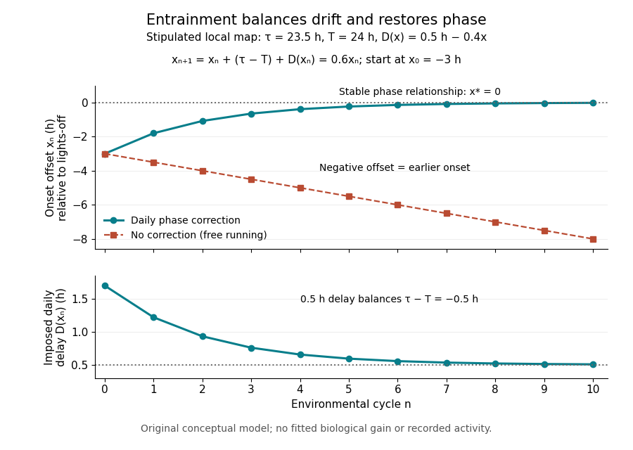

# Physiology

↑ **Parent:** [Biology](biology.md)  
ⓦ [Wiki](https://en.wikipedia.org/wiki/Physiology)

**Table of contents**

- [Wound healing](#wound-healing)
- [Electrophysiology](#electrophysiology)
- [Physiological stress](#physiological-stress)
- [Aerobic capacity](#aerobic-capacity)
- [Muscle tissue](#muscle-tissue)
  - [Smooth muscle](#smooth-muscle)
- [Digestive system](#digestive-system)
  - [Intestine](#intestine)
    - [Gut granule](#gut-granule)
    - [Small intestine](#small-intestine)
    - [Intestinal crypt](#intestinal-crypt)
    - [Intestinal villus](#intestinal-villus)
- [Microbial digestion](#microbial-digestion)
- [Diet](#diet)
  - [Fallback food](#fallback-food)
- [Circulatory system](#circulatory-system)
  - [Blood](#blood)
- [Homeostasis](#homeostasis)
  - [Osmoregulation](#osmoregulation)
    - [Compatible solute](#compatible-solute)
  - [Tissue homeostasis](#tissue-homeostasis)
  - [Regulated physiological variable](#regulated-physiological-variable)
    - [Blood pressure](#blood-pressure)
    - [Osmolality](#osmolality)
  - [Physiological sensor](#physiological-sensor)
  - [Physiological integrator](#physiological-integrator)
    - [Hypothalamus](#hypothalamus)
  - [Physiological effector](#physiological-effector)
    - [Effector saturation](#effector-saturation)
  - [Physiological set point](#physiological-set-point)
  - [Homeostatic temperature model](#homeostatic-temperature-model)
  - [Thermoregulation](#thermoregulation)
    - [Thermal conductance of an animal](#thermal-conductance-of-an-animal)
    - [Thermogenesis](#thermogenesis)
      - [Non-shivering thermogenesis](#non-shivering-thermogenesis)
        - [Brown adipose tissue](#brown-adipose-tissue)
      - [Shivering thermogenesis](#shivering-thermogenesis)
    - [Heterothermy](#heterothermy)
    - [Ectothermy](#ectothermy)
    - [Homeothermy](#homeothermy)
    - [Core body temperature](#core-body-temperature)
    - [Skin-temperature perturbation experiment](#skin-temperature-perturbation-experiment)
    - [Sweating](#sweating)
      - [Sweat gland](#sweat-gland)
    - [Shivering](#shivering)
    - [Vasoconstriction](#vasoconstriction)
    - [Vasodilation](#vasodilation)
    - [Fever](#fever)
    - [Humidity](#humidity)
      - [Relative humidity](#relative-humidity)
  - [Blood sugar](#blood-sugar)
  - [Synthetic insulin-glucagon response model](#synthetic-insulin-glucagon-response-model)
- [Skin](#skin)
  - [Epidermis](#epidermis)
    - [Interfollicular epidermis](#interfollicular-epidermis)
    - [Epidermal proliferative unit](#epidermal-proliferative-unit)
- [Extracellular fluid](#extracellular-fluid)
- [Circadian rhythm](#circadian-rhythm)
  - [Circadian gating](#circadian-gating)
  - [Free-running circadian rhythm](#free-running-circadian-rhythm)
  - [Entrainment of circadian rhythm](#entrainment-of-circadian-rhythm)
    - [Zeitgeber](#zeitgeber)
  - [Circadian clock](#circadian-clock)
    - [Plant circadian clock](#plant-circadian-clock)
      - [TOC1](#toc1)
      - [LHY](#lhy)
      - [CCA1](#cca1)
  - [Circadian phase](#circadian-phase)
  - [Masking of circadian rhythm](#masking-of-circadian-rhythm)
  - [Actogram](#actogram)
- [Physiologist](#physiologist)
  - [List of physiologists](#list-of-physiologists)
    - [Thomas W. Burns](#thomas-w-burns)
      - [Work by Thomas W. Burns](#work-by-thomas-w-burns)
    - [Paul E. Langley](#paul-e-langley)
      - [Work by Paul E. Langley](#work-by-paul-e-langley)
    - [Boyd E. Terry](#boyd-e-terry)
      - [Work by Boyd E. Terry](#work-by-boyd-e-terry)
    - [David B. Bylund](#david-b-bylund)
      - [Work by David B. Bylund](#work-by-david-b-bylund)
    - [Brian B. Hoffman](#brian-b-hoffman)
      - [Work by Brian B. Hoffman](#work-by-brian-b-hoffman)
    - [Michael D. Tharp](#michael-d-tharp)
      - [Work by Michael D. Tharp](#work-by-michael-d-tharp)
    - [Robert J. Lefkowitz](#robert-j-lefkowitz)
      - [Work by Robert J. Lefkowitz](#work-by-robert-j-lefkowitz)
    - [J. Adolfo García-Saínz](#j-adolfo-garcia-sainz)
      - [Work by J. Adolfo García-Saínz](#work-by-j-adolfo-garcia-sainz)
    - [John N. Fain](#john-n-fain)
      - [Work by John N. Fain](#work-by-john-n-fain)
    - [H. Streb](#h-streb)
      - [Work by H. Streb](#work-by-h-streb)
    - [E. Bayerdörffer](#e-bayerdorffer)
      - [Work by E. Bayerdörffer](#work-by-e-bayerdorffer)
    - [Irene Schulz-Hofer](#irene-schulz-hofer)
      - [Work by Irene Schulz-Hofer](#work-by-irene-schulz-hofer)
    - [Walter Bradford Cannon](#walter-bradford-cannon)
      - [Work by Walter Bradford Cannon](#work-by-walter-bradford-cannon)
    - [Martha Hotz Vitaterna](#martha-hotz-vitaterna)
      - [Work by Martha Hotz Vitaterna](#work-by-martha-hotz-vitaterna)
    - [David P. King](#david-p-king)
      - [Work by David P. King](#work-by-david-p-king)
    - [Anne-Marie Chang](#anne-marie-chang)
      - [Work by Anne-Marie Chang](#work-by-anne-marie-chang)
    - [Jon M. Kornhauser](#jon-m-kornhauser)
      - [Work by Jon M. Kornhauser](#work-by-jon-m-kornhauser)
    - [Phillip L. Lowrey](#phillip-l-lowrey)
      - [Work by Phillip L. Lowrey](#work-by-phillip-l-lowrey)
    - [Lawrence H. Pinto](#lawrence-h-pinto)
      - [Work by Lawrence H. Pinto](#work-by-lawrence-h-pinto)
    - [Fred W. Turek](#fred-w-turek)
      - [Work by Fred W. Turek](#work-by-fred-w-turek)
    - [Joseph S. Takahashi](#joseph-s-takahashi)
      - [Work by Joseph S. Takahashi](#work-by-joseph-s-takahashi)
    - [Alan Hodgkin](#alan-hodgkin)
      - [Work by Alan Hodgkin](#work-by-alan-hodgkin)
    - [Andrew Huxley](#andrew-huxley)
      - [Work by Andrew Huxley](#work-by-andrew-huxley)
    - [Ian R. Lanza](#ian-r-lanza)
      - [Work by Ian R. Lanza](#work-by-ian-r-lanza)
- [Adrenal gland](#adrenal-gland)
  - [Adrenal medulla](#adrenal-medulla)
- [Sympathetic nervous system](#sympathetic-nervous-system)
- [Pancreas](#pancreas)
  - [Pancreatic acinar cell](#pancreatic-acinar-cell)
  - [Pancreatic islets](#pancreatic-islets)
    - [Alpha cell](#alpha-cell)
    - [Beta cell](#beta-cell)
    - [Delta cell](#delta-cell)
- [Liver](#liver)
  - [Hepatocyte](#hepatocyte)
- [Skeletal muscle](#skeletal-muscle)
- [Adipose tissue](#adipose-tissue)
  - [Adipocyte](#adipocyte)
- [Endocrinology](#endocrinology)
  - [Endocrinologist](#endocrinologist)
    - [List of endocrinologists](#list-of-endocrinologists)
      - [K. Sreekumaran Nair](#k-sreekumaran-nair)
        - [Work by K. Sreekumaran Nair](#work-by-k-sreekumaran-nair)

## Wound healing

↑ **Parent:** [Physiology](physiology.md)

Coordinated tissue repair involving growth, migration, matrix remodelling and immune responses. Persistent deployment of related activities can support a [tumour](biology.md#tumour) without constituting productive repair.

## Electrophysiology

↑ **Parent:** [Physiology](physiology.md)

## Physiological stress

↑ **Parent:** [Physiology](physiology.md)

A physiological response to challenge or disturbance. Its cause, duration and measured consequences should be specified rather than inferred from one behavioural change.

## Aerobic capacity

↑ **Parent:** [Physiology](physiology.md)

Capacity to sustain oxygen-dependent energy [metabolism](biology.md#metabolism), commonly assessed through maximum oxygen consumption in a specified activity or condition.

## Muscle tissue

↑ **Parent:** [Physiology](physiology.md)

### Smooth muscle

↑ **Parent:** [Muscle tissue](#muscle-tissue)

A contractile muscle class whose cells lack the conspicuous sarcomeric striations of skeletal and cardiac muscle. Differentiated smooth-muscle layers can also mechanically constrain neighbouring growing tissues.

## Digestive system

↑ **Parent:** [Physiology](physiology.md)

### Intestine

↑ **Parent:** [Digestive system](#digestive-system)

The digestive-tract region containing specialized absorptive and secretory [epithelium](biology.md#epithelium). Architecture differs between intestinal regions and species.

#### Gut granule

↑ **Parent:** [Intestine](#intestine)

A [lysosome](biological-cell.md#lysosome)-related [organelle](biological-cell.md#organelle) of the [Caenorhabditis elegans](organism.md#caenorhabditis-elegans) intestine. Loss of granule formation can alter a gut-marker assay without eliminating the intestinal founder lineage.

#### Small intestine

↑ **Parent:** [Intestine](#intestine)

#### Intestinal crypt

↑ **Parent:** [Intestine](#intestine)

An epithelial invagination housing proliferative populations in the adult mammalian intestinal lining. Crypt structure, supporting cells and developmental timing vary with region and species.

#### Intestinal villus

↑ **Parent:** [Intestine](#intestine)

A projection of the intestinal lining that increases exposed absorptive surface. Mammalian small-intestinal villi must be distinguished from microscopic microvilli on individual epithelial cells and from the normally non-villous colon.

## Microbial digestion

↑ **Parent:** [Physiology](physiology.md)

Processing of food by microorganisms associated with a host. Measuring the resulting nutrients and their absorption helps establish the benefit to the host.

## Diet

↑ **Parent:** [Physiology](physiology.md)

The food consumed by an organism. Realized diet, short-term feeding observations and the diet inferred from inherited anatomy are different kinds of evidence.

### Fallback food

↑ **Parent:** [Diet](#diet)

A food relied on when preferred resources are unavailable. Selection associated with difficult periods can shape anatomy without making that food dominant in short-term observations.

## Circulatory system

↑ **Parent:** [Physiology](physiology.md)  
ⓦ [Wiki](https://en.wikipedia.org/wiki/Circulatory_system)

### Blood

↑ **Parent:** [Circulatory system](#circulatory-system)  
ⓦ [Wiki](https://en.wikipedia.org/wiki/Blood)

Blood is a fluid containing [biological cells](biological-cell.md) that transports substances through a [circulatory system](#circulatory-system). Its [viscosity](dynamic-viscosity.md) depends on its cellular content and deformation rate. Treating it as a [Newtonian fluid](viscous-fluid-flow.md#newtonian-fluid) in the [Hagen-Poiseuille equation](viscous-fluid-flow.md#hagen-poiseuille-equation) is an approximation that depends on the vessel size and flow conditions.

## Homeostasis

↑ **Parent:** [Physiology](physiology.md)  
ⓦ [Wiki](https://en.wikipedia.org/wiki/Homeostasis)

[Homeostasis](#homeostasis) is the maintenance of usable internal conditions despite disturbances. It concerns selected [regulated physiological variables](#regulated-physiological-variable), rather than keeping every part of an organism unchanged: [core body temperature](#core-body-temperature) may remain near its usual range while [skin](#skin) [temperature](temperature.md), [sweating](#sweating) and [blood pressure](#blood-pressure) change. Regulation makes a relatively dependable environment for [biological cells](biological-cell.md) out of a changing external world. [§1.5, opening paragraphs and Negative Feedback: normal ranges and compensatory responses](biology-bibliography.md#anatomy-and-physiology-2e-by-j-gordon-betts-and-others/1-5-homeostasis)

A useful causal description separates a [physiological sensor](#physiological-sensor), a [physiological integrator](#physiological-integrator) and a [physiological effector](#physiological-effector). The return from the [physiological effector](#physiological-effector)'s action to the sensed [regulated physiological variable](#regulated-physiological-variable) closes a [feedback control](control-theory.md#closed-loop-control) loop. In [negative feedback](signal-transduction.md#negative-feedback), that return opposes the disturbance. The [insulin](protein.md#insulin) and [glucagon](signal-transduction.md#glucagon) articles already trace the [blood glucose](#blood-sugar) example; [synaptic integration](neuroscience.md#synaptic-integration) explains how several inputs can jointly influence a [neuron](neuroscience.md#neuron). These are implementations and ingredients, not a requirement that every regulatory loop use one anatomical control center. [§1.5, Negative Feedback, Figure 1.10: sensor, control center and effector](biology-bibliography.md#anatomy-and-physiology-2e-by-j-gordon-betts-and-others/1-5-homeostasis)

**[Figure 1](#image-homeostasis-sensing-integration-and-action-with-a-synthetic-disturbance-response). Homeostasis: sensing, integration and action, with a synthetic disturbance response**. Original qualitative [thermoregulation](#thermoregulation) circuit above an explicitly synthetic plot from the [homeostatic temperature model](#homeostatic-temperature-model). The solid return represents [negative feedback](signal-transduction.md#negative-feedback) from [core body temperature](#core-body-temperature); the dashed [skin](#skin) input can anticipate a core change. The lower curves use invented [dimensionless variables](mathematics.md#dimensionless-variable) and arbitrary time units. They are neither experimental measurements nor fitted human responses.

[Homeostasis](#homeostasis) is useful precisely because internal activity can change: a nearly steady [temperature](temperature.md) can conceal a large increase in [heat transfer](heat.md#heat-transfer). Conversely, observing a flat trace alone does not identify a regulatory mechanism. The environment might simply be constant, or the measuring instrument too insensitive; a perturbation and an independent response readout provide stronger evidence. The [skin-temperature perturbation experiment](#skin-temperature-perturbation-experiment) below makes that distinction tangible.

The historical motivation was the puzzle of stability in changing living material. In his 1932 [The Wisdom of the Body](https://www.panarchy.org/cannon/homeostasis.1932.html), [Walter Bradford Cannon](#walter-bradford-cannon) emphasized that an organism exchanges material with its surroundings and continually replaces its own structure, yet maintains relatively steady internal conditions. This authored excerpt presents [homeostasis](#homeostasis) as active compensation for external and internal disturbances, rather than a static body. [Homeostasis excerpt, paragraphs beginning The wonder increases, Resistance to changes and In short; hosting page identifies book and 1932 date](biology-bibliography.md#the-wisdom-of-the-body-by-walter-bradford-cannon/homeostasis-excerpt-from-the-wisdom-of-the-body)

### Osmoregulation

↑ **Parent:** [Homeostasis](#homeostasis)

Regulation of cellular water balance, solute content and pressure in response to external osmotic conditions.

#### Compatible solute

↑ **Parent:** [Osmoregulation](#osmoregulation)

An accumulated small solute that helps balance osmotic pressure with relatively limited interference with cellular macromolecules.

### Tissue homeostasis

↑ **Parent:** [Homeostasis](#homeostasis)

Maintenance of a tissue's organization and function despite continuing cell production and loss. Stable population size need not imply that its individual cells or constituent clones persist.

### Regulated physiological variable

↑ **Parent:** [Homeostasis](#homeostasis)

A [regulated physiological variable](#regulated-physiological-variable) is a specified internal quantity whose departures elicit actions tending to restore an appropriate range. Examples include [core body temperature](#core-body-temperature), [blood glucose](#blood-sugar) [concentration](mathematical-physics.md#concentration), [blood pressure](#blood-pressure), and the [pH](acid-base-chemistry.md#ph) and [osmolality](#osmolality) of [extracellular fluid](#extracellular-fluid). Specify the compartment and readout: [skin](#skin) [temperature](temperature.md) and [core body temperature](#core-body-temperature) are different quantities, and an [insulin](protein.md#insulin) [concentration](mathematical-physics.md#concentration) is a regulatory message rather than the [blood glucose](#blood-sugar) it helps control.

#### Blood pressure

↑ **Parent:** [Regulated physiological variable](#regulated-physiological-variable)  
ⓦ [Wiki](https://en.wikipedia.org/wiki/Blood_pressure)

#### Osmolality

↑ **Parent:** [Regulated physiological variable](#regulated-physiological-variable)

[Osmolality](#osmolality) counts dissolved particles per mass of [solvent](mixture.md#solvent); it characterizes a [chemical solution](mixture.md#solution-chemistry), rather than the total amount of [water](chemical-substance.md#water) in an organism.

### Physiological sensor

↑ **Parent:** [Homeostasis](#homeostasis)

A [physiological sensor](#physiological-sensor) detects a relevant condition and changes a signal. In [thermoregulation](#thermoregulation), temperature-sensitive [neurons](neuroscience.md#neuron) supply information about internal and [skin](#skin) [temperature](temperature.md). Sensing a disturbance and sensing its internal consequence need not be the same operation.

### Physiological integrator

↑ **Parent:** [Homeostasis](#homeostasis)

A [physiological integrator](#physiological-integrator) combines regulatory inputs to select a response; it need not perform the mathematical [integral action](control-theory.md#integral-action) used in [control theory](control-theory.md). In [thermoregulation](#thermoregulation), the [hypothalamus](#hypothalamus) participates in combining internal and [skin](#skin) signals. The term describes a role, which can be distributed across interacting [biological cells](biological-cell.md), rather than a mandatory single comparator.

#### Hypothalamus

↑ **Parent:** [Physiological integrator](#physiological-integrator)  
ⓦ [Wiki](https://en.wikipedia.org/wiki/Hypothalamus)

### Physiological effector

↑ **Parent:** [Homeostasis](#homeostasis)

A [physiological effector](#physiological-effector) performs the action that changes the [regulated physiological variable](#regulated-physiological-variable). In [thermoregulation](#thermoregulation), [sweat glands](#sweat-gland), changes in [skin](#skin) blood flow, and [skeletal muscle](#skeletal-muscle) [shivering](#shivering) contribute different actions. The command, the action and the resulting [temperature](temperature.md) are three distinct readouts. [§1.5, Figure 1.10 and thermoregulatory examples following it](biology-bibliography.md#anatomy-and-physiology-2e-by-j-gordon-betts-and-others/1-5-homeostasis)

#### Effector saturation

↑ **Parent:** [Physiological effector](#physiological-effector)

[Effector saturation](#effector-saturation) is a capacity limit beyond which a larger command cannot produce a larger corrective action. In the [homeostatic temperature model](#homeostatic-temperature-model), take $u=\min(4x,1/2)$ during the sustained unit disturbance. Before reaching the cap, $x=(1-e^{-5t})/5$. The cap is reached at $t_c=\log(8/3)/5$, when $x=1/8$. Thereafter

$$
x(t)=\frac12-\frac38e^{-(t-t_c)},\qquad u(t)=\frac12.
$$

The lasting displacement is now $1/2$, compared with $1/5$ without the cap. The [negative feedback](signal-transduction.md#negative-feedback) command still asks for more cooling, but the action cannot supply it. This illustrates a capacity limit without predicting a human [temperature](temperature.md) limit. Increasing [feedback gain](control-theory.md#feedback-gain) cannot remove a binding cap; [integral action](control-theory.md#integral-action) cannot overcome inadequate physical capacity either.

### Physiological set point

↑ **Parent:** [Homeostasis](#homeostasis)

A [physiological set point](#physiological-set-point) is a reference around which regulation is organized, analogous to a [reference signal](control-theory.md#reference-signal). An observed average is not automatically a separately encoded target. A range of acceptable values and different response thresholds can be more informative than a single exact number. [Negative feedback](signal-transduction.md#negative-feedback) describes a causal sign; neither perfect constancy nor complete restoration follows from that sign alone.

For [core body temperature](#core-body-temperature), [circadian rhythms](#circadian-rhythm) and [fever](#fever) can change the defended level. Thus a response toward the current [physiological set point](#physiological-set-point) need not restore yesterday's [temperature](temperature.md). A drifting target and imperfect tracking of a fixed target are different explanations for a changing readout. [§2.3.1, Figure 1 and following paragraphs: circadian and pyrogen-related changes of the temperature set point](biology-bibliography.md#fundamental-concepts-of-human-thermoregulation-and-adaptation-to-heat-a-review-in-the-context-of-global-warming-by-chin-leong-lim)

### Homeostatic temperature model

↑ **Parent:** [Homeostasis](#homeostasis)

Here is an explicitly synthetic [mathematical model](mathematics.md#mathematical-model) of a warming disturbance and its compensatory cooling. It is a teaching analogy for [thermoregulation](#thermoregulation), not a measured human heat budget. Write $x=(T-T_r)/\Delta T$, where $T$ is a lumped internal [temperature](temperature.md), $T_r$ is a fixed reference and $\Delta T>0$ is a chosen [temperature](temperature.md) scale. Let $d$ be an additional heating rate and $u$ an additional cooling rate, both scaled to the same reference rate. All three are [dimensionless variables](mathematics.md#dimensionless-variable), while $\tau>0$ is a [time constant](analysis.md#time-constant) in the chosen time units. The [ordinary differential equation](differential-equation.md#ordinary-differential-equation) is

$$
\tau\dot x=d-x-u,\qquad u=kx,\qquad k\geq0.
$$

The term $-x$ idealizes increased passive [heat transfer](heat.md#heat-transfer) with increased internal [temperature](temperature.md), around the baseline. The term $-u$ opposes warming through [proportional control](control-theory.md#proportional-control) with [feedback gain](control-theory.md#feedback-gain) $k$. This local signed model does not treat a negative $u$ as negative [sweating](#sweating): it would represent decreased cooling relative to baseline. Changes of the environment and multiple body compartments are omitted.

For a constant disturbance $d=D$ and [initial condition](differential-equation.md#initial-condition) $x(0)=0$, the [exponential function](calculus.md#exponential-function) solution is

$$
x(t)=\frac{D}{1+k}\left(1-e^{-(1+k)t/\tau}\right),\qquad x_*=\frac{D}{1+k},\qquad u_*=\frac{kD}{1+k}.
$$

Substitution checks the [ordinary differential equation](differential-equation.md#ordinary-differential-equation) directly. Increasing $k$ reduces the lasting offset and, in this instantaneous model, shortens the response [time constant](analysis.md#time-constant) to $\tau/(1+k)$. It does not make $x_*$ zero for a nonzero disturbance and finite $k$: a persistent cooling command requires a persistent displacement under [proportional control](control-theory.md#proportional-control). At the [equilibrium point](dynamical-systems.md#equilibrium-point-of-a-dynamical-system), the extra heating is balanced by passive loss $x_*$ plus active cooling $u_*$. Zero change of [temperature](temperature.md) means balanced rates, rather than zero rates, consistent with [conservation of energy](mathematical-physics.md#conservation-of-energy).

The first diagram uses $D=1$, $\tau=4$, and a pulse from $t=2$ to $t=10$, comparing $k=0$ with $k=3$. The latter approaches $x_*=1/4$ during the pulse, compared with $1$ without active [feedback control](control-theory.md#closed-loop-control). After the pulse ends, each displacement decays as $x(10)e^{-(1+k)(t-10)/\tau}$. These are computed curves, not physiological measurements. The $k=0$ curve still has passive loss; it is not a claim that an unregulated body warms without limit.

Real [physiological effectors](#physiological-effector) take time to respond. To isolate that issue, set $\tau=1$ and replace the instantaneous command by another [ordinary differential equation](differential-equation.md#ordinary-differential-equation):

$$
\dot x=1-x-u,\qquad \dot u=4x-u,\qquad x(0)=u(0)=0.
$$

Here the disturbance remains $1$ from $t=0$ onward and the effector [time constant](analysis.md#time-constant) is also $1$. The [equilibrium point](dynamical-systems.md#equilibrium-point-of-a-dynamical-system) is still $(x_*,u_*)=(1/5,4/5)$, but the [characteristic polynomial](linear-operator-theory.md#characteristic-polynomial) is $(\lambda+1)^2+4$. Its [eigenvalues](linear-operator-theory.md#eigenvalue) $-1\pm2i$ give decaying [oscillations](wave.md#oscillation) and [asymptotic stability](dynamical-systems.md#asymptotic-stability). The exact response is

$$
x(t)=\frac15+e^{-t}\left(-\frac15\cos(2t)+\frac25\sin(2t)\right),\qquad u(t)=\frac45+e^{-t}\left(-\frac45\cos(2t)-\frac25\sin(2t)\right).
$$

In particular, $\dot x=e^{-t}\cos(2t)$, so the first maximum occurs at $t=\pi/4$, with $x=1/5+(2/5)e^{-\pi/4}\simeq0.3824$. The response exceeds its eventual displacement while remaining above its baseline. The return has the same negative sign as before; the extra state changes the timing. A finite effector [time constant](analysis.md#time-constant) is distinct from the fixed time lag in the [delayed negative feedback model](signal-transduction.md#delayed-negative-feedback-model).

**[Figure 2](#image-synthetic-homeostasis-responses-offset-lag-and-limited-effector-capacity). Synthetic homeostasis responses: offset, lag and limited effector capacity**. Original computed plots from the [homeostatic temperature model](#homeostatic-temperature-model), all in arbitrary units and explicitly labelled synthetic. Upper panel: displacement under the same sustained disturbance. Lower panel: corresponding cooling command. Instantaneous [proportional control](control-theory.md#proportional-control), a finite effector [time constant](analysis.md#time-constant), and [effector saturation](#effector-saturation) give different responses despite opposing the same disturbance. No experimental data or clinical limits are shown.

### Thermoregulation

↑ **Parent:** [Homeostasis](#homeostasis)  
ⓦ [Wiki](https://en.wikipedia.org/wiki/Thermoregulation)

[Thermoregulation](#thermoregulation) regulates body [temperature](temperature.md). [Skin](#skin) signals can anticipate a change of [core body temperature](#core-body-temperature), so a response need not wait for an internal error. [Introduction, paragraphs beginning The reflex regulation and In humans, the contribution from skin temperature: thermoregulatory effectors and feedforward skin input](biology-bibliography.md#cortical-thalamic-and-hypothalamic-responses-to-cooling-and-warming-the-skin-in-awake-humans-a-positron-emission-tomography-study-by-gary-f-egan-and-others)

These responses have costs and environmental limits. [Shivering](#shivering) consumes metabolic resources; cooling through [sweating](#sweating) removes [water](chemical-substance.md#water) that must eventually be replaced. High [humidity](#humidity) restricts [evaporation](critical-phenomenon.md#evaporation), so secreted sweat and successful cooling are not interchangeable. Maintaining [core body temperature](#core-body-temperature) also depends on maintaining circulation: depleted blood volume can compromise [skin](#skin) blood flow and [heat transfer](heat.md#heat-transfer). Seeking shade or reducing work changes the disturbance itself, whereas a larger regulatory command merely attempts to counter it. [§2.2.4, Evaporation: sweat secretion versus evaporation and blood-volume depletion; §2.3.1: behavioral heat conservation and dissipation](biology-bibliography.md#fundamental-concepts-of-human-thermoregulation-and-adaptation-to-heat-a-review-in-the-context-of-global-warming-by-chin-leong-lim)

#### Thermal conductance of an animal

↑ **Parent:** [Thermoregulation](#thermoregulation)

The effective rate of [heat](heat.md) transfer per body-to-environment [temperature](temperature.md) difference. Insulation, posture and perfusion can change it.

#### Thermogenesis

↑ **Parent:** [Thermoregulation](#thermoregulation)

Production of [heat](heat.md) through metabolic processes.

##### Non-shivering thermogenesis

↑ **Parent:** [Thermogenesis](#thermogenesis)

[heat](heat.md) production through mechanisms other than shivering. A mechanism found in living placentals need not have originated with early synapsid [endothermy](biology.md#endothermy).

###### Brown adipose tissue

↑ **Parent:** [Non-shivering thermogenesis](#non-shivering-thermogenesis)

A thermogenic tissue of many placental [mammals](organism.md#mammal). It should not be assumed to be the ancestral heat-producing mechanism in every synapsid.

##### Shivering thermogenesis

↑ **Parent:** [Thermogenesis](#thermogenesis)

[heat](heat.md) generation through muscle activity associated with shivering.

#### Heterothermy

↑ **Parent:** [Thermoregulation](#thermoregulation)

Variation of body [temperature](temperature.md) across times or body regions. An endothermic animal need not maintain one constant [temperature](temperature.md) continuously.

#### Ectothermy

↑ **Parent:** [Thermoregulation](#thermoregulation)

Dependence primarily on external [heat](heat.md) sources for body-temperature regulation, without implying an inability to regulate [temperature](temperature.md) behaviourally.

#### Homeothermy

↑ **Parent:** [Thermoregulation](#thermoregulation)

Maintenance of a relatively constant body [temperature](temperature.md). It differs from the metabolic source of [heat](heat.md) described by [endothermy](biology.md#endothermy).

#### Core body temperature

↑ **Parent:** [Thermoregulation](#thermoregulation)

[Core body temperature](#core-body-temperature) refers to internal [temperature](temperature.md), distinguished from [skin](#skin) [temperature](temperature.md). Different measurement sites are proxies with their own limitations, not interchangeable readings of a perfectly uniform interior. [§2.1.1, Core Temperature: internal sites and indirect measurement](biology-bibliography.md#fundamental-concepts-of-human-thermoregulation-and-adaptation-to-heat-a-review-in-the-context-of-global-warming-by-chin-leong-lim)

#### Skin-temperature perturbation experiment

↑ **Parent:** [Thermoregulation](#thermoregulation)

Twelve resting volunteers wore a water-perfused suit. Tubes covered the torso, upper arms and legs; the right forearm remained uncovered for laser Doppler blood-flow measurement. Six [thermocouples](thermoelectric-effect.md#thermocouple) estimated mean [skin](#skin) [temperature](temperature.md); a sublingual [thermocouple](thermoelectric-effect.md#thermocouple) measured oral [temperature](temperature.md). A dry-air capsule measured local sweat output from outgoing air moisture. [Methods, Temperature-Control Procedures: garment, uncovered forearm, blood-flow probe, ventilated capsule and thermocouples](biology-bibliography.md#cortical-thalamic-and-hypothalamic-responses-to-cooling-and-warming-the-skin-in-awake-humans-a-positron-emission-tomography-study-by-gary-f-egan-and-others)

After two control scans near $34\,{}^\circ\mathrm C$ [skin](#skin) [temperature](temperature.md), the suit cooled and then warmed the [skin](#skin). Mean oral [temperature](temperature.md) was $36.6\,{}^\circ\mathrm C$ during both cooling and early warming; mean [skin](#skin) readings were $30.5$ and $38.2\,{}^\circ\mathrm C$. Cutaneous vascular conductance fell during cooling and rose during warming. The inference is that compensatory blood-flow responses can precede an appreciable internal [temperature](temperature.md) change. [Methods, Experimental Protocol; Results, Body Temperature and Hemodynamic Responses; Table 1, SC1 and H1](biology-bibliography.md#cortical-thalamic-and-hypothalamic-responses-to-cooling-and-warming-the-skin-in-awake-humans-a-positron-emission-tomography-study-by-gary-f-egan-and-others)

Repeated baselines controlled comparison within participants; closed mouths reduced oral-probe cooling artifacts. A later control with reduced oral [temperature](temperature.md) was excluded. Oral [temperature](temperature.md) is a proxy, local flow is not whole-body [heat transfer](heat.md#heat-transfer), and the fixed condition order leaves time effects possible. Brain imaging measured regional blood flow, not direct [neuron](neuroscience.md#neuron) firing or causal necessity. [Methods, Temperature-Control Procedures, Experimental Protocol and Imaging Procedures; Results, exclusion of C3; Table 1](biology-bibliography.md#cortical-thalamic-and-hypothalamic-responses-to-cooling-and-warming-the-skin-in-awake-humans-a-positron-emission-tomography-study-by-gary-f-egan-and-others)

#### Sweating

↑ **Parent:** [Thermoregulation](#thermoregulation)  
ⓦ [Wiki](https://en.wikipedia.org/wiki/Sweating)

[Sweating](#sweating) supports [thermoregulation](#thermoregulation) through [evaporation](critical-phenomenon.md#evaporation) of [water](chemical-substance.md#water), which carries away [latent heat](thermodynamic-potential.md#latent-heat).

##### Sweat gland

↑ **Parent:** [Sweating](#sweating)  
ⓦ [Wiki](https://en.wikipedia.org/wiki/Sweat_gland)

#### Shivering

↑ **Parent:** [Thermoregulation](#thermoregulation)  
ⓦ [Wiki](https://en.wikipedia.org/wiki/Shivering)

#### Vasoconstriction

↑ **Parent:** [Thermoregulation](#thermoregulation)  
ⓦ [Wiki](https://en.wikipedia.org/wiki/Vasoconstriction)

#### Vasodilation

↑ **Parent:** [Thermoregulation](#thermoregulation)  
ⓦ [Wiki](https://en.wikipedia.org/wiki/Vasodilation)

#### Fever

↑ **Parent:** [Thermoregulation](#thermoregulation)  
ⓦ [Wiki](https://en.wikipedia.org/wiki/Fever)

#### Humidity

↑ **Parent:** [Thermoregulation](#thermoregulation)  
ⓦ [Wiki](https://en.wikipedia.org/wiki/Humidity)

##### Relative humidity

↑ **Parent:** [Humidity](#humidity)

[Relative humidity](#relative-humidity) is the ratio of the [partial pressure](ideal-gas.md#partial-pressure) of [water vapor](chemical-substance.md#water-vapor) to its saturation [vapor pressure](thermodynamic-potential.md#vapor-pressure) at the same [temperature](temperature.md), usually expressed as a percentage.

### Blood sugar

↑ **Parent:** [Homeostasis](#homeostasis)

The [glucose](chemical-substance.md#glucose) present in blood; in [insulin](protein.md#insulin) and [glucagon](signal-transduction.md#glucagon) control, the sensed quantity is its [concentration](mathematical-physics.md#concentration), not total [glucose](chemical-substance.md#glucose) in every organ.

### Synthetic insulin-glucagon response model

↑ **Parent:** [Homeostasis](#homeostasis)

This deliberately synthetic [differential equation](differential-equation.md) model illustrates response direction and lag. Every plotted number is chosen for teaching; none is a biological measurement or a fitted human parameter. Let externally prescribed, [dimensionless](physics.md#dimensionless-quantity) $g>0$ represent a [glucose](chemical-substance.md#glucose) stimulus relative to a reference. Let $I$ and $H$ be normalized [insulin](protein.md#insulin) and [glucagon](signal-transduction.md#glucagon) response variables, with independently chosen [time constants](analysis.md#time-constant) $\tau_I=4$ and $\tau_H=6$ in arbitrary time units:

$$
I_\infty(g)=\frac{g^4}{1+g^4},\qquad H_\infty(g)=\frac{1}{1+g^4},\qquad \tau_I\dot I=I_\infty(g)-I,\qquad \tau_H\dot H=H_\infty(g)-H.
$$

Here $I_\infty$ rises and $H_\infty$ falls with $g$. Their targets add to one by construction; the evolving $I+H$ need not equal one because their [time constants](analysis.md#time-constant) differ. Start with $g=1$ and $I=H=1/2$. Set $g=1.6$ from $t=10$ to $40$, $g=0.65$ from $t=40$ to $70$, and $g=1$ otherwise. Within a constant-input interval beginning at $t_0$, the [exponential decay](analysis.md#exponential-decay) solution is

$$
I(t)=I_\infty+[I(t_0)-I_\infty]e^{-(t-t_0)/\tau_I},\qquad H(t)=H_\infty+[H(t_0)-H_\infty]e^{-(t-t_0)/\tau_H}.
$$

Each response is a [continuous function](calculus.md#continuous-function) of time even when the imposed stimulus jumps. The chosen starting values stay between zero and one, since each solution is a [weighted arithmetic mean](arithmetic.md#weighted-arithmetic-mean) of its interval's starting value and target.

**[Figure 3](#image-synthetic-insulin-and-glucagon-responses-to-imposed-glucose-steps). Synthetic insulin and glucagon responses to imposed glucose steps**. Original illustration of the [synthetic insulin-glucagon response model](#synthetic-insulin-glucagon-response-model). All curves are constructed examples in arbitrary units. Top: imposed [dimensionless](physics.md#dimensionless-quantity) stimulus. Middle: responses with unequal [time constants](analysis.md#time-constant). Bottom: illustrative [liver](#liver) release and tissue uptake tendencies, which do not determine the imposed stimulus. No experimental data or clinical ranges are represented.

For an illustrative downstream comparison, define release tendency $R=0.3+0.6H/(1+I)$ and uptake tendency $U=(0.25+0.5I)g$, in the same arbitrary flux units. At the reference target, $R=U=0.5$. At the high-stimulus targets, $R\approx0.343$ and $U\approx1.094$; at the low-stimulus targets, $R\approx0.742$ and $U\approx0.212$. These chosen functions encode greater uptake with [insulin](protein.md#insulin) and greater release with [glucagon](signal-transduction.md#glucagon), moderated by [insulin](protein.md#insulin); they are not established [enzyme kinetics](mathematical-biology.md#enzyme-kinetics). The $g$ trace is imposed externally, so the figure does not demonstrate self-correction of [blood glucose](#blood-sugar). A closed model would also need a [conservation of mass](continuum-mechanics.md#mass-conservation) equation, nutrient input, finite [glycogen](biology.md#glycogen) stores, and additional tissue interactions. The qualitative restoring loops are shown separately in the [insulin](protein.md#insulin) circuit.

## Skin

↑ **Parent:** [Physiology](physiology.md)  
ⓦ [Wiki](https://en.wikipedia.org/wiki/Skin)

### Epidermis

↑ **Parent:** [Skin](#skin)

#### Interfollicular epidermis

↑ **Parent:** [Epidermis](#epidermis)

[epidermis](#epidermis) between hair follicles. Its renewal dynamics and lineage contributions vary with anatomical site and injury context.

#### Epidermal proliferative unit

↑ **Parent:** [Epidermis](#epidermis)

A historical organizational model linking a spatial column of differentiated cells to a local basal renewing unit. Spatial appearance alone does not establish its lineage hierarchy.

## Extracellular fluid

↑ **Parent:** [Physiology](physiology.md)  
ⓦ [Wiki](https://en.wikipedia.org/wiki/Extracellular_fluid)

## Circadian rhythm

↑ **Parent:** [Physiology](physiology.md)  
ⓦ [Wiki](https://en.wikipedia.org/wiki/Circadian_rhythm)

A [circadian rhythm](#circadian-rhythm) is an endogenous biological [oscillation](wave.md#oscillation) with a [period](mathematics.md#period-of-a-function) near 24 hours, persisting without a repeating external signal. A [circadian clock](#circadian-clock) times biological activities and anticipates daily changes without continual external instructions. A [free-running circadian rhythm](#free-running-circadian-rhythm) reveals its intrinsic [period](mathematics.md#period-of-a-function); [entrainment of circadian rhythm](#entrainment-of-circadian-rhythm) coordinates it with an external cycle.[Vitaterna, Takahashi and Turek (2001), Overview of Circadian Rhythms, pp. 85–86, Biological Rhythms and Basic Properties of Circadian Rhythms](biology-bibliography.md#overview-of-circadian-rhythms-by-martha-hotz-vitaterna-and-others)

In 1994, [Martha Hotz Vitaterna](#martha-hotz-vitaterna) and colleagues screened offspring of mutagen-treated C57BL/6J mice (the [house mouse](organism.md#house-mouse)). Each mouse lived in a cage with a running wheel, inside a ventilated, light-tight chamber with timer-controlled lighting. Wheel revolutions were recorded electronically or on an event recorder. The initial screen used 14:10 LD for the first 41 animals and 12:12 LD thereafter; LD denotes hours of light and darkness. Transfer to constant darkness, DD, omitted the next scheduled lights-on; recording continued for at least three weeks. The first 41 animals also received brief light pulses, so those records were not uninterrupted DD.[Vitaterna and others (1994), Mutagenesis and Mapping of a Mouse Gene, Clock, Essential for Circadian Behavior, Figure 1 and References and Notes 6–10](biology-bibliography.md#mutagenesis-and-mapping-of-a-mouse-gene-clock-essential-for-circadian-behavior-by-martha-hotz-vitaterna-and-others)

The subsequent-generation comparison in Figure 2 used 12:12 LD before DD. Animals without the [Clock mutation](genetics.md#clock-mutation-mouse) and with mutant [genotypes](genetics.md#genotype) supplied the comparison: the B6 examples in panels A–C had initial DD [periods](mathematics.md#period-of-a-function) of 23.6, 24.8 and 27.1 hours, respectively; the [homozygote](genetics.md#homozygote) later lost its sustained [circadian rhythm](#circadian-rhythm). Total activity remained comparable across [genotypes](genetics.md#genotype) in the interstrain comparison. The [mutation](genetics.md#mutation) therefore altered timing, beyond merely reducing running. Wheel activity is a behavioral readout; it does not directly measure every [circadian clock](#circadian-clock) or establish a human [period](mathematics.md#period-of-a-function).[Figure 2A–C; Table 2 and discussion of activity counts and loss of rhythmicity; References and Notes 10 and 14](biology-bibliography.md#mutagenesis-and-mapping-of-a-mouse-gene-clock-essential-for-circadian-behavior-by-martha-hotz-vitaterna-and-others)

Daily activity under LD alone cannot establish [entrainment of circadian rhythm](#entrainment-of-circadian-rhythm). Light can directly change activity without resetting the [circadian clock](#circadian-clock): [masking of circadian rhythm](#masking-of-circadian-rhythm). Removing the light cycle helps distinguish these effects; they can coexist.[p. 92, glossary entries Entrainment, Free running and Masking](biology-bibliography.md#overview-of-circadian-rhythms-by-martha-hotz-vitaterna-and-others) In an experiment, other repeating inputs must also be controlled: a nominally dark room with daily handling is not automatically an environment without timing cues.

### Circadian gating

↑ **Parent:** [Circadian rhythm](#circadian-rhythm)

Dependence of a stimulus-response relationship on internal [circadian phase](#circadian-phase). A rhythmic baseline or a daily change in stimulus availability alone does not demonstrate gating.

### Free-running circadian rhythm

↑ **Parent:** [Circadian rhythm](#circadian-rhythm)

A [free-running circadian rhythm](#free-running-circadian-rhythm) persists without an entraining cycle. Its [period](mathematics.md#period-of-a-function) $\tau$ separates corresponding [circadian phases](#circadian-phase), such as successive activity onsets, under specified constant conditions.[pp. 86–87, Figure 1A; p. 92, Free running](biology-bibliography.md#overview-of-circadian-rhythms-by-martha-hotz-vitaterna-and-others) A [circadian phase](#circadian-phase) tells where the system is within its cycle; a [period](mathematics.md#period-of-a-function) tells how long one cycle takes. Choosing onset rather than peak as the reference changes the phase label, not the [period](mathematics.md#period-of-a-function) of an ideal repeating signal.

Consider an original, deliberately idealized model with $\tau=23.5\,\mathrm h$. For seven days prescribe a 12:12 LD cycle with activity starting at hour 12 of each 24-hour day. Then omit the next scheduled dawn and keep the environment dark. Stipulate that the first DD onset retains hour 12, and that every later onset is exactly $23.5\,\mathrm h$ after the previous one. Activity lasts eight hours after each onset. These are chosen model values, not recorded mouse or human data, and the fixed activity window represents an output of the model rather than the molecular mechanism of a [circadian clock](#circadian-clock).

**[Figure 4](#image-circadian-free-running-actogram). An idealized circadian rhythm under 12:12 LD followed by constant darkness**. Original stipulated [actogram](#actogram): each row is a fixed 24-hour calendar day, with successive days running downwards. Yellow denotes light, pale gray denotes darkness, and teal denotes the chosen activity window. The DD [period](mathematics.md#period-of-a-function) is $23.5\,\mathrm h$, so successive activity onsets move earlier on the plotting grid. No biological measurements are plotted.

An [actogram](#actogram) displays activity against time in successive rows. Here each row spans $T=24\,\mathrm h$, regardless of the [circadian rhythm](#circadian-rhythm)'s [period](mathematics.md#period-of-a-function). If $t_0$ is the first DD onset and $n$ counts completed free-running cycles, then

$$
t_n=t_0+n\tau,\qquad t_{n+1}-t_n=\tau,\qquad x_n=t_n-(t_0+nT)=n(\tau-T).
$$

The unwrapped onset displacement $x_n$ is therefore $-0.5n\,\mathrm h$. After eight cycles the onset is four hours earlier than a 24-hour continuation would predict; after sixteen cycles it is eight hours earlier. Because these onsets remain within successive calendar rows in the displayed interval, their row positions are $12,11.5,11,\ldots,4$ hours. The visual slant comes from comparing two different [periods](mathematics.md#period-of-a-function), not from cessation of the [oscillation](wave.md#oscillation).

An alternative [phase oscillator](dynamical-systems.md#phase-oscillator) description makes the same distinction explicit. Set the [circadian phase](#circadian-phase) to zero at $t_0$ and define

$$
\theta(t)=\frac{2\pi(t-t_0)}{\tau}\pmod{2\pi},\qquad \omega=\frac{2\pi}{\tau}.
$$

The [angular frequency](lagrangian-mechanics.md#angular-frequency) $\omega$ is constant in this model. Onset occurs whenever the unwrapped [circadian phase](#circadian-phase) completes another turn. A [period](mathematics.md#period-of-a-function) longer than $T$ would instead produce later onsets; equality would produce aligned rows even without [entrainment of circadian rhythm](#entrainment-of-circadian-rhythm). Thus aligned rows by themselves do not identify the cause of a daily pattern. Real activity can be noisy, and a [free-running circadian rhythm](#free-running-circadian-rhythm)'s [period](mathematics.md#period-of-a-function) can vary with conditions or with time after release; the stipulated straight line assumes a stationary [period](mathematics.md#period-of-a-function).

### Entrainment of circadian rhythm

↑ **Parent:** [Circadian rhythm](#circadian-rhythm)

[Entrainment of circadian rhythm](#entrainment-of-circadian-rhythm) synchronizes a [circadian clock](#circadian-clock) to a repeating cue, a [zeitgeber](#zeitgeber). One-to-one [entrainment of circadian rhythm](#entrainment-of-circadian-rhythm) gives one cycle per environmental cycle with a stable relative [circadian phase](#circadian-phase).[pp. 86–87, synchronization to external cues; p. 92, Entrainment and Zeitgeber](biology-bibliography.md#overview-of-circadian-rhythms-by-martha-hotz-vitaterna-and-others) The stable relation need not put an activity onset exactly at lights-off: a constant offset also expresses [phase locking](dynamical-systems.md#phase-locking).

For an original local model, let $x_n$ be the activity-onset offset from lights-off on environmental cycle $n$, with a negative value meaning an earlier onset. Choose an intrinsic [period](mathematics.md#period-of-a-function) $\tau=23.5\,\mathrm h$ and environmental [period](mathematics.md#period-of-a-function) $T=24\,\mathrm h$. Let $D(x)$ be a stipulated daily delay, measured in hours; positive $D$ moves the next onset later. The [recurrence relation](sequence-and-series.md#recurrence-relation) is

$$
x_{n+1}=x_n+(\tau-T)+D(x_n).
$$

A fixed phase relationship $x_*$ requires $D(x_*)=T-\tau$: here a half-hour delay balances the half-hour intrinsic advance each cycle. This equality alone describes balance; restoration after a small disturbance also requires [fixed point stability for an iteration](dynamical-systems.md#fixed-point-stability-for-an-iteration).

Choose the illustrative local law $D(x)=0.5\,\mathrm h-0.4x$. Then

$$
x_{n+1}=0.6x_n,\qquad x_* =0,\qquad x_n=-3(0.6)^n\,\mathrm h
$$

for the chosen starting offset $x_0=-3\,\mathrm h$. The error shrinks by a factor of $0.6$ each cycle, proving [fixed point stability for an iteration](dynamical-systems.md#fixed-point-stability-for-an-iteration) in this model. After five cycles $x_5=-0.23328\,\mathrm h$, about fourteen minutes early. At the [fixed point](function.md#fixed-point), the imposed delay is $0.5\,\mathrm h$ and the corrected onset interval is $\tau+D(x_*)=24\,\mathrm h$, although the uncoupled [period](mathematics.md#period-of-a-function) remains $23.5\,\mathrm h$.

**[Figure 5](#image-circadian-entrainment-phase-correction). Daily phase correction restores a stable relation in an idealized entrainment of circadian rhythm model**. Original conceptual [circadian phase](#circadian-phase) traces from the stated [recurrence relation](sequence-and-series.md#recurrence-relation). With the stipulated delay law, the offset approaches zero and the delay approaches half an hour. With no correction, the offset drifts earlier. The coefficient $0.4$ and starting offset are selected for explanation, not measured biological parameters. Lines join discrete cycle values.

The uncorrected comparison has $D=0$ and $x_n=-3\,\mathrm h+n(\tau-T)$, so after five cycles it is $5.5$ hours early. The two traces separate ongoing timekeeping from adjustment to a [zeitgeber](#zeitgeber). The chosen linear delay law is only a local teaching construction: it is not a measured response to light, does not account for wrapping of [circadian phase](#circadian-phase), and does not predict an organism's entrainment range. Nor does it include [masking of circadian rhythm](#masking-of-circadian-rhythm). In a real study, tracking several cycles after removal of the cue or after a timed perturbation supplies information that a single activity value under illumination cannot provide.

#### Zeitgeber

↑ **Parent:** [Entrainment of circadian rhythm](#entrainment-of-circadian-rhythm)  
ⓦ [Wiki](https://en.wikipedia.org/wiki/Zeitgeber)

A [zeitgeber](#zeitgeber) is an external timing cue capable of entraining a [circadian rhythm](#circadian-rhythm).

### Circadian clock

↑ **Parent:** [Circadian rhythm](#circadian-rhythm)  
ⓦ [Wiki](https://en.wikipedia.org/wiki/Circadian_clock)

A [circadian clock](#circadian-clock) is an endogenous timekeeping system that generates [circadian rhythms](#circadian-rhythm).

#### Plant circadian clock

↑ **Parent:** [Circadian clock](#circadian-clock)

A plant timekeeping network with interacting transcriptional and post-translational processes. Light and temperature entrain its phase, and its outputs regulate physiology and development.

##### TOC1

↑ **Parent:** [Plant circadian clock](#plant-circadian-clock)

TIMING OF CAB EXPRESSION 1, also called PRR1, an evening-associated transcriptional regulator in the Arabidopsis circadian network.

##### LHY

↑ **Parent:** [Plant circadian clock](#plant-circadian-clock)

LATE ELONGATED HYPOCOTYL, a morning-associated transcriptional regulator in the Arabidopsis circadian network.

##### CCA1

↑ **Parent:** [Plant circadian clock](#plant-circadian-clock)

CIRCADIAN CLOCK ASSOCIATED 1, a morning-associated transcriptional regulator in the Arabidopsis circadian network.

### Circadian phase

↑ **Parent:** [Circadian rhythm](#circadian-rhythm)

A [circadian phase](#circadian-phase) specifies position within a [circadian rhythm](#circadian-rhythm)'s cycle relative to a chosen reference event.

### Masking of circadian rhythm

↑ **Parent:** [Circadian rhythm](#circadian-rhythm)

In [masking of circadian rhythm](#masking-of-circadian-rhythm), an external condition changes the observed output without necessarily changing the underlying [circadian clock](#circadian-clock).

### Actogram

↑ **Parent:** [Circadian rhythm](#circadian-rhythm)

An [actogram](#actogram) displays activity across successive time intervals, commonly in one row per calendar day.

## Physiologist

↑ **Parent:** [Physiology](physiology.md)

### List of physiologists

↑ **Parent:** [Physiologist](#physiologist)

#### Thomas W. Burns

↑ **Parent:** [List of physiologists](#list-of-physiologists)

##### Work by Thomas W. Burns

↑ **Parent:** [Thomas W. Burns](#thomas-w-burns)

#### Paul E. Langley

↑ **Parent:** [List of physiologists](#list-of-physiologists)

##### Work by Paul E. Langley

↑ **Parent:** [Paul E. Langley](#paul-e-langley)

#### Boyd E. Terry

↑ **Parent:** [List of physiologists](#list-of-physiologists)

##### Work by Boyd E. Terry

↑ **Parent:** [Boyd E. Terry](#boyd-e-terry)

#### David B. Bylund

↑ **Parent:** [List of physiologists](#list-of-physiologists)

##### Work by David B. Bylund

↑ **Parent:** [David B. Bylund](#david-b-bylund)

#### Brian B. Hoffman

↑ **Parent:** [List of physiologists](#list-of-physiologists)

##### Work by Brian B. Hoffman

↑ **Parent:** [Brian B. Hoffman](#brian-b-hoffman)

#### Michael D. Tharp

↑ **Parent:** [List of physiologists](#list-of-physiologists)

##### Work by Michael D. Tharp

↑ **Parent:** [Michael D. Tharp](#michael-d-tharp)

#### Robert J. Lefkowitz

↑ **Parent:** [List of physiologists](#list-of-physiologists)

**[Figure 6](#image-portrait-of-robert-j-lefkowitz). Portrait of Robert J. Lefkowitz**. Photograph identified on the [named portrait page](https://medicine.duke.edu/about-department/achievements-recognition).

##### Work by Robert J. Lefkowitz

↑ **Parent:** [Robert J. Lefkowitz](#robert-j-lefkowitz)

<h4 id="j-adolfo-garcia-sainz">J. Adolfo García-Saínz</h4>

↑ **Parent:** [List of physiologists](#list-of-physiologists)

<h5 id="work-by-j-adolfo-garcia-sainz">Work by J. Adolfo García-Saínz</h5>

↑ **Parent:** [J. Adolfo García-Saínz](#j-adolfo-garcia-sainz)

#### John N. Fain

↑ **Parent:** [List of physiologists](#list-of-physiologists)

##### Work by John N. Fain

↑ **Parent:** [John N. Fain](#john-n-fain)

#### H. Streb

↑ **Parent:** [List of physiologists](#list-of-physiologists)

Publication record: [https://pubmed.ncbi.nlm.nih.gov/6334162/](https://pubmed.ncbi.nlm.nih.gov/6334162/)

##### Work by H. Streb

↑ **Parent:** [H. Streb](#h-streb)

<h4 id="e-bayerdorffer">E. Bayerdörffer</h4>

↑ **Parent:** [List of physiologists](#list-of-physiologists)

Publication record: [https://pubmed.ncbi.nlm.nih.gov/6334162/](https://pubmed.ncbi.nlm.nih.gov/6334162/)

<h5 id="work-by-e-bayerdorffer">Work by E. Bayerdörffer</h5>

↑ **Parent:** [E. Bayerdörffer](#e-bayerdorffer)

#### Irene Schulz-Hofer

↑ **Parent:** [List of physiologists](#list-of-physiologists)

Homepage: [https://www.ae-info.org/ae/Member/Schulz-Hofer_Irene](https://www.ae-info.org/ae/Member/Schulz-Hofer_Irene)

##### Work by Irene Schulz-Hofer

↑ **Parent:** [Irene Schulz-Hofer](#irene-schulz-hofer)

#### Walter Bradford Cannon

↑ **Parent:** [List of physiologists](#list-of-physiologists)  
ⓦ [Wiki](https://en.wikipedia.org/wiki/Walter_Bradford_Cannon)

##### Work by Walter Bradford Cannon

↑ **Parent:** [Walter Bradford Cannon](#walter-bradford-cannon)

#### Martha Hotz Vitaterna

↑ **Parent:** [List of physiologists](#list-of-physiologists)

Identity source: [https://neurobiology.northwestern.edu/people/research-teaching-faculty/vitaterna-martha-hotz.html](https://neurobiology.northwestern.edu/people/research-teaching-faculty/vitaterna-martha-hotz.html)

##### Work by Martha Hotz Vitaterna

↑ **Parent:** [Martha Hotz Vitaterna](#martha-hotz-vitaterna)

#### David P. King

↑ **Parent:** [List of physiologists](#list-of-physiologists)

Identity source: [https://pmc.ncbi.nlm.nih.gov/articles/PMC3839659/](https://pmc.ncbi.nlm.nih.gov/articles/PMC3839659/)

##### Work by David P. King

↑ **Parent:** [David P. King](#david-p-king)

#### Anne-Marie Chang

↑ **Parent:** [List of physiologists](#list-of-physiologists)

Identity source: [https://hhd.psu.edu/contact/anne-marie-chang](https://hhd.psu.edu/contact/anne-marie-chang)

##### Work by Anne-Marie Chang

↑ **Parent:** [Anne-Marie Chang](#anne-marie-chang)

#### Jon M. Kornhauser

↑ **Parent:** [List of physiologists](#list-of-physiologists)

Identity source: [https://pmc.ncbi.nlm.nih.gov/articles/PMC3839659/](https://pmc.ncbi.nlm.nih.gov/articles/PMC3839659/)

##### Work by Jon M. Kornhauser

↑ **Parent:** [Jon M. Kornhauser](#jon-m-kornhauser)

#### Phillip L. Lowrey

↑ **Parent:** [List of physiologists](#list-of-physiologists)

Identity source: [https://pmc.ncbi.nlm.nih.gov/articles/PMC3839659/](https://pmc.ncbi.nlm.nih.gov/articles/PMC3839659/)

##### Work by Phillip L. Lowrey

↑ **Parent:** [Phillip L. Lowrey](#phillip-l-lowrey)

#### Lawrence H. Pinto

↑ **Parent:** [List of physiologists](#list-of-physiologists)

Identity source: [https://pmc.ncbi.nlm.nih.gov/articles/PMC3839659/](https://pmc.ncbi.nlm.nih.gov/articles/PMC3839659/)

##### Work by Lawrence H. Pinto

↑ **Parent:** [Lawrence H. Pinto](#lawrence-h-pinto)

#### Fred W. Turek

↑ **Parent:** [List of physiologists](#list-of-physiologists)

Identity source: [https://neurobiology.northwestern.edu/people/core-faculty/turek-fred.html](https://neurobiology.northwestern.edu/people/core-faculty/turek-fred.html)

**[Figure 7](#image-portrait-of-fred-w-turek). Portrait of Fred W. Turek**. Portrait linked from the [official named profile](https://neurobiology.northwestern.edu/people/core-faculty/turek-fred.html).

##### Work by Fred W. Turek

↑ **Parent:** [Fred W. Turek](#fred-w-turek)

#### Joseph S. Takahashi

↑ **Parent:** [List of physiologists](#list-of-physiologists)

Identity source: [https://profiles.utsouthwestern.edu/profile/105885/joseph-takahashi.html](https://profiles.utsouthwestern.edu/profile/105885/joseph-takahashi.html)

**[Figure 8](#image-portrait-of-joseph-s-takahashi). Portrait of Joseph S. Takahashi**. Portrait linked from the [official named profile](https://profiles.utsouthwestern.edu/profile/105885/joseph-takahashi.html).

##### Work by Joseph S. Takahashi

↑ **Parent:** [Joseph S. Takahashi](#joseph-s-takahashi)

#### Alan Hodgkin

↑ **Parent:** [List of physiologists](#list-of-physiologists)  
ⓦ [Wiki](https://en.wikipedia.org/wiki/Alan_Hodgkin)

A [physiologist](#physiologist) who studied [membrane potentials](membrane-potential.md) and [action potentials](neuroscience.md#action-potential).

Institutional biography: [https://www.physoc.org/blog/prize-lecture-memoria-alan-hodgkin/](https://www.physoc.org/blog/prize-lecture-memoria-alan-hodgkin/)

**[Figure 9](#image-alan-lloyd-hodgkin). Alan Lloyd Hodgkin**.

##### Work by Alan Hodgkin

↑ **Parent:** [Alan Hodgkin](#alan-hodgkin)

#### Andrew Huxley

↑ **Parent:** [List of physiologists](#list-of-physiologists)  
ⓦ [Wiki](https://en.wikipedia.org/wiki/Andrew_Huxley)

A [physiologist](#physiologist) who studied [membrane potentials](membrane-potential.md) and [action potentials](neuroscience.md#action-potential).

Institutional biography: [https://www.physoc.org/blog/prize-lecture-memoria-andrew-huxley/](https://www.physoc.org/blog/prize-lecture-memoria-andrew-huxley/)

**[Figure 10](#image-andrew-fielding-huxley). Andrew Fielding Huxley**.

##### Work by Andrew Huxley

↑ **Parent:** [Andrew Huxley](#andrew-huxley)

#### Ian R. Lanza

↑ **Parent:** [List of physiologists](#list-of-physiologists)

##### Work by Ian R. Lanza

↑ **Parent:** [Ian R. Lanza](#ian-r-lanza)

## Adrenal gland

↑ **Parent:** [Physiology](physiology.md)  
ⓦ [Wiki](https://en.wikipedia.org/wiki/Adrenal_gland)

### Adrenal medulla

↑ **Parent:** [Adrenal gland](#adrenal-gland)  
ⓦ [Wiki](https://en.wikipedia.org/wiki/Adrenal_medulla)

## Sympathetic nervous system

↑ **Parent:** [Physiology](physiology.md)  
ⓦ [Wiki](https://en.wikipedia.org/wiki/Sympathetic_nervous_system)

## Pancreas

↑ **Parent:** [Physiology](physiology.md)  
ⓦ [Wiki](https://en.wikipedia.org/wiki/Pancreas)

### Pancreatic acinar cell

↑ **Parent:** [Pancreas](#pancreas)

### Pancreatic islets

↑ **Parent:** [Pancreas](#pancreas)  
ⓦ [Wiki](https://en.wikipedia.org/wiki/Pancreatic_islets)

#### Alpha cell

↑ **Parent:** [Pancreatic islets](#pancreatic-islets)  
ⓦ [Wiki](https://en.wikipedia.org/wiki/Alpha_cell)

#### Beta cell

↑ **Parent:** [Pancreatic islets](#pancreatic-islets)  
ⓦ [Wiki](https://en.wikipedia.org/wiki/Beta_cell)

#### Delta cell

↑ **Parent:** [Pancreatic islets](#pancreatic-islets)  
ⓦ [Wiki](https://en.wikipedia.org/wiki/Delta_cell)

## Liver

↑ **Parent:** [Physiology](physiology.md)  
ⓦ [Wiki](https://en.wikipedia.org/wiki/Liver)

### Hepatocyte

↑ **Parent:** [Liver](#liver)  
ⓦ [Wiki](https://en.wikipedia.org/wiki/Hepatocyte)

## Skeletal muscle

↑ **Parent:** [Physiology](physiology.md)  
ⓦ [Wiki](https://en.wikipedia.org/wiki/Skeletal_muscle)

## Adipose tissue

↑ **Parent:** [Physiology](physiology.md)  
ⓦ [Wiki](https://en.wikipedia.org/wiki/Adipose_tissue)

### Adipocyte

↑ **Parent:** [Adipose tissue](#adipose-tissue)  
ⓦ [Wiki](https://en.wikipedia.org/wiki/Adipocyte)

## Endocrinology

↑ **Parent:** [Physiology](physiology.md)  
ⓦ [Wiki](https://en.wikipedia.org/wiki/Endocrinology)

### Endocrinologist

↑ **Parent:** [Endocrinology](#endocrinology)

#### List of endocrinologists

↑ **Parent:** [Endocrinologist](#endocrinologist)

##### K. Sreekumaran Nair

↑ **Parent:** [List of endocrinologists](#list-of-endocrinologists)

###### Work by K. Sreekumaran Nair

↑ **Parent:** [K. Sreekumaran Nair](#k-sreekumaran-nair)

## ↑ Ancestors (2)

1. [Biology](biology.md)
2. [Codex Wiki](README.md)

## ← Incoming links (1)

- [Insulin](protein.md#insulin)
