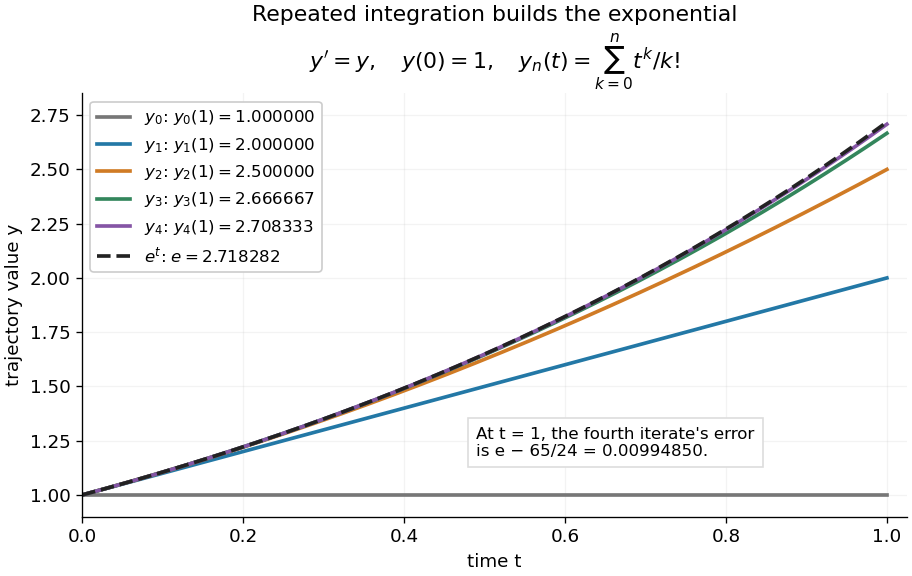

# Picard iteration

↑ **Parent:** [Picard-Lindelöf theorem](picard-lindelof-theorem.md)

[Picard iteration](picard-iteration.md) replaces a tentative trajectory by the accumulated [integral](integral.md) of its proposed rate. For an [initial value problem](initial-value-problem.md) $y'=f(t,y)$, $y(t_0)=y_0$, define the Picard map and its starting [function](function-split.md) by

$$
(\mathcal P u)(t)=y_0+\int_{t_0}^t f(s,u(s))\,ds,\qquad y_0(t)\equiv y_0,\qquad y_{n+1}=\mathcal P y_n.
$$

Here $y_0(t)$ is the constant starting trajectory; the same symbol without its argument denotes the initial state. A [fixed point](fixed-point.md) of $\mathcal P$ solves this [integral equation](integral-equation.md), and the [fundamental theorem of calculus](fundamental-theorem-of-calculus.md) gives the original [ordinary differential equation](ordinary-differential-equation.md).

For $y'=y$, $y(0)=1$, successive [integrals](integral.md) give

$$
\begin{aligned}
y_0(t)&=1,\\
y_1(t)&=1+t,\\
y_2(t)&=1+t+\frac{t^2}{2},\\
y_3(t)&=1+t+\frac{t^2}{2}+\frac{t^3}{6},\\
y_4(t)&=1+t+\frac{t^2}{2}+\frac{t^3}{6}+\frac{t^4}{24},\\
y_n(t)&=\sum_{k=0}^n\frac{t^k}{k!}.
\end{aligned}
$$

At $t=1$, the first five values are $1,2,2.5,2.66666667,2.70833333$, while $e\approx2.71828183$. The fourth [polynomial](polynomial-split.md) misses by about $0.00994850$. On $0\leq t\leq1$, every omitted term of the [exponential series](exponential-series.md) is nonnegative and increasing, so the largest error occurs at $t=1$. The tail tends to zero, giving [uniform convergence](uniform-convergence.md) to the [exponential function](exponential-function.md) on this [interval](interval-mathematics.md).

**[Figure 9](#image-picard-iteration-builds-the-exponential-solution-by-repeated-integration). Picard iteration builds the exponential solution by repeated integration**. The first five [polynomials](polynomial-split.md) $y_0,\ldots,y_4$ approach the [exponential function](exponential-function.md) on $0\leq t\leq1$. Endpoint values are listed in the legend; the last error is approximately $0.00994850$.

The beauty of [Picard iteration](picard-iteration.md) is that each proposed trajectory supplies a better rate history for the next one. For this example, one [integration](integral.md) adds exactly the next term of the [exponential series](exponential-series.md). In general, the [integrals](integral.md) may be difficult to compute, but the construction still explains local existence and uniqueness.

The short [contraction mapping](contraction-mapping.md) argument needs two independent controls. Choose a time-state cylinder $[t_0-a,t_0+a]\times\overline B_r(y_0)\subset U$ on which

$$
\|f(t,z)\|\leq M,\qquad \|f(t,u)-f(t,v)\|\leq L\|u-v\|.
$$

The second bound is the uniform local [Lipschitz condition](lipschitz-continuity.md). Set $J=[t_0-h,t_0+h]$ with $0<h\leq a$, $Mh\leq r$ and $Lh<1$. In the [function space](function-space.md) of [continuous functions](continuous-function.md) $J\to\mathbb R^d$, use the [supremum norm](supremum-norm.md) $\|u\|_\infty=\sup_{t\in J}\|u(t)\|$. On its [closed ball](closed-ball.md) $\|u-y_0\|_\infty\leq r$, direct [integral](integral.md) estimates give

$$
\|\mathcal P u-y_0\|_\infty\leq Mh\leq r,\qquad \|\mathcal P u-\mathcal P v\|_\infty\leq Lh\|u-v\|_\infty.
$$

Thus the map preserves the [closed ball](closed-ball.md) and is a [contraction mapping](contraction-mapping.md) there. This [closed ball](closed-ball.md) is a [complete metric space](complete-metric-space.md), so the [contraction mapping theorem](contraction-mapping-theorem.md) gives convergence to exactly one [fixed point](fixed-point.md). Any other local [solution of a differential equation](solution-of-a-differential-equation.md) stays in the same ball after shortening its [interval](interval-mathematics.md), and hence agrees there.

For $y'=y$, take $r=1$, so $|y|\leq2$ in the state ball and $M=2$, $L=1$. Choosing $h=1/2$ gives $Mh=1$ and $Lh=1/2$, with the actual solution satisfying $|e^{1/2}-1|\approx0.64872127<1$. The plotted [interval](interval-mathematics.md) $[0,1]$ is longer than this simple guarantee: the explicitly computed [exponential series](exponential-series.md) converges there anyway. The condition $Lh<1$ is sufficient for this one-step [contraction mapping](contraction-mapping.md) argument, rather than a necessary lifespan bound.

## ↑ Ancestors (7)

1. [Picard-Lindelöf theorem](picard-lindelof-theorem.md)
2. [Ordinary differential equation](ordinary-differential-equation.md)
3. [Differential equation](differential-equation-split.md)
4. [Analysis](analysis-split.md)
5. [Area of mathematics](area-of-mathematics.md)
6. [Mathematics](mathematics-split.md)
7. [Codex Wiki](split.md)

## ← Incoming links (2)

- [Picard iteration](picard-iteration.md)
- [Picard-Lindelöf theorem](picard-lindelof-theorem.md)
