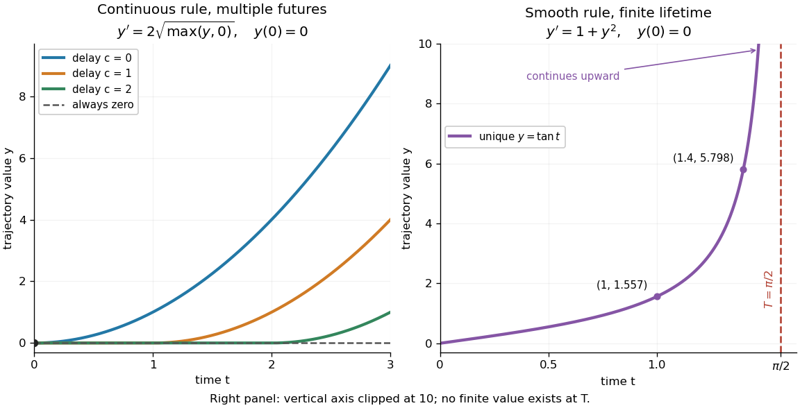

<h1 id="picard-lindelof-theorem">Picard-Lindelöf theorem</h1>

↑ **Parent:** [Ordinary differential equation](ordinary-differential-equation.md)  
ⓦ [Wiki](https://en.wikipedia.org/wiki/Picard–Lindelöf_theorem)

Let $U\subset\mathbb R\times\mathbb R^d$ be an [open set](open-set.md) and $f:U\to\mathbb R^d$ a [continuous function](continuous-function.md). Suppose $f$ is [locally Lipschitz](locally-lipschitz-function.md) in the state $y$, with a [Lipschitz constant](lipschitz-constant.md) uniform on a sufficiently small time-state neighborhood of each point. Then each $(t_0,y_0)\in U$ determines a unique local [solution of a differential equation](solution-of-a-differential-equation.md) to the displayed [initial value problem](initial-value-problem.md), on an [interval](interval-mathematics.md) around $t_0$. This is the local theorem in [Ordinary Differential Equations and Dynamical Systems by Gerald Teschl](ordinary-differential-equations-and-dynamical-systems-by-gerald-teschl.md).

For example, $y'=y$, $y(0)=1$, has the [solution of a differential equation](solution-of-a-differential-equation.md) $y(t)=e^t$: its [derivative](derivative.md) is itself and its starting value is $1$. The [Lipschitz constant](lipschitz-constant.md) is $L=1$, since $|u-v|=|f(t,u)-f(t,v)|$. Thus uniqueness follows even before computing $y(1)=e\approx2.71828183$. [Picard iteration](picard-iteration.md) below constructs this [exponential function](exponential-function.md) one [polynomial](polynomial-split.md) at a time.

The [Lipschitz condition](lipschitz-continuity.md) has real content. For the [continuous function](continuous-function.md) involving a [square root](square-root.md),

$$
f(y)=2\sqrt{\max(y,0)},\qquad y'=f(y),\qquad y(0)=0,
$$

each waiting time $c\geq0$ gives a different forward [solution of a differential equation](solution-of-a-differential-equation.md):

$$
y_c(t)=\begin{cases}0,&0\leq t\leq c,\\(t-c)^2,&t>c.\end{cases}
$$

The constant [solution of a differential equation](solution-of-a-differential-equation.md) $y(t)=0$ is another choice. At $t=2$, delays $c=0,1,2$ give $y=4,1,0$ respectively. Before the join, both sides of the [ordinary differential equation](ordinary-differential-equation.md) are zero; afterwards, $y_c'=2(t-c)=2\sqrt{y_c}$. Both one-sided [derivatives](derivative.md) at $c$ are zero, so the join is valid. All these trajectories can also be extended by zero to $t<0$. The failed [Lipschitz condition](lipschitz-continuity.md) is visible in the quotient

$$
\frac{|f(\varepsilon)-f(0)|}{|\varepsilon-0|}=\frac{2}{\sqrt\varepsilon}\longrightarrow\infty\qquad(\varepsilon\downarrow0).
$$

For $\varepsilon=10^{-2},10^{-4},10^{-6}$ this quotient is $20,200,2000$. [Continuity](continuous-function.md) still allows local existence by the [Peano existence theorem](peano-existence-theorem.md); it cannot choose a waiting time. MIT's [18.034 Lecture 2, Example 2.3](https://ocw.mit.edu/courses/18-034-honors-differential-equations-spring-2009/a8c15198f81e85870da85da9792565b9_MIT18_034s09_lec02.pdf) develops the same waiting-time mechanism for a different [ordinary differential equation](ordinary-differential-equation.md), $y'=3y^{2/3}$.

**[Figure 13](#image-failure-of-uniqueness-and-finite-time-blowup-are-different-obstructions). Failure of uniqueness and finite-time blowup are different obstructions**. Left: several delayed [solutions of a differential equation](solution-of-a-differential-equation.md) of $y'=2\sqrt{\max(y,0)}$ share $y(0)=0$. Right: the unique [solution of a differential equation](solution-of-a-differential-equation.md) $y=\tan t$ of $y'=1+y^2$, $y(0)=0$, has [finite-time blowup](finite-time-blowup.md) at $T=\pi/2$. The right vertical axis ends at $10$; the curve continues upward beyond the plot, and there is no finite endpoint value.

The useful promise is that an [initial condition](initial-condition.md) and a sufficiently regular local rule select one trajectory. It justifies comparing models and following trajectories without an arbitrary choice at each instant. A locally [Lipschitz continuous](lipschitz-continuity.md) rule need not keep that trajectory bounded: $y'=1+y^2$ meets the theorem's hypotheses everywhere but has [finite-time blowup](finite-time-blowup.md). Longer existence is governed by the [finite-dimensional continuation criterion](finite-dimensional-continuation-criterion.md).

**Table of contents**

- [Picard iteration](picard-iteration.md)
- [Finite-dimensional continuation criterion](finite-dimensional-continuation-criterion.md)
- [Bielecki norm method](bielecki-norm-method.md)

## ↑ Ancestors (6)

1. [Ordinary differential equation](ordinary-differential-equation.md)
2. [Differential equation](differential-equation-split.md)
3. [Analysis](analysis-split.md)
4. [Area of mathematics](area-of-mathematics.md)
5. [Mathematics](mathematics-split.md)
6. [Codex Wiki](split.md)

## ← Incoming links (34)

- [Bernoulli power substitution](bernoulli-power-substitution.md)
- [Complex ordinary differential equation](complex-ordinary-differential-equation.md)
- [Direction field](direction-field.md)
- [Finite-dimensional continuation criterion](finite-dimensional-continuation-criterion.md)
- [Finite-time blowup](finite-time-blowup.md)
- [Global characteristic flow for a Hamiltonian with bounded Hessian](global-characteristic-flow-for-a-hamiltonian-with-bounded-hessian.md)
- [Implicit factorization can reveal nonunique initial solutions](implicit-factorization-can-reveal-nonunique-initial-solutions.md)
- [Initial value problem](initial-value-problem.md)
- [Lipschitz continuity](lipschitz-continuity.md)
- [Locally Lipschitz function](locally-lipschitz-function.md)
- [Painlevé determinateness theorem](painleve-determinateness-theorem.md)
- [Solution](past-exam-of-the-mathematics-course-of-the-university-of-cambridge/2004/iii/paper-14/4/solution.md)
- [Solution](past-exam-of-the-mathematics-course-of-the-university-of-cambridge/2004/iii/paper-51/1/solution.md)
- [Solution](past-exam-of-the-mathematics-course-of-the-university-of-cambridge/2006/ib/paper-2/13f/solution.md)
- [Solution](past-exam-of-the-mathematics-course-of-the-university-of-cambridge/2007/iii/paper-37/1/b/solution.md)
- [Solution](past-exam-of-the-mathematics-course-of-the-university-of-cambridge/2009/ii/paper-1/30b/i/solution.md)
- [Solution](past-exam-of-the-mathematics-course-of-the-university-of-cambridge/2012/iii/paper-17/1/1/solution.md)
- [Solution](past-exam-of-the-mathematics-course-of-the-university-of-cambridge/2015/iii/paper-8/1/a/solution.md)
- [Solution](past-exam-of-the-mathematics-course-of-the-university-of-cambridge/2016/iii/paper-102/6/solution.md)
- [Solution](past-exam-of-the-mathematics-course-of-the-university-of-cambridge/2016/iii/paper-115/3/solution.md)
- [Solution](past-exam-of-the-mathematics-course-of-the-university-of-cambridge/2017/iii/paper-331/3/b/iii/solution.md)
- [Solution](past-exam-of-the-mathematics-course-of-the-university-of-cambridge/2019/ib/paper-3/12e/a/solution.md)
- [Solution](past-exam-of-the-mathematics-course-of-the-university-of-cambridge/2019/iii/paper-202/2/2/solution.md)
- [Solution](past-exam-of-the-mathematics-course-of-the-university-of-cambridge/2022/iii/paper-313/1/solution.md)
- [Solution](past-exam-of-the-mathematics-course-of-the-university-of-cambridge/2023/iii/paper-313/1/b/solution.md)
- [Solution](past-exam-of-the-mathematics-course-of-the-university-of-cambridge/2025/iii/paper-105/3/a/solution.md)
- [Solution](past-exam-of-the-mathematics-course-of-the-university-of-cambridge/2025/iii/paper-359/1/b/i/solution.md)
- [Solution](past-exam-of-the-mathematics-course-of-the-university-of-cambridge/2026/iii/paper-359/1/b/ii/solution.md)
- [Solution](past-exam-of-the-mathematics-course-of-the-year-1-of-the-natural-sciences-course-of-the-university-of-cambridge/2012/paper-1/13/a/solution.md)
- [Solution](past-exam-of-the-mathematics-course-of-the-year-1-of-the-natural-sciences-course-of-the-university-of-cambridge/2021/paper-1/13/b/solution.md)
- [Solution](past-exam-of-the-mathematics-course-of-the-year-1-of-the-natural-sciences-course-of-the-university-of-cambridge/2024/paper-1/13/a/ii/solution.md)
- [Peano existence theorem](peano-existence-theorem.md)
- [Reciprocal Bernoulli equation with finite-time blowup](reciprocal-bernoulli-equation-with-finite-time-blowup.md)
- [Streamline](streamline.md)
