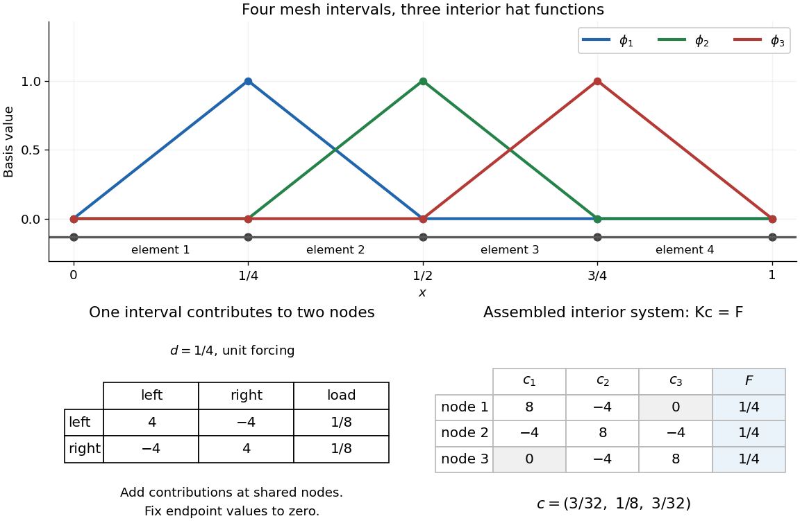

# Piecewise-linear hat function

↑ **Parent:** [Finite element method](finite-element-method.md)

A [piecewise-linear hat function](piecewise-linear-hat-function.md) is a continuous [piecewise linear function](piecewise-linear-function.md) that selects one node of a [finite element mesh](finite-element-mesh.md): it is one there and zero at every other node. For an interior node $x_i$, its exact formula on a possibly nonuniform [mesh](finite-element-mesh.md) is

$$
\phi_i(x)=\begin{cases}
(x-x_{i-1})/(x_i-x_{i-1}),&x_{i-1}\leq x\leq x_i,\\
(x_{i+1}-x)/(x_{i+1}-x_i),&x_i\leq x\leq x_{i+1},\\
0,&\text{otherwise}.
\end{cases}
$$

Its [support of a function](support.md) is $[x_{i-1},x_{i+1}]$. It rises on the left [interval](interval-mathematics.md) and falls on the right, producing its hat-shaped graph. The interior [hat functions](piecewise-linear-hat-function.md) form a [basis](basis.md) of the continuous $P_1$ [conforming finite element space](conforming-finite-element-space.md) with homogeneous [Dirichlet boundary conditions](dirichlet-boundary-condition.md). Chen's author notes define this nodal [basis](basis.md) and illustrate it in one and two dimensions.[Chen, Introduction to Finite Element Methods, §3.1, pp. 5–6 and Figure 5: nodal hat basis](https://webapps.math.uci.edu/~chenlong/226/Ch2FEM.pdf) The nodal property $\phi_i(x_j)=\delta_{ij}$ makes the [coefficients](coefficient.md) directly readable: if $v_h=\sum_i c_i\phi_i$, then $v_h(x_i)=c_i$. Unlike the global [Lagrange cardinal polynomials](lagrange-cardinal-polynomial.md), each of these functions is confined to two neighboring elements.

For example, with $x_j=j/4$, the middle [hat function](piecewise-linear-hat-function.md) is $\phi_2(x)=4x-1$ on $[1/4,1/2]$, $3-4x$ on $[1/2,3/4]$, and zero elsewhere. Hence $\phi_2(3/8)=1/2$, while $\phi_1(3/8)=1/2$ and $\phi_3(3/8)=0$. The [finite element solution of the one-dimensional Poisson equation](finite-element-solution-of-the-one-dimensional-poisson-equation.md) therefore has $u_h(3/8)=(3/32)/2+(1/8)/2=7/64$.

Local assembly makes this locality computational. On an element $[a,b]$ of length $d=b-a$, the two local [basis](basis.md) functions are $N_L=(b-x)/d$ and $N_R=(x-a)/d$. For the [Poisson equation](poisson-equation.md) with unit forcing, their local [stiffness matrix](stiffness-matrix.md) and load vector are

$$
K^{(e)}=\frac1d\begin{pmatrix}1&-1\\-1&1\end{pmatrix},\qquad
F^{(e)}=\frac d2\begin{pmatrix}1\\1\end{pmatrix}.
$$

Add these four matrix entries and two loads to the rows and columns belonging to the element's endpoints, then impose the prescribed boundary values. An interior node receives contributions from its two neighboring elements. Writing $d_L=x_i-x_{i-1}$ and $d_R=x_{i+1}-x_i$ gives

$$
K_{ii}=\frac1{d_L}+\frac1{d_R},\qquad
K_{i,i-1}=-\frac1{d_L},\qquad K_{i,i+1}=-\frac1{d_R},\qquad
F_i=\frac{d_L+d_R}{2},
$$

with off-diagonal entries included only for interior neighbors. On a uniform [mesh](finite-element-mesh.md) these reduce to $2/h$, $-1/h$ and $h$. Nonadjacent [hat functions](piecewise-linear-hat-function.md) have no derivative overlap of positive length, so all distant entries vanish. This produces a [sparse matrix](sparse-matrix.md) with only three diagonals: the global coupling is built entirely from local two-node interactions.

**[Figure 26](#image-three-interior-hat-functions-on-a-four-interval-mesh-with-local-stiffness-and-load-contributions-assembled-into-the-three-unknown-poisson-system). Three interior hat functions on a four-interval mesh, with local stiffness and load contributions assembled into the three-unknown Poisson system**.

## ↑ Ancestors (6)

1. [Finite element method](finite-element-method.md)
2. [Numerical analysis](numerical-analysis-split.md)
3. [Analysis](analysis-split.md)
4. [Area of mathematics](area-of-mathematics.md)
5. [Mathematics](mathematics-split.md)
6. [Codex Wiki](split.md)

## ← Incoming links (19)

- [Affine-weighted hat mass matrix](affine-weighted-hat-mass-matrix.md)
- [Energy conservation for semidiscrete Galerkin advection](energy-conservation-for-semidiscrete-galerkin-advection.md)
- [Finite element method](finite-element-method.md)
- [Finite element solution of the one-dimensional Poisson equation](finite-element-solution-of-the-one-dimensional-poisson-equation.md)
- [Galerkin orthogonality](galerkin-orthogonality.md)
- [Solution](past-exam-of-the-mathematics-course-of-the-university-of-cambridge/2005/iii/paper-69/5/a/solution.md)
- [Solution](past-exam-of-the-mathematics-course-of-the-university-of-cambridge/2006/iii/paper-68/4/b/solution.md)
- [Solution](past-exam-of-the-mathematics-course-of-the-university-of-cambridge/2009/iii/paper-72/1/b/solution.md)
- [Solution](past-exam-of-the-mathematics-course-of-the-university-of-cambridge/2014/iii/paper-66/7/solution.md)
- [Solution](past-exam-of-the-mathematics-course-of-the-university-of-cambridge/2017/iii/paper-341/5/iii/solution.md)
- [Solution](past-exam-of-the-mathematics-course-of-the-university-of-cambridge/2018/iii/paper-341/5/c/solution.md)
- [Solution](past-exam-of-the-mathematics-course-of-the-university-of-cambridge/2018/iii/paper-341/6/solution.md)
- [Solution](past-exam-of-the-mathematics-course-of-the-university-of-cambridge/2019/iii/paper-341/5/a/solution.md)
- [Solution](past-exam-of-the-mathematics-course-of-the-university-of-cambridge/2019/iii/paper-341/7/solution.md)
- [Solution](past-exam-of-the-mathematics-course-of-the-university-of-cambridge/2021/iii/paper-341/5/b/solution.md)
- [Solution](past-exam-of-the-mathematics-course-of-the-university-of-cambridge/2023/iii/paper-341/7/solution.md)
- [Piecewise-linear hat function](piecewise-linear-hat-function.md)
- [Reaction-diffusion finite element matrix](reaction-diffusion-finite-element-matrix.md)
- [Stiffness matrix](stiffness-matrix.md)
