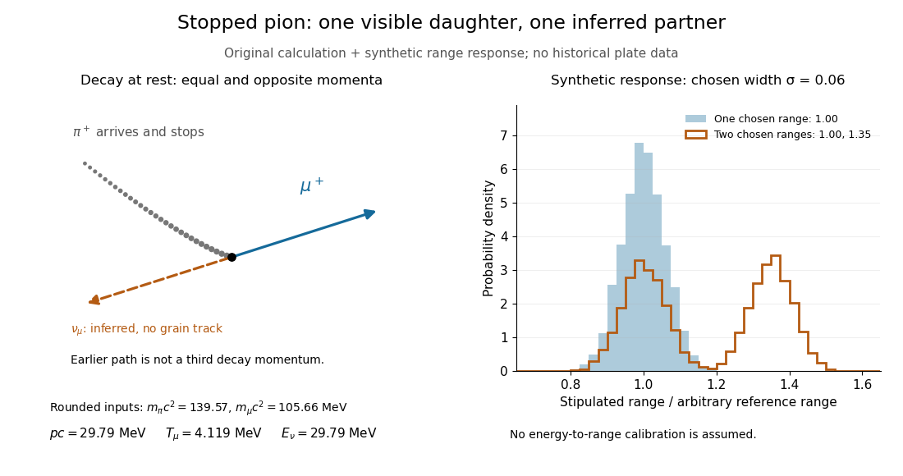

# Pion decay at rest in emulsion

↑ **Parent:** [Nuclear emulsion track experiment](nuclear-emulsion-track-experiment.md)

[Cecil Frank Powell](cecil-frank-powell.md)'s 1950 lecture illustrates the successive decays of [pions](pion.md) and [muons](muon.md) through their tracks and explains why the nearly fixed secondary [muon](muon.md) range, allowing for [range straggling](range-straggling.md), supports a single neutral decay partner. He describes its identification as a [neutrino](neutrino.md) tentatively. The neutral particle itself leaves no recorded track. He contrasts this decay with the [nuclear reactions](nuclear-reaction.md) caused by stopped negative [pions](pion.md), connecting the latter with the [nuclear force](nuclear-force-split.md).[Powell, The cosmic radiation, Nobel lecture, 11 December 1950, printed pp. 151–152, Fig. 5 and paragraphs beginning “When brought to rest” and “When a negative”; inspected in the Columbia-hosted Nobel lecture volume, PDF pp. 151–152](the-cosmic-radiation-by-cecil-frank-powell.md)

Here is a modern [special relativity](special-relativity-split.md) derivation for the dominant [leptonic pion decay](leptonic-pion-decay.md), assuming a free [pion](pion.md) at rest, a massless [muon neutrino](muon-neutrino.md), and no emitted [photon](photon.md). Write $m_\pi$ and $m_\mu$ for the [pion](pion.md) and [muon](muon.md) masses. By [conservation of momentum](momentum-conservation.md) the daughter momenta are opposite with equal magnitude $p$. By [conservation of energy](conservation-of-energy.md) and the [energy–momentum relation](energy-momentum-relation.md),

$$
m_\pi c^2=E_\mu+pc,\qquad E_\mu^2=p^2c^2+m_\mu^2c^4.
$$

Substitute $E_\mu=m_\pi c^2-pc$, square, and cancel $p^2c^2$. This gives

$$
p=\frac{(m_\pi^2-m_\mu^2)c}{2m_\pi},\qquad
E_\mu=\frac{(m_\pi^2+m_\mu^2)c^2}{2m_\pi},\qquad
T_\mu=\frac{(m_\pi-m_\mu)^2c^2}{2m_\pi}.
$$

The resulting $p$ is fixed, although the [muon](muon.md)'s direction is not set by the incoming stopping track. Thus the kink angle relative to that earlier track is not the angle between the two daughters: in the [pion](pion.md) [rest frame](rest-frame.md), the daughters are back to back. A neutral-partner arrow in a diagram represents inferred [momentum](momentum-split.md), not an observed string of grains.

For an original calculation, adopt rounded input values $m_\pi c^2=139.57\,\mathrm{MeV}$ and $m_\mu c^2=105.66\,\mathrm{MeV}$. They give $pc=29.79\,\mathrm{MeV}$, $T_\mu=4.119\,\mathrm{MeV}$ and $E_\nu=29.79\,\mathrm{MeV}$. Their sum satisfies $T_\mu+E_\nu=(m_\pi-m_\mu)c^2=33.91\,\mathrm{MeV}$. These are rounded calculation inputs and outputs, not a fit to the 1947 plates.

**[Figure 2](#image-pion-decay-at-rest-in-emulsion-daughter-momentum-balance-and-a-stipulated-particle-range-response). Pion decay at rest in emulsion: daughter momentum balance and a stipulated particle range response**. Original [special relativity](special-relativity-split.md) calculation and synthetic [histograms](histogram.md). The dashed [neutrino](neutrino.md) arrow is an inference. For illustration only, the range response has arbitrarily chosen mean $1$ and [standard deviation](standard-deviation.md) $0.06$ in dimensionless units; it does not reproduce historical grain measurements, a measured resolution or a calibrated muon range.

At fixed material and particle identity, a fixed initial [kinetic energy](kinetic-energy.md) suggests a narrow [particle range](particle-range.md) distribution broadened by [range straggling](range-straggling.md) and [measurement uncertainty](measurement-uncertainty.md). The synthetic example convolves a single chosen range with a [normal distribution](normal-distribution.md); a second example superposes two such chosen ranges. It explains why repeated comparable stopping distances can be informative, without pretending to extract a historical spectrum.

The decay equations do not identify the neutral partner as a [neutrino](neutrino.md) on their own: a massless [photon](photon.md) would satisfy the same energy and momentum equations. Nor does any isolated kink establish the [pion](pion.md)'s identity. The inference gains force from calibrated [particle range](particle-range.md), [track grain density](track-grain-density.md), repeated decay patterns and independent particle properties. Historical particle names should not obscure the distinction: a [muon](muon.md) is a [lepton](lepton.md), whereas a [pion](pion.md) is a [meson](meson.md).

## ↑ Ancestors (5)

1. [Nuclear emulsion track experiment](nuclear-emulsion-track-experiment.md)
2. [Nuclear emulsion](nuclear-emulsion.md)
3. [Photographic emulsion](photographic-emulsion.md)
4. [Photography](photography-split.md)
5. [Codex Wiki](split.md)

## ← Incoming links (1)

- [Pion decay at rest in emulsion](pion-decay-at-rest-in-emulsion.md)
