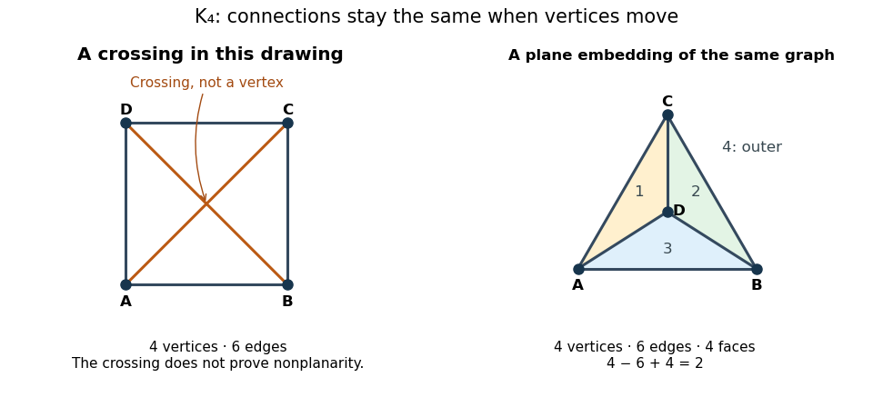

# Planar graph

↑ **Parent:** [Graph theory](graph-theory.md)  
ⓦ [Wiki](https://en.wikipedia.org/wiki/Planar_graph)

A [planar graph](planar-graph.md) admits at least one [graph drawing](graph-theory.md#graph-drawing) in which [edges](graph-theory.md#edge-of-a-graph) meet only at common endpoints. This is a property of the abstract [graph](graph.md), not a requirement on every [graph drawing](graph-theory.md#graph-drawing). A [plane graph](#plane-graph) specifies one such drawing.[Planar Graphs; Bipartite Matching, slides lec 5f.3 and 5f.12](mathematics-bibliography.md#planar-graphs-bipartite-matching-by-albert-r-meyer-6-042j-lecture-5f)

For example, the [complete graph](graph-theory.md#complete-graph) $K_4$ joins every pair of four [vertices](graph.md#vertex-graph-theory), giving six [edges](graph-theory.md#edge-of-a-graph). Put its [vertices](graph.md#vertex-graph-theory) at the corners of a square and its diagonals cross. Instead put $A,B,C$ at the corners of a [triangle](euclidean-geometry.md#triangle) and $D$ inside it: the same six [edges](graph-theory.md#edge-of-a-graph) $AB,AC,BC,AD,BD,CD$ now meet only at their endpoints. The first [graph drawing](graph-theory.md#graph-drawing) obscures planarity; the second proves it. In particular, its [crossing number](graph-theory.md#crossing-number) is zero.

**[Figure 1](#complete-four-vertex-graph-crossing-and-plane-drawings). The same complete graph on four vertices drawn with a crossing and with four faces**.

The distinction matters whenever connections must fit on one surface without intersecting. A failed [graph drawing](graph-theory.md#graph-drawing) may only need rearrangement, whereas [nonplanarity by edge counts](#nonplanarity-by-edge-counts) proves that every rearrangement fails.

**Table of contents**

- [Kuratowski's theorem](#kuratowski-s-theorem)
- [Plane graph](#plane-graph)
  - [Face of a plane graph](#face-of-a-plane-graph)
    - [Outer face](#outer-face)
    - [Facial boundary walk](#facial-boundary-walk)
- [Honeycomb lattice](#honeycomb-lattice)
  - [Martini lattice](#martini-lattice)
- [Four color theorem](#four-color-theorem)
- [Five color theorem](#five-color-theorem)
- [Planar map](#planar-map)
  - [Face of a planar map](#face-of-a-planar-map)
  - [Rooted planar map](#rooted-planar-map)
  - [Planar quadrangulation](#planar-quadrangulation)
    - [Trivial bijection between planar maps and quadrangulations](#trivial-bijection-between-planar-maps-and-quadrangulations)
- [Planar dual graph](#planar-dual-graph)
  - [Planar cluster-count identity](#planar-cluster-count-identity)
  - [Dual bond percolation](#dual-bond-percolation)
    - [Three-terminal cell partition duality](#three-terminal-cell-partition-duality)
    - [Dual contour bound for a finite planar cluster](#dual-contour-bound-for-a-finite-planar-cluster)
  - [Planar duality for rectangle crossings](#planar-duality-for-rectangle-crossings)
    - [Exact self-dual rectangle crossing probability](#exact-self-dual-rectangle-crossing-probability)
- [Euler formula for a connected planar graph](#euler-formula-for-a-connected-planar-graph)
  - [Small faces of a spherical polyhedral graph](#small-faces-of-a-spherical-polyhedral-graph)
  - [Planar graph edge bound](#planar-graph-edge-bound)
    - [Bipartite planar graph edge bound](#bipartite-planar-graph-edge-bound)
    - [Nonplanarity by edge counts](#nonplanarity-by-edge-counts)
  - [Planar girth edge bound](#planar-girth-edge-bound)
  - [Triangle-pentagon planar edge bound](#triangle-pentagon-planar-edge-bound)
    - [Icosidodecahedral graph](#icosidodecahedral-graph)

<h2 id="kuratowski-s-theorem">Kuratowski's theorem</h2>

↑ **Parent:** [Planar graph](planar-graph.md)  
ⓦ [Wiki](https://en.wikipedia.org/wiki/Kuratowski's_theorem)

A finite [simple graph](graph.md#simple-graph) is a [planar graph](planar-graph.md) if and only if it contains no [graph subdivision](graph-theory.md#graph-subdivision) of the [complete graph](graph-theory.md#complete-graph) $K_5$ or the [complete bipartite graph](bipartite-graph.md#complete-bipartite-graph) $K_{3,3}$ as a [subgraph](graph-theory.md#subgraph); equivalently, neither is a [topological minor](graph-minor.md#topological-minor). The easy direction follows by tracing each replacement [graph path](graph-theory.md#path-in-a-graph) as one drawn [edge](graph-theory.md#edge-of-a-graph). The converse asserts that every failure of planarity contains one of these two patterns.[§4.4, Theorem 4.4.6(iii), printed p. 111](mathematics-bibliography.md#graph-theory-by-reinhard-diestel/planar-graphs-author-hosted-chapter-preview)

[Graph Theory by Reinhard Diestel](mathematics-bibliography.md#graph-theory-by-reinhard-diestel) (Planar Graphs preview, §4.4, Theorem 4.4.6, printed p. 111) dates [Kuratowski's theorem](#kuratowski-s-theorem) to 1930 and the equivalent [graph minor](graph-minor.md) characterization to 1937. These dates are that textbook's historical attribution.

## Plane graph

↑ **Parent:** [Planar graph](planar-graph.md)

A [plane graph](#plane-graph) is a [planar graph](planar-graph.md) with a specified [graph drawing](graph-theory.md#graph-drawing) whose [edges](graph-theory.md#edge-of-a-graph) meet only at common endpoints, also called an embedding in the [Euclidean plane](geometry-and-topology.md#euclidean-plane). Its [faces of a plane graph](#face-of-a-plane-graph) and [facial boundary walks](#facial-boundary-walk) refer to that embedding. This geometric use of embedding differs from a [graph embedding](graph-theory.md#graph-embedding), which maps one abstract [graph](graph.md) into another.

### Face of a plane graph

↑ **Parent:** [Plane graph](#plane-graph)

A [face of a plane graph](#face-of-a-plane-graph) is a [connected component](geometry-and-topology.md#connected-component) of the [Euclidean plane](geometry-and-topology.md#euclidean-plane) after removing the drawn [vertices](graph.md#vertex-graph-theory) and [edges](graph-theory.md#edge-of-a-graph). Count the [outer face](#outer-face) too. This is the plane counterpart of a [face of a planar map](#face-of-a-planar-map) on the [sphere](euclidean-geometry.md#sphere).[Planar Graphs; Bipartite Matching, slide lec 5f.6, including the outer face](mathematics-bibliography.md#planar-graphs-bipartite-matching-by-albert-r-meyer-6-042j-lecture-5f)

#### Outer face

↑ **Parent:** [Face of a plane graph](#face-of-a-plane-graph)

The [outer face](#outer-face) is the unique unbounded [face of a plane graph](#face-of-a-plane-graph) for a finite [plane graph](#plane-graph). It counts once even though it surrounds the whole [graph drawing](graph-theory.md#graph-drawing). A [tree](tree-graph-theory.md) has only this [face of a plane graph](#face-of-a-plane-graph).

#### Facial boundary walk

↑ **Parent:** [Face of a plane graph](#face-of-a-plane-graph)

For a finite [connected graph](graph.md#connected-graph) embedded as a [plane graph](#plane-graph), follow the [edges](graph-theory.md#edge-of-a-graph) around a [face of a plane graph](#face-of-a-plane-graph) to obtain a [closed walk](graph-theory.md#closed-walk). Count traversals, not distinct [edges](graph-theory.md#edge-of-a-graph): a [bridge in a graph](graph.md#bridge-graph-theory) occurs twice along one [facial boundary walk](#facial-boundary-walk). Each [edge](graph-theory.md#edge-of-a-graph) contributes two sides in total.[Mathematics for Computer Science, §12.4, Lemma 12.4.1, printed p. 485](mathematics-bibliography.md#mathematics-for-computer-science-by-eric-lehman-and-others)

For the three-[vertex](graph.md#vertex-graph-theory) [graph path](graph-theory.md#path-in-a-graph) $A-B-C$, the only [facial boundary walk](#facial-boundary-walk) is $A,B,C,B,A$, of length four. Both [edges](graph-theory.md#edge-of-a-graph) are [bridges in a graph](graph.md#bridge-graph-theory); neither is a [graph cycle](graph-theory.md#cycle-in-a-graph). Thus a [facial boundary walk](#facial-boundary-walk) need not be a [graph cycle](graph-theory.md#cycle-in-a-graph).

## Honeycomb lattice

↑ **Parent:** [Planar graph](planar-graph.md)

The honeycomb lattice is the periodic degree-three [planar graph](planar-graph.md) consisting of the vertices and edges of a regular hexagonal tiling. It has two vertex classes; every edge joins opposite classes. Its [planar dual graph](#planar-dual-graph) is the [triangular lattice](graph.md#triangular-lattice).

### Martini lattice

↑ **Parent:** [Honeycomb lattice](#honeycomb-lattice)

The martini lattice is obtained from the [honeycomb lattice](#honeycomb-lattice) by replacing every vertex in one of its two vertex classes by a triangle, attaching its three former incident bonds to the triangle's three vertices. It is a periodic degree-three [planar graph](planar-graph.md), with triangular faces and nine-sided faces. Each decorated vertex and its incident bonds is a three-terminal cell with three internal triangle bonds and three terminal spokes. Its independent [bond percolation](bond-percolation.md) threshold is $1/\sqrt2$, as follows from [three-terminal cell partition duality](#three-terminal-cell-partition-duality).

## Four color theorem

↑ **Parent:** [Planar graph](planar-graph.md)  
ⓦ [Wiki](https://en.wikipedia.org/wiki/Four_color_theorem)

Every finite [planar graph](planar-graph.md) has [chromatic number](graph-coloring.md#chromatic-number) at most four. This stronger theorem is distinct from the elementary [five colour theorem](#five-color-theorem); the latter's [Kempe chain](graph-coloring.md#kempe-chain) proof does not prove this assertion.

## Five color theorem

↑ **Parent:** [Planar graph](planar-graph.md)  
ⓦ [Wiki](https://en.wikipedia.org/wiki/Five_color_theorem)

Every finite [planar graph](planar-graph.md) admits a proper vertex coloring with at most five colors. [Euler formula for a connected planar graph](#euler-formula-for-a-connected-planar-graph) supplies a vertex of degree at most five. Inductively color its deletion. The only obstruction is five differently colored neighbours in cyclic order. If opposite neighbours 1 and 3 are in different two-color components, interchange one component. If they are connected, planarity prevents opposite neighbours 2 and 4 from being connected in their two-color subgraph, and that interchange frees a color instead. This is a [Kempe chain](graph-coloring.md#kempe-chain) proof.

## Planar map

↑ **Parent:** [Planar graph](planar-graph.md)  
ⓦ [Wiki](https://en.wikipedia.org/wiki/Planar_map)

A planar map is a [planar graph](planar-graph.md) together with a fixed embedding in the [sphere](euclidean-geometry.md#sphere), considered up to orientation-preserving homeomorphism. A rooted planar map has a distinguished oriented edge, which removes most embedding symmetries.

### Face of a planar map

↑ **Parent:** [Planar map](#planar-map)

A face of a planar map is a connected component of the complement of its embedded graph. Its degree is the number of edge incidences around its boundary, counted with multiplicity, and the sum of all face degrees is twice the number of edges.

### Rooted planar map

↑ **Parent:** [Planar map](#planar-map)

A rooted planar map is a [planar map](#planar-map) with a distinguished oriented edge called its root edge. Its tail is the root vertex, and the face on a chosen side of the edge may be designated as the root face.

### Planar quadrangulation

↑ **Parent:** [Planar map](#planar-map)

A planar quadrangulation is a [planar map](#planar-map) in which every face has degree four, with incidences counted with multiplicity. A pointed quadrangulation additionally has a distinguished vertex.

A [squaregraph](graph-theory.md#squaregraph) has separate conditions on bounded faces and interior vertex degrees; its outer face need not be quadrilateral.

#### Trivial bijection between planar maps and quadrangulations

↑ **Parent:** [Planar quadrangulation](#planar-quadrangulation)

The trivial bijection sends a rooted [planar map](#planar-map) with $n$ edges to a rooted [planar quadrangulation](#planar-quadrangulation) with $n$ faces. Put one new vertex in each face and, in each corner, connect that face vertex to the incident original vertex. Each original edge then lies inside one quadrangular face; deleting the original edges gives the quadrangulation. The face bipartition recovers the original vertices and hence the inverse map.

## Planar dual graph

↑ **Parent:** [Planar graph](planar-graph.md)

A planar dual graph has one vertex in each face of a fixed planar embedding and one dual edge crossing each primal edge.

This is the planar-embedding case of a [dual graph](graph.md#dual-graph).

### Planar cluster-count identity

↑ **Parent:** [Planar dual graph](#planar-dual-graph)

For a fixed finite plane graph, the complementary dual configuration opens a dual edge exactly when its primal edge is closed. Its components correspond to faces of the spanning open primal graph. The componentwise [Euler formula for a connected planar graph](#euler-formula-for-a-connected-planar-graph) gives the displayed identity. The outer face and isolated primal vertices are included; the identity also handles disconnected graphs, bridges and loops.

### Dual bond percolation

↑ **Parent:** [Planar dual graph](#planar-dual-graph)

In planar [bond percolation](bond-percolation.md), declare a dual edge open exactly when the primal edge it crosses is closed. Independent primal parameter $p$ then gives independent dual parameter $1-p$.

#### Three-terminal cell partition duality

↑ **Parent:** [Dual bond percolation](#dual-bond-percolation)

A planar finite network with three boundary terminals induces one of five connection partitions: all three connected, all three separate, or one connected pair and an isolated third terminal. Put three dual terminals on the intervening boundary arcs. Passing to the [planar dual graph](#planar-dual-graph) interchanges the all-connected and all-separate partitions and permutes the three pair partitions. If the network is symmetric under all terminal permutations, equality $P_3=P_0$ of the first two probabilities makes its whole partition law dual-invariant. Independent cells on a self-dual triangular terminal arrangement then give identical primal and dual coarse connection laws. Infinite connectivity is preserved because cells are uniformly finite. For a [martini lattice](#martini-lattice) cell with six independent bonds of common parameter $p$, $P_3=3p^5-2p^6$ and $P_3-P_0=(2p^2-1)(p^4-3p^3+2p^2+1)$. The unique zero in $[0,1]$ is $1/\sqrt2$.

#### Dual contour bound for a finite planar cluster

↑ **Parent:** [Dual bond percolation](#dual-bond-percolation)

In [bond percolation](bond-percolation.md) on the square lattice, the outer boundary of a finite [percolation cluster](bond-percolation.md#percolation-cluster), after filling its holes, consists of closed bonds. Their crossing edges in the [planar dual graph](#planar-dual-graph) form a connected enclosing contour, and hence belong to a single [dual bond percolation](#dual-bond-percolation) cluster $K$. If $|K|=m$, both its coordinate widths are at most $m-1$, so the enclosed primal cluster contains at most $m^2$ vertices. A contour enclosing the origin also places every vertex of $K$ within distance $m+1$ of the origin. An exponential volume tail for the subcritical [dual bond percolation](#dual-bond-percolation) clusters thus gives a bound $Ce^{-c\sqrt n}$ for a finite primal cluster of size at least $n$.

### Planar duality for rectangle crossings

↑ **Parent:** [Planar dual graph](#planar-dual-graph)

For a rectangle in a planar lattice, exactly one of an open primal left-to-right crossing and a closed dual top-to-bottom crossing occurs.

#### Exact self-dual rectangle crossing probability

↑ **Parent:** [Planar duality for rectangle crossings](#planar-duality-for-rectangle-crossings)

For the lattice rectangle with [graph vertices](graph.md#vertex-graph-theory) $\{0,\ldots,n\}\times\{0,\ldots,n-1\}$, let $H_n$ be an open left-to-right crossing. Its complementary event is a closed dual top-to-bottom crossing. The dual crossing rectangle has width $n-1$ and height $n$, so rotation and translation identify it with the original rectangle. Boundary [edges](graph-theory.md#edge-of-a-graph) along the starting and ending sides do not affect the crossing event. At $p=1/2$ the primal and dual [edge](graph-theory.md#edge-of-a-graph) states have identical laws, hence

$$
\mathbb P_{1/2}(H_n)=1-\mathbb P_{1/2}(H_n)=\frac12.
$$

The one-unit adjustment in the side lengths makes the symmetry exact rather than an informal assertion about a finite [graph vertex](graph.md#vertex-graph-theory) square.

## Euler formula for a connected planar graph

↑ **Parent:** [Planar graph](planar-graph.md)

For a finite [connected graph](graph.md#connected-graph) with at least one [vertex](graph.md#vertex-graph-theory), embedded as a [plane graph](#plane-graph), let $n$ count [vertices](graph.md#vertex-graph-theory), $m$ count [edges](graph-theory.md#edge-of-a-graph), and $f$ count [faces of a plane graph](#face-of-a-plane-graph), including the [outer face](#outer-face). Then

$$
n-m+f=2.
$$

The hypotheses refer to an actual embedding; regions in a crossing-filled [graph drawing](graph-theory.md#graph-drawing) do not supply its $f$.[Planar Graphs; Bipartite Matching, slides lec 5f.14–5f.15](mathematics-bibliography.md#planar-graphs-bipartite-matching-by-albert-r-meyer-6-042j-lecture-5f)

In the [plane graph](#plane-graph) $K_4$ pictured above, three bounded [faces of a plane graph](#face-of-a-plane-graph) and the [outer face](#outer-face) give $4-6+4=2$. A square [cycle graph](graph-theory.md#cycle-graph) gives $4-4+2=2$, while the [graph path](graph-theory.md#path-in-a-graph) $A-B-C$ gives $3-2+1=2$. Changing a crossing into a new [vertex](graph.md#vertex-graph-theory) changes the [graph](graph.md): the square-and-diagonals drawing then has five [vertices](graph.md#vertex-graph-theory), eight [edges](graph-theory.md#edge-of-a-graph), and five [faces of a plane graph](#face-of-a-plane-graph), giving $5-8+5=2$.

A proof outline deletes [edges](graph-theory.md#edge-of-a-graph) on [graph cycles](graph-theory.md#cycle-in-a-graph). Each deletion preserves the [connected graph](graph.md#connected-graph) and merges two [faces of a plane graph](#face-of-a-plane-graph), leaving $n-m+f$ unchanged. Eventually a [tree](tree-graph-theory.md) remains, with $m=n-1$ and $f=1$. Adding the point at infinity identifies the plane picture with a [sphere](euclidean-geometry.md#sphere); the value two agrees with its [Euler characteristic](homology.md#euler-characteristic) and the [cell-count formula for Euler characteristic](homology.md#cell-count-formula-for-euler-characteristic).

### Small faces of a spherical polyhedral graph

↑ **Parent:** [Euler formula for a connected planar graph](#euler-formula-for-a-connected-planar-graph)

For a connected cellular spherical [planar graph](planar-graph.md) with vertex degrees at least three and face sizes at least three, degree/face double counting and the [Euler formula for a connected planar graph](#euler-formula-for-a-connected-planar-graph) give $\sum_n(6-n)F_n=12+\sum_m(2m-6)V_m\ge12$. The left side is at most $3(F_3+F_4+F_5)$, proving the displayed bound. In particular a convex polyhedron has at least four faces of size at most five.

### Planar graph edge bound

↑ **Parent:** [Euler formula for a connected planar graph](#euler-formula-for-a-connected-planar-graph)

A finite [simple graph](graph.md#simple-graph) that is a [connected graph](graph.md#connected-graph) and a [planar graph](planar-graph.md), with $n\geq3$ [vertices](graph.md#vertex-graph-theory) and $m$ [edges](graph-theory.md#edge-of-a-graph), satisfies $m\leq3n-6$. Choose a [plane graph](#plane-graph): each [facial boundary walk](#facial-boundary-walk) has length at least three, so $3f\leq2m$. Substitute $f=2-n+m$ from the [Euler formula for a connected planar graph](#euler-formula-for-a-connected-planar-graph).[Mathematics for Computer Science, §12.4, Lemma 12.4.2 and Theorem 12.4.3, printed pp. 485–486](mathematics-bibliography.md#mathematics-for-computer-science-by-eric-lehman-and-others)

The [complete graph](graph-theory.md#complete-graph) $K_4$ attains equality: $6=3\cdot4-6$. The bound also holds for a disconnected finite [simple graph](graph.md#simple-graph) that is a [planar graph](planar-graph.md) with $n\geq3$: place its [connected components of a graph](graph.md#component-graph-theory) in disjoint regions and join them with new [bridges in a graph](graph.md#bridge-graph-theory), then apply the connected bound.

#### Bipartite planar graph edge bound

↑ **Parent:** [Planar graph edge bound](#planar-graph-edge-bound)

If a finite [simple graph](graph.md#simple-graph) is a [connected graph](graph.md#connected-graph), a [bipartite graph](bipartite-graph.md), and a [planar graph](planar-graph.md), with $n\geq3$ [vertices](graph.md#vertex-graph-theory), then $m\leq2n-4$. Every [facial boundary walk](#facial-boundary-walk) has even length and length at least three, hence at least four. Thus $4f\leq2m$; substitute the [Euler formula for a connected planar graph](#euler-formula-for-a-connected-planar-graph).[Mathematics for Computer Science, §12.5, Lemma 12.5.2 and Theorem 12.5.3, printed pp. 486–487](mathematics-bibliography.md#mathematics-for-computer-science-by-eric-lehman-and-others)

The square [cycle graph](graph-theory.md#cycle-graph) attains equality: $4=2\cdot4-4$. The three-[vertex](graph.md#vertex-graph-theory) [graph path](graph-theory.md#path-in-a-graph) also attains equality: $2=2\cdot3-4$. Its repeated [bridges in a graph](graph.md#bridge-graph-theory) illustrate why counting [facial boundary walk](#facial-boundary-walk) length correctly matters. Neither bound applies unchanged to a [multigraph](graph.md#multigraph): two [vertices](graph.md#vertex-graph-theory) may support arbitrarily many parallel [edges](graph-theory.md#edge-of-a-graph) in a [plane graph](#plane-graph).

#### Nonplanarity by edge counts

↑ **Parent:** [Planar graph edge bound](#planar-graph-edge-bound)

The [complete graph](graph-theory.md#complete-graph) $K_5$ has $n=5$ and $m=\binom52=10$, exceeding the [planar graph edge bound](#planar-graph-edge-bound) $3\cdot5-6=9$. Therefore it is not a [planar graph](planar-graph.md). The [complete bipartite graph](bipartite-graph.md#complete-bipartite-graph) $K_{3,3}$ has $n=6$ and $m=3\cdot3=9$. The general bound allows twelve [edges](graph-theory.md#edge-of-a-graph), but the [bipartite planar graph edge bound](#bipartite-planar-graph-edge-bound) allows only eight, proving nonplanarity.

**[Figure 2](#plane-graph-face-counts-and-edge-obstructions). Actual plane-graph face counts compared with impossible face counts for the two complete-graph obstructions**.

These are necessary bounds, not a complete planarity test. For an original counterexample, subdivide every [edge](graph-theory.md#edge-of-a-graph) of $K_{3,3}$ once. The resulting [simple graph](graph.md#simple-graph) is a [connected graph](graph.md#connected-graph) with $n=15$, $m=18$, and is [bipartite](bipartite-graph.md): put all original [vertices](graph.md#vertex-graph-theory) in one part and all nine new [vertices](graph.md#vertex-graph-theory) in the other. Both inequalities hold, $18\leq39$ and $18\leq26$. Nevertheless, a crossing-free [graph drawing](graph-theory.md#graph-drawing) would let us trace each two-[edge](graph-theory.md#edge-of-a-graph) [graph path](graph-theory.md#path-in-a-graph) as one curve, producing an impossible embedding of $K_{3,3}$. The [graph subdivision](graph-theory.md#graph-subdivision) preserves this obstruction. [Kuratowski's theorem](#kuratowski-s-theorem) supplies a stronger characterization than these counts.

### Planar girth edge bound

↑ **Parent:** [Euler formula for a connected planar graph](#euler-formula-for-a-connected-planar-graph)

If every face of a connected planar graph has size at least $g>2$, double-counting edge-face incidences and using Euler's formula gives

$$
e\leq\frac{g(n-2)}{g-2}.
$$

### Triangle-pentagon planar edge bound

↑ **Parent:** [Euler formula for a connected planar graph](#euler-formula-for-a-connected-planar-graph)

Let a connected bridgeless planar graph have $n\ge4$ vertices, $e$ edges, no four-cycle, and $t$ triangular faces. If no edge borders two triangular faces, then

$$
2e\ge3t+5(f-t),
\qquad e\ge3t,
$$

so $f\le8e/15$. The [Euler formula for a connected planar graph](#euler-formula-for-a-connected-planar-graph) then gives

$$
e\le\frac{15(n-2)}7.
$$

#### Icosidodecahedral graph

↑ **Parent:** [Triangle-pentagon planar edge bound](#triangle-pentagon-planar-edge-bound)

The icosidodecahedral graph is the skeleton of the [icosidodecahedron](euclidean-geometry.md#icosidodecahedron). It has 30 vertices, 60 edges, 20 triangular faces, and 12 pentagonal faces. Every edge separates a triangle from a pentagon, so it attains equality in the [triangle-pentagon planar edge bound](#triangle-pentagon-planar-edge-bound).

## ↑ Ancestors (5)

1. [Graph theory](graph-theory.md)
2. [Foundations of mathematics](foundations-of-mathematics.md)
3. [Area of mathematics](mathematics.md#area-of-mathematics)
4. [Mathematics](mathematics.md)
5. [Codex Wiki](README.md)

## ← Incoming links (27)

- [Bipartite planar graph edge bound](#bipartite-planar-graph-edge-bound)
- [Chordal graph](graph-theory.md#chordal-graph)
- [Five color theorem](#five-color-theorem)
- [Four color theorem](#four-color-theorem)
- [Four-connected planar obstruction to two-linkage](graph-theory.md#four-connected-planar-obstruction-to-two-linkage)
- [Graph minor](graph-minor.md)
- [Graph subdivision](graph-theory.md#graph-subdivision)
- [Honeycomb lattice](#honeycomb-lattice)
- [Kuratowski's theorem](#kuratowski-s-theorem)
- [Martini lattice](#martini-lattice)
- [Nonplanarity by edge counts](#nonplanarity-by-edge-counts)
- [Solution](past-exam-of-the-mathematics-course-of-the-university-of-cambridge/2003/iii/paper-30.md#2/solution)
- [Solution](past-exam-of-the-mathematics-course-of-the-university-of-cambridge/2003/iii/paper-30.md#5/solution)
- [Solution](past-exam-of-the-mathematics-course-of-the-university-of-cambridge/2006/ii/paper-1.md#17f/solution)
- [Solution](past-exam-of-the-mathematics-course-of-the-university-of-cambridge/2008/ii/paper-1.md#17f/solution)
- [Solution](past-exam-of-the-mathematics-course-of-the-university-of-cambridge/2010/ii/paper-4.md#17f/solution)
- [Solution](past-exam-of-the-mathematics-course-of-the-university-of-cambridge/2014/iii/paper-28.md#4/solution)
- [Solution](past-exam-of-the-mathematics-course-of-the-university-of-cambridge/2020/ii/paper-1.md#17g/a/solution)
- [Solution](past-exam-of-the-mathematics-course-of-the-university-of-cambridge/2020/ii/paper-2.md#17g/ii/solution)
- [Solution](past-exam-of-the-mathematics-course-of-the-university-of-cambridge/2021/iii/paper-161.md#1/i/solution)
- [Planar graph](planar-graph.md)
- [Planar graph edge bound](#planar-graph-edge-bound)
- [Planar map](#planar-map)
- [Plane graph](#plane-graph)
- [Self-dual parameter of the random-cluster model](site-percolation.md#self-dual-parameter-of-the-random-cluster-model)
- [Small faces of a spherical polyhedral graph](#small-faces-of-a-spherical-polyhedral-graph)
- [Topological minor](graph-minor.md#topological-minor)
