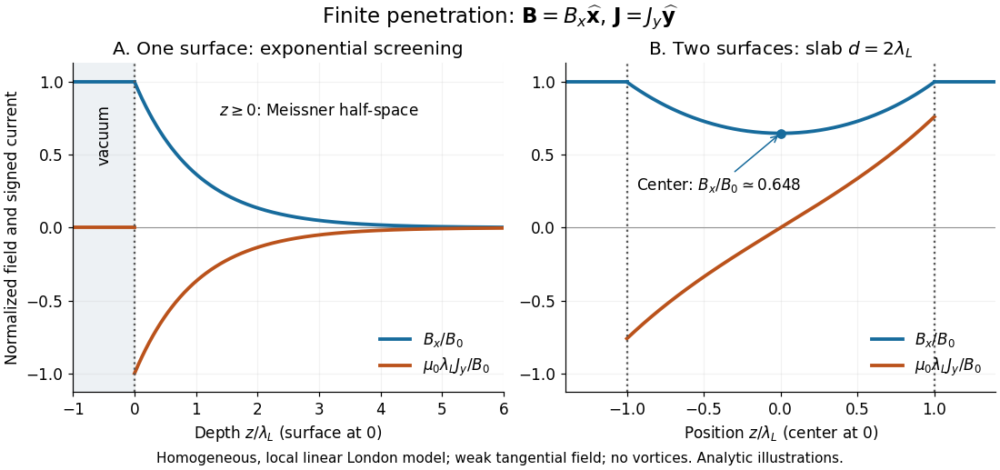

# Planar London screening

↑ **Parent:** [Meissner state](meissner-state.md)

Take a homogeneous material exhibiting [superconductivity](superconductivity.md) in the [half-space](half-space.md) $z\geq0$, bounded by vacuum at $z=0$. Fix the [temperature](temperature.md) below the [superconducting transition temperature](superconducting-transition-temperature.md), take a constant positive [London penetration depth](london-penetration-depth.md) $\lambda_L$, and assume a local, linear [London equation](london-equations.md) description in a [Meissner state](meissner-state.md). The applied [magnetic field](magnetic-field.md) is weak enough that it neither nucleates a [quantum vortex](quantum-vortex.md) nor appreciably suppresses the material's [superconductivity](superconductivity.md). Assume translation invariance in $x,y$, no imposed transport [electric current](electric-current.md), and a tangential boundary [magnetic field](magnetic-field.md) $\mathbf B(0)=B_0\widehat{\mathbf x}$. Here $B_0$ is the local surface [magnetic flux density](magnetic-field.md), equal to the imposed vacuum [magnetic field](magnetic-field.md) in this infinite planar geometry; it is not automatically the far-away applied value for a finite object.

For a bounded, decaying interior solution, the [London equations](london-equations.md), [magnetostatic Ampère law](magnetostatic-ampere-law.md) and [Gauss's law for magnetism](gauss-s-law-for-magnetism.md) give

$$
\nabla^2\mathbf B=\frac{\mathbf B}{\lambda_L^2},\qquad
\frac{d^2B_x}{dz^2}=\frac{B_x}{\lambda_L^2},\qquad
B_x(0)=B_0,\quad B_x(\infty)=0.
$$

The solution is

$$
\mathbf B(z)=B_0e^{-z/\lambda_L}\widehat{\mathbf x}.
$$

At one [London penetration depth](london-penetration-depth.md) the [magnetic field](magnetic-field.md) is $e^{-1}\simeq0.368$ of its surface value; at five it is $e^{-5}\simeq0.00674$. There is no finite depth where this exponential is exactly zero. The [differential equation](differential-equation-split.md) excludes the growing exponential through the deep-interior boundary condition. A constant normal component cannot decay in this geometry: [Gauss's law for magnetism](gauss-s-law-for-magnetism.md) would require $\partial_zB_z=0$. A perpendicular applied [magnetic field](magnetic-field.md) on a finite plate therefore requires a different spatial problem.[§2, p. 13, Eqs. (68)–(74): London screening equation; the planar boundary-value solution here follows directly](lecture-notes-on-the-electrodynamics-of-metals-and-superconductors.md)

**[Figure 34](#image-magnetic-field-and-signed-meissner-screening-current-profiles-with-finite-london-penetration-depth). Magnetic field and signed Meissner screening current profiles with finite London penetration depth**. Original analytic profiles, not measured data. Left: the [Planar London screening](planar-london-screening.md) solution, with vacuum at $z<0$ and the material at $z\geq0$. Right: [Finite-thickness Meissner screening](finite-thickness-meissner-screening.md) in a slab of thickness $2\lambda_L$, with equal tangential surface [magnetic fields](magnetic-field.md). Blue is $B_x/B_0$; orange is the signed [current density](current-density.md) $\mu_0\lambda_LJ_y/B_0$. Different horizontal origins are labeled explicitly.

**Table of contents**

- [Meissner screening current](meissner-screening-current.md)

## ↑ Ancestors (8)

1. [Meissner state](meissner-state.md)
2. [Meissner effect](meissner-effect.md)
3. [London equations](london-equations.md)
4. [Magnetic field](magnetic-field.md)
5. [Electromagnetism](electromagnetism-split.md)
6. [Branches of physics](branches-of-physics.md)
7. [Physics](physics-split.md)
8. [Codex Wiki](split.md)

## ← Incoming links (3)

- [Limits of Meissner screening](limits-of-meissner-screening.md)
- [Meissner screening current](meissner-screening-current.md)
- [Planar London screening](planar-london-screening.md)
