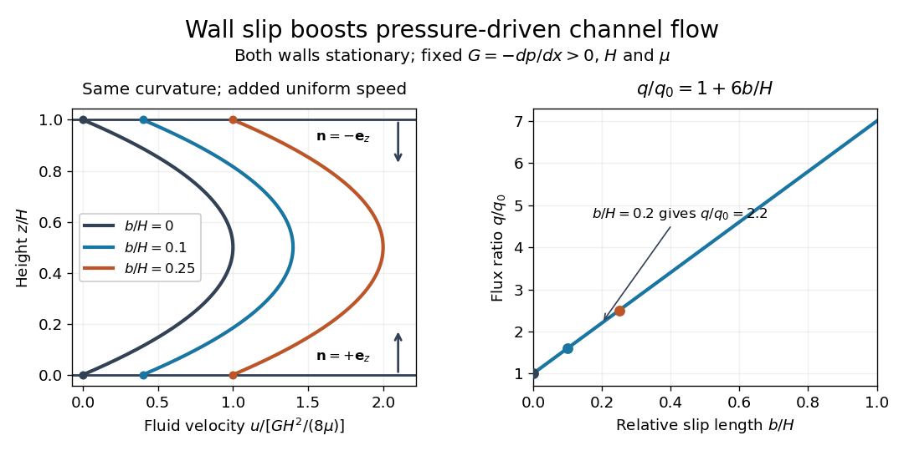

# Planar Poiseuille flow with equal wall slip

↑ **Parent:** [Slip length](slip-length.md)

Now both plates at $z=0$ and $z=H$ are stationary and both obey the [Navier slip boundary condition](navier-slip-boundary-condition.md) with the same [slip length](slip-length.md) $b$. Drive [steady flow](steady-flow.md) of a [Newtonian fluid](newtonian-fluid.md) in [incompressible flow](incompressible-flow.md) by the constant [pressure gradient](pressure-gradient.md) $G=-dp/dx>0$, with constant [dynamic viscosity](dynamic-viscosity.md) $\mu>0$ and no other streamwise body [force](force.md). The planar [Poiseuille flow](hagen-poiseuille-equation.md) profile and its [volumetric flow rate](volumetric-flow-rate.md) per unit width are

$$
u(z)=\frac{G}{2\mu}\left[z(H-z)+bH\right],\qquad
q=\int_0^H u(z)\,dz
=\frac{GH^3}{12\mu}\left(1+\frac{6b}{H}\right).
$$

The full [volumetric flow rate](volumetric-flow-rate.md) for channel width $W$ is $Q=Wq$ when side-wall effects are negligible. Thus $q$ has units $\mathrm{m^2\,s^{-1}}$, while $Q$ has units $\mathrm{m^3\,s^{-1}}$. Denote the value at $b=0$ by $q_0=GH^3/(12\mu)$.

The two wall checks expose the normal signs:

$$
u'(z)=\frac{G}{2\mu}(H-2z),\qquad
u(0)=u(H)=\frac{GbH}{2\mu},
$$

$$
bu'(0)=\frac{GbH}{2\mu}=u(0),\qquad
-bu'(H)=\frac{GbH}{2\mu}=u(H).
$$

Both [Navier slip boundary conditions](navier-slip-boundary-condition.md) therefore hold exactly. The two walls exert backward tangential [tractions](traction.md) of magnitude $GH/2$ on the [fluid](fluid.md). Increasing $b$ at fixed $G$ adds a uniform [velocity](velocity.md) offset, leaving the [velocity gradient](velocity-gradient.md) and wall [shear stress](shear-stress.md) unchanged. This differs from [Couette flow with a slipping lower wall](couette-flow-with-a-slipping-lower-wall.md), where upper-wall [velocity](velocity.md) is fixed and [shear stress](shear-stress.md) decreases.

For $H=10\,\mathrm{\mu m}$, $b=2\,\mathrm{\mu m}$, $G=10^3\,\mathrm{Pa\,m^{-1}}$ and $\mu=10^{-3}\,\mathrm{Pa\,s}$, the wall [velocity](velocity.md) is $10\,\mathrm{\mu m\,s^{-1}}$, the centre [velocity](velocity.md) is $22.5\,\mathrm{\mu m\,s^{-1}}$, and $q=1.83\times10^{-10}\,\mathrm{m^2\,s^{-1}}$. The enhancement is $q/q_0=2.2$. Equivalently, a prescribed [volumetric flow rate](volumetric-flow-rate.md) needs only $1/2.2$ of the original [pressure gradient](pressure-gradient.md). This makes [slip length](slip-length.md) useful for estimating pumping requirements in small channels.

**[Figure 8](#image-equal-slip-at-both-channel-walls-increases-pressure-driven-flow). Equal slip at both channel walls increases pressure-driven flow**. Both walls are stationary and obey the [Navier slip boundary condition](navier-slip-boundary-condition.md). Left: normalized planar [Poiseuille flow](hagen-poiseuille-equation.md) profiles at fixed [pressure gradient](pressure-gradient.md) $G$, gap $H$ and [dynamic viscosity](dynamic-viscosity.md) $\mu$ for $b/H=0$, $0.10$ and $0.25$. Arrows show inward [unit normals](unit-normal.md) in opposite directions at the two walls. Right: [volumetric flow rate](volumetric-flow-rate.md) per unit width increases by the factor $1+6b/H$ at fixed $G$.

At fixed $H$, $G>0$ and $\mu$, $b\to0$ recovers ordinary planar [Poiseuille flow](hagen-poiseuille-equation.md). As $b\to\infty$, the [velocity](velocity.md) and $q$ grow without bound in this model, although the varying part of the profile stays the same. At exactly zero tangential wall [traction](traction.md), no steady solution can balance this nonzero [pressure gradient](pressure-gradient.md): $u'(0)=u'(H)=0$ conflicts with $\mu[u'(H)-u'(0)]=-GH$. Unlimited enhancement is consequently not a prediction for a real channel; finite wall friction, finite driving capacity and the validity of the assumed [steady flow](steady-flow.md) must be assessed. At fixed finite $q$ instead, $G\to0$ and the profile approaches uniform [velocity](velocity.md) $q/H$.

A short derivation integrates the reduced [Navier-Stokes equation](navier-stokes-equation.md) $\mu u''=-G$ twice. Equal [slip lengths](slip-length.md) and the opposite inward [unit normals](unit-normal.md) give $u=G[z(H-z)+bH]/(2\mu)$. Its [integral](integral.md) over the gap supplies the enhancement factor $1+6b/H$.

## ↑ Ancestors (6)

1. [Slip length](slip-length.md)
2. [Navier slip boundary condition](navier-slip-boundary-condition.md)
3. [Fluid mechanics](fluid-mechanics-split.md)
4. [Branches of physics](branches-of-physics.md)
5. [Physics](physics-split.md)
6. [Codex Wiki](split.md)

## ← Incoming links (2)

- [Navier slip boundary condition](navier-slip-boundary-condition.md)
- [Wall friction in the Navier slip boundary condition](wall-friction-in-the-navier-slip-boundary-condition.md)
