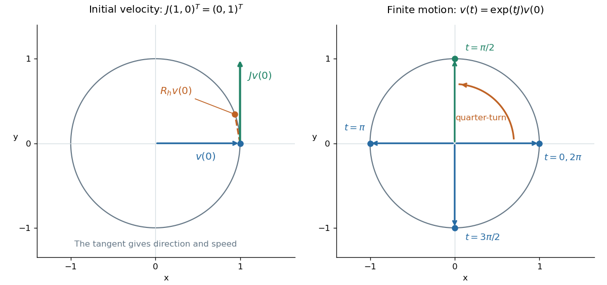

# Planar rotation as a one-parameter subgroup

↑ **Parent:** [One-parameter subgroup](one-parameter-subgroup.md)

Differentiate the planar [rotation matrix](rotation-matrix.md) at angle zero:

$$
J=\left.\frac{dR_\theta}{d\theta}\right|_{\theta=0}=\begin{pmatrix}0&-1\\1&0\end{pmatrix},\qquad J^2=-I.
$$

The even and odd powers in the [matrix exponential](matrix-exponential.md) therefore give

$$
\exp(\theta J)=\sum_{n=0}^\infty\frac{\theta^nJ^n}{n!}=\cos\theta\,I+\sin\theta\,J=R_\theta.
$$

This exact formula gives the whole [one-parameter subgroup](one-parameter-subgroup.md). Taking $X=J$ means unit [angular velocity](angular-velocity.md): at $t=\pi/2$, $\exp(tJ)=J$ sends $(1,0)^T$ to $(0,1)^T$, a counterclockwise quarter-turn. At $t=\pi$, it equals $-I$; at $t=2\pi$, it returns to $I$. Choosing $X=2J$ reaches the quarter-turn at $t=\pi/4$. Changing the generator changes the speed, while preserving the circular path.

**[Figure 1](#image-the-generator-j-gives-a-tangent-velocity-while-its-exponential-gives-finite-rotations). The generator J gives a tangent velocity, while its exponential gives finite rotations**.

For a moving [vector](vector.md) $v(t)=R_t v(0)$, the [ordinary differential equation](ordinary-differential-equation.md) $v'(t)=Jv(t)$ says its velocity is perpendicular to its position. The beautiful compression is that one constant [matrix](matrix.md) specifies every angle of this endless family of [rotations](rotation-mathematics.md).

## ↑ Ancestors (8)

1. [One-parameter subgroup](one-parameter-subgroup.md)
2. [Lie group](lie-group.md)
3. [Lie theory](lie-theory-split.md)
4. [Diagonal dominance](diagonal-dominance.md)
5. [Algebra](algebra-split.md)
6. [Area of mathematics](area-of-mathematics.md)
7. [Mathematics](mathematics-split.md)
8. [Codex Wiki](split.md)
