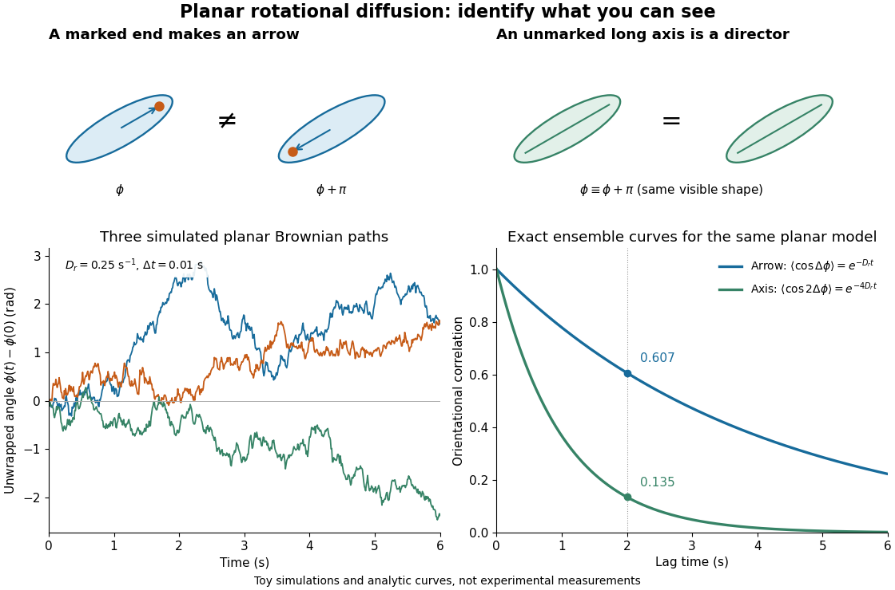

# Planar rotational diffusion

↑ **Parent:** [Rotational diffusion](rotational-diffusion.md)

For free planar turning with constant $D_r$, no imposed [torque](torque.md) and negligible [inertia](inertia.md), model an unwrapped [angle](angle.md) by the [stochastic differential equation](stochastic-differential-equation.md)

$$
d\phi=\sqrt{2D_r}\,dW,\qquad
\Delta\phi=\phi(t)-\phi(0),\qquad
\langle\Delta\phi\rangle=0,\qquad
\langle(\Delta\phi)^2\rangle=2D_rt.
$$

Here $W$ is standard one-dimensional [Brownian motion](brownian-motion-split.md), with increment [variance](variance-split.md) $dt$, and brackets denote [expected values](expected-value-split.md) over repeated realizations. The angular [variance](variance-split.md) is conventionally reported in $\mathrm{rad^2}$. “Unwrapped” means recording accumulated turns continuously, rather than resetting the [angle](angle.md) at each revolution. Directly subtracting wrapped camera angles creates artificial jumps; for an unmarked [ellipsoid](ellipsoid.md) the wrapping period is $\pi$, and resolving successive turns additionally requires sufficiently frequent images.

For a planar arrow $\mathbf u=(\cos\phi,\sin\phi)$, the orientational [autocorrelation](autocorrelation.md) is

$$
C_{\rm arrow}(t)=\langle\mathbf u(t)\cdot\mathbf u(0)\rangle
=\langle\cos\Delta\phi\rangle=e^{-D_rt}.
$$

For an unoriented planar axis, use an [autocorrelation](autocorrelation.md) unchanged by replacing either endpoint [angle](angle.md) by that [angle](angle.md) plus $\pi$:

$$
C_{\rm axis}(t)=\langle\cos(2\Delta\phi)\rangle=e^{-4D_rt}.
$$

The same $D_r$ thus gives arrow and axis [correlation times](correlation-time.md) $1/D_r$ and $1/(4D_r)$, respectively, where a [correlation time](correlation-time.md) here is the lag at which the relevant curve reaches $1/e$. A short explanation is enough: $\Delta\phi$ has a [Gaussian distribution](normal-distribution.md) of [variance](variance-split.md) $2D_rt$, so its [characteristic function](characteristic-function-split.md) gives $\langle\cos(n\Delta\phi)\rangle=e^{-n^2D_rt}$. The integer $n$ selects what the observable can distinguish; it does not change the underlying angular spreading.

For an original numerical example, choose $D_r=0.25\,\mathrm{s^{-1}}$. After $2\,\mathrm s$, the angular [variance](variance-split.md) is $1\,\mathrm{rad^2}$ and its [root mean square](root-mean-square.md) displacement is $1\,\mathrm{rad}$, although the mean displacement is zero. The planar arrow [autocorrelation](autocorrelation.md) is $e^{-0.5}\simeq0.607$, while the planar axis [autocorrelation](autocorrelation.md) is $e^{-2}\simeq0.135$. Calling both “the orientation correlation” without specifying the observable would hide a factor of four in decay rate.

**[Figure 17](#image-planar-rotational-diffusion-arrows-unoriented-axes-and-loss-of-angular-memory). Planar rotational diffusion: arrows, unoriented axes and loss of angular memory**. Original schematics, three simulated [Brownian motion](brownian-motion-split.md) angle paths and exact ensemble [autocorrelation](autocorrelation.md) curves for the chosen $D_r=0.25\,\mathrm{s^{-1}}$. The paths use independent [Gaussian distribution](normal-distribution.md) increments of [variance](variance-split.md) $2D_r\Delta t$ with $\Delta t=0.01\,\mathrm s$. The curves are model predictions, not fits to these three paths or experimental measurements. Both curves concern planar turning; neither is the three-dimensional unit-vector law.

## ↑ Ancestors (7)

1. [Rotational diffusion](rotational-diffusion.md)
2. [Diffusion](diffusion.md)
3. [Thermodynamics](thermodynamics-split.md)
4. [Statistical physics](statistical-physics-split.md)
5. [Branches of physics](branches-of-physics.md)
6. [Physics](physics-split.md)
7. [Codex Wiki](split.md)

## ← Incoming links (1)

- [Isotropic rotational diffusion in three dimensions](isotropic-rotational-diffusion-in-three-dimensions.md)
