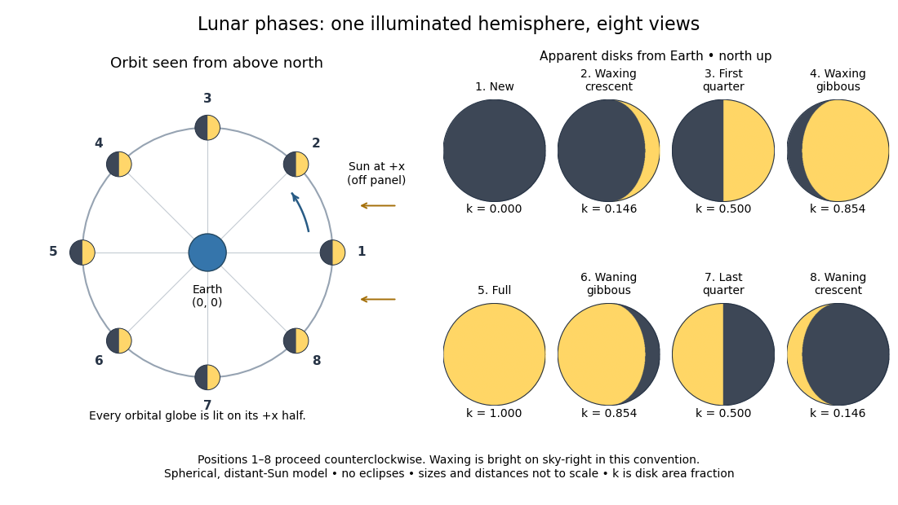
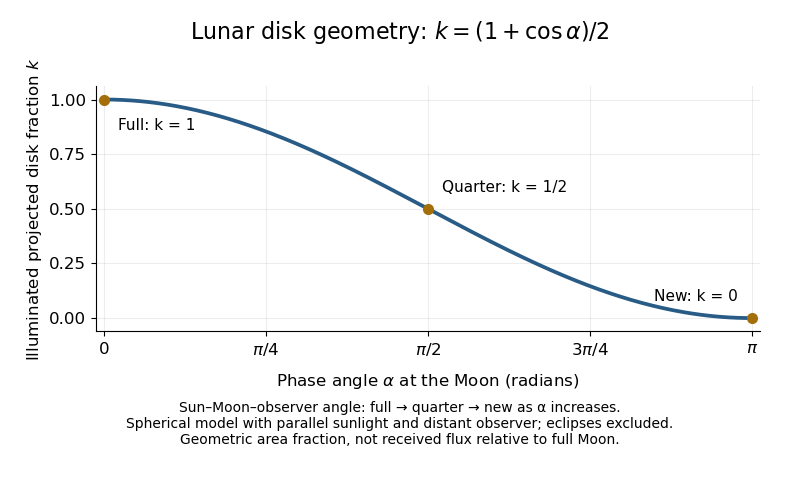
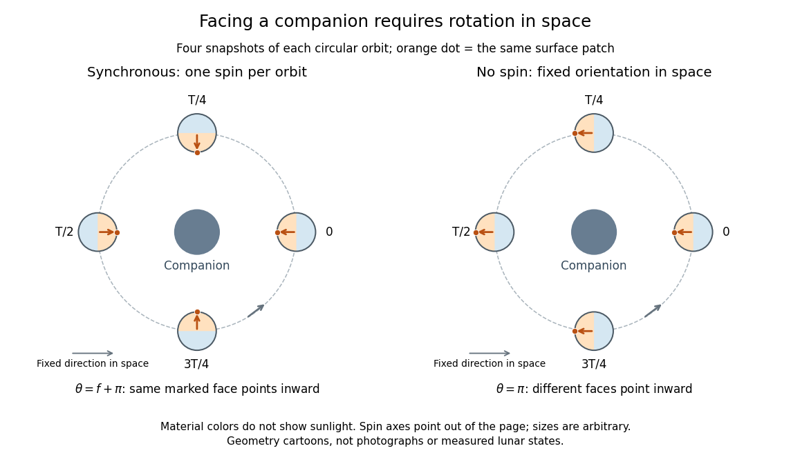

# Planetary science

↑ **Parent:** [Astrophysics](astrophysics.md)  
ⓦ [Wiki](https://en.wikipedia.org/wiki/Planetary_science)

Planetary science studies planets, moons, small bodies, planetary systems, and the processes that form and evolve them.

**Table of contents**

- [Magnetosphere](#magnetosphere)
  - [Induced magnetosphere](#induced-magnetosphere)
- [Planetary magnetic field](#planetary-magnetic-field)
  - [Planetary dynamo](#planetary-dynamo)
    - [Geodynamo](#geodynamo)
    - [Geomagnetic reversal](#geomagnetic-reversal)
- [Asteroid](#asteroid)
- [Astronomical unit](#astronomical-unit)
- [Planet formation](#planet-formation)
  - [Gravitational collapse of a settled particle layer](#gravitational-collapse-of-a-settled-particle-layer)
  - [Planetary embryo](#planetary-embryo)
  - [Protoplanetary dust coagulation](#protoplanetary-dust-coagulation)
    - [Fragmentation barrier to dust growth](#fragmentation-barrier-to-dust-growth)
  - [Core accretion](#core-accretion)
    - [Cooling-controlled planetary envelope growth](#cooling-controlled-planetary-envelope-growth)
      - [Gas recycling through a planetary envelope](#gas-recycling-through-a-planetary-envelope)
    - [Runaway gas accretion](#runaway-gas-accretion)
      - [Envelope crossover in core accretion](#envelope-crossover-in-core-accretion)
    - [Critical core mass for gas accretion](#critical-core-mass-for-gas-accretion)
    - [Oligarchic growth](#oligarchic-growth)
      - [Feeding zone of a planetary embryo](#feeding-zone-of-a-planetary-embryo)
        - [Isolation mass](#isolation-mass)
      - [Viscous stirring of planetesimals](#viscous-stirring-of-planetesimals)
    - [Runaway planetesimal growth](#runaway-planetesimal-growth)
    - [Pebble accretion](#pebble-accretion)
  - [Minimum-mass solar nebula](#minimum-mass-solar-nebula)
  - [Hot and cold starts of a giant planet](#hot-and-cold-starts-of-a-giant-planet)
- [Comet](#comet)
  - [Comet tail](#comet-tail)
    - [Cometary dust tail](#cometary-dust-tail)
  - [Phase-mixed comet surface density](#phase-mixed-comet-surface-density)
- [Planet](#planet)
  - [Mercury (planet)](#mercury-planet)
  - [Terrestrial planet](#terrestrial-planet)
  - [Ice giant](#ice-giant)
  - [Gas giant](#gas-giant)
  - [Venus](#venus)
  - [Neptune](#neptune)
  - [Earth](#earth)
    - [Earth mantle](#earth-mantle)
      - [Mantle viscosity](#mantle-viscosity)
        - [Postseismic relaxation](#postseismic-relaxation)
    - [Earth crust](#earth-crust)
    - [Geology](#geology)
      - [Geochemistry](#geochemistry)
        - [Geochemist](#geochemist)
          - [Stephane Gin](#stephane-gin)
            - [Work by Stephane Gin](#work-by-stephane-gin)
          - [G. R. Lumpkin](#g-r-lumpkin)
            - [Work by G. R. Lumpkin](#work-by-g-r-lumpkin)
          - [A. E. Ringwood](#a-e-ringwood)
            - [Work by A. E. Ringwood](#work-by-a-e-ringwood)
      - [Mineralogy](#mineralogy)
        - [Mineral](#mineral)
          - [Silicate mineral](#silicate-mineral)
          - [Brannerite](#brannerite)
          - [Zirconolite](#zirconolite)
            - [Zirconolite-4M](#zirconolite-4m)
            - [Zirconolite-2M](#zirconolite-2m)
      - [Sediment](#sediment)
      - [Continental drift](#continental-drift)
        - [Gondwana](#gondwana)
      - [Geological time scale](#geological-time-scale)
        - [Cretaceous–Palaeogene boundary](#cretaceous-palaeogene-boundary)
        - [Cenozoic](#cenozoic)
          - [Quaternary](#quaternary)
            - [Holocene](#holocene)
            - [Pleistocene](#pleistocene)
          - [Neogene](#neogene)
            - [Pliocene](#pliocene)
            - [Miocene](#miocene)
          - [Palaeogene](#palaeogene)
            - [Eocene](#eocene)
            - [Paleocene](#paleocene)
        - [Mesozoic](#mesozoic)
          - [Cretaceous](#cretaceous)
          - [Jurassic](#jurassic)
          - [Triassic](#triassic)
    - [Earth's rotation](#earth-s-rotation)
    - [Earth's outer core](#earth-s-outer-core)
    - [Terrestrial atmosphere](#terrestrial-atmosphere)
      - [Radiative-convective structure of the terrestrial atmosphere](#radiative-convective-structure-of-the-terrestrial-atmosphere)
      - [Thermosphere](#thermosphere)
      - [Mesosphere](#mesosphere)
      - [Stratosphere](#stratosphere)
        - [Stratosphere-troposphere exchange](#stratosphere-troposphere-exchange)
        - [Brewer-Dobson circulation](#brewer-dobson-circulation)
        - [Stratospheric polar vortex](#stratospheric-polar-vortex)
        - [Stratospheric cooling by carbon dioxide](#stratospheric-cooling-by-carbon-dioxide)
        - [Polar stratospheric cloud](#polar-stratospheric-cloud)
          - [Stratospheric denitrification](#stratospheric-denitrification)
          - [Stratospheric chlorine activation](#stratospheric-chlorine-activation)
      - [Troposphere](#troposphere)
        - [Free troposphere](#free-troposphere)
        - [Atmospheric boundary layer](#atmospheric-boundary-layer)
          - [Marine atmospheric boundary layer](#marine-atmospheric-boundary-layer)
        - [Planetary boundary layer](#planetary-boundary-layer)
  - [Jupiter](#jupiter)
    - [Jupiter mass](#jupiter-mass)
  - [Rogue planet](#rogue-planet)
- [Natural satellite](#natural-satellite)
  - [Moon](#moon)
    - [Near side of the Moon](#near-side-of-the-moon)
    - [Far side of the Moon](#far-side-of-the-moon)
    - [Lunar phase](#lunar-phase)
      - [Phase angle (astronomy)](#phase-angle-astronomy)
      - [Elongation (astronomy)](#elongation-astronomy)
      - [Lunar illuminated fraction](#lunar-illuminated-fraction)
      - [Sidereal month](#sidereal-month)
      - [Synodic month](#synodic-month)
      - [Aristarchus of Samos](#aristarchus-of-samos)
    - [Lunar eclipse](#lunar-eclipse)
    - [Libration](#libration)
- [Planetary system dynamics](#planetary-system-dynamics)
  - [Dynamical friction](#dynamical-friction)
  - [Orbit crossing](#orbit-crossing)
    - [Differential secular orbit-crossing criterion](#differential-secular-orbit-crossing-criterion)
  - [Isotropic stellar mass loss](#isotropic-stellar-mass-loss)
    - [Adiabatic orbital expansion under isotropic mass loss](#adiabatic-orbital-expansion-under-isotropic-mass-loss)
      - [Adiabatic apsidal condition](#adiabatic-apsidal-condition)
    - [Osculating-element evolution under isotropic mass loss](#osculating-element-evolution-under-isotropic-mass-loss)
  - [Yarkovsky effect](#yarkovsky-effect)
    - [Yarkovsky removal](#yarkovsky-removal)
      - [External population supplied by belt removal](#external-population-supplied-by-belt-removal)
      - [Critical belt mass for Yarkovsky removal](#critical-belt-mass-for-yarkovsky-removal)
      - [Minimum Yarkovsky removal time](#minimum-yarkovsky-removal-time)
  - [Stellar flyby](#stellar-flyby)
  - [Planetary migration](#planetary-migration)
    - [Type I migration](#type-i-migration)
      - [Planetary thermal mass](#planetary-thermal-mass)
      - [Type I migration timescale from disk torque](#type-i-migration-timescale-from-disk-torque)
      - [Planet trap](#planet-trap)
      - [Corotation torque](#corotation-torque)
        - [Corotation-torque saturation](#corotation-torque-saturation)
        - [Entropy-related corotation torque](#entropy-related-corotation-torque)
        - [Horseshoe orbit in a planetary disk](#horseshoe-orbit-in-a-planetary-disk)
      - [Lindblad resonance](#lindblad-resonance)
    - [Gap opening by a planet](#gap-opening-by-a-planet)
    - [Circular-orbit migration rate from disk torque](#circular-orbit-migration-rate-from-disk-torque)
    - [Stellar obliquity](#stellar-obliquity)
      - [Rossiter-McLaughlin effect](#rossiter-mclaughlin-effect)
  - [Tidal locking](#tidal-locking)
    - [Tidal deformation](#tidal-deformation)
    - [Secular tidal torque](#secular-tidal-torque)
    - [Spin-orbit resonance](#spin-orbit-resonance)
    - [Synchronous rotation](#synchronous-rotation)
      - [Facing geometry of synchronous rotation](#facing-geometry-of-synchronous-rotation)
      - [Illumination of a synchronously rotating moon](#illumination-of-a-synchronously-rotating-moon)
  - [Tidal heating](#tidal-heating)
    - [Tidal dissipation](#tidal-dissipation)
  - [Conjunction (astronomy)](#conjunction-astronomy)
    - [Conjunction longitude from a transit time lag](#conjunction-longitude-from-a-transit-time-lag)
  - [Keplerian shear](#keplerian-shear)
  - [Phase mixing](#phase-mixing)
  - [Planetesimal](#planetesimal)
    - [Planetesimal collision rate](#planetesimal-collision-rate)
    - [Specific impact energy](#specific-impact-energy)
    - [Binary planetesimal](#binary-planetesimal)
      - [Gas drag on a planetesimal binary](#gas-drag-on-a-planetesimal-binary)
        - [Gas-driven contraction of a planetesimal binary](#gas-driven-contraction-of-a-planetesimal-binary)
        - [Gas-driven migration of a binary centre of mass](#gas-driven-migration-of-a-binary-centre-of-mass)
  - [Tisserand parameter](#tisserand-parameter)
    - [Tisserand periapsis bound](#tisserand-periapsis-bound)
    - [Planet-encounter relative velocity](#planet-encounter-relative-velocity)
  - [Disturbing function](#disturbing-function)
    - [Stellar quadrupole disturbing function](#stellar-quadrupole-disturbing-function)
      - [Double-averaged circular tidal potential](#double-averaged-circular-tidal-potential)
    - [Lagrange planetary equations](#lagrange-planetary-equations)
      - [Eccentricity and semimajor-axis invariant of a truncated resonance](#eccentricity-and-semimajor-axis-invariant-of-a-truncated-resonance)
      - [Mean-longitude equation for a first-order resonant term](#mean-longitude-equation-for-a-first-order-resonant-term)
      - [Gauss planetary equation for the semi-major axis](#gauss-planetary-equation-for-the-semi-major-axis)
    - [Direct disturbing function](#direct-disturbing-function)
    - [Indirect disturbing function](#indirect-disturbing-function)
    - [D'Alembert characteristic](#d-alembert-characteristic)
    - [Laplace coefficient](#laplace-coefficient)
    - [Short-period orbital perturbation](#short-period-orbital-perturbation)
    - [Resonant orbital perturbation](#resonant-orbital-perturbation)
    - [Secular perturbation](#secular-perturbation)
      - [Orbit averaging](#orbit-averaging)
      - [Angular momentum deficit](#angular-momentum-deficit)
      - [Proper eccentricity](#proper-eccentricity)
        - [Proper longitude of periapsis](#proper-longitude-of-periapsis)
      - [Laplace-Lagrange secular theory](#laplace-lagrange-secular-theory)
        - [Secular forcing by a distant outer planet](#secular-forcing-by-a-distant-outer-planet)
        - [Secular forcing of a test particle](#secular-forcing-of-a-test-particle)
          - [Secular phase integral for proportional mass growth](#secular-phase-integral-for-proportional-mass-growth)
        - [Laplace-Lagrange secular matrix](#laplace-lagrange-secular-matrix)
        - [Complex eccentricity](#complex-eccentricity)
          - [Forced eccentricity circle](#forced-eccentricity-circle)
        - [Secular eigenmode](#secular-eigenmode)
          - [Secular eigenmode amplitude product](#secular-eigenmode-amplitude-product)
        - [Complex inclination](#complex-inclination)
          - [Forced inclination](#forced-inclination)
          - [Laplace-Lagrange inclination matrix](#laplace-lagrange-inclination-matrix)
            - [Rigid inner pair in hierarchical secular inclination dynamics](#rigid-inner-pair-in-hierarchical-secular-inclination-dynamics)
      - [Forced eccentricity](#forced-eccentricity)
        - [Secular resonance](#secular-resonance)
          - [Sweeping secular resonance](#sweeping-secular-resonance)
      - [Eccentricity damping](#eccentricity-damping)
        - [Damping of coupled secular eigenmodes](#damping-of-coupled-secular-eigenmodes)
      - [Secular torque](#secular-torque)
      - [Quadrupole approximation](#quadrupole-approximation)
        - [Quadrupole potential of a circular binary](#quadrupole-potential-of-a-circular-binary)
          - [Circumbinary orbital-period correction](#circumbinary-orbital-period-correction)
      - [Nodal precession](#nodal-precession)
        - [Differential nodal precession](#differential-nodal-precession)
          - [Planet-induced debris-disk warp](#planet-induced-debris-disk-warp)
        - [Laplace plane](#laplace-plane)
          - [Laplace radius](#laplace-radius)
      - [Apsidal precession](#apsidal-precession)
      - [Kozai–Lidov mechanism](#kozai-lidov-mechanism)
  - [Planetary scattering](#planetary-scattering)
    - [Angular-momentum kicks to nearly radial orbits](#angular-momentum-kicks-to-nearly-radial-orbits)
    - [Comet energy diffusion](#comet-energy-diffusion)
      - [Finite-age planetary scattering regimes](#finite-age-planetary-scattering-regimes)
    - [Safronov number](#safronov-number)
    - [Planetary ejection of a comet](#planetary-ejection-of-a-comet)
      - [Single-encounter escape velocity bound](#single-encounter-escape-velocity-bound)
      - [Collision-ejection lifetime of a comet](#collision-ejection-lifetime-of-a-comet)
    - [Coplanar comet collision time](#coplanar-comet-collision-time)
      - [Inclined comet collision time](#inclined-comet-collision-time)
- [Debris disk](#debris-disk)
  - [Eccentric debris ring](#eccentric-debris-ring)
    - [Surface density contrast in an eccentric ring](#surface-density-contrast-in-an-eccentric-ring)
    - [Aligned eccentric ring](#aligned-eccentric-ring)
    - [Proper-eccentricity annulus](#proper-eccentricity-annulus)
  - [Dust halo](#dust-halo)
  - [Dust birth ring](#dust-birth-ring)
  - [Fractional luminosity of a debris disk](#fractional-luminosity-of-a-debris-disk)
    - [Fractional luminosity of a phase-mixed eccentric wire](#fractional-luminosity-of-a-phase-mixed-eccentric-wire)
  - [Dust clump](#dust-clump)
  - [Collisional cascade](#collisional-cascade)
    - [Two-size fragmentation cascade](#two-size-fragmentation-cascade)
    - [Collisional age after uniform dynamical depletion](#collisional-age-after-uniform-dynamical-depletion)
    - [Collisional-cascade relaxation time](#collisional-cascade-relaxation-time)
    - [Strength-dependent steady collisional-cascade slope](#strength-dependent-steady-collisional-cascade-slope)
    - [Depletion feedback on a collision timescale](#depletion-feedback-on-a-collision-timescale)
      - [Secondary cascade below a removal band](#secondary-cascade-below-a-removal-band)
    - [Fragment redistribution function](#fragment-redistribution-function)
      - [Removal-dominated fragment size distribution](#removal-dominated-fragment-size-distribution)
    - [Constant mass flux in a collisional cascade](#constant-mass-flux-in-a-collisional-cascade)
    - [Power-law size distribution](#power-law-size-distribution)
      - [Mass per logarithmic size bin](#mass-per-logarithmic-size-bin)
      - [Cross-section of a power-law fragment population](#cross-section-of-a-power-law-fragment-population)
        - [Parent-body size from a fragment cross-section](#parent-body-size-from-a-fragment-cross-section)
      - [Mass normalization of a power-law size distribution](#mass-normalization-of-a-power-law-size-distribution)
    - [Velocity-dependent collisional cascade](#velocity-dependent-collisional-cascade)
    - [Dohnanyi collisional cascade](#dohnanyi-collisional-cascade)
    - [Catastrophic disruption threshold](#catastrophic-disruption-threshold)
      - [Strength-gravity disruption transition](#strength-gravity-disruption-transition)
      - [Catastrophic projectile diameter](#catastrophic-projectile-diameter)
      - [Rubblising collision](#rubblising-collision)
        - [Rubblising-to-dispersal collision-rate ratio](#rubblising-to-dispersal-collision-rate-ratio)
      - [Catastrophic planetesimal collision](#catastrophic-planetesimal-collision)
        - [Collision disruption radius under secular stirring](#collision-disruption-radius-under-secular-stirring)
        - [Catastrophic planetesimal collision rate](#catastrophic-planetesimal-collision-rate)
        - [Catastrophic collision mass-loss timescale](#catastrophic-collision-mass-loss-timescale)
    - [Cratering collision](#cratering-collision)
- [Interplanetary dust](#interplanetary-dust)
  - [Dust tail](#dust-tail)
    - [Steady dust-tail continuity equation](#steady-dust-tail-continuity-equation)
      - [Dust-tail caustic](#dust-tail-caustic)
    - [Dust-tail angular lag](#dust-tail-angular-lag)
      - [Secular phase approximation for a dust tail](#secular-phase-approximation-for-a-dust-tail)
  - [Radiation-pressure coefficient](#radiation-pressure-coefficient)
    - [Dust orbit released from a circular parent ring](#dust-orbit-released-from-a-circular-parent-ring)
    - [Radiation-pressure efficiency](#radiation-pressure-efficiency)
    - [Radiation-pressure blowout orbit](#radiation-pressure-blowout-orbit)
      - [Radiation-pressure blowout threshold](#radiation-pressure-blowout-threshold)
  - [Finson–Probstein model](#finson-probstein-model)
    - [Synchrone](#synchrone)
    - [Syndyne](#syndyne)
  - [Steady radial dust outflow](#steady-radial-dust-outflow)
  - [Poynting–Robertson drag](#poynting-robertson-drag)
    - [Burst transport under inverse-size radial drag](#burst-transport-under-inverse-size-radial-drag)
      - [Surface density of a size-sorted dust burst](#surface-density-of-a-size-sorted-dust-burst)
      - [Dust-burst accretion pulse](#dust-burst-accretion-pulse)
    - [Poynting–Robertson decay of a circumplanetary orbit](#poynting-robertson-decay-of-a-circumplanetary-orbit)
      - [Inspiral time of circumplanetary dust](#inspiral-time-of-circumplanetary-dust)
    - [Poynting–Robertson decay of a circumstellar orbit](#poynting-robertson-decay-of-a-circumstellar-orbit)
    - [First-order stellar radiation force on a blackbody grain](#first-order-stellar-radiation-force-on-a-blackbody-grain)
    - [Inspiral time under Poynting–Robertson drag](#inspiral-time-under-poynting-robertson-drag)
    - [Apsidal evolution under Poynting–Robertson drag](#apsidal-evolution-under-poynting-robertson-drag)
    - [Poynting–Robertson drag invariant](#poynting-robertson-drag-invariant)
  - [Stellar-wind drag](#stellar-wind-drag)
  - [Resonant trapping of dust](#resonant-trapping-of-dust)
    - [Damped first-order resonant complex eccentricity](#damped-first-order-resonant-complex-eccentricity)
      - [Fixed points of a damped first-order exterior resonance](#fixed-points-of-a-damped-first-order-exterior-resonance)
    - [Dissipative resonant eccentricity equilibrium](#dissipative-resonant-eccentricity-equilibrium)
    - [Pericentre geometry of an exterior resonance](#pericentre-geometry-of-an-exterior-resonance)

## Magnetosphere

↑ **Parent:** [Planetary science](planetary-science.md)  
ⓦ [Wiki](https://en.wikipedia.org/wiki/Magnetosphere)

A magnetosphere is the region around a body in which the body's magnetic interaction controls charged-particle motion and its response to the surrounding plasma. A planet with an intrinsic [magnetic field](magnetic-field.md) can support a compressed dayside and an extended magnetotail in the [solar wind](astrophysics.md#solar-wind). Magnetospheric currents must be distinguished from the internal field when inferring a [planetary dynamo](#planetary-dynamo).

### Induced magnetosphere

↑ **Parent:** [Magnetosphere](#magnetosphere)

An induced magnetosphere is maintained by the interaction of an external magnetized plasma flow with a conducting ionosphere or atmosphere. Its currents and draped [magnetic field](magnetic-field.md) do not establish an internal [planetary dynamo](#planetary-dynamo). [Venus](#venus) is a central example; [Mars](astrophysics.md#mars) combines this interaction with localized crustal fields.

## Planetary magnetic field

↑ **Parent:** [Planetary science](planetary-science.md)

A planetary magnetic field may include an intrinsic field maintained by an internal [planetary dynamo](#planetary-dynamo), local crustal [remanent magnetization](electromagnetism.md#remanent-magnetization), and externally driven fields associated with the [solar wind](astrophysics.md#solar-wind). Separating these components requires spatial and temporal observations. A global internally sourced field, a localized crustal anomaly, and an [induced magnetosphere](#induced-magnetosphere) are different evidence about the planet's present and past interior.

### Planetary dynamo

↑ **Parent:** [Planetary magnetic field](#planetary-magnetic-field)

A planetary dynamo maintains an intrinsic [magnetic field](magnetic-field.md) by motion of an electrically conducting fluid. The [resistive induction equation](resistive-magnetohydrodynamics.md#resistive-induction-equation) balances stretching and transport against [magnetic diffusion](magnetohydrodynamics.md#magnetic-diffusion). A sufficiently large [magnetic Reynolds number](magnetohydrodynamics.md#magnetic-reynolds-number) is necessary but does not ensure that the flow regenerates every required field component. Thermal or compositional [convection](convection.md) supplies mechanical power; rotation organizes the flow through the [Coriolis force](mathematical-physics.md#coriolis-force), and the [Lorentz force density](relativistic-electromagnetism.md#lorentz-force-density) eventually modifies the flow and limits growth. A fluid core can fail to operate a dynamo if it is stably stratified or inadequately driven.

#### Geodynamo

↑ **Parent:** [Planetary dynamo](#planetary-dynamo)

The geodynamo is the maintenance of Earth's [magnetic field](magnetic-field.md) by electrically conducting fluid motion in its liquid outer core. Rotation and buoyant [convection](convection.md) organize helical flow and permit mean-field poloidal–toroidal regeneration. A scalar homogeneous alpha model explains a mechanism and a threshold but omits spherical boundaries, [anisotropy](continuum-mechanics.md#anisotropy), spatial variations and [Lorentz force](relativistic-electromagnetism.md#lorentz-force) feedback. Reversals and saturation require dynamical or time-dependent transport information beyond a growing constant-coefficient kinematic mode.

#### Geomagnetic reversal

↑ **Parent:** [Planetary dynamo](#planetary-dynamo)  
ⓦ [Wiki](https://en.wikipedia.org/wiki/Geomagnetic_reversal)

A geomagnetic reversal changes the large-scale polarity of Earth's intrinsic [magnetic field](magnetic-field.md). Crustal [remanent magnetization](electromagnetism.md#remanent-magnetization) records past reversals. The reversal times are not a regular clock; their occurrence reflects time-dependent [dynamo action](resistive-magnetohydrodynamics.md#dynamo-action) rather than rigid rotation of a permanent magnet.

## Asteroid

↑ **Parent:** [Planetary science](planetary-science.md)  
ⓦ [Wiki](https://en.wikipedia.org/wiki/Asteroid)

An [asteroid](#asteroid) is a small rocky or metallic body orbiting a [star](stellar-astrophysics.md#star). [Asteroid](#asteroid) dynamics can involve [mean-motion resonances](celestial-mechanics.md#mean-motion-resonance), [planetary scattering](#planetary-scattering) and [secular perturbations](#secular-perturbation). Solar-system [asteroids](#asteroid) illustrate how phase protection can prevent close encounters even when orbital paths approach a [planet](#planet).

## Astronomical unit

↑ **Parent:** [Planetary science](planetary-science.md)

The astronomical unit is a length scale used for Solar System distances, approximately $1.5\times10^{13}\,\mathrm{cm}$. Coarse estimates sometimes round it to $10^{13}\,\mathrm{cm}$. Numerical coefficients in [planet formation](#planet-formation) estimates depend on which approximation is used.

## Planet formation

↑ **Parent:** [Planetary science](planetary-science.md)

### Gravitational collapse of a settled particle layer

↑ **Parent:** [Planet formation](#planet-formation)

A concentrated thin layer of solids can become self-gravitating if particle random velocities and stellar shear do not support it. [Gas](thermodynamics.md#gas) turbulence, drag and settling change both concentration and velocity dispersion. Collapse into solid planetesimals supplies seeds for [core accretion](#core-accretion) and is distinct from direct fragmentation of a gaseous disk patch.

### Planetary embryo

↑ **Parent:** [Planet formation](#planet-formation)

A growing solid protoplanet dynamically important compared with the surrounding smaller [planetesimals](#planetesimal). The term identifies a formation stage, rather than a single sharply specified [mass](classical-mechanics.md#mass).

### Protoplanetary dust coagulation

↑ **Parent:** [Planet formation](#planet-formation)

Growth of solid aggregates through collisions and sticking in a [protoplanetary disk](astrophysical-disk.md#protoplanetary-disk). Relative motion can arise from [Brownian motion](brownian-motion.md), settling, turbulence and differential radial drift. Bouncing and fragmentation can interrupt growth; collision frequency alone does not determine whether an encounter increases aggregate [mass](classical-mechanics.md#mass).

#### Fragmentation barrier to dust growth

↑ **Parent:** [Protoplanetary dust coagulation](#protoplanetary-dust-coagulation)

A regime in which collisions disrupt aggregates faster than sticking can build larger bodies. The outcome depends on collision speed, porosity and material properties; it is distinct from loss of intact aggregates through [radial drift of solids in a gas disk](astrophysical-disk.md#radial-drift-of-solids-in-a-gas-disk).

### Core accretion

↑ **Parent:** [Planet formation](#planet-formation)

Core accretion forms a planet by building a solid core through growth and accretion of solid material. A sufficiently massive core can then bind a gaseous envelope. It is distinct from direct fragmentation through [gravitational instability of an astrophysical disk](gravitational-instability-of-an-astrophysical-disk.md).

#### Cooling-controlled planetary envelope growth

↑ **Parent:** [Core accretion](#core-accretion)

Gravitational binding is necessary but not sufficient for [gas](thermodynamics.md#gas) capture. A hydrostatic envelope contracts by losing energy on a Kelvin-Helmholtz scale $t_{\rm KH}\sim|E|/L$. Solid accretion heats it, while radiative transport depends on [opacity](stellar-structure.md#opacity) and [convection](convection.md) carries energy when the radiative gradient is unstable. The disk supply and outer tidal/thermal boundaries also matter.

##### Gas recycling through a planetary envelope

↑ **Parent:** [Cooling-controlled planetary envelope growth](#cooling-controlled-planetary-envelope-growth)

#### Runaway gas accretion

↑ **Parent:** [Core accretion](#core-accretion)

Rapid envelope growth after cooling and envelope self-gravity allow gas capture to accelerate. It requires an available disk gas supply; eventually disk transport, gap formation or [protoplanetary disk dispersal](astrophysical-disk.md#protoplanetary-disk-dispersal) can limit growth. It differs from solid-body [runaway planetesimal growth](#runaway-planetesimal-growth).

##### Envelope crossover in core accretion

↑ **Parent:** [Runaway gas accretion](#runaway-gas-accretion)

The epoch when the gaseous envelope [mass](classical-mechanics.md#mass) becomes comparable with the solid core [mass](classical-mechanics.md#mass). Envelope self-[gravity](physics.md#gravity) then changes structure and can accelerate [gas](thermodynamics.md#gas) capture through cooling and contraction. Crossover is a useful stage in classical models, rather than a universal core [mass](classical-mechanics.md#mass) independent of [opacity](stellar-structure.md#opacity) and accretion history.

#### Critical core mass for gas accretion

↑ **Parent:** [Core accretion](#core-accretion)

A model-dependent threshold beyond which a cooling gaseous envelope cannot remain on a slowly growing low-mass branch around a solid core. [Opacity](stellar-structure.md#opacity), solid accretion heating, ambient disk conditions and envelope composition affect the threshold. It is not a universal constant assigning one exact mass to every gas-giant progenitor.

#### Oligarchic growth

↑ **Parent:** [Core accretion](#core-accretion)

A stage in which several neighboring [planetary embryos](#planetary-embryo) dominate stirring of surrounding [planetesimals](#planetesimal) and grow in a self-regulated manner. Larger embryos heat their feeding populations more strongly, weakening [gravitational focusing](classical-mechanics.md#gravitational-focusing) and preventing unlimited [runaway planetesimal growth](#runaway-planetesimal-growth). A small number of embryos coexist with many much smaller bodies.

##### Feeding zone of a planetary embryo

↑ **Parent:** [Oligarchic growth](#oligarchic-growth)

The region of a disk from which a [planetary embryo](#planetary-embryo) can efficiently accrete solids. Its width depends on gravitational encounters and the surrounding orbital population. Approximating that width by a multiple of the [Hill radius](celestial-mechanics.md#hill-radius) gives a useful local [isolation mass](#isolation-mass).

###### Isolation mass

↑ **Parent:** [Feeding zone of a planetary embryo](#feeding-zone-of-a-planetary-embryo)

The [mass](classical-mechanics.md#mass) reached after consuming an idealized local annulus of solids. With full annular width $\Delta a=B a[M_{\rm iso}/(3M_\star)]^{1/3}$ and solid [surface density](astrophysical-disk.md#surface-density-of-a-disk) $\Sigma_s$, the balance $M_{\rm iso}=2\pi a\Delta a\Sigma_s$ gives the displayed value. Radial replenishment, migration and embryo mergers can overcome local isolation; defining the width with a mutual rather than single-body [Hill radius](celestial-mechanics.md#hill-radius) changes the numerical coefficient.

##### Viscous stirring of planetesimals

↑ **Parent:** [Oligarchic growth](#oligarchic-growth)

Growth of planetesimal random orbital motions through gravitational encounters. The word viscous does not denote molecular fluid viscosity here. Stirring competes with gas [drag](fluid-mechanics.md#drag-physics), collisions and [dynamical friction](#dynamical-friction) in setting the encounter speeds that control [gravitational focusing](classical-mechanics.md#gravitational-focusing).

#### Runaway planetesimal growth

↑ **Parent:** [Core accretion](#core-accretion)

A growth regime in which larger [planetesimals](#planetesimal) have shorter fractional growth times. In a dispersion-dominated population with nearly mass-independent random speed and strong [gravitational focusing](classical-mechanics.md#gravitational-focusing), fixed material density gives $\dot M\propto M^{4/3}$. The displayed scaling is an illustrative limit, not a universal law once large bodies control the random velocities.

#### Pebble accretion

↑ **Parent:** [Core accretion](#core-accretion)

Capture of small drifting solids by a [planetary embryo](#planetary-embryo), aided by dissipation through gas [drag](fluid-mechanics.md#drag-physics). Its efficiency depends on the [Stokes number](fluid-mechanics.md#stokes-number), particle-layer thickness, embryo [mass](classical-mechanics.md#mass) and the supply of solids; it is not simply geometric sweeping of every passing particle.

### Minimum-mass solar nebula

↑ **Parent:** [Planet formation](#planet-formation)

The minimum-mass solar nebula estimates a primordial gas-and-solid [protoplanetary disk](astrophysical-disk.md#protoplanetary-disk) by spreading planetary material into annuli and restoring a solar mixture. A common idealized [surface density](astrophysical-disk.md#surface-density-of-a-disk) is proportional to $r^{-3/2}$. This reconstruction is a model of minimum material requirements, not a unique history of the Solar System. Extrapolating it far beyond the planetary region need not give a physically consistent disk.

### Hot and cold starts of a giant planet

↑ **Parent:** [Planet formation](#planet-formation)

Accretion releases gravitational energy. Efficient radiation at an accretion shock leaves a lower-entropy cold start, while greater retained energy gives a higher-entropy hot start; intermediate outcomes are possible. Initial entropy changes a young planet's radius, luminosity and spectrum. Consequently an [exoplanet direct imaging](exoplanet.md#exoplanet-direct-imaging) luminosity and age need not uniquely fix mass without a formation/evolution model.

## Comet

↑ **Parent:** [Planetary science](planetary-science.md)  
ⓦ [Wiki](https://en.wikipedia.org/wiki/Comet)

### Comet tail

↑ **Parent:** [Comet](#comet)  
ⓦ [Wiki](https://en.wikipedia.org/wiki/Comet_tail)

A comet tail is an extended structure formed from material released by a comet. Its dust tail is shaped largely by [radiation pressure](pressure.md#radiation-pressure), while an ion tail is shaped by the solar wind and magnetic field. The [cometary dust tail](#cometary-dust-tail) is the solid-grain component.

#### Cometary dust tail

↑ **Parent:** [Comet tail](#comet-tail)

A cometary dust tail is the extended distribution of solid grains released by a comet. [Radiation pressure](pressure.md#radiation-pressure) sorts its grains by size: high-$\beta$ grains are displaced rapidly in the anti-stellar direction, while larger low-$\beta$ grains remain closer to the projected orbit and form a more curved trail.

### Phase-mixed comet surface density

↑ **Parent:** [Comet](#comet)

With uniformly distributed apsidal orientations, the [phase-mixed radial probability of a Kepler orbit](celestial-mechanics.md#phase-mixed-radial-probability-of-a-kepler-orbit) gives the surface probability per [comet](#comet)

$$
\Sigma_c(r)=\frac{1}{\pi^2(Q+q)\sqrt{(r-q)(Q-r)}}.
$$

For $Q\gg r>q$, this is $\pi^{-2}Q^{-3/2}r^{-1/2}(1-q/r)^{-1/2}$. Multiply by the population size for a number [surface density of a disk](astrophysical-disk.md#surface-density-of-a-disk).

## Planet

↑ **Parent:** [Planetary science](planetary-science.md)  
ⓦ [Wiki](https://en.wikipedia.org/wiki/Planet)

### Mercury (planet)

↑ **Parent:** [Planet](#planet)  
ⓦ [Wiki](https://en.wikipedia.org/wiki/Mercury_(planet))

The innermost [planet](#planet) has a large metallic core and a weak but global intrinsic [magnetic field](magnetic-field.md). Its observed field supports an active [planetary dynamo](#planetary-dynamo) in a fluid conducting part of that core. Slow rotation does not by itself exclude [dynamo action](resistive-magnetohydrodynamics.md#dynamo-action).

### Terrestrial planet

↑ **Parent:** [Planet](#planet)  
ⓦ [Wiki](https://en.wikipedia.org/wiki/Terrestrial_planet)

A planet dominated by rocky and metallic material rather than a massive H/He envelope. [Earth](#earth) and [Mars](astrophysics.md#mars) are examples. A [super-Earth](exoplanet.md#super-earth) is a mass category and need not be a terrestrial planet.

### Ice giant

↑ **Parent:** [Planet](#planet)  
ⓦ [Wiki](https://en.wikipedia.org/wiki/Ice_giant)

A giant planet with a much larger heavy-element fraction than a typical [gas giant](#gas-giant), exemplified by [Uranus](astrophysics.md#uranus) and [Neptune](#neptune). Water, ammonia and other volatile-rich materials are called “ices” in formation terminology; they need not remain ordinary frozen solids in the hot deep interior.

### Gas giant

↑ **Parent:** [Planet](#planet)  
ⓦ [Wiki](https://en.wikipedia.org/wiki/Gas_giant)

A large planet whose bulk mass includes a substantial [hydrogen](chemical-substance.md#hydrogen)–[helium](chemical-substance.md#helium) envelope, as in [Jupiter](#jupiter) and [Saturn](astrophysics.md#saturn). The deep envelope is fluid rather than a dilute atmosphere with a sharp solid surface. Its cooling, compression and possible [electron degeneracy pressure](quantum-ideal-gas-statistics.md#electron-degeneracy-pressure) influence the [mass-radius relation](exoplanet.md#mass-radius-relation).

### Venus

↑ **Parent:** [Planet](#planet)  
ⓦ [Wiki](https://en.wikipedia.org/wiki/Venus)

### Neptune

↑ **Parent:** [Planet](#planet)  
ⓦ [Wiki](https://en.wikipedia.org/wiki/Neptune)

### Earth

↑ **Parent:** [Planet](#planet)  
ⓦ [Wiki](https://en.wikipedia.org/wiki/Earth)

#### Earth mantle

↑ **Parent:** [Earth](#earth)

The rocky shell below the crust and above the core. It transmits [S waves](wave-equation.md#s-wave) on seismic time scales while undergoing very slow viscous deformation over geological time scales.

##### Mantle viscosity

↑ **Parent:** [Earth mantle](#earth-mantle)

An effective relation between deviatoric [stress](continuum-mechanics.md#stress) and deformation rate in mantle rocks. [temperature](temperature.md), [stress](continuum-mechanics.md#stress), grain size, water and time scale can affect it; a constant Newtonian [viscosity](dynamic-viscosity.md) is a model parameter, not a universal material number.

###### Postseismic relaxation

↑ **Parent:** [Mantle viscosity](#mantle-viscosity)

Time-dependent deformation after an [earthquake](geophysics.md#earthquake), including viscous or viscoelastic flow as distinct from fault afterslip. Joint spatial and temporal observations are needed to distinguish those mechanisms and the layers that deform.

#### Earth crust

↑ **Parent:** [Earth](#earth)

The outer compositional shell above the mantle. Crustal thickness and [density](fluid-mechanics.md#density) variations contribute to [surface topography](optics.md#surface-topography) and [gravity](physics.md#gravity); crust and mechanically defined [lithosphere](geophysics.md#lithosphere) are different boundaries.

#### Geology

↑ **Parent:** [Earth](#earth)

Study of the solid Earth and its history. Geological evidence provides the stratigraphic and environmental context for [fossils](biology.md#fossil).

##### Geochemistry

↑ **Parent:** [Geology](#geology)

Study of the chemical composition and chemical processes of Earth materials.

###### Geochemist

↑ **Parent:** [Geochemistry](#geochemistry)

###### Stephane Gin

↑ **Parent:** [Geochemist](#geochemist)

###### Work by Stephane Gin

↑ **Parent:** [Stephane Gin](#stephane-gin)

###### G. R. Lumpkin

↑ **Parent:** [Geochemist](#geochemist)

###### Work by G. R. Lumpkin

↑ **Parent:** [G. R. Lumpkin](#g-r-lumpkin)

###### A. E. Ringwood

↑ **Parent:** [Geochemist](#geochemist)

###### Work by A. E. Ringwood

↑ **Parent:** [A. E. Ringwood](#a-e-ringwood)

##### Mineralogy

↑ **Parent:** [Geology](#geology)

Study of [mineral](#mineral) compositions, structures and properties.

###### Mineral

↑ **Parent:** [Mineralogy](#mineralogy)

A naturally occurring solid substance with a characteristic composition range and internal structure. Synthetic analogues can be engineered as hosts for selected waste constituents.

###### Silicate mineral

↑ **Parent:** [Mineral](#mineral)

A [mineral](#mineral) whose structure contains silicon–oxygen units. Different linkages give isolated groups, chains, sheets or extended frameworks. Refractory silicate grains are an important solid component of a [protoplanetary disk](astrophysical-disk.md#protoplanetary-disk).

###### Brannerite

↑ **Parent:** [Mineral](#mineral)

A [uranium](chemical-substance.md#uranium) titanate with ideal composition $\mathrm{UTi_2O_6}$. It occurs in natural actinide-bearing minerals and can appear in titanate [ceramic](engineering.md#ceramic) waste forms.

###### Zirconolite

↑ **Parent:** [Mineral](#mineral)

A [calcium](chemical-substance.md#calcium) [zirconium](chemical-substance.md#zirconium) titanate with ideal formula $\mathrm{CaZrTi_2O_7}$. Its structural variants and substitution mechanisms are important in actinide-bearing [ceramic](engineering.md#ceramic) waste forms.

###### Zirconolite-4M

↑ **Parent:** [Zirconolite](#zirconolite)

A monoclinic [zirconolite](#zirconolite) [polytype](physical-chemistry.md#polytype) with a four-layer repeat, observed in some actinide-substituted composition ranges.

###### Zirconolite-2M

↑ **Parent:** [Zirconolite](#zirconolite)

A monoclinic [zirconolite](#zirconolite) [polytype](physical-chemistry.md#polytype) with a two-layer repeat. Its [zirconium](chemical-substance.md#zirconium) site has sevenfold oxygen coordination.

##### Sediment

↑ **Parent:** [Geology](#geology)

Material deposited by physical, biological or chemical processes that may later be altered into sedimentary rock.

##### Continental drift

↑ **Parent:** [Geology](#geology)

Change in relative continental positions through geological time, as explained within [plate tectonics](geophysics.md#plate-tectonics). Ancient connections must be reconstructed rather than read from modern maps.

###### Gondwana

↑ **Parent:** [Continental drift](#continental-drift)

A former southern supercontinent. Its changing connections constrain historical [biogeography](biology.md#biogeography), without implying that every shared lineage originated by [vicariance](biology.md#vicariance).

##### Geological time scale

↑ **Parent:** [Geology](#geology)

A chronostratigraphic framework organizing Earth history into named intervals. Numerical boundary ages and the uncertainty of a particular fossil date are separate matters.

<h6 id="cretaceous-palaeogene-boundary">Cretaceous–Palaeogene boundary</h6>

↑ **Parent:** [Geological time scale](#geological-time-scale)

The geological boundary at approximately 66 million years ago, associated with a major mass extinction. Deep lineage splits, ecological radiation and first [fossil](biology.md#fossil) occurrence are distinct events in assessing mammalian history.

###### Cenozoic

↑ **Parent:** [Geological time scale](#geological-time-scale)

###### Quaternary

↑ **Parent:** [Cenozoic](#cenozoic)

###### Holocene

↑ **Parent:** [Quaternary](#quaternary)

###### Pleistocene

↑ **Parent:** [Quaternary](#quaternary)

###### Neogene

↑ **Parent:** [Cenozoic](#cenozoic)

###### Pliocene

↑ **Parent:** [Neogene](#neogene)

###### Miocene

↑ **Parent:** [Neogene](#neogene)

###### Palaeogene

↑ **Parent:** [Cenozoic](#cenozoic)

###### Eocene

↑ **Parent:** [Palaeogene](#palaeogene)

###### Paleocene

↑ **Parent:** [Palaeogene](#palaeogene)

###### Mesozoic

↑ **Parent:** [Geological time scale](#geological-time-scale)

###### Cretaceous

↑ **Parent:** [Mesozoic](#mesozoic)

###### Jurassic

↑ **Parent:** [Mesozoic](#mesozoic)

###### Triassic

↑ **Parent:** [Mesozoic](#mesozoic)

<h4 id="earth-s-rotation">Earth's rotation</h4>

↑ **Parent:** [Earth](#earth)  
ⓦ [Wiki](https://en.wikipedia.org/wiki/Earth's_rotation)

[Earth](#earth)'s axial [rotation](riemannian-geometry.md#rotation-mathematics) relative to an [inertial frame](mathematical-physics.md#inertial-frame). The [Foucault pendulum](simple-pendulum.md#foucault-pendulum) detects its component along the local vertical through the [Latitude law of Foucault precession](simple-pendulum.md#latitude-law-of-foucault-precession).

<h4 id="earth-s-outer-core">Earth's outer core</h4>

↑ **Parent:** [Earth](#earth)  
ⓦ [Wiki](https://en.wikipedia.org/wiki/Earth's_outer_core)

Earth's outer core is a liquid, electrically conducting region whose buoyant motion and rotation sustain the [geodynamo](#geodynamo). Its [magnetic field](magnetic-field.md) both responds to the flow through induction and modifies that flow through the [Lorentz force](relativistic-electromagnetism.md#lorentz-force). A prescribed-velocity kinematic model describes onset rather than the entire nonlinear core dynamics.

#### Terrestrial atmosphere

↑ **Parent:** [Earth](#earth)

The terrestrial atmosphere has regions with opposite signs of the [atmospheric lapse rate](exoplanet.md#lapse-rate-atmosphere): the [troposphere](#troposphere) usually cools upward, the [stratosphere](#stratosphere) warms upward through ultraviolet heating, the [mesosphere](#mesosphere) cools, and the [thermosphere](#thermosphere) warms. A monotone [atmospheric pressure-temperature profile](exoplanet.md#atmospheric-pressure-temperature-profile) can approximate one such interval, but cannot describe all their transitions with one fixed branch.

##### Radiative-convective structure of the terrestrial atmosphere

↑ **Parent:** [Terrestrial atmosphere](#terrestrial-atmosphere)

Surface heating, upward sensible and latent energy transport, expansion cooling and atmospheric radiative cooling shape the tropospheric temperature decrease. Ozone ultraviolet absorption gives the mean stratospheric inversion. Reduced ozone heating and radiative losses allow mesospheric cooling with height; energetic solar absorption heats the tenuous thermosphere. Boundaries depend on latitude, season and dynamical state, and a schematic profile is not a measured global sounding. [Jetstream, layer definitions and heating mechanisms](physics-bibliography.md#layers-of-the-atmosphere-by-national-oceanic-and-atmospheric-administration)

##### Thermosphere

↑ **Parent:** [Terrestrial atmosphere](#terrestrial-atmosphere)  
ⓦ [Wiki](https://en.wikipedia.org/wiki/Thermosphere)

The thermosphere is a high atmospheric region where absorption of energetic stellar radiation can produce an upward-rising kinetic [temperature](temperature.md). Its very low density distinguishes kinetic temperature from a large thermal energy content.

##### Mesosphere

↑ **Parent:** [Terrestrial atmosphere](#terrestrial-atmosphere)  
ⓦ [Wiki](https://en.wikipedia.org/wiki/Mesosphere)

The mesosphere lies above the [stratosphere](#stratosphere) and below the [thermosphere](#thermosphere). Its typical terrestrial [temperature](temperature.md) decreases upward.

##### Stratosphere

↑ **Parent:** [Terrestrial atmosphere](#terrestrial-atmosphere)  
ⓦ [Wiki](https://en.wikipedia.org/wiki/Stratosphere)

The terrestrial stratosphere lies above the [troposphere](#troposphere) and has an upward-warming region associated with ultraviolet heating by the [ozone layer](exoplanet.md#ozone-layer).

###### Stratosphere-troposphere exchange

↑ **Parent:** [Stratosphere](#stratosphere)

Transport of air and trace species across the tropopause. Downward [ozone](chemical-substance.md#ozone) transport can supply the [troposphere](#troposphere) even when local tropospheric photochemical production is unchanged. Regional pathways, mixing and residence times determine the resulting burden.

###### Brewer-Dobson circulation

↑ **Parent:** [Stratosphere](#stratosphere)

The wave-driven mean stratospheric circulation with tropical ascent and extratropical descent. Changes in wave propagation and momentum deposition can alter its strength and transport times. Its response redistributes [ozone](chemical-substance.md#ozone) and trace gases; local chemistry and transport must be considered together.

###### Stratospheric polar vortex

↑ **Parent:** [Stratosphere](#stratosphere)

A wintertime region of strong circumpolar flow that can isolate polar stratospheric air and sustain cold conditions. Isolation, [cloud](geophysics.md#cloud) formation, sunlight return and subsequent breakup jointly influence seasonal [ozone](chemical-substance.md#ozone) chemistry. Cooling alone does not determine the full [ozone](chemical-substance.md#ozone) evolution.

###### Stratospheric cooling by carbon dioxide

↑ **Parent:** [Stratosphere](#stratosphere)

An increase of atmospheric [carbon dioxide](chemical-substance.md#carbon-dioxide) can cool the [stratosphere](#stratosphere) through enhanced infrared cooling relative to non-infrared heating and through changes in the spectrum of upwelling radiation. A local emissivity-only explanation is incomplete because absorption and emission both change. The response depends on [ozone](chemical-substance.md#ozone) solar heating, spectral opacity, altitude and adjustments of the layers below.[Abstract: window-grey model, blocking and indirect solar effects](chemistry.md#why-co2-cools-the-middle-atmosphere-a-consolidating-model-perspective-by-helge-f-goessling-and-sebastian-bathiany)

###### Polar stratospheric cloud

↑ **Parent:** [Stratosphere](#stratosphere)

Cold-region stratospheric particles that can support heterogeneous reactions activating reactive halogen chemistry. Their occurrence and effect depend on temperature, available condensable species, halogen reservoirs and sunlight history.

###### Stratospheric denitrification

↑ **Parent:** [Polar stratospheric cloud](#polar-stratospheric-cloud)

Removal of reactive nitrogen from an air [mass](classical-mechanics.md#mass) through formation and [sedimentation](suspension-chemistry.md#sedimentation) of nitric-acid-containing particles. This can delay reformation of [chlorine nitrate](chemistry.md#chlorine-nitrate) and prolong active [chlorine](chemical-substance.md#chlorine) chemistry. It is a physical/chemical atmospheric removal process, distinct from biological denitrification.

###### Stratospheric chlorine activation

↑ **Parent:** [Polar stratospheric cloud](#polar-stratospheric-cloud)

Conversion of relatively unreactive [chlorine](chemical-substance.md#chlorine) reservoirs into forms that produce active [radicals](chemistry.md#radical-chemistry) in sunlight. Heterogeneous reactions on appropriate particle surfaces can turn [hydrogen chloride](electronegativity.md#hydrogen-chloride) and [chlorine nitrate](chemistry.md#chlorine-nitrate) into photolabile species. Available surface composition, [temperature](temperature.md), reservoir supply and subsequent illumination all matter; adding arbitrary particles does not guarantee activation.

##### Troposphere

↑ **Parent:** [Terrestrial atmosphere](#terrestrial-atmosphere)  
ⓦ [Wiki](https://en.wikipedia.org/wiki/Troposphere)

The troposphere is the lowest main layer of the [terrestrial atmosphere](#terrestrial-atmosphere), with weather and generally decreasing [temperature](temperature.md) with altitude. Local inversions and moist convection complicate a single lapse-rate description.

###### Free troposphere

↑ **Parent:** [Troposphere](#troposphere)

The [troposphere](#troposphere) above the directly surface-coupled [atmospheric boundary layer](#atmospheric-boundary-layer). [Entrainment](fluid-mechanics.md#fluid-entrainment) between these regions can change pollutant abundances even when local chemical production is unchanged.

###### Atmospheric boundary layer

↑ **Parent:** [Troposphere](#troposphere)

The lowest part of the [terrestrial atmosphere](#terrestrial-atmosphere) that responds directly to surface fluxes on relatively short timescales through [turbulence](turbulence.md). Its depth changes with heating, stability and weather; a sharp composition or [temperature](temperature.md) change can mark its top. A uniform-layer chemical budget converts a surface flux into a [volume](geometry-and-topology.md#volume) tendency by dividing by layer depth.

###### Marine atmospheric boundary layer

↑ **Parent:** [Atmospheric boundary layer](#atmospheric-boundary-layer)

The [atmospheric boundary layer](#atmospheric-boundary-layer) over an ocean surface. A box-model [ozone](chemical-substance.md#ozone) budget can include in-layer production, chemical loss, [dry deposition](chemistry.md#dry-deposition), [entrainment](fluid-mechanics.md#fluid-entrainment) from the [free troposphere](#free-troposphere) and horizontal [Advection](fluid-mechanics.md#advection). Fixed-depth local steady-state assumptions must be checked against transport and day–night variation.

###### Planetary boundary layer

↑ **Parent:** [Troposphere](#troposphere)

### Jupiter

↑ **Parent:** [Planet](#planet)  
ⓦ [Wiki](https://en.wikipedia.org/wiki/Jupiter)

#### Jupiter mass

↑ **Parent:** [Jupiter](#jupiter)

A mass unit based on Jupiter, conventionally written $M_J$; numerical calculations must state the adopted value or gravitational parameter.

### Rogue planet

↑ **Parent:** [Planet](#planet)  
ⓦ [Wiki](https://en.wikipedia.org/wiki/Rogue_planet)

A rogue planet has no bound host star. Without stellar irradiation, its luminosity can still be supplied by internal cooling and [Kelvin-Helmholtz contraction](stellar-astrophysics.md#kelvin-helmholtz-mechanism); its emitting [temperature](temperature.md) need not equal the negligible irradiation-based [planetary equilibrium temperature](exoplanet.md#planetary-equilibrium-temperature).

## Natural satellite

↑ **Parent:** [Planetary science](planetary-science.md)  
ⓦ [Wiki](https://en.wikipedia.org/wiki/Natural_satellite)

A [natural satellite](#natural-satellite) is a naturally occurring body orbiting a [planet](#planet) or another nonstellar body. The [Moon](#moon) is [Earth](#earth)'s [natural satellite](#natural-satellite); its [synchronous rotation](#synchronous-rotation) provides a familiar example of [tidal locking](#tidal-locking).

### Moon

↑ **Parent:** [Natural satellite](#natural-satellite)  
ⓦ [Wiki](https://en.wikipedia.org/wiki/Moon)

The [Moon](#moon) is [Earth](#earth)'s [natural satellite](#natural-satellite). Its [synchronous rotation](#synchronous-rotation) keeps approximately the same [near side of the Moon](#near-side-of-the-moon) facing [Earth](#earth), while both the [near side of the Moon](#near-side-of-the-moon) and the [far side of the Moon](#far-side-of-the-moon) experience sunlight and darkness. See [illumination of a synchronously rotating moon](#illumination-of-a-synchronously-rotating-moon) for the geometry. [NASA: Moon facts](https://science.nasa.gov/moon/facts/).

#### Near side of the Moon

↑ **Parent:** [Moon](#moon)  
ⓦ [Wiki](https://en.wikipedia.org/wiki/Near_side_of_the_Moon)

The [near side of the Moon](#near-side-of-the-moon) is the hemisphere directed approximately toward [Earth](#earth). [Libration](#libration) changes the exact visible boundary, so [synchronous rotation](#synchronous-rotation) does not mean that an observer always sees precisely the same hemisphere.

#### Far side of the Moon

↑ **Parent:** [Moon](#moon)  
ⓦ [Wiki](https://en.wikipedia.org/wiki/Far_side_of_the_Moon)

The [far side of the Moon](#far-side-of-the-moon) is the hemisphere directed approximately away from [Earth](#earth). “Far” describes the direction to [Earth](#earth); it does not describe illumination by the [Sun](stellar-astrophysics.md#sun). The [far side of the Moon](#far-side-of-the-moon) experiences both sunlight and darkness during the [lunar phase](#lunar-phase) cycle. [NASA: Moon facts, orbit and rotation](https://science.nasa.gov/moon/facts/).

#### Lunar phase

↑ **Parent:** [Moon](#moon)  
ⓦ [Wiki](https://en.wikipedia.org/wiki/Lunar_phase)

A [lunar phase](#lunar-phase) is the appearance of the sunlit portion of the [Moon](#moon) as seen from [Earth](#earth). Outside a [lunar eclipse](#lunar-eclipse), the distant [Sun](stellar-astrophysics.md#sun) illuminates approximately one hemisphere of the [Moon](#moon), but an observer sees a changing overlap of that hemisphere with the hemisphere facing [Earth](#earth). The [lunar phase](#lunar-phase) therefore changes even though [synchronous rotation](#synchronous-rotation) keeps approximately the same [near side of the Moon](#near-side-of-the-moon) facing [Earth](#earth). [NASA: Moon phases and illumination geometry](https://science.nasa.gov/moon/moon-phases/).

The cycle runs through new Moon, waxing crescent, first quarter, waxing gibbous, full Moon, waning gibbous, last quarter and waning crescent. “Waxing” means that the [lunar illuminated fraction](#lunar-illuminated-fraction) is increasing; “waning” means it is decreasing. A crescent has less than half its apparent disk sunlit, and a gibbous [lunar phase](#lunar-phase) has more than half. First and last quarter each show half a disk: “quarter” refers to progress around the cycle, rather than a quarter of the disk being lit. [US Naval Observatory: disk fractions and waxing versus waning](https://aa.usno.navy.mil/data/MoonFraction).

An instructive [circular orbit](classical-mechanics.md#circular-orbit) model puts [Earth](#earth) at the origin, the [Sun](stellar-astrophysics.md#sun) far away along $+x$, and the [Moon](#moon) at $R(\cos\theta,\sin\theta)$. The sunward position $x>0$, $\theta=0$, gives new Moon; the opposite position $x<0$, $\theta=\pi$, gives full Moon. Counterclockwise motion gives first quarter at $\theta=\pi/2$ and last quarter at $\theta=3\pi/2$. The [Sun](stellar-astrophysics.md#sun)'s direction is fixed during this snapshot of the cycle. Every small globe in the orbital view is illuminated on its $+x$ half; the adjacent apparent disks are separate views from [Earth](#earth), rather than globes viewed from above.

**[Figure 1](#image-eight-lunar-phases-in-a-circular-orbit-and-the-corresponding-apparent-disks-from-earth). Eight lunar phases in a circular orbit and the corresponding apparent disks from Earth**.

The disk views choose north up, with the upward direction perpendicular to the [orbital plane](celestial-mechanics.md#orbital-plane). In this convention waxing [lunar phases](#lunar-phase) are bright on the right and waning [lunar phases](#lunar-phase) on the left. Local horizon orientation and viewing from different locations on [Earth](#earth) can rotate the apparent disk; its lit edge always points toward the projected direction of the [Sun](stellar-astrophysics.md#sun). The [lunar illuminated fraction](#lunar-illuminated-fraction) is unaffected by this rotation.

The useful [angle](geometry-and-topology.md#angle) is the [phase angle](#phase-angle-astronomy) $\alpha=\angle SME$, with $S$ the [Sun](stellar-astrophysics.md#sun), $M$ the [Moon](#moon) and $E$ the observer at [Earth](#earth)'s center: its vertex is at the [Moon](#moon). Full Moon has $\alpha=0$, quarter has $\alpha=\pi/2$, and new Moon has $\alpha=\pi$ in the ideal model. By contrast, the [elongation](#elongation-astronomy) $\epsilon=\angle SEM$ has its vertex at [Earth](#earth). For a distant [Sun](stellar-astrophysics.md#sun), its rays are parallel, so

$$
\alpha=\pi-\epsilon,\qquad k=\frac{1+\cos\alpha}{2}=\frac{1-\cos\epsilon}{2}.
$$

Here $k$ is the [lunar illuminated fraction](#lunar-illuminated-fraction): a fraction of projected disk [area](differential-geometry.md#surface-area), not a fraction of the [Moon](#moon)'s total [surface area](differential-geometry.md#surface-area) or its received [radiant flux](radiometry.md#radiant-flux) relative to full Moon. The [phase angle](#phase-angle-astronomy) and unsigned [elongation](#elongation-astronomy) each lie between $0$ and $\pi$, so either alone gives the illuminated amount without distinguishing waxing from waning. The orbital direction resolves that ambiguity.

**[Figure 2](#image-projected-illuminated-fraction-versus-the-sun-moon-observer-phase-angle-at-the-moon). Projected illuminated fraction versus the Sun–Moon–observer phase angle at the Moon**.

The [lunar illuminated fraction](#lunar-illuminated-fraction) has an elegant geometric derivation. Model the [Moon](#moon) as a [sphere](euclidean-geometry.md#sphere) of unit radius and view it along the $z$ direction. Take the [Sun](stellar-astrophysics.md#sun)'s unit direction to be $(\sin\alpha,0,\cos\alpha)$. A visible surface point above apparent disk coordinates $(x,y)$ has $z=\sqrt{1-x^2-y^2}$. Direct illumination requires the outward normal's [dot product](inner-product.md#dot-product) with the sunward direction to be positive. The [day-night terminator](exoplanet.md#day-night-terminator) therefore obeys $x\sin\alpha+z\cos\alpha=0$. At a fixed $y$, set $q=\sqrt{1-y^2}$; the visible [day-night terminator](exoplanet.md#day-night-terminator) is $x_t=-q\cos\alpha$, and the illuminated strip extends from $x_t$ to the right edge $q$. Integrating its width gives

$$
A_{\mathrm{lit}}=\int_{-1}^{1}(1+\cos\alpha)\sqrt{1-y^2}\,dy
=\frac{\pi}{2}(1+\cos\alpha),\qquad
k=\frac{A_{\mathrm{lit}}}{\pi}.
$$

The [integral](integral.md) is the [area](differential-geometry.md#surface-area) of half a unit [circle](topology.md#circle). Thus a three-dimensional visibility problem reduces to a [circle](topology.md#circle)'s [area](differential-geometry.md#surface-area) and a [cosine](geometry-and-topology.md#cosine). The derivation assumes parallel sunlight, a distant observer and a [sphere](euclidean-geometry.md#sphere), and ignores a [lunar eclipse](#lunar-eclipse). Real observed brightness additionally depends on surface [scattering of light](optics.md#scattering-of-light) and observing geometry, so $k=1/2$ does not promise half the full-Moon [radiant flux](radiometry.md#radiant-flux).

For a worked example, [elongation](#elongation-astronomy) $\epsilon=60^\circ$ gives [phase angle](#phase-angle-astronomy) $\alpha=120^\circ$ and $k=(1+\cos120^\circ)/2=1/4$: a crescent with $25\%$ of its apparent disk sunlit. At [elongation](#elongation-astronomy) $120^\circ$, the [phase angle](#phase-angle-astronomy) is $60^\circ$ and $k=3/4$: a gibbous [lunar phase](#lunar-phase). At $90^\circ$, $k=1/2$. In each case the same $k$ occurs once while waxing and once while waning in the ideal cycle.

Ordinary [lunar phases](#lunar-phase) are not caused by [Earth](#earth)'s shadow. A [lunar eclipse](#lunar-eclipse) occurs only when the [Moon](#moon) actually enters that shadow near full Moon. The [orbital inclination](celestial-mechanics.md#orbital-inclination) of the [Moon](#moon) is about $5^\circ$ relative to [Earth](#earth)'s [orbital plane](celestial-mechanics.md#orbital-plane) around the [Sun](stellar-astrophysics.md#sun); most full Moons pass above or below the shadow. This is why full Moon does not imply a [lunar eclipse](#lunar-eclipse) every month. [NASA: lunar eclipses and the Moon's roughly five-degree orbital tilt](https://science.nasa.gov/moon/eclipses/).

The phase cycle is a [synodic month](#synodic-month), about $29.5$ days, whereas the [Moon](#moon)'s [orbital period](celestial-mechanics.md#orbital-period) relative to distant stars is a [sidereal month](#sidereal-month), about $27.3$ days. During one [sidereal month](#sidereal-month), [Earth](#earth) advances around the [Sun](stellar-astrophysics.md#sun), so the [Moon](#moon) must move farther to repeat the sunward alignment. For coplanar [circular orbits](classical-mechanics.md#circular-orbit) traversed in the same direction, subtract their [mean motions](celestial-mechanics.md#mean-motion): $n_{\mathrm{syn}}=n_{\mathrm{sid}}-n_{\mathrm{year}}$, with $n=2\pi/P$. Hence

$$
\frac{1}{P_{\mathrm{syn}}}=\frac{1}{P_{\mathrm{sid}}}-\frac{1}{P_{\mathrm{year}}},\qquad
P_{\mathrm{syn}}=\frac{P_{\mathrm{sid}}P_{\mathrm{year}}}{P_{\mathrm{year}}-P_{\mathrm{sid}}}.
$$

Using $P_{\mathrm{sid}}=27.321661\,\mathrm{days}$ and $P_{\mathrm{year}}=365.256\,\mathrm{days}$ gives $P_{\mathrm{syn}}=29.530591\,\mathrm{days}$, consistent with the mean [synodic month](#synodic-month) of $29.53059$ days. After one [sidereal month](#sidereal-month), the sunward direction has advanced about $26.93^\circ$; catching up takes about $2.21$ more days. These are mean-period estimates: [orbital eccentricity](celestial-mechanics.md#orbital-eccentricity) and changing geometry make individual [synodic months](#synodic-month) vary. [Fred Espenak, NASA: sidereal and synodic months and varying lunations](https://eclipse.gsfc.nasa.gov/SEhelp/moonorbit.html). [David R. Williams, NASA: Earth's sidereal orbital period](https://nssdc.gsfc.nasa.gov/planetary/factsheet/earthfact.html).

The [lunar phase](#lunar-phase) is also a practical clock for observing. Full Moon is opposite the [Sun](stellar-astrophysics.md#sun) and rises roughly at sunset; first quarter is about a [right angle](euclidean-geometry.md#right-angle) from the [Sun](stellar-astrophysics.md#sun) and is convenient in the evening, while last quarter is convenient before dawn. These are rough guides, not exact rise-time predictions for every place and season. [NASA: approximate visibility times by lunar phase](https://science.nasa.gov/moon/moon-phases/). Historically, repeated [lunar phases](#lunar-phase) provided the month in lunar calendars, while half-lit disks gave [Aristarchus of Samos](#aristarchus-of-samos) a way to infer astronomical distances. [Fred Espenak, NASA: lunations and lunar calendars](https://eclipse.gsfc.nasa.gov/SEhelp/moonorbit.html).

##### Phase angle (astronomy)

↑ **Parent:** [Lunar phase](#lunar-phase)  
ⓦ [Wiki](https://en.wikipedia.org/wiki/Phase_angle_(astronomy))

The astronomical [phase angle](#phase-angle-astronomy) is the [angle](geometry-and-topology.md#angle) at an illuminated body between the directions to its light source and to its observer. For a [lunar phase](#lunar-phase) it is the [Sun](stellar-astrophysics.md#sun)–[Moon](#moon)–observer [angle](geometry-and-topology.md#angle) at the [Moon](#moon), rather than the [elongation](#elongation-astronomy) measured at [Earth](#earth). A small [phase angle](#phase-angle-astronomy) gives a nearly full apparent disk in the spherical model.

##### Elongation (astronomy)

↑ **Parent:** [Lunar phase](#lunar-phase)  
ⓦ [Wiki](https://en.wikipedia.org/wiki/Elongation_(astronomy))

[Elongation](#elongation-astronomy) is the apparent angular separation of a celestial body from the [Sun](stellar-astrophysics.md#sun), measured at the observer. For a [lunar phase](#lunar-phase), the [elongation](#elongation-astronomy) is the [Sun](stellar-astrophysics.md#sun)–[Earth](#earth)–[Moon](#moon) [angle](geometry-and-topology.md#angle); in the distant-[Sun](stellar-astrophysics.md#sun) approximation it is supplementary to the [phase angle](#phase-angle-astronomy). A given unsigned [elongation](#elongation-astronomy) can occur on either side of the [Sun](stellar-astrophysics.md#sun) in the sky.

##### Lunar illuminated fraction

↑ **Parent:** [Lunar phase](#lunar-phase)

The [lunar illuminated fraction](#lunar-illuminated-fraction) is the directly sunlit projected [area](differential-geometry.md#surface-area) of the apparent lunar disk divided by its total projected [area](differential-geometry.md#surface-area). For a [sphere](euclidean-geometry.md#sphere) with parallel sunlight and a distant observer, outside a [lunar eclipse](#lunar-eclipse), it is $k=(1+\cos\alpha)/2$, with [phase angle](#phase-angle-astronomy) $\alpha$ at the [Moon](#moon). It measures geometry rather than the fraction of full-Moon [radiant flux](radiometry.md#radiant-flux). [US Naval Observatory: definition of the illuminated disk fraction](https://aa.usno.navy.mil/data/MoonFraction).

##### Sidereal month

↑ **Parent:** [Lunar phase](#lunar-phase)

A [sidereal month](#sidereal-month) is the [Moon](#moon)'s [orbital period](celestial-mechanics.md#orbital-period) relative to distant stars, about $27.32166$ days. It is shorter than the [synodic month](#synodic-month) because the sunward direction changes as [Earth](#earth) travels around the [Sun](stellar-astrophysics.md#sun). The lunar spin period associated with [synchronous rotation](#synchronous-rotation) matches the [sidereal month](#sidereal-month) in the mean. [Fred Espenak, NASA: the sidereal month](https://eclipse.gsfc.nasa.gov/SEhelp/moonorbit.html).

##### Synodic month

↑ **Parent:** [Lunar phase](#lunar-phase)

A [synodic month](#synodic-month) is the [synodic period](celestial-mechanics.md#synodic-period) of the [Moon](#moon) relative to the [Sun](stellar-astrophysics.md#sun), about $29.53059$ days on average. A [lunation](#synodic-month) is commonly measured from one new Moon to the next. Actual [lunations](#synodic-month) vary, so the constant-speed relation derived in [lunar phase](#lunar-phase) is useful for understanding the mean cycle rather than predicting exact dates. [Fred Espenak, NASA: the synodic month and lunation](https://eclipse.gsfc.nasa.gov/SEhelp/moonorbit.html).

##### Aristarchus of Samos

↑ **Parent:** [Lunar phase](#lunar-phase)  
ⓦ [Wiki](https://en.wikipedia.org/wiki/Aristarchus_of_Samos)

[Aristarchus of Samos](#aristarchus-of-samos) used the half-lit [Moon](#moon) to estimate the relative distances of the [Sun](stellar-astrophysics.md#sun) and [Moon](#moon). In the spherical illumination model a half-lit disk means [phase angle](#phase-angle-astronomy) $\alpha=\pi/2$, so the [Sun](stellar-astrophysics.md#sun)–[Moon](#moon)–[Earth](#earth) triangle is right-angled at the [Moon](#moon). Keeping the [Sun](stellar-astrophysics.md#sun) at a finite distance, let $d_{EM}$ and $d_{ES}$ be the distances from [Earth](#earth) to the [Moon](#moon) and [Sun](stellar-astrophysics.md#sun). Then [elongation](#elongation-astronomy) $\epsilon$ at [Earth](#earth) gives

$$
\cos\epsilon=\frac{d_{EM}}{d_{ES}},\qquad \frac{d_{ES}}{d_{EM}}=\frac{1}{\cos\epsilon}.
$$

The $87^\circ$ [elongation](#elongation-astronomy) attributed to [Aristarchus of Samos](#aristarchus-of-samos) gives a ratio about $19.1$, consistent with his conclusion that the [Sun](stellar-astrophysics.md#sun) was between $18$ and $20$ times farther away. The example shows how [lunar phase](#lunar-phase) geometry becomes a distance measurement, but the ratio is extremely sensitive to an [angle](geometry-and-topology.md#angle) close to $90^\circ$. Unlike the distant-[Sun](stellar-astrophysics.md#sun) approximation, this finite triangle has [elongation](#elongation-astronomy) slightly less than $90^\circ$ at half illumination. [Siebren van der Werf and Tjeerd van Albada, An explanation for Aristarchus' measurement of the sun's distance, 2025](https://doi.org/10.5802/crphys.246).

#### Lunar eclipse

↑ **Parent:** [Moon](#moon)  
ⓦ [Wiki](https://en.wikipedia.org/wiki/Lunar_eclipse)

A [lunar eclipse](#lunar-eclipse) occurs when [Earth](#earth) blocks some or all of the direct sunlight reaching the [Moon](#moon). It requires alignment near full Moon; the [orbital inclination](celestial-mechanics.md#orbital-inclination) usually carries the [Moon](#moon) clear of [Earth](#earth)'s shadow. Ordinary [lunar phases](#lunar-phase) instead arise from viewing different amounts of the sunlit hemisphere. [NASA: lunar eclipse geometry](https://science.nasa.gov/moon/eclipses/).

#### Libration

↑ **Parent:** [Moon](#moon)  
ⓦ [Wiki](https://en.wikipedia.org/wiki/Libration)

[Libration](#libration) is the apparent rocking of a body as seen by an observer. For the [Moon](#moon), longitudinal [libration](#libration) arises because [orbital eccentricity](celestial-mechanics.md#orbital-eccentricity) makes its orbital angular speed vary while its spin is much more uniform: the direction to [Earth](#earth) advances ahead of, then falls behind, the mean facing direction. The [Moon](#moon)'s tilted geometry also causes latitudinal [libration](#libration); small actual rotational oscillations provide further corrections. Thus lunar [synchronous rotation](#synchronous-rotation) holds in the mean, rather than requiring exact instantaneous alignment. [NASA Scientific Visualization Studio: libration in longitude](https://svs.gsfc.nasa.gov/5195/). [NASA Scientific Visualization Studio: lunar phase and libration](https://svs.gsfc.nasa.gov/5588/).

## Planetary system dynamics

↑ **Parent:** [Planetary science](planetary-science.md)

Planetary system dynamics studies the orbital evolution of planets, planetesimals, and dust under gravity, radiation, collisions, and dissipative forces.

### Dynamical friction

↑ **Parent:** [Planetary system dynamics](#planetary-system-dynamics)

The systematic gravitational drag experienced by a massive body interacting with a population of lighter bodies. In a planetesimal swarm, it tends to damp a massive embryo's random motion while transferring random kinetic energy to the smaller bodies. Its detailed strength depends on the background velocity distribution and geometry.

### Orbit crossing

↑ **Parent:** [Planetary system dynamics](#planetary-system-dynamics)

[Orbit crossing](#orbit-crossing) occurs when two geometrical orbital paths intersect. It permits [collisions](classical-mechanics.md#collision) or close encounters when bodies also reach the intersection at compatible times; crossing alone does not imply a [collision](classical-mechanics.md#collision). For nearly circular coplanar nested orbits, a useful local test follows by differentiating their radial positions at fixed longitude.

#### Differential secular orbit-crossing criterion

↑ **Parent:** [Orbit crossing](#orbit-crossing)

For a cold coplanar disk with [complex eccentricity](#complex-eccentricity) $z(a,t)$, the first-order radial shape is $r=a[1-\operatorname{Re}(ze^{-i\theta})]$. Infinitesimally neighboring orbits first cross when $|z+a\partial_a z|=1$. Under [secular forcing by a distant outer planet](#secular-forcing-by-a-distant-outer-planet), $z=Z_f(1-e^{iAt})$, $Z_f\propto a$ and $A\propto a^{3/2}$, so the secular phase gradient gives $t_{\rm cross}\simeq2/(3Z_fA)$. The finite-neighbor version requires the accumulated phase difference to remain small when replacing a difference by a derivative.

### Isotropic stellar mass loss

↑ **Parent:** [Planetary system dynamics](#planetary-system-dynamics)

[Isotropic stellar mass loss](#isotropic-stellar-mass-loss) changes the central gravitational parameter $\mu(t)$ while preserving the central direction of the force, provided the escaping material causes no recoil or drag on the orbiting body. The relative equation is $\ddot{\mathbf r}=-\mu(t)\mathbf r/r^3$. [Specific angular momentum](celestial-mechanics.md#specific-angular-momentum) remains exactly constant; [specific orbital energy](celestial-mechanics.md#specific-orbital-energy) obeys $\dot C=-\dot\mu/r$. Orbital expansion is adiabatic only when the [mass](classical-mechanics.md#mass)-loss law varies slowly on the [orbital period](celestial-mechanics.md#orbital-period).

#### Adiabatic orbital expansion under isotropic mass loss

↑ **Parent:** [Isotropic stellar mass loss](#isotropic-stellar-mass-loss)

Time averaging over a [Kepler orbit](celestial-mechanics.md#kepler-orbit) gives $\langle\cos f\rangle=-e$, as follows from $dt=(1-e\cos E)dE/n$ and $\cos f=(\cos E-e)/(1-e\cos E)$. Consequently slow [isotropic stellar mass loss](#isotropic-stellar-mass-loss) preserves the secular [orbital eccentricity](celestial-mechanics.md#orbital-eccentricity). Conserved [specific angular momentum](celestial-mechanics.md#specific-angular-momentum) then gives $\mu a=\mathrm{constant}$, so [pericentre](celestial-mechanics.md#periapsis), [apocentre](celestial-mechanics.md#apoapsis) and [semimajor axis](celestial-mechanics.md#semi-major-axis) expand inversely with the remaining gravitational parameter.

##### Adiabatic apsidal condition

↑ **Parent:** [Adiabatic orbital expansion under isotropic mass loss](#adiabatic-orbital-expansion-under-isotropic-mass-loss)

The signed instantaneous contribution of [apsidal precession](#apsidal-precession) to azimuthal motion during [isotropic stellar mass loss](#isotropic-stellar-mass-loss) is $\dot\varpi/\dot\theta=-(\dot\mu/\mu n)(1-e^2)^{3/2}\sin f/[e(1+e\cos f)^2]$. Its maximum absolute magnitude is small when $n|\mu/\dot\mu|\gg F(e)$, where $F(e)\sim1/e$ near a circular orbit and $F(e)\to3\sqrt3/4$ as $e\to1$. The low-[orbital eccentricity](celestial-mechanics.md#orbital-eccentricity) coordinate singularity can be avoided by evolving the [eccentricity vector](celestial-mechanics.md#eccentricity-vector).

#### Osculating-element evolution under isotropic mass loss

↑ **Parent:** [Isotropic stellar mass loss](#isotropic-stellar-mass-loss)

For [isotropic stellar mass loss](#isotropic-stellar-mass-loss) the [eccentricity vector](celestial-mechanics.md#eccentricity-vector) obeys $\dot{\mathbf e}=-(\dot\mu/\mu)(\mathbf e+\widehat{\mathbf r})$. With [true anomaly](celestial-mechanics.md#true-anomaly) $f$ and $e>0$, this gives $\dot e=-(\dot\mu/\mu)(e+\cos f)$ and $\dot\varpi=-(\dot\mu/\mu)\sin f/e$. The osculating [pericentre](celestial-mechanics.md#periapsis) satisfies $\dot q/q=-(\dot\mu/\mu)(1-\cos f)/(1+e)$, hence cannot decrease during [mass](classical-mechanics.md#mass) loss and is instantaneously stationary at [pericentre](celestial-mechanics.md#periapsis). The vector form is nonsingular at a circular orbit.

### Yarkovsky effect

↑ **Parent:** [Planetary system dynamics](#planetary-system-dynamics)  
ⓦ [Wiki](https://en.wikipedia.org/wiki/Yarkovsky_effect)

Anisotropic [thermal radiation](electromagnetic-radiation.md#thermal-radiation) produces recoil that changes the [semi-major axis](celestial-mechanics.md#semi-major-axis) of a rotating solid body. Finite [thermal inertia](heat.md#thermal-inertia) provides the temperature lag. Large bodies have small acceleration per unit mass, while very small bodies become nearly isothermal. The [Yarkovsky effect](#yarkovsky-effect) can supply bodies to dynamical escape regions.

#### Yarkovsky removal

↑ **Parent:** [Yarkovsky effect](#yarkovsky-effect)

Drift driven by the [Yarkovsky effect](#yarkovsky-effect) can carry a body out of a belt or into an unstable orbital region. A useful two-limit removal law is $t_y=BD+C/D$, with slow escape at both large and small diameters.

##### External population supplied by belt removal

↑ **Parent:** [Yarkovsky removal](#yarkovsky-removal)

A population supplied at differential number rate $n_b(D)/t_y(D)$ and surviving externally for a size-independent time $T$ has $n_{\rm out}(D)=Tn_b(D)/t_y(D)$. Its differential number slope changes by the negative of the removal-time exponent, unless the belt is already removal-dominated, in which case it reflects the fragment injection spectrum.

##### Critical belt mass for Yarkovsky removal

↑ **Parent:** [Yarkovsky removal](#yarkovsky-removal)

For $t_c=(A/M)D^{1/2}$, the ratio $t_y/t_c$ has its minimum at $D_*=\sqrt{3C/B}$. Removal beats collisions somewhere exactly when $M<M_y=(3^{3/4}/4)AB^{-3/4}C^{-1/4}$, provided the relevant diameters are present. This criterion uses the collision-only cascade as a reference.

##### Minimum Yarkovsky removal time

↑ **Parent:** [Yarkovsky removal](#yarkovsky-removal)

The law $t_y=BD+C/D$ for positive $B,C$ has a minimum at $D_0=\sqrt{C/B}$ with value $2\sqrt{BC}$. This size differs from the minimum of the ratio of removal and collision times.

### Stellar flyby

↑ **Parent:** [Planetary system dynamics](#planetary-system-dynamics)

A passing [star](stellar-astrophysics.md#star) perturbs a planetary or cometary system through its differential [Newtonian gravitational field](newton-s-law-of-universal-gravitation.md#newtonian-gravitational-field). A distant encounter is predominantly tidal; a sufficiently close one can substantially change [specific orbital energy](celestial-mechanics.md#specific-orbital-energy) and [angular momentum](momentum.md#angular-momentum), eject a [comet](#comet), or shift its [periapsis](celestial-mechanics.md#periapsis) into or out of the planetary region.

### Planetary migration

↑ **Parent:** [Planetary system dynamics](#planetary-system-dynamics)  
ⓦ [Wiki](https://en.wikipedia.org/wiki/Planetary_migration)

Planetary migration changes a [planet](#planet)'s orbital semimajor axis through torques from a disc or exchanges of energy and angular momentum with other bodies, often followed by [tidal dissipation](#tidal-dissipation). Short-period giant planets, eccentric progenitors, resonant architectures, and [stellar obliquity](#stellar-obliquity) provide complementary constraints rather than one unique migration diagnostic.

#### Type I migration

↑ **Parent:** [Planetary migration](#planetary-migration)

Orbital migration of a low-[mass](classical-mechanics.md#mass) embedded [planet](#planet) driven by its interaction with disk [gas](thermodynamics.md#gas), without a deep gap. Spiral wave torques and corotation-region torques exchange orbital [angular momentum](momentum.md#angular-momentum). The sign depends on the disk gradients and thermodynamics; this regime is not restricted to inward migration.

##### Planetary thermal mass

↑ **Parent:** [Type I migration](#type-i-migration)

The scale $M_{\rm th}=h^3M_\star$ makes the Bondi [radius](topology.md#radius) comparable with the [disk scale height](astrophysical-disk.md#disk-scale-height). It organizes when [planet](#planet)-induced disturbances become nonlinear; it is not identical to an exact universal gap-opening [mass](classical-mechanics.md#mass).

##### Type I migration timescale from disk torque

↑ **Parent:** [Type I migration](#type-i-migration)

For a circular fixed-[mass](classical-mechanics.md#mass) [planet](#planet), $L=M_pa^2\Omega$ and $\dot a=2\Gamma/(M_pa\Omega)$. With $\Gamma=C(q/h)^2\Sigma a^4\Omega^2$, the radial migration timescale is $a/|\dot a|=(M_\star/M_p)[M_\star/(\Sigma a^2)]h^2/(2|C|\Omega)$. The factor of two distinguishes radial evolution from $L/|\Gamma|$. The dimensionless coefficient and its sign depend on the disk model.

##### Planet trap

↑ **Parent:** [Type I migration](#type-i-migration)

A location where the net disk torque on a [planet](#planet) vanishes and, for a stable trap, restoring torque changes sign across the location. A torque zero alone does not guarantee stable trapping as the disk or [planet](#planet) evolves.

##### Corotation torque

↑ **Parent:** [Type I migration](#type-i-migration)

The orbital torque associated with disk material near the [planet](#planet)'s corotation [radius](topology.md#radius). Vortensity and entropy gradients matter because [gas](thermodynamics.md#gas) exchanged across the orbit carries different conserved properties. Horseshoe turns can make the response nonlinear even while the [planet](#planet) remains in the low-[mass](classical-mechanics.md#mass) migration regime.

###### Corotation-torque saturation

↑ **Parent:** [Corotation torque](#corotation-torque)

Repeated mixing or libration in an isolated corotation region can erase the gradient that drives its torque. Viscosity and thermal diffusion can help restore relevant gradients; excessive diffusion also changes the response. Saturation concerns the sustained torque, not cessation of all disk waves.

###### Entropy-related corotation torque

↑ **Parent:** [Corotation torque](#corotation-torque)

An entropy contrast carried by [gas](thermodynamics.md#gas) executing a horseshoe turn creates a [density](fluid-mechanics.md#density) asymmetry around an embedded [planet](#planet). The resulting torque can oppose the usual negative wave torque. Its persistence depends on thermal transport and the replenishment of the background entropy gradient.

###### Horseshoe orbit in a planetary disk

↑ **Parent:** [Corotation torque](#corotation-torque)

A disk-[gas](thermodynamics.md#gas) trajectory that turns from one side of a [planet](#planet)'s orbital [radius](topology.md#radius) to the other in the corotating frame. Its angular-momentum exchange contributes to the [corotation torque](#corotation-torque); repeated libration without restoring gradients can saturate that contribution.

##### Lindblad resonance

↑ **Parent:** [Type I migration](#type-i-migration)

A rotating gravitational perturbation drives an epicyclic disk response where $m(\Omega-\Omega_p)=\pm\kappa$. The launched [density](fluid-mechanics.md#density) waves carry [angular momentum](momentum.md#angular-momentum). For a [planet](#planet), inner and outer waves exert torques of opposite signs, and their imbalance contributes to migration.

#### Gap opening by a planet

↑ **Parent:** [Planetary migration](#planetary-migration)

A [planet](#planet) transfers [angular momentum](momentum.md#angular-momentum) to disk material through its spiral wakes, tending to push [gas](thermodynamics.md#gas) away from its orbital annulus. A persistent deep gap requires this clearing to compete with [pressure](pressure.md) and disk transport. A gap can reduce local supply without completely shutting off [gas](thermodynamics.md#gas) streams or fixing the final [planet](#planet) [mass](classical-mechanics.md#mass).

#### Circular-orbit migration rate from disk torque

↑ **Parent:** [Planetary migration](#planetary-migration)

For a fixed mass on a Keplerian [circular orbit](classical-mechanics.md#circular-orbit), $L_s=M_s\sqrt{GM_*r_0}$ has derivative $M_sr_0\Omega/2$. The [torque](momentum.md#torque) on the satellite is minus the [torque](momentum.md#torque) $\Gamma$ on the disk. This gives the displayed drift law. In the [density-slope satellite torque](galaxy.md#density-slope-satellite-torque) model, $\dot r_0=-(8\chi/9)\beta q(\Sigma_0r_0^2/M_*)r_0\Omega(H/r_0)^{-2}$.

#### Stellar obliquity

↑ **Parent:** [Planetary migration](#planetary-migration)

The stellar obliquity is the angle between a star's spin and a planet's orbital angular momentum. The [Rossiter-McLaughlin effect](#rossiter-mclaughlin-effect) constrains the angle $\lambda$ between the sky projections of those two axes, rather than a component of $\psi$. If the orbital and stellar-spin inclinations to the line of sight are $i_{\rm orb}$ and $i_*$, then $\cos\psi=\cos i_*\cos i_{\rm orb}+\sin i_*\sin i_{\rm orb}\cos\lambda$; $\lambda$ alone generally does not determine $\psi$. Large misalignments constrain formation and [planetary migration](#planetary-migration), but can also reflect a tilted birth disc.

##### Rossiter-McLaughlin effect

↑ **Parent:** [Stellar obliquity](#stellar-obliquity)

A transiting body hides different velocity regions of a rotating stellar disc and causes an anomalous measured [Doppler shift](wave.md#doppler-effect). Its time dependence constrains the sky-projected spin-orbit angle, which is not generally the full [stellar obliquity](#stellar-obliquity).

### Tidal locking

↑ **Parent:** [Planetary system dynamics](#planetary-system-dynamics)  
ⓦ [Wiki](https://en.wikipedia.org/wiki/Tidal_locking)

[Tidal locking](#tidal-locking) settles a body's spin into a sustained relation with its orbital motion through [tidal forces](newton-s-law-of-universal-gravitation.md#tidal-force) and [tidal dissipation](#tidal-dissipation). The simplest case is [synchronous rotation](#synchronous-rotation), a $1:1$ [spin-orbit resonance](#spin-orbit-resonance). On an ideal [circular orbit](classical-mechanics.md#circular-orbit), with spin axis perpendicular to the [orbital plane](celestial-mechanics.md#orbital-plane), the body keeps the same face toward its companion, as the [Moon](#moon) approximately does toward [Earth](#earth). [Tracy Vogel, NASA: tidal locking](https://science.nasa.gov/moon/tidal-locking/).

This article retains the broader sense of [tidal locking](#tidal-locking) as capture into a [spin-orbit resonance](#spin-orbit-resonance); the term is also commonly used specifically for [synchronous rotation](#synchronous-rotation). Tidally evolved rotation need not be $1:1$: [Mercury](#mercury-planet) has a $3:2$ [spin-orbit resonance](#spin-orbit-resonance) with the [Sun](stellar-astrophysics.md#sun), turning three times in two [orbital periods](celestial-mechanics.md#orbital-period). The distinction matters when inferring illumination or climate from a spin period. [Rodríguez et al. (2012): spin-orbit coupling](https://arxiv.org/pdf/1209.1580).

#### Tidal deformation

↑ **Parent:** [Tidal locking](#tidal-locking)

[Tidal deformation](#tidal-deformation) is the change in a body's shape caused by differential [gravity](physics.md#gravity) across it, that is, by a [tidal force](newton-s-law-of-universal-gravitation.md#tidal-force). The familiar two-bulge picture represents an elongated response along the companion direction, rather than a separate force pulling only the nearest surface. If spin and orbital motion differ, the forcing sweeps through the body's material. With [tidal dissipation](#tidal-dissipation), the response is out of alignment with the instantaneous forcing, allowing a net [torque](momentum.md#torque). [Tracy Vogel, NASA: deformation and tidal locking](https://science.nasa.gov/moon/tidal-locking/).

#### Secular tidal torque

↑ **Parent:** [Tidal locking](#tidal-locking)

A [secular tidal torque](#secular-tidal-torque) is the [torque](momentum.md#torque) remaining after averaging the changing tidal interaction over fast orbital and rotational motion. The misaligned [tidal deformation](#tidal-deformation) lets the companion's [gravity](physics.md#gravity) change the spin [angular momentum](momentum.md#angular-momentum); the orbit receives the opposite [torque](momentum.md#torque). [Tidal dissipation](#tidal-dissipation) converts [mechanical energy](energy.md#mechanical-energy) into [heat](heat.md), while total [angular momentum](momentum.md#angular-momentum) is conserved in an isolated system. Thus the spin-orbit coupling exchanges [angular momentum](momentum.md#angular-momentum) rather than destroying it. [Fuller, Guillot, Mathis and Murray (2024): tidal dissipation in giant planets](https://link.springer.com/article/10.1007/s11214-024-01055-4).

For intuition near [synchronous rotation](#synchronous-rotation) on a [circular orbit](classical-mechanics.md#circular-orbit), hold [mean motion](celestial-mechanics.md#mean-motion) $n$ and [moment of inertia](rigid-body-dynamics.md#moment-of-inertia) $I$ fixed and adopt the illustrative linear dissipative law

$$
I\dot\omega=\langle\tau\rangle=-K(\omega-n),\qquad K>0,\qquad \omega=\dot\theta.
$$

Here $\omega$ is spin [angular velocity](rigid-body-dynamics.md#angular-velocity), $\theta$ is a marked surface direction in an [inertial frame](mathematical-physics.md#inertial-frame), and $K$ is a response coefficient, not a universal material constant. A faster spin is slowed and a slower prograde spin is accelerated. The solution and the associated mechanical power loss are

$$
\omega(t)-n=[\omega(0)-n]e^{-Kt/I},\qquad
\dot E_{\rm mech}=\langle\tau\rangle(\omega-n)=-K(\omega-n)^2\le0.
$$

The orbital contribution to this power is $-n\langle\tau\rangle$, and the spin contribution is $\omega\langle\tau\rangle$; their sum becomes [heat](heat.md). Holding $n$ fixed is a local approximation to the coupled evolution. Actual [secular tidal torque](#secular-tidal-torque) depends on the deformation response and [orbital eccentricity](celestial-mechanics.md#orbital-eccentricity), so this simple law does not establish which [spin-orbit resonance](#spin-orbit-resonance) an eccentric body captures into.

#### Spin-orbit resonance

↑ **Parent:** [Tidal locking](#tidal-locking)

A prograde [spin-orbit resonance](#spin-orbit-resonance) relates mean spin [angular velocity](rigid-body-dynamics.md#angular-velocity) to [mean motion](celestial-mechanics.md#mean-motion) by a ratio of small positive [integers](integer.md), $\langle\omega\rangle/n=p/q$: the body makes $p$ turns in $q$ [orbital periods](celestial-mechanics.md#orbital-period). [Synchronous rotation](#synchronous-rotation) is $1:1$; [Mercury](#mercury-planet)'s $3:2$ [spin-orbit resonance](#spin-orbit-resonance) is nonsynchronous. The relevant combination of spin and orbital angles must stay bounded around a preferred orientation, not merely have a near-integer frequency ratio. For an elongated body on an eccentric orbit, the companion's gravitational [torque](momentum.md#torque) on the permanent shape can sustain the resonance while [tidal dissipation](#tidal-dissipation) permits capture. [Rodríguez et al. (2012): spin-orbit coupling](https://arxiv.org/pdf/1209.1580).

#### Synchronous rotation

↑ **Parent:** [Tidal locking](#tidal-locking)

[Synchronous rotation](#synchronous-rotation) means one prograde turn about the body's own axis per [orbital period](celestial-mechanics.md#orbital-period), measured against fixed directions in an [inertial frame](mathematical-physics.md#inertial-frame). This $1:1$ [spin-orbit resonance](#spin-orbit-resonance) approximately describes the [Moon](#moon)'s [synchronous rotation](#synchronous-rotation) toward [Earth](#earth). [Tracy Vogel, NASA: synchronous rotation](https://science.nasa.gov/moon/tidal-locking/).

**[Figure 3](#image-keeping-the-same-face-toward-a-companion-requires-one-turn-per-orbit). Keeping the same face toward a companion requires one turn per orbit**. Two circular-orbit cartoons viewed along the spin axis. The orange arrow and dot are fixed to the body. With synchronous rotation they turn once in space and always face the companion; without spin they keep a fixed direction in space and different faces point inward. Colors mark material orientation, not sunlight. Sizes are arbitrary; these are not observed lunar states or photographs.

The striking geometric idea is that one turn in space can keep one face toward the companion: a fixed orientation in the frame turning with the orbit is a changing orientation in an [inertial frame](mathematical-physics.md#inertial-frame). This distinction helps us predict illumination: a synchronously rotating [exoplanet](exoplanet.md) orbiting its illuminating [star](stellar-astrophysics.md#star) can have persistent day and night hemispheres, whereas the [Moon](#moon), synchronized to [Earth](#earth), receives changing illumination from a different body, the [Sun](stellar-astrophysics.md#sun).

##### Facing geometry of synchronous rotation

↑ **Parent:** [Synchronous rotation](#synchronous-rotation)

View a [circular orbit](classical-mechanics.md#circular-orbit) along its perpendicular spin axis. Let $f$ be the orbital angle measured from a fixed direction, choosing an arbitrary zero for the circular limit of [true anomaly](celestial-mechanics.md#true-anomaly), and let $\theta$ be the direction of an outward arrow painted on the body, measured from the same fixed direction. The direction from the body to its companion is $f+\pi$. Thus an inward-facing arrow satisfies

$$
\theta=f+\pi\pmod{2\pi},\qquad \dot\theta=\dot f=n,\qquad n=\frac{2\pi}{T}.
$$

More generally [synchronous rotation](#synchronous-rotation) keeps $\theta-f$ constant; its particular value selects which surface direction faces the companion. Over one [orbital period](celestial-mechanics.md#orbital-period) $T$, both $f$ and the unwrapped $\theta$ increase by $2\pi$. This is the short geometric explanation for one turn per orbit. For a nonspinning body, $\dot\theta=0$ instead, and the companion direction sweeps through all surface longitudes. On an eccentric orbit, mean $1:1$ spin does not force $\theta-f$ to stay exactly constant: [true anomaly](celestial-mechanics.md#true-anomaly) advances nonuniformly, producing the longitudinal component of [libration](#libration).

##### Illumination of a synchronously rotating moon

↑ **Parent:** [Synchronous rotation](#synchronous-rotation)

Facing a companion and facing the source of [light](optics.md#light) are different relations. The [Moon](#moon) keeps its [near side of the Moon](#near-side-of-the-moon) approximately toward [Earth](#earth), while the direction to the distant [Sun](stellar-astrophysics.md#sun) is nearly fixed during the idealized orbit shown below. A fixed surface patch therefore turns toward, across and away from sunlight. The [far side of the Moon](#far-side-of-the-moon) has day and night too; its name does not mean permanent darkness. [NASA: changing lunar illumination](https://science.nasa.gov/moon/facts/).

**[Figure 4](#image-a-face-fixed-toward-earth-still-alternates-between-sunlight-and-darkness). A face fixed toward Earth still alternates between sunlight and darkness**. Four snapshots of one circular-orbit cartoon viewed from above the orbital plane. The orange dot marks the same Earth-facing surface patch in every snapshot; the Sun is far to the left and all rays travel rightward. White and grey show directly lit and unlit hemispheres. The diagram neglects Earth's motion around the Sun, lunar libration, eclipses, terrain and reflected light. Sizes and distances are arbitrary; this is a geometry cartoon, not an ephemeris or photograph.

If the [Sun](stellar-astrophysics.md#sun) direction has fixed angle $\alpha$ and the marked surface patch has outward [normal vector](differential-geometry.md#normal-vector) at angle $\theta$, its direct illumination is proportional to $\max(0,\cos(\theta-\alpha))$. With [synchronous rotation](#synchronous-rotation), $\theta=f+\pi$, so the patch goes through day and night even though it always faces [Earth](#earth). In reality the [Earth](#earth)-[Moon](#moon) system advances around the [Sun](stellar-astrophysics.md#sun): the lunar spin and orbital cycle relative to distant [stars](stellar-astrophysics.md#star) is about $27.3$ Earth days, while the [lunar phase](#lunar-phase) cycle has a [synodic period](celestial-mechanics.md#synodic-period) of about $29.5$ Earth days. These numbers describe the actual system, not the fixed-sunlight cartoon. [NASA StarChild: sidereal and synodic lunar periods](https://starchild.gsfc.nasa.gov/docs/StarChild/questions/question32.html).

For a synchronously rotating [exoplanet](exoplanet.md) whose orbital companion is itself the illuminating [star](stellar-astrophysics.md#star), the direction to the [star](stellar-astrophysics.md#star) turns with the orbit. On an ideal [circular orbit](classical-mechanics.md#circular-orbit), with perpendicular spin axis and no additional oscillations, this direction is fixed relative to the surface, giving persistent day and night hemispheres. [Day-night heat redistribution](exoplanet.md#day-night-heat-redistribution) then helps determine the nightside [temperature](temperature.md); permanent lack of direct starlight does not imply zero [temperature](temperature.md). [Orbital eccentricity](celestial-mechanics.md#orbital-eccentricity) and departures from this ideal spin geometry modify that simple picture.

### Tidal heating

↑ **Parent:** [Planetary system dynamics](#planetary-system-dynamics)  
ⓦ [Wiki](https://en.wikipedia.org/wiki/Tidal_heating)

[Tidal heating](#tidal-heating) converts [mechanical energy](energy.md#mechanical-energy) of [tidal deformation](#tidal-deformation) into internal [heat](heat.md) through [tidal dissipation](#tidal-dissipation). Sustained [orbital eccentricity](celestial-mechanics.md#orbital-eccentricity) or a spin axis tilted relative to the [orbital plane](celestial-mechanics.md#orbital-plane)'s perpendicular can maintain changing [tidal deformation](#tidal-deformation) and heat an [exoplanet](exoplanet.md) interior. Thus [synchronous rotation](#synchronous-rotation) alone does not eliminate [tidal heating](#tidal-heating).

#### Tidal dissipation

↑ **Parent:** [Tidal heating](#tidal-heating)

[Tidal dissipation](#tidal-dissipation) converts [mechanical energy](energy.md#mechanical-energy) associated with a time-varying [tidal deformation](#tidal-deformation) into [heat](heat.md). It can reduce [orbital eccentricity](celestial-mechanics.md#orbital-eccentricity), drive [synchronous rotation](#synchronous-rotation), and contribute deep planetary heating. A [circular orbit](classical-mechanics.md#circular-orbit) with exact [synchronous rotation](#synchronous-rotation), perpendicular spin axis and no additional forcing has a static [tidal deformation](#tidal-deformation) in the body's frame and need not sustain substantial [tidal heating](#tidal-heating).

### Conjunction (astronomy)

↑ **Parent:** [Planetary system dynamics](#planetary-system-dynamics)  
ⓦ [Wiki](https://en.wikipedia.org/wiki/Conjunction_(astronomy))

An astronomical conjunction occurs when two orbiting bodies have the same apparent longitude as viewed from their primary or from an observer.

#### Conjunction longitude from a transit time lag

↑ **Parent:** [Conjunction (astronomy)](#conjunction-astronomy)

For two uniform angular motions with $P_b<P_c$, an inner [exoplanet transit](exoplanet.md#exoplanet-transit) at zero and next outer [exoplanet transit](exoplanet.md#exoplanet-transit) at $\tau$, the next [conjunction](#conjunction-astronomy) solves $(n_b-n_c)t+n_c\tau=2\pi$. Hence its longitude modulo $2\pi$ is

$$
\Lambda=2\pi\frac{1-\tau/P_b}{P_c/P_b-1}.
$$

For an eccentric outer body this is only an approximation. Let $f_L,M_L$ be its line-of-sight anomalies and $\Delta_e(t)=f(t)-M(t)-(f_L-M_L)$. Exact true alignment instead requires $(n_b-n_c)t+n_c\tau-\Delta_e(t)=2\pi$. The correction follows directly from uniform [mean anomaly](celestial-mechanics.md#mean-anomaly) and nonuniform [true anomaly](celestial-mechanics.md#true-anomaly).

### Keplerian shear

↑ **Parent:** [Planetary system dynamics](#planetary-system-dynamics)

Keplerian shear is differential orbital motion caused by $n\propto a^{-3/2}$: neighboring material at smaller semi-major axis advances in longitude relative to material farther out.

### Phase mixing

↑ **Parent:** [Planetary system dynamics](#planetary-system-dynamics)

Phase mixing disperses an initially localized ensemble because its members have slightly different orbital frequencies, causing their phases to spread with time.

### Planetesimal

↑ **Parent:** [Planetary system dynamics](#planetary-system-dynamics)  
ⓦ [Wiki](https://en.wikipedia.org/wiki/Planetesimal)

A planetesimal is a solid body in a young or evolved planetary system whose collisions and gravitational interactions help build or erode larger bodies.

#### Planetesimal collision rate

↑ **Parent:** [Planetesimal](#planetesimal)

For an impactor number density per size $n(D_{\rm im})$, relative speed $v_{\rm rel}$, and collision cross-section $\sigma(D,D_{\rm im})$, the differential collision rate of one target is $n(D_{\rm im})v_{\rm rel}\sigma(D,D_{\rm im})dD_{\rm im}$.

#### Specific impact energy

↑ **Parent:** [Planetesimal](#planetesimal)

The specific impact energy is an impactor's kinetic energy divided by the target mass. For equal-density spherical bodies,

$$
Q=\frac12\left(\frac{D_{\rm im}}D\right)^3v_{\rm rel}^2.
$$

#### Binary planetesimal

↑ **Parent:** [Planetesimal](#planetesimal)

A binary planetesimal is a gravitationally bound pair of [planetesimals](#planetesimal). Its internal [two-body problem](celestial-mechanics.md#two-body-problem) and its [centre of mass](classical-mechanics.md#center-of-mass) orbit respond differently to external forces, including [gas drag](fluid-mechanics.md#gas-drag).

##### Gas drag on a planetesimal binary

↑ **Parent:** [Binary planetesimal](#binary-planetesimal)

For linear [gas drag](fluid-mechanics.md#gas-drag) with [aerodynamic stopping times](fluid-mechanics.md#aerodynamic-stopping-time) $t_1,t_2$, masses $m_1,m_2$, total mass $m=m_1+m_2$, and relative velocity $\mathbf v$, define

$$
\kappa=\frac{m_1/t_2+m_2/t_1}{m},\qquad
\kappa_b=\frac{m_1/t_1+m_2/t_2}{m},\qquad
\Delta=\frac1{t_2}-\frac1{t_1}.
$$

If $\mathbf w$ is the gas velocity relative to the [centre of mass](classical-mechanics.md#center-of-mass), the relative drag acceleration is $-\kappa\mathbf v+\Delta\mathbf w$. The first term dissipates internal [specific orbital energy](celestial-mechanics.md#specific-orbital-energy); the second is a differential headwind that vanishes for equal [aerodynamic stopping times](fluid-mechanics.md#aerodynamic-stopping-time).

###### Gas-driven contraction of a planetesimal binary

↑ **Parent:** [Gas drag on a planetesimal binary](#gas-drag-on-a-planetesimal-binary)

For a weakly perturbed circular [binary planetesimal](#binary-planetesimal), the constant differential headwind does zero work averaged over the unperturbed orbit. [Orbit-averaged drag work](celestial-mechanics.md#orbit-averaged-drag-work) gives

$$
\langle\dot a\rangle=-2\kappa a,\qquad
\tau=\frac1{2\kappa}=\frac{m_1+m_2}{2(m_1/t_2+m_2/t_1)}.
$$

With constant [aerodynamic stopping times](fluid-mechanics.md#aerodynamic-stopping-time), $a(t)=a_0e^{-t/\tau}$. This averaging assumes drag is slow compared with the [orbital period](celestial-mechanics.md#orbital-period) and does not appreciably distort the circular orbit within one period.

###### Gas-driven migration of a binary centre of mass

↑ **Parent:** [Gas drag on a planetesimal binary](#gas-drag-on-a-planetesimal-binary)

For a nearly circular stellar orbit of radius $a_b$ in gas moving at $(1-\eta)$ times the local circular speed, the averaged tangential [gas drag](fluid-mechanics.md#gas-drag) on the [centre of mass](classical-mechanics.md#center-of-mass) is $-\eta\kappa_bv_K$. [Orbit-averaged drag work](celestial-mechanics.md#orbit-averaged-drag-work) gives

$$
\dot a_b=-2\eta\kappa_ba_b,\qquad \tau_b=\frac1{2\eta\kappa_b}.
$$

If $m_2/m_1=\epsilon\ll1$ and [aerodynamic stopping time](fluid-mechanics.md#aerodynamic-stopping-time) scales as $m^k$, $0<k<1$, then $\tau/\tau_b\simeq\eta\epsilon^k\ll1$. Internal contraction can outpace stellar migration. Tightly gas-coupled drift requires solving radial and azimuthal motion together instead of this weak-drag approximation.

### Tisserand parameter

↑ **Parent:** [Planetary system dynamics](#planetary-system-dynamics)  
ⓦ [Wiki](https://en.wikipedia.org/wiki/Tisserand_parameter)

For a small body with orbital elements $a,e,I$ relative to a planet on a circular orbit of semi-major axis $a_p$, the Tisserand parameter is approximately

$$
T_p=\frac{a_p}{a}+2\sqrt{\frac a{a_p}(1-e^2)}\cos I.
$$

It is derived from the Jacobi constant and is approximately conserved across separated weak encounters in the circular restricted three-body problem.

#### Tisserand periapsis bound

↑ **Parent:** [Tisserand parameter](#tisserand-parameter)

For bound [planet](#planet)-crossing [Kepler orbits](celestial-mechanics.md#kepler-orbit), $T=2/(q+Q)+2\sqrt{2qQ/(q+Q)}\cos I$, with the [planet](#planet) radius taken as one. At fixed $q<1$, $T$ is maximized by $I=0$ and $Q=1$. For $2<T<3$ this gives $q\ge(1-\sqrt{3-T})^2/[1+2\sqrt{3-T}-(3-T)]$. This form remains regular at $T=\sqrt8$. It is an invariant-based accessibility bound, not a guarantee that a scattering history attains it; for $0<T\le2$ it gives no positive universal [pericentre](celestial-mechanics.md#periapsis) floor.

#### Planet-encounter relative velocity

↑ **Parent:** [Tisserand parameter](#tisserand-parameter)

In units where a circular [planet](#planet) has orbital radius and speed one, the particle's relative speed $u$ outside a close encounter satisfies $u^2=3-T$, to leading order in the [planet](#planet)-to-[star](stellar-astrophysics.md#star) [mass](classical-mechanics.md#mass) ratio. This follows from the [vis-viva equation](celestial-mechanics.md#vis-viva-equation) and $u^2=v^2+1-2h_z$ at the encounter radius. A short conservative encounter changes the direction of this relative velocity while preserving its magnitude.

### Disturbing function

↑ **Parent:** [Planetary system dynamics](#planetary-system-dynamics)  
ⓦ [Wiki](https://en.wikipedia.org/wiki/Disturbing_function)

The disturbing function is the perturbing part of the gravitational potential used to derive the evolution of orbital elements in celestial mechanics.

#### Stellar quadrupole disturbing function

↑ **Parent:** [Disturbing function](#disturbing-function)

For a particle far inside a planet's stellar orbit, the planet-centred [disturbing function](#disturbing-function) is $GM_\star/|\boldsymbol r_\star-\boldsymbol r|-GM_\star\boldsymbol r\cdot\boldsymbol r_\star/r_\star^3$. Expanding the first term cancels its dipole against the [indirect disturbing function](#indirect-disturbing-function). Dropping the spatially constant monopole leaves $GM_\star r^2(3\cos^2\psi-1)/(2r_\star^3)$, where $\psi$ is the angle between the two offset vectors. The omitted instantaneous terms are $O(GM_\star r^3/r_\star^4)$. The gradient of the retained expression is the leading differential stellar tidal acceleration.

##### Double-averaged circular tidal potential

↑ **Parent:** [Stellar quadrupole disturbing function](#stellar-quadrupole-disturbing-function)

For two circular [Kepler orbits](celestial-mechanics.md#kepler-orbit) with [mutual inclination](celestial-mechanics.md#mutual-inclination) $I_m$, independently average the [stellar quadrupole disturbing function](#stellar-quadrupole-disturbing-function) over both [mean anomalies](celestial-mechanics.md#mean-anomaly). A circular ring with unit normal $\boldsymbol k$ has $\langle\widehat r_i\widehat r_j\rangle=(\delta_{ij}-k_i k_j)/2$. Contracting the two ring tensors gives $\langle\cos^2\psi\rangle=[1+(\boldsymbol k\cdot\boldsymbol k_p)^2]/4$, proving the displayed exact angular factor. For small [orbital inclinations](celestial-mechanics.md#orbital-inclination) relative to a common plane, $I_m^2=I^2+I_p^2-2II_p\cos(\Omega_p-\Omega)+O(I^4)$. Thus the secular angular factor is $1/4-3(I^2+I_p^2)/8+3II_p\cos(\Omega_p-\Omega)/4$. This potential generates the slow stellar contribution to satellite [nodal precession](#nodal-precession).

#### Lagrange planetary equations

↑ **Parent:** [Disturbing function](#disturbing-function)

The Lagrange planetary equations express changes of osculating [orbital elements](celestial-mechanics.md#orbital-element) in terms of derivatives of a [disturbing function](#disturbing-function). Their small-eccentricity secular limit becomes a linear equation for [complex eccentricity](#complex-eccentricity).

##### Eccentricity and semimajor-axis invariant of a truncated resonance

↑ **Parent:** [Lagrange planetary equations](#lagrange-planetary-equations)

If retained [Lagrange planetary equations](#lagrange-planetary-equations) have $\dot a=-2(p+q)ae^q C_r\sin\phi$ and $\dot e=-qe^{q-1}C_r\sin\phi$, then $d(e^2)/d\log a=q/(p+q)$. Thus $e^2-[q/(p+q)]\log(a/a_{\rm ref})$ is constant. A resonantly oscillating [orbital eccentricity](celestial-mechanics.md#orbital-eccentricity)–[semi-major axis](celestial-mechanics.md#semi-major-axis) trajectory retraces one curve rather than enclosing area in that projection.

##### Mean-longitude equation for a first-order resonant term

↑ **Parent:** [Lagrange planetary equations](#lagrange-planetary-equations)

For [disturbing function](#disturbing-function) $\mathcal R=(GM_2/a_2)f(\alpha)e\cos\phi$, $\alpha=a/a_2$, the leading planar [Lagrange planetary equations](#lagrange-planetary-equations) give $\dot\lambda=n+n(M_2/M_\star)e\,g(\alpha)\cos\phi$. The derivative with respect to $a$ holds the other [osculating orbital elements](celestial-mechanics.md#osculating-orbital-element) fixed. If one writes $\lambda=n(t)t+\epsilon(t)$, its literal derivative includes $t\dot n$; the physical mean-longitude equation cannot be obtained by silently dropping that term. A consistent accumulated-phase parametrization uses $\lambda=\int_0^t n(s)\,ds+\epsilon_{\rm int}$.

##### Gauss planetary equation for the semi-major axis

↑ **Parent:** [Lagrange planetary equations](#lagrange-planetary-equations)

For perturbing [acceleration](classical-mechanics.md#acceleration) $R\widehat{\boldsymbol r}+T\widehat{\boldsymbol\theta}$ on an [osculating orbital element](celestial-mechanics.md#osculating-orbital-element) system with fixed central parameter $\mu$,

$$
\dot a=2\sqrt{\frac{a^3}{\mu(1-e^2)}}[Re\sin f+T(1+e\cos f)].
$$

To prove it, differentiate the [specific orbital energy](celestial-mechanics.md#specific-orbital-energy) $-\mu/(2a)$, obtaining $\dot a=(2a^2/\mu)(R\dot r+Th/r)$. Substitute $\dot r=\mu e\sin f/h$, $h/r=\mu(1+e\cos f)/h$ and $h^2=\mu a(1-e^2)$. Here $f$ is the [true anomaly](celestial-mechanics.md#true-anomaly); a normal perturbing [acceleration](classical-mechanics.md#acceleration) does no instantaneous [work](energy.md#work).

#### Direct disturbing function

↑ **Parent:** [Disturbing function](#disturbing-function)

The direct disturbing function is the gravitational potential of the perturbing body evaluated at the disturbed body. In heliocentric coordinates it is proportional to the inverse separation of the two bodies.

#### Indirect disturbing function

↑ **Parent:** [Disturbing function](#disturbing-function)

The indirect disturbing function accounts for the acceleration of a non-inertial origin, such as a star-centered coordinate frame accelerated by a perturbing planet.

<h4 id="d-alembert-characteristic">D'Alembert characteristic</h4>

↑ **Parent:** [Disturbing function](#disturbing-function)

The D'Alembert characteristic constrains each disturbing-function harmonic so that the integer coefficients of its angular arguments sum to zero, with corresponding parity and eccentricity-inclination order restrictions imposed by rotational symmetry.

#### Laplace coefficient

↑ **Parent:** [Disturbing function](#disturbing-function)

A Laplace coefficient is the Fourier coefficient

$$
b_s^{(j)}(\alpha)=\frac1\pi\int_0^{2\pi}
\frac{\cos(j\psi)\,d\psi}{(1-2\alpha\cos\psi+\alpha^2)^s}.
$$

It packages the radial dependence of a disturbing-function expansion.

#### Short-period orbital perturbation

↑ **Parent:** [Disturbing function](#disturbing-function)

A short-period orbital perturbation is driven by rapidly varying orbital-angle combinations and usually averages to zero over many conjunctions away from resonance.

#### Resonant orbital perturbation

↑ **Parent:** [Disturbing function](#disturbing-function)

A resonant orbital perturbation has a slowly varying angular argument because a nearly integer relation between orbital frequencies prevents successive conjunction effects from averaging away.

#### Secular perturbation

↑ **Parent:** [Disturbing function](#disturbing-function)  
ⓦ [Wiki](https://en.wikipedia.org/wiki/Secular_perturbation)

A secular perturbation survives averaging over fast orbital phases and drives slow precession and exchange of eccentricity or inclination.

##### Orbit averaging

↑ **Parent:** [Secular perturbation](#secular-perturbation)

For a quantity on a periodic [Kepler orbit](celestial-mechanics.md#kepler-orbit), its orbit average is $\langle x\rangle=P^{-1}\int_0^P x(t)\,dt$. Equal increments of [true anomaly](celestial-mechanics.md#true-anomaly) are not equal increments of time. [Eccentric anomaly](celestial-mechanics.md#eccentric-anomaly) gives the weight $dt=(1-e\cos E)dE/n$, which yields $\langle\cos f\rangle=-e$. Slow orbital perturbations can be averaged using elements held fixed over a single [orbital period](celestial-mechanics.md#orbital-period).

##### Angular momentum deficit

↑ **Parent:** [Secular perturbation](#secular-perturbation)

The difference between the [angular momentum](momentum.md#angular-momentum) of circular coplanar orbits at fixed [semi-major axes](celestial-mechanics.md#semi-major-axis) and the system's actual angular momentum along the reference normal. With circular momenta $L_j=m_j\sqrt{GM_\star a_j}$ it is $\sum_jL_j(1-\sqrt{1-e_j^2}\cos I_j)$. For small planar [orbital eccentricities](celestial-mechanics.md#orbital-eccentricity) its quadratic part is $\frac12\sum_jL_j|z_j|^2$. Its conservation in $\dot z=iAz$ requires $L_jA_{jk}=L_kA_{kj}$.

##### Proper eccentricity

↑ **Parent:** [Secular perturbation](#secular-perturbation)

The proper eccentricity is the magnitude of the homogeneous part of the [complex eccentricity](#complex-eccentricity) in linear [secular perturbation](#secular-perturbation) theory. It remains constant in conservative theory, while its [proper longitude of periapsis](#proper-longitude-of-periapsis) advances at the free precession frequency.

###### Proper longitude of periapsis

↑ **Parent:** [Proper eccentricity](#proper-eccentricity)

##### Laplace-Lagrange secular theory

↑ **Parent:** [Secular perturbation](#secular-perturbation)

Laplace-Lagrange secular theory linearizes the orbit-averaged disturbing function to second order in eccentricities and inclinations. It represents planetary eccentricity evolution by a constant matrix.

###### Secular forcing by a distant outer planet

↑ **Parent:** [Laplace-Lagrange secular theory](#laplace-lagrange-secular-theory)

For a test particle interior to a distant eccentric [planet](#planet), write $\alpha=a/a_p\ll1$. The leading [Laplace coefficients](#laplace-coefficient) are $b_{3/2}^{1}=3\alpha$ and $b_{3/2}^{2}=15\alpha^2/4$. Thus its [forced eccentricity](#forced-eccentricity) is $Z_f=5\alpha e_p/4$ and its secular frequency is $A=(3/4)n_p(m_p/M)\alpha^{3/2}$. More distant inner particles have larger forced [orbital eccentricities](celestial-mechanics.md#orbital-eccentricity) and faster secular precession, producing a growing gradient of [complex eccentricity](#complex-eccentricity).

###### Secular forcing of a test particle

↑ **Parent:** [Laplace-Lagrange secular theory](#laplace-lagrange-secular-theory)

###### Secular phase integral for proportional mass growth

↑ **Parent:** [Secular forcing of a test particle](#secular-forcing-of-a-test-particle)

If both precession and forcing in $\dot z=ig(t)(z-z_f)$ share a common mass factor while $z_f$ stays fixed, then $z=z_f+(z(0)-z_f)\exp(i\int_0^t g(t\prime)\,dt\prime)$. The [Argand diagram](complex-analysis.md#complex-plane) circle is unchanged; only its traversal speed varies. With $g(t)=g_f t/t_p$, the phase is $g_ft^2/(2t_p)$.

###### Laplace-Lagrange secular matrix

↑ **Parent:** [Laplace-Lagrange secular theory](#laplace-lagrange-secular-theory)

The eigenvalues of the Laplace-Lagrange secular matrix are apsidal precession frequencies, and its eigenvectors give the relative eccentricities and apsidal phases of the corresponding normal modes.

###### Complex eccentricity

↑ **Parent:** [Laplace-Lagrange secular theory](#laplace-lagrange-secular-theory)

The complex eccentricity packages eccentricity and longitude of periapsis as $z=e e^{i\varpi}$, turning linear secular dynamics into a complex linear system.

###### Forced eccentricity circle

↑ **Parent:** [Complex eccentricity](#complex-eccentricity)

With a fixed planetary [pericentre](celestial-mechanics.md#periapsis), the linear secular equation $\dot z=iA(z-Z_f)$ has solution $z=Z_f+(z(0)-Z_f)e^{iAt}$. An initially circular orbit follows $z=Z_f(1-e^{iAt})$, a counterclockwise circle in the complex plane centered at the [forced eccentricity](#forced-eccentricity) $Z_f$, with [free eccentricity](#proper-eccentricity) amplitude $Z_f$. Its maximum [orbital eccentricity](celestial-mechanics.md#orbital-eccentricity) is $2Z_f$ and its phase-averaged mean [orbital eccentricity](celestial-mechanics.md#orbital-eccentricity) is $4Z_f/\pi$.

###### Secular eigenmode

↑ **Parent:** [Laplace-Lagrange secular theory](#laplace-lagrange-secular-theory)

A secular eigenmode is a normal mode in which all complex eccentricities precess at one eigenfrequency with fixed amplitude ratios and relative apsidal phases.

###### Secular eigenmode amplitude product

↑ **Parent:** [Secular eigenmode](#secular-eigenmode)

For a real two-planet [Laplace-Lagrange secular matrix](#laplace-lagrange-secular-matrix) with negative off-diagonal entries, the upper [secular eigenmode](#secular-eigenmode) has anti-aligned apsides and the lower has aligned apsides. Their positive planet-1 to planet-2 amplitude ratios obey $r_pr_m=A_{12}/A_{21}$. Under the conventional [angular momentum deficit](#angular-momentum-deficit) normalization this is $L_2/L_1$.

###### Complex inclination

↑ **Parent:** [Laplace-Lagrange secular theory](#laplace-lagrange-secular-theory)

Complex inclination packages small [orbital inclination](celestial-mechanics.md#orbital-inclination) $I$ and [longitude of ascending node](celestial-mechanics.md#longitude-of-ascending-node) $\Omega$. It differs from [complex eccentricity](#complex-eccentricity). Linear [Laplace-Lagrange secular theory](#laplace-lagrange-secular-theory) gives $\dot{\mathbf y}=iB\mathbf y$, whose [matrix exponential](linear-operator-theory.md#matrix-exponential) solution decomposes into nodal [secular eigenmodes](#secular-eigenmode).

###### Forced inclination

↑ **Parent:** [Complex inclination](#complex-inclination)

The particular, forced part of a [complex inclination](#complex-inclination) solution. For a fixed, circular, inclined inner [planet](#planet) and an exterior test ring, linear [Laplace-Lagrange secular theory](#laplace-lagrange-secular-theory) gives $\dot w=-i\nu(w-w_p)$, so $w_f=w_p$ and $w=w_p+(w(0)-w_p)e^{-i\nu t}$. The ring describes a circle about the planetary tilt in an [Argand diagram](complex-analysis.md#complex-plane); relative to the planet, its [mutual inclination](celestial-mechanics.md#mutual-inclination) stays constant while its [ascending node](celestial-mechanics.md#ascending-node) precesses.

###### Laplace-Lagrange inclination matrix

↑ **Parent:** [Complex inclination](#complex-inclination)

For circular planetary orbits with [angular momenta](momentum.md#angular-momentum) $L_j=M_j\sqrt{GM_\star a_j}$, the inclination matrix has positive off-diagonal entries, zero row sums, and $L_jB_{jk}=L_kB_{kj}$. [Positive diagonal symmetrization of a matrix](linear-algebra.md#positive-diagonal-symmetrization-of-a-matrix) with $W=\operatorname{diag}(L_j)$ makes $W^{1/2}BW^{-1/2}$ a [symmetric matrix](linear-algebra.md#symmetric-matrix). Moreover,

$$
\mathbf z^\dagger WB\mathbf z=-\sum_{j<k}L_jB_{jk}|z_j-z_k|^2\le0.
$$

All [eigenvalues](linear-operator-theory.md#eigenvalue) are real and nonpositive. The [zero eigenvalue](linear-operator-theory.md#zero-eigenvalue) is a common tilt of every orbital plane; nonzero modes describe relative nodal precession.

###### Rigid inner pair in hierarchical secular inclination dynamics

↑ **Parent:** [Laplace-Lagrange inclination matrix](#laplace-lagrange-inclination-matrix)

If two nearby inner planets couple much more strongly to each other than to a distant third planet, their slow [secular eigenmode](#secular-eigenmode) has a common [complex inclination](#complex-inclination). With $L_{12}=L_1+L_2$, the effective inner-to-outer coupling is

$$
c=\frac{L_1B_{13}+L_2B_{23}}{L_{12}}.
$$

[Angular momentum](momentum.md#angular-momentum) balance makes the reverse coupling $cL_{12}/L_3$. The reduced matrix has [eigenvalues](linear-operator-theory.md#eigenvalue) $0$ and $-c(1+L_{12}/L_3)$. If $L_3\gg L_{12}$, the nonzero frequency is approximately $-c$, while the fast inner differential mode has frequency $-(B_{12}+B_{21})$.

##### Forced eccentricity

↑ **Parent:** [Secular perturbation](#secular-perturbation)

The forced eccentricity is the particular secular response of a small body to planetary eigenmodes, as distinct from its freely precessing homogeneous eccentricity.

###### Secular resonance

↑ **Parent:** [Forced eccentricity](#forced-eccentricity)  
ⓦ [Wiki](https://en.wikipedia.org/wiki/Secular_resonance)

A secular resonance occurs when a small body's free precession frequency equals a planetary secular eigenfrequency. Undamped linear theory then predicts resonant eccentricity growth.

###### Sweeping secular resonance

↑ **Parent:** [Secular resonance](#secular-resonance)

Changing planetary masses or other system parameters move the frequencies of [secular eigenmodes](#secular-eigenmode). A particle can cross a [secular resonance](#secular-resonance) when its free precession frequency meets a forcing frequency. Passage can change its [free eccentricity](#proper-eccentricity) and mix modes; a single scalar phase replacement generally cannot describe the response.

##### Eccentricity damping

↑ **Parent:** [Secular perturbation](#secular-perturbation)

Linear eccentricity damping contributes $\dot z=-z/\tau$ to the complex-eccentricity equation, exponentially suppressing the free mode and regularizing a secular resonance.

###### Damping of coupled secular eigenmodes

↑ **Parent:** [Eccentricity damping](#eccentricity-damping)

Linear [eccentricity damping](#eccentricity-damping) on one planet changes $\dot z=iAz$ to $\dot z=i[A+i\operatorname{diag}(\tau^{-1},0)]z$. For a nondegenerate, weakly damped two-planet matrix, let $D=\sqrt{(A_{11}-A_{22})^2+4A_{12}A_{21}}$. The modal damping rates are $g_{p,m}=[1\pm(A_{11}-A_{22})/D]/(2\tau)>0$. Both [secular eigenmodes](#secular-eigenmode) damp even though only one planet is directly affected; the coupling shares the dissipation.

##### Secular torque

↑ **Parent:** [Secular perturbation](#secular-perturbation)

A secular torque is the orbit-averaged gravitational torque that changes orbital orientation or shape after fast orbital phases have been averaged out.

##### Quadrupole approximation

↑ **Parent:** [Secular perturbation](#secular-perturbation)

In a hierarchical orbital system, the quadrupole approximation keeps the first nontrivial term beyond the monopole in the orbit-averaged expansion in the ratio of inner to outer separation.

###### Quadrupole potential of a circular binary

↑ **Parent:** [Quadrupole approximation](#quadrupole-approximation)

A [binary star](stellar-astrophysics.md#binary-star) of total mass $M$, [reduced mass](classical-mechanics.md#reduced-mass) $\mu$ and separation vector $\mathbf a$ has far-field [potential function](energy.md#potential-function)

$$
\Phi=-\frac{GM}{x}-\frac{G\mu a^2}{2x^3}(3\cos^2\theta-1)+O(GMa^3/x^4),
$$

where $\theta$ is the angle between $\mathbf x$ and $\mathbf a$. The dipole term vanishes in [centre of mass](classical-mechanics.md#center-of-mass) coordinates. Averaging a circular coplanar binary over its fast phase gives $\overline\Phi=-GM/x-G\mu a^2/(4x^3)$.

###### Circumbinary orbital-period correction

↑ **Parent:** [Quadrupole potential of a circular binary](#quadrupole-potential-of-a-circular-binary)

For a distant coplanar [circular orbit](classical-mechanics.md#circular-orbit) about a [binary star](stellar-astrophysics.md#binary-star), the averaged [quadrupole potential of a circular binary](#quadrupole-potential-of-a-circular-binary) gives

$$
P=2\pi\sqrt{\frac{x^3}{GM}}\left(1+\frac{3\mu a^2}{4Mx^2}\right)^{-1/2}.
$$

At fixed outer radius $x$, the quadrupole shortens the period relative to the monopole result. If the inner binary evolves slowly, the outer [specific angular momentum](celestial-mechanics.md#specific-angular-momentum) stays constant in the axisymmetric averaged potential, but the outer energy can change. The outer radius must then be allowed to adjust when computing a period derivative.

##### Nodal precession

↑ **Parent:** [Secular perturbation](#secular-perturbation)  
ⓦ [Wiki](https://en.wikipedia.org/wiki/Nodal_precession)

Nodal precession is the gradual rotation of an orbit's line of nodes, usually driven by a nonspherical or external gravitational torque.

###### Differential nodal precession

↑ **Parent:** [Nodal precession](#nodal-precession)

Differential nodal precession occurs when neighboring orbits precess at different rates, winding a flat collection of rings into a warp or a phase-mixed thick structure.

###### Planet-induced debris-disk warp

↑ **Parent:** [Differential nodal precession](#differential-nodal-precession)

An inclined inner [planet](#planet) causes exterior [debris disk](#debris-disk) rings to undergo [nodal precession](#nodal-precession) at different rates. In the [quadrupole approximation](#quadrupole-approximation), $\nu\simeq(3/4)n(M_p/M_\star)(a_p/a)^2\propto a^{-7/2}$. Rings that have precessed appreciably tilt away from their original [orbital plane](celestial-mechanics.md#orbital-plane), whereas distant rings remain near it, making an evolving warp. Conservative [secular perturbations](#secular-perturbation) alone do not damp every ring into the planet's plane; unresolved [phase mixing](#phase-mixing) can instead produce a thick inner disk whose mean normal is near the forced plane.

###### Laplace plane

↑ **Parent:** [Nodal precession](#nodal-precession)  
ⓦ [Wiki](https://en.wikipedia.org/wiki/Laplace_plane)

The Laplace plane is the local equilibrium orbital plane about which a satellite or disk annulus precesses under competing secular torques.

###### Laplace radius

↑ **Parent:** [Laplace plane](#laplace-plane)

The Laplace radius is the satellite distance where the small-tilt [nodal precession](#nodal-precession) contributions from a planet's axisymmetric quadrupole and the stellar tide have equal magnitudes. In the circular hierarchical limit those rates are $3GM_pJ_2R_p^2/(2na^5)$ and $3GM_\star/(4na_p^3)$. Equating them proves the displayed fifth-root expression. Inside this radius the [planetary quadrupole coefficient](newton-s-law-of-universal-gravitation.md#planetary-quadrupole-coefficient) controls the preferred plane; outside it the [double-averaged circular tidal potential](#double-averaged-circular-tidal-potential) dominates. When equator and planetary orbit are inclined to one another, their balance determines the local [Laplace plane](#laplace-plane).

##### Apsidal precession

↑ **Parent:** [Secular perturbation](#secular-perturbation)  
ⓦ [Wiki](https://en.wikipedia.org/wiki/Apsidal_precession)

Apsidal precession is the gradual rotation of an orbit's line of apsides, equivalently a change in its [longitude of periapsis](celestial-mechanics.md#longitude-of-periapsis).

<h5 id="kozai-lidov-mechanism">Kozai–Lidov mechanism</h5>

↑ **Parent:** [Secular perturbation](#secular-perturbation)  
ⓦ [Wiki](https://en.wikipedia.org/wiki/Kozai–Lidov_mechanism)

The Kozai–Lidov mechanism exchanges eccentricity and inclination in a hierarchical gravitational system while preserving a component of angular momentum in the quadrupole limit.

### Planetary scattering

↑ **Parent:** [Planetary system dynamics](#planetary-system-dynamics)

Planetary scattering is the alteration of a smaller body's orbital energy and angular momentum by close encounters with a planet. Repeated encounters can eject, accrete, or detach the body.

#### Angular-momentum kicks to nearly radial orbits

↑ **Parent:** [Planetary scattering](#planetary-scattering)

For a nearly radial [Kepler orbit](celestial-mechanics.md#kepler-orbit), $q\simeq h^2/(2GM)$, so modest changes in [specific angular momentum](celestial-mechanics.md#specific-angular-momentum) can strongly change [pericentre](celestial-mechanics.md#periapsis). A planetary [torque](momentum.md#torque) acting for a reference orbital time gives $\delta h\sim(m_p/M)\sqrt{GMa_p}$. Coherent kicks change $q$ by order itself after $N\sim(M/m_p)\sqrt{q/a_p}$ orbital-scale encounters, whereas uncorrelated kicks require an order-$N^2$ random-walk count. Both estimates are conditional on encounter geometry: a close encounter with a smaller [impact parameter](classical-mechanics.md#impact-parameter) can give a much larger kick.

#### Comet energy diffusion

↑ **Parent:** [Planetary scattering](#planetary-scattering)

Model successive uncorrelated planetary kicks as a [random walk](random-walk.md) in inverse [semi-major axis](celestial-mechanics.md#semi-major-axis) $x=1/a$, proportional to negative [specific orbital energy](celestial-mechanics.md#specific-orbital-energy). If the [root mean square](analysis.md#root-mean-square) kick per periapsis passage is $s_x$ and the initial value is $x_0$, the characteristic number of passages to reach the escape scale is $N\sim(x_0/s_x)^2$. For $s_x=10M_p/(a_pM_\star)$ and passage interval $P(a_0)$,

$$
t_{\rm ej}\sim\frac{P(a_0)}{100}\left(\frac{a_p}{a_0}\right)^2
\left(\frac{M_\star}{M_p}\right)^2.
$$

The quantity $s_x$ has inverse-length units, not the units of a variance-per-time [diffusion coefficient](brownian-motion.md#diffusion-coefficient). With $\langle(\Delta x)^2\rangle=2D_xt$, that coefficient is $D_x=s_x^2/(2P)$. This estimate assumes many independent encounters; changing [orbital periods](celestial-mechanics.md#orbital-period) and resonant correlations can invalidate the clock. It is not an exact mean [first-passage time](markov-chain.md#first-passage-time).

##### Finite-age planetary scattering regimes

↑ **Parent:** [Comet energy diffusion](#comet-energy-diffusion)

At fixed stellar [mass](classical-mechanics.md#mass) $M_\star$, planetary [mass density](fluid-mechanics.md#density) $\rho_p$, age $t_\star$ and initial ratio $\kappa=a_0/a_p$, the order-unity [Safronov number](#safronov-number) comparison and [comet energy diffusion](#comet-energy-diffusion) give boundaries

$$
M_{\rm esc}=\sqrt{\frac{3}{32\pi}}M_\star^{3/2}\rho_p^{-1/2}a_p^{-3/2},
\qquad
M_{\rm age}=M_\star\sqrt{\frac{P_p}{100t_\star}}\kappa^{-1/4}.
$$

Their logarithmic slopes in planetary [mass](classical-mechanics.md#mass) versus radius are $-3/2$ and $3/4$. Above both, strong kicks and a short estimated diffusion time favour ejection; below the escape boundary, repeated weak encounters favour collision statistically. Below the age boundary, the stated diffusion mechanism has not completed on its characteristic clock. Collision lifetimes require additional cross-section and encounter-rate information, so this map alone cannot establish retention or [accretion](astrophysics.md#accretion) within the age.

#### Safronov number

↑ **Parent:** [Planetary scattering](#planetary-scattering)

For a [planet](#planet) on a circular stellar [orbit](dynamical-systems.md#orbit-dynamical-system), a common convention is $\Theta=\tfrac12(v_{\rm esc}/v_k)^2$. The escape-to-orbital-speed ratio measures the size of a strong [gravitational assist](celestial-mechanics.md#gravitational-assist) relative to the stellar binding [energy](energy.md) of a nearby [comet](#comet). Large values tend to favour ejection over collision; small values favour repeated weak encounters with more collision opportunities. This is a statistical comparison, dependent on the initial [orbit](dynamical-systems.md#orbit-dynamical-system) and encounter geometry, rather than a universal outcome threshold.

#### Planetary ejection of a comet

↑ **Parent:** [Planetary scattering](#planetary-scattering)

A [gravitational assist](celestial-mechanics.md#gravitational-assist) ejects a weakly bound [comet](#comet) when the increase in its [specific orbital energy](celestial-mechanics.md#specific-orbital-energy) exceeds its binding energy. For near-parabolic coplanar encounters, the weak-deflection ejection [impact parameter](classical-mechanics.md#impact-parameter) scales as $(M_p/M_\star)Q$. Combining this with the [phase-mixed comet surface density](#phase-mixed-comet-surface-density) gives a one-encounter ejection time proportional to $Q^{1/2}$, within the local two-body encounter approximation.

##### Single-encounter escape velocity bound

↑ **Parent:** [Planetary ejection of a comet](#planetary-ejection-of-a-comet)

For a particle initially having [semimajor axis](celestial-mechanics.md#semi-major-axis) one and encountering a circular [planet](#planet) at radius one, the incoming stellar-frame speed is one. A conservative encounter at [planet](#planet)-relative speed $u$ changes the stellar-frame velocity by at most $2u$. Since stellar escape requires speed $\sqrt2$, a necessary bound is $u>(\sqrt2-1)/2$. Retaining the outgoing relative-velocity geometry sharpens the necessary bound to $u>\sqrt2-1$. Neither inequality by itself guarantees a realizable deflection at a specified [impact parameter](classical-mechanics.md#impact-parameter).

##### Collision-ejection lifetime of a comet

↑ **Parent:** [Planetary ejection of a comet](#planetary-ejection-of-a-comet)

#### Coplanar comet collision time

↑ **Parent:** [Planetary scattering](#planetary-scattering)

The [geometric collision cross-section](classical-mechanics.md#geometric-collision-cross-section) in a coplanar calculation is a length $2R_p$, rather than an area. For one [comet](#comet) with local surface probability $\Sigma_c$ and [relative velocity](classical-mechanics.md#relative-velocity) $v_{\rm rel}$, the rare-event rate is $2R_p\Sigma_c v_{\rm rel}$. Without [gravitational focusing](classical-mechanics.md#gravitational-focusing), the resulting mean collision time scales as $Q^{3/2}M_p^{-1/3}a_p$ for deep planet-crossing orbits at fixed stellar mass and planetary [mass density](fluid-mechanics.md#density).

##### Inclined comet collision time

↑ **Parent:** [Coplanar comet collision time](#coplanar-comet-collision-time)

For a population with randomized vertical phases, [orbital inclination](celestial-mechanics.md#orbital-inclination) $I$, and $R_p\ll a_p I$, the effective volume probability near the planetary plane is proportional to $\Sigma_c/(a_p I)$. The collision time then scales as $I Q^{3/2}M_p^{-2/3}a_p^2$, at fixed stellar mass and planetary [mass density](fluid-mechanics.md#density). An individual inclined [Kepler orbit](celestial-mechanics.md#kepler-orbit) whose [orbital nodes](celestial-mechanics.md#orbital-node) do not intersect the [planet](#planet)'s orbit need not collide at all.

## Debris disk

↑ **Parent:** [Planetary science](planetary-science.md)  
ⓦ [Wiki](https://en.wikipedia.org/wiki/Debris_disk)

A debris disk is an optically thin circumstellar population of dust and larger solid bodies maintained mainly by collisions.

### Eccentric debris ring

↑ **Parent:** [Debris disk](#debris-disk)

#### Surface density contrast in an eccentric ring

↑ **Parent:** [Eccentric debris ring](#eccentric-debris-ring)

A higher orbital line density at [apoapsis](celestial-mechanics.md#apoapsis) does not always give a higher [surface density of a disk](astrophysical-disk.md#surface-density-of-a-disk): the local ring width also changes. In a narrow [aligned eccentric ring](#aligned-eccentric-ring), neglecting disc twist and keeping first-order [orbital eccentricity](celestial-mechanics.md#orbital-eccentricity), $\Sigma_{\rm peri}\propto1+a\,de/da$ and $\Sigma_{\rm apo}\propto1-a\,de/da$. Constant eccentricity therefore gives constant surface density to this order.

#### Aligned eccentric ring

↑ **Parent:** [Eccentric debris ring](#eccentric-debris-ring)

An aligned eccentric ring consists of nested [Kepler orbits](celestial-mechanics.md#kepler-orbit) with nearly common [longitude of periapsis](celestial-mechanics.md#longitude-of-periapsis). Its width and [surface density of a disk](astrophysical-disk.md#surface-density-of-a-disk) depend on both the distribution of [semi-major axis](celestial-mechanics.md#semi-major-axis) values and the radial gradient of [forced eccentricity](#forced-eccentricity).

#### Proper-eccentricity annulus

↑ **Parent:** [Eccentric debris ring](#eccentric-debris-ring)

For a common [semi-major axis](celestial-mechanics.md#semi-major-axis) $a$ and [proper eccentricity](#proper-eccentricity) $e_p$, randomly distributed [proper longitudes of periapsis](#proper-longitude-of-periapsis) give an [annulus](topology.md#annulus-mathematics) of radii $a(1-e_p)$ and $a(1+e_p)$ about the point displaced from the [star](stellar-astrophysics.md#star) by minus $a$ times the [forced eccentricity](#forced-eccentricity) vector, to first order in [orbital eccentricity](celestial-mechanics.md#orbital-eccentricity).

### Dust halo

↑ **Parent:** [Debris disk](#debris-disk)

### Dust birth ring

↑ **Parent:** [Debris disk](#debris-disk)

A dust birth ring is a belt of parent [planetesimals](#planetesimal) whose collisions supply dust. [Radiation pressure](pressure.md#radiation-pressure) gives the fragments different orbits even when their release velocities match those of their parents.

### Fractional luminosity of a debris disk

↑ **Parent:** [Debris disk](#debris-disk)

The fractional luminosity is $f=L_{\rm disk}/L_*$; for blackbody grains in an optically thin belt at radius $r$, it equals their total geometric cross-section divided by $4\pi r^2$.

#### Fractional luminosity of a phase-mixed eccentric wire

↑ **Parent:** [Fractional luminosity of a debris disk](#fractional-luminosity-of-a-debris-disk)

On a steady [phase-mixed orbit](celestial-mechanics.md#phase-mixed-orbit), [line density on a Kepler orbit](celestial-mechanics.md#line-density-on-a-kepler-orbit) is proportional to $1/v$, so cross-sectional area is uniform in time. For an [optically thin](astrophysics.md#optically-thin-medium) wire of [blackbodies](astrophysics.md#blackbody) in [radiative equilibrium](heat.md#radiative-equilibrium),

$$
f=\frac{\sigma_{\rm tot}}{4\pi P}\int_0^P\frac{dt}{r^2}
=\frac{\sigma_{\rm tot}}{4\pi a^2\sqrt{1-e^2}}.
$$

The proof uses [specific angular momentum](celestial-mechanics.md#specific-angular-momentum): $dt/r^2=df/h$, and $Ph=2\pi a^2\sqrt{1-e^2}$. If one instead imposes a line density proportional to $v$, area is weighted by $v^2dt$, yielding $f=\sigma_{\rm tot}(1+e^2)/[4\pi a^2(1-e^2)^{3/2}]$. The two distributions agree only for a [circular Kepler orbit](celestial-mechanics.md#circular-kepler-orbit).

### Dust clump

↑ **Parent:** [Debris disk](#debris-disk)

A dust clump is a localized concentration of collision fragments or trapped grains whose orbital phases have not yet become uniformly distributed around their parent belt.

### Collisional cascade

↑ **Parent:** [Debris disk](#debris-disk)  
ⓦ [Wiki](https://en.wikipedia.org/wiki/Collisional_cascade)

A collisional cascade transfers mass from large bodies to progressively smaller fragments. A steady cascade has a size distribution whose mass flux through logarithmic size bins is independent of size.

#### Two-size fragmentation cascade

↑ **Parent:** [Collisional cascade](#collisional-cascade)

A simplified [collisional cascade](#collisional-cascade) tracks large objects $S$ and small fragments $F$. A fragment can disrupt a large object and multiply, while fragment–fragment collisions remove material. With $\dot S=-\kappa SF$ and $\dot F=\alpha SF-\beta F^2$, elimination of time gives a [linear differential equation](differential-equation.md#linear-differential-equation), $dF/dS-(\beta/\kappa)F/S=-\alpha/\kappa$. It has solution $F=C S^k-(\alpha/\kappa)S/(1-k)$ for $k=\beta/\kappa\ne1$. Its maximum occurs at $F=(\alpha/\beta)S$; early exponential growth does not imply permanent exponential growth after the large-object reservoir is depleted.

#### Collisional age after uniform dynamical depletion

↑ **Parent:** [Collisional cascade](#collisional-cascade)

If a collision operator is homogeneous of degree two in its bin masses, reducing every mass by $f$ slows the subsequent evolution by $f$. If $m(t)$ is the undepleted trajectory and depletion occurs at $T$, the post-depletion trajectory is $m_d(t)=m(T+(t-T)/f)/f$. Compared with a collision-only model starting with normalization $m(0)/f$, the same observed distribution has inferred age $fT+(t-T)$. The distribution alone cannot distinguish the depletion factor from unknown initial normalization and age.

#### Collisional-cascade relaxation time

↑ **Parent:** [Collisional cascade](#collisional-cascade)

A bin with mass $m$ loses mass at approximately $mR_{\rm cc}$, so changing an order-one fraction takes $m/(mR_{\rm cc})=1/R_{\rm cc}$. The [catastrophic planetesimal collision rate](#catastrophic-planetesimal-collision-rate) must be evaluated using the contemporaneous projectile population. It supplies a relaxation scale, not an exact equilibration time for an arbitrary fragment kernel.

#### Strength-dependent steady collisional-cascade slope

↑ **Parent:** [Collisional cascade](#collisional-cascade)

With size-independent collision speed and [catastrophic disruption threshold](#catastrophic-disruption-threshold) $Q_D^*\propto D^b$, the [catastrophic planetesimal collision rate](#catastrophic-planetesimal-collision-rate) scales as $R\propto D^{3-\alpha+b(1-\alpha)/3}$. Multiplying by [mass per logarithmic size bin](#mass-per-logarithmic-size-bin) gives processed mass proportional to $D^{7-2\alpha+b(1-\alpha)/3}$. [Constant mass flux in a collisional cascade](#constant-mass-flux-in-a-collisional-cascade) sets the exponent to zero, yielding the displayed differential-number index when $b\ne-6$. This is the zero-velocity-exponent case of a [velocity-dependent collisional cascade](#velocity-dependent-collisional-cascade).

#### Depletion feedback on a collision timescale

↑ **Parent:** [Collisional cascade](#collisional-cascade)

Once escape depletes a diameter interval, collision rates must be recomputed from the depleted projectile population. For a local power law $n(D)=K D^{-\alpha}$ and self-similar catastrophic-projectile limits, the rate scales as $KD^{3-\alpha}$. Retaining the original rate after changing $K$ or $\alpha$ can give incorrect transition sizes.

##### Secondary cascade below a removal band

↑ **Parent:** [Depletion feedback on a collision timescale](#depletion-feedback-on-a-collision-timescale)

When a loss mechanism becomes slow again at very small diameters, a depleted intermediate band can feed a lower-normalization [collisional cascade](#collisional-cascade). For size-independent strength the asymptotic collision-dominated slope returns to $-7/2$. In the local two-limit [Yarkovsky removal](#yarkovsky-removal) model, matching gives $D_-\sim D_0^{8/5}D_+^{-3/5}$ and normalization ratio $K_-/K\sim(D_0/D_+)^{2/5}$. Coefficients depend on the collision kernel; a sharp join is only an asymptotic sketch.

#### Fragment redistribution function

↑ **Parent:** [Collisional cascade](#collisional-cascade)

This function specifies the fraction of disrupted mass assigned to each fragment size interval. A self-similar law depends on fragment-to-parent size ratios, rather than an absolute size. In logarithmic bins its translation invariance gives the constant processed [mass flux](mathematical-physics.md#mass-flux) of the interior steady [collisional cascade](#collisional-cascade). In a removal-dominated interval, it instead sets the fragment source spectrum.

##### Removal-dominated fragment size distribution

↑ **Parent:** [Fragment redistribution function](#fragment-redistribution-function)

If fragments are injected with number spectrum $S_N(D)\propto D^{-\alpha_r}$ and escape faster than they collide, steady balance gives $n(D)=S_N(D)t_y(D)$. Thus $t_y\propto D^\gamma$ changes the differential number index to $\alpha_r-\gamma$. A removed population with size-independent subsequent lifetime retains the source index $\alpha_r$.

#### Constant mass flux in a collisional cascade

↑ **Parent:** [Collisional cascade](#collisional-cascade)

In a steady [collisional cascade](#collisional-cascade) supplied at large sizes and depleted only at small sizes, [mass conservation](continuum-mechanics.md#mass-conservation) makes the downward mass flux across every intermediate size threshold equal. With self-similar fragmentation and comparable transfer between logarithmic bins, the mass removed per bin per unit time is consequently independent of size. Nonlocal or size-dependent fragmentation, additional sources, and proximity to the cutoffs can invalidate the simplified bin-by-bin relation.

#### Power-law size distribution

↑ **Parent:** [Collisional cascade](#collisional-cascade)

A differential power-law size distribution has $n(D)dD=kD^{-\alpha}dD$ objects with sizes between $D$ and $D+dD$.

##### Mass per logarithmic size bin

↑ **Parent:** [Power-law size distribution](#power-law-size-distribution)

For equal-density spherical bodies with differential number distribution $n(D)\propto D^{-\alpha}$, a fixed logarithmic bin has width $dD=D\,d\log D$. Multiplying the body mass proportional to $D^3$ by $n(D)dD$ gives $m_{\log}\propto D^{4-\alpha}$. Distinguishing differential-number and logarithmic-mass slopes is essential in [collisional cascade](#collisional-cascade) plots.

##### Cross-section of a power-law fragment population

↑ **Parent:** [Power-law size distribution](#power-law-size-distribution)

For spherical fragments of common [mass density](fluid-mechanics.md#density) $\rho$, with $n(D)=KD^{-\alpha}$ between specified diameter cutoffs, [mass normalization of a power-law size distribution](#mass-normalization-of-a-power-law-size-distribution) and integration of the [geometric cross-section](classical-mechanics.md#geometric-collision-cross-section) give

$$
\sigma_{\rm tot}=\frac{3m}{2\rho}\frac{4-\alpha}{\alpha-3}
\frac{D_{\min}^{3-\alpha}-D_{\max}^{3-\alpha}}
{D_{\max}^{4-\alpha}-D_{\min}^{4-\alpha}},\qquad 3<\alpha<4.
$$

Indeed $m=(\pi\rho K/6)\int D^{3-\alpha}\,dD$ and $\sigma_{\rm tot}=(\pi K/4)\int D^{2-\alpha}\,dD$; eliminating $K$ proves the formula. If both cutoff ratios raised to $\alpha-3$ and $4-\alpha$ are small, respectively, this reduces to $3m(4-\alpha)D_{\min}^{3-\alpha}D_{\max}^{\alpha-4}/[2\rho(\alpha-3)]$. Approaching either endpoint requires the corresponding logarithmic integral.

###### Parent-body size from a fragment cross-section

↑ **Parent:** [Cross-section of a power-law fragment population](#cross-section-of-a-power-law-fragment-population)

If a spherical parent and its fragments have the same [mass density](fluid-mechanics.md#density), substitute $m=\pi\rho D_c^3/6$ into the endpoint-dominated [cross-section of a power-law fragment population](#cross-section-of-a-power-law-fragment-population). The diameter obeys

$$
D_c^3=\frac{4(\alpha-3)}{\pi(4-\alpha)}
\sigma_{\rm tot}D_{\min}^{\alpha-3}D_{\max}^{4-\alpha}.
$$

This inversion requires specified fragment cutoffs. If $D_{\max}=\eta D_c$ instead, solving that dependence changes the power of $D_c$ to $\alpha-1$. It is useful for estimating the parent [comet](#comet) needed to supply an observed [debris disk](#debris-disk), subject to the assumed fragment model.

##### Mass normalization of a power-law size distribution

↑ **Parent:** [Power-law size distribution](#power-law-size-distribution)

For spherical [planetesimals](#planetesimal) with [mass density](fluid-mechanics.md#density) $\rho$ and total-number distribution $n(D)=KD^{-\alpha}$ between $D_{\min}$ and $D_{\max}$,

$$
M_{\rm tot}=\frac{\pi\rho K}{6}\int_{D_{\min}}^{D_{\max}}D^{3-\alpha}\,dD.
$$

Thus $K=6M_{\rm tot}(4-\alpha)/[\pi\rho(D_{\max}^{4-\alpha}-D_{\min}^{4-\alpha})]$ for $\alpha\ne4$. At $\alpha=4$, use $K=6M_{\rm tot}/[\pi\rho\log(D_{\max}/D_{\min})]$. Divide $n(D)$ by belt volume to obtain the number-density distribution used in a [planetesimal collision rate](#planetesimal-collision-rate).

#### Velocity-dependent collisional cascade

↑ **Parent:** [Collisional cascade](#collisional-cascade)

For [catastrophic disruption threshold](#catastrophic-disruption-threshold) $Q_D^*=Q_bD^b$, encounter speed $v_{\rm rel}=v_pD^p$, fixed belt volume, and small impactors, the [catastrophic projectile diameter](#catastrophic-projectile-diameter) scales as $D_{\rm cc}\propto D^{1+(b-2p)/3}$. If $\alpha>1$, small destructive impactors dominate the [catastrophic planetesimal collision rate](#catastrophic-planetesimal-collision-rate), giving

$$
R_{\rm cc}(D)\propto D^{2+p}D_{\rm cc}^{1-\alpha}.
$$

Mass per logarithmic bin scales as $D^{4-\alpha}$. [Constant mass flux in a collisional cascade](#constant-mass-flux-in-a-collisional-cascade) then gives

$$
\alpha=\frac{21+b+p}{6+b-2p}.
$$

Size-independent speed and strength recover the [Dohnanyi collisional cascade](#dohnanyi-collisional-cascade) slope $7/2$. A size-dependent belt thickness changes this derivation. The broader coupled size-and-velocity problem is studied by [Pan and Schlichting](https://arxiv.org/abs/1111.0667).

#### Dohnanyi collisional cascade

↑ **Parent:** [Collisional cascade](#collisional-cascade)

The ideal steady Dohnanyi cascade assumes self-similar fragmentation, size-independent collision speeds, and a size-independent catastrophic disruption threshold. Its differential size distribution is $n(D)\propto D^{-7/2}$.

#### Catastrophic disruption threshold

↑ **Parent:** [Collisional cascade](#collisional-cascade)

The catastrophic disruption threshold is the impact energy per unit target mass required both to shatter a body and to disperse enough fragments against self-gravity.

##### Strength-gravity disruption transition

↑ **Parent:** [Catastrophic disruption threshold](#catastrophic-disruption-threshold)

For $Q_D^*=Q_aD^{-a}+Q_bD^b$, $a,b>0$, [differentiation](calculus.md#differentiation) gives the minimum at the displayed diameter. Equal strength and gravity contributions occur instead at $D_{\rm eq}=(Q_a/Q_b)^{1/(a+b)}=(b/a)^{1/(a+b)}D_w$. These two transition conventions coincide only for $a=b$.

##### Catastrophic projectile diameter

↑ **Parent:** [Catastrophic disruption threshold](#catastrophic-disruption-threshold)

For equal-density spherical [planetesimals](#planetesimal), an impactor much smaller than target diameter $D$ causes a [catastrophic planetesimal collision](#catastrophic-planetesimal-collision) when its [specific impact energy](#specific-impact-energy) reaches $Q_D^*$. Neglecting [gravitational focusing](classical-mechanics.md#gravitational-focusing),

$$
D_{\rm cc}=D\left(\frac{2Q_D^*}{v_{\rm rel}^2}\right)^{1/3}.
$$

When encounter speed is much smaller than the target's [escape velocity](energy.md#escape-velocity), impact speed is approximately $v_{\rm esc}=D\sqrt{2\pi G\rho/3}$. For $Q_D^*=Q_bD^b$, the focusing-dominated threshold is $D_{\rm cc}=(3Q_b/\pi G\rho)^{1/3}D^{(1+b)/3}$. This assumes the disruption threshold uses impact energy per target mass and neglects energy-coupling efficiency variations.

##### Rubblising collision

↑ **Parent:** [Catastrophic disruption threshold](#catastrophic-disruption-threshold)

A rubblising collision shatters a body but does not supply enough energy to disperse its fragments against self-gravity, leaving a gravitationally bound rubble pile.

###### Rubblising-to-dispersal collision-rate ratio

↑ **Parent:** [Rubblising collision](#rubblising-collision)

For a common projectile [power-law size distribution](#power-law-size-distribution), the rate of impacts exceeding a threshold $Q$ is proportional to $Q^{(1-\alpha)/3}$. Taking the strength-only threshold $Q_s=Q_aD^{-a}$ rather than the full [catastrophic disruption threshold](#catastrophic-disruption-threshold) gives the displayed ratio. Here the strength-shattering rate counts all impacts above $Q_s$, including dispersive ones; subtracting $R_{
m cc}$ gives the bound-remnant-only [rubblising collision](#rubblising-collision) rate. In a gravity-dominated cascade with $\alpha=3$, $a=1/2$, and $b=3/2$, it scales as $D^{4/3}$. Using the actual [strength-gravity disruption transition](#strength-gravity-disruption-transition) minimum diameter gives coefficient $3^{-2/3}$ in the asymptotic rate ratio; treating that diameter as the equal-contribution crossover silently loses this factor.

##### Catastrophic planetesimal collision

↑ **Parent:** [Catastrophic disruption threshold](#catastrophic-disruption-threshold)

A catastrophic planetesimal collision has $Q\geq Q_D^*$ and disperses a substantial fraction of the target mass.

###### Collision disruption radius under secular stirring

↑ **Parent:** [Catastrophic planetesimal collision](#catastrophic-planetesimal-collision)

A phase-mixed population secularly forced by a distant eccentric [planet](#planet) has typical [orbital eccentricity](celestial-mechanics.md#orbital-eccentricity) proportional to $e_p a/a_p$. Consequently a relative speed of order [orbital eccentricity](celestial-mechanics.md#orbital-eccentricity) times Keplerian speed gives $v_{\rm col}^2\sim e_p^2(a/a_p)GM/a_p$. Comparing [specific impact energy](#specific-impact-energy) with a [catastrophic disruption threshold](#catastrophic-disruption-threshold) gives a lower disruption radius $a/a_p\gtrsim Q_D^*a_p/(GM e_p^2)$, up to an order-one coefficient depending on velocity statistics and impact-energy convention. The [planet](#planet) [mass](classical-mechanics.md#mass) sets the secular stirring time, but cancels from this energy scaling.

###### Catastrophic planetesimal collision rate

↑ **Parent:** [Catastrophic planetesimal collision](#catastrophic-planetesimal-collision)

The catastrophic planetesimal collision rate is the collision rate integrated over impactors large enough to satisfy $Q\geq Q_D^*$.

###### Catastrophic collision mass-loss timescale

↑ **Parent:** [Catastrophic planetesimal collision](#catastrophic-planetesimal-collision)

The catastrophic collision mass-loss timescale is the target mass divided by the rate at which catastrophic impacts remove mass from its largest remnant.

#### Cratering collision

↑ **Parent:** [Collisional cascade](#collisional-cascade)

A cratering collision has $Q<Q_D^*$ and removes part of a target without catastrophically dispersing it.

## Interplanetary dust

↑ **Parent:** [Planetary science](planetary-science.md)  
ⓦ [Wiki](https://en.wikipedia.org/wiki/Interplanetary_dust)

Interplanetary dust consists of small solid particles orbiting within a planetary system and responding to gravity, radiation, plasma, and collisions.

### Dust tail

↑ **Parent:** [Interplanetary dust](#interplanetary-dust)

A dust tail is an extended distribution of grains released from a localized moving source. [Radiation pressure](pressure.md#radiation-pressure) changes the grains' orbits; their release times, grain properties and survival probabilities determine the spatial profile.

#### Steady dust-tail continuity equation

↑ **Parent:** [Dust tail](#dust-tail)

For a single-stream [dust tail](#dust-tail) with injection rate $\dot N$, monotone angular distance $s(t)$, and survival probability $P(t)$, the number per unit angle is $n(s)=\dot N P(t(s))/\dot s$. A vanishing angular drift creates an idealized density enhancement; velocity dispersion rounds it.

##### Dust-tail caustic

↑ **Parent:** [Steady dust-tail continuity equation](#steady-dust-tail-continuity-equation)

A zero of the angular drift in a cold single-grain-size [dust tail](#dust-tail) produces a formally divergent number density per unit angle. The divergence is integrable when the exact local angle-to-age map is retained. A spread of launch velocities or [radiation-pressure coefficients](#radiation-pressure-coefficient) removes the singularity.

#### Dust-tail angular lag

↑ **Parent:** [Dust tail](#dust-tail)

For unwrapped grain and parent azimuths, define a signed lag $\Delta\theta=\theta_d-\theta_p$ and a positive trailing distance $s=-\Delta\theta$. A grain released without a velocity kick from a circular parent orbit has $\Delta\theta=2\beta(\sin\theta_d-\theta_d)+O(\beta^2\theta_d)$. Keeping track of this sign avoids mistaking trailing motion for leading motion.

##### Secular phase approximation for a dust tail

↑ **Parent:** [Dust-tail angular lag](#dust-tail-angular-lag)

The replacement $s=2\beta(\theta-\sin\theta)\mapsto2\beta\theta$ neglects a bounded orbital ripple in accumulated lag. Substituting the resulting angle into the instantaneous periodic drift gives a convenient $\csc^2(s/(4\beta))$ profile, but is not a uniform small-$\beta$ approximation. The consistent first-order profile retains the implicit angle-to-lag map; near release it gives $n(s)\propto s^{-2/3}$.

### Radiation-pressure coefficient

↑ **Parent:** [Interplanetary dust](#interplanetary-dust)

The radiation-pressure coefficient is the ratio of outward stellar radiation pressure to inward stellar gravity on a dust grain. The grain therefore feels effective gravitational parameter $(1-\beta)GM_*$.

#### Dust orbit released from a circular parent ring

↑ **Parent:** [Radiation-pressure coefficient](#radiation-pressure-coefficient)

If release imparts no velocity kick, a grain's initial [Kepler orbit](celestial-mechanics.md#kepler-orbit) under reduced stellar attraction has $q=r_b$, $Q=r_b/(1-2\beta)$, and $e=\beta/(1-\beta)$ for $0\leq\beta<1/2$. Its [pericentre distance](celestial-mechanics.md#pericentre-distance) remains at the [dust birth ring](#dust-birth-ring), while its [apocentre distance](celestial-mechanics.md#apocentre-distance) grows with the [radiation-pressure coefficient](#radiation-pressure-coefficient).

#### Radiation-pressure efficiency

↑ **Parent:** [Radiation-pressure coefficient](#radiation-pressure-coefficient)

The radiation-pressure efficiency is the radiation-force cross-section of a grain divided by its geometric cross-section. It is of order unity for grains larger than the illuminating wavelength and depends strongly on size and composition in the small-particle regime.

#### Radiation-pressure blowout orbit

↑ **Parent:** [Radiation-pressure coefficient](#radiation-pressure-coefficient)

A grain released from a circular parent orbit without a relative velocity impulse is unbound when radiation pressure reduces the effective stellar attraction sufficiently. For $\beta>1$, the effective inverse-square force is repulsive.

##### Radiation-pressure blowout threshold

↑ **Parent:** [Radiation-pressure blowout orbit](#radiation-pressure-blowout-orbit)

The zero-kick circular-parent threshold is $\beta=1/2$: below it grains are initially bound, at it their conservative release orbit is parabolic, and above it they are initially unbound. [Poynting–Robertson drag](#poynting-robertson-drag) can modify a marginal orbit, so the threshold is a statement about the instantaneous release orbit, not an exact capture criterion with dissipation included.

<h3 id="finson-probstein-model">Finson–Probstein model</h3>

↑ **Parent:** [Interplanetary dust](#interplanetary-dust)

The Finson–Probstein model follows cometary dust after release with negligible ejection speed under stellar gravity reduced by [radiation pressure](pressure.md#radiation-pressure). A grid of [synchrones](#synchrone) and [syndynes](#syndyne) organizes the resulting dust-tail morphology.

#### Synchrone

↑ **Parent:** [Finson–Probstein model](#finson-probstein-model)

A synchrone is the locus, at one observation time, of grains released at the same time with different [radiation-pressure coefficients](#radiation-pressure-coefficient).

#### Syndyne

↑ **Parent:** [Finson–Probstein model](#finson-probstein-model)

A syndyne is the locus, at one observation time, of grains with the same [radiation-pressure coefficient](#radiation-pressure-coefficient) released at different times.

### Steady radial dust outflow

↑ **Parent:** [Interplanetary dust](#interplanetary-dust)

For an axisymmetric steady dust outflow with surface density $\Sigma$ and radial speed $v_r$, number or mass conservation gives $2\pi r\Sigma v_r=\text{constant}$.

<h3 id="poynting-robertson-drag">Poynting–Robertson drag</h3>

↑ **Parent:** [Interplanetary dust](#interplanetary-dust)  
ⓦ [Wiki](https://en.wikipedia.org/wiki/Poynting–Robertson_drag)

Poynting–Robertson drag is the tangential component of stellar radiation force caused by aberration in an orbiting dust grain's frame. It removes orbital energy and angular momentum and drives the grain inward.

#### Burst transport under inverse-size radial drag

↑ **Parent:** [Poynting–Robertson drag](#poynting-robertson-drag)

For grains of fixed diameter $D$ released instantaneously at $r_0$, the drift law $\dot r=-\gamma/(rD)$ integrates to the displayed size-radius map. The time to radius $r<r_0$ is $t_r(D)=D(r_0^2-r^2)/(2\gamma)$. Grains therefore arrive in increasing diameter order. This model of [Poynting–Robertson drag](#poynting-robertson-drag) assumes nearly circular [Kepler orbits](celestial-mechanics.md#kepler-orbit), fixed positive $\gamma$, and no grain loss or diameter changes before arrival. At a positive time, the map is monotone in $D$ and allows the initial [power-law size distribution](#power-law-size-distribution) to be transformed into a spatial distribution or an arrival-time distribution.

##### Surface density of a size-sorted dust burst

↑ **Parent:** [Burst transport under inverse-size radial drag](#burst-transport-under-inverse-size-radial-drag)

For initial dust mass $m_d$ in a ring at $r_0$ with a fixed-diameter [power-law size distribution](#power-law-size-distribution) of index $\alpha<4$, [burst transport under inverse-size radial drag](#burst-transport-under-inverse-size-radial-drag) maps radius to diameter $D_r=2\gamma t/(r_0^2-r^2)$. Set $T_r=t_r(D_{\max})$ and $\eta=D_{\min}/D_{\max}$. The [surface density](astrophysical-disk.md#surface-density-of-a-disk) is the azimuthal average: $2\pi r\Sigma\,dr=(\pi\rho K/6)D_r^{3-\alpha}dD_r$. Since $dD_r/dr=2rD_r/(r_0^2-r^2)$, [mass normalization of a power-law size distribution](#mass-normalization-of-a-power-law-size-distribution) gives the displayed expression. It is supported where $\eta\le t/T_r\le1$. It applies at $t>0$ before removal at the radius in question; the initial state is a delta-function ring. A local angular density needs additional phase information.

##### Dust-burst accretion pulse

↑ **Parent:** [Burst transport under inverse-size radial drag](#burst-transport-under-inverse-size-radial-drag)

Let the initial dust mass be $m_d$, let its differential number distribution be $KD^{-\alpha}$ with $\alpha<4$ between $D_{\min}$ and $D_{\max}$, and put $\eta=D_{\min}/D_{\max}$. Under [burst transport under inverse-size radial drag](#burst-transport-under-inverse-size-radial-drag), complete absorption at a fixed radius occurs at $t=TD/D_{\max}$, with $T=t_r(D_{\max})$. The arriving [mass](classical-mechanics.md#mass) is proportional to $D^{3-\alpha}dD$. Substitute $D=D_{\max}t/T$ and $dD/dt=D_{\max}/T$ and use [mass normalization of a power-law size distribution](#mass-normalization-of-a-power-law-size-distribution) to prove the displayed rate for $\eta T\le t\le T$, with zero rate elsewhere. Its integral is exactly $m_d$. Resonant delays, scattering losses, a finite release duration or grain destruction change this ideal pulse.

<h4 id="poynting-robertson-decay-of-a-circumplanetary-orbit">Poynting–Robertson decay of a circumplanetary orbit</h4>

↑ **Parent:** [Poynting–Robertson drag](#poynting-robertson-drag)

Consider a circular [circumplanetary orbit](celestial-mechanics.md#circumplanetary-orbit) well inside the [Hill sphere](celestial-mechanics.md#hill-sphere), with dust speed $u^2=GM_p/a$ and unit plane normal $\widehat{\boldsymbol k}$. During one dust [orbital period](celestial-mechanics.md#orbital-period), take the stellar direction $\widehat{\boldsymbol R}$ and flux at the [planet](#planet)'s stellar radius $a_p$ as constant. The velocity-dependent [Poynting–Robertson drag](#poynting-robertson-drag) has relative [work](energy.md#work)

$$
\langle\dot\varepsilon_p\rangle=-\frac A{a_p^2}
\langle u^2+(\boldsymbol u\cdot\widehat{\boldsymbol R})^2\rangle,\qquad
A=\frac{\beta GM_\star}c.
$$

The constant terms have zero [work](energy.md#work) over the closed circular [orbit](dynamical-systems.md#orbit-dynamical-system). Since $\langle u_i u_j\rangle=(u^2/2)(\delta_{ij}-k_i k_j)$,

$$
\langle\dot a\rangle=-\frac A{a_p^2}a
[3-(\widehat{\boldsymbol k}\cdot\widehat{\boldsymbol R})^2].
$$

The coefficient is three for coplanar stellar and dust [orbits](dynamical-systems.md#orbit-dynamical-system); it is two for a dust plane normal to the instantaneous stellar direction. Averaging over a circular planetary year at fixed dust [orbital inclination](celestial-mechanics.md#orbital-inclination) $I$ gives $3-\sin^2I/2$. Conservative perturbations must remain small enough for this circular-orbit average.

##### Inspiral time of circumplanetary dust

↑ **Parent:** [Poynting–Robertson decay of a circumplanetary orbit](#poynting-robertson-decay-of-a-circumplanetary-orbit)

For coplanar circular dust, constant $A=\beta GM_\star/c$, fixed stellar radius $a_p$ and initial planetocentric radius $a_0>R_p$, integrating $\dot a=-3Aa/a_p^2$ gives

$$
a(t)=a_0e^{-3At/a_p^2},\qquad
t_{\rm cp}=\frac{a_p^2}{3A}\log\frac{a_0}{R_p}.
$$

Compare the [inspiral time under Poynting–Robertson drag](#inspiral-time-under-poynting-robertson-drag) for a circular [circumstellar orbit](celestial-mechanics.md#circumstellar-orbit), $t_{\rm cs}=(a_p^2-R_\star^2)/(4A)$. Planetary arrival is not automatically faster; in the point-star limit it is faster only for $a_0/R_p<e^{3/4}$. A different constant orientation coefficient replaces three.

<h4 id="poynting-robertson-decay-of-a-circumstellar-orbit">Poynting–Robertson decay of a circumstellar orbit</h4>

↑ **Parent:** [Poynting–Robertson drag](#poynting-robertson-drag)

With $A=\beta GM_\star/c$ constant, average the drag [work](energy.md#work) $\dot\varepsilon=-A(2\dot r^2+v_\theta^2)/r^2$ over a bound [elliptic orbit](celestial-mechanics.md#elliptic-orbit). Using $dt=r^2df/h$ gives the integral $\pi(2+3e^2)\mu^2/h^2$, where $\mu$ is the conservative central parameter. Combining with $\dot a=2a^2\dot\varepsilon/\mu$ gives

$$
\langle\dot a\rangle=-\frac A a\frac{2+3e^2}{(1-e^2)^{3/2}}.
$$

This is a weak-drag secular average. It also holds when the conservative parameter is $(1-\beta)GM_\star$, provided a bound [orbit](dynamical-systems.md#orbit-dynamical-system) exists; the conservative parameter cancels but the drag amplitude remains $A$. For a [circular Kepler orbit](celestial-mechanics.md#circular-kepler-orbit), $a^2(t)=a_0^2-4At$.

#### First-order stellar radiation force on a blackbody grain

↑ **Parent:** [Poynting–Robertson drag](#poynting-robertson-drag)

For a [blackbody](astrophysics.md#blackbody) grain with [geometric cross-section](classical-mechanics.md#geometric-collision-cross-section) $\sigma$, [mass](classical-mechanics.md#mass) $m$ and stellar-frame [velocity](classical-mechanics.md#velocity) $\boldsymbol v$, define the [radiation-pressure coefficient](#radiation-pressure-coefficient) $\beta=L_\star\sigma/(4\pi cGM_\star m)$. To first order in $v/c$, steady absorption and isotropic rest-frame reradiation give

$$
\boldsymbol F_{\rm rad}=\frac{m\beta GM_\star}{r^2}
\left[\left(1-\frac{\dot r}c\right)\widehat{\boldsymbol r}-\frac{\boldsymbol v}c\right].
$$

The relative incoming flux provides $1-\dot r/c$; [photon](quantum-mechanics.md#photon) reradiation carries stellar-frame [momentum](momentum.md) proportional to $\boldsymbol v/c$. Subtracting static [radiation pressure](pressure.md#radiation-pressure) gives radial drag $-2m\beta GM_\star\dot r/(cr^2)$ and transverse drag $-m\beta GM_\star v_\theta/(cr^2)$. Non-blackbody grains require their actual [radiation-pressure efficiency](#radiation-pressure-efficiency).

<h4 id="inspiral-time-under-poynting-robertson-drag">Inspiral time under Poynting–Robertson drag</h4>

↑ **Parent:** [Poynting–Robertson drag](#poynting-robertson-drag)

For the [Poynting–Robertson drag invariant](#poynting-robertson-drag-invariant) $C$ and $A=\beta GM_\star/c$, the orbit-averaged time to the point-star limit is

$$
t_{\rm PR}=\frac{2C^2}{5A}\int_0^{e_0}\frac{u^{3/5}}{(1-u^2)^{3/2}}\,du.
$$

This tends to $a_0^2/(4A)$ for a circular orbit and to $4Q_0^{1/2}q_0^{3/2}/(5A)$ for a highly eccentric orbit. Stellar radius, sublimation, collisions, and failure of orbital averaging can terminate the evolution earlier.

<h4 id="apsidal-evolution-under-poynting-robertson-drag">Apsidal evolution under Poynting–Robertson drag</h4>

↑ **Parent:** [Poynting–Robertson drag](#poynting-robertson-drag)

<h4 id="poynting-robertson-drag-invariant">Poynting–Robertson drag invariant</h4>

↑ **Parent:** [Poynting–Robertson drag](#poynting-robertson-drag)

The orbit-averaged [Poynting–Robertson drag](#poynting-robertson-drag) equations preserve $C=a(1-e^2)e^{-4/5}$ for $0<e<1$. This relates shrinking [semi-major axis](celestial-mechanics.md#semi-major-axis) to decreasing [orbital eccentricity](celestial-mechanics.md#orbital-eccentricity); a circular orbit is treated by its separate limiting solution.

### Stellar-wind drag

↑ **Parent:** [Interplanetary dust](#interplanetary-dust)

Stellar-wind drag is the tangential force exerted by a star's outflow on an orbiting grain. Like Poynting–Robertson drag, it removes orbital energy and angular momentum.

### Resonant trapping of dust

↑ **Parent:** [Interplanetary dust](#interplanetary-dust)

During inward migration, dust can be captured into an exterior mean-motion resonance with a planet. A phase-shifted conjunction then lets planetary torque replace angular momentum lost to Poynting–Robertson drag.

#### Damped first-order resonant complex eccentricity

↑ **Parent:** [Resonant trapping of dust](#resonant-trapping-of-dust)

For an exterior $(p+1):p$ [mean-motion resonance](celestial-mechanics.md#mean-motion-resonance), use [mean longitude](celestial-mechanics.md#mean-longitude) in $\phi=(p+1)\lambda-p\lambda_p-\varpi$, $z=e\exp(i\phi)$, $x=(a-a_r)/a_r$ and $B=3pn_p/2$. Given $\dot e=-C\sin\phi-Ae$ and $\dot\varpi=(C/e)\cos\phi$, the leading Keplerian detuning gives $\dot\phi=-Bx-(C/e)\cos\phi$. Differentiating $z$ and using $e^{i\phi}(\sin\phi+i\cos\phi)=i$ proves the displayed equation. It retains resonant forcing and [eccentricity damping](#eccentricity-damping) without the coordinate singularity at $e=0$. True longitude adds a fast orbital ripple and does not yield this autonomous averaged equation directly.

##### Fixed points of a damped first-order exterior resonance

↑ **Parent:** [Damped first-order resonant complex eccentricity](#damped-first-order-resonant-complex-eccentricity)

For positive locally constant $A,C$, supplement [damped first-order resonant complex eccentricity](#damped-first-order-resonant-complex-eccentricity) by $\dot a/a=-2(p+1)Ce\sin\phi-4A/5$. Balancing the two dissipative rates gives $e_f^2=2/[5(p+1)]$, $\sin\phi_f=-Ae_f/C$ and $Bx_f=-(C/e_f)\cos\phi_f$. Two fixed points exist when $A<C\sqrt{5(p+1)/2}$. The negative-cosine branch has $x_f>0$ and is stable in this leading model: a phase increase raises the positive resonant [torque](momentum.md#torque), raises [semi-major axis](celestial-mechanics.md#semi-major-axis), lowers [mean motion](celestial-mechanics.md#mean-motion), and reverses the phase drift. The positive-cosine branch has the opposite feedback.

For a coupled verification put $z=u+iv$. The [characteristic polynomial](linear-operator-theory.md#characteristic-polynomial) at either fixed point is $\lambda^3+2A\lambda^2+[A^2+B^2x_f^2-2B(p+1)Cu_f]\lambda-4AB(p+1)Cu_f$. For $u_f<0$ its positive coefficients satisfy the cubic [Routh-Hurwitz stability criterion](dynamical-systems.md#routh-hurwitz-stability-criterion), since the remaining inequality reduces to $2A(A^2+B^2x_f^2)>0$. For $u_f>0$ its negative constant term forces a positive real root. At the equality threshold the equilibria merge and an [eigenvalue](linear-operator-theory.md#eigenvalue) is zero. This is local stability for the frozen smooth-coefficient approximation, not a conclusion for arbitrary rapidly varying dissipation laws.

#### Dissipative resonant eccentricity equilibrium

↑ **Parent:** [Resonant trapping of dust](#resonant-trapping-of-dust)

For [resonant trapping of dust](#resonant-trapping-of-dust) in an exterior $(p+q):p$ [mean-motion resonance](celestial-mechanics.md#mean-motion-resonance), let [Poynting–Robertson drag](#poynting-robertson-drag) have parameter $A$. Holding [semi-major axis](celestial-mechanics.md#semi-major-axis) $a$ fixed and retaining secular rates through second order in [orbital eccentricity](celestial-mechanics.md#orbital-eccentricity) gives

$$
\frac{d(e^2)}{dt}=\frac A{a^2}\left[\frac{2q}{p+q}-\frac{5p-q}{p+q}e^2\right],
\qquad e_{\rm eq}^2=\frac{2q}{5p-q},\qquad
\tau=\frac{a^2(p+q)}{A(5p-q)}.
$$

For $5p>q$, squared [orbital eccentricity](celestial-mechanics.md#orbital-eccentricity) approaches this equilibrium exponentially in the truncated model. If the predicted value is not small, higher-order terms are needed for quantitative dynamics. Finite planetary torque also imposes a minimum eccentricity for balance, which alone does not guarantee capture during migration.

#### Pericentre geometry of an exterior resonance

↑ **Parent:** [Resonant trapping of dust](#resonant-trapping-of-dust)

At pericentre, [mean longitude](celestial-mechanics.md#mean-longitude) equals [longitude of periapsis](celestial-mechanics.md#longitude-of-periapsis), so [resonant argument](celestial-mechanics.md#resonant-argument) $\phi=(p+q)\lambda-p\lambda_p-q\varpi$ becomes $\phi=p(\varpi-\lambda_p)$. The pericentre angle in the planet's rotating frame is $\phi/p$ modulo $2\pi/p$. For coprime $p,q$, there are $p$ distinct pericentre directions before the trajectory closes. [Resonant-argument libration](celestial-mechanics.md#resonant-argument-libration) restricts these directions and supplies [resonance protection](celestial-mechanics.md#resonance-protection).

## ↑ Ancestors (4)

1. [Astrophysics](astrophysics.md)
2. [Branches of physics](physics.md#branches-of-physics)
3. [Physics](physics.md)
4. [Codex Wiki](README.md)
