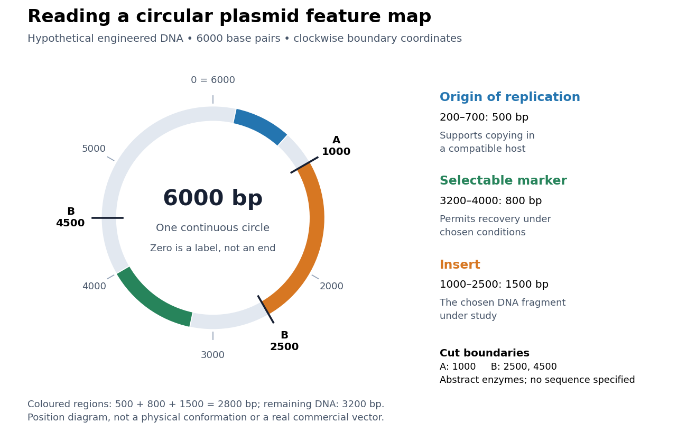

# Plasmid feature map

↑ **Parent:** [Plasmid](plasmid.md)

A [plasmid feature map](plasmid-feature-map.md) records the positions of specified [DNA](deoxyribonucleic-acid.md) features. Construct an original circular example of total length $L=6000$ [base pairs](base-pair.md). Coordinates run clockwise from a chosen zero, and $0$ and $6000$ label the same boundary. Positions here denote boundaries between [base pairs](base-pair.md), so the interval from 1000 to 2500 contains $2500-1000=1500$ [base pairs](base-pair.md). This convention avoids counting both endpoints as additional material.

**[Figure 1](#image-an-original-6000-base-pair-plasmid-feature-map-copying-selection-and-a-chosen-plasmid-insert-occupy-distinct-regions). An original 6000-base pair plasmid feature map: copying, selection and a chosen plasmid insert occupy distinct regions**. Hypothetical engineered circular [DNA](deoxyribonucleic-acid.md), with clockwise boundary coordinates. Blue marks an [origin of replication](origin-of-replication.md) at 200–700; green marks a [selectable marker](selectable-marker.md) at 3200–4000; orange marks the [plasmid insert](plasmid-insert.md) at 1000–2500. Abstract [restriction enzymes](restriction-enzyme.md) A and B cut at the labelled boundaries: A at 1000; B at 2500 and 4500. Their recognition [nucleotide sequences](nucleic-acid-sequence.md) are unspecified. Neither the feature intervals nor the total length describe a real commercial construct. The ring records position, not the physical shape or three-dimensional conformation of [DNA](deoxyribonucleic-acid.md).

The [origin of replication](origin-of-replication.md) is assigned to 200–700, the [selectable marker](selectable-marker.md) to 3200–4000 and the [plasmid insert](plasmid-insert.md) to 1000–2500. Other positions are unspecified [DNA](deoxyribonucleic-acid.md), not empty gaps. Their lengths account for the entire circle:

$$
500+800+1500+3200=6000.
$$

The first three terms are the marked regions; the last is all remaining material. Choosing a coordinate zero does not add a physical break. Rotating every coordinate by the same amount changes the drawing's labels without changing any distance around the [plasmid](plasmid.md).

A [gene promoter](promoter-genetics.md) must function in the recipient for the intended [gene expression](gene-expression.md); copying a [plasmid](plasmid.md) alone does not establish [gene expression](gene-expression.md).[Plasmid Elements, Promoter Region row: recipient-dependent transcriptional machinery](molecular-biology-reference-by-addgene.md) The map therefore supports three separate questions: can the carrier persist, can carriers be recovered, and can the selected [DNA](deoxyribonucleic-acid.md) perform the proposed task? The [galactose induction](galactose-induction.md) comparison illustrates the third question in an actual [yeast](yeast.md) experiment.

## ↑ Ancestors (5)

1. [Plasmid](plasmid.md)
2. [Molecular genetics](molecular-genetics-split.md)
3. [Genetics](genetics-split.md)
4. [Biology](biology-split.md)
5. [Codex Wiki](split.md)

## ← Incoming links (3)

- [Plasmid feature map](plasmid-feature-map.md)
- [Plasmid insert](plasmid-insert.md)
- [Plasmid restriction mapping](plasmid-restriction-mapping.md)
