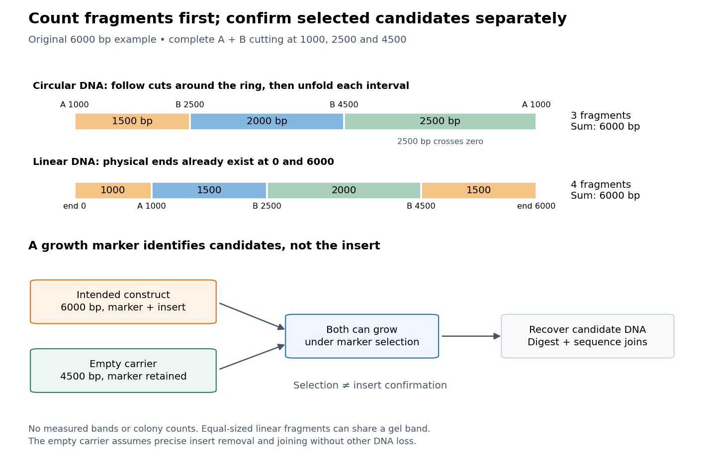

# Plasmid restriction mapping

↑ **Parent:** [Plasmid](plasmid.md)

[Plasmid restriction mapping](plasmid-restriction-mapping.md) compares fragment lengths after a [restriction digest](restriction-digest.md) with the pattern predicted by specified cut positions. Use the original 6000-[base pair](base-pair.md) [plasmid feature map](plasmid-feature-map.md). Abstract [restriction enzyme](restriction-enzyme.md) A cuts once, at 1000. Abstract [restriction enzyme](restriction-enzyme.md) B cuts twice, at 2500 and 4500. Assume complete cutting of identical circular copies at exactly those sites, with no loss of [DNA](deoxyribonucleic-acid.md). These assumptions define a length-accounting exercise; the labels A and B do not stand for particular commercial [enzymes](enzyme-split.md).

| Complete [restriction digest](restriction-digest.md) | Cut coordinates | Linear fragment lengths in [base pairs](base-pair.md) |
| --- | --- | --- |
| A | 1000 | 6000 |
| B | 2500, 4500 | 2000, 4000 |
| A and B | 1000, 2500, 4500 | 1500, 2000, 2500 |

For the combined [restriction digest](restriction-digest.md), successive clockwise distances are

$$
2500-1000=1500,\qquad 4500-2500=2000,
$$

and the final fragment crosses the chosen zero:

$$
(6000-4500)+1000=2500.
$$

Their sum is $1500+2000+2500=6000$. The single A cut opens the circle into one full-length linear fragment. It does not produce pieces of lengths 1000 and 5000, because coordinate zero was never an end.

**[Figure 2](#image-plasmid-restriction-mapping-counts-physical-ends-plasmid-selection-and-confirmation-answer-different-questions). Plasmid restriction mapping counts physical ends; plasmid selection and confirmation answer different questions**. Original length-accounting and inference schematic for the same 6000-[base pair](base-pair.md) construction. The upper strips compare complete A-and-B cutting of the circle with cutting of a separate linear [DNA](deoxyribonucleic-acid.md) substrate that already has physical ends at 0 and 6000. The lower branches show that the [selectable marker](selectable-marker.md) can permit recovery of both an intended construct and an empty carrier. No [biological colony](colony-biology.md) counts, experimental efficiencies, measured [gel bands](gel-band.md) or historical data are depicted.

For contrast, stipulate a different starting substrate: a linear 6000-[base pair](base-pair.md) [DNA](deoxyribonucleic-acid.md) fragment with physical ends at 0 and 6000 and the same three internal cut coordinates. Its complete [restriction digest](restriction-digest.md) gives

$$
1000,\quad1500,\quad2000,\quad1500
$$

[base pairs](base-pair.md), summing again to 6000. There are four fragments, including two of equal length. Even an ideal length-resolving comparison would show only three distinct sizes if both 1500-[base pair](base-pair.md) fragments occupy the same [gel band](gel-band.md). Fragment number and visible [gel band](gel-band.md) number need not agree.

The general counting argument is short. For $k\geq1$ distinct complete cuts of a circle, each fragment runs from one cut to the next, so there are $k$ fragments. For a linear substrate with $k$ distinct internal cuts, its two pre-existing ends give $k+1$ intervals. Summing successive distances counts every original [base pair](base-pair.md) once in either case. The rule assumes internal double-strand cuts and does not treat an uncut circle as a zero-length product.

In practice, compare released linear fragments with an appropriate [DNA ladder](dna-ladder.md) using [agarose gel electrophoresis](agarose-gel-electrophoresis.md). The original uncut circular [DNA](deoxyribonucleic-acid.md) need not migrate like a linear fragment of equal length; the existing [agarose gel electrophoresis](agarose-gel-electrophoresis.md) discussion explains that shape-dependent limitation. Partial cutting also changes the expected pattern. In this example, a circular copy cut at 1000 and 2500 but not 4500 yields lengths 1500 and 4500. A 4500-[base pair](base-pair.md) product would therefore be compatible with that missed cut rather than uniquely identifying a different construction.

Matching lengths constrain an arrangement without determining every [nucleotide sequence](nucleic-acid-sequence.md). For example, any change of letters preserving all three cut positions leaves this predicted pattern unchanged. Even the order of fragments can be ambiguous when only their unordered lengths are observed. [DNA sequencing](dna-sequencing.md) across both joins and through the [plasmid insert](plasmid-insert.md) tests additional claims that this length model cannot decide.

## ↑ Ancestors (5)

1. [Plasmid](plasmid.md)
2. [Molecular genetics](molecular-genetics-split.md)
3. [Genetics](genetics-split.md)
4. [Biology](biology-split.md)
5. [Codex Wiki](split.md)

## ← Incoming links (2)

- [Plasmid](plasmid.md)
- [Plasmid restriction mapping](plasmid-restriction-mapping.md)
