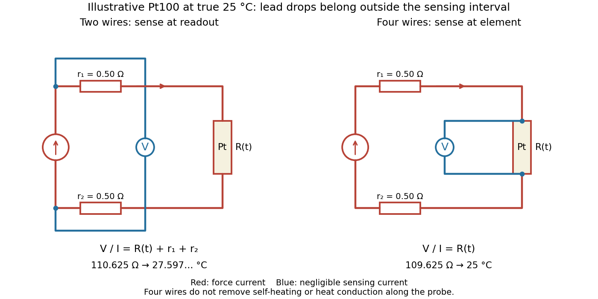

# Platinum resistance thermometer lead resistance error

↑ **Parent:** [Platinum resistance thermometer](platinum-resistance-thermometer.md)

With two shared leads of [electrical resistances](electrical-resistance.md) $r_1,r_2$, [Ohm's law](ohm-s-law.md) gives

$$
V_{\rm two}=I[R(t)+r_1+r_2],\qquad
R_{\rm indicated}=R(t)+r_1+r_2.
$$

Using the [Pt100 local linear model](pt100-local-linear-model.md), positive lead [electrical resistance](electrical-resistance.md) appears as a warmer [temperature](temperature-split.md). At true $25\,{}^\circ\mathrm C$, stipulated leads of $0.50\,\Omega$ each change $109.625\,\Omega$ into $110.625\,\Omega$, producing $27.597\ldots\,{}^\circ\mathrm C$: a calculated bias of about $2.60\,{}^\circ\mathrm C$. Subtracting a measured $1.00\,\Omega$ loop correction works only while that loop [electrical resistance](electrical-resistance.md) remains appropriate; cable [temperature](temperature-split.md) changes can invalidate it.

**[Figure 4](#platinum-resistance-two-wire-four-wire-sensing). Two shared leads include cable voltage drops; four leads sense at the platinum element**. [Source](platinum-resistance-two-wire-four-wire-sensing.py). Red paths carry [electric current](electric-current.md); blue paths connect an ideal high-input-[electrical resistance](electrical-resistance.md) [voltmeter](voltmeter.md). In the two-wire circuit the sensing terminals span both leads and the element. In [four-terminal sensing](four-terminal-sensing.md) they span the element alone. The stated lead values and [temperature](temperature-split.md) bias are illustrative calculations.

[Four-terminal sensing](four-terminal-sensing.md) separates the [electric current](electric-current.md) and [electric potential difference](electric-potential-difference.md) leads. Negligible sensing [electric current](electric-current.md) suppresses sensing-lead drops; force-lead drops lie outside the interval. Real [voltmeter loading](voltmeter-loading.md), connections, and leakage still need checking.[§§4.4.1 and 4.4.3, printed pp. 30 and 32–33: two-wire inclusion of leads and four-wire exclusion](guide-on-secondary-thermometry-industrial-platinum-resistance-thermometers-by-jonathan-pearce-and-others.md)

For a stable offset $E$ from the [thermoelectric effect](thermoelectric-effect-split.md), two signed [electric potential differences](electric-potential-difference.md) obey $V_+=IR+E$ and $V_-=-IR+E$. The current-reversal calculation in [four-terminal sensing](four-terminal-sensing.md) yields

$$
R=\frac{V_+-V_-}{2I}.
$$

At stipulated $I=1\,\mathrm{mA}$, $R=109.625\,\Omega$ and $E=3\,\mathrm{\mu V}$, $V_+=109.628\,\mathrm{mV}$ and $V_-=-109.622\,\mathrm{mV}$ recover $R$ exactly in this model. If the offset or sample [temperature](temperature-split.md) changes between readings, cancellation is incomplete. Reversal also leaves [Joule heating](joule-heating.md) unchanged because it depends on $I^2$.

## ↑ Ancestors (9)

1. [Platinum resistance thermometer](platinum-resistance-thermometer.md)
2. [Resistance thermometer](resistance-thermometer.md)
3. [Thermometer](thermometer.md)
4. [Temperature](temperature-split.md)
5. [Thermodynamics](thermodynamics-split.md)
6. [Statistical physics](statistical-physics-split.md)
7. [Branches of physics](branches-of-physics.md)
8. [Physics](physics-split.md)
9. [Codex Wiki](split.md)

## ← Incoming links (1)

- [Platinum resistance thermometer](platinum-resistance-thermometer.md)
