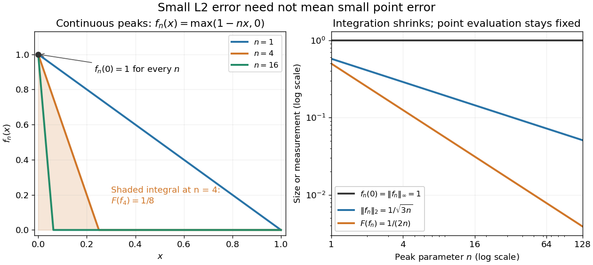

# Point-evaluation kernel is not closed in the integral norm

↑ **Parent:** [Normed vector space](normed-vector-space-split.md)

On continuous functions on a compact interval, evaluation at an interior point is not continuous in the integral [norm](norm.md). Narrow triangular peaks have fixed point value and integral tending to zero. Subtracting such a peak from the constant function one gives functions vanishing at the point and converging in the integral norm to one. Thus the evaluation kernel is not closed, although it is closed in the [uniform norm](supremum-norm.md).

Here is a fully computed endpoint version, now using the [L2 norm](l2-norm.md) on the actual [continuous functions](continuous-function.md) $C([0,1])$. For each integer $n\geq1$, set $f_n(x)=\max(1-nx,0)$. Its [point evaluation](point-evaluation-functional.md) at zero is $E(f_n)=f_n(0)=1$, while

$$
\|f_n\|_2^2=\int_0^{1/n}(1-nx)^2\,dx=\frac1{3n},\qquad F(f_n)=\int_0^{1/n}(1-nx)\,dx=\frac1{2n}.
$$

Consequently $f_n\to0$ in the [L2 norm](l2-norm.md) but $E(f_n)\not\to0$: [point evaluation](point-evaluation-functional.md) is discontinuous on this [normed space](normed-vector-space-split.md). Quantitatively $|E(f_n)|/\|f_n\|_2=\sqrt{3n}$ is unbounded. At $n=100$, the [L2 norm](l2-norm.md) is approximately $0.057735$, the [integral](integral-split.md) is $0.005$, and the point value is still $1$. In the [supremum norm](supremum-norm.md), $\|f_n\|_\infty=1$ and $|E(f)|\leq\|f\|_\infty$, so $E$ has [operator norm](operator-norm.md) one instead.

Set $g_n=1-f_n$. Then $E(g_n)=0$ and $\|g_n-1\|_2=1/\sqrt{3n}\to0$, although $E(1)=1$. Thus the [kernel](kernel-of-a-linear-map-split.md) of $E$ fails to be a [closed set](closed-set.md). On the full [L2 space](l2-space-is-a-hilbert-space.md), a further distinction is essential: its elements are [equivalence classes](equivalence-class.md) under equality [almost everywhere](almost-everywhere.md), and changing a representative at zero does not change its class. Arbitrary [point evaluation](point-evaluation-functional.md) is therefore not even well-defined there. Restricting first to [continuous functions](continuous-function.md) makes the discontinuity statement precise.[MIT 18.102, lecture 13: Lp spaces and almost-everywhere identification](https://ocw.mit.edu/courses/18-102-introduction-to-functional-analysis-spring-2021/aad5fcf3b0f85788519a0324258dd296_MIT18_102s21_lec13.pdf)

**[Figure 1](#image-shrinking-continuous-peaks-integration-and-l2-size-vanish-while-point-evaluation-stays-one). Shrinking continuous peaks: integration and L2 size vanish while point evaluation stays one**.

## ↑ Ancestors (6)

1. [Normed vector space](normed-vector-space-split.md)
2. [Functional analysis](functional-analysis-split.md)
3. [Analysis](analysis-split.md)
4. [Area of mathematics](area-of-mathematics.md)
5. [Mathematics](mathematics-split.md)
6. [Codex Wiki](split.md)

## ← Incoming links (1)

- [Solution](past-exam-of-the-mathematics-course-of-the-university-of-cambridge/2014/ib/paper-1/11f/solution.md)
