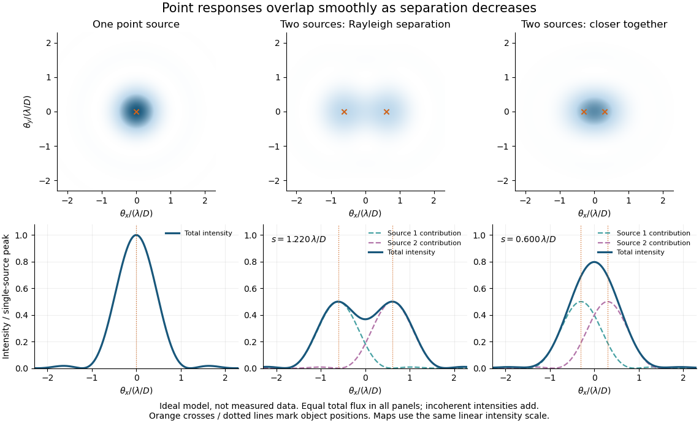

# Point spread function

↑ **Parent:** [Physical optics](physical-optics-split.md)  
ⓦ [Wiki](https://en.wikipedia.org/wiki/Point_spread_function)

A [point spread function](point-spread-function-split.md) is an imaging system's response to an [optical point source](optical-point-source.md). Here it means the distribution of image [light intensity](light-intensity.md): an ideal point object becomes a finite spot, often with faint rings, because of [diffraction](diffraction.md). An unresolved [star](star.md) and a sufficiently small bead emitting [fluorescence](fluorescence-split.md) are practical approximations to an [optical point source](optical-point-source.md). Their image tells us how nearby object details will overlap, and reveals blurring from [optical aberrations](optical-aberration.md), [defocus](defocus-aberration.md), and, for an [optical telescope](optical-telescope.md), [astronomical seeing](astronomical-seeing.md).

A useful convention separates shape from throughput. At a fixed image plane, let $p(\mathbf x)\geq0$ be the [point spread function](point-spread-function-split.md) with $\int_{\mathbb R^2}p(\mathbf x)\,d^2\mathbf x=1$. Its units are inverse [area](surface-area.md). A point delivering detected [radiant flux](radiant-flux.md) $F$ at image position $\mathbf x_0$ produces [light intensity](light-intensity.md) $Fp(\mathbf x-\mathbf x_0)$; this [point spread function normalization](point-spread-function-normalization.md) makes the [integral](integral-split.md) over the image equal to $F$. A profile divided by its own peak is convenient for comparing widths, but is a different [point spread function normalization](point-spread-function-normalization.md) and does not by itself compare total [radiant flux](radiant-flux.md).

In [incoherent imaging](incoherent-imaging.md), different object points have negligible mutual [spatial optical coherence](spatial-optical-coherence.md) over the measurement, so their image [light intensities](light-intensity.md) add. If the response also obeys [translation invariance](translation-invariance.md) over the chosen [field of view](field-of-view.md), the expected continuous image is the [convolution](convolution.md)

$$
I(\mathbf x)=\tau\int_{\mathbb R^2}O(\mathbf u)p(\mathbf x-\mathbf u)\,d^2\mathbf u=\tau(O*p)(\mathbf x).
$$

Here $O$ is the object brightness distribution expressed in image-scaled coordinates, with [magnification](magnification.md) already included, and $\tau$ is constant transmission. For $O(\mathbf u)=F_0\delta(\mathbf u-\mathbf u_0)$, where $\delta$ is the two-dimensional [Dirac delta function](dirac-delta-function.md), this gives $I=\tau F_0p(\mathbf x-\mathbf u_0)$. A changing response across the [field of view](field-of-view.md) instead requires a position-dependent [integral kernel](integral-kernel.md) $p(\mathbf x;\mathbf u)$; one measured [point spread function](point-spread-function-split.md) is then only a local calibration.

In [coherent imaging](coherent-imaging.md), the [superposition principle](superposition-principle.md) applies to the complex [wave amplitudes](wave-amplitude.md). With [amplitude spread function](amplitude-spread-function.md) $h$, the corresponding ideal model is

$$
E_{\rm image}=h*E_{\rm object},\qquad I_{\rm image}=|E_{\rm image}|^2,\qquad p=\frac{|h|^2}{\int_{\mathbb R^2}|h|^2\,d^2\mathbf x}.
$$

Thus $|h*E|^2$ generally differs from $|h|^2*|E|^2$: coherent contributions produce [wave interference](interference-wave-propagation.md) terms that depend on their relative [wave phases](phase-waves.md). Their time average vanishes for mutually incoherent emitters, which explains the intensity [convolution](convolution.md). Partial [optical coherence](optical-coherence.md) requires the correlations between object points as well.[pp. 7–8, §E(a–b): coherent field and incoherent intensity imaging](mit-2-71-and-2-710-optics-spring-2014-by-nicholas-x-fang/review-for-optics.md)

**[Figure 1](#image-ideal-circular-pupil-point-responses-and-the-overlap-of-two-mutually-incoherent-sources). Ideal circular-pupil point responses and the overlap of two mutually incoherent sources**.

The figure is an original [diffraction](diffraction.md) model, not measured data. All panels have the same total [radiant flux](radiant-flux.md): each member of a pair contributes half the single-source [radiant flux](radiant-flux.md). Dashed curves show the separate [light intensity](light-intensity.md) contributions; the solid curve is their sum. The [point spread functions](point-spread-function-split.md) have tails, so even sources satisfying the [Rayleigh criterion](rayleigh-criterion.md) overlap. As separation decreases, the image changes continuously; there is no abrupt disappearance of all information at one separation.

A motivating measured example is [Measurement of point-spread function (PSF) for confocal fluorescence microscopy by InCheon Song and others](measurement-of-point-spread-function-psf-for-confocal-fluorescence-microscopy-by-incheon-song-and-others.md) (2005). A $543.8\,\mathrm{nm}$ [laser](laser-split.md), delivered through an [optical fiber](optical-fiber.md), excited fluorescent beads on a slide through a $100\times$, [numerical aperture](numerical-aperture.md) $1.3$ oil-immersion objective. A moving stage scanned the bead; emitted [light](light.md) returned through the objective, an emission filter and a pinhole to a [photodiode](photodiode.md). The readout was [fluorescence](fluorescence-split.md) [light intensity](light-intensity.md) against scanned position. Under the same setup, nominal bead [diameters](diameter.md) $0.17$, $0.5$, and $1\,\mathrm{\mu m}$ produced progressively broader measured spots. The size comparison controls for the finite object: the measured response is the [convolution](convolution.md) of bead emission with the effective [point spread function](point-spread-function-split.md), rather than a pure point response. Inverting this [convolution](convolution.md) model gave a response compared with the theoretical one. The smaller bead gave a weaker [signal](signal.md) relative to [noise](noise-signal-processing.md); uncertainty in actual bead [diameter](diameter.md) also affected the restored width. These are limits of the calibration. In [confocal microscopy](confocal-microscopy.md), excitation and pinhole detection jointly determine the effective [point spread function](point-spread-function-split.md); this experiment does not measure the ideal widefield [Airy disk](airy-disk.md) plotted above.[§2 and Fig. 1, pp. 2–3: apparatus; §3.2 and Figs. 4–5, pp. 4–5: bead-size comparison and limitations](measurement-of-point-spread-function-psf-for-confocal-fluorescence-microscopy-by-incheon-song-and-others.md)

For a new calibration, useful additional controls are to measure detector background, avoid saturating the [photodetector](photodetector.md), repeat the scan to check stability, and compare isolated beads at several positions in the [field of view](field-of-view.md). Record [wavelength](wavelength.md), [numerical aperture](numerical-aperture.md), pinhole setting, sampling interval and [optical focus](focus-optics.md). These are practical recommendations, not extra measurements claimed for the published experiment.

**Table of contents**

- [Encircled energy](encircled-energy.md)
- [Point spread function normalization](point-spread-function-normalization.md)
- [Optical point source](optical-point-source.md)
- [Incoherent imaging](incoherent-imaging.md)
- [Coherent imaging](coherent-imaging.md)
  - [Coherent imaging cutoff](coherent-imaging-cutoff.md)
  - [Amplitude spread function](amplitude-spread-function.md)
- [Airy disk](airy-disk.md)
  - [Airy disk derivation](airy-disk-derivation.md)
  - [Airy disk normalization and encircled energy](airy-disk-normalization-and-encircled-energy.md)
  - [Circular-aperture diffraction laboratory experiment](circular-aperture-diffraction-laboratory-experiment.md)
- [Defocus aberration](defocus-aberration.md)
- [Optical transfer function](optical-transfer-function.md)
  - [Michelson contrast](michelson-contrast.md)
  - [Modulation transfer function](modulation-transfer-function.md)
- [Diffraction-limited system](diffraction-limited-system.md)
  - [Numerical aperture](numerical-aperture.md)
  - [Diffraction-limited resolution](diffraction-limited-resolution.md)
    - [Rayleigh criterion](rayleigh-criterion.md)
      - [Incoherent two-source Airy profile](incoherent-two-source-airy-profile.md)
    - [Spatial resolution element](spatial-resolution-element.md)
- [Strehl ratio](strehl-ratio.md)
  - [Maréchal approximation](marechal-approximation.md)

## ↑ Ancestors (5)

1. [Physical optics](physical-optics-split.md)
2. [Optics](optics-split.md)
3. [Branches of physics](branches-of-physics.md)
4. [Physics](physics-split.md)
5. [Codex Wiki](split.md)

## ← Incoming links (53)

- [Airy disk](airy-disk.md)
- [Airy disk normalization and encircled energy](airy-disk-normalization-and-encircled-energy.md)
- [Amplitude spread function](amplitude-spread-function.md)
- [Angular differential imaging](angular-differential-imaging.md)
- [Astronomical seeing](astronomical-seeing.md)
- [Coma (optics)](coma-optics.md)
- [Confocal excitation and detection point spread function](confocal-excitation-and-detection-point-spread-function.md)
- [Confocal optical sectioning](confocal-optical-sectioning.md)
- [Conjugate pinholes in confocal microscopy](conjugate-pinholes-in-confocal-microscopy.md)
- [Coronagraph](coronagraph.md)
- [Coronagraph pupil-stop observing experiment](coronagraph-pupil-stop-observing-experiment.md)
- [Coronagraphic focal plane mask](coronagraphic-focal-plane-mask.md)
- [Defocus aberration](defocus-aberration.md)
- [Diffraction-limited resolution](diffraction-limited-resolution.md)
- [Diffraction-limited system](diffraction-limited-system.md)
- [Dirty beam](dirty-beam.md)
- [Electron microscope resolution](electron-microscope-resolution.md)
- [Encircled energy](encircled-energy.md)
- [Fluorescent bead experiment for confocal microscopy](fluorescent-bead-experiment-for-confocal-microscopy.md)
- [Focal ratio](focal-ratio.md)
- [Full width at half maximum](full-width-at-half-maximum.md)
- [Grazing-incidence X-ray optics](grazing-incidence-x-ray-optics.md)
- [High-contrast imaging](high-contrast-imaging.md)
- [Incoherent imaging](incoherent-imaging.md)
- [Incoherent two-source Airy profile](incoherent-two-source-airy-profile.md)
- [Isophotal photometry](isophotal-photometry.md)
- [Localization precision](localization-precision.md)
- [Neutrino directional-coincidence model](neutrino-directional-coincidence-model.md)
- [Off-axis pinhole test for coma](off-axis-pinhole-test-for-coma.md)
- [Optical aberration](optical-aberration.md)
- [Optical transfer function](optical-transfer-function.md)
- [Solution](past-exam-of-the-frontiers-of-observational-astrophysics-course-of-the-university-of-cambridge/2014/paper-1/1/solution.md)
- [Solution](past-exam-of-the-frontiers-of-observational-astrophysics-course-of-the-university-of-cambridge/2015/paper-1/3/b/solution.md)
- [Solution](past-exam-of-the-frontiers-of-observational-astrophysics-course-of-the-university-of-cambridge/2016/paper-1/2/b/solution.md)
- [Solution](past-exam-of-the-mathematics-course-of-the-university-of-cambridge/2018/iii/paper-338/1/c/i/solution.md)
- [Solution](past-exam-of-the-mathematics-course-of-the-university-of-cambridge/2018/iii/paper-338/2/c/i/solution.md)
- [Solution](past-exam-of-the-mathematics-course-of-the-university-of-cambridge/2018/iii/paper-338/2/c/ii/solution.md)
- [Solution](past-exam-of-the-mathematics-course-of-the-university-of-cambridge/2019/iii/paper-338/2/a/v/solution.md)
- [Solution](past-exam-of-the-mathematics-course-of-the-university-of-cambridge/2019/iii/paper-338/2/b/iv/solution.md)
- [Solution](past-exam-of-the-physics-a-course-of-the-university-of-cambridge/2010/paper-1/section-a/3/a/solution.md)
- [Solution](past-exam-of-the-physics-a-course-of-the-university-of-cambridge/2011/paper-1/section-d/d12/b/solution.md)
- [Solution](past-exam-of-the-physics-b-course-of-the-university-of-cambridge/2010/paper-2a/section-d/d17/c/solution.md)
- [Solution](past-exam-of-the-relativistic-astrophysics-and-cosmology-course-of-the-university-of-cambridge/2013/paper-1/3/b/solution.md)
- [Solution](past-exam-of-the-systems-biology-course-of-the-university-of-cambridge/2024/paper-2/6/i/solution.md)
- [Solution](past-exam-of-the-systems-biology-course-of-the-university-of-cambridge/2024/paper-2/6/ii/solution.md)
- [Solution](past-exam-of-the-systems-biology-course-of-the-university-of-cambridge/2024/paper-2/6/iv/solution.md)
- [Point spread function](point-spread-function-split.md)
- [Rayleigh criterion](rayleigh-criterion.md)
- [Release-expansion thermometry](release-expansion-thermometry.md)
- [Seidel coma pupil mapping](seidel-coma-pupil-mapping.md)
- [Speckle pattern](speckle-pattern.md)
- [Strehl ratio](strehl-ratio.md)
- [Supernova discovery of accelerating expansion](supernova-discovery-of-accelerating-expansion.md)
