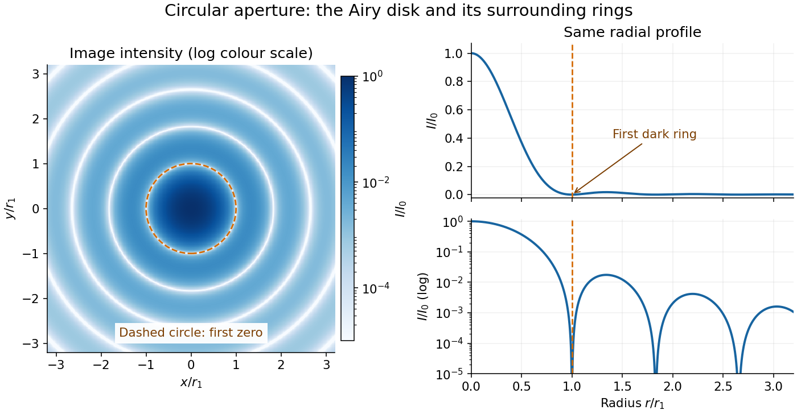

# Point spread function

↑ **Parent:** [Physical optics](physical-optics.md)  
ⓦ [Wiki](https://en.wikipedia.org/wiki/Point_spread_function)

A [point spread function](point-spread-function.md) is an imaging system's response to an [optical point source](#optical-point-source). Here it means the distribution of image [light intensity](wave.md#light-intensity): an ideal point object becomes a finite spot, often with faint rings, because of [diffraction](quantum-scattering.md#diffraction). An unresolved [star](stellar-astrophysics.md#star) and a sufficiently small bead emitting [fluorescence](fluorescence.md) are practical approximations to an [optical point source](#optical-point-source). Their image tells us how nearby object details will overlap, and reveals blurring from [optical aberrations](geometrical-optics.md#optical-aberration), [defocus](#defocus-aberration), and, for an [optical telescope](optical-instrument.md#optical-telescope), [astronomical seeing](optics.md#astronomical-seeing).

A useful convention separates shape from throughput. At a fixed image plane, let $p(\mathbf x)\geq0$ be the [point spread function](point-spread-function.md) with $\int_{\mathbb R^2}p(\mathbf x)\,d^2\mathbf x=1$. Its units are inverse [area](differential-geometry.md#surface-area). A point delivering detected [radiant flux](radiometry.md#radiant-flux) $F$ at image position $\mathbf x_0$ produces [light intensity](wave.md#light-intensity) $Fp(\mathbf x-\mathbf x_0)$; this [point spread function normalization](#point-spread-function-normalization) makes the [integral](integral.md) over the image equal to $F$. A profile divided by its own peak is convenient for comparing widths, but is a different [point spread function normalization](#point-spread-function-normalization) and does not by itself compare total [radiant flux](radiometry.md#radiant-flux).

In [incoherent imaging](#incoherent-imaging), different object points have negligible mutual [spatial optical coherence](physical-optics.md#spatial-optical-coherence) over the measurement, so their image [light intensities](wave.md#light-intensity) add. If the response also obeys [translation invariance](physics.md#translation-invariance) over the chosen [field of view](optical-instrument.md#field-of-view), the expected continuous image is the [convolution](fourier-analysis.md#convolution)

$$
I(\mathbf x)=\tau\int_{\mathbb R^2}O(\mathbf u)p(\mathbf x-\mathbf u)\,d^2\mathbf u=\tau(O*p)(\mathbf x).
$$

Here $O$ is the object brightness distribution expressed in image-scaled coordinates, with [magnification](optics.md#magnification) already included, and $\tau$ is constant transmission. For $O(\mathbf u)=F_0\delta(\mathbf u-\mathbf u_0)$, where $\delta$ is the two-dimensional [Dirac delta function](distribution-theory.md#dirac-delta-function), this gives $I=\tau F_0p(\mathbf x-\mathbf u_0)$. A changing response across the [field of view](optical-instrument.md#field-of-view) instead requires a position-dependent [integral kernel](functional-analysis.md#integral-kernel) $p(\mathbf x;\mathbf u)$; one measured [point spread function](point-spread-function.md) is then only a local calibration.

In [coherent imaging](#coherent-imaging), the [superposition principle](vector-space.md#superposition-principle) applies to the complex [wave amplitudes](wave.md#wave-amplitude). With [amplitude spread function](#amplitude-spread-function) $h$, the corresponding ideal model is

$$
E_{\rm image}=h*E_{\rm object},\qquad I_{\rm image}=|E_{\rm image}|^2,\qquad p=\frac{|h|^2}{\int_{\mathbb R^2}|h|^2\,d^2\mathbf x}.
$$

Thus $|h*E|^2$ generally differs from $|h|^2*|E|^2$: coherent contributions produce [wave interference](physical-optics.md#interference-wave-propagation) terms that depend on their relative [wave phases](wave.md#phase-waves). Their time average vanishes for mutually incoherent emitters, which explains the intensity [convolution](fourier-analysis.md#convolution). Partial [optical coherence](physical-optics.md#optical-coherence) requires the correlations between object points as well.[pp. 7–8, §E(a–b): coherent field and incoherent intensity imaging](physics-bibliography.md#mit-2-71-and-2-710-optics-spring-2014-by-nicholas-x-fang/review-for-optics)

**[Figure 1](#image-ideal-circular-pupil-point-responses-and-the-overlap-of-two-mutually-incoherent-sources). Ideal circular-pupil point responses and the overlap of two mutually incoherent sources**.

The figure is an original [diffraction](quantum-scattering.md#diffraction) model, not measured data. All panels have the same total [radiant flux](radiometry.md#radiant-flux): each member of a pair contributes half the single-source [radiant flux](radiometry.md#radiant-flux). Dashed curves show the separate [light intensity](wave.md#light-intensity) contributions; the solid curve is their sum. The [point spread functions](point-spread-function.md) have tails, so even sources satisfying the [Rayleigh criterion](#rayleigh-criterion) overlap. As separation decreases, the image changes continuously; there is no abrupt disappearance of all information at one separation.

A motivating measured example is [Measurement of point-spread function (PSF) for confocal fluorescence microscopy by InCheon Song and others](physics-bibliography.md#measurement-of-point-spread-function-psf-for-confocal-fluorescence-microscopy-by-incheon-song-and-others) (2005). A $543.8\,\mathrm{nm}$ [laser](laser.md), delivered through an [optical fiber](optical-instrument.md#optical-fiber), excited fluorescent beads on a slide through a $100\times$, [numerical aperture](#numerical-aperture) $1.3$ oil-immersion objective. A moving stage scanned the bead; emitted [light](optics.md#light) returned through the objective, an emission filter and a pinhole to a [photodiode](optical-instrument.md#photodiode). The readout was [fluorescence](fluorescence.md) [light intensity](wave.md#light-intensity) against scanned position. Under the same setup, nominal bead [diameters](topological-analysis.md#diameter) $0.17$, $0.5$, and $1\,\mathrm{\mu m}$ produced progressively broader measured spots. The size comparison controls for the finite object: the measured response is the [convolution](fourier-analysis.md#convolution) of bead emission with the effective [point spread function](point-spread-function.md), rather than a pure point response. Inverting this [convolution](fourier-analysis.md#convolution) model gave a response compared with the theoretical one. The smaller bead gave a weaker [signal](electrical-engineering.md#signal) relative to [noise](electrical-engineering.md#noise-signal-processing); uncertainty in actual bead [diameter](topological-analysis.md#diameter) also affected the restored width. These are limits of the calibration. In [confocal microscopy](fluorescence.md#confocal-microscopy), excitation and pinhole detection jointly determine the effective [point spread function](point-spread-function.md); this experiment does not measure the ideal widefield [Airy disk](#airy-disk) plotted above.[§2 and Fig. 1, pp. 2–3: apparatus; §3.2 and Figs. 4–5, pp. 4–5: bead-size comparison and limitations](physics-bibliography.md#measurement-of-point-spread-function-psf-for-confocal-fluorescence-microscopy-by-incheon-song-and-others)

For a new calibration, useful additional controls are to measure detector background, avoid saturating the [photodetector](optical-instrument.md#photodetector), repeat the scan to check stability, and compare isolated beads at several positions in the [field of view](optical-instrument.md#field-of-view). Record [wavelength](wave-equation.md#wavelength), [numerical aperture](#numerical-aperture), pinhole setting, sampling interval and [optical focus](geometrical-optics.md#focus-optics). These are practical recommendations, not extra measurements claimed for the published experiment.

**Table of contents**

- [Encircled energy](#encircled-energy)
- [Point spread function normalization](#point-spread-function-normalization)
- [Optical point source](#optical-point-source)
- [Incoherent imaging](#incoherent-imaging)
- [Coherent imaging](#coherent-imaging)
  - [Coherent imaging cutoff](#coherent-imaging-cutoff)
  - [Amplitude spread function](#amplitude-spread-function)
- [Airy disk](#airy-disk)
  - [Airy disk derivation](#airy-disk-derivation)
  - [Airy disk normalization and encircled energy](#airy-disk-normalization-and-encircled-energy)
  - [Circular-aperture diffraction laboratory experiment](#circular-aperture-diffraction-laboratory-experiment)
- [Defocus aberration](#defocus-aberration)
- [Optical transfer function](#optical-transfer-function)
  - [Michelson contrast](#michelson-contrast)
  - [Modulation transfer function](#modulation-transfer-function)
- [Diffraction-limited system](#diffraction-limited-system)
  - [Numerical aperture](#numerical-aperture)
  - [Diffraction-limited resolution](#diffraction-limited-resolution)
    - [Rayleigh criterion](#rayleigh-criterion)
      - [Incoherent two-source Airy profile](#incoherent-two-source-airy-profile)
    - [Spatial resolution element](#spatial-resolution-element)
- [Strehl ratio](#strehl-ratio)
  - [Maréchal approximation](#marechal-approximation)

## Encircled energy

↑ **Parent:** [Point spread function](point-spread-function.md)

[Encircled energy](#encircled-energy) is the fraction of total image [radiant flux](radiometry.md#radiant-flux) within a circle of radius $R$ around the centre of a [point spread function](point-spread-function.md).

## Point spread function normalization

↑ **Parent:** [Point spread function](point-spread-function.md)

[Point spread function normalization](#point-spread-function-normalization) specifies how the response is scaled. Unit-[integral](integral.md) scaling separates image shape from total [radiant flux](radiometry.md#radiant-flux); unit-peak scaling compares shapes but does not make their total [radiant fluxes](radiometry.md#radiant-flux) equal.

## Optical point source

↑ **Parent:** [Point spread function](point-spread-function.md)

An [optical point source](#optical-point-source) has spatial extent negligible relative to the imaging scale being tested. The [Dirac delta function](distribution-theory.md#dirac-delta-function) is its idealization; a finite bead or unresolved [star](stellar-astrophysics.md#star) only approximates it.

## Incoherent imaging

↑ **Parent:** [Point spread function](point-spread-function.md)

In [incoherent imaging](#incoherent-imaging), contributions from distinct object points add as [light intensities](wave.md#light-intensity) because their mutual [spatial optical coherence](physical-optics.md#spatial-optical-coherence) is negligible. A single [convolution](fourier-analysis.md#convolution) additionally requires [translation invariance](physics.md#translation-invariance) of the [point spread function](point-spread-function.md).

## Coherent imaging

↑ **Parent:** [Point spread function](point-spread-function.md)

In [coherent imaging](#coherent-imaging), complex [wave amplitudes](wave.md#wave-amplitude) add with their relative [wave phases](wave.md#phase-waves) preserved. The measured [light intensity](wave.md#light-intensity) includes [wave interference](physical-optics.md#interference-wave-propagation) between the contributions.

### Coherent imaging cutoff

↑ **Parent:** [Coherent imaging](#coherent-imaging)

For an ideal on-axis coherent circular-pupil system the field transfer cutoff is $\nu_c=\mathrm{NA}/\lambda$. Incoherent intensity transfer extends to $2\mathrm{NA}/\lambda$. Field and intensity transfer functions must be distinguished.

### Amplitude spread function

↑ **Parent:** [Coherent imaging](#coherent-imaging)

The [amplitude spread function](#amplitude-spread-function) is the complex field response to an [optical point source](#optical-point-source). Its squared magnitude, with a specified [point spread function normalization](#point-spread-function-normalization), gives the intensity [point spread function](point-spread-function.md).

## Airy disk

↑ **Parent:** [Point spread function](point-spread-function.md)  
ⓦ [Wiki](https://en.wikipedia.org/wiki/Airy_disk)

The [Airy disk](#airy-disk) is the central bright region, up to the first dark ring, in the scalar [diffraction](quantum-scattering.md#diffraction) pattern of a uniformly illuminated, unobscured circular [aperture](optics.md#aperture). The whole pattern includes the weaker surrounding rings; its radius is distinct from its [full width at half maximum](analysis.md#full-width-at-half-maximum).

For a circular [optical pupil](optics.md#optical-pupil) of [diameter](topological-analysis.md#diameter) $D$ under normal, uniform monochromatic [plane wave](wave-function.md#plane-wave) illumination, [Fraunhofer diffraction](physical-optics.md#fraunhofer-diffraction) gives

$$
\frac{I(\theta)}{I_0}=P(u)=\left[\frac{2J_1(u)}{u}\right]^2,\qquad u=\frac{\pi D\sin\theta}{\lambda},\qquad P(0)=1.
$$

Here $I_0$ is the on-axis [light intensity](wave.md#light-intensity), $\theta$ is the [angle](geometry-and-topology.md#angle) from the [optical axis](geometrical-optics.md#optical-axis), $\lambda$ is the [wavelength](wave-equation.md#wavelength) in the propagation medium, and $J_1$ is the order-one [Bessel function of the first kind](bessel-function.md#bessel-function-of-the-first-kind). The [paraxial approximation](partial-differential-equation.md#paraxial-approximation) replaces $\sin\theta$ by $\theta$, measured in [radians](geometry-and-topology.md#radian). The first positive zero $j_{1,1}=3.831705970\ldots$ gives

$$
\sin\theta_1=\frac{j_{1,1}}{\pi}\frac{\lambda}{D},\qquad \theta_1\simeq1.219669891\frac{\lambda}{D}\simeq1.22\frac{\lambda}{D}.
$$

This is the angular radius of the [Airy disk](#airy-disk); the angular diameter is twice as large. The [Airy disk derivation](#airy-disk-derivation) explains the origin of the [Bessel function of the first kind](bessel-function.md#bessel-function-of-the-first-kind) and of the numerical coefficient.[equations 10.78–10.85 and Table 10.1: circular-aperture response and first zero](physics-bibliography.md#oscillations-and-waves-by-richard-fitzpatrick/two-dimensional-fourier-optics)

**[Figure 2](#image-ideal-circular-aperture-intensity-central-disk-dark-rings-and-radial-profile). Ideal circular-aperture intensity: central disk, dark rings and radial profile**.

The image and both radial curves show the same calculated [light intensity](wave.md#light-intensity), divided by its peak. The image's [logarithmic scale](calculus.md#logarithmic-scale) makes the weak rings visible; its colour is a display choice. The linear curve shows how small the ring peaks are compared with the centre. A dark ring marks a zero of [wave amplitude](wave.md#wave-amplitude), produced by cancellation across the [optical pupil](optics.md#optical-pupil); it is not the edge of all transmitted [light](optics.md#light). The first [Airy disk](#airy-disk) contains about $83.78\%$ of the total [radiant flux](radiometry.md#radiant-flux), as calculated in [Airy disk normalization and encircled energy](#airy-disk-normalization-and-encircled-energy).

For an original design example, take an ideal [optical lens](geometrical-optics.md#lens-optics) in air with [focal length](geometrical-optics.md#focal-length) $f=100\,\mathrm{mm}$, circular [optical pupil](optics.md#optical-pupil) [diameter](topological-analysis.md#diameter) $D=5.00\,\mathrm{mm}$ and [wavelength](wave-equation.md#wavelength) $\lambda=550\,\mathrm{nm}$. In the [focal plane](optical-instrument.md#focal-plane), the radial coordinate $r\simeq f\theta$ gives

$$
\theta_1\simeq1.34164\times10^{-4}\,\mathrm{rad},\qquad r_1\simeq1.219669891\frac{\lambda f}{D}=13.4164\,\mathrm{\mu m}.
$$

The first-zero diameter is $26.8327\,\mathrm{\mu m}$. Solving $P(u_{1/2})=1/2$ gives $u_{1/2}=1.616339948\ldots$, so the diameter measured by [full width at half maximum](analysis.md#full-width-at-half-maximum) is only

$$
w_{1/2}=\frac{2u_{1/2}}{\pi}\frac{\lambda f}{D}\simeq1.028993970\frac{\lambda f}{D}=11.3189\,\mathrm{\mu m}.
$$

Thus a quoted “spot diameter” is incomplete without its definition. Doubling $D$ halves both widths at fixed [wavelength](wave-equation.md#wavelength) and [focal length](geometrical-optics.md#focal-length); increasing [magnification](optics.md#magnification) alone changes the image scale without improving object-space discrimination.

The [Airy disk](#airy-disk) supplies a calculable reference for a [point spread function](point-spread-function.md), allowing [diffraction](quantum-scattering.md#diffraction) to be distinguished from [defocus](#defocus-aberration) and [optical aberrations](geometrical-optics.md#optical-aberration). Its beauty is that one circular boundary determines an entire sequence of bright and dark rings through a [Fourier transform](fourier-transform.md). The ideal formula assumes an unobscured pupil, uniform illumination, ideal [optical focus](geometrical-optics.md#focus-optics), a single [wavelength](wave-equation.md#wavelength), and a scalar description with small output [angles](geometry-and-topology.md#angle). A blocked centre, nonuniform pupil transmission or a significant pupil [wave phase](wave.md#phase-waves) error changes the response. High [numerical aperture](#numerical-aperture) may require [polarization of an electromagnetic wave](electromagnetic-wave.md#polarization-of-an-electromagnetic-wave) and a vector field description. The [circular-aperture diffraction laboratory experiment](#circular-aperture-diffraction-laboratory-experiment) tests the far-field pattern directly; the [Rayleigh criterion](#rayleigh-criterion) uses its first zero to define a two-source convention.

### Airy disk derivation

↑ **Parent:** [Airy disk](#airy-disk)

Write $a=D/2$ and [wavenumber](wave-equation.md#wavenumber) $k=2\pi/\lambda$. The pupil [Fourier transform](fourier-transform.md), normalized by pupil [area](differential-geometry.md#surface-area), gives the [Fraunhofer diffraction](physical-optics.md#fraunhofer-diffraction) [wave amplitude](wave.md#wave-amplitude). In pupil [polar coordinates](multivariable-calculus.md#polar-coordinates),

$$
A(u)=\frac1{\pi a^2}\int_0^a\int_0^{2\pi}e^{-ik\rho\sin\theta\cos\phi}\rho\,d\phi\,d\rho=2\int_0^1tJ_0(ut)\,dt,\qquad u=ka\sin\theta.
$$

The angular average is $J_0$ because $J_0(z)=(2\pi)^{-1}\int_0^{2\pi}e^{-iz\cos\phi}\,d\phi$. The [Bessel function of the first kind](bessel-function.md#bessel-function-of-the-first-kind) identity $d\{zJ_1(z)\}/dz=zJ_0(z)$ then reduces the radial [integral](integral.md) to $A(u)=2J_1(u)/u$. Taking the squared magnitude yields the [Airy disk](#airy-disk) [light intensity](wave.md#light-intensity) profile.[equations 10.78–10.84: angular integral, radial integral and Bessel identities](physics-bibliography.md#oscillations-and-waves-by-richard-fitzpatrick/two-dimensional-fourier-optics)

The apparent division by zero is removable. The [power series](sequence-and-series.md#power-series)

$$
J_1(u)=\frac u2-\frac{u^3}{16}+\frac{u^5}{384}+O(u^7)
$$

gives $A(u)=1-u^2/8+u^4/192+O(u^6)$ and $P(u)=1-u^2/4+5u^4/192+O(u^6)$. At the centre, every pupil contribution has the same [wave phase](wave.md#phase-waves), so their normalized sum is one. The first dark ring instead corresponds to $J_1(u)=0$ with $u>0$, rather than to the removable zero of $J_1$ at the origin.

### Airy disk normalization and encircled energy

↑ **Parent:** [Airy disk](#airy-disk)

Peak normalization $P(0)=1$ does not make the [integral](integral.md) of a [point spread function](point-spread-function.md) equal to one. In the [paraxial approximation](partial-differential-equation.md#paraxial-approximation) to the [focal plane](optical-instrument.md#focal-plane), define $b=\pi D/(\lambda f)$ and $u=br$. The unit-[integral](integral.md) [point spread function normalization](#point-spread-function-normalization) is

$$
p(r)=\frac{b^2}{4\pi}P(br),\qquad \int_{\mathbb R^2}p(r)\,d^2\mathbf r=1.
$$

Here $p$ has units of inverse [area](differential-geometry.md#surface-area); multiplying by the detected [radiant flux](radiometry.md#radiant-flux) gives image-plane [irradiance](radiometry.md#irradiance). Its [encircled energy](#encircled-energy), meaning the fraction inside radius $R=U/b$, is

$$
E(U)=\int_0^{U/b}2\pi r p(r)\,dr=\frac12\int_0^UuP(u)\,du=1-J_0(U)^2-J_1(U)^2.
$$

This is an [integral](integral.md) over [area](differential-geometry.md#surface-area), so its radial weight is $u$. An unweighted [integral](integral.md) of a line through the centre is a different quantity.

A short proof uses the [Bessel function of the first kind](bessel-function.md#bessel-function-of-the-first-kind) identities $J_0'=-J_1$ and $J_1'=J_0-J_1/u$. They give

$$
\frac{d}{dU}\left(1-J_0(U)^2-J_1(U)^2\right)=\frac{2J_1(U)^2}{U}=\frac U2P(U).
$$

Both expressions for $E$ vanish at zero. Since these [Bessel functions of the first kind](bessel-function.md#bessel-function-of-the-first-kind) tend to zero as $U\to\infty$, $E(\infty)=1$, establishing the normalization. At the first dark ring,

$$
E(j_{1,1})=1-J_0(j_{1,1})^2\simeq0.837784869.
$$

A circular detector region ending at the first zero therefore misses about $16.22\%$ of the ideal [radiant flux](radiometry.md#radiant-flux), even though the surrounding rings have low peak [light intensity](wave.md#light-intensity). This matters when converting measured counts into total source brightness or choosing an image aperture for a [photodetector](optical-instrument.md#photodetector).

### Circular-aperture diffraction laboratory experiment

↑ **Parent:** [Airy disk](#airy-disk)

An actual teaching setup is described in [Laboratory Exercise No. 4: Diffraction, MIT 6.237, Fall 2024](physics-bibliography.md#laboratory-exercise-no-4-diffraction-mit-6-237-fall-2024), for MIT's 6.237 Modern Optics Project Laboratory, Fall 2024. Preparation includes predicting the aperture-size dependence and the distinction between [Fraunhofer diffraction](physical-optics.md#fraunhofer-diffraction) and [Fresnel diffraction](physical-optics.md#fresnel-diffraction). A helium–neon [laser](laser.md) supplies $632.8\,\mathrm{nm}$ [light](optics.md#light); the far-field setup uses a planar incident [wavefront](physical-optics.md#wavefront), a diffracting object and a distant screen, with beam expansion when needed. Figure 1 also marks an optional [CCD](optical-instrument.md#charge-coupled-device) camera. Exercise 4.7 asks students to sketch the circular-aperture pattern, measure the [Airy disk](#airy-disk) diameter between correctly identified boundaries, and infer the aperture size. No measured values are supplied. As a regime comparison, exercise 4.9 varies the circular opening's position near a microscope objective [optical lens](geometrical-optics.md#lens-optics), observes near-field patterns and compares them with the far-field case. This tests whether a change in propagation geometry changes the pattern. The coherent illumination measures one aperture's response, rather than the discrimination of two mutually incoherent [optical point sources](#optical-point-source).[pp. 1–2, introduction, PL4.1 and Fig. 1; p. 5, §4.7; p. 6, §4.9: apparatus, readout and regime comparison](physics-bibliography.md#laboratory-exercise-no-4-diffraction-mit-6-237-fall-2024)

For a quantitative interpretation, let $L$ be the aperture-to-screen distance and $d_{\rm spot}$ the first-zero diameter on the screen. In the [paraxial approximation](partial-differential-equation.md#paraxial-approximation), the independent calculation is

$$
d_{\rm spot}\simeq2L\theta_1=2\frac{j_{1,1}}\pi\frac{\lambda L}{D},\qquad D\simeq2\frac{j_{1,1}}\pi\frac{\lambda L}{d_{\rm spot}}.
$$

For an explicitly hypothetical measurement, $L=1.80\,\mathrm m$ and $d_{\rm spot}=5.60\,\mathrm{mm}$ at $632.8\,\mathrm{nm}$ would imply $D\simeq0.496\,\mathrm{mm}$. The scale $D^2/\lambda\simeq0.389\,\mathrm m$ is smaller than $L$, but only by a factor of about $4.6$; this alone gives limited confidence in a high-precision [Fraunhofer diffraction](physical-optics.md#fraunhofer-diffraction) approximation. It is not a reported MIT measurement.

Additional recommended controls are to keep [wavelength](wave-equation.md#wavelength) fixed, record $L$, centre and uniformly illuminate the [aperture](optics.md#aperture), and repeat with another $D$. Compare $d_{\rm spot}/L$, which should vary inversely with $D$. A camera readout should include blocked-beam background and avoid saturation. A scaled repetition at larger $L$ tests residual [Fresnel diffraction](physical-optics.md#fresnel-diffraction); nonuniform illumination, [optical aberrations](geometrical-optics.md#optical-aberration), detector sampling and uncertainty in locating a dark ring limit the inferred $D$. The screen pattern's apparent bright edge depends on display brightness and is not a substitute for the first-zero boundary.

## Defocus aberration

↑ **Parent:** [Point spread function](point-spread-function.md)  
ⓦ [Wiki](https://en.wikipedia.org/wiki/Defocus_aberration)

[Defocus](#defocus-aberration) is the mismatch between the receiving plane and the intended [optical focus](geometrical-optics.md#focus-optics). Changing the plane changes the [point spread function](point-spread-function.md) even when the [optical lens](geometrical-optics.md#lens-optics) is otherwise ideal.

## Optical transfer function

↑ **Parent:** [Point spread function](point-spread-function.md)  
ⓦ [Wiki](https://en.wikipedia.org/wiki/Optical_transfer_function)

The [optical transfer function](#optical-transfer-function) is the [Fourier transform](fourier-transform.md) of the normalized intensity [point spread function](point-spread-function.md) for [incoherent imaging](#incoherent-imaging) with [translation invariance](physics.md#translation-invariance), using [spatial frequency](fourier-analysis.md#spatial-frequency) in cycles per unit length. It has $H(\mathbf0)=1$. For an ideal circular pupil it is the normalized pupil autocorrelation, with cutoff $2\mathrm{NA}/\lambda_0$ in object coordinates: no overlap remains when two pupil copies are shifted apart by more than one pupil [diameter](topological-analysis.md#diameter).[p. 8, §E(b): OTF as Fourier transform of intensity PSF and pupil autocorrelation](physics-bibliography.md#mit-2-71-and-2-710-optics-spring-2014-by-nicholas-x-fang/review-for-optics)

### Michelson contrast

↑ **Parent:** [Optical transfer function](#optical-transfer-function)

For a periodic intensity distribution, $C=(I_{\max}-I_{\min})/(I_{\max}+I_{\min})$. It should not be confused with a resist contrast parameter.

### Modulation transfer function

↑ **Parent:** [Optical transfer function](#optical-transfer-function)

The magnitude of the normalized intensity optical transfer function. It describes transfer of sinusoidal intensity contrast in a linear, shift-invariant incoherent imaging model.

## Diffraction-limited system

↑ **Parent:** [Point spread function](point-spread-function.md)  
ⓦ [Wiki](https://en.wikipedia.org/wiki/Diffraction-limited_system)

A [diffraction-limited system](#diffraction-limited-system) has an optical response close to the ideal [diffraction](quantum-scattering.md#diffraction) response for its specified [optical pupil](optics.md#optical-pupil), [wavelength](wave-equation.md#wavelength) and [optical focus](geometrical-optics.md#focus-optics). Improving the [optical aberrations](geometrical-optics.md#optical-aberration) further makes little difference to that response. This describes the optics: a poorly sampled or noisy detector can still deliver an image with much worse usable [diffraction-limited resolution](#diffraction-limited-resolution).

The [optical pupil](optics.md#optical-pupil) determines which [wave amplitudes](wave.md#wave-amplitude) and [wave phases](wave.md#phase-waves) contribute to an image point. In a scalar, [paraxial approximation](partial-differential-equation.md#paraxial-approximation) at the [focal plane](optical-instrument.md#focal-plane) of an [optical lens](geometrical-optics.md#lens-optics) in air, write the pupil transmission as $T(u,v)e^{i\phi(u,v)}$, after removing the ideal focusing phase. The [amplitude spread function](#amplitude-spread-function) is proportional to its scaled [Fourier transform](fourier-transform.md):

$$
h(x,y)\propto\iint T(u,v)e^{i\phi(u,v)}\exp\left[-\frac{2\pi i}{\lambda f}(ux+vy)\right]\,du\,dv.
$$

Here $(u,v)$ are pupil coordinates, $(x,y)$ are image coordinates, $f$ is [focal length](geometrical-optics.md#focal-length), and $\lambda$ is the [wavelength](wave-equation.md#wavelength) in air. For a uniformly transmitting, unobscured circular [optical pupil](optics.md#optical-pupil) at ideal [optical focus](geometrical-optics.md#focus-optics), the result is an [Airy disk](#airy-disk) with surrounding rings. A blocked centre, support structures, or nonuniform transmission changes the ideal [point spread function](point-spread-function.md); “diffraction limited” does not specify one universal spot shape. The existing [Fourier model of a Lyot coronagraph](optics.md#fourier-model-of-a-lyot-coronagraph) illustrates how pupil and focal masks deliberately alter this response.[pp. 6–8, §§D(c), E: lens Fourier transform and pupil transfer function](physics-bibliography.md#mit-2-71-and-2-710-optics-spring-2014-by-nicholas-x-fang/review-for-optics)

[Optical aberrations](geometrical-optics.md#optical-aberration) add pupil [wave phase](wave.md#phase-waves) errors. [Defocus](#defocus-aberration) contributes a quadratic pupil [wave phase](wave.md#phase-waves) in the [paraxial approximation](partial-differential-equation.md#paraxial-approximation), redistributing [light intensity](wave.md#light-intensity) from the best-focused spot. The [Strehl ratio](#strehl-ratio) compares the peak with the ideal response for the same pupil and total [radiant flux](radiometry.md#radiant-flux). A broad [optical spectrum](optics.md#optical-spectrum) produces a weighted sum of wavelength-dependent [point spread functions](point-spread-function.md); [chromatic aberration](geometrical-optics.md#chromatic-aberration) can additionally change [optical focus](geometrical-optics.md#focus-optics) with [wavelength](wave-equation.md#wavelength). Thus the operating conditions belong with any claim that a system is diffraction limited.

### Numerical aperture

↑ **Parent:** [Diffraction-limited system](#diffraction-limited-system)  
ⓦ [Wiki](https://en.wikipedia.org/wiki/Numerical_aperture)

The [numerical aperture](#numerical-aperture) is $n\sin\alpha$, where $n$ is the [refractive index](electromagnetic-wave.md#refractive-index) of the medium between object and objective, and $\alpha$ is the half-[angle](geometry-and-topology.md#angle) of the admitted cone of [light](optics.md#light). Specify object-side or image-side [numerical aperture](#numerical-aperture); the microscope convention usually means the object side.[Numerical Aperture by Michael W. Davidson](physics-bibliography.md#numerical-aperture-by-michael-w-davidson)

### Diffraction-limited resolution

↑ **Parent:** [Diffraction-limited system](#diffraction-limited-system)

[Diffraction-limited resolution](#diffraction-limited-resolution) is a scale for distinguishing details with a specified ideal [diffraction](quantum-scattering.md#diffraction) response and a specified criterion. For two equally bright, mutually incoherent [optical point sources](#optical-point-source) imaged through a uniformly transmitting, unobscured circular [optical pupil](optics.md#optical-pupil), the [Rayleigh criterion](#rayleigh-criterion) places the centre of one [Airy disk](#airy-disk) at the first zero of the other. At small [angles](geometry-and-topology.md#angle) in air this separation is

$$
\theta_{\rm R}=\frac{j_{1,1}}{\pi}\frac{\lambda}{D}\simeq1.22\frac{\lambda}{D},\qquad j_{1,1}\simeq3.831706.
$$

Here $D$ is pupil [diameter](topological-analysis.md#diameter), $\lambda$ is [wavelength](wave-equation.md#wavelength) in air, and $j_{1,1}$ is the first positive zero of the order-one [Bessel function of the first kind](bessel-function.md#bessel-function-of-the-first-kind). This is the radius to the first zero, not the diameter of the central spot. [Fraunhofer diffraction](physical-optics.md#fraunhofer-diffraction) gives the radial peak-normalized [light intensity](wave.md#light-intensity)

$$
P(q)=\left[\frac{2J_1(q)}q\right]^2,\qquad q=\frac{\pi D\theta}{\lambda},\qquad P(0)=1.
$$

The removable value at zero follows from $J_1(q)\sim q/2$. The pupil [Fourier transform](fourier-transform.md) reduces to a radial [integral](integral.md) by circular symmetry, which produces the [Bessel function of the first kind](bessel-function.md#bessel-function-of-the-first-kind); its first zero supplies the factor $1.22$.[Two-Dimensional Fourier Optics](physics-bibliography.md#oscillations-and-waves-by-richard-fitzpatrick/two-dimensional-fourier-optics)

In the usual scalar circular-pupil approximation for a [fluorescence microscope](fluorescence.md#fluorescence-microscope), the corresponding object-plane [Rayleigh criterion](#rayleigh-criterion) is

$$
r_{\rm R}=\frac{j_{1,1}}{2\pi}\frac{\lambda_0}{\mathrm{NA}}\simeq0.61\frac{\lambda_0}{\mathrm{NA}},\qquad q=\frac{2\pi\mathrm{NA}\,r}{\lambda_0}.
$$

Here $\lambda_0$ is the vacuum emission [wavelength](wave-equation.md#wavelength), and the object-side [numerical aperture](#numerical-aperture) already includes the medium's [refractive index](electromagnetic-wave.md#refractive-index). Do not divide $\lambda_0$ by $n$ again. For small cone [angles](geometry-and-topology.md#angle) in air, $\mathrm{NA}\simeq D/(2f)$ and image-plane radius $f\theta_{\rm R}$ agrees with this form. The assumptions include a single [wavelength](wave-equation.md#wavelength), ideal [optical focus](geometrical-optics.md#focus-optics), and mutually incoherent emitters. High [numerical aperture](#numerical-aperture) can require a vector description with [polarization of an electromagnetic wave](electromagnetic-wave.md#polarization-of-an-electromagnetic-wave) and emitter orientation; [confocal microscopy](fluorescence.md#confocal-microscopy) has its own excitation-and-detection response. The same $0.61$ formula therefore does not describe every microscope or illumination method.[Resolution by Michael W. Davidson](physics-bibliography.md#resolution-by-michael-w-davidson)

**[Figure 3](#image-doubling-numerical-aperture-halves-the-ideal-circular-pupil-point-response-scale-at-fixed-wavelength). Doubling numerical aperture halves the ideal circular-pupil point-response scale at fixed wavelength**.

In this original model, $\lambda_0=550\,\mathrm{nm}$ and [numerical apertures](#numerical-aperture) $0.25$ and $0.50$ give first-zero radii $1.342\,\mathrm{\mu m}$ and $0.671\,\mathrm{\mu m}$. Each [point spread function](point-spread-function.md) is divided by its own peak to compare shape. The pupil axes are transverse [wave vector](elasticity-physics.md#wavevector) components multiplied by $\lambda_0/(2\pi)$, so pupil radius equals [numerical aperture](#numerical-aperture). A wider pupil accepts a wider range of transverse [wave vectors](elasticity-physics.md#wavevector), producing a narrower image. Increasing [magnification](optics.md#magnification) alone enlarges the same spot and does not reduce its object-plane radius.

The [Rayleigh criterion](#rayleigh-criterion) is a useful visual convention, not an absolute information barrier. For equal incoherent sources with total detected [radiant flux](radiometry.md#radiant-flux) $F$ and separation vector $\mathbf s$, the ideal image is

$$
I(\mathbf x)=\frac F2\left[p(\mathbf x-\mathbf s/2)+p(\mathbf x+\mathbf s/2)\right].
$$

Below the [Rayleigh criterion](#rayleigh-criterion) this still differs from $Fp(\mathbf x)$; for small $\mathbf s$, symmetry cancels the linear change and the first change is quadratic in separation. Estimating two unknown source positions is then increasingly sensitive to [noise](electrical-engineering.md#noise-signal-processing), background, relative brightness and uncertainty in the [point spread function](point-spread-function.md). Localizing one isolated source and recovering an arbitrary extended object are different inference tasks. Measurements that separate optical modes can also extract separation information differently from direct image [light intensity](wave.md#light-intensity) measurement.[Quantum Theory of Superresolution for Two Incoherent Optical Point Sources by Mankei Tsang and others](physics-bibliography.md#quantum-theory-of-superresolution-for-two-incoherent-optical-point-sources-by-mankei-tsang-and-others)

There remains a real limit for arbitrary images in this model: the [optical transfer function](#optical-transfer-function) is zero above the transmitted [spatial frequency](fourier-analysis.md#spatial-frequency) band. Its cutoff for scalar [incoherent imaging](#incoherent-imaging) is $\nu_c=2\mathrm{NA}/\lambda_0$ in object-plane cycles per unit length. The [Nyquist–Shannon sampling theorem](fourier-analysis.md#nyquist-shannon-sampling-theorem) therefore suggests object-referred [detector pixel](optical-instrument.md#optical-detector-pixel) pitch $p_{\rm pix}\leq\lambda_0/(4\mathrm{NA})$, with finer sampling providing margin. Finite [detector pixels](optical-instrument.md#optical-detector-pixel) also integrate over their [area](differential-geometry.md#surface-area), suppressing contrast; coarse sampling can cause [aliasing](fourier-analysis.md#aliasing). Finer sampling cannot alone recover [spatial frequencies](fourier-analysis.md#spatial-frequency) removed by the optics, and [Fourier deconvolution](nonparametric-statistics.md#fourier-deconvolution) amplifies [noise](electrical-engineering.md#noise-signal-processing) where the [optical transfer function](#optical-transfer-function) is small. [Photon shot noise](optical-instrument.md#photon-shot-noise), [read noise](optical-instrument.md#read-noise), [optical aberrations](geometrical-optics.md#optical-aberration) and [defocus](#defocus-aberration) can all worsen practical discrimination. A useful resolution claim therefore reports the object model, criterion, [wavelength](wave-equation.md#wavelength), [numerical aperture](#numerical-aperture), sampling and [signal-to-noise ratio in photon counting](optical-instrument.md#signal-to-noise-ratio-in-photon-counting).

#### Rayleigh criterion

↑ **Parent:** [Diffraction-limited resolution](#diffraction-limited-resolution)

The [Rayleigh criterion](#rayleigh-criterion) calls two equal, mutually incoherent [optical point sources](#optical-point-source) just resolved when one circular-pupil [Airy disk](#airy-disk)'s centre coincides with the other's first zero. It is a specified discrimination convention, distinct from [full width at half maximum](analysis.md#full-width-at-half-maximum) and from precision in estimating one source's position.

For this circular [optical pupil](optics.md#optical-pupil), the [Rayleigh criterion](#rayleigh-criterion) uses angular separation $s_{\rm R}=\theta_1\simeq1.22\lambda/D$, or $s_{\rm R}=r_1\simeq1.22\lambda f/D$ in the [paraxial approximation](partial-differential-equation.md#paraxial-approximation) to the [focal plane](optical-instrument.md#focal-plane). The [point spread functions](point-spread-function.md) still overlap.[equations 10.85–10.87: circular-aperture first-zero scale and Rayleigh convention](physics-bibliography.md#oscillations-and-waves-by-richard-fitzpatrick/two-dimensional-fourier-optics)

For the [Airy disk](#airy-disk) design example with $D=5.00\,\mathrm{mm}$, $f=100\,\mathrm{mm}$ and $\lambda=550\,\mathrm{nm}$, the angular convention gives $s_{\rm R}=1.34164\times10^{-4}\,\mathrm{rad}$, or about $27.67$ [arcseconds](geometry-and-topology.md#arcsecond), and the image-plane separation is $13.4164\,\mathrm{\mu m}$. Two equally bright, mutually incoherent [optical point sources](#optical-point-source) at separations $0.7$, $1$ and $1.5$ times this scale would have image separations $9.391$, $13.416$ and $20.125\,\mathrm{\mu m}$ respectively. These calculated cases are compared in [incoherent two-source Airy profile](#incoherent-two-source-airy-profile).

The [Rayleigh criterion](#rayleigh-criterion) is useful because it ties an easily recognized two-peak convention to a predictable optical scale. It does not assert that all information vanishes below that separation. Inferring two unknown positions also depends on [photon shot noise](optical-instrument.md#photon-shot-noise), background, unequal brightness and uncertainty in the [point spread function](point-spread-function.md); locating a single isolated source is a different task. A theoretical analysis shows that alternative optical measurements can estimate the separation of two incoherent [optical point sources](#optical-point-source) below this scale.[abstract: linear optics and photon counting can estimate sub-Rayleigh separation](physics-bibliography.md#quantum-theory-of-superresolution-for-two-incoherent-optical-point-sources-by-mankei-tsang-and-others)

The mutual [optical coherence](physical-optics.md#optical-coherence) condition is essential. In [incoherent imaging](#incoherent-imaging), time-averaged [light intensities](wave.md#light-intensity) add. In [coherent imaging](#coherent-imaging), [wave amplitudes](wave.md#wave-amplitude) add before squaring, leaving a [wave interference](physical-optics.md#interference-wave-propagation) term controlled by relative [wave phase](wave.md#phase-waves). Two holes illuminated by the same coherent [laser](laser.md) therefore do not implement the equal-incoherent-source convention merely because their individual patterns resemble [Airy disks](#airy-disk). The coherent single-aperture laboratory test establishes the response of each aperture; it does not establish the pair's mutual incoherence.

##### Incoherent two-source Airy profile

↑ **Parent:** [Rayleigh criterion](#rayleigh-criterion)

Let $x$ measure position along the line joining two mutually incoherent [optical point sources](#optical-point-source) in the [focal plane](optical-instrument.md#focal-plane), with equal detected [radiant fluxes](radiometry.md#radiant-flux) and separation $s$. Extend the even [Airy disk](#airy-disk) profile $P(u)$ to signed $u$, and put $b=\pi D/(\lambda f)$ as in [Airy disk normalization and encircled energy](#airy-disk-normalization-and-encircled-energy). Relative to the peak of one source carrying the pair's total [radiant flux](radiometry.md#radiant-flux), their summed [light intensity](wave.md#light-intensity) is

$$
Q_s(x)=\frac12P\bigl(b(x-s/2)\bigr)+\frac12P\bigl(b(x+s/2)\bigr),\qquad bs_{\rm R}=j_{1,1}.
$$

The two-dimensional [point spread functions](point-spread-function.md) underlying these line profiles all have the same total [radiant flux](radiometry.md#radiant-flux). The line-profile [integrals](integral.md) themselves need not equal one.

**[Figure 4](#image-equal-incoherent-sources-at-0-7-1-and-1-5-times-the-rayleigh-separation). Equal incoherent sources at 0.7, 1 and 1.5 times the Rayleigh separation**.

The dashed curves show individual contributions; the solid curve is their sum. All panels use the same brightness scale, and the vertical markers indicate the true source centres. At $s=s_{\rm R}$, the other source contributes zero at each centre, so $Q_{s_{\rm R}}(\pm s_{\rm R}/2)=1/2$. At the midpoint,

$$
Q_{s_{\rm R}}(0)=P(j_{1,1}/2)\simeq0.367515831.
$$

The midpoint is therefore about $26.50\%$ below the source-centre peak. This is a calculation for this particular [Airy disk](#airy-disk) and equal-incoherent-source convention, not a universal experimental threshold. At $0.7s_{\rm R}$ the two central peaks merge; at $1.5s_{\rm R}$ the valley is deeper. Changing separation continuously changes the profile, without a discontinuity at the [Rayleigh criterion](#rayleigh-criterion).

To see how information survives when the central peaks merge, set $z=bx$ and $\delta=bs$. A symmetric [Taylor expansion](calculus.md#taylor-expansion) gives

$$
Q_s(x)=P(z)+\frac{\delta^2}{8}P''(z)+O(\delta^4).
$$

The linear terms cancel because the source positions are symmetric. At the midpoint, the [Airy disk derivation](#airy-disk-derivation) gives $Q_s(0)=1-\delta^2/16+O(\delta^4)$. Thus a close pair's shape differs from that of one source, but only quadratically at leading order. Detecting this small change becomes sensitive to [noise](electrical-engineering.md#noise-signal-processing) and response calibration. For unequal flux fractions $\alpha$ and $1-\alpha$, the intensity instead becomes $\alpha P(b(x-s/2))+(1-\alpha)P(b(x+s/2))$; its valley and peak positions need not match the equal-source example.

#### Spatial resolution element

↑ **Parent:** [Diffraction-limited resolution](#diffraction-limited-resolution)

A [spatial resolution element](#spatial-resolution-element) is one independently resolved angular or spatial scale under a specified resolution criterion. For an ideal telescope of [diameter](topological-analysis.md#diameter) $D$, its angular scale is of order $\lambda/D$ and its angular area of order $(\lambda/D)^2$. A [photodetector](optical-instrument.md#photodetector) [detector pixel](optical-instrument.md#optical-detector-pixel) or [spaxel](optical-instrument.md#spaxel) can be smaller than a resolution element without adding independent spatial information.

## Strehl ratio

↑ **Parent:** [Point spread function](point-spread-function.md)  
ⓦ [Wiki](https://en.wikipedia.org/wiki/Strehl_ratio)

The Strehl ratio compares the peak of an observed [point spread function](point-spread-function.md) with the ideal [diffraction-limited system](#diffraction-limited-system) peak for the same pupil and total flux. It measures how strongly [wavefront errors](physical-optics.md#wavefront-error) redistribute light away from the central peak.

<h3 id="marechal-approximation">Maréchal approximation</h3>

↑ **Parent:** [Strehl ratio](#strehl-ratio)

For small residual phase errors, $S\simeq e^{-\sigma_\phi^2}$, where $\sigma_\phi=2\pi h_{\rm rms}/\lambda$. The variance is taken after removing irrelevant constant phase. This approximation to the [Strehl ratio](#strehl-ratio) is most useful near the [diffraction limit of a telescope](optical-instrument.md#diffraction-limit-of-a-telescope).

## ↑ Ancestors (5)

1. [Physical optics](physical-optics.md)
2. [Optics](optics.md)
3. [Branches of physics](physics.md#branches-of-physics)
4. [Physics](physics.md)
5. [Codex Wiki](README.md)

## ← Incoming links (53)

- [Airy disk](#airy-disk)
- [Airy disk normalization and encircled energy](#airy-disk-normalization-and-encircled-energy)
- [Amplitude spread function](#amplitude-spread-function)
- [Angular differential imaging](optical-instrument.md#angular-differential-imaging)
- [Astronomical seeing](optics.md#astronomical-seeing)
- [Coma (optics)](geometrical-optics.md#coma-optics)
- [Confocal excitation and detection point spread function](fluorescence.md#confocal-excitation-and-detection-point-spread-function)
- [Confocal optical sectioning](fluorescence.md#confocal-optical-sectioning)
- [Conjugate pinholes in confocal microscopy](fluorescence.md#conjugate-pinholes-in-confocal-microscopy)
- [Coronagraph](optics.md#coronagraph)
- [Coronagraph pupil-stop observing experiment](optics.md#coronagraph-pupil-stop-observing-experiment)
- [Coronagraphic focal plane mask](optics.md#coronagraphic-focal-plane-mask)
- [Defocus aberration](#defocus-aberration)
- [Diffraction-limited resolution](#diffraction-limited-resolution)
- [Diffraction-limited system](#diffraction-limited-system)
- [Dirty beam](astrophysics.md#dirty-beam)
- [Electron microscope resolution](optics.md#electron-microscope-resolution)
- [Encircled energy](#encircled-energy)
- [Fluorescent bead experiment for confocal microscopy](fluorescence.md#fluorescent-bead-experiment-for-confocal-microscopy)
- [Focal ratio](optical-instrument.md#focal-ratio)
- [Full width at half maximum](analysis.md#full-width-at-half-maximum)
- [Grazing-incidence X-ray optics](astrophysics.md#grazing-incidence-x-ray-optics)
- [High-contrast imaging](optical-instrument.md#high-contrast-imaging)
- [Incoherent imaging](#incoherent-imaging)
- [Incoherent two-source Airy profile](#incoherent-two-source-airy-profile)
- [Isophotal photometry](astrophysics.md#isophotal-photometry)
- [Localization precision](fluorescence.md#localization-precision)
- [Neutrino directional-coincidence model](particle-detection.md#neutrino-directional-coincidence-model)
- [Off-axis pinhole test for coma](geometrical-optics.md#off-axis-pinhole-test-for-coma)
- [Optical aberration](geometrical-optics.md#optical-aberration)
- [Optical transfer function](#optical-transfer-function)
- [Solution](past-exam-of-the-frontiers-of-observational-astrophysics-course-of-the-university-of-cambridge/2014/paper-1.md#1/solution)
- [Solution](past-exam-of-the-frontiers-of-observational-astrophysics-course-of-the-university-of-cambridge/2015/paper-1.md#3/b/solution)
- [Solution](past-exam-of-the-frontiers-of-observational-astrophysics-course-of-the-university-of-cambridge/2016/paper-1.md#2/b/solution)
- [Solution](past-exam-of-the-mathematics-course-of-the-university-of-cambridge/2018/iii/paper-338.md#1/c/i/solution)
- [Solution](past-exam-of-the-mathematics-course-of-the-university-of-cambridge/2018/iii/paper-338.md#2/c/i/solution)
- [Solution](past-exam-of-the-mathematics-course-of-the-university-of-cambridge/2018/iii/paper-338.md#2/c/ii/solution)
- [Solution](past-exam-of-the-mathematics-course-of-the-university-of-cambridge/2019/iii/paper-338.md#2/a/v/solution)
- [Solution](past-exam-of-the-mathematics-course-of-the-university-of-cambridge/2019/iii/paper-338.md#2/b/iv/solution)
- [Solution](past-exam-of-the-physics-a-course-of-the-university-of-cambridge/2010/paper-1.md#section-a/3/a/solution)
- [Solution](past-exam-of-the-physics-a-course-of-the-university-of-cambridge/2011/paper-1.md#section-d/d12/b/solution)
- [Solution](past-exam-of-the-physics-b-course-of-the-university-of-cambridge/2010/paper-2a.md#section-d/d17/c/solution)
- [Solution](past-exam-of-the-relativistic-astrophysics-and-cosmology-course-of-the-university-of-cambridge/2013/paper-1.md#3/b/solution)
- [Solution](past-exam-of-the-systems-biology-course-of-the-university-of-cambridge/2024/paper-2.md#6/i/solution)
- [Solution](past-exam-of-the-systems-biology-course-of-the-university-of-cambridge/2024/paper-2.md#6/ii/solution)
- [Solution](past-exam-of-the-systems-biology-course-of-the-university-of-cambridge/2024/paper-2.md#6/iv/solution)
- [Point spread function](point-spread-function.md)
- [Rayleigh criterion](#rayleigh-criterion)
- [Release-expansion thermometry](atomic-physics.md#release-expansion-thermometry)
- [Seidel coma pupil mapping](geometrical-optics.md#seidel-coma-pupil-mapping)
- [Speckle pattern](physical-optics.md#speckle-pattern)
- [Strehl ratio](#strehl-ratio)
- [Supernova discovery of accelerating expansion](cosmology.md#supernova-discovery-of-accelerating-expansion)
