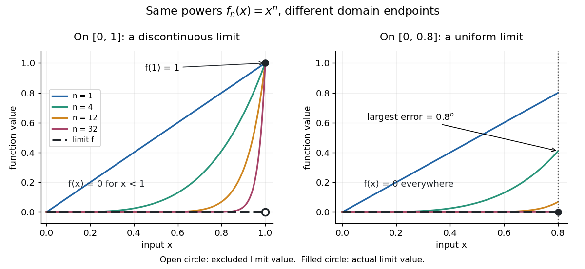

# Pointwise convergence

↑ **Parent:** [Sequence and series](sequence-and-series-split.md)  
ⓦ [Wiki](https://en.wikipedia.org/wiki/Pointwise_convergence)

For a [sequence](sequence.md) of [functions](function-split.md) $f_n:X\to\mathbb R$, [pointwise convergence](pointwise-convergence.md) to a [function](function-split.md) $f:X\to\mathbb R$ means

$$
\forall x\in X\;\forall\varepsilon>0\;\exists N\in\mathbb N_{>0}\;\forall n\geq N:\quad |f_n(x)-f(x)|<\varepsilon.
$$

It is the ordinary [limit of a sequence](limit-of-a-sequence.md) at each fixed input. The threshold $N=N(x,\varepsilon)$ may depend on the input. [Uniform convergence](uniform-convergence.md) instead requires one threshold for the entire [domain of a function](domain-of-a-function.md).[Basic Analysis: Introduction to Real Analysis, Volume I by Jiří Lebl, §6.1.1, Definition 6.1.1 and Proposition 6.1.5](basic-analysis-introduction-to-real-analysis-volume-i-by-jiri-lebl/6-1-pointwise-and-uniform-convergence.md)

Consider the [polynomial functions](polynomial-function.md) $f_n(x)=x^n$, for positive [integers](integer-split.md) $n$, on the [interval](interval-mathematics.md) $[0,1]$. For $0\leq x<1$ the [geometric sequence](geometric-progression.md) $(x^n)$ tends to zero, while $f_n(1)=1$. Thus

$$
f(x)=\begin{cases}0,&0\leq x<1,\\1,&x=1.\end{cases}
$$

Each $f_n$ is a [continuous function](continuous-function.md), but its [pointwise limit](pointwise-limit.md) is [discontinuous](discontinuity-of-a-function.md) at one. Holding an input still hides what happens near that endpoint. The analogous even-power example on $[-1,1]$ appears in the source.[Basic Analysis: Introduction to Real Analysis, Volume I by Jiří Lebl, §6.1.1, Example 6.1.2, even powers on the interval from minus one to one](basic-analysis-introduction-to-real-analysis-volume-i-by-jiri-lebl/6-1-pointwise-and-uniform-convergence.md)

For $0<x<1$ and $0<\varepsilon<1$, taking the [logarithm](logarithm.md) of $x^n<\varepsilon$ and dividing by the negative [real number](real-number.md) $\log x$ reverses the [inequality](inequality-mathematics.md):

$$
n>\frac{\log\varepsilon}{\log x},\qquad N(x,\varepsilon)=\left\lfloor\frac{\log\varepsilon}{\log x}\right\rfloor+1.
$$

The [floor function](floor-function.md) followed by adding one handles the strict [inequality](inequality-mathematics.md) even when the ratio is an [integer](integer-split.md). For tolerance $\varepsilon=0.01$, the first successful indices at $x=0.5$, $0.8$, and $0.99$ are respectively $7$, $21$, and $459$. At $x=0.5$, $2^{-6}=0.015625$ fails and $2^{-7}=0.0078125$ succeeds. At $x=0$ and $x=1$, the error from this [pointwise limit](pointwise-limit.md) is already zero, so $N=1$ works. Nevertheless, $N(x,\varepsilon)$ grows without bound as $x\to1$ from below. A finite list of accurate test inputs cannot establish [uniform convergence](uniform-convergence.md).

**[Figure 11](#image-pointwise-convergence-of-powers-changes-character-when-the-domain-of-a-function-stops-before-one). Pointwise convergence of powers changes character when the domain of a function stops before one**. On $[0,1]$ the [pointwise limit](pointwise-limit.md) is zero except for its value one at the endpoint: the open circle and filled circle distinguish these values. On $[0,0.8]$ the [pointwise limit](pointwise-limit.md) is zero everywhere, and the largest error is $0.8^n$. All curves are original evaluations of $x^n$.

An even sharper warning concerns [integration](integral-split.md). On $[0,1]$, define the [continuous functions](continuous-function.md)

$$
g_n(x)=\begin{cases}2n^2x,&0\leq x\leq1/(2n),\\2n-2n^2x,&1/(2n)\leq x\leq1/n,\\0,&1/n\leq x\leq1.\end{cases}
$$

Their [supports](support.md) are $[0,1/n]$, with height $n$ at $1/(2n)$ and value zero at both ends. Every fixed $x>0$ eventually lies beyond the [support](support.md), and $g_n(0)=0$ always, so [pointwise convergence](pointwise-convergence.md) gives the zero [function](function-split.md). Nevertheless, each [integral](integral-split.md) is the area of a [triangle](triangle.md): $\int_0^1g_n(x)\,dx=\tfrac12(1/n)n=\tfrac12$. Shrinking width compensates increasing height. Hence the [limit of a sequence](limit-of-a-sequence.md) of these [integrals](integral-split.md) differs from the [integral](integral-split.md) of the [pointwise limit](pointwise-limit.md); interchanging them requires additional conditions, such as [uniform convergence preserves integrals on a compact interval](uniform-convergence-preserves-integrals-on-a-compact-interval.md).

**Table of contents**

- [Factorial cosine iterated limit detects rationality](factorial-cosine-iterated-limit-detects-rationality.md)
- [Shrinking continuous spikes with vanishing integral](shrinking-continuous-spikes-with-vanishing-integral.md)
- [Pointwise limit](pointwise-limit.md)

## ↑ Ancestors (6)

1. [Sequence and series](sequence-and-series-split.md)
2. [Real analysis](real-analysis-split.md)
3. [Analysis](analysis-split.md)
4. [Area of mathematics](area-of-mathematics.md)
5. [Mathematics](mathematics-split.md)
6. [Codex Wiki](split.md)

## ← Incoming links (43)

- [Convergence in a product space](convergence-in-a-product-space.md)
- [Fourier series](fourier-series-split.md)
- [Geometric power-series remainder](geometric-power-series-remainder.md)
- [Gibbs phenomenon](gibbs-phenomenon.md)
- [Moving an exterior pole to obtain pointwise polynomial approximation](moving-an-exterior-pole-to-obtain-pointwise-polynomial-approximation.md)
- [Solution](past-exam-of-the-mathematics-course-of-the-university-of-cambridge/2001/ib/paper-1/16e/solution.md)
- [Solution](past-exam-of-the-mathematics-course-of-the-university-of-cambridge/2002/ib/paper-1/1e/b/solution.md)
- [Solution](past-exam-of-the-mathematics-course-of-the-university-of-cambridge/2003/ib/paper-3/1f/solution.md)
- [Solution](past-exam-of-the-mathematics-course-of-the-university-of-cambridge/2004/ib/paper-1/4g/solution.md)
- [Solution](past-exam-of-the-mathematics-course-of-the-university-of-cambridge/2006/ib/paper-2/3f/solution.md)
- [Solution](past-exam-of-the-mathematics-course-of-the-university-of-cambridge/2006/ii/paper-4/2g/b/solution.md)
- [Solution](past-exam-of-the-mathematics-course-of-the-university-of-cambridge/2007/ib/paper-4/3h/i/solution.md)
- [Solution](past-exam-of-the-mathematics-course-of-the-university-of-cambridge/2007/ii/paper-3/2f/solution.md)
- [Solution](past-exam-of-the-mathematics-course-of-the-university-of-cambridge/2008/ib/paper-4/3f/solution.md)
- [Solution](past-exam-of-the-mathematics-course-of-the-university-of-cambridge/2008/ii/paper-3/2f/b/solution.md)
- [Solution](past-exam-of-the-mathematics-course-of-the-university-of-cambridge/2011/ii/paper-3/2f/ii/solution.md)
- [Solution](past-exam-of-the-mathematics-course-of-the-university-of-cambridge/2013/iii/paper-7/1/i/solution.md)
- [Solution](past-exam-of-the-mathematics-course-of-the-university-of-cambridge/2013/iii/paper-7/1/ii/solution.md)
- [Solution](past-exam-of-the-mathematics-course-of-the-university-of-cambridge/2015/iii/paper-7/1/solution.md)
- [Solution](past-exam-of-the-mathematics-course-of-the-university-of-cambridge/2015/iii/paper-7/5/solution.md)
- [Solution](past-exam-of-the-mathematics-course-of-the-university-of-cambridge/2016/ib/paper-3/2g/a/solution.md)
- [Solution](past-exam-of-the-mathematics-course-of-the-university-of-cambridge/2017/ib/paper-2/3g/a/solution.md)
- [Solution](past-exam-of-the-mathematics-course-of-the-university-of-cambridge/2017/ii/paper-1/22f/a/solution.md)
- [Solution](past-exam-of-the-mathematics-course-of-the-university-of-cambridge/2017/ii/paper-2/10f/solution.md)
- [Solution](past-exam-of-the-mathematics-course-of-the-university-of-cambridge/2017/ii/paper-2/2f/ii/solution.md)
- [Solution](past-exam-of-the-mathematics-course-of-the-university-of-cambridge/2019/ib/paper-4/3e/ii/solution.md)
- [Solution](past-exam-of-the-mathematics-course-of-the-university-of-cambridge/2020/ii/paper-4/2h/solution.md)
- [Solution](past-exam-of-the-mathematics-course-of-the-university-of-cambridge/2023/ib/paper-2/10g/solution.md)
- [Solution](past-exam-of-the-mathematics-course-of-the-university-of-cambridge/2023/ii/paper-3/2f/ii/solution.md)
- [Solution](past-exam-of-the-mathematics-course-of-the-university-of-cambridge/2024/ib/paper-3/11f/a/solution.md)
- [Solution](past-exam-of-the-mathematics-course-of-the-university-of-cambridge/2024/ii/paper-3/26g/b/iii/solution.md)
- [Solution](past-exam-of-the-mathematics-course-of-the-university-of-cambridge/2025/ii/paper-1/27h/a/solution.md)
- [Pointwise approximation by uniformly continuous functions](pointwise-approximation-by-uniformly-continuous-functions.md)
- [Pointwise closure of the bounded Lipschitz unit ball](pointwise-closure-of-the-bounded-lipschitz-unit-ball.md)
- [Pointwise convergence](pointwise-convergence.md)
- [Pointwise polynomial approximation of a half-plane sign](pointwise-polynomial-approximation-of-a-half-plane-sign.md)
- [Real analysis](real-analysis-split.md)
- [Sequence of functions](sequence-of-functions.md)
- [Singular perturbation](singular-perturbation-split.md)
- [Stability of a supremum under uniform perturbations](stability-of-a-supremum-under-uniform-perturbations.md)
- [Uniform convergence](uniform-convergence.md)
- [Uniform convergence at moving evaluation points](uniform-convergence-at-moving-evaluation-points.md)
- [Uniform limit theorem](uniform-limit-theorem.md)
