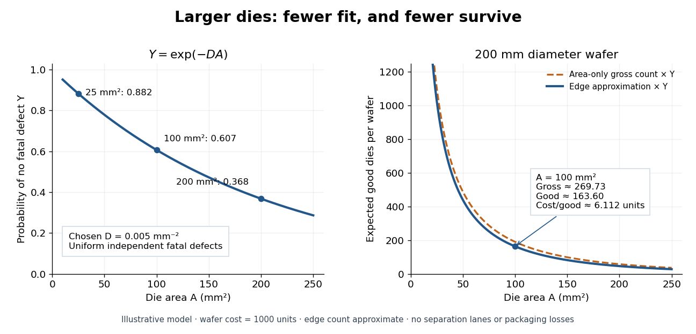

# Poisson defect yield

↑ **Parent:** [Integrated circuit](integrated-circuit.md)

Consider a deliberately simplified model: fatal defects form a spatially uniform [Poisson point process](poisson-point-process-split.md) with intensity $D$ per unit [area](surface-area.md). A [semiconductor die](semiconductor-die.md) of [area](surface-area.md) $A$ works exactly when it contains no fatal defect. Its defect count $N$ has a [Poisson distribution](poisson-distribution.md) with [expected value](expected-value-split.md) $DA$, hence its probability of working, called its yield, is

$$
Y=\Pr(N=0)=\frac{(DA)^0}{0!}e^{-DA}=e^{-DA}.
$$

The product $DA$ is dimensionless. The formula concerns fatal defects, not every visible imperfection. Spatial uniformity, independent defect counts in disjoint [areas](surface-area.md), and failure from even one fatal defect are model assumptions. Clustering, shared processing failures, repairable regions and defects that affect only some functions can invalidate them. This is a chosen probability model, not historical yield data.

Choose $D=0.005\,\mathrm{mm}^{-2}$. For [semiconductor die](semiconductor-die.md) [areas](surface-area.md) $25$, $100$ and $200\,\mathrm{mm}^2$, the model gives $Y=e^{-0.125}=0.882497$, $e^{-0.5}=0.606531$ and $e^{-1}=0.367879$. Doubling the [area](surface-area.md) squares the yield: $Y(2A)=Y(A)^2$. This follows either from the [exponential function](exponential-function.md) or by splitting the larger [area](surface-area.md) into two disjoint parts and using [independence](independent-random-variables.md). More functions on one [semiconductor die](semiconductor-die.md) can save assembly while making the no-defect requirement harder to satisfy.

**[Figure 17](#image-a-chosen-poisson-defect-yield-model-connects-die-area-to-expected-output). A chosen Poisson defect yield model connects die area to expected output**. Original model calculations with $D=0.005\,\mathrm{mm}^{-2}$. Left: $Y=e^{-DA}$ and three worked points. Right: expected good [semiconductor dies](semiconductor-die.md) per circular $200\,\mathrm{mm}$ [semiconductor wafer](semiconductor-wafer.md), comparing an area-only gross count with the declared approximate edge correction. No scribe lanes, packaging losses or measured yields are included. The annotation uses an assumed cost of $1000$ units per wafer.

**Table of contents**

- [Integrated circuit cost per good die](integrated-circuit-cost-per-good-die.md)

## ↑ Ancestors (6)

1. [Integrated circuit](integrated-circuit.md)
2. [Electrical circuit](electrical-circuit-split.md)
3. [Electromagnetism](electromagnetism-split.md)
4. [Branches of physics](branches-of-physics.md)
5. [Physics](physics-split.md)
6. [Codex Wiki](split.md)

## ← Incoming links (3)

- [Integrated circuit cost per good die](integrated-circuit-cost-per-good-die.md)
- [Monolithic integrated circuit](monolithic-integrated-circuit.md)
- [Poisson defect yield](poisson-defect-yield.md)
