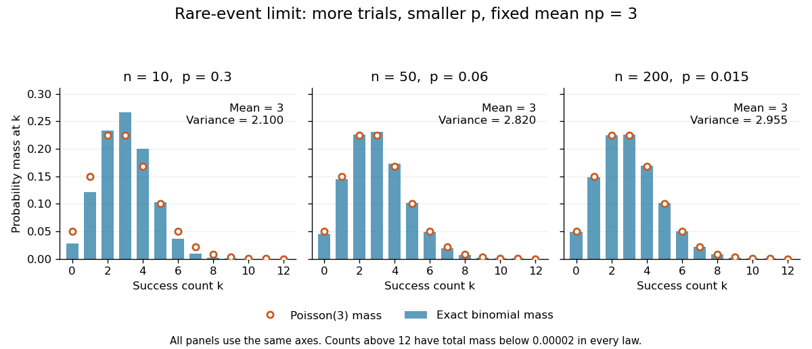

# Poisson distribution

↑ **Parent:** [Discrete probability distribution](discrete-probability-distribution-split.md)  
ⓦ [Wiki](https://en.wikipedia.org/wiki/Poisson_distribution)

For $\lambda>0$, a [Poisson random variable](poisson-distribution.md) $N$ has [probability mass function](probability-mass-function.md)

$$
\mathbb P(N=k)=e^{-\lambda}\frac{\lambda^k}{k!},\quad k=0,1,2,\ldots,
\qquad \mathbb E N=\operatorname{Var}(N)=\lambda.
$$

The [exponential function](exponential-function.md) series verifies normalization. At $\lambda=0$, define $N=0$ with certainty. The equality of [mean](expected-value.md) and [variance](variance-split.md) is a distinguishing model property, though it does not by itself characterize the law.

When counting events in a homogeneous [Poisson process](poisson-process.md), distinguish its rate $r$ from the distribution parameter: an interval of duration $t$ has $\lambda=rt$. A rate measured per minute times a duration measured in minutes gives a dimensionless expected count. This process assumes [independent increments](independent-increments.md), a constant rate, and a negligible chance of multiple events relative to interval length in a sufficiently short interval. A rate alone does not establish a [Poisson distribution](poisson-distribution.md). See [Bertsekas and Tsitsiklis, chapter 6 summary, pages 46-47](https://ocw.mit.edu/courses/res-6-012-introduction-to-probability-spring-2018/d973b10c2587781f86ca4f2aff49098f_MITRES_6_012S18_Textbook.pdf).

For a constructed arrival model with $r=2$ events per minute over $t=1.5$ minutes, $\lambda=3$. The [mean](expected-value.md) and [variance](variance-split.md) are both three, and

$$
\mathbb P(N=0)=e^{-3}\approx0.0497871,\qquad
\mathbb P(N=3)=e^{-3}\frac{3^3}{3!}=4.5e^{-3}\approx0.2240418.
$$

The [probability](probability.md) of at least one event is $1-e^{-3}\approx0.9502129$. These results describe the specified process, not every arrival mechanism with the same average rate.

The [Poisson limit theorem](poisson-limit-theorem.md), often called the law of rare events, connects this law to the [binomial distribution](binomial-distribution.md). Keep $\lambda>0$ fixed and let $K_n\sim\operatorname{Bin}(n,\lambda/n)$ for integers $n\geq\lambda$. For each fixed nonnegative integer $k$ and sufficiently large $n\geq k$,

$$
\mathbb P(K_n=k)=\frac{\lambda^k}{k!}
\left(\prod_{j=0}^{k-1}\left(1-\frac jn\right)\right)
\left(1-\frac\lambda n\right)^{n-k}
\longrightarrow e^{-\lambda}\frac{\lambda^k}{k!}.
$$

There are more opportunities, each less likely to succeed, while the [mean](expected-value.md) stays $\lambda$ and the [variance](variance-split.md) $\lambda(1-\lambda/n)$ approaches $\lambda$. For $\lambda=3$, the [probability](probability.md) of three successes is $0.2668279$ at $n=10$, $0.2310569$ at $n=50$, and $0.2257398$ at $n=200$, approaching the [Poisson distribution](poisson-distribution.md) value $0.2240418$.

**[Figure 8](#image-binomial-counts-approach-poisson-counts-while-their-mean-stays-fixed-at-three). Binomial counts approach Poisson counts while their mean stays fixed at three**.

The panels show the same count scale and the same [Poisson distribution](poisson-distribution.md) reference. At $n=10$, $p=0.3$ is not especially small and the difference is visible. No universal trial-count cutoff guarantees an adequate approximation for every event.

The [independence](independent-random-variables.md) assumption matters even when every success is rare. For $n\geq3$, if all $n$ [indicator random variables](indicator-random-variable.md) equal one shared [Bernoulli random variable](bernoulli-distribution.md) of parameter $3/n$, their sum is zero with [probability](probability.md) $1-3/n$ and $n$ with [probability](probability.md) $3/n$. Its [mean](expected-value.md) is three, yet its zero-count [probability](probability.md) tends to one, not $e^{-3}$. Some dependent counts still admit approximation through the [Stein-Chen method](stein-chen-method.md), but this requires additional control of dependence.

For historical orientation, the BnF records Poisson's original probability treatise, _Recherches sur la probabilité des jugements_, as published in Paris in 1837. This bibliographic fact alone does not establish when the modern distribution terminology arose. See [BnF record of Poisson's 1837 treatise](https://catalogue.bnf.fr/ark:/12148/cb31129269s).

**Table of contents**

- [Skellam distribution](skellam-distribution.md)
- [Mixed Poisson distribution](mixed-poisson-distribution.md)
  - [Overdispersion of nondegenerate mixed Poisson counts](overdispersion-of-nondegenerate-mixed-poisson-counts.md)
  - [Posterior mean from adjacent mixed Poisson probabilities](posterior-mean-from-adjacent-mixed-poisson-probabilities.md)
- [Poisson entropy monotonicity](poisson-entropy-monotonicity.md)
- [Stein-Chen method](stein-chen-method.md)
  - [Stein-Chen bound with the Poisson Stein factor](stein-chen-bound-with-the-poisson-stein-factor.md)
  - [Poisson approximation with dependency neighborhoods](poisson-approximation-with-dependency-neighborhoods.md)
  - [Poisson Stein equation](poisson-stein-equation.md)
- [Poisson size-bias identity](poisson-size-bias-identity.md)
- [Upper-truncated Poisson distribution](upper-truncated-poisson-distribution.md)
- [Poisson mixture](poisson-mixture.md)
  - [Poisson-uniform posterior mean](poisson-uniform-posterior-mean.md)
  - [Shifted-exponential Poisson mixture](shifted-exponential-poisson-mixture.md)
    - [Shifted-exponential Poisson count recursion](shifted-exponential-poisson-count-recursion.md)
- [Zero-truncated Poisson distribution](zero-truncated-poisson-distribution.md)
  - [Parity estimator for a zero-truncated Poisson count](parity-estimator-for-a-zero-truncated-poisson-count.md)
- [Addition of independent Poisson random variables](addition-of-independent-poisson-random-variables.md)
- [Poisson approximation bound for dependent Bernoulli variables](poisson-approximation-bound-for-dependent-bernoulli-variables.md)
- [Poisson observation model](poisson-observation-model.md)
  - [Poisson observation](poisson-observation.md)
- [Zero-inflated Poisson distribution](zero-inflated-poisson-distribution.md)
  - [Zero-inflated Poisson regression](zero-inflated-poisson-regression.md)
    - [Posterior structural-zero probability](posterior-structural-zero-probability.md)
    - [Component and marginal effects in zero-inflated regression](component-and-marginal-effects-in-zero-inflated-regression.md)
    - [EM algorithm for zero-inflated Poisson regression](em-algorithm-for-zero-inflated-poisson-regression.md)
- [Poisson central limit theorem](poisson-central-limit-theorem.md)
  - [Poisson cumulative probability at its growing mean](poisson-cumulative-probability-at-its-growing-mean.md)
- [Poisson-multinomial conditioning](poisson-multinomial-conditioning.md)
  - [Poisson trick](poisson-trick.md)
    - [Flat log-rate marginalization gives the multinomial likelihood](flat-log-rate-marginalization-gives-the-multinomial-likelihood.md)
      - [Gaussian log-rate correction to the Poisson trick](gaussian-log-rate-correction-to-the-poisson-trick.md)
- [Normal approximation to the Poisson distribution](normal-approximation-to-the-poisson-distribution.md)

## ↑ Ancestors (7)

1. [Discrete probability distribution](discrete-probability-distribution-split.md)
2. [Probability distribution](probability-distribution.md)
3. [Probability theory](probability-theory-split.md)
4. [Probability and statistics](probability-and-statistics-split.md)
5. [Area of mathematics](area-of-mathematics.md)
6. [Mathematics](mathematics-split.md)
7. [Codex Wiki](split.md)

## ← Incoming links (232)

- [Aggregation of macroparasite burdens](aggregation-of-macroparasite-burdens.md)
- [Bias of pooled flat-field ratio gain](bias-of-pooled-flat-field-ratio-gain.md)
- [Binomial accident portfolio with Poisson clusters](binomial-accident-portfolio-with-poisson-clusters.md)
- [Claim count](claim-count.md)
- [Claim count distribution](claim-count-distribution.md)
- [Collision-path coupling for slotted ALOHA](collision-path-coupling-for-slotted-aloha.md)
- [Compound mixed Poisson distribution](compound-mixed-poisson-distribution.md)
- [Compound Poisson cumulants](compound-poisson-cumulants.md)
- [Compound Poisson distribution](compound-poisson-distribution.md)
- [Conditional cure-weight equations for paired Poisson counts](conditional-cure-weight-equations-for-paired-poisson-counts.md)
- [Constant intensity does not imply independence](constant-intensity-does-not-imply-independence.md)
- [Constrained Poisson and multinomial likelihood equivalence](constrained-poisson-and-multinomial-likelihood-equivalence.md)
- [Critical-window connectivity probability of a binomial random graph](critical-window-connectivity-probability-of-a-binomial-random-graph.md)
- [Dependence in Poisson thinning](dependence-in-poisson-thinning.md)
- [Detector conversion gain](detector-conversion-gain.md)
- [Discrete probability distribution](discrete-probability-distribution-split.md)
- [Exceedance count limit for extreme order statistics](exceedance-count-limit-for-extreme-order-statistics.md)
- [Exponential Markov bound](exponential-markov-bound.md)
- [Factorial-moment criterion for Poisson convergence](factorial-moment-criterion-for-poisson-convergence.md)
- [Fano factor](fano-factor.md)
- [Finite-exposure Poisson inconsistency](finite-exposure-poisson-inconsistency.md)
- [Fixed point count of a uniform random permutation](fixed-point-count-of-a-uniform-random-permutation.md)
- [Gain estimation from flat-field ratios](gain-estimation-from-flat-field-ratios.md)
- [Gamma-integrated baseline Poisson likelihood](gamma-integrated-baseline-poisson-likelihood.md)
- [Gamma-mixed Poisson aggregate with exponential claims](gamma-mixed-poisson-aggregate-with-exponential-claims.md)
- [Gaussian-prior Poisson log-effect conditional](gaussian-prior-poisson-log-effect-conditional.md)
- [Geometric mutation count in a coalescent epoch](geometric-mutation-count-in-a-coalescent-epoch.md)
- [Haldane mapping function](haldane-mapping-function.md)
- [Immigration-death worm-burden model](immigration-death-worm-burden-model.md)
- [Infinite divisibility (probability)](infinite-divisibility-probability.md)
- [Infinite sites mutation model](infinite-sites-mutation-model.md)
- [Inflation-adjusted Poisson-gamma credibility](inflation-adjusted-poisson-gamma-credibility.md)
- [Insurance exposure](insurance-exposure.md)
- [L2 construction of compensated Poisson integrals](l2-construction-of-compensated-poisson-integrals.md)
- [Likelihood-ratio test of area-proportional Poisson means](likelihood-ratio-test-of-area-proportional-poisson-means.md)
- [Mating-limited macroparasite transmission](mating-limited-macroparasite-transmission.md)
- [Mixed Poisson distribution](mixed-poisson-distribution.md)
- [Moments of the mutation count on a neutral coalescent tree](moments-of-the-mutation-count-on-a-neutral-coalescent-tree.md)
- [Multiplication excess noise](multiplication-excess-noise.md)
- [Multitype Poisson branching process](multitype-poisson-branching-process.md)
- [Negative binomial distribution](negative-binomial-distribution.md)
- [Nested Poisson flood count](nested-poisson-flood-count.md)
- [Panjer claim-count class](panjer-claim-count-class.md)
- [Parametric statistical model](parametric-statistical-model.md)
- [Solution](past-exam-of-the-mathematics-course-of-the-university-of-cambridge/2001/ib/paper-2/12d/solution.md)
- [Solution](past-exam-of-the-mathematics-course-of-the-university-of-cambridge/2001/iii/paper-11/3/solution.md)
- [Solution](past-exam-of-the-mathematics-course-of-the-university-of-cambridge/2001/iii/paper-26/3/a/solution.md)
- [Solution](past-exam-of-the-mathematics-course-of-the-university-of-cambridge/2001/iii/paper-26/4/solution.md)
- [Solution](past-exam-of-the-mathematics-course-of-the-university-of-cambridge/2001/iii/paper-27/1/solution.md)
- [Solution](past-exam-of-the-mathematics-course-of-the-university-of-cambridge/2001/iii/paper-29/3/a/i/solution.md)
- [Solution](past-exam-of-the-mathematics-course-of-the-university-of-cambridge/2001/iii/paper-32/6/iii/solution.md)
- [Solution](past-exam-of-the-mathematics-course-of-the-university-of-cambridge/2001/iii/paper-52/3/solution.md)
- [Solution](past-exam-of-the-mathematics-course-of-the-university-of-cambridge/2001/iii/paper-73/3/solution.md)
- [Solution](past-exam-of-the-mathematics-course-of-the-university-of-cambridge/2002/ia/paper-2/10f/b/solution.md)
- [Solution](past-exam-of-the-mathematics-course-of-the-university-of-cambridge/2002/iii/paper-35/3/solution.md)
- [Solution](past-exam-of-the-mathematics-course-of-the-university-of-cambridge/2002/iii/paper-35/4/a/solution.md)
- [Solution](past-exam-of-the-mathematics-course-of-the-university-of-cambridge/2002/iii/paper-37/3/iii/solution.md)
- [Solution](past-exam-of-the-mathematics-course-of-the-university-of-cambridge/2002/iii/paper-37/4/iii/solution.md)
- [Solution](past-exam-of-the-mathematics-course-of-the-university-of-cambridge/2003/ia/paper-2/9f/solution.md)
- [Solution](past-exam-of-the-mathematics-course-of-the-university-of-cambridge/2003/iii/paper-38/4/ii/solution.md)
- [Solution](past-exam-of-the-mathematics-course-of-the-university-of-cambridge/2003/iii/paper-39/1/ii/solution.md)
- [Solution](past-exam-of-the-mathematics-course-of-the-university-of-cambridge/2003/iii/paper-40/2/i/solution.md)
- [Solution](past-exam-of-the-mathematics-course-of-the-university-of-cambridge/2004/iii/paper-11/1/solution.md)
- [Solution](past-exam-of-the-mathematics-course-of-the-university-of-cambridge/2004/iii/paper-28/5/c/solution.md)
- [Solution](past-exam-of-the-mathematics-course-of-the-university-of-cambridge/2004/iii/paper-37/1/i/solution.md)
- [Solution](past-exam-of-the-mathematics-course-of-the-university-of-cambridge/2004/iii/paper-39/1/ii/solution.md)
- [Solution](past-exam-of-the-mathematics-course-of-the-university-of-cambridge/2004/iii/paper-40/5/ii/solution.md)
- [Solution](past-exam-of-the-mathematics-course-of-the-university-of-cambridge/2004/iii/paper-41/1/i/solution.md)
- [Solution](past-exam-of-the-mathematics-course-of-the-university-of-cambridge/2004/iii/paper-41/1/iii/solution.md)
- [Solution](past-exam-of-the-mathematics-course-of-the-university-of-cambridge/2004/iii/paper-41/2/solution.md)
- [Solution](past-exam-of-the-mathematics-course-of-the-university-of-cambridge/2005/ia/paper-2/4f/solution.md)
- [Solution](past-exam-of-the-mathematics-course-of-the-university-of-cambridge/2005/ii/paper-2/5i/solution.md)
- [Solution](past-exam-of-the-mathematics-course-of-the-university-of-cambridge/2005/iii/paper-39/2/solution.md)
- [Solution](past-exam-of-the-mathematics-course-of-the-university-of-cambridge/2005/iii/paper-43/2/solution.md)
- [Solution](past-exam-of-the-mathematics-course-of-the-university-of-cambridge/2005/iii/paper-44/5/a/solution.md)
- [Solution](past-exam-of-the-mathematics-course-of-the-university-of-cambridge/2005/iii/paper-44/5/b/solution.md)
- [Solution](past-exam-of-the-mathematics-course-of-the-university-of-cambridge/2005/iii/paper-44/5/c/solution.md)
- [Solution](past-exam-of-the-mathematics-course-of-the-university-of-cambridge/2005/iii/paper-45/3/ii/solution.md)
- [Solution](past-exam-of-the-mathematics-course-of-the-university-of-cambridge/2005/iii/paper-47/6/solution.md)
- [Solution](past-exam-of-the-mathematics-course-of-the-university-of-cambridge/2006/ii/paper-1/6b/solution.md)
- [Solution](past-exam-of-the-mathematics-course-of-the-university-of-cambridge/2006/iii/paper-30/1/c/solution.md)
- [Solution](past-exam-of-the-mathematics-course-of-the-university-of-cambridge/2006/iii/paper-32/6/b/iii/solution.md)
- [Solution](past-exam-of-the-mathematics-course-of-the-university-of-cambridge/2006/iii/paper-34/1/solution.md)
- [Solution](past-exam-of-the-mathematics-course-of-the-university-of-cambridge/2006/iii/paper-41/3/solution.md)
- [Solution](past-exam-of-the-mathematics-course-of-the-university-of-cambridge/2006/iii/paper-43/2/solution.md)
- [Solution](past-exam-of-the-mathematics-course-of-the-university-of-cambridge/2006/iii/paper-43/3/solution.md)
- [Solution](past-exam-of-the-mathematics-course-of-the-university-of-cambridge/2006/iii/paper-45/4/b/solution.md)
- [Solution](past-exam-of-the-mathematics-course-of-the-university-of-cambridge/2006/iii/paper-45/4/d/solution.md)
- [Solution](past-exam-of-the-mathematics-course-of-the-university-of-cambridge/2007/ii/paper-1/13i/solution.md)
- [Solution](past-exam-of-the-mathematics-course-of-the-university-of-cambridge/2007/iii/paper-33/6/b/ii/solution.md)
- [Solution](past-exam-of-the-mathematics-course-of-the-university-of-cambridge/2007/iii/paper-33/6/c/solution.md)
- [Solution](past-exam-of-the-mathematics-course-of-the-university-of-cambridge/2007/iii/paper-35/1/solution.md)
- [Solution](past-exam-of-the-mathematics-course-of-the-university-of-cambridge/2007/iii/paper-35/3/solution.md)
- [Solution](past-exam-of-the-mathematics-course-of-the-university-of-cambridge/2007/iii/paper-37/3/solution.md)
- [Solution](past-exam-of-the-mathematics-course-of-the-university-of-cambridge/2007/iii/paper-46/1/c/solution.md)
- [Solution](past-exam-of-the-mathematics-course-of-the-university-of-cambridge/2007/iii/paper-48/5/b/i/solution.md)
- [Solution](past-exam-of-the-mathematics-course-of-the-university-of-cambridge/2007/iii/paper-49/3/solution.md)
- [Solution](past-exam-of-the-mathematics-course-of-the-university-of-cambridge/2008/ii/paper-1/27i/solution.md)
- [Solution](past-exam-of-the-mathematics-course-of-the-university-of-cambridge/2008/iii/paper-39/5/iii/solution.md)
- [Solution](past-exam-of-the-mathematics-course-of-the-university-of-cambridge/2008/iii/paper-41/3/solution.md)
- [Solution](past-exam-of-the-mathematics-course-of-the-university-of-cambridge/2008/iii/paper-42/1/solution.md)
- [Solution](past-exam-of-the-mathematics-course-of-the-university-of-cambridge/2008/iii/paper-42/5/solution.md)
- [Solution](past-exam-of-the-mathematics-course-of-the-university-of-cambridge/2008/iii/paper-43/1/b/solution.md)
- [Solution](past-exam-of-the-mathematics-course-of-the-university-of-cambridge/2008/iii/paper-43/2/solution.md)
- [Solution](past-exam-of-the-mathematics-course-of-the-university-of-cambridge/2008/iii/paper-46/1/b/solution.md)
- [Solution](past-exam-of-the-mathematics-course-of-the-university-of-cambridge/2008/iii/paper-46/1/c/solution.md)
- [Solution](past-exam-of-the-mathematics-course-of-the-university-of-cambridge/2009/ii/paper-2/5i/solution.md)
- [Solution](past-exam-of-the-mathematics-course-of-the-university-of-cambridge/2009/iii/paper-101/5/a/solution.md)
- [Solution](past-exam-of-the-mathematics-course-of-the-university-of-cambridge/2009/iii/paper-36/3/a/solution.md)
- [Solution](past-exam-of-the-mathematics-course-of-the-university-of-cambridge/2009/iii/paper-36/3/b/solution.md)
- [Solution](past-exam-of-the-mathematics-course-of-the-university-of-cambridge/2009/iii/paper-36/3/e/solution.md)
- [Solution](past-exam-of-the-mathematics-course-of-the-university-of-cambridge/2009/iii/paper-36/3/g/solution.md)
- [Solution](past-exam-of-the-mathematics-course-of-the-university-of-cambridge/2009/iii/paper-37/1/a/solution.md)
- [Solution](past-exam-of-the-mathematics-course-of-the-university-of-cambridge/2010/ii/paper-2/5j/solution.md)
- [Solution](past-exam-of-the-mathematics-course-of-the-university-of-cambridge/2010/iii/paper-32/2/2/solution.md)
- [Solution](past-exam-of-the-mathematics-course-of-the-university-of-cambridge/2010/iii/paper-34/2/b/solution.md)
- [Solution](past-exam-of-the-mathematics-course-of-the-university-of-cambridge/2010/iii/paper-36/2/a/solution.md)
- [Solution](past-exam-of-the-mathematics-course-of-the-university-of-cambridge/2010/iii/paper-36/2/b/solution.md)
- [Solution](past-exam-of-the-mathematics-course-of-the-university-of-cambridge/2010/iii/paper-36/2/f/solution.md)
- [Solution](past-exam-of-the-mathematics-course-of-the-university-of-cambridge/2010/iii/paper-38/1/a/solution.md)
- [Solution](past-exam-of-the-mathematics-course-of-the-university-of-cambridge/2010/iii/paper-38/2/solution.md)
- [Solution](past-exam-of-the-mathematics-course-of-the-university-of-cambridge/2011/ia/paper-2/3f/a/solution.md)
- [Solution](past-exam-of-the-mathematics-course-of-the-university-of-cambridge/2012/iii/paper-32/3/solution.md)
- [Solution](past-exam-of-the-mathematics-course-of-the-university-of-cambridge/2012/iii/paper-33/3/a/solution.md)
- [Solution](past-exam-of-the-mathematics-course-of-the-university-of-cambridge/2012/iii/paper-33/3/b/solution.md)
- [Solution](past-exam-of-the-mathematics-course-of-the-university-of-cambridge/2012/iii/paper-33/3/d/solution.md)
- [Solution](past-exam-of-the-mathematics-course-of-the-university-of-cambridge/2012/iii/paper-37/4/c/solution.md)
- [Solution](past-exam-of-the-mathematics-course-of-the-university-of-cambridge/2012/iii/paper-9/3/i/solution.md)
- [Solution](past-exam-of-the-mathematics-course-of-the-university-of-cambridge/2013/ia/paper-2/4f/ii/solution.md)
- [Solution](past-exam-of-the-mathematics-course-of-the-university-of-cambridge/2013/iii/paper-24/2/d/solution.md)
- [Solution](past-exam-of-the-mathematics-course-of-the-university-of-cambridge/2013/iii/paper-28/1/b/i/solution.md)
- [Solution](past-exam-of-the-mathematics-course-of-the-university-of-cambridge/2013/iii/paper-28/1/b/ii/solution.md)
- [Solution](past-exam-of-the-mathematics-course-of-the-university-of-cambridge/2013/iii/paper-28/2/b/solution.md)
- [Solution](past-exam-of-the-mathematics-course-of-the-university-of-cambridge/2013/iii/paper-28/2/solution.md)
- [Solution](past-exam-of-the-mathematics-course-of-the-university-of-cambridge/2013/iii/paper-28/4/b/i/solution.md)
- [Solution](past-exam-of-the-mathematics-course-of-the-university-of-cambridge/2013/iii/paper-28/4/b/iv/solution.md)
- [Solution](past-exam-of-the-mathematics-course-of-the-university-of-cambridge/2013/iii/paper-30/3/a/solution.md)
- [Solution](past-exam-of-the-mathematics-course-of-the-university-of-cambridge/2013/iii/paper-30/3/b/solution.md)
- [Solution](past-exam-of-the-mathematics-course-of-the-university-of-cambridge/2013/iii/paper-30/3/c/solution.md)
- [Solution](past-exam-of-the-mathematics-course-of-the-university-of-cambridge/2013/iii/paper-30/3/d/solution.md)
- [Solution](past-exam-of-the-mathematics-course-of-the-university-of-cambridge/2013/iii/paper-34/3/c/solution.md)
- [Solution](past-exam-of-the-mathematics-course-of-the-university-of-cambridge/2013/iii/paper-37/1/i/solution.md)
- [Solution](past-exam-of-the-mathematics-course-of-the-university-of-cambridge/2013/iii/paper-37/3/solution.md)
- [Solution](past-exam-of-the-mathematics-course-of-the-university-of-cambridge/2014/ia/paper-2/10f/solution.md)
- [Solution](past-exam-of-the-mathematics-course-of-the-university-of-cambridge/2014/ib/paper-1/19h/solution.md)
- [Solution](past-exam-of-the-mathematics-course-of-the-university-of-cambridge/2014/iii/paper-26/6/a/solution.md)
- [Solution](past-exam-of-the-mathematics-course-of-the-university-of-cambridge/2014/iii/paper-31/4/a/solution.md)
- [Solution](past-exam-of-the-mathematics-course-of-the-university-of-cambridge/2014/iii/paper-33/6/a/solution.md)
- [Solution](past-exam-of-the-mathematics-course-of-the-university-of-cambridge/2014/iii/paper-35/1/a/solution.md)
- [Solution](past-exam-of-the-mathematics-course-of-the-university-of-cambridge/2014/iii/paper-35/1/d/solution.md)
- [Solution](past-exam-of-the-mathematics-course-of-the-university-of-cambridge/2014/iii/paper-35/1/h/solution.md)
- [Solution](past-exam-of-the-mathematics-course-of-the-university-of-cambridge/2015/ii/paper-2/4j/solution.md)
- [Solution](past-exam-of-the-mathematics-course-of-the-university-of-cambridge/2015/iii/paper-29/6/ii/solution.md)
- [Solution](past-exam-of-the-mathematics-course-of-the-university-of-cambridge/2015/iii/paper-33/3/a/solution.md)
- [Solution](past-exam-of-the-mathematics-course-of-the-university-of-cambridge/2015/iii/paper-34/1/a/solution.md)
- [Solution](past-exam-of-the-mathematics-course-of-the-university-of-cambridge/2015/iii/paper-35/3/g/solution.md)
- [Solution](past-exam-of-the-mathematics-course-of-the-university-of-cambridge/2015/iii/paper-39/1/solution.md)
- [Solution](past-exam-of-the-mathematics-course-of-the-university-of-cambridge/2016/ia/paper-2/10f/d/solution.md)
- [Solution](past-exam-of-the-mathematics-course-of-the-university-of-cambridge/2016/ib/paper-3/20h/a/solution.md)
- [Solution](past-exam-of-the-mathematics-course-of-the-university-of-cambridge/2016/iii/paper-206/3/b/solution.md)
- [Solution](past-exam-of-the-mathematics-course-of-the-university-of-cambridge/2017/ia/paper-2/9f/b/solution.md)
- [Solution](past-exam-of-the-mathematics-course-of-the-university-of-cambridge/2017/ii/paper-2/25k/b/solution.md)
- [Solution](past-exam-of-the-mathematics-course-of-the-university-of-cambridge/2017/iii/paper-206/1/b/solution.md)
- [Solution](past-exam-of-the-mathematics-course-of-the-university-of-cambridge/2017/iii/paper-206/1/c/solution.md)
- [Solution](past-exam-of-the-mathematics-course-of-the-university-of-cambridge/2017/iii/paper-216/3/a/solution.md)
- [Solution](past-exam-of-the-mathematics-course-of-the-university-of-cambridge/2017/iii/paper-216/3/b/solution.md)
- [Solution](past-exam-of-the-mathematics-course-of-the-university-of-cambridge/2017/iii/paper-338/3/b/i/solution.md)
- [Solution](past-exam-of-the-mathematics-course-of-the-university-of-cambridge/2017/iii/paper-338/3/c/i/solution.md)
- [Solution](past-exam-of-the-mathematics-course-of-the-university-of-cambridge/2017/iii/paper-338/3/c/v/solution.md)
- [Solution](past-exam-of-the-mathematics-course-of-the-university-of-cambridge/2018/iii/paper-213/3/solution.md)
- [Solution](past-exam-of-the-mathematics-course-of-the-university-of-cambridge/2018/iii/paper-338/3/a/ii/solution.md)
- [Solution](past-exam-of-the-mathematics-course-of-the-university-of-cambridge/2019/ii/paper-3/13c/a/iii/solution.md)
- [Solution](past-exam-of-the-mathematics-course-of-the-university-of-cambridge/2021/ii/paper-1/13j/a/i/solution.md)
- [Solution](past-exam-of-the-mathematics-course-of-the-university-of-cambridge/2022/ii/paper-1/34a/c/solution.md)
- [Solution](past-exam-of-the-mathematics-course-of-the-university-of-cambridge/2022/ii/paper-4/27j/b/i/solution.md)
- [Solution](past-exam-of-the-mathematics-course-of-the-university-of-cambridge/2023/ib/paper-4/17h/b/solution.md)
- [Solution](past-exam-of-the-mathematics-course-of-the-university-of-cambridge/2023/ii/paper-1/28j/c/solution.md)
- [Solution](past-exam-of-the-mathematics-course-of-the-university-of-cambridge/2023/ii/paper-3/27j/a/solution.md)
- [Solution](past-exam-of-the-mathematics-course-of-the-university-of-cambridge/2023/ii/paper-3/27j/c/solution.md)
- [Solution](past-exam-of-the-mathematics-course-of-the-university-of-cambridge/2023/ii/paper-3/5j/solution.md)
- [Solution](past-exam-of-the-mathematics-course-of-the-university-of-cambridge/2023/ii/paper-4/13j/iii/solution.md)
- [Solution](past-exam-of-the-mathematics-course-of-the-university-of-cambridge/2023/ii/paper-4/13j/iv/solution.md)
- [Solution](past-exam-of-the-mathematics-course-of-the-university-of-cambridge/2023/ii/paper-4/13j/v/solution.md)
- [Solution](past-exam-of-the-mathematics-course-of-the-university-of-cambridge/2023/ii/paper-4/27j/a/solution.md)
- [Solution](past-exam-of-the-mathematics-course-of-the-university-of-cambridge/2023/ii/paper-4/27j/b/solution.md)
- [Solution](past-exam-of-the-mathematics-course-of-the-university-of-cambridge/2023/iii/paper-201/3/a/solution.md)
- [Solution](past-exam-of-the-mathematics-course-of-the-university-of-cambridge/2023/iii/paper-224/4/a/solution.md)
- [Solution](past-exam-of-the-mathematics-course-of-the-university-of-cambridge/2024/ia/paper-2/3f/b/i/solution.md)
- [Solution](past-exam-of-the-mathematics-course-of-the-university-of-cambridge/2024/iii/paper-207/6/b/ii/solution.md)
- [Solution](past-exam-of-the-mathematics-course-of-the-university-of-cambridge/2024/iii/paper-208/3/b/solution.md)
- [Solution](past-exam-of-the-mathematics-course-of-the-university-of-cambridge/2024/iii/paper-218/1/d/solution.md)
- [Solution](past-exam-of-the-mathematics-course-of-the-university-of-cambridge/2025/iii/paper-218/1/b/solution.md)
- [Persistent claim intensity can destroy the discount Markov property](persistent-claim-intensity-can-destroy-the-discount-markov-property.md)
- [Photon shot noise](photon-shot-noise.md)
- [Poisson branching process](poisson-branching-process.md)
- [Poisson characterization by independent binomial splitting](poisson-characterization-by-independent-binomial-splitting.md)
- [Poisson count change-point model with gamma priors](poisson-count-change-point-model-with-gamma-priors.md)
- [Poisson credibility with a shape-three Pareto intensity](poisson-credibility-with-a-shape-three-pareto-intensity.md)
- [Poisson cumulative probability at its growing mean](poisson-cumulative-probability-at-its-growing-mean.md)
- [Poisson distribution](poisson-distribution.md)
- [Poisson entropy monotonicity](poisson-entropy-monotonicity.md)
- [Poisson-gamma conjugacy with unequal exposures](poisson-gamma-conjugacy-with-unequal-exposures.md)
- [Poisson generalized linear mixed model](poisson-generalized-linear-mixed-model.md)
- [Poisson interarrival times](poisson-interarrival-times.md)
- [Poisson limit for occupancy fractions](poisson-limit-for-occupancy-fractions.md)
- [Poisson log-rate ratio](poisson-log-rate-ratio.md)
- [Poisson-lognormal random-effect model](poisson-lognormal-random-effect-model.md)
- [Poisson mean saturation at three distinct times](poisson-mean-saturation-at-three-distinct-times.md)
- [Poisson observation](poisson-observation.md)
- [Poisson process](poisson-process.md)
- [Poisson regression margin-matching score equations](poisson-regression-margin-matching-score-equations.md)
- [Poisson score linearization under proportional variance](poisson-score-linearization-under-proportional-variance.md)
- [Poisson size-bias identity](poisson-size-bias-identity.md)
- [Poisson surrogate for a conditional multinomial model](poisson-surrogate-for-a-conditional-multinomial-model.md)
- [Poisson thinning](poisson-thinning.md)
- [Poisson-uniform posterior mean](poisson-uniform-posterior-mean.md)
- [Posterior mean from adjacent mixed Poisson probabilities](posterior-mean-from-adjacent-mixed-poisson-probabilities.md)
- [Power of a two-sample rare-event comparison](power-of-a-two-sample-rare-event-comparison.md)
- [Proper gamma approximation to a Poisson Jeffreys prior](proper-gamma-approximation-to-a-poisson-jeffreys-prior.md)
- [Shifted-exponential Poisson mixture](shifted-exponential-poisson-mixture.md)
- [Signal-to-noise ratio in photon counting](signal-to-noise-ratio-in-photon-counting.md)
- [Stationary distribution of an M-M-infinity queue](stationary-distribution-of-an-m-m-infinity-queue.md)
- [Stationary increments](stationary-increments.md)
- [Stein-Chen method](stein-chen-method.md)
- [Superposition theorem for Poisson point processes](superposition-theorem-for-poisson-point-processes.md)
- [Two-group Poisson ratio conditional likelihood](two-group-poisson-ratio-conditional-likelihood.md)
- [Upper-truncated Poisson distribution](upper-truncated-poisson-distribution.md)
- [Zero claim sizes in a compound Poisson representation](zero-claim-sizes-in-a-compound-poisson-representation.md)
- [Zero-inflated Poisson distribution](zero-inflated-poisson-distribution.md)
- [Zero-inflated Poisson regression](zero-inflated-poisson-regression.md)
- [Zero-truncated Poisson distribution](zero-truncated-poisson-distribution.md)
- [Zeros trick](zeros-trick.md)
