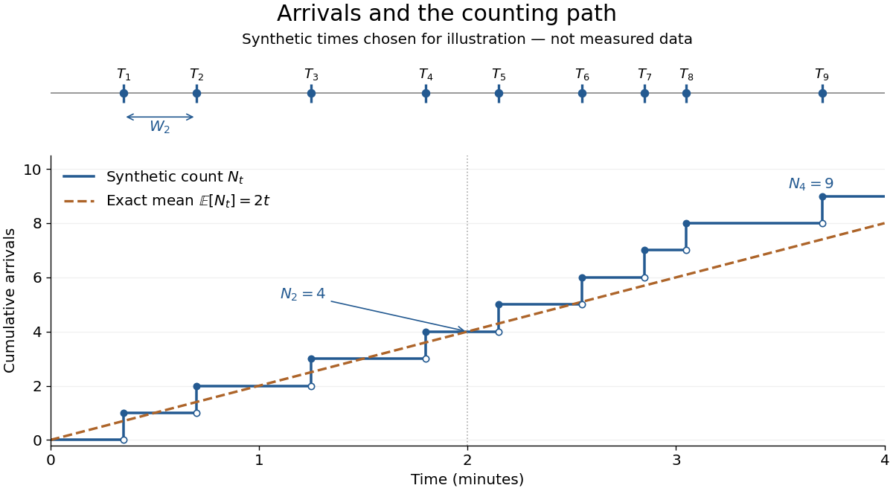

# Poisson process

↑ **Parent:** [Probability theory](probability-theory-split.md)  
ⓦ [Wiki](https://en.wikipedia.org/wiki/Poisson_process)

A [Homogeneous Poisson process](poisson-process-split.md) models arrivals at a constant rate $\lambda>0$. Its [counting process](counting-process.md) $N_t=N(t)$ counts arrivals in $(0,t]$, with $N_0=0$. Its paths are [right-continuous](right-continuous-function.md) [nondecreasing functions](nondecreasing-function.md), take nonnegative [integer](integer-split.md) values, and have unit jumps [almost surely](almost-sure-convergence.md). The defining [Poisson distribution](poisson-distribution.md) of each increment is

$$
\mathbb P(N_{s+t}-N_s=k)=e^{-\lambda t}\frac{(\lambda t)^k}{k!},\qquad s\geq0,\quad t>0,\quad k=0,1,2,\ldots.
$$

It has [stationary increments](stationary-increments.md): the [probability distribution](probability-distribution-split.md) above depends on the duration $t$, not the starting time $s$. It also has [independent increments](independent-increments.md): counts in any finite collection of disjoint time intervals are [independent random variables](independent-random-variables.md). Together these conditions specify the joint count laws, not merely the [Poisson distribution](poisson-distribution.md) at a single time.[pp. 78-79: counting-process definition and its equivalence to exponential interarrival times](discrete-stochastic-processes-draft-of-2nd-edition-31-january-2011-by-robert-gallager/poisson-processes-chapter-2.md)

The rate has units of arrivals per unit time; $\lambda t$ is dimensionless. The [Poisson distribution](poisson-distribution.md) gives

$$
\mathbb E[N_{s+t}-N_s]=\operatorname{Var}(N_{s+t}-N_s)=\lambda t.
$$

For a toy rate $\lambda=2$ per minute and a duration of $1.5$ minutes, the [expected value](expected-value-split.md) and [variance](variance-split.md) of the count are both $3$. The [probability](probability.md) of no arrival is $e^{-3}\approx0.049787$, and the [probability](probability.md) of exactly three is $3^3e^{-3}/3!=\tfrac92e^{-3}\approx0.224042$. In two consecutive one-minute intervals, the [probability](probability.md) of exactly two arrivals in the first and exactly one in the second is $(2e^{-2})(2e^{-2})=4e^{-4}\approx0.073263$, using [independent increments](independent-increments.md). These are exact model calculations with rounded decimals, not measured frequencies.

**[Figure 1](#image-synthetic-arrival-times-and-their-right-continuous-counting-path-compared-with-the-exact-mean-at-two-arrivals-per-minute). Synthetic arrival times and their right-continuous counting path, compared with the exact mean at two arrivals per minute**.

The diagram's nine hand-chosen arrivals illustrate a path; the line $\lambda t$ is an [expected value](expected-value-split.md), not a prescribed trajectory. Constant rate does not imply evenly spaced arrivals. [Poisson interarrival times](poisson-interarrival-times.md) connect the count description to waiting, while [Poisson thinning](poisson-thinning.md) explains how independently routing arrivals produces separate streams. This makes the [Poisson process](poisson-process-split.md) useful as a simple arrival model for a [queue](queue-queueing-theory.md), provided constant rate and [independent increments](independent-increments.md) are plausible. For a deterministic changing rate, use an [Inhomogeneous Poisson process](inhomogeneous-poisson-process.md); bunching or history-dependent arrivals need additional assumptions. Conditional on $N_t=n$, the arrival times are the [order statistics](order-statistic.md) of $n$ [independent](independent-random-variables.md) [uniform distributions](continuous-uniform-distribution.md) on $[0,t]$, as developed in [Poisson process conditional arrival times](poisson-process-conditional-arrival-times.md).

**Table of contents**

- [Poisson interarrival times](poisson-interarrival-times.md)
- [Poisson observation scheme and rate likelihood](poisson-observation-scheme-and-rate-likelihood.md)
- [Strong law for Poisson arrival times](strong-law-for-poisson-arrival-times.md)
- [Poisson exponential martingale](poisson-exponential-martingale.md)
- [Poisson maximal concentration bound](poisson-maximal-concentration-bound.md)
- [Every second Poisson arrival has underdispersed counts](every-second-poisson-arrival-has-underdispersed-counts.md)
- [Cox process](cox-process.md)
  - [Poisson offspring clusters directed by their parent process](poisson-offspring-clusters-directed-by-their-parent-process.md)
  - [Random directing measure of a Cox process](random-directing-measure-of-a-cox-process.md)
- [Inhomogeneous Poisson process](inhomogeneous-poisson-process.md)
  - [Time change of an inhomogeneous Poisson process](time-change-of-an-inhomogeneous-poisson-process.md)
- [Symmetric Poisson difference process](symmetric-poisson-difference-process.md)
- [Poisson thinning](poisson-thinning.md)
  - [Dependence in Poisson thinning](dependence-in-poisson-thinning.md)
  - [Poisson characterization by independent binomial splitting](poisson-characterization-by-independent-binomial-splitting.md)
  - [Categorical thinning of a Poisson claim count](categorical-thinning-of-a-poisson-claim-count.md)
  - [Poisson onset-bin independence](poisson-onset-bin-independence.md)
  - [Binomial thinning conditional on a total](binomial-thinning-conditional-on-a-total.md)
  - [Infinite-server queue transient distribution](infinite-server-queue-transient-distribution.md)
- [Kolmogorov forward equation for a Poisson process](kolmogorov-forward-equation-for-a-poisson-process.md)
- [Poisson process conditional arrival times](poisson-process-conditional-arrival-times.md)
- [Number of one Poisson type before another](number-of-one-poisson-type-before-another.md)
- [Exponential formula for a marked Poisson sum](exponential-formula-for-a-marked-poisson-sum.md)
- [Age of a Poisson process](age-of-a-poisson-process.md)

## ↑ Ancestors (5)

1. [Probability theory](probability-theory-split.md)
2. [Probability and statistics](probability-and-statistics-split.md)
3. [Area of mathematics](area-of-mathematics.md)
4. [Mathematics](mathematics-split.md)
5. [Codex Wiki](split.md)

## ← Incoming links (171)

- [Accidental coincidence](accidental-coincidence.md)
- [Alternating split of a Poisson process](alternating-split-of-a-poisson-process.md)
- [Atomic compound Poisson process with drift](atomic-compound-poisson-process-with-drift.md)
- [Burke theorem for a multi-server queue](burke-theorem-for-a-multi-server-queue.md)
- [Burke theorem for an M-M-infinity queue](burke-theorem-for-an-m-m-infinity-queue.md)
- [Classical risk model](classical-risk-model.md)
- [Compound Poisson process](compound-poisson-process.md)
- [Continuous-time symmetric simple random walk](continuous-time-symmetric-simple-random-walk.md)
- [Delayed neutron-capture coincidence window](delayed-neutron-capture-coincidence-window.md)
- [Dependence in Poisson thinning](dependence-in-poisson-thinning.md)
- [Detector dead time](detector-dead-time.md)
- [Difference of independent Poisson processes](difference-of-independent-poisson-processes.md)
- [Every second Poisson arrival has underdispersed counts](every-second-poisson-arrival-has-underdispersed-counts.md)
- [Exponential Laplace martingale of a compound Poisson process](exponential-laplace-martingale-of-a-compound-poisson-process.md)
- [Flow-level network model](flow-level-network-model.md)
- [Geometric galaxy-encounter rate](geometric-galaxy-encounter-rate.md)
- [Graphical representation of the contact process](graphical-representation-of-the-contact-process.md)
- [Heterogeneous two-server queue](heterogeneous-two-server-queue.md)
- [Increment](increment.md)
- [Independent increments](independent-increments.md)
- [Insensitivity of loss networks](insensitivity-of-loss-networks.md)
- [Inverse-power sum over Poisson arrivals](inverse-power-sum-over-poisson-arrivals.md)
- [Little's law](little-s-law.md)
- [Loss given default](loss-given-default.md)
- [Loss network](loss-network.md)
- [M/D/1 queue](m-d-1-queue.md)
- [M/M/1 utilization and delay](m-m-1-utilization-and-delay.md)
- [M-M-s-K queue](m-m-s-k-queue.md)
- [M/M/∞ queue](m-m-%E2%88%9E-queue.md)
- [Mutation count on a neutral coalescent tree](mutation-count-on-a-neutral-coalescent-tree.md)
- [Neuronal refractory period](neuronal-refractory-period.md)
- [Nonexplosion of a continuous-time Markov chain](nonexplosion-of-a-continuous-time-markov-chain.md)
- [Open migration process](open-migration-process.md)
- [Solution](past-exam-of-the-mathematics-course-of-the-university-of-cambridge/2001/iii/paper-73/1/solution.md)
- [Solution](past-exam-of-the-mathematics-course-of-the-university-of-cambridge/2002/iii/paper-28/4/solution.md)
- [Solution](past-exam-of-the-mathematics-course-of-the-university-of-cambridge/2002/iii/paper-31/1/solution.md)
- [Solution](past-exam-of-the-mathematics-course-of-the-university-of-cambridge/2003/iii/paper-30/6/solution.md)
- [Solution](past-exam-of-the-mathematics-course-of-the-university-of-cambridge/2003/iii/paper-31/2/solution.md)
- [Solution](past-exam-of-the-mathematics-course-of-the-university-of-cambridge/2003/iii/paper-34/1/solution.md)
- [Solution](past-exam-of-the-mathematics-course-of-the-university-of-cambridge/2003/iii/paper-34/2/i/solution.md)
- [Solution](past-exam-of-the-mathematics-course-of-the-university-of-cambridge/2003/iii/paper-39/3/i/solution.md)
- [Solution](past-exam-of-the-mathematics-course-of-the-university-of-cambridge/2004/iii/paper-29/2/solution.md)
- [Solution](past-exam-of-the-mathematics-course-of-the-university-of-cambridge/2004/iii/paper-29/3/solution.md)
- [Solution](past-exam-of-the-mathematics-course-of-the-university-of-cambridge/2005/ii/paper-1/26i/b/solution.md)
- [Solution](past-exam-of-the-mathematics-course-of-the-university-of-cambridge/2005/iii/paper-36/4/b/solution.md)
- [Solution](past-exam-of-the-mathematics-course-of-the-university-of-cambridge/2005/iii/paper-39/2/solution.md)
- [Solution](past-exam-of-the-mathematics-course-of-the-university-of-cambridge/2005/iii/paper-43/3/solution.md)
- [Solution](past-exam-of-the-mathematics-course-of-the-university-of-cambridge/2005/iii/paper-48/5/a/solution.md)
- [Solution](past-exam-of-the-mathematics-course-of-the-university-of-cambridge/2006/iii/paper-34/1/solution.md)
- [Solution](past-exam-of-the-mathematics-course-of-the-university-of-cambridge/2006/iii/paper-34/2/solution.md)
- [Solution](past-exam-of-the-mathematics-course-of-the-university-of-cambridge/2006/iii/paper-35/6/solution.md)
- [Solution](past-exam-of-the-mathematics-course-of-the-university-of-cambridge/2006/iii/paper-36/1/a/solution.md)
- [Solution](past-exam-of-the-mathematics-course-of-the-university-of-cambridge/2006/iii/paper-43/3/solution.md)
- [Solution](past-exam-of-the-mathematics-course-of-the-university-of-cambridge/2006/iii/paper-45/4/b/solution.md)
- [Solution](past-exam-of-the-mathematics-course-of-the-university-of-cambridge/2007/ii/paper-1/26j/a/solution.md)
- [Solution](past-exam-of-the-mathematics-course-of-the-university-of-cambridge/2007/iii/paper-35/1/solution.md)
- [Solution](past-exam-of-the-mathematics-course-of-the-university-of-cambridge/2007/iii/paper-35/4/solution.md)
- [Solution](past-exam-of-the-mathematics-course-of-the-university-of-cambridge/2007/iii/paper-37/1/b/solution.md)
- [Solution](past-exam-of-the-mathematics-course-of-the-university-of-cambridge/2007/iii/paper-45/3/solution.md)
- [Solution](past-exam-of-the-mathematics-course-of-the-university-of-cambridge/2007/iii/paper-46/1/b/solution.md)
- [Solution](past-exam-of-the-mathematics-course-of-the-university-of-cambridge/2007/iii/paper-73/1/b/solution.md)
- [Solution](past-exam-of-the-mathematics-course-of-the-university-of-cambridge/2008/ii/paper-4/26i/a/solution.md)
- [Solution](past-exam-of-the-mathematics-course-of-the-university-of-cambridge/2008/ii/paper-4/26i/b/solution.md)
- [Solution](past-exam-of-the-mathematics-course-of-the-university-of-cambridge/2008/iii/paper-35/1/solution.md)
- [Solution](past-exam-of-the-mathematics-course-of-the-university-of-cambridge/2008/iii/paper-35/2/solution.md)
- [Solution](past-exam-of-the-mathematics-course-of-the-university-of-cambridge/2008/iii/paper-35/5/solution.md)
- [Solution](past-exam-of-the-mathematics-course-of-the-university-of-cambridge/2008/iii/paper-43/3/solution.md)
- [Solution](past-exam-of-the-mathematics-course-of-the-university-of-cambridge/2008/iii/paper-89/3/solution.md)
- [Solution](past-exam-of-the-mathematics-course-of-the-university-of-cambridge/2009/ii/paper-3/26j/a/solution.md)
- [Solution](past-exam-of-the-mathematics-course-of-the-university-of-cambridge/2009/ii/paper-3/26j/b/solution.md)
- [Solution](past-exam-of-the-mathematics-course-of-the-university-of-cambridge/2009/ii/paper-4/26j/a/solution.md)
- [Solution](past-exam-of-the-mathematics-course-of-the-university-of-cambridge/2009/ii/paper-4/26j/b/solution.md)
- [Solution](past-exam-of-the-mathematics-course-of-the-university-of-cambridge/2009/iii/paper-101/5/a/solution.md)
- [Solution](past-exam-of-the-mathematics-course-of-the-university-of-cambridge/2009/iii/paper-101/5/c/solution.md)
- [Solution](past-exam-of-the-mathematics-course-of-the-university-of-cambridge/2009/iii/paper-30/1/i/solution.md)
- [Solution](past-exam-of-the-mathematics-course-of-the-university-of-cambridge/2009/iii/paper-30/1/ii/solution.md)
- [Solution](past-exam-of-the-mathematics-course-of-the-university-of-cambridge/2009/iii/paper-30/2/solution.md)
- [Solution](past-exam-of-the-mathematics-course-of-the-university-of-cambridge/2009/iii/paper-37/3/solution.md)
- [Solution](past-exam-of-the-mathematics-course-of-the-university-of-cambridge/2010/ii/paper-2/27i/b/solution.md)
- [Solution](past-exam-of-the-mathematics-course-of-the-university-of-cambridge/2010/ii/paper-2/27i/c/solution.md)
- [Solution](past-exam-of-the-mathematics-course-of-the-university-of-cambridge/2010/ii/paper-3/26i/a/solution.md)
- [Solution](past-exam-of-the-mathematics-course-of-the-university-of-cambridge/2010/iii/paper-30/1/a/solution.md)
- [Solution](past-exam-of-the-mathematics-course-of-the-university-of-cambridge/2010/iii/paper-30/2/a/solution.md)
- [Solution](past-exam-of-the-mathematics-course-of-the-university-of-cambridge/2010/iii/paper-30/2/b/solution.md)
- [Solution](past-exam-of-the-mathematics-course-of-the-university-of-cambridge/2011/ii/paper-3/26j/ii/solution.md)
- [Solution](past-exam-of-the-mathematics-course-of-the-university-of-cambridge/2012/iii/paper-32/2/solution.md)
- [Solution](past-exam-of-the-mathematics-course-of-the-university-of-cambridge/2012/iii/paper-33/3/c/solution.md)
- [Solution](past-exam-of-the-mathematics-course-of-the-university-of-cambridge/2012/iii/paper-40/3/solution.md)
- [Solution](past-exam-of-the-mathematics-course-of-the-university-of-cambridge/2013/iii/paper-24/2/d/solution.md)
- [Solution](past-exam-of-the-mathematics-course-of-the-university-of-cambridge/2013/iii/paper-28/3/solution.md)
- [Solution](past-exam-of-the-mathematics-course-of-the-university-of-cambridge/2013/iii/paper-37/1/i/solution.md)
- [Solution](past-exam-of-the-mathematics-course-of-the-university-of-cambridge/2013/iii/paper-37/5/solution.md)
- [Solution](past-exam-of-the-mathematics-course-of-the-university-of-cambridge/2013/iii/paper-72/3/d/solution.md)
- [Solution](past-exam-of-the-mathematics-course-of-the-university-of-cambridge/2014/iii/paper-26/6/c/solution.md)
- [Solution](past-exam-of-the-mathematics-course-of-the-university-of-cambridge/2014/iii/paper-35/1/a/solution.md)
- [Solution](past-exam-of-the-mathematics-course-of-the-university-of-cambridge/2014/iii/paper-35/1/b/solution.md)
- [Solution](past-exam-of-the-mathematics-course-of-the-university-of-cambridge/2014/iii/paper-35/1/d/solution.md)
- [Solution](past-exam-of-the-mathematics-course-of-the-university-of-cambridge/2014/iii/paper-62/4/solution.md)
- [Solution](past-exam-of-the-mathematics-course-of-the-university-of-cambridge/2015/ii/paper-2/24k/i/solution.md)
- [Solution](past-exam-of-the-mathematics-course-of-the-university-of-cambridge/2015/ii/paper-2/24k/ii/solution.md)
- [Solution](past-exam-of-the-mathematics-course-of-the-university-of-cambridge/2015/ii/paper-3/23k/i/solution.md)
- [Solution](past-exam-of-the-mathematics-course-of-the-university-of-cambridge/2015/iii/paper-29/6/ii/solution.md)
- [Solution](past-exam-of-the-mathematics-course-of-the-university-of-cambridge/2015/iii/paper-35/3/d/solution.md)
- [Solution](past-exam-of-the-mathematics-course-of-the-university-of-cambridge/2015/iii/paper-39/1/solution.md)
- [Solution](past-exam-of-the-mathematics-course-of-the-university-of-cambridge/2015/iii/paper-39/2/solution.md)
- [Solution](past-exam-of-the-mathematics-course-of-the-university-of-cambridge/2015/iii/paper-39/5/solution.md)
- [Solution](past-exam-of-the-mathematics-course-of-the-university-of-cambridge/2016/iii/paper-201/6/b/solution.md)
- [Solution](past-exam-of-the-mathematics-course-of-the-university-of-cambridge/2016/iii/paper-207/3/f/solution.md)
- [Solution](past-exam-of-the-mathematics-course-of-the-university-of-cambridge/2016/iii/paper-213/1/i/solution.md)
- [Solution](past-exam-of-the-mathematics-course-of-the-university-of-cambridge/2016/iii/paper-213/2/solution.md)
- [Solution](past-exam-of-the-mathematics-course-of-the-university-of-cambridge/2016/iii/paper-320/1/solution.md)
- [Solution](past-exam-of-the-mathematics-course-of-the-university-of-cambridge/2017/ii/paper-2/25k/a/solution.md)
- [Solution](past-exam-of-the-mathematics-course-of-the-university-of-cambridge/2018/ii/paper-1/28j/solution.md)
- [Solution](past-exam-of-the-mathematics-course-of-the-university-of-cambridge/2018/ii/paper-2/27j/solution.md)
- [Solution](past-exam-of-the-mathematics-course-of-the-university-of-cambridge/2018/ii/paper-3/27j/solution.md)
- [Solution](past-exam-of-the-mathematics-course-of-the-university-of-cambridge/2018/iii/paper-213/1/i/solution.md)
- [Solution](past-exam-of-the-mathematics-course-of-the-university-of-cambridge/2018/iii/paper-213/1/ii/solution.md)
- [Solution](past-exam-of-the-mathematics-course-of-the-university-of-cambridge/2018/iii/paper-213/1/iii/solution.md)
- [Solution](past-exam-of-the-mathematics-course-of-the-university-of-cambridge/2018/iii/paper-213/4/solution.md)
- [Solution](past-exam-of-the-mathematics-course-of-the-university-of-cambridge/2018/iii/paper-316/1/v/solution.md)
- [Solution](past-exam-of-the-mathematics-course-of-the-university-of-cambridge/2019/ii/paper-4/27k/c/solution.md)
- [Solution](past-exam-of-the-mathematics-course-of-the-university-of-cambridge/2019/iii/paper-201/6/a/solution.md)
- [Solution](past-exam-of-the-mathematics-course-of-the-university-of-cambridge/2019/iii/paper-346/2/solution.md)
- [Solution](past-exam-of-the-mathematics-course-of-the-university-of-cambridge/2020/ii/paper-4/27k/i/solution.md)
- [Solution](past-exam-of-the-mathematics-course-of-the-university-of-cambridge/2020/ii/paper-4/27k/iii/solution.md)
- [Solution](past-exam-of-the-mathematics-course-of-the-university-of-cambridge/2021/ii/paper-3/27k/c/solution.md)
- [Solution](past-exam-of-the-mathematics-course-of-the-university-of-cambridge/2022/ii/paper-3/27j/d/solution.md)
- [Solution](past-exam-of-the-mathematics-course-of-the-university-of-cambridge/2022/iii/paper-201/6/c/solution.md)
- [Solution](past-exam-of-the-mathematics-course-of-the-university-of-cambridge/2022/iii/paper-325/1/solution.md)
- [Solution](past-exam-of-the-mathematics-course-of-the-university-of-cambridge/2023/ii/paper-1/28j/a/solution.md)
- [Solution](past-exam-of-the-mathematics-course-of-the-university-of-cambridge/2023/ii/paper-3/27j/a/solution.md)
- [Solution](past-exam-of-the-mathematics-course-of-the-university-of-cambridge/2023/ii/paper-3/27j/c/solution.md)
- [Solution](past-exam-of-the-mathematics-course-of-the-university-of-cambridge/2025/ii/paper-3/27l/b/solution.md)
- [Solution](past-exam-of-the-mathematics-course-of-the-university-of-cambridge/2026/ii/paper-1/28k/a/solution.md)
- [Solution](past-exam-of-the-mathematics-course-of-the-university-of-cambridge/2026/iii/paper-201/6/e/solution.md)
- [Solution](past-exam-of-the-mathematics-course-of-the-university-of-cambridge/2026/iii/paper-353/4/a/i/solution.md)
- [Solution](past-exam-of-the-physics-a-course-of-the-university-of-cambridge/2017/paper-1/section-d/d13/a/solution.md)
- [Photon correlation loss and background model](photon-correlation-loss-and-background-model.md)
- [Poisson arrivals see time averages](poisson-arrivals-see-time-averages.md)
- [Poisson distribution](poisson-distribution.md)
- [Poisson exponential martingale](poisson-exponential-martingale.md)
- [Poisson maximal concentration bound](poisson-maximal-concentration-bound.md)
- [Poisson migration stream without a return path](poisson-migration-stream-without-a-return-path.md)
- [Poisson observation scheme and rate likelihood](poisson-observation-scheme-and-rate-likelihood.md)
- [Poisson process](poisson-process-split.md)
- [Poisson-sampled continuous-time Markov chain](poisson-sampled-continuous-time-markov-chain.md)
- [Poisson superposition of insurance portfolios](poisson-superposition-of-insurance-portfolios.md)
- [Poisson thinning](poisson-thinning.md)
- [Poisson time-change representation of a Markov chain](poisson-time-change-representation-of-a-markov-chain.md)
- [Poissonization](poissonization.md)
- [Queueing theory](queueing-theory-split.md)
- [Quota-share retention under exponential utility](quota-share-retention-under-exponential-utility.md)
- [Rearrangeable triangular loss network](rearrangeable-triangular-loss-network.md)
- [Refractory limits on neuronal firing](refractory-limits-on-neuronal-firing.md)
- [Ruin integro-differential equation](ruin-integro-differential-equation.md)
- [Sample path](sample-path.md)
- [Sample-path area identity for Little's law](sample-path-area-identity-for-little-s-law.md)
- [Shot noise](shot-noise.md)
- [Shot noise departures from Poisson statistics](shot-noise-departures-from-poisson-statistics.md)
- [SN 1987A neutrino burst](sn-1987a-neutrino-burst.md)
- [Stationary increments](stationary-increments.md)
- [Stochastic process](stochastic-process-split.md)
- [Strong law for Poisson arrival times](strong-law-for-poisson-arrival-times.md)
- [Survival integro-differential equation for a classical risk model](survival-integro-differential-equation-for-a-classical-risk-model.md)
- [Survival renewal equation for a classical risk model](survival-renewal-equation-for-a-classical-risk-model.md)
- [Symmetric Poisson difference process](symmetric-poisson-difference-process.md)
- [Symmetric simple exclusion process](symmetric-simple-exclusion-process.md)
- [Time change of an inhomogeneous Poisson process](time-change-of-an-inhomogeneous-poisson-process.md)
- [Trapped-ion fluorescence count model](trapped-ion-fluorescence-count-model.md)
- [Two-sided order statistics of a boundary-singular Poisson process](two-sided-order-statistics-of-a-boundary-singular-poisson-process.md)
- [Voter-model duality](voter-model-duality.md)
