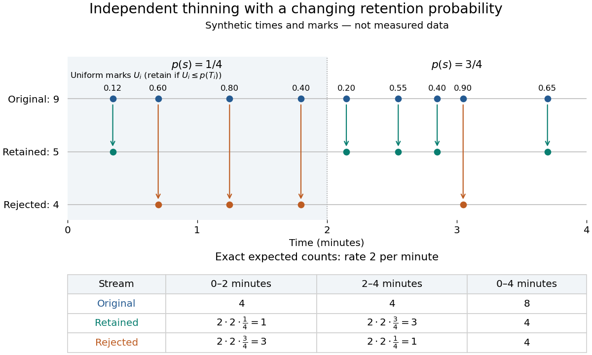

# Poisson thinning

↑ **Parent:** [Poisson process](poisson-process-split.md)

[Poisson thinning](poisson-thinning.md) splits a [Poisson process](poisson-process-split.md) by independently marking each arrival as retained or rejected. Let the original [Homogeneous Poisson process](poisson-process-split.md) have rate $\lambda>0$, and let $p(s)\in[0,1]$ be a deterministic [measurable function](measurable-function.md) of time. Attach [independent](independent-random-variables.md) [uniform distributions](continuous-uniform-distribution.md) $U_1,U_2,\ldots$ on $(0,1)$, independent of the entire original [Poisson process](poisson-process-split.md). At arrival time $T_i$, retain the arrival if $U_i\leq p(T_i)$. Given all arrival times, these decisions are [independent](independent-random-variables.md) and have the specified retention [probabilities](probability.md). Define the two [counting processes](counting-process.md) using an [indicator function](indicator-function.md):

$$
R_t=\sum_{i:T_i\leq t}\mathbf1_{\{U_i\leq p(T_i)\}},\qquad D_t=N_t-R_t.
$$

The [Poisson thinning theorem](poisson-thinning-theorem.md) gives [independent](independent-random-variables.md) retained and rejected [Inhomogeneous Poisson processes](inhomogeneous-poisson-process.md). Their rates are $\lambda p(s)$ and $\lambda(1-p(s))$, respectively, in the sense of the [intensity function of a point process](intensity-function-of-a-point-process.md). In particular, for $0\leq a<b$,

$$
R_b-R_a\sim\operatorname{Poisson}\!\left(\lambda\int_a^b p(s)\,ds\right),\qquad D_b-D_a\sim\operatorname{Poisson}\!\left(\lambda\int_a^b(1-p(s))\,ds\right).
$$

The [independence](independent-random-variables.md) is of the two whole processes: every finite collection of retained counts is [independent](independent-random-variables.md) of every finite collection of rejected counts. It is not merely zero [covariance](covariance.md) for one interval. For constant $p$, the streams are [Homogeneous Poisson processes](poisson-process-split.md) of rates $\lambda p$ and $\lambda(1-p)$; the endpoints $p=0,1$ include the identically zero stream.[Definition 5.7, Proposition 5.5, Theorem 5.8 and Corollary 5.9, printed pp. 42-44: location-dependent independent marking, intensities, and independence of the split processes](lectures-on-the-poisson-process-by-gunter-last-and-others.md)

For an exact toy calculation, take $\lambda=2$ per minute and retain with $p(s)=1/4$ on $(0,2]$ and $p(s)=3/4$ on $(2,4]$. In the first two minutes, the retained and rejected [expected values](expected-value-split.md) are $2\cdot2\cdot1/4=1$ and $2\cdot2\cdot3/4=3$. In the next two minutes they are $3$ and $1$. Over all four minutes, $R_4,D_4$ are [independent](independent-random-variables.md) [Poisson distributions](poisson-distribution.md) with [mean](expected-value-split.md) $4$ each, and their sum $N_4$ has [mean](expected-value-split.md) $8$. Thus

$$
\mathbb P(R_4=0,D_4=0)=e^{-4}e^{-4}=e^{-8},\qquad \mathbb P(R_4=2,D_4=3)=e^{-8}\frac{4^2}{2!}\frac{4^3}{3!}=\frac{256}{3}e^{-8}.
$$

These [probabilities](probability.md) and [expected values](expected-value-split.md) describe the model, not empirical measurements. In the diagram, the original nine synthetic arrivals split into five retained and four rejected arrivals; those realized counts need not equal their [expected values](expected-value-split.md).

**[Figure 2](#image-independent-marks-split-a-synthetic-poisson-arrival-path-with-exact-expected-counts-for-two-time-dependent-retention-probabilities). Independent marks split a synthetic Poisson arrival path, with exact expected counts for two time-dependent retention probabilities**.

The mechanism explains why mutually exclusive labels can yield [independent](independent-random-variables.md) counts: randomness of the original total offsets the dependence from allocating a fixed total. For constant $p$ and an interval with original [mean](expected-value-split.md) $m$, the conditional retained count has a [binomial distribution](binomial-distribution.md) given $N=n$. The joint [probability generating function](probability-generating-function.md) is

$$
\mathbb E[z^Rw^D]=\mathbb E[(pz+(1-p)w)^N]=\exp\{m(pz+(1-p)w-1)\}=e^{mp(z-1)}e^{m(1-p)(w-1)},\qquad 0\leq z,w\leq1.
$$

This factorization proves the two [independent](independent-random-variables.md) [Poisson distributions](poisson-distribution.md); disjoint original intervals give [independent](independent-random-variables.md) pairs. For varying $p(s)$, the [Independent marking theorem for Poisson point processes](independent-marking-theorem-for-poisson-point-processes.md) gives the same conclusion with the two integrated intensities. The [joint red and green Poisson count formula](joint-red-and-green-poisson-count-formula.md) gives the corresponding direct calculation with [probability mass functions](probability-mass-function.md).

Independence here is unconditional. After conditioning on $N=n$, the identity $D=n-R$ gives [covariance](covariance.md) $\operatorname{Cov}(R,D\mid N=n)=-np(1-p)$ for constant $p$. Thus the retained and rejected counts are dependent for $n>0$ and $0<p<1$, even though their unconditional [covariance](covariance.md) is zero. [Poisson thinning](poisson-thinning.md) can model independent routing of arrivals, or independent detection of arrivals with a known efficiency schedule; using only a retention fraction without checking the marking mechanism can give a wrong count law.

**Table of contents**

- [Dependence in Poisson thinning](dependence-in-poisson-thinning.md)
- [Poisson characterization by independent binomial splitting](poisson-characterization-by-independent-binomial-splitting.md)
- [Categorical thinning of a Poisson claim count](categorical-thinning-of-a-poisson-claim-count.md)
- [Poisson onset-bin independence](poisson-onset-bin-independence.md)
- [Binomial thinning conditional on a total](binomial-thinning-conditional-on-a-total.md)
- [Infinite-server queue transient distribution](infinite-server-queue-transient-distribution.md)

## ↑ Ancestors (6)

1. [Poisson process](poisson-process-split.md)
2. [Probability theory](probability-theory-split.md)
3. [Probability and statistics](probability-and-statistics-split.md)
4. [Area of mathematics](area-of-mathematics.md)
5. [Mathematics](mathematics-split.md)
6. [Codex Wiki](split.md)

## ← Incoming links (23)

- [Charge-transfer efficiency](charge-transfer-efficiency.md)
- [Solution](past-exam-of-the-mathematics-course-of-the-university-of-cambridge/2001/iii/paper-27/1/solution.md)
- [Solution](past-exam-of-the-mathematics-course-of-the-university-of-cambridge/2002/ia/paper-2/10f/b/solution.md)
- [Solution](past-exam-of-the-mathematics-course-of-the-university-of-cambridge/2006/ii/paper-4/26j/b/solution.md)
- [Solution](past-exam-of-the-mathematics-course-of-the-university-of-cambridge/2006/iii/paper-35/6/solution.md)
- [Solution](past-exam-of-the-mathematics-course-of-the-university-of-cambridge/2010/ii/paper-3/26i/a/solution.md)
- [Solution](past-exam-of-the-mathematics-course-of-the-university-of-cambridge/2012/iii/paper-33/3/d/solution.md)
- [Solution](past-exam-of-the-mathematics-course-of-the-university-of-cambridge/2013/iii/paper-28/2/solution.md)
- [Solution](past-exam-of-the-mathematics-course-of-the-university-of-cambridge/2015/iii/paper-35/3/d/solution.md)
- [Solution](past-exam-of-the-mathematics-course-of-the-university-of-cambridge/2018/ii/paper-1/28j/solution.md)
- [Solution](past-exam-of-the-mathematics-course-of-the-university-of-cambridge/2023/ia/paper-2/9f/b/solution.md)
- [Solution](past-exam-of-the-mathematics-course-of-the-university-of-cambridge/2023/ii/paper-3/27j/b/solution.md)
- [Solution](past-exam-of-the-mathematics-course-of-the-university-of-cambridge/2025/ii/paper-1/28l/c/solution.md)
- [Solution](past-exam-of-the-mathematics-course-of-the-university-of-cambridge/2026/ii/paper-1/28k/c/solution.md)
- [Solution](past-exam-of-the-mathematics-course-of-the-year-1-of-the-natural-sciences-course-of-the-university-of-cambridge/2007/paper-1/section-b/4/a/solution.md)
- [Poisson characterization by independent binomial splitting](poisson-characterization-by-independent-binomial-splitting.md)
- [Poisson onset-bin independence](poisson-onset-bin-independence.md)
- [Poisson process](poisson-process-split.md)
- [Poisson thinning](poisson-thinning.md)
- [Poissonized coupon completion time and count](poissonized-coupon-completion-time-and-count.md)
- [Retained compound Poisson aggregate](retained-compound-poisson-aggregate.md)
- [Transient distribution of an M-M-infinity queue](transient-distribution-of-an-m-m-infinity-queue.md)
- [Zero claim sizes in a compound Poisson representation](zero-claim-sizes-in-a-compound-poisson-representation.md)
