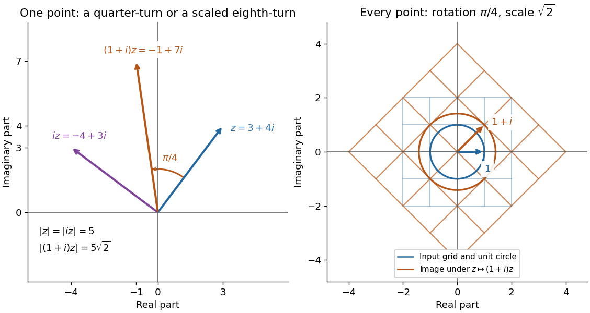

# Polar form of a complex number

↑ **Parent:** [Complex number](complex-number.md)

A nonzero [complex number](complex-number.md) has [polar form](polar-form-of-a-complex-number.md)

$$
z=r(\cos\theta+i\sin\theta)=re^{i\theta},\qquad r=|z|>0,
$$

where $r$ is its [modulus](modulus.md) and $\theta$ is an [argument](argument-complex-analysis.md). The equality uses [Euler's formula](euler-s-formula.md); [sine](sine.md) and [cosine](cosine.md) recover the [imaginary part](imaginary-part.md) and [real part](real-part.md) from [polar coordinates](polar-coordinates.md). For $z=3+4i$, take $r=5$ and $\theta=\arctan(4/3)\approx0.927295$ [radians](radian.md), so $\cos\theta=3/5$ and $\sin\theta=4/5$.

If $w=se^{i\phi}\ne0$, then

$$
zw=rs e^{i(\theta+\phi)},\qquad \frac zw=\frac rs e^{i(\theta-\phi)}.
$$

Thus [multiplication](multiplication.md) multiplies [moduli](modulus.md) and adds [arguments](argument-complex-analysis.md) modulo $2\pi$; [division](division-mathematics.md) divides [moduli](modulus.md) and subtracts [arguments](argument-complex-analysis.md) modulo $2\pi$. Since $1+i=\sqrt2 e^{i\pi/4}$, multiplying $3+4i$ by $1+i$ gives $-1+7i$, of [modulus](modulus.md) $5\sqrt2$ and [argument](argument-complex-analysis.md) $\theta+\pi/4\approx1.712693$ [radians](radian.md). One formula simultaneously describes its new size and direction.

**[Figure 9](#image-complex-multiplication-rotates-every-direction-and-scales-every-length-equally). Complex multiplication rotates every direction and scales every length equally**.

Repeated [multiplication](multiplication.md) now becomes especially simple: $(re^{i\theta})^n=r^n e^{in\theta}$ for a positive [integer](integer-split.md) $n$. This explains the evenly spaced [arguments](argument-complex-analysis.md) of the [roots of a complex number](root-of-a-complex-number.md). For example, $(3+4i)^2=-7+24i$ has [modulus](modulus.md) $25$ and principal [argument](argument-complex-analysis.md) $2\theta\approx1.854590$ [radians](radian.md). The Cartesian calculation and the [polar form](polar-form-of-a-complex-number.md) provide independent checks on both its location and its size. Choose [polar form](polar-form-of-a-complex-number.md) when the task concerns [multiplication](multiplication.md), [division](division-mathematics.md), or repeated turns; use [real parts](real-part.md) and [imaginary parts](imaginary-part.md) for [addition](addition.md).

**Table of contents**

- [Root of a complex number](root-of-a-complex-number.md)
  - [Complex square root](complex-square-root.md)

## ↑ Ancestors (6)

1. [Complex number](complex-number.md)
2. [Complex analysis](complex-analysis-split.md)
3. [Analysis](analysis-split.md)
4. [Area of mathematics](area-of-mathematics.md)
5. [Mathematics](mathematics-split.md)
6. [Codex Wiki](split.md)

## ← Incoming links (7)

- [Solution](past-exam-of-the-mathematics-course-of-the-university-of-cambridge/2010/ia/paper-1/2c/a/solution.md)
- [Solution](past-exam-of-the-mathematics-course-of-the-university-of-cambridge/2014/ia/paper-1/1b/a/i/solution.md)
- [Solution](past-exam-of-the-mathematics-course-of-the-year-1-of-the-natural-sciences-course-of-the-university-of-cambridge/2010/paper-1/14/a/iv/solution.md)
- [Solution](past-exam-of-the-mathematics-course-of-the-year-1-of-the-natural-sciences-course-of-the-university-of-cambridge/2012/paper-1/12/a/ii/solution.md)
- [Solution](past-exam-of-the-mathematics-course-of-the-year-1-of-the-natural-sciences-course-of-the-university-of-cambridge/2015/paper-1/11/b/solution.md)
- [Solution](past-exam-of-the-mathematics-course-of-the-year-1-of-the-natural-sciences-course-of-the-university-of-cambridge/2015/paper-1/18/d/solution.md)
- [Solution](past-exam-of-the-mathematics-course-of-the-year-1-of-the-natural-sciences-course-of-the-university-of-cambridge/2017/paper-1/11/a/solution.md)
