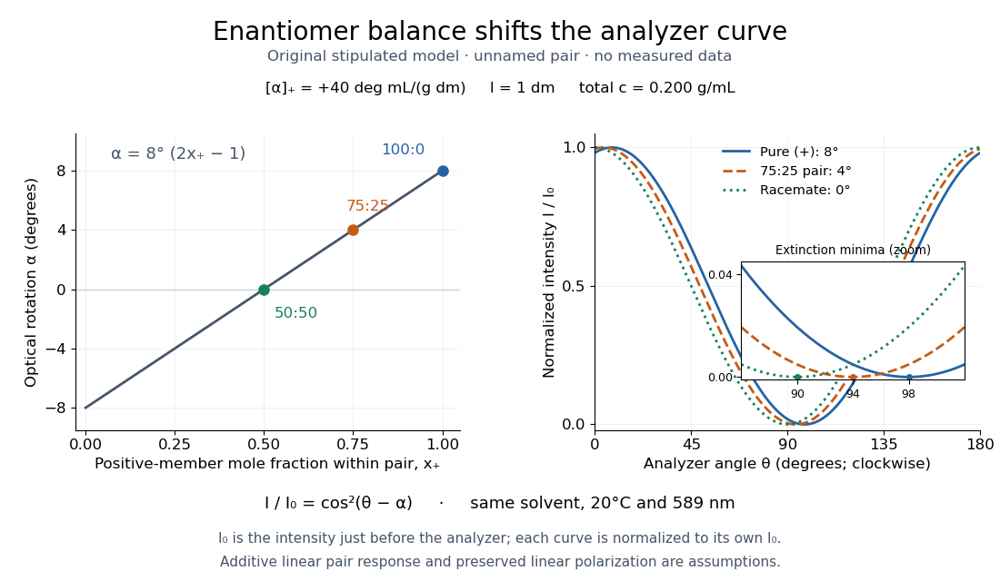

# Polarimetry

↑ **Parent:** [Optical activity](optical-activity.md)

[Polarimetry](polarimetry.md) measures [optical rotation](optical-rotation.md) with a [polarimeter](polarimeter.md). The vertical Vernier Go Direct instrument uses a $589\,\mathrm{nm}$ [light-emitting diode](light-emitting-diode.md) source, fixed [polarizer](polarizer.md), sample cell, motor-driven [polarimeter analyzer](polarimeter-analyzer.md), [photodetector](photodetector.md) and optical [rotary encoder](rotary-encoder.md). Calibrate using the same [solvent](solvent.md) at $10\,\mathrm{cm}$ fill height; rinse with sample, fill to $10.0\,\mathrm{cm}$, and read the meniscus to $0.1\,\mathrm{cm}$. The readout plots illumination against analyzer [angle](angle.md); a maximum near zero or a cosine-squared fit locates $\alpha$.[Using the Product steps 2–4; Specifications; How the Sensor Works](go-direct-polarimeter-user-manual-by-vernier.md)

An actual teaching experiment in the Truman State University-hosted Optical Activity Laboratory handout, revised July 2013, uses [sucrose](sucrose.md) [chemical solutions](solution-chemistry.md). Weigh the [sucrose](sucrose.md), dissolve completely without heating, and measure final solution [volume](volume-thermodynamics.md) for [concentration](concentration.md). Use one [polarimeter](polarimeter.md) throughout; measure the [water](water.md) blank's extinction reading, then each sample's extinction reading and actual liquid path length near $10\,\mathrm{cm}$. Subtract the blank and plot corrected [optical rotation](optical-rotation.md) against [concentration](concentration.md). The attached apparatus description specifies a vertical [light](light.md) path, an incandescent or tungsten source with yellow filter, sheet [polarizers](polarizer.md) and a rotating eyepiece [polarimeter analyzer](polarimeter-analyzer.md). Its coarse demonstration permits [temperature](temperature-split.md) control to the nearest $5^\circ\mathrm C$, path length to the nearest millimeter and approximately $1^\circ$ angular precision. These are design tolerances, not measured results.[Optical Activity Laboratory, revised July 2013, pp. 1–2 Experiment 1; p. 3 The Design and General Use of Simple Polarimeters](optical-activity-laboratory-truman-state-university.md)

For a quantitative comparison, equilibrate blank, reference and sample at the same recorded [temperature](temperature-split.md); use a thermostatted cell when needed. This is a recommended control, not a claim that the teaching instruments provide a thermostat. A yellow filter also passes a band of [wavelengths](wavelength.md), so its result need not match a narrow-source reference exactly. The laboratory's concentration series tests the linear model rather than establishing it in advance; a second series varying only path length tests the other factor.

For our original ideal model, [Malus's law](malus-s-law.md) gives

$$
I(\theta)=I_0\cos^2(\theta-\alpha),
$$

where $I_0$ is [light intensity](light-intensity.md) immediately before the ideal [polarimeter analyzer](polarimeter-analyzer.md), after sample transmission. It is not the intensity of the original unpolarized source. The [angle](angle.md) difference is evaluated in consistent units; the plotted degree values are converted to [radians](radian.md) before computing the [cosine](cosine.md). Assume transmitted [light](light.md) retains [linear polarization](linear-polarization.md), with negligible scattering and no polarization-dependent absorption. The pure positive model, $75{:}25$ mixture and [racemate](racemate.md) shift the maxima to $8^\circ$, $4^\circ$ and $0^\circ$, respectively. Minima shift by the same amount, to $98^\circ$, $94^\circ$ and $90^\circ$. Thus an extinction measurement and a maximum measurement recover the same shift after their respective blanks are subtracted.

**[Figure 4](#image-polarimetry-mixtures-and-analyzer-intensity). Computed optical rotations and polarimeter analyzer intensity for a stipulated enantiomer pair**. Original model, not experimental data: $k=40\,\mathrm{deg\,mL\,g^{-1}\,dm^{-1}}$, $l=1\,\mathrm{dm}$ and total pair [concentration](concentration.md) $c=0.200\,\mathrm{g\,mL^{-1}}$. Left: additive [optical rotation](optical-rotation.md) versus positive-member [mole fraction](mole-fraction.md). Right: normalized [Malus's law](malus-s-law.md) curves for $\alpha=8^\circ,4^\circ,0^\circ$, with a close view of their extinction minima. Normalization by each trace's pre-analyzer $I_0$ compares orientations rather than sample transmission losses.

Repeat blanks and use a reference to check drift and scale. Bubbles, particles, stressed windows and sample absorption can spoil the ideal curve. Vernier specifies $\pm1^\circ$ accuracy; the manual's $\pm0.1^\circ$ fit reproducibility does not establish that accuracy. It warns against interpreting its illumination readout quantitatively and requires a transparent homogeneous sample.[Using the Product, cosine-squared fit; Specifications; Troubleshooting, illumination and sample limits](go-direct-polarimeter-user-manual-by-vernier.md) Neither a zero reading nor a matching [specific rotation](specific-rotation.md) uniquely identifies a [molecule](molecule-split.md).

**Table of contents**

- [Polarimeter](polarimeter.md)
  - [Polarimeter analyzer](polarimeter-analyzer.md)

## ↑ Ancestors (5)

1. [Optical activity](optical-activity.md)
2. [Chirality (chemistry)](chirality-chemistry.md)
3. [Stereochemistry](stereochemistry-split.md)
4. [Chemistry](chemistry-split.md)
5. [Codex Wiki](split.md)

## ← Incoming links (8)

- [Chirality (chemistry)](chirality-chemistry.md)
- [Glucose mutarotation experiment](glucose-mutarotation-experiment.md)
- [Monosaccharide](monosaccharide.md)
- [Optical activity](optical-activity.md)
- [Optical rotation](optical-rotation.md)
- [Polarimeter](polarimeter.md)
- [Polarimetry](polarimetry.md)
- [Racemate](racemate.md)
