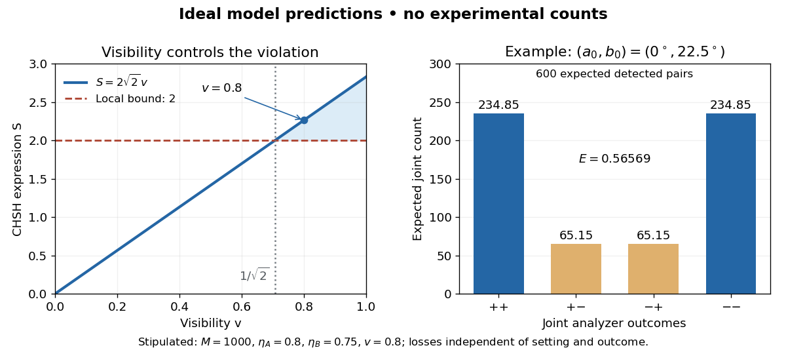

# Polarization CHSH count model

↑ **Parent:** [CHSH inequality](chsh-inequality.md)

Let $H,V$ be orthogonal [linear polarizations](linear-polarization.md), and prepare the [Bell state](bell-state-split.md) $|\Phi^+\rangle=(|HH\rangle+|VV\rangle)/\sqrt2$. The $+1$ analyzer vector is $|a\rangle=\cos a|H\rangle+\sin a|V\rangle$; its orthogonal companion has outcome $-1$. Direct [inner products](inner-product-split.md) with the [Bell state](bell-state-split.md) give $P_{++}=P_{--}=\cos^2(a-b)/2$ and $P_{+-}=P_{-+}=\sin^2(a-b)/2$. Thus the [expectation value](expectation-value.md) of the outcome product is $E(a,b)=\cos2(a-b)$. These are physical [polarizer](polarizer.md) angles; their corresponding [Bloch sphere](bloch-sphere.md) angles are doubled.

For a stipulated isotropic admixture, use the [density matrix](density-matrix-split.md)

$$
\rho_v=v|\Phi^+\rangle\langle\Phi^+|+(1-v)I_4/4,\qquad 0\leq v\leq1.
$$

The [maximally mixed state](maximally-mixed-state.md) contributes zero correlation, so $P_{st}(a,b)=[1+st\,v\cos2(a-b)]/4$ for $s,t\in\{-1,1\}$. Each local marginal is $1/2$, independently of the other setting, illustrating [quantum no-signalling](quantum-no-signalling.md). In this model $v$ is the [interferometric visibility](interferometric-visibility.md) of the coincidence fringe; other noise models need not have one common visibility for every basis.

Choose $a_0=0^\circ$, $a_1=45^\circ$, $b_0=22.5^\circ$ and $b_1=-22.5^\circ$. The four correlations in the displayed [CHSH inequality](chsh-inequality.md) are $v/\sqrt2,v/\sqrt2,v/\sqrt2,-v/\sqrt2$. Consequently $S=2\sqrt2v$, exceeding the local bound exactly when $v>1/\sqrt2$. Perfect correlation at a single common setting would not yield this comparison between incompatible [measurement in quantum measurements](quantum-measurement-split.md).

To connect [probabilities](probability.md) with expected counts, stipulate $M$ emitted pairs per setting pair and independent detection efficiencies $\eta_A,\eta_B$, independent also of settings, outcomes and hidden variables. The expected joint counts are $n_{st}=M\eta_A\eta_BP_{st}$. Their normalized correlation is

$$
E_{\rm det}=\frac{n_{++}+n_{--}-n_{+-}-n_{-+}}{n_{++}+n_{--}+n_{+-}+n_{-+}}=v\cos2(a-b).
$$

For original teaching inputs $M=1000$, $\eta_A=0.8$, $\eta_B=0.75$ and $v=0.8$, the $(a_0,b_0)$ expected counts are $n_{++}=n_{--}\simeq234.85$ and $n_{+-}=n_{-+}\simeq65.15$. They total $600$ and give $E_{\rm det}\simeq0.56569$, hence $S\simeq2.26274$. Fractional expected counts are not measured data. Efficiency cancels here because the loss model was specified to be independent; this algebra supplies no justification for discarding failures in an arbitrary [Bell test](bell-test.md) with a [detection loophole](detection-loophole.md).

**[Figure 2](#image-ideal-chsh-visibility-threshold-and-expected-detection-counts). Ideal CHSH visibility threshold and expected detection counts**. Original model predictions, not experimental data. The first panel shows the visibility needed to exceed the local bound. The second uses 1000 emitted pairs, efficiencies 0.8 and 0.75, and visibility 0.8; each bar is an expected joint count.

## ↑ Ancestors (7)

1. [CHSH inequality](chsh-inequality.md)
2. [Bell theorem](bell-theorem.md)
3. [Foundations of quantum mechanics](foundations-of-quantum-mechanics-split.md)
4. [Quantum theory](quantum-theory-split.md)
5. [Branches of physics](branches-of-physics.md)
6. [Physics](physics-split.md)
7. [Codex Wiki](split.md)

## ← Incoming links (3)

- [Bell test](bell-test.md)
- [CHSH inequality](chsh-inequality.md)
- [Fair sampling](fair-sampling.md)
