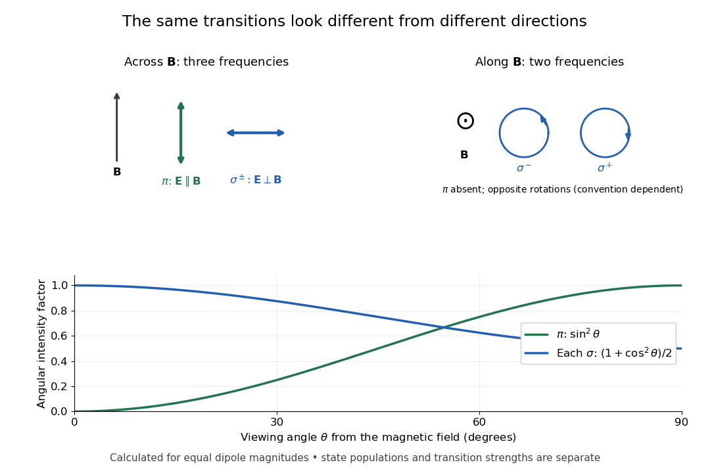

# Polarization of Zeeman components

↑ **Parent:** [Zeeman splitting](zeeman-splitting.md)

Viewed perpendicular to the [magnetic field](magnetic-field-split.md), the [normal Zeeman effect](normal-zeeman-effect.md) has a $\pi$ component with [linear polarization](linear-polarization.md) parallel to the [magnetic field](magnetic-field-split.md) and two $\sigma$ components polarized perpendicular to it. Along the [magnetic field](magnetic-field-split.md), $\pi$ vanishes and the $\sigma$ pair has opposite [circular polarizations](circular-polarization.md). [Pieter Zeeman](pieter-zeeman.md) described these geometry-dependent patterns in his lecture.[Light Radiation in a Magnetic Field, University of Maryland mirror PDF p. 3, rectilinear/circular oscillator discussion and cadmium photographs](light-radiation-in-a-magnetic-field-by-pieter-zeeman.md)

The geometry can be derived from [electric dipole radiation](electric-dipole-radiation.md). Let the observation unit [vector](vector.md) be $\mathbf n=(\sin\theta,0,\cos\theta)$, with $\theta$ measured from the [magnetic field](magnetic-field-split.md). Radiation retains only the transverse part of the oscillating [electric dipole moment](electric-dipole-moment.md) $\mathbf d$:

$$
\mathbf E_{\rm rad}\ \propto\ \mathbf d-\mathbf n(\mathbf n\cdot\mathbf d).
$$

For $\pi$, take $\mathbf d\parallel\hat{\mathbf z}$; its angular [light intensity](light-intensity.md) factor is $\sin^2\theta$, so it vanishes on axis. For $\sigma^\pm$, use normalized complex dipoles $(\hat{\mathbf x}\pm i\hat{\mathbf y})/\sqrt2$. Their angular factors are $(1+\cos^2\theta)/2$. Projection gives circles on axis, lines at $\theta=\pi/2$, and generally [elliptical polarization](elliptical-polarization.md) between. These factors assume equal dipole magnitudes; actual line [light intensities](light-intensity.md) also depend on initial [quantum state populations](quantum-state-population.md), transition strengths and collection geometry. No absolute handedness name is needed: it depends on the viewing and phase conventions.

**[Figure 4](#image-viewing-direction-selects-the-zeeman-polarization-pattern). Viewing direction selects the Zeeman polarization pattern**. Original projection diagram with the magnetic field vertical. The top panels show electric-field traces as seen by transverse and axial observers. The lower plot gives calculated dipole angular factors for equal dipole magnitudes; it is not a measured spectrum or an assumption of equal state populations.

A transverse [polarizer](polarizer.md) can separate $\pi$ from $\sigma$ even before the [spectral line](spectral-line.md) components are fully resolved. Along the [magnetic field](magnetic-field-split.md), a [quarter-wave plate](quarter-wave-plate.md) followed by a [polarizer](polarizer.md) converts the two opposite [circular polarizations](circular-polarization.md) into distinguishable linear settings. This explains why polarization analysis carried information beyond a small increase in line width.

## ↑ Ancestors (4)

1. [Zeeman splitting](zeeman-splitting.md)
2. [Atomic physics](atomic-physics-split.md)
3. [Physics](physics-split.md)
4. [Codex Wiki](split.md)
