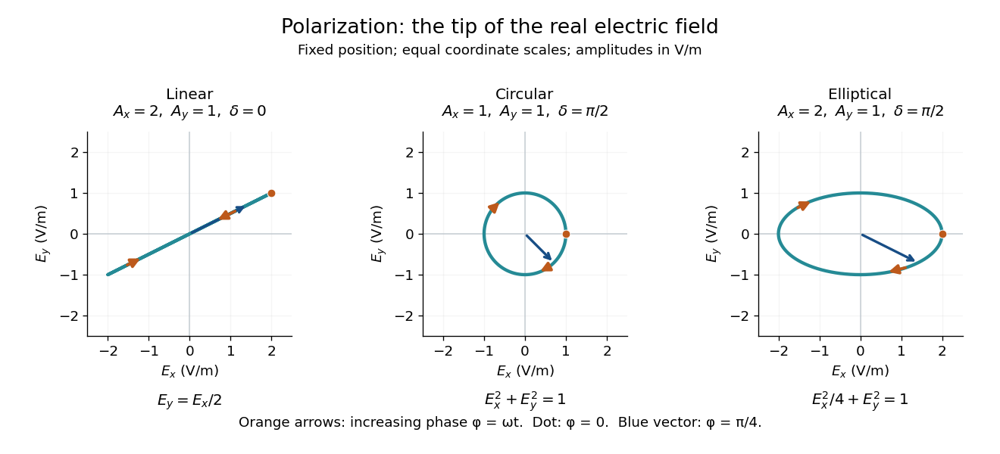

# Polarization (waves)

↑ **Parent:** [Wave](wave.md)  
ⓦ [Wiki](https://en.wikipedia.org/wiki/Polarization_(waves))

[Polarization of waves](polarization-waves.md) describes the direction and time-dependent geometry of a [transverse wave](transverse-wave.md)'s [vector](vector.md) during its [oscillation](oscillation.md) at a fixed position. In three spatial dimensions, a [transverse wave](transverse-wave.md) can have two independent directions of [oscillation](oscillation.md), both perpendicular to its direction of propagation. For [polarization of an electromagnetic wave](polarization-of-an-electromagnetic-wave.md), the relevant [vector](vector.md) is the transverse [electric field](electric-field.md); for a mechanical [transverse wave](transverse-wave.md), it can be the transverse [displacement](displacement.md). A purely [longitudinal wave](longitudinal-wave.md) has no choice between these transverse directions, and the orientation of a static [electric field](electric-field.md) is not [polarization of waves](polarization-waves.md).

Choose transverse axes $x,y$ in a [Cartesian coordinate system](cartesian-coordinate-system.md). A [monochromatic wave](monochromatic-wave.md) with a fixed [phase difference](phase-difference.md) has the real [electric field](electric-field.md)

$$
\mathbf E(t)=\bigl(A_x\cos\omega t,\ A_y\cos(\omega t+\delta)\bigr),\qquad A_x,A_y\geq0,\quad\omega>0.
$$

Here $A_x,A_y$ are [wave amplitudes](wave-amplitude.md), $\omega$ is the [angular frequency](angular-frequency.md), and $\delta$ is the [phase difference](phase-difference.md) of the $y$ [oscillation](oscillation.md) relative to the $x$ [oscillation](oscillation.md). The [vector](vector.md)'s tip traces its path during the [wave period](wave-period.md) $T=2\pi/\omega$. Both plotted coordinates are real [electric field](electric-field.md) components; neither axis represents the [imaginary part](imaginary-part.md) of a [complex amplitude](complex-amplitude.md).

For nonzero [wave amplitudes](wave-amplitude.md), $\delta=0$ or $\pi$ modulo $2\pi$ gives [linear polarization](linear-polarization.md): the [vector](vector.md) moves back and forth along a fixed line. Equal nonzero [wave amplitudes](wave-amplitude.md) and $\delta=\pm\pi/2$ modulo $2\pi$ give [circular polarization](circular-polarization.md): the tip traces a [circle](circle.md) of constant [radius](radius.md). Unequal nonzero [wave amplitudes](wave-amplitude.md) with $\delta=\pm\pi/2$ give a noncircular [ellipse](ellipse.md) whose axes coincide with $x,y$. More generally, nonzero [wave amplitudes](wave-amplitude.md) and $\sin\delta\neq0$ give [elliptical polarization](elliptical-polarization.md), with [circular polarization](circular-polarization.md) as a special case. If exactly one [wave amplitude](wave-amplitude.md) vanishes, the nonzero [wave](wave.md) has [linear polarization](linear-polarization.md) for every $\delta$; if both vanish, there is no nonzero [wave](wave.md) to assign a [polarization of waves](polarization-waves.md). [Feynman Lectures, I §33–1: the electric vector of light](https://www.feynmanlectures.caltech.edu/I_33.html#Ch33-S1).

For example, take $\omega=2\pi\,\mathrm{s}^{-1}$, so the [wave period](wave-period.md) is $T=1\,\mathrm{s}$. The choices $(A_x,A_y,\delta)=(2,1,0)$, $(1,1,\pi/2)$ and $(2,1,\pi/2)$, with [electric field](electric-field.md) [wave amplitudes](wave-amplitude.md) in $\mathrm{V/m}$, produce respectively the [line segment](line-segment.md) $E_y=E_x/2$, the [circle](circle.md) $E_x^2+E_y^2=1$ and the [ellipse](ellipse.md) $E_x^2/4+E_y^2=1$, when coordinates are measured in $\mathrm{V/m}$. At $t=T/4$, their tips are respectively $(0,0)$, $(0,-1)$ and $(0,-1)\,\mathrm{V/m}$. The last two share a point without having the same path.

**[Figure 4](#image-real-transverse-electric-field-trajectories-for-linear-polarization-circular-polarization-and-elliptical-polarization). Real transverse electric field trajectories for linear polarization, circular polarization and elliptical polarization**. All panels use the same coordinate scale. Orange arrows follow increasing [wave phase](phase-waves.md) $\phi=\omega t$; the dot marks $\phi=0$. The blue [vector](vector.md) is the [electric field](electric-field.md) at $\phi=\pi/4$. These are paths at one fixed position, rather than spatial drawings of a propagating [wave](wave.md).

Resolving the [electric field](electric-field.md) into two transverse components makes [polarization of waves](polarization-waves.md) useful: the same [frequency](frequency.md) and [wave amplitudes](wave-amplitude.md) can describe different paths when their [phase difference](phase-difference.md) changes. An ideal linear [polarizer](polarizer.md) selects the component along its pass axis, letting its orientation probe the direction of [linear polarization](linear-polarization.md) through [Malus's law](malus-s-law.md). A fixed pair of [wave amplitudes](wave-amplitude.md) and a fixed [phase difference](phase-difference.md) describe one stable path; [unpolarized light](unpolarized-light.md) requires a statistical description rather than one fixed [ellipse](ellipse.md).

**Table of contents**

- [Elliptical polarization](elliptical-polarization.md)
- [Malus's law](malus-s-law.md)
- [Unpolarized light](unpolarized-light.md)

## ↑ Ancestors (3)

1. [Wave](wave.md)
2. [Physics](physics-split.md)
3. [Codex Wiki](split.md)

## ← Incoming links (1)

- [Solution](past-exam-of-the-mathematics-course-of-the-university-of-cambridge/2002/iii/paper-54/3/solution.md)
