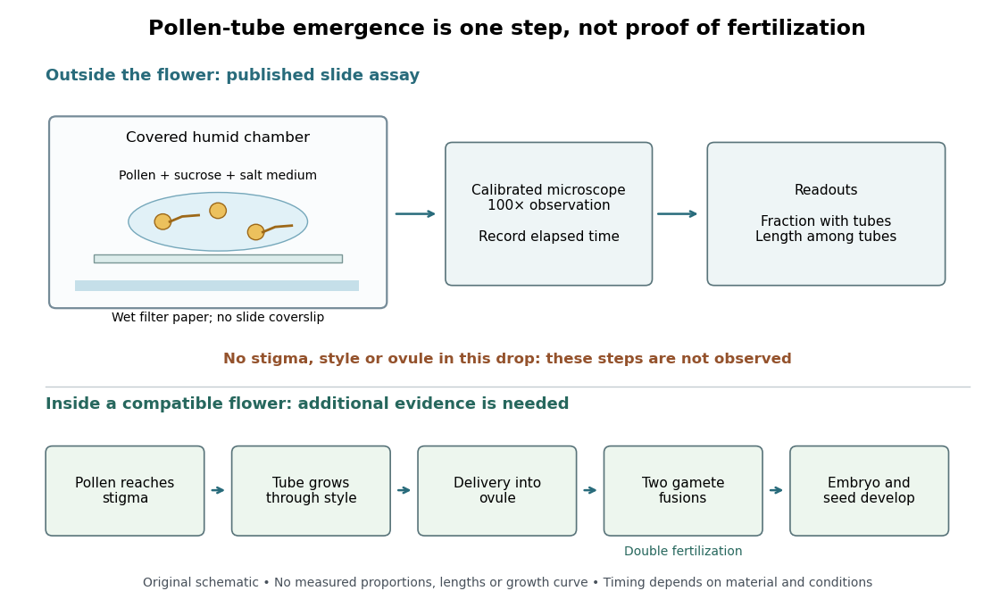

# Pollen tube germination assay

↑ **Parent:** [Pollen tube](pollen-tube.md)

A [pollen tube germination assay](pollen-tube-germination-assay.md) makes tube emergence visible outside a [flower](flower.md). The published Practical Biology experiment, [Observing the growth of pollen tubes (Practical Biology)](observing-the-growth-of-pollen-tubes-practical-biology.md), Technical note 3, lists florist [lilies](lilium.md) among successful materials without specifying a [species](species.md). Record the actual identification; success with one sample cannot establish a universal growth rate.[Technical note 3 and Teaching notes: material dependence and contorted versus straight tubes](observing-the-growth-of-pollen-tubes-practical-biology.md)

Pearson's [Core practical 4: Investigate the effect of sucrose concentration on pollen tube growth by Pearson Education Ltd](core-practical-4-investigate-the-effect-of-sucrose-concentration-on-pollen-tube-growth-by-pearson-education-ltd.md), Teacher sheet, pp. 1–2, describes an inspectable experiment. Mix equal volumes of [sucrose](sucrose.md) solution and mineral-[salt](salt-chemistry.md) medium on clean cavity slides. Dust in [pollen](pollen.md) from mature [anthers](anther.md) with a mounted needle, record the addition time, and incubate without coverslips in covered dishes containing wet filter paper. The moist chamber reduces drying; the uncovered drops avoid oxygen limitation. Brief observations with an [optical microscope](optical-microscope.md) at $100\times$, using an [eyepiece graticule](ocular-micrometer.md) calibrated against a [stage micrometer](stage-micrometer.md), reveal tube emergence and length. Return slides to the chambers and switch off the lamp between observations to reduce heating and drying. For comparisons of [sucrose](sucrose.md) [concentration](concentration.md), use the same [flower](flower.md) across treatments to control maturity, then repeat with other [flowers](flower.md).[Teacher sheet, pp. 1–2, steps 3–8 and answer 1; Technician sheet, p. 1, equipment and plant materials](core-practical-4-investigate-the-effect-of-sucrose-concentration-on-pollen-tube-growth-by-pearson-education-ltd.md)

**[Figure 38](#image-what-a-pollen-tube-germination-assay-observes-and-what-remains-to-reach-fertilization). What a pollen tube germination assay observes, and what remains to reach fertilization**. Original apparatus and evidence schematic. A drop contains [pollen](pollen.md) with and without emerged [pollen tubes](pollen-tube.md); these are cartoons, not measured tube lengths or experimental success proportions. The separate lower route shows the additional stages inside a compatible [flower](flower.md). No time or length scale is implied.

An additional proposed [experimental design](design-of-experiments-split.md) check is a medium-only slide: it tests whether debris is being mistaken for [pollen tubes](pollen-tube.md). Compare matched [pollen](pollen.md) samples at different final [sucrose](sucrose.md) [concentrations](concentration.md), keeping [temperature](temperature-split.md), elapsed time and observation rules fixed. A sample known to produce [pollen tubes](pollen-tube.md) in a previously successful medium would test whether an apparent failure comes from handling or the tested condition. These controls are questions to test, not guaranteed outcomes. A negative result cannot distinguish dead [pollen](pollen.md) from an unsuitable medium without further comparisons.

Two original calculations clarify the readout. First, take $0.40\,\mathrm{mL}$ of $0.80\,\mathrm{mol\,L^{-1}}$ [sucrose](sucrose.md) solution and $0.40\,\mathrm{mL}$ of [sucrose](sucrose.md)-free medium. Assuming additive [volumes](volume.md), conservation of the [amount of substance](amount-of-substance.md) gives

$$
c_{\mathrm{final}}=\frac{c_{\mathrm{stock}}V_{\mathrm{stock}}}{V_{\mathrm{stock}}+V_{\mathrm{medium}}}=0.40\,\mathrm{mol\,L^{-1}}.
$$

This [dilution](dilution.md) also halves the medium's original component [concentrations](concentration.md). Label the final [molar concentration](molar-concentration.md), not the starting bottle.

Second, stipulate a toy field containing $40$ [pollen](pollen.md) grains, of which $12$ have emerged [pollen tubes](pollen-tube.md). Its emergence fraction is $12/40=0.30$. If those twelve [pollen tubes](pollen-tube.md) have total measured length $960\,\mathrm{\mu m}$, their [arithmetic mean](arithmetic-mean.md) length is $80\,\mathrm{\mu m}$. Assigning length zero to the other grains instead gives $960/40=24\,\mathrm{\mu m}$ per grain. These invented numbers show why emergence fraction and mean length among emerged tubes answer different questions. Specify the denominator and the emergence criterion before counting, and avoid selecting only conspicuous long [pollen tubes](pollen-tube.md).

Tube emergence in a drop demonstrates growth under that medium's conditions. It observes no [stigma](stigma-botany.md) interaction, passage through a [style](style-botany.md), delivery into an [ovule](ovule.md), [gamete](gamete.md) fusion, or [seed](seed.md) development. Thus a positive [pollen tube germination assay](pollen-tube-germination-assay.md) does not demonstrate successful [fertilization](fertilization.md) in a living [flower](flower.md). Its beauty is making one otherwise hidden part of [sexual reproduction](sexual-reproduction.md) directly observable.[Teaching notes: steps between pollen germination and seed formation; prepared style slides as a separate observation](observing-the-growth-of-pollen-tubes-practical-biology.md)

## ↑ Ancestors (7)

1. [Pollen tube](pollen-tube.md)
2. [Pollen](pollen.md)
3. [Pollination](pollination.md)
4. [Sexual reproduction](sexual-reproduction.md)
5. [Reproduction](reproduction.md)
6. [Biology](biology-split.md)
7. [Codex Wiki](split.md)

## ← Incoming links (2)

- [Pollen tube germination assay](pollen-tube-germination-assay.md)
- [Stigma (botany)](stigma-botany.md)
