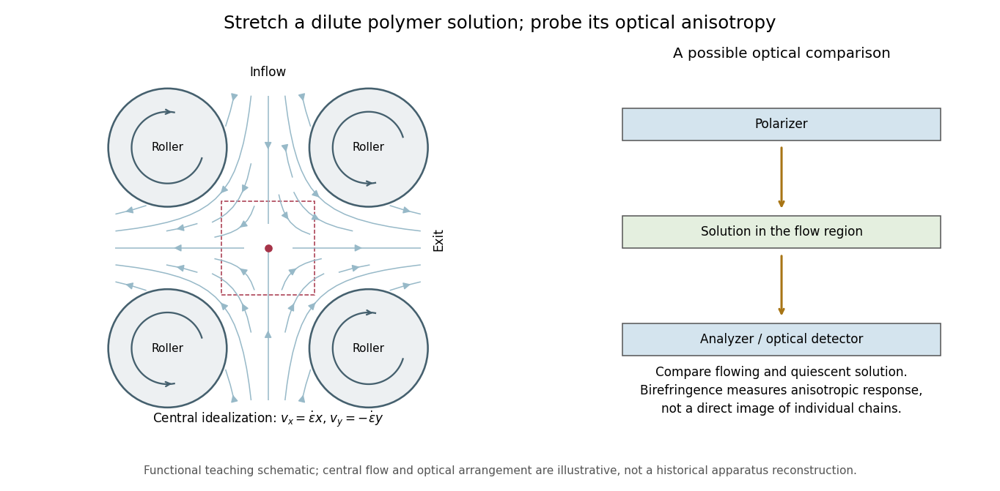
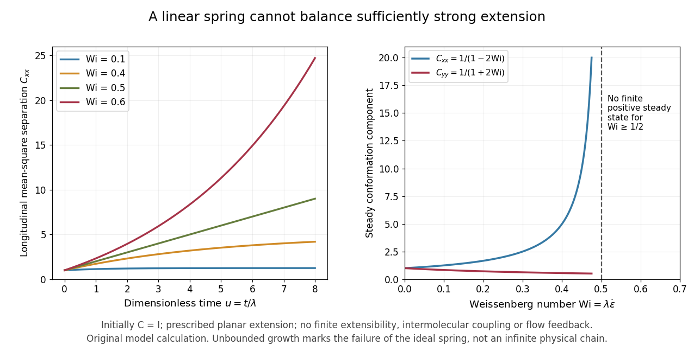
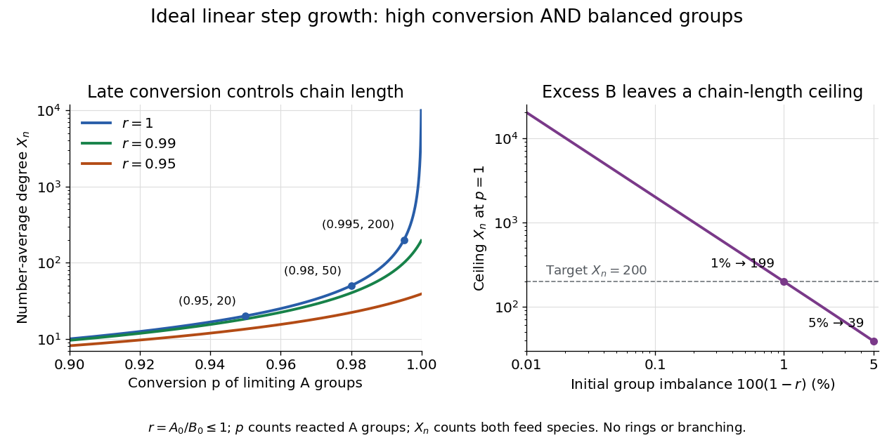

# Polymer

↑ **Parent:** [Chemistry](chemistry.md)  
ⓦ [Wiki](https://en.wikipedia.org/wiki/Polymer)

A [polymer](polymer.md) is a large molecular chain or network built from many chemically linked repeating units. Statistical chain models idealize its microscopic structure by segment vectors and describe its conformation through distributions, correlations and scattering. A [freely jointed chain](mathematical-biology.md#ideal-chain) fixes each segment length while allowing independent orientations; a [Gaussian chain](mathematical-biology.md#gaussian-chain) replaces the segment or coarse-grained displacement distribution by a [Gaussian distribution](probability-distribution.md#normal-distribution). These ideal models neglect excluded-volume and other segment interactions.

**Table of contents**

- [Entropic-trap length separation](#entropic-trap-length-separation)
- [Insertion barrier of a charged polymer](#insertion-barrier-of-a-charged-polymer)
  - [Confined-polymer entry and recoil times](#confined-polymer-entry-and-recoil-times)
- [Poly(p-phenylene terephthalamide)](#poly-p-phenylene-terephthalamide)
- [Entropic polymer depletion near nonadsorbing walls](#entropic-polymer-depletion-near-nonadsorbing-walls)
  - [Flow-dependent migration beyond an equilibrium polymer depletion sketch](#flow-dependent-migration-beyond-an-equilibrium-polymer-depletion-sketch)
- [Conducting polymer](#conducting-polymer)
- [Polyvinylpyrrolidone](#polyvinylpyrrolidone)
- [Polyether](#polyether)
- [Polyvinylidene fluoride](#polyvinylidene-fluoride)
- [Poly(methyl methacrylate)](#poly-methyl-methacrylate)
- [Supramolecular polymer](#supramolecular-polymer)
- [Molar mass distribution](#molar-mass-distribution)
- [Polyamide](#polyamide)
- [Regioregularity](#regioregularity)
- [Conjugated polymer](#conjugated-polymer)
- [Copolymer](#copolymer)
  - [Statistical copolymer](#statistical-copolymer)
    - [Copolymer melting-point depression](#copolymer-melting-point-depression)
    - [Vinyl chloride-vinyl alcohol copolymer](#vinyl-chloride-vinyl-alcohol-copolymer)
    - [Vinyl chloride-vinyl acetate copolymer](#vinyl-chloride-vinyl-acetate-copolymer)
      - [Competing dehydrochlorination during copolymer saponification](#competing-dehydrochlorination-during-copolymer-saponification)
    - [Random copolymer](#random-copolymer)
- [Polyvinyl alcohol](#polyvinyl-alcohol)
- [Polyvinyl acetate](#polyvinyl-acetate)
- [Polyvinyl chloride](#polyvinyl-chloride)
- [Block copolymer](#block-copolymer)
  - [Amphiphilic block copolymer](#amphiphilic-block-copolymer)
  - [Lamellar block-copolymer film](#lamellar-block-copolymer-film)
    - [Neutral wetting of a block-copolymer film](#neutral-wetting-of-a-block-copolymer-film)
    - [Asymmetric wetting of a block-copolymer film](#asymmetric-wetting-of-a-block-copolymer-film)
    - [Symmetric wetting of a block-copolymer film](#symmetric-wetting-of-a-block-copolymer-film)
  - [Diblock copolymer](#diblock-copolymer)
    - [Block-copolymer kinetic trapping](#block-copolymer-kinetic-trapping)
    - [Block volume fraction](#block-volume-fraction)
    - [Block copolymer segregation strength](#block-copolymer-segregation-strength)
- [Polymer backbone](#polymer-backbone)
  - [Polymer repeat unit](#polymer-repeat-unit)
- [Chain scission](#chain-scission)
- [Thermoplastic](#thermoplastic)
- [Polymer network](#polymer-network)
  - [Thermoset](#thermoset)
- [Inorganic polymer](#inorganic-polymer)
  - [Polythiazyl](#polythiazyl)
- [Polysulfur](#polysulfur)
- [Polymer mass fraction](#polymer-mass-fraction)
- [Tacticity](#tacticity)
- [Polypropylene](#polypropylene)
- [Lignin](#lignin)
- [Polybutadiene](#polybutadiene)
- [Silicone](#silicone)
  - [Polysiloxane](#polysiloxane)
  - [Polydimethylsiloxane](#polydimethylsiloxane)
- [Polyisoprene](#polyisoprene)
- [Biopolymer](#biopolymer)
- [Elastomer](#elastomer)
  - [Natural rubber](#natural-rubber)
  - [Rubber elasticity](#rubber-elasticity)
    - [Entropic network modulus](#entropic-network-modulus)
    - [Positive-feedback entropic chain](#positive-feedback-entropic-chain)
    - [Cross-link density inferred from rubber elasticity](#cross-link-density-inferred-from-rubber-elasticity)
- [Cross-link](#cross-link)
- [Polyethylene glycol](#polyethylene-glycol)
- [Polymer physics](#polymer-physics)
  - [Coil-globule transition](#coil-globule-transition)
  - [Polymers at interfaces](#polymers-at-interfaces)
  - [Rotational isomeric state model](#rotational-isomeric-state-model)
  - [Hydrodynamic volume](#hydrodynamic-volume)
  - [Zimm model](#zimm-model)
  - [Rouse model](#rouse-model)
    - [Free-draining polymer friction](#free-draining-polymer-friction)
  - [Grafted polymer chain](#grafted-polymer-chain)
    - [Grafting-from](#grafting-from)
    - [Grafting-to](#grafting-to)
    - [Grafting density](#grafting-density)
    - [Polymer brush](#polymer-brush)
      - [Dense-brush packing limit](#dense-brush-packing-limit)
      - [Polymer-brush volume fraction](#polymer-brush-volume-fraction)
      - [Theta-solvent brush height](#theta-solvent-brush-height)
      - [Alexander-de Gennes brush model](#alexander-de-gennes-brush-model)
      - [Polymer mushroom-to-brush crossover](#polymer-mushroom-to-brush-crossover)
      - [Poor-solvent brush height](#poor-solvent-brush-height)
      - [Good-solvent brush height](#good-solvent-brush-height)
    - [Polymer mushroom](#polymer-mushroom)
  - [Polymer entanglement](#polymer-entanglement)
  - [Polymer melt](#polymer-melt)
  - [End-to-end distance of a polymer chain](#end-to-end-distance-of-a-polymer-chain)
    - [Polymer contour length](#polymer-contour-length)
      - [Finite extensibility of a polymer chain](#finite-extensibility-of-a-polymer-chain)
  - [Reptation](#reptation)
  - [Tensile blob](#tensile-blob)
    - [Good-solvent force-extension scaling](#good-solvent-force-extension-scaling)
  - [Polymer adsorption](#polymer-adsorption)
    - [Adsorbed polymer tail](#adsorbed-polymer-tail)
    - [Adsorbed polymer loop](#adsorbed-polymer-loop)
    - [Adsorbed polymer train](#adsorbed-polymer-train)
    - [Equilibrium peeling force of an adsorbed Gaussian chain](#equilibrium-peeling-force-of-an-adsorbed-gaussian-chain)
    - [Adsorption blob](#adsorption-blob)
  - [Polymer relaxation time](#polymer-relaxation-time)
  - [Coil-stretch transition](#coil-stretch-transition)
    - [Keller four-roller polymer experiment](#keller-four-roller-polymer-experiment)
      - [Residence time in planar extension](#residence-time-in-planar-extension)
    - [Hookean dumbbell in planar extension](#hookean-dumbbell-in-planar-extension)
- [Teflon](#teflon)
- [Polystyrene](#polystyrene)
  - [Good-solvent size calibration for polystyrene](#good-solvent-size-calibration-for-polystyrene)
- [Flory approximation](#flory-approximation)
  - [Two-dimensional Flory approximation](#two-dimensional-flory-approximation)
- [Polymerization](#polymerization)
  - [Monomer functionality](#monomer-functionality)
  - [Chain termination](#chain-termination)
  - [Ring-opening polymerization](#ring-opening-polymerization)
    - [Ring-opening metathesis polymerization](#ring-opening-metathesis-polymerization)
  - [Cossee-Arlman mechanism](#cossee-arlman-mechanism)
  - [Step-growth polymerization](#step-growth-polymerization)
    - [Linear step-growth molecule count](#linear-step-growth-molecule-count)
      - [Functional-group conversion in step growth](#functional-group-conversion-in-step-growth)
    - [Carothers equation](#carothers-equation)
      - [Stoichiometric imbalance in step growth](#stoichiometric-imbalance-in-step-growth)
    - [Cyclization in step-growth polymerization](#cyclization-in-step-growth-polymerization)
    - [Polyaddition](#polyaddition)
      - [Residual-group monitoring of polyurethane formation](#residual-group-monitoring-of-polyurethane-formation)
    - [Polycondensation](#polycondensation)
      - [Silanol condensation](#silanol-condensation)
  - [Functionality in polymerization](#functionality-in-polymerization)
  - [Gelation](#gelation)
  - [Chain-growth polymerization](#chain-growth-polymerization)
    - [Catalyst-transfer polymerization](#catalyst-transfer-polymerization)
    - [Coordination polymerization](#coordination-polymerization)
    - [Radical polymerization](#radical-polymerization)
      - [Reversible-deactivation radical polymerization](#reversible-deactivation-radical-polymerization)
        - [Nitroxide-mediated polymerization](#nitroxide-mediated-polymerization)
    - [Polymerization-active site](#polymerization-active-site)
    - [Chain-growth initiation](#chain-growth-initiation)
    - [Chain-growth propagation](#chain-growth-propagation)
    - [Chain-growth termination](#chain-growth-termination)
    - [Chain transfer in chain polymerization](#chain-transfer-in-chain-polymerization)
    - [Finite chain-growth bookkeeping](#finite-chain-growth-bookkeeping)
    - [Living versus terminating chain populations](#living-versus-terminating-chain-populations)
    - [NMR monitoring of chain polymerization](#nmr-monitoring-of-chain-polymerization)
    - [Size-exclusion characterization of chain polymers](#size-exclusion-characterization-of-chain-polymers)
    - [Monitoring chain polymerization in a sealed tube](#monitoring-chain-polymerization-in-a-sealed-tube)
    - [Living polymerization](#living-polymerization)
- [Polyurethane](#polyurethane)
- [Degree of polymerization](#degree-of-polymerization)
- [Repeat unit](#repeat-unit)
- [Nylon 6,10](#nylon-6-10)
- [Polyethylene](#polyethylene)
- [Monomer](#monomer)
  - [Monomeric unit](#monomeric-unit)
  - [Monomer molecule](#monomer-molecule)
  - [Ethylene](#ethylene)
- [Nucleic acid](#nucleic-acid)
  - [DNA-RNA hybrid](#dna-rna-hybrid)
  - [Nucleic acid sequence](#nucleic-acid-sequence)
    - [GC content](#gc-content)
    - [Reverse complement](#reverse-complement)
  - [Base pair](#base-pair)
    - [Base pairing](#base-pairing)
      - [Watson-Crick base pairing](#watson-crick-base-pairing)
      - [Nucleic acid complementarity](#nucleic-acid-complementarity)
  - [Nucleic acid double helix](#nucleic-acid-double-helix)
    - [Antiparallel nucleic acid strands](#antiparallel-nucleic-acid-strands)
    - [Base stacking](#base-stacking)
  - [Stem-loop](#stem-loop)
    - [DNA hairpin](#dna-hairpin)
  - [Deoxyribonucleic acid](#deoxyribonucleic-acid)
    - [Nuclease protection assay](#nuclease-protection-assay)
    - [DNA hybridization](#dna-hybridization)
    - [DNA damage](#dna-damage)
      - [Chromosome breakage](#chromosome-breakage)
    - [Ancient DNA](#ancient-dna)
    - [DNA looping](#dna-looping)
    - [Negative supercoiling](#negative-supercoiling)
    - [Minor groove](#minor-groove)
    - [Major groove](#major-groove)
    - [DNA double helix](#dna-double-helix)
    - [Z-DNA](#z-dna)
    - [B-DNA](#b-dna)
    - [A-DNA](#a-dna)
    - [DNA supercoiling](#dna-supercoiling)
    - [Heteroduplex DNA](#heteroduplex-dna)
    - [Double-stranded DNA](#double-stranded-dna)
    - [Single-stranded DNA](#single-stranded-dna)
    - [DNA lesion](#dna-lesion)
  - [Ribonucleic acid](#ribonucleic-acid)
    - [Double-stranded RNA](#double-stranded-rna)
    - [Small nucleolar RNA](#small-nucleolar-rna)
    - [RNA localization](#rna-localization)
    - [RNA pseudoknot](#rna-pseudoknot)
    - [Small regulatory RNA](#small-regulatory-rna)
      - [Piwi-interacting RNA](#piwi-interacting-rna)
        - [21U RNA](#21u-rna)
        - [piRNA ping-pong amplification](#pirna-ping-pong-amplification)
        - [piRNA cluster](#pirna-cluster)
    - [MicroRNA](#microrna)
      - [lin-4 microRNA](#lin-4-microrna)
      - [MicroRNA-mediated deadenylation](#microrna-mediated-deadenylation)
      - [miR2111](#mir2111)
      - [MicroRNA-resistant target](#microrna-resistant-target)
      - [MicroRNA mimic](#microrna-mimic)
        - [MRX34](#mrx34)
      - [MicroRNA seed region](#microrna-seed-region)
      - [miR-34 family](#mir-34-family)
      - [miR-16-1](#mir-16-1)
      - [miR-15a](#mir-15a)
      - [let-7](#let-7)
    - [RNA secondary structure](#rna-secondary-structure)
      - [RNA looping](#rna-looping)
      - [Iron-responsive element](#iron-responsive-element)
      - [RNA modification switch](#rna-modification-switch)
    - [Messenger RNA](#messenger-rna)
      - [caudal messenger RNA](#caudal-messenger-rna)
      - [hunchback messenger RNA](#hunchback-messenger-rna)
      - [bicoid messenger RNA](#bicoid-messenger-rna)
      - [5′ untranslated region](#5′-untranslated-region)
      - [Polycistronic messenger RNA](#polycistronic-messenger-rna)
      - [psbA messenger RNA](#psba-messenger-rna)
      - [Beta-actin messenger RNA](#beta-actin-messenger-rna)
      - [nanos messenger RNA](#nanos-messenger-rna)
      - [3′ untranslated region](#3′-untranslated-region)
        - [Nanos response element](#nanos-response-element)
      - [Decapping](#decapping)
      - [Poly(A) tail](#poly-a-tail)
        - [Deadenylation](#deadenylation)
          - [CCR4-NOT complex](#ccr4-not-complex)
      - [oskar messenger RNA](#oskar-messenger-rna)
    - [Transfer RNA](#transfer-rna)
      - [Peptidyl-tRNA](#peptidyl-trna)
      - [Anticodon](#anticodon)
      - [Aminoacyl-tRNA](#aminoacyl-trna)
      - [Methionyl-tRNA](#methionyl-trna)
    - [Ribosomal RNA](#ribosomal-rna)
    - [Polyuridylic acid](#polyuridylic-acid)
- [Radius of gyration](#radius-of-gyration)
  - [Molecular-weight scaling of an ideal-chain gyration radius](#molecular-weight-scaling-of-an-ideal-chain-gyration-radius)
  - [Radius of gyration of a uniform sphere](#radius-of-gyration-of-a-uniform-sphere)

## Entropic-trap length separation

↑ **Parent:** [Polymer](polymer.md)

Repeated transitions between a broad reservoir and a narrow channel can accumulate length-dependent capture and relaxation delays. Uniform inside-channel drift alone may be [length](physics.md#length) independent and therefore insufficient for separation. A time-dependent drive can retain the length-sensitive delays, while stronger [advection](fluid-mechanics.md#advection) raises throughput but can erase selectivity. A quantitative ordering requires the actual barrier, chain dynamics and driving protocol.

## Insertion barrier of a charged polymer

↑ **Parent:** [Polymer](polymer.md)

If only the inserted [length](physics.md#length) $x$ feels a uniform inward [electric field](electric-field.md), its charge experiences [force](force.md) $qEx$, where $q$ is charge per contour [length](physics.md#length). Integrating gives electric energy $-qEx^2/2$. Adding a constant entropic confinement [force](force.md) gives the displayed free-energy profile. Its interior maximum is at $x=f/(qE)$ and has height $f^2/(2qE)$; entry waiting and subsequent directed insertion are distinct times.

### Confined-polymer entry and recoil times

↑ **Parent:** [Insertion barrier of a charged polymer](#insertion-barrier-of-a-charged-polymer)

With friction $\gamma(x)=\zeta_\ell x$, inward [force](force.md) $qEx$ gives constant entry [speed](classical-mechanics.md#speed) after capture. With the field off, constant outward [entropic force](force.md#entropic-force) gives $x\dot x=-f/\zeta_\ell$ and a quadratic recoil time. Exterior drag, adsorption and the short final end region are omitted. These ideal transport times alone do not establish steady size separation through a whole uniform channel.

<h2 id="poly-p-phenylene-terephthalamide">Poly(p-phenylene terephthalamide)</h2>

↑ **Parent:** [Polymer](polymer.md)

A synthetic aromatic polyamide with a relatively stiff backbone. Dilute-solution light scattering and viscometry provide evidence for rodlike conformations under the conditions investigated.[abstract, molecular characterization in solution](chemistry-bibliography.md#properties-of-some-rodlike-polymers-in-solution-by-c-p-wong-and-others)

## Entropic polymer depletion near nonadsorbing walls

↑ **Parent:** [Polymer](polymer.md)

A [polymer](polymer.md) near an impenetrable nonadsorbing wall has fewer allowed configurations than a coil in the bulk. This entropic loss suppresses its equilibrium [density](fluid-mechanics.md#density) over a scale comparable with its [radius of gyration](#radius-of-gyration). Strong confinement, adsorption and strong flow can change the profile; electrical neutrality does not remove configurational [entropy](entropy.md).

### Flow-dependent migration beyond an equilibrium polymer depletion sketch

↑ **Parent:** [Entropic polymer depletion near nonadsorbing walls](#entropic-polymer-depletion-near-nonadsorbing-walls)

## Conducting polymer

↑ **Parent:** [Polymer](polymer.md)

A polymeric material capable of appreciable electronic conduction, commonly through a conjugated backbone with an appropriate charge state. Conductivity, optical absorption, environmental stability and processing history must be specified; the material category does not guarantee a transparent-electrode specification.

## Polyvinylpyrrolidone

↑ **Parent:** [Polymer](polymer.md)

A [polymer](polymer.md) containing pyrrolidone groups, widely used as a soluble stabilizer or capping agent. In [silver](chemical-substance.md#silver) nanostructure synthesis its [adsorption](physical-chemistry.md#adsorption) can affect [facet](convex-set.md#facet) growth and aggregation. Residual [polymer](polymer.md) can also create electrically resistive [nanowire](engineering.md#nanowire) junctions.

## Polyether

↑ **Parent:** [Polymer](polymer.md)

A [polymer](polymer.md) or [oligomer](molecule.md#oligomer) with repeated [ether](chemical-substance.md#ether) linkages in its main chain.

## Polyvinylidene fluoride

↑ **Parent:** [Polymer](polymer.md)

A fluorinated [polymer](polymer.md) whose polar crystalline phases can exhibit [piezoelectricity](quantum-mechanics.md#piezoelectricity) and [pyroelectricity](electromagnetism.md#pyroelectricity).

<h2 id="poly-methyl-methacrylate">Poly(methyl methacrylate)</h2>

↑ **Parent:** [Polymer](polymer.md)

A thermoplastic [polymer](polymer.md) commonly used as a positive-tone electron-beam resist.

## Supramolecular polymer

↑ **Parent:** [Polymer](polymer.md)

A long chain or network maintained by reversible noncovalent association of molecular units.

## Molar mass distribution

↑ **Parent:** [Polymer](polymer.md)

The distribution of [molar masses](chemistry.md#molar-mass) among the chains in a [polymer](polymer.md) sample. Number-weighted and mass-weighted descriptions assign different relative weights to long chains: for populations $N_i$ of chains with [molar mass](chemistry.md#molar-mass) $M_i$, the [number-average molar mass](chemistry.md#number-average-molar-mass) is $M_n=\sum_iN_iM_i/\sum_iN_i$, while the [weight-average molar mass](chemistry.md#weight-average-molar-mass) is $M_w=\sum_iN_iM_i^2/\sum_iN_iM_i$. A single average does not determine the full distribution.

## Polyamide

↑ **Parent:** [Polymer](polymer.md)

A [polymer](polymer.md) containing repeated [amide](chemical-substance.md#amide) linkages in its main chain.

## Regioregularity

↑ **Parent:** [Polymer](polymer.md)

Consistent orientation of constitutionally unsymmetrical repeat units along a [polymer](polymer.md) chain.

## Conjugated polymer

↑ **Parent:** [Polymer](polymer.md)

A [polymer](polymer.md) with an extended sequence of conjugated bonds along its backbone.

## Copolymer

↑ **Parent:** [Polymer](polymer.md)

A [polymer](polymer.md) containing monomeric units derived from more than one monomer species.

### Statistical copolymer

↑ **Parent:** [Copolymer](#copolymer)

#### Copolymer melting-point depression

↑ **Parent:** [Statistical copolymer](#statistical-copolymer)

An ideal dilution estimate for a random copolymer whose comonomer units are excluded from the crystal. Let $x$ be the crystallizable-unit fraction in the melt and $\Delta h_f$ the molar enthalpy of fusion per such unit. Mixing contributes $RT\ln x$ to its liquid chemical potential. Approximate the unmixed liquid-minus-solid chemical-potential difference by $\Delta h_f(1-T/T_m^0)$. Equating the sum to zero gives the displayed relation. For $x<1$, the predicted melting temperature decreases. Nonideal mixing, finite crystallizable sequences, lamellar surface energy and comonomer inclusion can change the result.

#### Vinyl chloride-vinyl alcohol copolymer

↑ **Parent:** [Statistical copolymer](#statistical-copolymer)

A [copolymer](#copolymer) containing $-\mathrm{CH_2-CHCl}-$ and $-\mathrm{CH_2-CH(OH)}-$ units. It describes the intended chemical composition, not a guarantee that unselective alkaline treatment yields an undegraded polymer.

#### Vinyl chloride-vinyl acetate copolymer

↑ **Parent:** [Statistical copolymer](#statistical-copolymer)

A [copolymer](#copolymer) containing $-\mathrm{CH_2-CHCl}-$ and $-\mathrm{CH_2-CH(OAc)}-$ units. Hydrolysis changes the acetate side groups without requiring cleavage of the carbon backbone, provided competing degradation is controlled.

##### Competing dehydrochlorination during copolymer saponification

↑ **Parent:** [Vinyl chloride-vinyl acetate copolymer](#vinyl-chloride-vinyl-acetate-copolymer)

Alkaline conditions that hydrolyse acetate side groups can also promote elimination from chlorinated backbone units. Dechlorination, unsaturation, changed solubility and possible subsequent cross-linking complicate isolation of an ideal [vinyl chloride-vinyl alcohol copolymer](#vinyl-chloride-vinyl-alcohol-copolymer). The competition is condition-dependent: analytical work used staged treatment and precipitation to restrain dehydrochlorination, so difficulty under generic conditions is not a proof that every hydroxyl-containing chloride copolymer is impossible.[Abstract and pp. 619–623: staged treatment, polymer precipitation and suppressed dehydrochlorination](chemistry-bibliography.md#determination-of-vinyl-acetate-in-vinyl-chloride-acetate-copolymers-by-takanori-shimazaki-and-others)

#### Random copolymer

↑ **Parent:** [Statistical copolymer](#statistical-copolymer)

A [copolymer](#copolymer) with an ideal sequence in which the probability of a monomeric unit is independent of neighbouring units. A real copolymer made by concurrent radical reactions can have sequence correlations; a feed ratio does not by itself establish incorporated composition or independent-unit statistics.

## Polyvinyl alcohol

↑ **Parent:** [Polymer](polymer.md)

## Polyvinyl acetate

↑ **Parent:** [Polymer](polymer.md)

## Polyvinyl chloride

↑ **Parent:** [Polymer](polymer.md)

## Block copolymer

↑ **Parent:** [Polymer](polymer.md)  
ⓦ [Wiki](https://en.wikipedia.org/wiki/Block_copolymer)

A [polymer](polymer.md) composed of connected blocks with different repeat-unit chemistry. Incompatible blocks can form spatially distinct domains while remaining covalently connected.

### Amphiphilic block copolymer

↑ **Parent:** [Block copolymer](#block-copolymer)

A [block copolymer](#block-copolymer) with blocks having different solvent affinities, permitting solvent-selective assembly into [micelles](physical-chemistry.md#micelle) and other morphologies.

### Lamellar block-copolymer film

↑ **Parent:** [Block copolymer](#block-copolymer)

A thin [block copolymer](#block-copolymer) film forming alternating sheet-like domains. Domain period, film thickness and the preferences of both boundaries constrain orientation and termination.

#### Neutral wetting of a block-copolymer film

↑ **Parent:** [Lamellar block-copolymer film](#lamellar-block-copolymer-film)

A boundary has approximately equal interfacial free energies against the two blocks. One neutral boundary does not remove selectivity at the other boundary.

#### Asymmetric wetting of a block-copolymer film

↑ **Parent:** [Lamellar block-copolymer film](#lamellar-block-copolymer-film)

The two boundaries prefer opposite blocks. In a simple parallel lamellar stack, opposite terminations favour half-integer repeat thicknesses.

#### Symmetric wetting of a block-copolymer film

↑ **Parent:** [Lamellar block-copolymer film](#lamellar-block-copolymer-film)

The two boundaries prefer the same block. Parallel lamellae then tend to favour matching terminations and integer-period commensurability.

### Diblock copolymer

↑ **Parent:** [Block copolymer](#block-copolymer)

A [block copolymer](#block-copolymer) comprising two covalently joined blocks. Its domain morphology depends on block composition, segregation strength and chain conformational properties.

#### Block-copolymer kinetic trapping

↑ **Parent:** [Diblock copolymer](#diblock-copolymer)

A domain structure can persist because chain relaxation is too slow to reach the [thermodynamic equilibrium](thermodynamics.md#thermodynamic-equilibrium) morphology. A glassy block, rapid [solvent](mixture.md#solvent) loss or strong segregation can impede defect correction. Controlled thermal or [solvent](mixture.md#solvent) [annealing](engineering.md#annealing-materials-science) and time-dependent structural measurements distinguish arrested patterns from equilibrated phase stability.

#### Block volume fraction

↑ **Parent:** [Diblock copolymer](#diblock-copolymer)

The fraction of dry polymer volume assigned to one block, $f_A=V_A/(V_A+V_B)$. Selective solvent swelling changes an effective domain-volume ratio without changing this dry chemical composition.

#### Block copolymer segregation strength

↑ **Parent:** [Diblock copolymer](#diblock-copolymer)

The product $\chi N$ of the [Flory interaction parameter](mixture.md#flory-interaction-parameter) and [degree of polymerization](#degree-of-polymerization), using compatible reference-segment conventions. It compares unlike-contact avoidance with chain entropy; solvent dilution need not change the chemical chain length.

## Polymer backbone

↑ **Parent:** [Polymer](polymer.md)

The connected main-chain skeleton of a [polymer](polymer.md), distinguished from attached side groups. Degradation of the backbone can change [molar mass](chemistry.md#molar-mass) and network integrity.

### Polymer repeat unit

↑ **Parent:** [Polymer backbone](#polymer-backbone)

A smallest constitutional unit whose repetition specifies a regular [polymer](polymer.md) chain.

## Chain scission

↑ **Parent:** [Polymer](polymer.md)

Cleavage of a [polymer backbone](#polymer-backbone) into shorter molecular fragments. It lowers chain length before it necessarily removes all material from a specimen.

## Thermoplastic

↑ **Parent:** [Polymer](polymer.md)

A polymeric material that can soften and flow reversibly on heating over its processing range without requiring cleavage of a permanent covalent network.

## Polymer network

↑ **Parent:** [Polymer](polymer.md)

A connected polymer structure in which cross-links couple chains. Network connectivity, density and defects determine macroscopic elasticity and flow.

### Thermoset

↑ **Parent:** [Polymer network](#polymer-network)

A permanently cross-linked polymeric material that does not undergo reversible melt flow like an uncrosslinked thermoplastic.

## Inorganic polymer

↑ **Parent:** [Polymer](polymer.md)

A polymer whose backbone includes elements other than a carbon-only chain. Backbone composition alone does not determine electrical conductivity or hydrolytic stability.

### Polythiazyl

↑ **Parent:** [Inorganic polymer](#inorganic-polymer)

Polymeric sulfur nitride, $(\mathrm{SN})_x$, with a sulfur–nitrogen backbone and metallic electronic conduction in crystalline samples. Real band structure, packing and defects matter beyond a simple repeat-unit electron count.

## Polysulfur

↑ **Parent:** [Polymer](polymer.md)

A sulfur-chain polymer with local S–S sigma bonds and filled nonbonding electron pairs. These features do not supply a partially filled delocalized conduction band.

## Polymer mass fraction

↑ **Parent:** [Polymer](polymer.md)

The fraction of measured material assigned to [polymer](polymer.md) under a stated separation or detection criterion. For corrected pellet and [supernatant](biology.md#supernatant) measurements, $f_P=P/(P+S)$; the assignment is valid only if [sedimentation](suspension-chemistry.md#sedimentation) separates the intended species.

## Tacticity

↑ **Parent:** [Polymer](polymer.md)

[Tacticity](#tacticity) describes the stereochemical ordering of configurational units along a [polymer](polymer.md) chain. It is distinct from the head-to-tail or head-to-head connectivity described by [regioselectivity](chemical-reaction.md#regioselectivity).

## Polypropylene

↑ **Parent:** [Polymer](polymer.md)

[Polypropylene](#polypropylene) is formed from [propene](chemical-substance.md#propene). Head-to-tail insertion gives the repeat connectivity $\mathrm{{-}CH_2{-}CH(Me){-}}$. The stereochemical sequence of its substituted carbons determines its [tacticity](#tacticity).

## Lignin

↑ **Parent:** [Polymer](polymer.md)

[lignin](#lignin) is an aromatic plant-wall polymer that contributes to mechanical and chemical resistance. It can obstruct access to [cellulose](chemical-substance.md#cellulose) and adsorb enzymes nonproductively.

## Polybutadiene

↑ **Parent:** [Polymer](polymer.md)  
ⓦ [Wiki](https://en.wikipedia.org/wiki/Polybutadiene)

## Silicone

↑ **Parent:** [Polymer](polymer.md)  
ⓦ [Wiki](https://en.wikipedia.org/wiki/Silicone)

### Polysiloxane

↑ **Parent:** [Silicone](#silicone)

A polymer with a repeating Si–O backbone and organic substituents at silicon. Its backbone is flexible but lacks a partly occupied electronic conduction band.

### Polydimethylsiloxane

↑ **Parent:** [Silicone](#silicone)

A flexible [silicone](#silicone) [polymer](polymer.md) that can form an [elastomer](#elastomer) when lightly crosslinked. The network's recoverable deformation provides an example of [rubber elasticity](#rubber-elasticity).

## Polyisoprene

↑ **Parent:** [Polymer](polymer.md)

A [polymer](polymer.md) with repeat-unit composition $\mathrm{C_5H_8}$. Its cis-rich form is the main polymer component of [natural rubber](#natural-rubber).

## Biopolymer

↑ **Parent:** [Polymer](polymer.md)  
ⓦ [Wiki](https://en.wikipedia.org/wiki/Biopolymer)

A biopolymer is a [polymer](polymer.md) produced by a living system, including [proteins](protein.md), [nucleic acids](#nucleic-acid) and [polysaccharides](chemical-substance.md#polysaccharide). Local chemical structure, sequence and interactions can give it stiffness or preferred conformations beyond those of an [ideal chain](mathematical-biology.md#ideal-chain). [Biopolymer mechanics](mathematical-biology.md#biopolymer-mechanics) uses models such as the [worm-like chain](mathematical-biology.md#worm-like-chain) and the [helix-coil transition model](mathematical-biology.md#helix-coil-transition-model) to represent those features.

## Elastomer

↑ **Parent:** [Polymer](polymer.md)  
ⓦ [Wiki](https://en.wikipedia.org/wiki/Elastomer)

An elastomer is a polymeric material capable of large substantially recoverable deformation. Flexible chain segments supply configurational [entropy](entropy.md), while a network of permanent or sufficiently long-lived [cross-links](#cross-link) prevents unrestricted macroscopic flow on the observation time scale. Its [dynamic modulus](rheology.md#dynamic-modulus) depends on whether segmental relaxation can follow the imposed deformation. The [rubbery plateau](rheology.md#rubbery-plateau) and high-frequency glassy response refer to different accessible relaxation regimes.

### Natural rubber

↑ **Parent:** [Elastomer](#elastomer)

A rubbery material based mainly on cis-rich [polyisoprene](#polyisoprene). A lightly crosslinked network provides recoverable deformation through [rubber elasticity](#rubber-elasticity).

### Rubber elasticity

↑ **Parent:** [Elastomer](#elastomer)

In a flexible crosslinked [polymer](polymer.md) network, deformation restricts the configurations of chain segments between [cross-links](#cross-link). The resulting decrease of [entropy](entropy.md) produces a restoring [entropic force](force.md#entropic-force). For an ideal affine Gaussian network, the [shear modulus](elasticity-physics.md#shear-modulus) is $G=\nu_s k_BT$, where $\nu_s$ is the [number density](statistical-physics.md#number-density) of elastically active strands. A nearly incompressible isotropic rubber has [Young's modulus](elasticity-physics.md#young-s-modulus) $E\simeq3G$. At fixed network density within the rubbery regime, both increase approximately linearly with absolute [temperature](temperature.md). This statement does not describe crossing the glass transition or chemical degradation.

#### Entropic network modulus

↑ **Parent:** [Rubber elasticity](#rubber-elasticity)

A network of flexible thermally fluctuating strands stores an order-$k_BT$ elastic free-energy change per active strand under an order-one deformation. For active-strand [number density](statistical-physics.md#number-density) $n$, its [shear modulus](elasticity-physics.md#shear-modulus) is therefore of order $nk_BT$. If one active element occupies a mesh [volume](geometry-and-topology.md#volume) $m^3$, this becomes $k_BT/m^3$. The numerical coefficient depends on network connectivity, defects and the deformation model. A mesh size alone does not fix the modulus of a general athermal or bending-dominated network; strand stiffness is then additional input.

#### Positive-feedback entropic chain

↑ **Parent:** [Rubber elasticity](#rubber-elasticity)

A chain of $N$ up/down segments of length $a$ has extension $L=Nax$ and binary [configurational entropy](entropy.md#configurational-entropy). An external force $f(L)=f_0L/a$ has potential $-f_0L^2/(2a)$, obtained by integrating the force. Its mean-field free-energy minima obey the displayed equation. Expansion gives $F-F(0)=Nk_B(T-T_c)x^2/2+Nk_BTx^4/12+\cdots$, so the ordered extension emerges continuously, $|x|\sim\sqrt{3(T_c-T)/T}$, rather than jumping. The equation matches zero-field mean-field theory of the [Ising model](spin-model.md#ising-model); finite systems round the ideal singular behavior.

#### Cross-link density inferred from rubber elasticity

↑ **Parent:** [Rubber elasticity](#rubber-elasticity)

The ideal [rubber elasticity](#rubber-elasticity) relation infers active strand [number density](statistical-physics.md#number-density) from the [shear modulus](elasticity-physics.md#shear-modulus). If a quoted modulus is instead [Young's modulus](elasticity-physics.md#young-s-modulus), nearly incompressible behavior gives $\nu_s\simeq E/(3k_BT)$. This is not automatically the junction density: for junction functionality $f$ and no dangling ends or loops, counting strand ends gives $\nu_s=f\nu_j/2$. Network fluctuations and inactive strands modify the modulus, so converting it into a chemical [cross-link](#cross-link) count requires a network model.

## Cross-link

↑ **Parent:** [Polymer](polymer.md)

A cross-link connects different segments of a [polymer](polymer.md) network and restricts their independent motion. Permanent chemical cross-links commonly use [covalent bonds](covalent-bond.md); physical associations can instead have finite lifetimes. A connected permanent network can sustain long-time shear [stress](continuum-mechanics.md#stress), whereas an uncrosslinked melt eventually flows. Cross-link density and network structure influence [elastomer](#elastomer) stiffness.

## Polyethylene glycol

↑ **Parent:** [Polymer](polymer.md)

[Polyethylene glycol](#polyethylene-glycol) is a water-soluble [polymer](polymer.md) with repeating ethylene oxide units. Nonadsorbing dissolved chains can cause a [depletion force](mixture.md#depletion-force) between larger [colloids](mixture.md#colloid). Chains attached to a surface can instead give [steric stabilization](mixture.md#steric-stabilization). Which effect occurs depends on surface affinity, chain size and [concentration](mathematical-physics.md#concentration).

## Polymer physics

↑ **Parent:** [Polymer](polymer.md)  
ⓦ [Wiki](https://en.wikipedia.org/wiki/Polymer_physics)

[Polymer physics](#polymer-physics) connects the conformations and motion of long [molecules](molecule.md) to the properties of a material. A [polymer](polymer.md) can change shape through many segment rotations while its chemical backbone remains intact. This makes the competition between flow and relaxation important: the same chain can behave as a coil in one experiment and an extended object in another. [Soft matter](physics.md#soft-matter) includes both these flexible structures and [liquid crystals](critical-phenomenon.md#liquid-crystal), whose orientational order produces a different route to strong mechanical and optical response.

### Coil-globule transition

↑ **Parent:** [Polymer physics](#polymer-physics)

The change of an isolated flexible [polymer](polymer.md) from an expanded coil toward a dense [polymer globule](mixture.md#polymer-globule) as its [solvent](mixture.md#solvent) becomes less favorable. In the [Flory approximation](#flory-approximation), $F/(k_BT)\sim R^2/(Na^2)+vN^2/R^3+uN^3/R^6$, where the positive three-segment coefficient $u$ prevents collapse to zero size. Positive $v$ gives swollen-coil scaling, $v=0$ gives the [theta temperature](mixture.md#theta-temperature) condition, and negative $v$ favors a dense state with $R^3\sim uN/|v|$. Finite chain [length](physics.md#length) rounds the change; [polymer aggregation](mixture.md#polymer-aggregation) is a distinct multi-chain process and must be controlled in an experiment.

### Polymers at interfaces

↑ **Parent:** [Polymer physics](#polymer-physics)

An interface changes [polymer](polymer.md) conformations through segment-surface affinity, [solvent](mixture.md#solvent) selectivity and [confinement](standard-model.md#confinement). Adsorbed chains make bound trains, intervening loops and free tails; end-grafted chains cross from isolated mushrooms to overlapping brushes as coverage rises. Surface binding [energy](energy.md) competes with chain [conformational entropy](protein.md#conformational-entropy) and crowding.

### Rotational isomeric state model

↑ **Parent:** [Polymer physics](#polymer-physics)

A [polymer](polymer.md) conformation model assigning allowed torsional states and statistical weights to successive backbone bonds. Correlations between torsional states can represent local stiffness beyond the fixed-angle, uniformly rotating [freely rotating chain](mathematical-biology.md#freely-rotating-chain).

### Hydrodynamic volume

↑ **Parent:** [Polymer physics](#polymer-physics)

The effective volume governing a dissolved macromolecule’s hydrodynamic behavior and pore accessibility.

### Zimm model

↑ **Parent:** [Polymer physics](#polymer-physics)

A dilute-solution bead-spring model including solvent-mediated [hydrodynamic interactions](stokes-flow.md#hydrodynamic-interaction). In its scaling regime, a chain of size $R$ has translational [diffusion coefficient](brownian-motion.md#diffusion-coefficient) of order $k_BT/(\eta_sR)$ and longest relaxation time of order $\eta_sR^3/(k_BT)$. Intermediate-time segment mean-square displacements scale as $t^{2/3}$. Screening of hydrodynamic interactions in a concentrated solution changes the regime toward [Rouse model](#rouse-model) behaviour; constraints from [polymer entanglement](#polymer-entanglement) require additional physics.

### Rouse model

↑ **Parent:** [Polymer physics](#polymer-physics)

An overdamped bead-spring model of [polymer](polymer.md) dynamics with local friction and no long-range [hydrodynamic interaction](stokes-flow.md#hydrodynamic-interaction). For an ideal unentangled chain of $N$ identical frictional units, the centre-of-mass [diffusion coefficient](brownian-motion.md#diffusion-coefficient) is proportional to $N^{-1}$ and the longest internal relaxation time to $N^2$. A tagged segment has an intermediate-time mean-square displacement proportional to $t^{1/2}$ before ordinary whole-chain diffusion dominates. Entanglement adds constraints beyond this model.

#### Free-draining polymer friction

↑ **Parent:** [Rouse model](#rouse-model)

With additive drag from $N$ identical [monomers](#monomer), $\zeta_N=N\zeta_0$ and centre-of-mass [diffusion](thermodynamics.md#diffusion) is $D_N=k_BT/(N\zeta_0)$. For [monomer](#monomer) [Stokes law](stokes-flow.md#stokes-s-law) $\zeta_0=6\pi\eta a$, this gives $D_N\propto N^{-1}$. The model neglects long-range hydrodynamic coupling and does not alone describe the long-time spatial [diffusion](thermodynamics.md#diffusion) of a strongly entangled chain.

### Grafted polymer chain

↑ **Parent:** [Polymer physics](#polymer-physics)

A [polymer](polymer.md) chain tethered by an end to a surface. Its surface [number density](statistical-physics.md#number-density) $\sigma_g$ sets a typical lateral separation $D\sim\sigma_g^{-1/2}$. Comparing $D$ with the isolated coil size determines whether grafted chains behave almost independently or must stretch cooperatively away from the surface.

#### Grafting-from

↑ **Parent:** [Grafted polymer chain](#grafted-polymer-chain)

Formation of a tethered [polymer](polymer.md) layer by growing chains from reactive sites on a surface. Small [monomers](#monomer) reach the growth sites without inserting an entire preformed coil, making high [grafting density](#grafting-density) more accessible than in [grafting-to](#grafting-to). Initiator availability, termination and control of chain-length distribution remain important.

#### Grafting-to

↑ **Parent:** [Grafted polymer chain](#grafted-polymer-chain)

Formation of a tethered [polymer](polymer.md) layer by attaching reactive ends of preformed chains to a surface. The chains can be characterized before attachment, but inserting further coils into an existing [polymer brush](#polymer-brush) costs [conformational entropy](protein.md#conformational-entropy) and produces a coverage-dependent barrier. Reaction chemistry and surface accessibility also limit the final [grafting density](#grafting-density).

#### Grafting density

↑ **Parent:** [Grafted polymer chain](#grafted-polymer-chain)

The number of grafted chains per unit substrate area. For roughly uniform attachment spacing $D$, it scales as $D^{-2}$.

#### Polymer brush

↑ **Parent:** [Grafted polymer chain](#grafted-polymer-chain)

A layer of sufficiently crowded tethered [polymer](polymer.md) chains stretched away from their attachment surface. In a [good solvent](mixture.md#good-solvent), overlap increases the interaction contribution to [free energy](thermodynamic-potential.md#thermodynamic-free-energy); extension relieves this crowding at a cost of chain [entropy](entropy.md). The mushroom-to-brush crossover occurs at $\sigma_gR^2\sim1$, where $R$ is an isolated coil size. In a simple good-solvent scaling model, the brush height is $H\sim Nb(v\sigma_g/b)^{1/3}$ for effective segment [excluded volume](statistical-physics.md#excluded-volume) $v$ and statistical segment length $b$; if $v\sim b^3$, this becomes $H\sim Nb(\sigma_gb^2)^{1/3}$. The scaling requires strong stretching relative to the isolated coil but extension well below the contour length $Nb$.

##### Dense-brush packing limit

↑ **Parent:** [Polymer brush](#polymer-brush)

A dense uniform [polymer brush](#polymer-brush) with $\phi\simeq1$ must have height $H\simeq Nv_0s$ by [polymer-brush volume fraction](#polymer-brush-volume-fraction). The contour bound $H\leq Na$ therefore requires $s\leq a/v_0$. If $v_0=a^3$, the limit is $sa^2\leq1$; beyond it the putative incompressible branch demands chains longer than their [polymer contour length](#polymer-contour-length). This is a failure of that microscopic packing model. A [Kuhn length](mathematical-biology.md#kuhn-length) does not alone determine $v_0$.

##### Polymer-brush volume fraction

↑ **Parent:** [Polymer brush](#polymer-brush)

Conservation of material in a uniform [polymer brush](#polymer-brush) gives its mean [volume fraction](continuum-mechanics.md#volume-fraction) as $Nv_0s/H$, with material [volume](geometry-and-topology.md#volume) $v_0$ per counted segment, chain [length](physics.md#length) $N$, [grafting density](#grafting-density) $s$ and height $H$. Identifying $v_0$ with $a^3$ is an extra coarse-graining assumption. The [Alexander-de Gennes brush model](#alexander-de-gennes-brush-model) then gives $\phi\sim(sa^2)^{(3\nu-1)/(2\nu)}$, including powers $2/3$ in a [good solvent](mixture.md#good-solvent) and $1/2$ in a [theta solvent](mixture.md#theta-solvent).

##### Theta-solvent brush height

↑ **Parent:** [Polymer brush](#polymer-brush)

In the [Alexander-de Gennes brush model](#alexander-de-gennes-brush-model), a [theta solvent](mixture.md#theta-solvent) gives $D\sim ag^{1/2}$. Stacking $N/g$ blobs then gives the displayed height, with mean [polymer](polymer.md) [volume fraction](continuum-mechanics.md#volume-fraction) $\phi\sim(sa^2)^{1/2}$ for segment [volume](geometry-and-topology.md#volume) $a^3$. Cancellation of the two-segment [excluded volume](statistical-physics.md#excluded-volume) does not remove three-segment repulsion or make the crowded layer freely interpenetrable at no cost.

##### Alexander-de Gennes brush model

↑ **Parent:** [Polymer brush](#polymer-brush)

A scaling model of overlapping end-grafted [polymers](polymer.md) assigns each chain a column of lateral width $D\sim s^{-1/2}$ at [grafting density](#grafting-density) $s$. Each [concentration blob](mixture.md#concentration-blob) contains $g\sim(D/a)^{1/\nu}$ statistical segments, and stacking $N/g$ blobs gives [polymer brush](#polymer-brush) height $H\sim ND/g$. For assumed segment [volume](geometry-and-topology.md#volume) $a^3$, the mean [volume fraction](continuum-mechanics.md#volume-fraction) is $\phi\sim Na^3s/H$. It assumes a long many-segment-blob brush and supplies scaling powers rather than a precise chain-end distribution.

##### Polymer mushroom-to-brush crossover

↑ **Parent:** [Polymer brush](#polymer-brush)

End-grafted chains are approximately isolated when their lateral spacing $\sigma_g^{-1/2}$ exceeds their coil size. When the spacing becomes smaller, excluded-volume crowding favors extension normal to the substrate. The crossover criterion is a scaling estimate, not a sharp phase transition.

##### Poor-solvent brush height

↑ **Parent:** [Polymer brush](#polymer-brush)

In a laterally uniform dense [polymer brush](#polymer-brush) with approximately fixed polymer [volume fraction](continuum-mechanics.md#volume-fraction) $\phi$, conservation of occupied [volume](geometry-and-topology.md#volume) gives $\phi h=Nv_0\sigma$, with repeat-unit [volume](geometry-and-topology.md#volume) $v_0$. At fixed solvent quality this gives $h\propto N\sigma$, unlike the [good-solvent brush height](#good-solvent-brush-height). Isolated collapsed [polymer globules](mixture.md#polymer-globule) and laterally segregated grafted layers need not obey this uniform-layer model.

##### Good-solvent brush height

↑ **Parent:** [Polymer brush](#polymer-brush)

For an overlapping layer of long flexible grafted [polymers](polymer.md), [concentration blobs](mixture.md#concentration-blob) of width $D\sim\sigma^{-1/2}$ contain $g\sim(D/a)^{5/3}$ statistical units under the three-dimensional [Flory approximation](#flory-approximation). A chain of $N/g$ blobs has height $h\sim ND/g$, giving the displayed [good solvent](mixture.md#good-solvent) scaling. Numerical prefactors are not supplied by this argument; extension must remain below the [polymer contour length](#polymer-contour-length).

#### Polymer mushroom

↑ **Parent:** [Grafted polymer chain](#grafted-polymer-chain)

A dilute layer of end-tethered [polymer](polymer.md) coils whose lateral separation greatly exceeds the isolated coil size. Each coil retains approximately its isolated-solvent conformation, modified by the impenetrable tethering surface. Increasing the grafting density drives overlap and the crossover to a [polymer brush](#polymer-brush).

### Polymer entanglement

↑ **Parent:** [Polymer physics](#polymer-physics)

A polymer entanglement is a constraint on a chain's motion caused by the inability of neighbouring chain contours to pass through one another. It is not a permanent chemical [cross-link](#cross-link). In a dense [polymer melt](#polymer-melt), these constraints can create long relaxation times and a transient [rubbery plateau](rheology.md#rubbery-plateau). Chains eventually release constraints through mechanisms such as [reptation](#reptation) and motion of their neighbours. Entanglement therefore strongly affects dynamics even when the equilibrium size of a long chain remains approximately that of an [ideal chain](mathematical-biology.md#ideal-chain) because excluded-volume interactions are screened.

### Polymer melt

↑ **Parent:** [Polymer physics](#polymer-physics)

A polymer melt is a dense fluid of [polymer](polymer.md) chains with little or no solvent. For a long flexible chain in a homogeneous melt, other chains screen its long-range [excluded volume](statistical-physics.md#excluded-volume) interactions: distant segments of the chosen chain displace statistically similar segments belonging to its neighbours. On scales above local stiffness, equilibrium chain dimensions are consequently approximately those of an [ideal chain](mathematical-biology.md#ideal-chain), even though monomers still cannot physically overlap. Entanglements can strongly affect dynamics without changing this leading large-scale equilibrium size law. Crystallinity, strong orientational order or unusual topological constraints require separate treatment.

### End-to-end distance of a polymer chain

↑ **Parent:** [Polymer physics](#polymer-physics)

The end-to-end vector joins the two ends of a [polymer](polymer.md) chain. In an isotropic unforced [polymer solution](mixture.md#polymer-solution), its vector [expected value](expected-value.md) is zero; a useful measure of chain size is its root-mean-square length. For an [ideal chain](mathematical-biology.md#ideal-chain) with $N$ independent isotropic steps of length $b$, the cross terms in the square of the step sum have zero [expected value](expected-value.md), so $R_{\mathrm{rms}}^2=Nb^2$. For a long [Gaussian chain](mathematical-biology.md#gaussian-chain), its [radius of gyration](#radius-of-gyration) obeys $R_g^2=R_{\mathrm{rms}}^2/6$. If $N$ counts chemical [repeat units](#repeat-unit) instead of independent [Kuhn length](mathematical-biology.md#kuhn-length) segments, the statistical length used in $R_{\mathrm{rms}}^2=Nb^2$ must be calibrated to that choice of $N$; it is not automatically the physical bond length or the [Kuhn length](mathematical-biology.md#kuhn-length) itself.

#### Polymer contour length

↑ **Parent:** [End-to-end distance of a polymer chain](#end-to-end-distance-of-a-polymer-chain)

The path [length](physics.md#length) along a [polymer](polymer.md) backbone. For $N$ links of length $a$ it is $Na$, whereas the [end-to-end distance of a polymer chain](#end-to-end-distance-of-a-polymer-chain) cannot exceed it. A statistical segment count need not equal the chemical [degree of polymerization](#degree-of-polymerization).

##### Finite extensibility of a polymer chain

↑ **Parent:** [Polymer contour length](#polymer-contour-length)

The [end-to-end distance of a polymer chain](#end-to-end-distance-of-a-polymer-chain) with $N$ fixed-length links of [length](physics.md#length) $a$ cannot exceed its [polymer contour length](#polymer-contour-length) $Na$. A [Gaussian chain](mathematical-biology.md#gaussian-chain) [spring](elasticity-physics.md#spring) has no such bound, so it eventually becomes an unphysical extrapolation. For a three-dimensional [freely jointed chain](mathematical-biology.md#ideal-chain) under [force](force.md) $f$, the mean extension along the [force](force.md) is $Na[\coth x-1/x]$, where $x=fa/(k_BT)$. Its small-$x$ limit is $Nfa^2/(3k_BT)$, and its large-$x$ limit approaches $Na$ from below.

### Reptation

↑ **Parent:** [Polymer physics](#polymer-physics)

[Reptation](#reptation) is the snake-like motion of a long [polymer](polymer.md) through the constraints imposed by neighboring chains or a fixed porous matrix. A tube model restricts large transverse motion while allowing curvilinear motion along the chain contour. For a flexible chain with additive segment friction, contour diffusion scales as $N^{-1}$ and the time to renew a contour of length proportional to $N$ scales as $N^3$. With coil size squared proportional to $N$, this gives a centre-of-mass [diffusion coefficient](brownian-motion.md#diffusion-coefficient) proportional to $N^{-2}$. Applying this tube picture to weak-field [DNA](#deoxyribonucleic-acid) [gel electrophoresis](biology.md#gel-electrophoresis) gives an inverse-length mobility over its appropriate regime; field-induced orientation and trapping can invalidate that simple law.

### Tensile blob

↑ **Parent:** [Polymer physics](#polymer-physics)

A [tensile blob](#tensile-blob) is the scale below which thermal conformations of a stretched [polymer](polymer.md) are weakly disturbed by tension $f$. Balancing stretching [work](energy.md#work) $f\xi_t$ with $k_BT$ gives $\xi_t\sim k_BT/f$. For free-chain size law $R\sim bg^\nu$, each blob contains $g_t\sim(\xi_t/b)^{1/\nu}$ [monomers](#monomer). A stretched string of blobs has extension $z\sim(n/g_t)\xi_t$ and stretching [free energy](thermodynamic-potential.md#thermodynamic-free-energy) of order $k_BTn/g_t$. This description requires blobs larger than individual statistical segments and smaller than the unperturbed coil.

#### Good-solvent force-extension scaling

↑ **Parent:** [Tensile blob](#tensile-blob)

For a long flexible [polymer](polymer.md) in a [good solvent](mixture.md#good-solvent), a [tensile blob](#tensile-blob) of size $\xi_t\sim k_BT/f$ contains $g\sim(\xi_t/a)^{1/\nu}$ statistical segments. Aligning $N/g$ blobs gives $R\sim(N/g)\xi_t=Na(fa/k_BT)^{1/\nu-1}$. The three-dimensional [Flory approximation](#flory-approximation) $\nu=3/5$ gives the displayed power. The regime requires $a\ll\xi_t\ll aN^\nu$: below its [force](force.md) range the coil has ordinary [linear response](statistical-physics.md#linear-response-theory), and above it finite link extension matters. Numerical amplitudes depend on [solvent](mixture.md#solvent) quality and segment conventions.[abstract and section I, p. 386](physics-bibliography.md#excluded-volume-effects-and-stretched-polymer-chains-by-philip-alan-pincus)

### Polymer adsorption

↑ **Parent:** [Polymer physics](#polymer-physics)

[Polymer adsorption](#polymer-adsorption) binds a [polymer](polymer.md) near an attractive interface through contacts of some of its [monomers](#monomer). The binding [energy](energy.md) competes with the loss of conformational [entropy](entropy.md). A chain need not lie flat: noncontacting loops and tails can extend into the [solvent](mixture.md#solvent). In a weak-adsorption blob model, the layer thickness exceeds the [Kuhn length](mathematical-biology.md#kuhn-length) and local chain statistics remain approximately those of the free chain below that thickness.

#### Adsorbed polymer tail

↑ **Parent:** [Polymer adsorption](#polymer-adsorption)

A nonadsorbed terminal section extending from a surface-bound part of an adsorbed chain to a free chain end. It has one surface connection, whereas an adsorbed loop has two.

#### Adsorbed polymer loop

↑ **Parent:** [Polymer adsorption](#polymer-adsorption)

A nonadsorbed chain section whose two ends connect to surface-bound portions of the same adsorbed [polymer](polymer.md). Loops extend into the [solvent](mixture.md#solvent) and contribute to the thickness, [steric repulsion](mixture.md#steric-repulsion) and [conformational entropy](protein.md#conformational-entropy) of an adsorbed layer.

#### Adsorbed polymer train

↑ **Parent:** [Polymer adsorption](#polymer-adsorption)

A contiguous sequence of segments making contacts with an adsorbing surface. The [adsorption](physical-chemistry.md#adsorption) [energy](energy.md) gained per contact competes with the loss of chain configurations. A chain can have several trains separated by loops rather than lying wholly flat.

#### Equilibrium peeling force of an adsorbed Gaussian chain

↑ **Parent:** [Polymer adsorption](#polymer-adsorption)

Let an adsorbed [Gaussian chain](mathematical-biology.md#gaussian-chain) gain [free energy](thermodynamic-potential.md#thermodynamic-free-energy) $\mu>0$ per bound [monomer](#monomer). A pulled segment of $n$ [Kuhn length](mathematical-biology.md#kuhn-length) steps spanning height $z$ has elastic [free energy](thermodynamic-potential.md#thermodynamic-free-energy) $3k_BTz^2/(2nb^2)$, giving $F=-(N-n)\mu+3k_BTz^2/(2nb^2)$. Minimizing over $n$ yields $n=(z/b)\sqrt{3k_BT/(2\mu)}$ and $F_{\min}=-N\mu+z\sqrt{6k_BT\mu}/b$. Its height [derivative](calculus.md#derivative) is the constant peeling [force](force.md) displayed above. The plateau lasts while $0<n<N$ and the [Gaussian chain](mathematical-biology.md#gaussian-chain) approximation remains valid. In the slab model $F_{\mathrm{ads}}=Nk_BT[(b/\xi)^2-\epsilon b/\xi]$, optimization gives $\mu=k_BT\epsilon^2/4$ and $f=\sqrt{3/2}\,\epsilon k_BT/b$.

#### Adsorption blob

↑ **Parent:** [Polymer adsorption](#polymer-adsorption)

An [adsorption blob](#adsorption-blob) is a subchain of size comparable to the adsorbed layer thickness $\xi$. If the free-chain size law is $R\sim bg^\nu$, it contains $g\sim(\xi/b)^{1/\nu}$ [monomers](#monomer). Confinement costs of order $k_BT$ per blob produce $F_{\mathrm{conf}}\sim Nk_BT/g$. A simple contact fraction $b/\xi$ gives $F/(Nk_BT)\sim(b/\xi)^{1/\nu}-\epsilon b/\xi$. This model predicts $\xi/b\sim\epsilon^{-\nu/(1-\nu)}$ and binding gain per monomer of order $k_BT\epsilon^{1/(1-\nu)}$. It assumes a many-blob layer and a monomer-scale attraction range; it does not replace the full surface-critical theory of [polymer adsorption](#polymer-adsorption).

### Polymer relaxation time

↑ **Parent:** [Polymer physics](#polymer-physics)

A characteristic [time](classical-mechanics.md#time-in-physics) for a chosen [polymer](polymer.md) deformation to relax after forcing stops. Its value depends on the measured quantity and the chain model; one [polymer](polymer.md) can have multiple relaxation modes.

### Coil-stretch transition

↑ **Parent:** [Polymer physics](#polymer-physics)

A [coil-stretch transition](#coil-stretch-transition) is a sharp change from a coiled to a substantially extended [polymer](polymer.md) conformation under sufficiently strong [extensional flow](rheology.md#extensional-flow). The driving [extensional strain rate](rheology.md#extensional-strain-rate) must compete with the chain's relaxation rate, and the available residence [time](classical-mechanics.md#time-in-physics) matters. A long [polymer relaxation time](#polymer-relaxation-time) lets a weak but sustained flow produce a large effect. The [Hookean dumbbell in planar extension](#hookean-dumbbell-in-planar-extension) below isolates this competition; its unbounded growth signals a model limitation, rather than a prediction of infinitely long [molecules](molecule.md).

#### Keller four-roller polymer experiment

↑ **Parent:** [Coil-stretch transition](#coil-stretch-transition)

[Pierre-Gilles de Gennes](physicist.md#pierre-gilles-de-gennes)'s 1991 lecture describes [Andrew Keller](physicist.md#andrew-keller) and collaborators using four rollers to deform a dilute [polymer solution](mixture.md#polymer-solution). A well-chosen exit trajectory kept coils under sustained extension. Above a threshold flow rate the solution became [birefringent](maxwell-equations.md#birefringence), revealing a change in chain orientation and conformation. The experiment connected an optical readout to a mechanically driven molecular response.[Printed p. 9: four-roller experiment and coil-stretch interpretation; text inspected in the Columbia reproduction](physics-bibliography.md#soft-matter-by-pierre-gilles-de-gennes)

**[Figure 1](#image-four-rollers-create-a-region-of-sustained-extension). Four rollers create a region of sustained extension**.

This original functional diagram shows a central flow idealization, rather than historical dimensions or a photograph. A probe of [birefringence](maxwell-equations.md#birefringence) detects different optical responses along different directions; it does not directly photograph a chain or establish its extension without an optical model. Comparing a flowing solution with its quiescent state and controlling [temperature](temperature.md) and [concentration](mathematical-physics.md#concentration) are useful proposed checks, not an assertion that this is the complete historical protocol.

##### Residence time in planar extension

↑ **Parent:** [Keller four-roller polymer experiment](#keller-four-roller-polymer-experiment)

An original local flow model has [velocity](classical-mechanics.md#velocity) $\mathbf v=(\dot\epsilon x,-\dot\epsilon y,0)$ for constant [extensional strain rate](rheology.md#extensional-strain-rate) $\dot\epsilon>0$. Its [divergence](multivariable-calculus.md#divergence) is zero, and its trajectories satisfy the displayed equations. Material approaches along $y$ and leaves along $x$. If the idealized observation region ends at $|x|=L$, a trajectory starting at $0<|x_0|<L$ has residence [time](classical-mechanics.md#time-in-physics)

$$
t_{\rm exit}=\frac{1}{\dot\epsilon}\log\frac{L}{|x_0|}.
$$

For chosen $\dot\epsilon=1\,\mathrm{s^{-1}}$, $L=1\,\mathrm{mm}$ and $|x_0|=0.01\,\mathrm{mm}$, this is $\log100\,\mathrm s\simeq4.61\,\mathrm s$. Starting ten times farther from the symmetry line halves this particular residence [time](classical-mechanics.md#time-in-physics). The mathematical trajectory $x_0=0$ never exits in this model; [diffusion](thermodynamics.md#diffusion), imperfect flow and finite apparatus prevent treating that ideal trajectory as a guaranteed infinite exposure in an experiment.

#### Hookean dumbbell in planar extension

↑ **Parent:** [Coil-stretch transition](#coil-stretch-transition)

Represent one [polymer](polymer.md) by two beads joined by an ideal linear entropic spring, and stipulate a dimensionless [conformation tensor](rheology.md#conformation-tensor) $C$ with equilibrium value $I$. The displayed model uses [velocity gradient](continuum-mechanics.md#velocity-gradient) $A=\operatorname{diag}(\dot\epsilon,-\dot\epsilon,0)$ and positive [polymer relaxation time](#polymer-relaxation-time) $\lambda$. It omits finite chain extensibility, interactions with other chains, and feedback from the [polymer](polymer.md) onto the flow. It is a teaching model, not a fitted description of Keller's apparatus.

Define the [Weissenberg number](rheology.md#weissenberg-number) for this model as $\mathrm{Wi}=\lambda\dot\epsilon$ and dimensionless [time](classical-mechanics.md#time-in-physics) $u=t/\lambda$. With an initially isotropic $C=I$, the diagonal entries obey

$$
\frac{dC_{xx}}{du}=(2\mathrm{Wi}-1)C_{xx}+1,\qquad
\frac{dC_{yy}}{du}=-(2\mathrm{Wi}+1)C_{yy}+1,\qquad C_{zz}=1.
$$

Below $\mathrm{Wi}=1/2$, both transverse and longitudinal responses approach positive finite steady values:

$$
\boxed{C_{xx}=\frac1{1-2\mathrm{Wi}},\qquad C_{yy}=\frac1{1+2\mathrm{Wi}},\qquad C_{zz}=1.}
$$

For a chosen $\mathrm{Wi}=0.4$, $C_{xx}=5$ and $C_{yy}=5/9$: the longitudinal mean-square separation is five times its quiescent value, while the transverse separation contracts. A root-mean-square length grows as the square root of a variance, so the longitudinal length factor is $\sqrt5$, not five. The anisotropy $C_{xx}-C_{yy}$ is an orientational indicator; converting it to measured [birefringence](maxwell-equations.md#birefringence) requires an additional calibrated optical relation.

**[Figure 2](#image-extension-competes-with-relaxation-in-a-chosen-dumbbell-model). Extension competes with relaxation in a chosen dumbbell model**.

At $\mathrm{Wi}=1/2$, $C_{xx}=1+u$. Above that value, the growing homogeneous solution prevents a positive finite steady state. For instance, $\mathrm{Wi}=0.6$ gives $C_{xx}=6e^{u/5}-5$. Real chains have finite contour lengths, so this growth identifies the failure of the linear spring model. It does not establish a universal threshold for arbitrary flow histories, finite chains or other definitions of [polymer relaxation time](#polymer-relaxation-time). Combining the growth equation with [residence time in planar extension](#residence-time-in-planar-extension) also explains why a large instantaneous [Weissenberg number](rheology.md#weissenberg-number) alone does not guarantee a strongly stretched exiting chain.

## Teflon

↑ **Parent:** [Polymer](polymer.md)

## Polystyrene

↑ **Parent:** [Polymer](polymer.md)  
ⓦ [Wiki](https://en.wikipedia.org/wiki/Polystyrene)

[Polystyrene](#polystyrene) is a [polymer](polymer.md) used as a calibration-standard family in organic-solvent [size-exclusion chromatography](chromatography.md#size-exclusion-chromatography). Its [hydrodynamic size](mixture.md#hydrodynamic-size) in a specified [solvent](mixture.md#solvent) supplies a conditional [SEC molar mass calibration](chromatography.md#sec-molar-mass-calibration) for other dissolved chains.

### Good-solvent size calibration for polystyrene

↑ **Parent:** [Polystyrene](#polystyrene)

The [radius of gyration](#radius-of-gyration) of a dilute linear [polystyrene](#polystyrene) coil in a [good solvent](mixture.md#good-solvent) depends on its [molar mass](chemistry.md#molar-mass) as $R_g=KM^\nu$, with a material- and solvent-dependent amplitude. A manufacturer-supplied light-scattering calibration for [polystyrene](#polystyrene) in [benzene](chemical-substance.md#benzene) or toluene near room temperature is the displayed relation, quoted over $M\simeq2\times10^5$ to $5\times10^7\,\mathrm{g\,mol^{-1}}$. The exponent is close to the [Flory approximation](#flory-approximation) $3/5$. Values outside the quoted mass range are extrapolations, not extra measured data. Using $c^*=M/[N_A(4\pi/3)R_g^3]$ then gives the [polymer overlap concentration](mixture.md#polymer-overlap-concentration) scaling $c^*\propto M^{1-3\nu}$. [Brookhaven Instruments, How to Use ParSEC, Appendix C, PDF page 47: polystyrene good-solvent radius-of-gyration calibration and its stated molar-mass range](https://www.brookhaveninstruments.com/wp-content/uploads/2023/08/ParSEC-Manual.pdf)

## Flory approximation

↑ **Parent:** [Polymer](polymer.md)

The [Flory approximation](#flory-approximation) balances the entropic cost of expanding an [ideal chain](mathematical-biology.md#ideal-chain) against a mean-field [excluded volume](statistical-physics.md#excluded-volume) interaction. For $N$ segments of length $b$ in $d$ spatial dimensions, minimizing $R^2/(Nb^2)+vN^2/R^d$ gives $R^{d+2}\sim vN^3b^2$. This yields the scaling exponents $3/5$ in three dimensions and $3/4$ in two dimensions. It is a scaling approximation, not an exact numerical free energy or proof of critical exponents; confinement replaces $R^d$ by the accessible coil volume.

### Two-dimensional Flory approximation

↑ **Parent:** [Flory approximation](#flory-approximation)

For a planar [polymer](polymer.md) with $N$ segments of length $\ell$, approximate its coil [free energy](thermodynamic-potential.md#thermodynamic-free-energy) by $F/(k_BT)\sim R^2/(N\ell^2)+v_2N^2/R^2$. The first term is the entropic stretching cost of an [ideal chain](mathematical-biology.md#ideal-chain), while $v_2$ is an excluded-area coefficient. Minimizing gives $R^4\sim v_2\ell^2N^3$ and size exponent $\nu=3/4$. For $v_2\sim\ell^2$, this becomes $R\sim\ell N^{3/4}$. A parameter multiplying $N^2/R^2$ must carry area units; using an unsquared segment length there would be dimensionally inconsistent.

## Polymerization

↑ **Parent:** [Polymer](polymer.md)

[Polymerization](#polymerization) converts a [monomer](#monomer), or a mixture of [monomers](#monomer), into a [polymer](polymer.md): repeated [chemical reactions](chemical-reaction.md) establish a connected molecular chain or network. The central question is how connections form, not merely whether a material becomes solid. Joining small [molecules](molecule.md) can produce a thread that can be handled, while the individual [molecules](molecule.md) remain invisible. See [IUPAC, Basic Definitions of Terms Relating to Polymers, definition 2.2](https://old.iupac.org/publications/pac/1974/pdf/4003x0477.pdf).

**[Figure 3](#polymerization-monomers-interface-units). From two liquid layers to a Nylon 6,10 thread: monomers, a constitutional repeating unit, and statistical segments**. Original schematic of the authored UCSB [polymerization](#polymerization) demonstration described below. Chemical formulas identify the actual reactants and interior repeat; colored blocks identify their contributions. The lower coarse-graining sketch deliberately groups three repeats per model segment. Shapes, sizes, and that grouping are illustrative, not measured molecular geometry or a fitted [Kuhn length](mathematical-biology.md#kuhn-length).

In [step-growth polymerization](#step-growth-polymerization), complementary reactive groups on [monomers](#monomer) and on shorter or longer chains can react with one another. A two-unit chain can join a three-unit chain to make a five-unit chain; growth does not require a specially active end to add only free [monomers](#monomer). An example is the [Nylon 6,10](#nylon-6-10) reaction of $\mathrm{H_2N(CH_2)_6NH_2}$ with $\mathrm{ClC(=O)(CH_2)_8C(=O)Cl}$: each [amine](chemical-substance.md#amine) end can form an [amide](chemical-substance.md#amide) connection with an acid-chloride end, with formal elimination of $\mathrm{HCl}$. Both reactants have two suitable ends, allowing repeated joining. See [Paula Hammond, MIT 10.569 lecture 2: step-growth joining](https://ocw.mit.edu/courses/10-569-synthesis-of-polymers-fall-2006/5474dc576b0669a8a09e9b70e39b1239_lec02_09082006.pdf) and [Hammond, lecture 5, p. 4: acid chloride–amine reaction](https://ocw.mit.edu/courses/10-569-synthesis-of-polymers-fall-2006/d9f9ac7021b0d0f418d3d3c90dbfb94b_lec05_09152006.pdf).

In [chain-growth polymerization](#chain-growth-polymerization), a [monomer](#monomer) reacts with an active site on a growing chain, and the growth step regenerates an active site. Schematically, $P_j^*+M\longrightarrow P_{j+1}^*$, where $j$ counts incorporated [monomeric units](#monomeric-unit) and the star denotes reactivity rather than a particular [electric charge](electric-charge.md). [Ethene](#ethylene) forming [polyethylene](#polyethylene) is an example: the double [chemical bond](chemical-bond.md) is converted into single [chemical bonds](chemical-bond.md) as the [carbon](chemical-substance.md#carbon) backbone grows. Initiation creates the active chains; subsequent reactions can deactivate them or transfer reactivity to another [molecule](molecule.md). See [IUPAC: chain polymerization](https://goldbook.iupac.org/terms/view/C00958/plain) and [John McMurry, Organic Chemistry, 31.1: chain growth](https://openstax.org/books/organic-chemistry/pages/31-1-chain-growth-polymers). Whether growth is stepwise or carried by an active site is a different question from whether small byproducts are released: [chain-growth polymerization](#chain-growth-polymerization) can also release them.

**A motivating experiment: drawing nylon from a liquid interface.** Feldwinn's UCSB demonstration places $25\,\mathrm{mL}$ of an aqueous [chemical solution](mixture.md#solution-chemistry) of hexamethylenediamine, $\mathrm{H_2N(CH_2)_6NH_2}$, in a $100\,\mathrm{mL}$ beaker, then gently adds $25\,\mathrm{mL}$ of sebacoyl chloride, $\mathrm{ClC(=O)(CH_2)_8C(=O)Cl}$, in an organic [solvent](mixture.md#solvent). The procedure specifies hexane; other parts of that handout list cyclohexane. The layers remain separate. The instructor catches material at their interface with tweezers and winds it slowly onto a glass rod; the handout reports continued spooling of [Nylon 6,10](#nylon-6-10). It specifies freshly prepared acid-chloride [chemical solution](mixture.md#solution-chemistry) and washing the thread before touching it. These are observations and conditions of a supervised laboratory demonstration, not measurements of chain lengths. See [Feldwinn, UCSB Demonstration Library, Demo 044, pp. 1–3](https://people.chem.ucsb.edu/feldwinn/darby/DemoLibrary/DemoPDFs/Demo044.pdf).

The mechanistic interpretation is that the [monomers](#monomer) encounter one another near the interface, where [amide](chemical-substance.md#amide) connections produce the film; withdrawing it exposes a region where more material can form. An authored research demonstration independently reports a rapidly formed interfacial film collapsing into a thread on withdrawal, using cyclohexane and an aqueous [chemical solution](mixture.md#solution-chemistry) containing potassium hydroxide. See [Polymer Day: Outreach Experiments for High School Students, Journal of Chemical Education (2017), nylon demonstration](https://pubs.acs.org/doi/10.1021/acs.jchemed.6b00767). This is the striking observation: a thread much longer than the beaker can emerge because material is continually supplied to the formation region, rather than because a pre-existing thread was hidden in the liquid.

Useful _proposed controls_, not results reported in those demonstrations, omit one [monomer](#monomer) at a time while retaining the same [solvents](mixture.md#solvent), liquid amounts, and pulling procedure. The prediction is loss of a renewable drawable [Nylon 6,10](#nylon-6-10) film; merely finding cloudiness would not establish [polymerization](#polymerization), since other [chemical reactions](chemical-reaction.md), including acid-chloride [hydrolysis](chemical-reaction.md#hydrolysis), can occur. See [McMurry, 21.4: competing acid-chloride hydrolysis](https://openstax.org/books/organic-chemistry/pages/21-4-chemistry-of-acid-halides). Stopping and restarting withdrawal would probe renewal at the interface. Even successful drawing does not measure the [degree of polymerization](#degree-of-polymerization), establish a chain-length [probability distribution](probability-distribution.md), or prove the entire growth mechanism. Chemical identification and a molecular-size measurement would be needed for those stronger conclusions. These controls and limits are inferences from the setup, not invented experimental data.

**Why almost complete reaction matters in step growth.** For ideal linear [step-growth polymerization](#step-growth-polymerization), assume exactly two reactive groups per starting [molecule](molecule.md), equal numbers of complementary groups, only joining of different chains, no rings, no branching, and no loss of chain material. Let $N_0$ count starting [monomer molecules](#monomer-molecule), including both reactant species, and let $p$ be the fraction of either type of reactive group consumed. There are initially $N_0$ groups of each type, so $pN_0$ connections reduce the number of chain-bearing [molecules](molecule.md) to $N=N_0(1-p)$; the count excludes small byproducts but includes unreacted [monomers](#monomer). The number-average [degree of polymerization](#degree-of-polymerization), measured in [monomeric units](#monomeric-unit), is therefore

$$
X_n=\frac{N_0}{N}=\frac{1}{1-p}.
$$

Thus $p=0.90$, $0.99$, and $0.999$ give $X_n=10$, $100$, and $1000$. Losing the last fraction of unreacted groups matters enormously. See [Hammond, lecture 3: balanced step-growth conversion](https://ocw.mit.edu/courses/10-569-synthesis-of-polymers-fall-2006/c7b7a987f7d5b66e0832be42fbf52b7d_lec03_09112006.pdf). This counts residues of both feed species; a [Nylon 6,10](#nylon-6-10) interior [constitutional repeating unit](#repeat-unit) contains two such [monomeric units](#monomeric-unit).

For an $AA+BB$ feed with $A_0\leq B_0$ initial reactive-group counts, put $r=A_0/B_0$ and now let $p$ denote the fraction of the _limiting $A$ groups_ consumed. Under the same linear, no-ring assumptions, $N_0=(A_0+B_0)/2$ and $N=N_0-pA_0$, giving

$$
X_n=\frac{1+r}{1+r-2rp}.
$$

For $r=0.98$, even complete consumption of $A$ gives $X_n=(1.98)/(0.02)=99$. [Stoichiometry](chemical-reaction.md#stoichiometry) controls chain length as well as yield. See [Hammond, lecture 2, pp. 2–3: stoichiometric imbalance](https://ocw.mit.edu/courses/10-569-synthesis-of-polymers-fall-2006/5474dc576b0669a8a09e9b70e39b1239_lec02_09082006.pdf). The liquid-interface demonstration is not a homogeneous, balanced reactor, so its thread length cannot be inserted into this formula as a molecular chain length.

**[Figure 4](#polymerization-monomers-conversion-models). Two ideal degree of polymerization counts: late growth in step-growth polymerization and fixed-chain growth in ideal living polymerization**. Toy analytic curves, not measured data. Left: $X_n=(1+r)/(1+r-2rp)$, with $p$ the limiting-group conversion and $r$ the initial reactive-group ratio. Right: $X_n=qR$, with $q$ the fraction of feed [monomer molecules](#monomer-molecule) incorporated and $R$ their initial number per initiated chain. The two horizontal axes count different entities; the right plot represents a special ideal model, not all [chain-growth polymerization](#chain-growth-polymerization).

**A contrasting chain count.** In ideal [living polymerization](#living-polymerization), assume no chain termination or irreversible chain transfer, all chains initiated before the counted growth, one chain per effective initiator, a fixed chain count $C$, and every consumed [monomer molecule](#monomer-molecule) incorporated into those chains. If $M_0$ is the initial number of feed [monomer molecules](#monomer-molecule) and $q$ their incorporated fraction, conservation gives $X_n=qM_0/C=qR$ in [monomeric units](#monomeric-unit), excluding initiator fragments. For $R=200$, incorporating half the feed gives $X_n=100$. If initiation consumes one [monomer molecule](#monomer-molecule) per chain, the fixed-chain interval starts at $q=1/R$, rather than $q=0$. See [Hammond, lecture 21, p. 1: ideal living-chain count](https://ocw.mit.edu/courses/10-569-synthesis-of-polymers-fall-2006/42d2e82b585136f5b6849919a0ee4449_lec21_11012006.pdf). The mean does not imply identical chain lengths. [Living polymerization](#living-polymerization) does not require reversible loss of [monomers](#monomer); the defining absence of chain termination and irreversible chain transfer is explained in [Devon Shipp, IUPAC Polymer Education workshop, Radical Polymerizations II, slide 50](https://iupac.org/wp-content/uploads/2017/03/IUPAC_PolymEdu_EduWorkshop_PPT_Shipp2.pdf). Ordinary [chain-growth polymerization](#chain-growth-polymerization) with new chains, termination, or transfer need not follow the straight line.

The useful connection is between local chemistry and a macroscopic material: selecting reactive ends and their proportions controls connectivity, while the resulting [polymer](polymer.md)'s conformation is a separate problem described by models such as the [freely jointed chain](mathematical-biology.md#ideal-chain) or [Gaussian chain](mathematical-biology.md#gaussian-chain). Formation of [chemical bonds](chemical-bond.md), the count of [monomeric units](#monomeric-unit), and the count of statistical segments must be kept distinct.

### Monomer functionality

↑ **Parent:** [Polymerization](#polymerization)

The number of reactive connections available on a [monomer](#monomer) under a specified [polymerization](#polymerization) [chemistry](chemistry.md). One-functional units can terminate chains, two-functional units can build chains, and higher functionality can produce branching and networks.

### Chain termination

↑ **Parent:** [Polymerization](#polymerization)

A chemical event preventing further growth of a polymer chain. Monofunctional end-capping units can reduce attainable chain length in a condensation system.

### Ring-opening polymerization

↑ **Parent:** [Polymerization](#polymerization)

Formation of a polymer by opening cyclic monomers and linking the resulting units. The repeat-unit inventory can be retained without eliminating a small molecule in each propagation step.

#### Ring-opening metathesis polymerization

↑ **Parent:** [Ring-opening polymerization](#ring-opening-polymerization)

Chain growth by successive [olefin metathesis](chemistry.md#olefin-metathesis) steps that open cyclic [alkenes](chemical-substance.md#alkene). Relief of [ring strain](chemistry.md#ring-strain) can offset the loss of [monomer](#monomer) translational [entropy](entropy.md).

### Cossee-Arlman mechanism

↑ **Parent:** [Polymerization](#polymerization)

The [Cossee-Arlman mechanism](#cossee-arlman-mechanism) propagates a [polymer](polymer.md) through [alkene](chemical-substance.md#alkene) coordination followed by insertion into a [metal](chemical-substance.md#metal)–[carbon](chemical-substance.md#carbon) bond. Repetition extends the [metal](chemical-substance.md#metal)-bound chain. [Regioselectivity](chemical-reaction.md#regioselectivity) controls monomer connectivity; it does not by itself specify [tacticity](#tacticity).

### Step-growth polymerization

↑ **Parent:** [Polymerization](#polymerization)  
ⓦ [Wiki](https://en.wikipedia.org/wiki/Step-growth_polymerization)

In [step-growth polymerization](#step-growth-polymerization), suitable reactive groups on [molecules](molecule.md) of different chain lengths can join. The linear count and its assumptions are given in [polymerization](#polymerization).

A one-unit [monomer](#monomer), a two-unit chain, and a twenty-unit chain can all be joining partners if their [functional groups](chemistry.md#functional-group) are compatible and accessible. Schematically, $P_j+P_k\longrightarrow P_{j+k}$: the subscripts count [monomeric units](#monomeric-unit), and end-group chemistry is suppressed. In [chain-growth propagation](#chain-growth-propagation), by contrast, $P_j^*+M\longrightarrow P_{j+1}^*$ requires a free [monomer](#monomer) and a [polymerization-active site](#polymerization-active-site). An arbitrary pair of existing chains is not a propagation pair in that mechanism. The practical consequence of [step-growth polymerization](#step-growth-polymerization) is that most [monomers](#monomer) can have joined something while the average chain is still short.

Whether a joining step releases a small [molecule](molecule.md) is a separate question. [Polycondensation](#polycondensation) releases small products during the joining chemistry, as in the [Nylon 6,10](#nylon-6-10) demonstration in [polymerization](#polymerization). [Polyaddition](#polyaddition) joins suitable chains without that elimination: reacting a [diol](chemical-substance.md#diol) with a molecule bearing two [isocyanate](chemical-substance.md#isocyanate) groups can build a [polyurethane](#polyurethane). Thus [step-growth polymerization](#step-growth-polymerization) and [polycondensation](#polycondensation) are not synonyms.[polyaddition, P04720, definition and note 1; polycondensation, P04722, definition and growth-step equation; source recommendation p. 2307](chemistry-bibliography.md#iupac-compendium-of-chemical-terminology-fifth-edition-gold-book-by-international-union-of-pure-and-applied-chemistry)

#### Linear step-growth molecule count

↑ **Parent:** [Step-growth polymerization](#step-growth-polymerization)

Use an ideal feed in which every starting [molecule](molecule.md) has exactly two suitable [functional groups](chemistry.md#functional-group): either one $A$ and one $B$, or two $A$ groups mixed with two $B$ groups. Only an $A$–$B$ pairing can form a joining [chemical bond](chemical-bond.md). Assume no loss of feed-derived material, no splitting of chains, no competing consumption of the counted [functional groups](chemistry.md#functional-group), no branching, and no [cyclization in step-growth polymerization](#cyclization-in-step-growth-polymerization). Linear here describes connectivity; a chain can bend in space. Small byproducts of [polycondensation](#polycondensation) do not enter the chain-bearing [molecule](molecule.md) count.

Let $N_0$ count all initial feed [molecules](molecule.md), $J$ the number of intermolecular joins, and $N$ all remaining chain-bearing [molecules](molecule.md), including unreacted [monomers](#monomer). Each join turns two [molecules](molecule.md) into one, so $N=N_0-J$ exactly. If chain $i$ contains $j_i$ feed-derived [monomeric units](#monomeric-unit), conservation gives $\sum_{i=1}^{N}j_i=N_0$. Consequently the number-average [degree of polymerization](#degree-of-polymerization) is

$$
X_n=\frac{\sum_{i=1}^{N}j_i}{N}=\frac{N_0}{N_0-J}.
$$

This is a count of both feed species' [monomeric units](#monomeric-unit), rather than a count of interior [constitutional repeating units](#repeat-unit). For $AA+BB$ chemistry an interior repeat often contains two feed-derived units, as explained in [monomer](#monomer). Equal [functional group](chemistry.md#functional-group) reactivities are not needed for this bookkeeping at a specified $J$; predicting a time course or a chain-length [probability distribution](probability-distribution.md) requires additional assumptions.

**[Figure 5](#image-step-growth-molecular-joining-count). Exact step-growth polymerization count: joining a two-unit chain to a three-unit chain consumes one pair of functional groups**. Original stipulated eight-$AB$-molecule example. Circles are feed-derived [monomeric units](#monomeric-unit), lines joining [chemical bonds](chemical-bond.md), and letters the surviving [functional groups](chemistry.md#functional-group). Internal $A$ and $B$ groups have already reacted and are not drawn. The depicted layouts are schematic connectivity, not molecular geometry or sampled experimental chains.

For the figure's eight $AB$ feed [molecules](molecule.md), three joins can give lengths $(2,3,1,1,1)$, so $N=5$ and $X_n=8/5$. Joining the first two chains gives $(5,1,1,1)$: the incorporated total stays eight, $N$ becomes four, and $X_n=2$. A [graph](graph.md) makes the bookkeeping visible: each starting [monomer molecule](#monomer-molecule) is a [vertex of a graph](graph.md#vertex-graph-theory), and each intermolecular joining [chemical bond](chemical-bond.md) connects two previously distinct [connected components of a graph](graph.md#component-graph-theory). The connected pieces are the counted [molecules](molecule.md).

##### Functional-group conversion in step growth

↑ **Parent:** [Linear step-growth molecule count](#linear-step-growth-molecule-count)

In a balanced bifunctional feed there are initially $N_0$ $A$ groups and $N_0$ $B$ groups. Define the [functional-group conversion in step growth](#functional-group-conversion-in-step-growth) by $p=J/N_0$: the reacted fraction of either group type. Each join consumes one of each. Therefore $N=N_0(1-p)$. In the eight-$AB$ example, three joins give $p=3/8$ and four give $p=1/2$. In the latter state only three of eight starting [monomer molecules](#monomer-molecule) remain isolated: their disappearance fraction is $5/8$, different from $p=1/2$. Neither this group-based $p$ nor disappearance of isolated [monomers](#monomer) is the incorporated-feed fraction in the ideal [living polymerization](#living-polymerization) count.

With unequal initial counts $A_0\leq B_0$, this article always uses $p=J/A_0$, the conversion of the limiting $A$ groups. The reacted fraction of $B$ groups is $J/B_0=rp$, where $r=A_0/B_0$. The fraction of all initial [functional groups](chemistry.md#functional-group) consumed is $2J/(A_0+B_0)=2rp/(1+r)$. At nonzero conversion these three fractions coincide only at $r=1$. Naming the measured group type prevents an apparently correct equation from using the wrong conversion.

#### Carothers equation

↑ **Parent:** [Step-growth polymerization](#step-growth-polymerization)

The balanced [Carothers equation](#carothers-equation) follows immediately from [linear step-growth molecule count](#linear-step-growth-molecule-count) and [functional-group conversion in step growth](#functional-group-conversion-in-step-growth):

$$
X_n=\frac{1}{1-p}.
$$

The same [Carothers equation](#carothers-equation) extends to unequal group counts once the limiting-group convention is specified.[Introduction, equations (1)–(6): Carothers equation, end-group count and limiting-$A$ conversion](chemistry-bibliography.md#generalization-of-the-carothers-equation-for-linear-step-growth-polymers-by-emilio-meaurio)

For an original balanced feed of $2000$ [monomer molecules](#monomer-molecule), $1900$, $1960$, and $1990$ intermolecular joins give $p=0.95$, $0.98$, and $0.995$. The remaining counts are $100$, $40$, and $10$, hence number-average [degree of polymerization](#degree-of-polymerization) values $20$, $50$, and $200$. The last thirty joins quadruple the average even though they consume only another $1.5\%$ of the initial groups of either type. These are exact synthetic counts, not experimental measurements.

The [derivative](calculus.md#derivative) $dX_n/dp=(1-p)^{-2}$ explains the sensitivity: near $p=0.99$, an absolute conversion uncertainty of $0.001$ changes the predicted [degree of polymerization](#degree-of-polymerization) substantially. The exact balanced values at $p=0.989$ and $0.991$ are approximately $90.9$ and $111.1$, instead of $100$. An instrument reporting rounded “complete conversion” cannot distinguish those chain lengths. In a finite no-ring system, even one chain retains two ends; the maximum $p$ is $1-1/N_0$ and $X_n=N_0$. The formal divergence at $p=1$ is a large-system limit, not an infinite chain in a finite flask.

##### Stoichiometric imbalance in step growth

↑ **Parent:** [Carothers equation](#carothers-equation)

For a strictly bifunctional $AA+BB$ feed, label the limiting [functional groups](chemistry.md#functional-group) $A$, set $0<r=A_0/B_0\leq1$, and define $p=J/A_0$ as in [functional-group conversion in step growth](#functional-group-conversion-in-step-growth). The initial [molecule](molecule.md) count is $N_0=(A_0+B_0)/2$, and each intermolecular join consumes one $A$ and one $B$. Thus

$$
N=\frac{A_0+B_0}{2}-pA_0,\qquad
X_n=\frac{1+r}{1+r-2rp}.
$$

This version of the [Carothers equation](#carothers-equation) uses limiting-group conversion, not the fraction of all groups reacted.[Introduction, equations (2)–(6), especially the paragraph before equation (3): A is the limiting reactant used to define p](chemistry-bibliography.md#generalization-of-the-carothers-equation-for-linear-step-growth-polymers-by-emilio-meaurio)

As an original finite example, mix $95$ $AA$ [monomer molecules](#monomer-molecule) with $100$ $BB$ [monomer molecules](#monomer-molecule). Then $(N_0,A_0,B_0)=(195,190,200)$ and $r=0.95$. At $p=0.90$, $171$ joins leave $24$ [molecules](molecule.md), giving $X_n=195/24=8.125$. At $p=1$, $190$ joins leave five chains and ten unreacted $B$ groups; every chain has two $B$ ends, and $X_n=39$. Continuing to wait cannot remove the missing-$A$ constraint within this model.

For $r<1$, complete limiting-group conversion gives the ceiling $X_{n,\max}=(1+r)/(1-r)$. Reaching a target $X_n=K>1$ therefore requires $r\geq(K-1)/(K+1)$, even before considering incomplete conversion. For $K=200$, $r\geq199/201\approx0.99005$. Equality requires $p=1$; any lower conversion demands closer balance. The imbalance $1-r$ is measured relative to the initial number of $B$ groups, not relative to the total number of groups. A monofunctional impurity changes the initial groups-per-[molecule](molecule.md) count, so it cannot be inserted into this strictly bifunctional formula by retaining an unexamined $r$.

**[Figure 6](#image-step-growth-conversion-stoichiometry-sensitivity). Carothers equation sensitivity to limiting-group conversion and initial stoichiometric imbalance in step growth**. Original analytic model curves with logarithmic vertical axes. Left: $X_n=(1+r)/(1+r-2rp)$ and the balanced example points. Right: $X_{n,\max}=(1+r)/(1-r)$ versus $100(1-r)$, the initial excess-$B$ fraction relative to $B_0$. These are ideal linear no-ring calculations, not fits to the [polyurethane](#polyurethane) study.

#### Cyclization in step-growth polymerization

↑ **Parent:** [Step-growth polymerization](#step-growth-polymerization)

In [cyclization in step-growth polymerization](#cyclization-in-step-growth-polymerization), compatible [functional groups](chemistry.md#functional-group) on the same chain react and close it into a ring. They consume groups without merging two [molecules](molecule.md). If $R$ ring-closing events and $J$ intermolecular joins occur in an otherwise balanced bifunctional feed, the group conversion is $p=(J+R)/N_0$, while $N=N_0-J=N_0(1-p)+R$. Thus

$$
X_n=\frac{N_0}{N_0(1-p)+R}.
$$

For example, an $AB$ dimer can close its remaining $A$ and $B$ ends: two group pairings have occurred among two starting [monomer molecules](#monomer-molecule), giving $p=1$, but the resulting single cyclic [molecule](molecule.md) has only two [monomeric units](#monomeric-unit). This counterexample shows exactly where the linear [Carothers equation](#carothers-equation) fails. Rings have no chain ends, so counting every chain-bearing [molecule](molecule.md) as two ends also fails.

#### Polyaddition

↑ **Parent:** [Step-growth polymerization](#step-growth-polymerization)

[Polyaddition](#polyaddition) is [step-growth polymerization](#step-growth-polymerization) by joining reactions without elimination of small [molecules](molecule.md). Compatible [functional groups](chemistry.md#functional-group) on different chain lengths remain eligible to join; the word addition alone does not imply [chain-growth polymerization](#chain-growth-polymerization).[polyaddition, P04720, definition and notes 1–2](chemistry-bibliography.md#iupac-compendium-of-chemical-terminology-fifth-edition-gold-book-by-international-union-of-pure-and-applied-chemistry)

##### Residual-group monitoring of polyurethane formation

↑ **Parent:** [Polyaddition](#polyaddition)

An experimental comparison joined a two-ended [diol](chemical-substance.md#diol) chain, HOPCLOH, with a bifunctional [isocyanate](chemical-substance.md#isocyanate), at reported [isocyanate](chemical-substance.md#isocyanate)-to-[diol](chemical-substance.md#diol) ratio $1.14:1$. The researchers used oven-dried $25\,\mathrm{mL}$ round-bottom flasks and an IKA RET magnetic hotplate with a metal carrier. They varied [solvent](mixture.md#solvent), [concentration](mathematical-physics.md#concentration), reaction [temperature](temperature.md) ($50$ or $61\,{}^\circ\mathrm C$), and duration ($1$ or $8\,\mathrm h$).[sections 2.1 and 2.3: flask, heating apparatus and varied conditions](chemistry-bibliography.md#experimental-design-2⁴-to-improve-the-reaction-conditions-of-non-segmented-poly-ester-urethanes-peus-derived-from-alpha-omega-hydroxy-telechelic-poly-epsilon-caprolactone-hopcloh-by-jaime-maldonado-estudillo-and-others)

A Bruker $500\,\mathrm{MHz}$ [NMR spectroscopy](nuclear-magnetic-resonance.md) instrument measured residual [hydroxy group](chemistry.md#hydroxy-group)-adjacent signal relative to an [ester](chemical-substance.md#ester) signal. Independently, [size-exclusion chromatography](chromatography.md#size-exclusion-chromatography) used ResiPore columns at $70\,{}^\circ\mathrm C$, a refractive-index detector, and polystyrene calibration. Figure 8 reports sharply increasing apparent number-average [molar mass](chemistry.md#molar-mass) beyond the reported conversion $0.95$. A deliberately water-exposed [isocyanate](chemical-substance.md#isocyanate) comparison reproduced a $1625\,\mathrm{cm^{-1}}$ [infrared spectroscopy](chemistry.md#infrared-spectroscopy) band assigned to [urea](chemical-substance.md#urea)-containing products. The authors warn that tiny residual [NMR spectroscopy](nuclear-magnetic-resonance.md) signals reduce integration precision.[sections 3.2–3.3; Figure 3 discussion of the water comparison; section 5.1 and Figure 8: independent conversion and GPC readouts and low-signal limitation](chemistry-bibliography.md#experimental-design-2⁴-to-improve-the-reaction-conditions-of-non-segmented-poly-ester-urethanes-peus-derived-from-alpha-omega-hydroxy-telechelic-poly-epsilon-caprolactone-hopcloh-by-jaime-maldonado-estudillo-and-others)

The inference is increasing chain size alongside depletion of reactive groups, consistent with [step-growth polymerization](#step-growth-polymerization). It is not an exact measurement of $X_n$ in the toy model. The feed contains already extended [diol](chemical-substance.md#diol) chains: counting their constituent repeat units differs from counting each feed [molecule](molecule.md) as one unit. Their varying [molar masses](chemistry.md#molar-mass), calibration against a different [polymer](polymer.md), residual starting material, and competing [chemical reactions](chemical-reaction.md) further obstruct a direct conversion-to-$X_n$ substitution. Report which [functional groups](chemistry.md#functional-group) the conversion readout measures before comparing it with [stoichiometric imbalance in step growth](#stoichiometric-imbalance-in-step-growth).

Useful _proposed controls_, distinct from the reported water comparison, are pre-reaction spectra and matched mixtures omitting each joining partner in turn. Keep [solvent](mixture.md#solvent), heating, and signal normalization matched. Disappearance of an [isocyanate](chemical-substance.md#isocyanate) signal in the omitted-[diol](chemical-substance.md#diol) control would reveal competing consumption rather than establish chain joining. Agreement between residual-group and independently calibrated chain-size readouts is stronger evidence than calculating both quantities from the same [Carothers equation](#carothers-equation).

#### Polycondensation

↑ **Parent:** [Step-growth polymerization](#step-growth-polymerization)

[Polycondensation](#polycondensation) is [step-growth polymerization](#step-growth-polymerization) in which joining reactions eliminate small [molecules](molecule.md). Its chain-bearing [molecule](molecule.md) count excludes those byproducts; otherwise two chains joining while releasing one small product would misleadingly appear to conserve the counted population.[polycondensation, P04722, definition and growth-step equation](chemistry-bibliography.md#iupac-compendium-of-chemical-terminology-fifth-edition-gold-book-by-international-union-of-pure-and-applied-chemistry)

##### Silanol condensation

↑ **Parent:** [Polycondensation](#polycondensation)

Formation of Si–O–Si linkages from silanol groups, with elimination of water or another small molecule according to the reacting functional groups.

### Functionality in polymerization

↑ **Parent:** [Polymerization](#polymerization)

The [functionality in polymerization](#functionality-in-polymerization) is the number of reactive [functional groups](chemistry.md#functional-group) on a [molecule](molecule.md) for the specified joining chemistry. The [linear step-growth molecule count](#linear-step-growth-molecule-count) assumes $f=2$ for every feed [molecule](molecule.md). A [diol](chemical-substance.md#diol) supplies two [hydroxy groups](chemistry.md#hydroxy-group) in the [polyurethane](#polyurethane) example; an impurity supplying only one suitable group can cap a chain. A group count must reflect the selected [chemical reaction](chemical-reaction.md), not simply every chemically recognizable group in the [molecule](molecule.md).

### Gelation

↑ **Parent:** [Polymerization](#polymerization)

[Gelation](#gelation) is formation of an extended connected network. In [step-growth polymerization](#step-growth-polymerization), feed [molecules](molecule.md) with [functionality in polymerization](#functionality-in-polymerization) above two can introduce branching and permit [gelation](#gelation). The [linear step-growth molecule count](#linear-step-growth-molecule-count)'s two-ended-chain interpretation and bifunctional [Carothers equation](#carothers-equation) must not silently be applied to such networks. Each join between distinct connected pieces still reduces their count by one, but neither that identity nor average size alone specifies the onset of [gelation](#gelation).

### Chain-growth polymerization

↑ **Parent:** [Polymerization](#polymerization)  
ⓦ [Wiki](https://en.wikipedia.org/wiki/Chain-growth_polymerization)

In [chain-growth polymerization](#chain-growth-polymerization), each growth step joins a [monomer](#monomer) to a reactive site on a [polymer](polymer.md) chain and regenerates that reactive site. This is the precise mechanistic restriction in IUPAC's definition: growth occurs exclusively through these monomer–chain-site reactions. The word chain refers to the succession of site-regenerating [chemical reactions](chemical-reaction.md). It does not merely mean that the product looks like a long chain. [Chain-growth initiation](#chain-growth-initiation) starts this succession; [chain-growth propagation](#chain-growth-propagation) continues it; [chain-growth termination](#chain-growth-termination) and [chain transfer in chain polymerization](#chain-transfer-in-chain-polymerization) can change its fate.[chain polymerization, C00958, definition and notes 1–2; source recommendation p. 2306](chemistry-bibliography.md#iupac-compendium-of-chemical-terminology-fifth-edition-gold-book-by-international-union-of-pure-and-applied-chemistry)

The contrast with [step-growth polymerization](#step-growth-polymerization) concerns the permitted joining partners. There, suitable reactive groups can join two existing chains, for example a two-unit chain and a three-unit chain. In [chain-growth propagation](#chain-growth-propagation), a free [monomer](#monomer) adds to a [polymerization-active site](#polymerization-active-site). Release of a small byproduct is a separate classification question: IUPAC explicitly allows condensative [chain polymerization](#chain-growth-polymerization).[chain polymerization, C00958, notes 3–6](chemistry-bibliography.md#iupac-compendium-of-chemical-terminology-fifth-edition-gold-book-by-international-union-of-pure-and-applied-chemistry) The useful consequence is that a few growing chains can incorporate many [monomer molecules](#monomer-molecule) while much of the feed remains unreacted. Their [degree of polymerization](#degree-of-polymerization) depends on how those units are shared among chains, as [finite chain-growth bookkeeping](#finite-chain-growth-bookkeeping) makes explicit.

**[Figure 7](#image-chain-growth-active-site-bookkeeping). Chain-growth initiation, chain-growth propagation, and two possible chain-growth termination counts**. Original schematic for linear chains with one [polymerization-active site](#polymerization-active-site) each. Blocks count [monomeric units](#monomeric-unit); stars identify reactivity, not [electric charge](electric-charge.md). $I^*$ is a free initiating species, excluded from the count of polymer-bound sites. The two termination rows are alternative outcomes for two active chains, not consecutive reactions. Joining two chains preserves their incorporated-unit total while reducing the number of [polymer](polymer.md) [molecules](molecule.md). Neither row specifies a universal [reaction mechanism](chemical-kinetics.md#reaction-mechanism) or rate.

#### Catalyst-transfer polymerization

↑ **Parent:** [Chain-growth polymerization](#chain-growth-polymerization)

Chain growth in which the [catalyst](chemical-kinetics.md#catalyst) remains associated with a newly formed chain end between coupling events.

#### Coordination polymerization

↑ **Parent:** [Chain-growth polymerization](#chain-growth-polymerization)

Chain growth by successive [monomer](#monomer) coordination and [migratory insertion](chemical-reaction.md#migratory-insertion) at a metal-bound active site.

#### Radical polymerization

↑ **Parent:** [Chain-growth polymerization](#chain-growth-polymerization)

A [chain-growth polymerization](#chain-growth-polymerization) whose propagating active centres are [free radicals](chemistry.md#radical-chemistry). Initiation creates active chains, propagation adds monomers while regenerating an active centre, and termination or transfer changes the population of growing chains.[radical polymerization, term R05075: radical kinetic-chain carriers](chemistry-bibliography.md#iupac-compendium-of-chemical-terminology-fifth-edition-gold-book-by-international-union-of-pure-and-applied-chemistry)

##### Reversible-deactivation radical polymerization

↑ **Parent:** [Radical polymerization](#radical-polymerization)

[Radical polymerization](#radical-polymerization) in which growing chain ends reversibly exchange between active [radicals](chemistry.md#radical-chemistry) and dormant species. Keeping the active-radical concentration small can reduce bimolecular termination and narrow the [molar mass distribution](#molar-mass-distribution). Termination and [chain transfer](#chain-transfer-in-chain-polymerization) may still occur, so reversible deactivation alone does not guarantee ideal [living polymerization](#living-polymerization).

###### Nitroxide-mediated polymerization

↑ **Parent:** [Reversible-deactivation radical polymerization](#reversible-deactivation-radical-polymerization)

Controlled [radical polymerization](#radical-polymerization) based on reversible trapping of growing radicals by a nitroxide, forming dormant alkoxyamines. Initiation and end-group retention must be controlled to obtain predictable chain length.

#### Polymerization-active site

↑ **Parent:** [Chain-growth polymerization](#chain-growth-polymerization)

A [polymerization-active site](#polymerization-active-site) is the reactive location that enables the next [chain-growth propagation](#chain-growth-propagation) step. In the schematic

$$
P_j^*+M\longrightarrow P_{j+1}^*,
$$

$M$ is one free [monomer molecule](#monomer-molecule), $j$ is the chain's [degree of polymerization](#degree-of-polymerization) in incorporated [monomeric units](#monomeric-unit), and the star marks the [polymerization-active site](#polymerization-active-site). The site's reactive character survives the growth step, although the [chemical atoms](physics.md#atom-physics) carrying it can change. The star is not an extra unit, a literal particle, or necessarily a positive or negative [electric charge](electric-charge.md). Actual [reaction mechanisms](chemical-kinetics.md#reaction-mechanism) can involve an unpaired [electron](physics.md#electron), a [cation](chemistry.md#cation), an [anion](chemistry.md#anion), or a metal-associated site; the abstract notation does not identify which. [John McMurry, Organic Chemistry, §31.1: successive reactive intermediates and radical, cationic and anionic initiation](chemistry-bibliography.md#organic-chemistry-by-john-mcmurry/31-1-chain-growth-polymers)

For bookkeeping below, each linear active chain has exactly one [polymerization-active site](#polymerization-active-site). This is a stipulated model, not a property of every [chain polymerization](#chain-growth-polymerization): a chain can have several reactive sites, and a reversibly inactive chain can remain capable of future growth. Count currently active sites separately from all chains capable of later reactivation.

#### Chain-growth initiation

↑ **Parent:** [Chain-growth polymerization](#chain-growth-polymerization)

[Chain-growth initiation](#chain-growth-initiation) creates a chain capable of [chain-growth propagation](#chain-growth-propagation). Write

$$
I^*+M\longrightarrow P_1^*.
$$

This schematic includes the first incorporated [monomeric unit](#monomeric-unit); any preceding production of $I^*$ is a separate step. If $C$ counts [polymer](polymer.md) [molecules](molecule.md), $A$ counts polymer-bound [polymerization-active sites](#polymerization-active-site), and $S$ counts incorporated [monomeric units](#monomeric-unit), this event changes $(C,A,S)$ by $(1,1,1)$. The free $I^*$ was excluded from $A$, so this does not assert creation of reactivity from nothing. An initiator feed amount need not equal the number of successful chains: the efficiency of forming productive chains and the number of initiating species per initiator matter. [McMurry, §31.1, initiating species and the first reactive intermediate](chemistry-bibliography.md#organic-chemistry-by-john-mcmurry/31-1-chain-growth-polymers)

#### Chain-growth propagation

↑ **Parent:** [Chain-growth polymerization](#chain-growth-polymerization)

In the one-site linear model, [chain-growth propagation](#chain-growth-propagation) changes $(C,A,S)$ by $(0,0,1)$: one [monomer molecule](#monomer-molecule) is consumed, one [monomeric unit](#monomeric-unit) is incorporated, and the [polymerization-active site](#polymerization-active-site) is regenerated. Thus longer chains do not imply more active sites. Repeated [chain-growth propagation](#chain-growth-propagation) can increase $S$ substantially with $A$ unchanged. This is a material count; it supplies no universal time dependence or empirical [chemical kinetics](chemical-kinetics.md) formula.

#### Chain-growth termination

↑ **Parent:** [Chain-growth polymerization](#chain-growth-polymerization)

[Chain-growth termination](#chain-growth-termination) removes the ability of a reactive chain carrier to continue the succession of growth steps.[termination, T06274, definition; source recommendation p. 1173](chemistry-bibliography.md#iupac-compendium-of-chemical-terminology-fifth-edition-gold-book-by-international-union-of-pure-and-applied-chemistry) Two illustrative outcomes have different molecule counts:

$$
\begin{aligned}
P_j^*+P_k^*&\longrightarrow P_{j+k}, &&\Delta(C,A,S)=(-1,-2,0),\\
P_j^*+P_k^*&\longrightarrow P_j+P_k, &&\Delta(C,A,S)=(0,-2,0).
\end{aligned}
$$

The first joins the two chains into one inactive [polymer](polymer.md) [molecule](molecule.md). The second leaves two inactive [polymer](polymer.md) [molecules](molecule.md), as can occur when one chain end transfers [hydrogen](chemical-substance.md#hydrogen) to the other instead of their ends joining. End-group chemistry is suppressed in these unit-count symbols; they are not complete [molecular formulas](chemical-substance.md#molecular-formula). Losing two [polymerization-active sites](#polymerization-active-site) does not mean losing two chains or any incorporated [monomeric units](#monomeric-unit). A temporarily inactive, reactivatable site must not be counted as irreversible [chain-growth termination](#chain-growth-termination).

#### Chain transfer in chain polymerization

↑ **Parent:** [Chain-growth polymerization](#chain-growth-polymerization)

In [chain transfer in chain polymerization](#chain-transfer-in-chain-polymerization), a growing chain can lose its [polymerization-active site](#polymerization-active-site) while another [molecule](molecule.md) acquires reactivity. In a common atom-transfer picture, the old chain becomes inactive and the new carrier can initiate further [chain-growth propagation](#chain-growth-propagation).[chain transfer, C00963, definition and subsequent-polymerization example; source recommendation p. 1094](chemistry-bibliography.md#iupac-compendium-of-chemical-terminology-fifth-edition-gold-book-by-international-union-of-pure-and-applied-chemistry) The number of reactive carriers can survive even though the identity of the growing chain changes. If the new carrier successfully starts a new chain, $C$ increases; a fixed active-carrier count therefore does not imply a fixed [polymer](polymer.md) [molecule](molecule.md) count. Whether transfer is irreversible, reversible, or involves an already existing chain matters for the final bookkeeping.

#### Finite chain-growth bookkeeping

↑ **Parent:** [Chain-growth polymerization](#chain-growth-polymerization)

Stipulate a feed of exactly $M_0=40$ [monomer molecules](#monomer-molecule), four successfully initiated linear chains, one [polymerization-active site](#polymerization-active-site) per chain, no [chain transfer in chain polymerization](#chain-transfer-in-chain-polymerization), no loss of incorporated units, and no further [chain-growth initiation](#chain-growth-initiation). Count only initiated chains in $C$; exclude unreacted [monomers](#monomer). Assume each consumed [monomer molecule](#monomer-molecule) contributes exactly one [monomeric unit](#monomeric-unit). With incorporated feed fraction $q=S/M_0$, the number-average [degree of polymerization](#degree-of-polymerization) is the counting identity

$$
X_n=\frac{\sum_{i=1}^{C}j_i}{C}=\frac{S}{C}=\frac{qM_0}{C}.
$$

This is conditional conservation bookkeeping, not a universal empirical law. Immediately after [chain-growth initiation](#chain-growth-initiation), the four lengths are $(1,1,1,1)$, so $(C,A,S)=(4,4,4)$ and $q=0.1$. Stipulate twelve subsequent [chain-growth propagation](#chain-growth-propagation) events, three on each chain: the lengths become $(4,4,4,4)$, giving $(C,A,S)=(4,4,16)$, $q=0.4$ and $X_n=4$. Sixteen units have been incorporated, while twenty-four free [monomer molecules](#monomer-molecule) remain. The chain-length assignment is deliberately chosen, not a prediction of equal growth in an experiment.

#### Living versus terminating chain populations

↑ **Parent:** [Chain-growth polymerization](#chain-growth-polymerization)

The defining idealization of [living polymerization](#living-polymerization) excludes [chain-growth termination](#chain-growth-termination) and irreversible [chain transfer in chain polymerization](#chain-transfer-in-chain-polymerization). Fast, effective [chain-growth initiation](#chain-growth-initiation) is an additional condition behind a nearly fixed growing-chain population, not a guarantee contained in the name alone.[living polymerization, L03597, definition and initiation/propagation comparison; living polymer, LT07156, definition specifies irreversible transfer](chemistry-bibliography.md#iupac-compendium-of-chemical-terminology-fifth-edition-gold-book-by-international-union-of-pure-and-applied-chemistry) If all four chains in [finite chain-growth bookkeeping](#finite-chain-growth-bookkeeping) remain active, completing the feed keeps $C=A=4$ and gives $X_n=10$. Stipulate six further additions to each chain, obtaining $(10,10,10,10)$. Other allocations with the same total also satisfy $X_n=10$: living does not mean identical lengths.

Alternatively, stipulate that the first two length-four chains undergo [chain-growth termination](#chain-growth-termination) without joining, while the other two each receive twelve more [monomer molecules](#monomer-molecule). The final lengths are $(4,4,16,16)$, with $(C,A,S)=(4,2,40)$. The mean [degree of polymerization](#degree-of-polymerization) is still $10$, but two chains have stopped and two carry the remaining growth. The population [variance](variance.md) of lengths is $36$, compared with zero in the deliberately equal living allocation. These are synthetic populations, not measured molecular distributions and not a claim that all terminating processes are broader than all living processes. Indeed, assigning all twenty-four remaining additions to one still-active chain gives the living allocation $(28,4,4,4)$, with the same mean but [variance](variance.md) $108$. Comparable start times and opportunities for [chain-growth propagation](#chain-growth-propagation) are extra assumptions behind an expectation of more uniform lengths.

**[Figure 8](#image-chain-growth-synthetic-chain-populations). Same incorporated total and mean degree of polymerization, different active-chain populations**. Two explicitly stipulated continuations from four length-four chains and twenty-four remaining [monomer molecules](#monomer-molecule). Left: all four chains stay active and receive six additions each. Right: two become inactive without joining, and the two survivors receive twelve additions each. Blue identifies active chains and grey inactive chains. Bars are exact chosen integer counts, not sampled data or fits to a molecular distribution. Both final populations contain forty incorporated [monomeric units](#monomeric-unit) in four chains.

If the two terminated length-four chains instead join, their inactive product has length eight; with the same remaining additions the final lengths are $(8,16,16)$. Now $C=3$, $A=2$, $S=40$ and $X_n=40/3$. Thus [chain-growth termination](#chain-growth-termination) can change both which chains grow and which chains enter the denominator. Continuing [chain-growth initiation](#chain-growth-initiation), inefficient initiation, [chain transfer in chain polymerization](#chain-transfer-in-chain-polymerization), and reactivation require their own counts. Predicting an entire length distribution additionally needs a specified [reaction mechanism](chemical-kinetics.md#reaction-mechanism) and growth statistics. A measured mean alone cannot establish [living polymerization](#living-polymerization).

#### NMR monitoring of chain polymerization

↑ **Parent:** [Chain-growth polymerization](#chain-growth-polymerization)

[NMR monitoring of chain polymerization](#nmr-monitoring-of-chain-polymerization) uses nuclear magnetic resonance signals to follow [monomer](#monomer) and other distinguishable [chemical species](mathematical-biology.md#chemical-species). In a proton experiment, suitable signal [integrals](integral.md) can track changes in their relative amounts. Disappearance of a [monomer](#monomer) signal is a consumption readout; it is not a direct count of [polymerization-active sites](#polymerization-active-site). Overlapping signals, baseline errors and competing [chemical reactions](chemical-reaction.md) can obstruct the inference. A pre-reaction reference and independent product characterization make the consumption interpretation stronger.

#### Size-exclusion characterization of chain polymers

↑ **Parent:** [Chain-growth polymerization](#chain-growth-polymerization)

[Size-exclusion characterization of chain polymers](#size-exclusion-characterization-of-chain-polymers) separates dissolved chains using porous columns and records an elution signal. Calibrating that separation against appropriate standards supplies a size-related estimate of molecular masses. Detector response and calibration must accompany any claimed molecular distribution: an elution trace is not automatically a histogram of molecule counts or [degree of polymerization](#degree-of-polymerization). Similar signals can conceal chemically different chain populations, while a shift toward larger apparent size alone does not show that every chain retained a [polymerization-active site](#polymerization-active-site).

#### Monitoring chain polymerization in a sealed tube

↑ **Parent:** [Chain-growth polymerization](#chain-growth-polymerization)

[A simple route to deuterated polystyrene block copolymers by reverse iodine transfer polymerisation by Trevor Gavin Wright and Harald Pasch](https://pubs.rsc.org/en/content/articlepdf/2015/py/c5py00278h) (2015, Experimental section, pp. 3237–3238) provides a concrete study of consumption and chain products. The authors used a valve-sealed J Young tube, freeze–pump–thaw preparation and [argon](chemical-substance.md#argon). [NMR monitoring of chain polymerization](#nmr-monitoring-of-chain-polymerization) compared a $25\,{}^\circ\mathrm C$ reference with spectra acquired at $70\,{}^\circ\mathrm C$ every fifteen minutes for twenty-four hours. Their formulation contained an azo initiating reagent, molecular iodine and a vinyl [monomer](#monomer). Companion flask syntheses used stirring and a heated silicone-oil bath.

The authors followed initiating and transfer-agent signals; Figure 3 reports a transfer-agent signal rising during induction and then falling as [polymerization](#polymerization) proceeds. Their [size-exclusion characterization of chain polymers](#size-exclusion-characterization-of-chain-polymers) used porous columns, refractive-index detection and polystyrene calibration. These distinct consumption and size readouts concern transfer-mediated chemistry; they do not establish strict [living polymerization](#living-polymerization). [Wright and Pasch, pp. 3237–3239: Experimental section, Analyses and Figure 3](chemistry-bibliography.md#a-simple-route-to-deuterated-polystyrene-block-copolymers-by-reverse-iodine-transfer-polymerisation-by-trevor-gavin-wright-and-others)

Useful _proposed controls_, rather than reported measurements, are a matched mixture omitting the initiating reagent, an unheated mixture, and a repeat of the complete formulation. Keep [monomer](#monomer) amount, [solvent](mixture.md#solvent), tube preparation and acquisition conditions matched where possible. The unheated comparison needs a readout that does not itself initiate [polymerization](#polymerization); placing it in the hot probe would defeat that control. A mixture omitting iodine asks a different question: it changes [chain transfer in chain polymerization](#chain-transfer-in-chain-polymerization) and induction chemistry, so it is not necessarily a no-[polymerization](#polymerization) control. Record the pre-reaction baseline and compare crude material with isolated product; isolation can selectively remove shorter chains. These comparisons help separate initiation-dependent [monomer](#monomer) consumption from signal drift and unrelated [chemical reactions](chemical-reaction.md).

The mechanistic inference is deliberately limited. Consumption plus independently characterized larger chain products supports [polymerization](#polymerization); evidence of an induction stage helps test a proposed [reaction mechanism](chemical-kinetics.md#reaction-mechanism). Neither readout directly counts stars in $P_j^*$, proves the absence of [chain-growth termination](#chain-growth-termination), nor recovers every chain length. A chain-extension test would probe retained growth capability, but even a successful extension would not by itself establish that _all_ original chains extended. No measured molecular distribution is reconstructed here. IUPAC cautions that reversible deactivation can produce living-like behaviour even when some termination occurs.[reversible-deactivation radical polymerization, 08916, notes 2 and 4: living terminology and remaining active/dormant population](chemistry-bibliography.md#iupac-compendium-of-chemical-terminology-fifth-edition-gold-book-by-international-union-of-pure-and-applied-chemistry)

#### Living polymerization

↑ **Parent:** [Chain-growth polymerization](#chain-growth-polymerization)  
ⓦ [Wiki](https://en.wikipedia.org/wiki/Living_polymerization)

[Living polymerization](#living-polymerization) is [chain-growth polymerization](#chain-growth-polymerization) without chain termination or irreversible chain transfer. A linear mean [degree of polymerization](#degree-of-polymerization) versus feed conversion additionally needs the fixed-chain assumptions in [polymerization](#polymerization); reversibility of [monomer](#monomer) addition is not required. See [Shipp, IUPAC workshop, slide 50](https://iupac.org/wp-content/uploads/2017/03/IUPAC_PolymEdu_EduWorkshop_PPT_Shipp2.pdf).

## Polyurethane

↑ **Parent:** [Polymer](polymer.md)

A [polyurethane](#polyurethane) contains repeated connections of the form $\mathrm{{-}O{-}C(=O){-}NH{-}}$. Suitable [hydroxy groups](chemistry.md#hydroxy-group) and [isocyanate](chemical-substance.md#isocyanate) groups can produce those connections by [polyaddition](#polyaddition); exactly two suitable groups per feed [molecule](molecule.md) give the bifunctional linear model only when competing reactions and ring closure are excluded.

## Degree of polymerization

↑ **Parent:** [Polymer](polymer.md)  
ⓦ [Wiki](https://en.wikipedia.org/wiki/Degree_of_polymerization)

The [degree of polymerization](#degree-of-polymerization) counts [monomeric units](#monomeric-unit) in a chain. $X_n$ is its number average over a specified collection of chains. State whether unreacted [monomers](#monomer) are included and distinguish this count from [constitutional repeating units](#repeat-unit) or statistical segments. See [IUPAC: degree of polymerization](https://doi.org/10.1515/pac-2023-0304).

## Repeat unit

↑ **Parent:** [Polymer](polymer.md)  
ⓦ [Wiki](https://en.wikipedia.org/wiki/Repeat_unit)

A [constitutional repeating unit](#repeat-unit) is the smallest chemical unit whose repetition describes a regular chain. Its boundaries mark repetition, not necessarily the origin of the [chemical atoms](physics.md#atom-physics) from a single [monomer](#monomer). See [IUPAC: constitutional repeating unit](https://goldbook.iupac.org/terms/view/C01286/plain).

<h2 id="nylon-6-10">Nylon 6,10</h2>

↑ **Parent:** [Polymer](polymer.md)

[Nylon 6,10](#nylon-6-10) has an [amide](chemical-substance.md#amide)-linked chain whose [constitutional repeating unit](#repeat-unit) contains a six-[carbon](chemical-substance.md#carbon) diamine contribution and a ten-[carbon](chemical-substance.md#carbon) diacid-derived contribution. See [monomer](#monomer) for its [stoichiometry](chemical-reaction.md#stoichiometry) and [polymerization](#polymerization) for the authored demonstration.

## Polyethylene

↑ **Parent:** [Polymer](polymer.md)  
ⓦ [Wiki](https://en.wikipedia.org/wiki/Polyethylene)

In ideal linear [polyethylene](#polyethylene), incorporated [ethene](#ethylene) contributes $\mathrm{{-}CH_2{-}CH_2{-}}$ [monomeric units](#monomeric-unit); the smallest [constitutional repeating unit](#repeat-unit) is $\mathrm{{-}CH_2{-}}$. See [monomer](#monomer) for the counting distinction.

## Monomer

↑ **Parent:** [Polymer](polymer.md)

A [monomer](#monomer) is a [chemical substance](chemical-substance.md) whose [molecules](molecule.md) can undergo [polymerization](#polymerization) and contribute units to the essential structure of a [polymer](polymer.md). A [monomer molecule](#monomer-molecule) is the individual reactant; its incorporated [monomeric unit](#monomeric-unit) is the portion identifiable as derived from that reactant. Incorporation can change [chemical bonds](chemical-bond.md) and release small byproducts, so the unit in the chain need not have the complete [molecular formula](chemical-substance.md#molecular-formula) of the feed [molecule](molecule.md). See [IUPAC: monomer molecule](https://old.goldbook.iupac.org/html/M/M04019.html) and [IUPAC, A brief guide to polymer terminology: monomeric units](https://doi.org/10.1515/pac-2023-0304).

Three different counts answer three different questions. [Monomer molecules](#monomer-molecule) describe the feed; [monomeric units](#monomeric-unit) trace that feed's contributions to the product; a [constitutional repeating unit](#repeat-unit) describes the smallest chemical pattern repeating along a regular chain. In [Nylon 6,10](#nylon-6-10), two different [monomers](#monomer) supply one interior [constitutional repeating unit](#repeat-unit),

$$
\mathrm{{-}NH{-}(CH_2)_6{-}NH{-}C(=O){-}(CH_2)_8{-}C(=O){-}}.
$$

Its [molecular formula](chemical-substance.md#molecular-formula) is $\mathrm{C_{16}H_{30}N_2O_2}$. The diamine feed is $\mathrm{C_6H_{16}N_2}$, and the diacid-chloride feed is $\mathrm{C_{10}H_{16}Cl_2O_2}$; subtracting two $\mathrm{HCl}$ gives the interior-repeat budget. For a finite linear chain made from $n$ of each reactant, there are $2n-1$ joining connections, hence $2n-1$ formal $\mathrm{HCl}$ eliminations, rather than $2n$. One [amine](chemical-substance.md#amine) end and one acid-chloride end remain in that ideal unmodified chain. This is a [stoichiometry](chemical-reaction.md#stoichiometry) check on the depicted reaction, not a claim that the washed experimental thread retains those ends. The reacting end-group chemistry is documented in [Hammond, lecture 5, p. 4](https://ocw.mit.edu/courses/10-569-synthesis-of-polymers-fall-2006/d9f9ac7021b0d0f418d3d3c90dbfb94b_lec05_09152006.pdf); the specified [Nylon 6,10](#nylon-6-10) reactant pair is reported in [Polymer Day, nylon demonstration](https://pubs.acs.org/doi/10.1021/acs.jchemed.6b00767).

[Ethene](#ethylene) shows the reverse counting mismatch. One $\mathrm{CH_2{=}CH_2}$ [monomer molecule](#monomer-molecule) contributes a two-[carbon](chemical-substance.md#carbon) $\mathrm{{-}CH_2{-}CH_2{-}}$ [monomeric unit](#monomeric-unit) to ideal linear [polyethylene](#polyethylene), without a small byproduct in that growth step. But the smallest [constitutional repeating unit](#repeat-unit) of its uniform backbone is just $\mathrm{{-}CH_2{-}}$: a chain containing $m$ incorporated [ethene](#ethylene) [monomeric units](#monomeric-unit) contains $2m$ such interior one-[carbon](chemical-substance.md#carbon) repeats. End groups are additional bookkeeping. The frequently drawn $[\mathrm{{-}CH_2{-}CH_2{-}}]_m$ is useful for tracing the feed, although it is not the smallest constitutional repeat. The minimum-pattern definition is given in [IUPAC: constitutional repeating unit](https://goldbook.iupac.org/terms/view/C01286/plain); the [ethene](#ethylene) growth chemistry is described by [McMurry, Organic Chemistry, 31.1](chemistry-bibliography.md#organic-chemistry-by-john-mcmurry/31-1-chain-growth-polymers).

A segment of a [freely jointed chain](mathematical-biology.md#ideal-chain) or [Gaussian chain](mathematical-biology.md#gaussian-chain) instead belongs to a statistical model. It can represent many [chemical bonds](chemical-bond.md) and several [constitutional repeating units](#repeat-unit); its length and the segment count are chosen to describe chain conformation at the intended scale. The three-repeats-per-segment drawing in [Figure 3. "From two liquid layers to a Nylon 6,10 thread: monomers, a constitutional repeating unit, and statistical segments"](#polymerization-monomers-interface-units) is a deliberately arbitrary coarse-graining example, not a measured [Kuhn length](mathematical-biology.md#kuhn-length). Always state the counting convention before substituting a segment count for a [degree of polymerization](#degree-of-polymerization). This separation lets chemistry track which [chemical atoms](physics.md#atom-physics) entered the material while statistical models track how the material bends and extends.

### Monomeric unit

↑ **Parent:** [Monomer](#monomer)

An incorporated [monomeric unit](#monomeric-unit) is the largest constitutional unit identifiable as derived from one [monomer molecule](#monomer-molecule). It need not be a whole unreacted [molecule](molecule.md) or the smallest [constitutional repeating unit](#repeat-unit). See [IUPAC: monomeric unit](https://doi.org/10.1515/pac-2023-0304).

### Monomer molecule

↑ **Parent:** [Monomer](#monomer)

An individual [molecule](molecule.md) capable of contributing structural units through [polymerization](#polymerization). See [IUPAC: monomer molecule](https://old.goldbook.iupac.org/html/M/M04019.html).

### Ethylene

↑ **Parent:** [Monomer](#monomer)  
ⓦ [Wiki](https://en.wikipedia.org/wiki/Ethylene)

[Ethene](#ethylene) is the two-[carbon](chemical-substance.md#carbon) [monomer](#monomer) in the [polyethylene](#polyethylene) example in [monomer](#monomer).

## Nucleic acid

↑ **Parent:** [Polymer](polymer.md)  
ⓦ [Wiki](https://en.wikipedia.org/wiki/Nucleic_acid)

A [nucleic acid](#nucleic-acid) is a [polymer](polymer.md) built from linked [nucleotides](molecule.md#nucleotide). The two principal kinds are [DNA](#deoxyribonucleic-acid) and [RNA](#ribonucleic-acid). Each [nucleotide](molecule.md#nucleotide) contributes a [sugar](chemical-substance.md#sugar), a [nucleobase](molecule.md#nucleotide-base), and [phosphate](chemical-substance.md#phosphate) to the chain; the [nucleobase](molecule.md#nucleotide-base) is only the letter-bearing component, not the entire [nucleotide](molecule.md#nucleotide). [DNA](#deoxyribonucleic-acid) uses [deoxyribose](chemical-substance.md#deoxyribose), whereas [RNA](#ribonucleic-acid) uses [ribose](chemical-substance.md#ribose). A chain of six [nucleotides](molecule.md#nucleotide) is therefore not six free [nucleobases](molecule.md#nucleotide-base) placed beside one another. See [NHGRI: nucleic acids](https://www.genome.gov/genetics-glossary/Nucleic-Acids).

The chemical scaffold and the variable lettering do different jobs. [Covalent bonds](covalent-bond.md) maintain the [sugar](chemical-substance.md#sugar)–[phosphate](chemical-substance.md#phosphate) backbone, while the order of attached [nucleobases](molecule.md#nucleotide-base) specifies the [nucleic acid sequence](#nucleic-acid-sequence). A [phosphodiester bond](covalent-bond.md#phosphodiester-bond) links the $3'$ position of one [sugar](chemical-substance.md#sugar) to the $5'$ position of the next through [phosphate](chemical-substance.md#phosphate). These position numbers refer to [carbon](chemical-substance.md#carbon) [chemical atoms](physics.md#atom-physics) in the [sugar](chemical-substance.md#sugar); they define a strand's direction even when it bends or forms a circle. See [Brown, Genomes, 2nd edition: the human genome](https://www.ncbi.nlm.nih.gov/books/NBK21134/).

This division is useful: the backbone supplies a connected physical record, and [base pairing](#base-pairing) allows its letters to recognize partners. [DNA replication](molecular-genetics.md#dna-replication) copies that record, and [transcription](molecular-genetics.md#transcription-biology) uses a [DNA](#deoxyribonucleic-acid) template to make [RNA](#ribonucleic-acid). [RNA](#ribonucleic-acid) can also fold into functional shapes through [base pairing](#base-pairing) within one chain; a [nucleic acid sequence](#nucleic-acid-sequence) specifies chemical order, not a requirement for a straight shape. The beauty is that the same kind of [polymer](polymer.md) can carry a message and form a structure that acts on messages.

### DNA-RNA hybrid

↑ **Parent:** [Nucleic acid](#nucleic-acid)

A [DNA-RNA hybrid](#dna-rna-hybrid) pairs a DNA strand with an RNA strand. Its backbone constraints commonly favour A-like duplex geometry, which can alter accessibility relative to [B-DNA](#b-dna).

### Nucleic acid sequence

↑ **Parent:** [Nucleic acid](#nucleic-acid)  
ⓦ [Wiki](https://en.wikipedia.org/wiki/Nucleic_acid_sequence)

A [nucleic acid sequence](#nucleic-acid-sequence) records the ordered [nucleobases](molecule.md#nucleotide-base) of a [nucleic acid](#nucleic-acid) strand, conventionally read from $5'$ to $3'$. The standard [DNA](#deoxyribonucleic-acid) alphabet is [adenine](molecule.md#adenine) A, [cytosine](molecule.md#cytosine) C, [guanine](molecule.md#guanine) G, and [thymine](molecule.md#thymine) T; the standard [RNA](#ribonucleic-acid) alphabet uses [uracil](molecule.md#uracil) U in place of [thymine](molecule.md#thymine) T. Each letter denotes the [nucleobase](molecule.md#nucleotide-base) attached to one [nucleotide](molecule.md#nucleotide), so the six-letter [DNA](#deoxyribonucleic-acid) [nucleic acid sequence](#nucleic-acid-sequence) $5'\text{-}\mathrm{ACGTAC}\text{-}3'$ describes six linked [nucleotides](molecule.md#nucleotide). See [NHGRI: representing DNA by a sequence of letters](https://www.genome.gov/genetics-glossary/Base-Pair).

Order carries information that composition loses. Both ACGTAC and AACCGT contain two [adenine](molecule.md#adenine), two [cytosine](molecule.md#cytosine), one [guanine](molecule.md#guanine), and one [thymine](molecule.md#thymine) [nucleobase](molecule.md#nucleotide-base), but their [nucleic acid sequences](#nucleic-acid-sequence) differ at positions 2, 3, 4, 5, and 6. At position 2, for example, the first has [cytosine](molecule.md#cytosine) and the second [adenine](molecule.md#adenine). Reporting only the four counts cannot reconstruct either ordered record.

To obtain the partner of $5'\text{-}\mathrm{ACGTAC}\text{-}3'$, apply the [DNA](#deoxyribonucleic-acid) [base pairing](#base-pairing) rules position by position: A selects T, C selects G, G selects C, T selects A, A selects T, and C selects G. Alignment gives $3'\text{-}\mathrm{TGCATG}\text{-}5'$. Its opposite end labels matter because the two are [antiparallel nucleic acid strands](#antiparallel-nucleic-acid-strands). Reading the partner from its own $5'$ end reverses the aligned lettering and yields the [reverse complement](#reverse-complement), $5'\text{-}\mathrm{GTACGT}\text{-}3'$.

**[Figure 9](#image-complement-then-reverse-dna-acgtac-has-aligned-partner-tgcatg-and-reverse-complement-gtacgt). Complement, then reverse: DNA ACGTAC has aligned partner TGCATG and reverse complement GTACGT**.

Reversal alone gives CATGCA; complementation alone gives aligned TGCATG. Neither operation alone gives the partner written in the usual $5'$-to-$3'$ convention. Applying the [reverse complement](#reverse-complement) operation twice returns ACGTAC: GTACGT complements to CATGCA, which reverses to ACGTAC. This convention makes a single reported strand sufficient to specify an ideally complementary [DNA](#deoxyribonucleic-acid) duplex, provided its direction is known.

#### GC content

↑ **Parent:** [Nucleic acid sequence](#nucleic-acid-sequence)

The fraction or percentage of [guanine](molecule.md#guanine) and [cytosine](molecule.md#cytosine) residues in a nucleic-acid sequence. Composition contributes to duplex stability but does not establish primer specificity.

#### Reverse complement

↑ **Parent:** [Nucleic acid sequence](#nucleic-acid-sequence)

A [nucleotide sequence](#nucleic-acid-sequence) obtained by reversing the order and complementing each [nucleobase](molecule.md#nucleotide-base) according to the appropriate [base pairing](#base-pairing) rules.

### Base pair

↑ **Parent:** [Nucleic acid](#nucleic-acid)  
ⓦ [Wiki](https://en.wikipedia.org/wiki/Base_pair)

A [base pair](#base-pair) is an association of two [nucleobases](molecule.md#nucleotide-base) through [hydrogen bonds](chemical-bond.md#hydrogen-bond) in a compatible arrangement. It commonly joins opposite strands of a [nucleic acid double helix](#nucleic-acid-double-helix), but can also join two regions of one folded [RNA](#ribonucleic-acid) strand. Canonical Watson–Crick [DNA](#deoxyribonucleic-acid) [base pairs](#base-pair) match [adenine](molecule.md#adenine) with [thymine](molecule.md#thymine) and [guanine](molecule.md#guanine) with [cytosine](molecule.md#cytosine); canonical [RNA](#ribonucleic-acid) [base pairs](#base-pair) use [adenine](molecule.md#adenine) with [uracil](molecule.md#uracil) instead. The [nucleobases](molecule.md#nucleotide-base) belong to complete [nucleotides](molecule.md#nucleotide), including their attached [sugars](chemical-substance.md#sugar) and backbone [phosphate](chemical-substance.md#phosphate). See [NHGRI: base pair](https://www.genome.gov/genetics-glossary/Base-Pair).

The abbreviation bp also measures the length of a paired region. Our ACGTAC/TGCATG duplex has six [base pairs](#base-pair), containing twelve [nucleotides](molecule.md#nucleotide) altogether. Its upper strand contains two [adenine](molecule.md#adenine), two [cytosine](molecule.md#cytosine), one [guanine](molecule.md#guanine), and one [thymine](molecule.md#thymine) [nucleobase](molecule.md#nucleotide-base); the lower contains one, one, two, and two respectively. Combined, the counts are three of each [nucleobase](molecule.md#nucleotide-base). Equality of total [adenine](molecule.md#adenine) and [thymine](molecule.md#thymine), or of total [guanine](molecule.md#guanine) and [cytosine](molecule.md#cytosine), need not hold within either individual strand.

#### Base pairing

↑ **Parent:** [Base pair](#base-pair)

[Base pairing](#base-pairing) is the recognition and association of compatible [nucleobases](molecule.md#nucleotide-base). In canonical Watson–Crick geometry, an [adenine](molecule.md#adenine)–[thymine](molecule.md#thymine) [base pair](#base-pair) has two [hydrogen bonds](chemical-bond.md#hydrogen-bond), while a [guanine](molecule.md#guanine)–[cytosine](molecule.md#cytosine) [base pair](#base-pair) has three. These counts refer to those specific geometries and usual chemical forms; they are not a definition of every possible [base pair](#base-pair). [RNA](#ribonucleic-acid) can also contain other pairings, and canonical [adenine](molecule.md#adenine)–[uracil](molecule.md#uracil) pairing replaces [adenine](molecule.md#adenine)–[thymine](molecule.md#thymine) pairing. See [Clark, Douglas and Choi, Biology 2e: DNA structure](https://openstax.org/books/biology-2e/pages/14-2-dna-structure-and-sequencing).

**[Figure 10](#image-six-canonical-watson-crick-dna-base-pairs-opposite-backbone-directions-and-two-or-three-hydrogen-bonds-per-pair). Six canonical Watson–Crick DNA base pairs: opposite backbone directions and two or three hydrogen bonds per pair**.

For this illustrative duplex, the six [base pairs](#base-pair) are A–T, C–G, G–C, T–A, A–T, and C–G. Thus three contribute two [hydrogen bonds](chemical-bond.md#hydrogen-bond) each and three contribute three each:

$$
3\times2+3\times3=15.
$$

Each dotted connector in the diagram counts one [hydrogen bond](chemical-bond.md#hydrogen-bond); coloured boxes denote whole [nucleobases](molecule.md#nucleotide-base), not individual [chemical atoms](physics.md#atom-physics). The solid rails denote the [covalent bond](covalent-bond.md) scaffold. Separating the two strands disrupts [base pairing](#base-pairing) and [base stacking](#base-stacking) without requiring the backbone to be cut.

The count of fifteen [hydrogen bonds](chemical-bond.md#hydrogen-bond) is not fifteen identical contributions to a duplex's [Gibbs free energy](thermodynamic-potential.md#gibbs-free-energy). [Base stacking](#base-stacking), interactions with [water](chemical-substance.md#water) and [ions](chemistry.md#ion), [temperature](temperature.md), and the order of neighbouring [base pairs](#base-pair) also matter. Knowing the fraction of [guanine](molecule.md#guanine)–[cytosine](molecule.md#cytosine) [base pairs](#base-pair) alone does not fix a [nucleic acid double helix](#nucleic-acid-double-helix)'s shape or stability. See [Brown, Genomes: pairing and stacking interactions](https://www.ncbi.nlm.nih.gov/books/NBK21134/). What makes [base pairing](#base-pairing) especially useful is its selectivity: an exposed [DNA](#deoxyribonucleic-acid) strand constrains the partner's [nucleic acid sequence](#nucleic-acid-sequence), giving [DNA replication](molecular-genetics.md#dna-replication) a chemical recognition rule.

##### Watson-Crick base pairing

↑ **Parent:** [Base pairing](#base-pairing)

[Watson-Crick base pairing](#watson-crick-base-pairing) is the canonical geometry of pairing between complementary nucleic-acid bases, including adenine–thymine and guanine–cytosine in ordinary [DNA](#deoxyribonucleic-acid). It is a particular pairing geometry, not a synonym for every possible [base pair](#base-pair).

##### Nucleic acid complementarity

↑ **Parent:** [Base pairing](#base-pairing)

[nucleic acid complementarity](#nucleic-acid-complementarity) is the relation between sequences that permits specified [base pairs](#base-pair) to form when aligned with appropriate strand orientation. In [homologous recombination](genetics.md#homologous-recombination), structural organization helps test pairing rather than reading one fixed base sequence.

### Nucleic acid double helix

↑ **Parent:** [Nucleic acid](#nucleic-acid)  
ⓦ [Wiki](https://en.wikipedia.org/wiki/Nucleic_acid_double_helix)

A [nucleic acid double helix](#nucleic-acid-double-helix) consists of two [nucleic acid](#nucleic-acid) strands winding around a common axis. In the familiar [DNA](#deoxyribonucleic-acid) arrangement, [sugar](chemical-substance.md#sugar)–[phosphate](chemical-substance.md#phosphate) backbones lie outside and paired [nucleobases](molecule.md#nucleotide-base) lie inside, stacked along the axis. The strands are [antiparallel nucleic acid strands](#antiparallel-nucleic-acid-strands). The flattened [base pairing](#base-pairing) ladder above displays partners and direction; winding that ladder into a [helix](topology.md#helix) adds spatial organization. [RNA](#ribonucleic-acid) can also form double-helical paired regions, so the geometry is not exclusive to [DNA](#deoxyribonucleic-acid). See [Alberts et al., Molecular Biology of the Cell: DNA structure](https://www.ncbi.nlm.nih.gov/books/NBK26821/).

The useful surprise is that a structure explains a copying principle. Complementary [base pairs](#base-pair) allow each [DNA](#deoxyribonucleic-acid) strand to specify the other's [nucleic acid sequence](#nucleic-acid-sequence); separate strands can each act as templates in [DNA replication](molecular-genetics.md#dna-replication). This is a structural constraint, while the [enzymes](enzyme.md) and stages of [DNA replication](molecular-genetics.md#dna-replication) supply the actual process. A [nucleic acid sequence](#nucleic-acid-sequence) specifies letter order without, by itself, giving every detail of the three-dimensional [helix](topology.md#helix).

On 25 April 1953, James Watson and Francis Crick published a model with two oppositely directed chains, outside [phosphate](chemical-substance.md#phosphate) groups, and specific [base pairs](#base-pair). Their short paper explicitly connected this pairing to a possible copying mechanism, while describing the model as requiring further experimental tests. See the original [Molecular Structure of Nucleic Acids: A Structure for Deoxyribose Nucleic Acid, Nature 171, 737–738](https://doi.org/10.1038/171737a0), with an accessible [reprint of the original paper](https://inters.org/files/watsoncrick1953.pdf).

Rosalind Franklin and Raymond Gosling's paper in the same issue had a different role: it presented [X-ray](electromagnetic-radiation.md#x-ray) [diffraction](quantum-scattering.md#diffraction) evidence from [DNA](#deoxyribonucleic-acid) fibres and its structural interpretation, including the helical character of the wetter B form and evidence for [phosphate](chemical-substance.md#phosphate) groups on the outside. They distinguished forms produced at different water contents and assessed compatibility with the Watson–Crick model. Read their original [Molecular Configuration in Sodium Thymonucleate, Nature 171, 740–741 (1953)](https://doi.org/10.1038/171740a0). The model and the experimental analysis are distinct contributions; a [diffraction](quantum-scattering.md#diffraction) pattern is evidence constraining a [molecular geometry](molecule.md#molecular-geometry), rather than a direct picture of letter-by-letter [base pairing](#base-pairing).

#### Antiparallel nucleic acid strands

↑ **Parent:** [Nucleic acid double helix](#nucleic-acid-double-helix)

Two [nucleic acid](#nucleic-acid) strands with opposite directional alignment: a $5'$-to-$3'$ direction on one is aligned with the $3'$-to-$5'$ direction on the other.

#### Base stacking

↑ **Parent:** [Nucleic acid double helix](#nucleic-acid-double-helix)

[Base stacking](#base-stacking) is the close arrangement and interaction of neighbouring [nucleobases](molecule.md#nucleotide-base) with their approximately planar faces above one another. Along a [nucleic acid double helix](#nucleic-acid-double-helix), neighbouring [base pairs](#base-pair) stack successively; [base pairing](#base-pairing) instead associates partners across the two strands. Both affect duplex stability, and the interactions depend on the identities and arrangement of neighbouring [nucleobases](molecule.md#nucleotide-base). See [Brown, Genomes: base pairing and base stacking](https://www.ncbi.nlm.nih.gov/books/NBK21134/).

### Stem-loop

↑ **Parent:** [Nucleic acid](#nucleic-acid)  
ⓦ [Wiki](https://en.wikipedia.org/wiki/Stem-loop)

#### DNA hairpin

↑ **Parent:** [Stem-loop](#stem-loop)

A [DNA hairpin](#dna-hairpin) is a [stem-loop](#stem-loop) formed within one DNA strand. Complementary arms can pair while intervening bases form a loop; bases outside the paired arms remain overhangs.

### Deoxyribonucleic acid

↑ **Parent:** [Nucleic acid](#nucleic-acid)

[Deoxyribonucleic acid](#deoxyribonucleic-acid), or [DNA](#deoxyribonucleic-acid), is a [nucleotide](molecule.md#nucleotide) [polymer](polymer.md) that stores biological information in its [nucleotide sequence](#nucleic-acid-sequence). The crucial variable is order: two [DNA](#deoxyribonucleic-acid) [molecules](molecule.md) can contain the same numbers of each [nucleobase](molecule.md#nucleotide-base) yet carry different [nucleotide sequences](#nucleic-acid-sequence). This makes a physical [molecule](molecule.md) an inheritable record, rather than merely a mixture of ingredients. [Genes](genetics.md#gene) are functional regions of that record; the whole [DNA](#deoxyribonucleic-acid) [nucleotide sequence](#nucleic-acid-sequence) is not one long [gene](genetics.md#gene). See [NHGRI: DNA fact sheet](https://www.genome.gov/about-genomics/fact-sheets/Deoxyribonucleic-Acid-Fact-Sheet).

Each [DNA](#deoxyribonucleic-acid) strand has a backbone of alternating [deoxyribose](chemical-substance.md#deoxyribose) [sugars](chemical-substance.md#sugar) and [phosphate](chemical-substance.md#phosphate) groups joined through [covalent bonds](covalent-bond.md). Attached [nucleobases](molecule.md#nucleotide-base) supply the familiar four-letter alphabet: [adenine](molecule.md#adenine) A, [thymine](molecule.md#thymine) T, [guanine](molecule.md#guanine) G, and [cytosine](molecule.md#cytosine) C. In ordinary double-stranded [DNA](#deoxyribonucleic-acid), [base pairing](#base-pairing) matches A with T and G with C. The backbone connects successive [nucleotides](molecule.md#nucleotide) along a strand; [base pairing](#base-pairing) connects partners across strands. Keeping these two connections distinct explains how strands can separate while each retains its own [nucleotide sequence](#nucleic-acid-sequence).

The two backbones have directions, conventionally labelled $5'$ and $3'$ after numbered [carbon](chemical-substance.md#carbon) [chemical atoms](physics.md#atom-physics) in [deoxyribose](chemical-substance.md#deoxyribose). They form [antiparallel nucleic acid strands](#antiparallel-nucleic-acid-strands): following one from $5'$ to $3'$ takes you opposite to the other's $5'$-to-$3'$ direction. For the chosen [DNA](#deoxyribonucleic-acid) [nucleotide sequence](#nucleic-acid-sequence) $5'\text{-}\mathrm{ATGCC}\text{-}3'$, write its partner directly underneath as $3'\text{-}\mathrm{TACGG}\text{-}5'$. Now read that partner from its own $5'$ end: its [reverse complement](#reverse-complement) is $5'\text{-}\mathrm{GGCAT}\text{-}3'$. Complementing letters and reversing their order are separate operations. See [Alberts et al., Molecular Biology of the Cell: the structure and function of DNA](https://www.ncbi.nlm.nih.gov/books/NBK26821/).

**[Figure 11](#image-dna-base-pairing-and-antiparallel-nucleic-acid-strands-an-unrolled-ladder-for-atgcc-and-its-reverse-complement). DNA base pairing and antiparallel nucleic acid strands: an unrolled ladder for ATGCC and its reverse complement**.

The diagram's rails represent [sugar](chemical-substance.md#sugar)–[phosphate](chemical-substance.md#phosphate) backbones and its coloured blocks represent [nucleobases](molecule.md#nucleotide-base), not individual [chemical atoms](physics.md#atom-physics). Reading left to right gives five matched positions: A–T, T–A, G–C, C–G, C–G. There are two A–T-type [base pairs](#base-pair) and three G–C-type [base pairs](#base-pair); the complete two-strand example contains ten [nucleotides](molecule.md#nucleotide). Reversing the bottom row changes the reading convention, not the physical partners. Real double-stranded [DNA](#deoxyribonucleic-acid) winds into a [nucleic acid double helix](#nucleic-acid-double-helix); the flattened ladder emphasizes [base pairing](#base-pairing) and direction without pretending to show its three-dimensional geometry.

The motivating consequence is copying by a template. After strands separate, each existing [DNA](#deoxyribonucleic-acid) strand specifies which incoming [nucleotides](molecule.md#nucleotide) should accompany it through [base pairing](#base-pairing). [DNA replication](molecular-genetics.md#dna-replication) uses [enzymes](enzyme.md) to build complementary strands, allowing the record to persist through successive [biological cells](biological-cell.md). [Base pairing](#base-pairing) supplies a selection rule, while [enzymes](enzyme.md) perform the chemistry: a matching diagram alone is not a complete copying mechanism. The connection between structure and copying was already central to the model published by Watson and Crick on 25 April 1953. See [Watson and Crick, Molecular Structure of Nucleic Acids, Nature 171, 737–738 (1953)](https://www.nature.com/articles/171737a0).

Stored information needs interpretation. Some [DNA](#deoxyribonucleic-acid) regions specify [proteins](protein.md) through [RNA](#ribonucleic-acid); others contribute to functional [RNA](#ribonucleic-acid) or regulate [gene expression](molecular-genetics.md#gene-expression), and some have no known function. [Non-coding DNA](molecular-genetics.md#non-coding-dna) means sequence that does not specify a [protein](protein.md)'s sequence of [amino acids](chemical-substance.md#amino-acid), not automatically useless sequence. Nor does a [DNA](#deoxyribonucleic-acid) [nucleotide sequence](#nucleic-acid-sequence) alone determine an [organism](organism.md)'s fate: [phenotypes](genetics.md#phenotype) also depend on biological context and environment. See [NHGRI: non-coding DNA](https://www.genome.gov/genetics-glossary/Non-Coding-DNA). Its double-stranded form is often modeled mechanically as a [worm-like chain](mathematical-biology.md#worm-like-chain), with [elasticity](elasticity-physics.md) and effective [excluded volume](statistical-physics.md#excluded-volume) depending on solvent conditions.

#### Nuclease protection assay

↑ **Parent:** [Deoxyribonucleic acid](#deoxyribonucleic-acid)

An assay asking whether nucleic acid remains inaccessible to a [nuclease](enzyme.md#nuclease) under specified conditions. Protection can reflect [protein](protein.md) binding or compartmental enclosure; appropriate disruption controls distinguish them.

#### DNA hybridization

↑ **Parent:** [Deoxyribonucleic acid](#deoxyribonucleic-acid)

#### DNA damage

↑ **Parent:** [Deoxyribonucleic acid](#deoxyribonucleic-acid)

A chemical or structural alteration of [DNA](#deoxyribonucleic-acid) that can disrupt its normal function or copying. Damage, activation of a damage response and successful repair are separate measurements.

##### Chromosome breakage

↑ **Parent:** [DNA damage](#dna-damage)

Physical discontinuity of a [chromosome](genetics.md#chromosome). Fluorescent locus splitting or undercondensation can suggest vulnerability but needs additional evidence before being equated with a break.

#### Ancient DNA

↑ **Parent:** [Deoxyribonucleic acid](#deoxyribonucleic-acid)

[DNA](#deoxyribonucleic-acid) recovered from historical or prehistoric biological material. Authentication must distinguish endogenous sequence from contamination and account for short fragments and damage.

#### DNA looping

↑ **Parent:** [Deoxyribonucleic acid](#deoxyribonucleic-acid)

[DNA looping](#dna-looping) brings separated sequence positions into spatial proximity through bending and folding of the DNA. In transcriptional regulation it can permit a distant regulatory protein to influence promoter-associated machinery, although proximity alone does not prove productive activation.

#### Negative supercoiling

↑ **Parent:** [Deoxyribonucleic acid](#deoxyribonucleic-acid)

[Negative supercoiling](#negative-supercoiling) describes torsionally constrained DNA with linking number below its relaxed reference value. Under appropriate conditions this stress can favour local strand opening or a transition to a different helical conformation, including [Z-DNA](#z-dna).

#### Minor groove

↑ **Parent:** [Deoxyribonucleic acid](#deoxyribonucleic-acid)

The [minor groove](#minor-groove) of duplex DNA exposes a different set of base edges from the [major groove](#major-groove). Similar chemical patterns for some oriented base-pair alternatives limit simple direct readout, but groove shape, hydration and electrostatics can still contribute to specificity.

#### Major groove

↑ **Parent:** [Deoxyribonucleic acid](#deoxyribonucleic-acid)

The [major groove](#major-groove) of an ordinary [B-DNA](#b-dna) duplex exposes base-pair edges whose donor, acceptor and hydrophobic patterns distinguish oriented base pairs. Groove accessibility changes with helical conformation, and protein recognition can combine these patterns with backbone and shape contacts.

#### DNA double helix

↑ **Parent:** [Deoxyribonucleic acid](#deoxyribonucleic-acid)

A [DNA double helix](#dna-double-helix) contains two antiparallel, base-paired DNA strands wound around a common axis. Handedness and groove geometry can change between conformational families without changing the basic fact of duplex pairing.

#### Z-DNA

↑ **Parent:** [Deoxyribonucleic acid](#deoxyribonucleic-acid)

[Z-DNA](#z-dna) is a left-handed duplex family with a zigzag backbone and alternating nucleotide conformations. Alternating purine–pyrimidine sequences can favour it; local torsional stress and binding partners influence its occurrence. Left-handed nucleosome wrapping is a different structural level.

#### B-DNA

↑ **Parent:** [Deoxyribonucleic acid](#deoxyribonucleic-acid)

[B-DNA](#b-dna) is the familiar hydrated right-handed duplex family, with predominantly C2′-endo sugars and accessible [major groove](#major-groove) base edges. Its local geometry varies with sequence and bound molecules; approximately 10.5 base pairs per turn is an average rather than an exact universal repeat.

#### A-DNA

↑ **Parent:** [Deoxyribonucleic acid](#deoxyribonucleic-acid)

[A-DNA](#a-dna) is a right-handed duplex family with predominantly C3′-endo [sugar puckering](stereochemistry.md#sugar-puckering), tilted and displaced base pairs, and a deep narrow [major groove](#major-groove). Double-stranded RNA and many [DNA-RNA hybrids](#dna-rna-hybrid) have related A-form geometry.

#### DNA supercoiling

↑ **Parent:** [Deoxyribonucleic acid](#deoxyribonucleic-acid)

Twisting of the axis of double-stranded [DNA](#deoxyribonucleic-acid) associated with torsional constraint. Supercoiling can influence the energetic cost of local strand opening.

#### Heteroduplex DNA

↑ **Parent:** [Deoxyribonucleic acid](#deoxyribonucleic-acid)

[heteroduplex DNA](#heteroduplex-dna) is a duplex whose strands originate from different parental molecules. Related but nonidentical sequences can introduce mismatches; heteroduplex formation does not require that every position be mismatched.

#### Double-stranded DNA

↑ **Parent:** [Deoxyribonucleic acid](#deoxyribonucleic-acid)

[double-stranded DNA](#double-stranded-dna) contains two associated [DNA](#deoxyribonucleic-acid) strands, ordinarily paired through [base pairing](#base-pairing). Their separation and re-pairing underlies [DNA strand exchange](molecular-genetics.md#dna-strand-exchange).

#### Single-stranded DNA

↑ **Parent:** [Deoxyribonucleic acid](#deoxyribonucleic-acid)

[single-stranded DNA](#single-stranded-dna) is [DNA](#deoxyribonucleic-acid) present as one polymer strand rather than an ordinary paired duplex. It can form secondary structures or associate with [proteins](protein.md); single-stranded does not imply an entirely straight, unstructured chain.

#### DNA lesion

↑ **Parent:** [Deoxyribonucleic acid](#deoxyribonucleic-acid)

A [DNA lesion](#dna-lesion) is physical or chemical damage to [DNA](#deoxyribonucleic-acid), such as an altered [nucleobase](molecule.md#nucleotide-base) or strand break. [DNA repair](molecular-genetics.md#dna-repair) can restore the sequence before a lasting [mutation](genetics.md#mutation) occurs.

### Ribonucleic acid

↑ **Parent:** [Nucleic acid](#nucleic-acid)

[Ribonucleic acid](#ribonucleic-acid), or [RNA](#ribonucleic-acid), is a [nucleotide](molecule.md#nucleotide) [polymer](polymer.md) whose [nucleotide sequence](#nucleic-acid-sequence) can both carry information and organize a working molecular shape. Its backbone contains alternating [ribose](chemical-substance.md#ribose) [sugars](chemical-substance.md#sugar) and [phosphate](chemical-substance.md#phosphate) groups connected through [covalent bonds](covalent-bond.md). Its usual [nucleobases](molecule.md#nucleotide-base) are [adenine](molecule.md#adenine) A, [uracil](molecule.md#uracil) U, [guanine](molecule.md#guanine) G, and [cytosine](molecule.md#cytosine) C. Thus [RNA](#ribonucleic-acid) uses U where [DNA](#deoxyribonucleic-acid) uses T; its [ribose](chemical-substance.md#ribose) also differs chemically from [DNA](#deoxyribonucleic-acid)'s [deoxyribose](chemical-substance.md#deoxyribose). See [NHGRI: RNA](https://www.genome.gov/genetics-glossary/Ribonucleic-Acid-RNA).

In [transcription](molecular-genetics.md#transcription-biology), an [enzyme](enzyme.md) uses one [DNA](#deoxyribonucleic-acid) strand as a template for [RNA](#ribonucleic-acid). For example, the [DNA](#deoxyribonucleic-acid) template $3'\text{-}\mathrm{TACGG}\text{-}5'$ specifies $5'\text{-}\mathrm{AUGCC}\text{-}3'$ in [RNA](#ribonucleic-acid). The [base pairing](#base-pairing) rules now include A–U rather than A–T, while G–C remains. This [RNA](#ribonucleic-acid) matches the other [DNA](#deoxyribonucleic-acid) strand's $5'$-to-$3'$ lettering after T is replaced by U. Identifying the template strand matters: replacing T by U in an arbitrarily chosen [DNA](#deoxyribonucleic-acid) strand is not a general method for deriving the [RNA](#ribonucleic-acid) product. See [Alberts et al., Molecular Biology of the Cell: from DNA to RNA](https://www.ncbi.nlm.nih.gov/books/NBK26887/).

[RNA](#ribonucleic-acid) is often a single strand, but single-stranded does not mean straight or entirely unpaired. Complementary regions within one [RNA](#ribonucleic-acid) [molecule](molecule.md) can undergo [base pairing](#base-pairing), bringing distant positions together. Consider the illustrative twelve-[nucleotide](molecule.md#nucleotide) [nucleotide sequence](#nucleic-acid-sequence) $5'\text{-}\mathrm{GCAUUUUUAUGC}\text{-}3'$. Pair positions 1 with 12, 2 with 11, 3 with 10, and 4 with 9. The resulting [stem-loop](#stem-loop) has four [base pairs](#base-pair): G–C, C–G, A–U, U–A. Positions 5–8 remain unpaired in the loop. Both arms belong to the same continuous backbone, and the paired arms have the directions of [antiparallel nucleic acid strands](#antiparallel-nucleic-acid-strands).

**[Figure 12](#image-one-rna-nucleotide-sequence-two-drawings-numbered-letters-and-an-illustrative-stem-loop-with-four-base-pairs). One RNA nucleotide sequence, two drawings: numbered letters and an illustrative stem-loop with four base pairs**.

The diagram proposes a possible pairing pattern, not a prediction that this short [RNA](#ribonucleic-acid) must adopt that shape under every condition. Actual [RNA](#ribonucleic-acid) folding depends on additional interactions, [temperature](temperature.md), [ions](chemistry.md#ion), and associated [proteins](protein.md); the full three-dimensional arrangement contains more information than the drawn [base pairs](#base-pair). The example's purpose is to show how a linear [nucleotide sequence](#nucleic-acid-sequence) can specify contacts within itself.

Different [RNA](#ribonucleic-acid) roles make this flexibility useful. [Messenger RNA](#messenger-rna) carries a message that a [ribosome](biological-cell.md#ribosome) reads during [translation](molecular-genetics.md#translation-biology) to build a [protein](protein.md). [Transfer RNA](#transfer-rna) helps match that message to [amino acid](chemical-substance.md#amino-acid) building blocks; see [NHGRI: transfer RNA](https://www.genome.gov/genetics-glossary/Transfer-RNA-tRNA). [Ribosomal RNA](#ribosomal-rna) forms structural and catalytic parts of the [ribosome](biological-cell.md#ribosome). Other [RNA](#ribonucleic-acid) participates in [gene regulatory networks](mathematical-biology.md#gene-regulatory-network), changing how strongly [genes](genetics.md#gene) are expressed. Many [RNA](#ribonucleic-acid) [molecules](molecule.md) therefore function without being translated into [proteins](protein.md); for some [genes](genetics.md#gene), functional [RNA](#ribonucleic-acid) is the product itself.

Most strikingly, some folded [RNA](#ribonucleic-acid) acts as an [enzyme](enzyme.md): these catalytic [RNA](#ribonucleic-acid) [molecules](molecule.md) are [ribozymes](enzyme.md#ribozyme). The [ribosome](biological-cell.md#ribosome)'s bond-forming [active site](enzyme.md#active-site) is built from [RNA](#ribonucleic-acid), although the complete [ribosome](biological-cell.md#ribosome) also contains [proteins](protein.md). Structural evidence appears in [Nissen et al., The structural basis of ribosome activity in peptide bond synthesis, Science 289, 920–930 (2000)](https://pubmed.ncbi.nlm.nih.gov/10937990/). [RNA](#ribonucleic-acid) therefore connects a readable record with physical recognition, regulation, and catalysis: the same kind of [polymer](polymer.md) can be a message, an adaptor, or part of molecular machinery.

#### Double-stranded RNA

↑ **Parent:** [Ribonucleic acid](#ribonucleic-acid)

An [RNA](#ribonucleic-acid) duplex formed by complementary strands or self-complementary segments. Purified duplex and single-strand controls distinguish a double-stranded trigger from a simple antisense effect in [RNA interference](molecular-genetics.md#rna-interference).

#### Small nucleolar RNA

↑ **Parent:** [Ribonucleic acid](#ribonucleic-acid)

A class of small noncoding [RNA](#ribonucleic-acid) involved in nucleolar RNA processing and modification pathways. Some are generated from intronic sequences.

#### RNA localization

↑ **Parent:** [Ribonucleic acid](#ribonucleic-acid)

The spatial distribution and directed or selective positioning of [RNA](#ribonucleic-acid) within a cell or tissue.

#### RNA pseudoknot

↑ **Parent:** [Ribonucleic acid](#ribonucleic-acid)

An [RNA pseudoknot](#rna-pseudoknot) forms when nucleotides in a loop pair with a region outside that loop, producing an interleaved pairing topology. Some pseudoknots resist ribosomal unwinding and contribute to programmed recoding.

#### Small regulatory RNA

↑ **Parent:** [Ribonucleic acid](#ribonucleic-acid)

A [small regulatory RNA](#small-regulatory-rna) can alter target-RNA translation or stability through base pairing or protein interactions. In bacteria, effects on initiation and RNA degradation should be separated experimentally with transcript and protein measurements.

##### Piwi-interacting RNA

↑ **Parent:** [Small regulatory RNA](#small-regulatory-rna)

A [guide RNA](molecular-genetics.md#guide-rna) associated with Piwi-family [proteins](protein.md). Most characterized [animal](organism.md#animal) [piRNA](#piwi-interacting-rna) pathways use [Dicer](enzyme.md#dicer)-independent processing of single-stranded precursors; the approximately 21-nucleotide C. elegans 21U [RNAs](#ribonucleic-acid) are distinct from the longer typical fly and mammalian piRNAs.[2009, pp. 522–535, somatic and germline pathway-mutant comparisons](biology-bibliography.md#specialized-pirna-pathways-act-in-germline-and-somatic-tissues-of-the-drosophila-ovary-by-colin-d-malone-and-others)

###### 21U RNA

↑ **Parent:** [Piwi-interacting RNA](#piwi-interacting-rna)

A class of approximately 21-nucleotide [Caenorhabditis elegans](organism.md#caenorhabditis-elegans) piRNAs associated with [PRG-1](protein.md#prg-1). They are not generated by the standard fly ping-pong system.

###### piRNA ping-pong amplification

↑ **Parent:** [Piwi-interacting RNA](#piwi-interacting-rna)

Reciprocal guide-directed cleavage produces new [piRNA](#piwi-interacting-rna) ends from complementary precursor or target [RNAs](#ribonucleic-acid). A 10-nucleotide overlap of opposite-strand 5′ ends supports this mechanism but does not prove amplification in every [piRNA](#piwi-interacting-rna) pathway.

###### piRNA cluster

↑ **Parent:** [Piwi-interacting RNA](#piwi-interacting-rna)

A genomic source of [piRNA](#piwi-interacting-rna) precursor transcripts, often containing fragments of [transposable elements](genetics.md#transposable-element). Cluster-derived guides can recognize related active elements elsewhere in the [genome](molecular-genetics.md#genome).

#### MicroRNA

↑ **Parent:** [Ribonucleic acid](#ribonucleic-acid)

A small regulatory [RNA](#ribonucleic-acid) that guides an [Argonaute](protein.md#argonaute)-containing complex to target [RNAs](#ribonucleic-acid), influencing their stability or [biological translation](molecular-genetics.md#translation-biology).

##### lin-4 microRNA

↑ **Parent:** [MicroRNA](#microrna)

A [Caenorhabditis elegans](organism.md#caenorhabditis-elegans) [microRNA](#microrna) regulating [developmental timing](biology.md#developmental-timing) through targets including [lin-14](genetics.md#lin-14). It demonstrates developmental use of a small [RNA](#ribonucleic-acid) rather than only defence against foreign sequences.

##### MicroRNA-mediated deadenylation

↑ **Parent:** [MicroRNA](#microrna)

Recruitment of [RNA decay](molecular-genetics.md#rna-decay) machinery by a [microRNA](#microrna)-bound effector can shorten the target [poly(A) tail](#poly-a-tail) and reduce stability, often together with [translational repression](molecular-genetics.md#translational-repression).

##### miR2111

↑ **Parent:** [MicroRNA](#microrna)

A mobile plant microRNA that can move from shoot to root and repress [TML](biology.md#tml). Its abundance helps regulate susceptibility to rhizobial infection in Lotus japonicus.

##### MicroRNA-resistant target

↑ **Parent:** [MicroRNA](#microrna)

A target altered so that a tested [microRNA](#microrna) can no longer regulate it while preserving the relevant target function. Rescue tests should control expression level and native [RNA](#ribonucleic-acid) context.

##### MicroRNA mimic

↑ **Parent:** [MicroRNA](#microrna)

An introduced [RNA](#ribonucleic-acid) designed to reproduce a mature [microRNA](#microrna) guide activity. Delivery, dosage, unintended interactions and immune activation constrain inference from [microRNA mimic](#microrna-mimic) experiments.

###### MRX34

↑ **Parent:** [MicroRNA mimic](#microrna-mimic)

A liposomal miR-34a [microRNA mimic](#microrna-mimic) studied in a phase 1 trial. Serious immune-related toxicity illustrates limits of inferring therapeutic safety from endogenous regulatory function.[Trial safety findings](biology-bibliography.md#phase-1-study-of-mrx34-a-liposomal-mir-34a-mimic-in-patients-with-advanced-solid-tumours-by-david-s-hong-and-others)

##### MicroRNA seed region

↑ **Parent:** [MicroRNA](#microrna)

A short guide-RNA segment important for recognition of many targets. Seed matching supports target prediction but does not establish functional regulation by itself.

##### miR-34 family

↑ **Parent:** [MicroRNA](#microrna)

A [microRNA](#microrna) family with members inducible by [p53](protein.md#p53) in appropriate contexts. Forced expression and endogenous requirement are distinct: complete family deletion did not abolish the tested [p53](protein.md#p53) responses in one mouse study.[Triple-family deletion](biology-bibliography.md#intact-p53-dependent-responses-in-mir-34-deficient-mice-by-carla-p-concepcion-and-others)

##### miR-16-1

↑ **Parent:** [MicroRNA](#microrna)

A [microRNA](#microrna) locus associated with the [miR-15a](#mir-15a) cluster. Locus-specific genetic tests should be distinguished from perturbation of other related family members.

##### miR-15a

↑ **Parent:** [MicroRNA](#microrna)

A [microRNA](#microrna) encoded with [miR-16-1](#mir-16-1) in a cluster implicated in B-cell proliferative control. The broader deleted genomic region can have effects beyond the miRNA [genes](genetics.md#gene).

##### let-7

↑ **Parent:** [MicroRNA](#microrna)

A conserved [microRNA](#microrna) family involved in developmental regulation and repression of growth-related targets, with demonstrated tumour-suppressive activity in selected models.

#### RNA secondary structure

↑ **Parent:** [Ribonucleic acid](#ribonucleic-acid)

The pattern of local and long-range [base pairing](#base-pairing) within [RNA](#ribonucleic-acid). Pairing can hide a binding motif or an initiation region, making accessibility an experimentally testable regulatory variable.

##### RNA looping

↑ **Parent:** [RNA secondary structure](#rna-secondary-structure)

Bringing separated [RNA](#ribonucleic-acid) segments into proximity while an intervening segment forms a loop. Multivalent [RNA-binding proteins](protein.md#rna-binding-protein) can stabilize this geometry, with consequences for accessibility and splice-site use.

##### Iron-responsive element

↑ **Parent:** [RNA secondary structure](#rna-secondary-structure)

A structured [RNA](#ribonucleic-acid) recognition element bound by [iron regulatory proteins](biology.md#iron-regulatory-protein). In suitable 5′ contexts it controls [biological translation](molecular-genetics.md#translation-biology), whereas a 3′ stability-control context can regulate [RNA decay](molecular-genetics.md#rna-decay). It is not an autonomous iron-sensing riboswitch.

##### RNA modification switch

↑ **Parent:** [RNA secondary structure](#rna-secondary-structure)

A regulatory mechanism in which a chemical modification changes [RNA secondary structure](#rna-secondary-structure) and thereby exposes or occludes a functional element. Modification dependence of binding alone does not distinguish this mechanism from direct chemical recognition.[Abstract and Figure 1](biology-bibliography.md#n6-methyladenosine-dependent-rna-structural-switches-regulate-rna-protein-interactions-by-nian-liu-and-others)

#### Messenger RNA

↑ **Parent:** [Ribonucleic acid](#ribonucleic-acid)  
ⓦ [Wiki](https://en.wikipedia.org/wiki/Messenger_RNA)

##### caudal messenger RNA

↑ **Parent:** [Messenger RNA](#messenger-rna)

A [Drosophila](organism.md#drosophila) transcript whose anterior translation is repressed by [Bicoid](molecular-genetics.md#bicoid), helping establish a posterior [Caudal](molecular-genetics.md#caudal) [protein](protein.md) distribution despite broad maternal transcript availability.

##### hunchback messenger RNA

↑ **Parent:** [Messenger RNA](#messenger-rna)

A [Drosophila](organism.md#drosophila) transcript with distinct maternal and zygotic contributions. [Nanos](protein.md#nanos)-dependent regulation of the maternal [RNA](#ribonucleic-acid) involves response elements in its [3′ untranslated region](#3′-untranslated-region) and shapes the posterior [Hunchback](molecular-genetics.md#hunchback) [protein](protein.md) distribution.

##### bicoid messenger RNA

↑ **Parent:** [Messenger RNA](#messenger-rna)

A maternally supplied [Drosophila](organism.md#drosophila) transcript localized at the anterior of the [oocyte](biology.md#oocyte) and early [embryo](biology.md#embryo), providing a spatial source of [Bicoid](molecular-genetics.md#bicoid) [protein](protein.md).

##### 5′ untranslated region

↑ **Parent:** [Messenger RNA](#messenger-rna)

The messenger-RNA region upstream of the principal coding start, which can contain structures and upstream [reading frames](molecular-genetics.md#reading-frame) affecting initiation.

##### Polycistronic messenger RNA

↑ **Parent:** [Messenger RNA](#messenger-rna)

A [polycistronic messenger RNA](#polycistronic-messenger-rna) contains multiple protein-coding regions. Their translation can be regulated independently or coupled through local RNA structure and ribosome movement.

##### psbA messenger RNA

↑ **Parent:** [Messenger RNA](#messenger-rna)

The chloroplast transcript encoding [D1 protein](biology.md#d1-protein). Changes in its [ribosome](biological-cell.md#ribosome) recruitment can help couple synthesis to demand for replacement [D1 protein](biology.md#d1-protein).

##### Beta-actin messenger RNA

↑ **Parent:** [Messenger RNA](#messenger-rna)

A transcript encoding a form of [actin](protein.md#actin), with a localization element recognized by [ZBP1](protein.md#zbp1).

##### nanos messenger RNA

↑ **Parent:** [Messenger RNA](#messenger-rna)

A localized [Drosophila melanogaster](organism.md#drosophila-melanogaster) transcript with an experimentally studied diffusion-and-entrapment mechanism.[Abstract](biology-bibliography.md#live-imaging-of-endogenous-rna-reveals-a-diffusion-and-entrapment-mechanism-for-nanos-mrna-localization-in-drosophila-by-kevin-m-forrest-and-elizabeth-r-gavis)

##### 3′ untranslated region

↑ **Parent:** [Messenger RNA](#messenger-rna)

The segment of a [messenger RNA](#messenger-rna) downstream of its translated coding region. It can contain [cis-regulatory elements](molecular-genetics.md#cis-regulatory-element) affecting localization, stability and [biological translation](molecular-genetics.md#translation-biology).

###### Nanos response element

↑ **Parent:** [3′ untranslated region](#3′-untranslated-region)

A cis-regulatory [messenger RNA](#messenger-rna) element mediating [Nanos](protein.md#nanos)-dependent regulation through associated [RNA](#ribonucleic-acid)-binding [proteins](protein.md). [mutation](genetics.md#mutation) and reporter transfer can test necessity and sufficiency.

##### Decapping

↑ **Parent:** [Messenger RNA](#messenger-rna)

Removal of an [RNA](#ribonucleic-acid) cap. It can expose an end to degradation and can also change recovery in an assay that selects capped [RNAs](#ribonucleic-acid).

<h5 id="poly-a-tail">Poly(A) tail</h5>

↑ **Parent:** [Messenger RNA](#messenger-rna)

A stretch of [adenosine](molecule.md#adenosine)-containing residues at an [RNA](#ribonucleic-acid) end. Tail length and associated [proteins](protein.md) can influence [messenger RNA](#messenger-rna) stability and [biological translation](molecular-genetics.md#translation-biology).

###### Deadenylation

↑ **Parent:** [Poly(A) tail](#poly-a-tail)

Shortening of an [RNA](#ribonucleic-acid) [poly(A) tail](#poly-a-tail). For many cytoplasmic [messenger RNAs](#messenger-rna), this contributes to progression toward decay.

###### CCR4-NOT complex

↑ **Parent:** [Deadenylation](#deadenylation)

A [protein](protein.md) complex with functions in [RNA](#ribonucleic-acid) regulation, including [deadenylation](#deadenylation); its recruitment can connect recognition by a silencing effector to RNA-tail shortening.

##### oskar messenger RNA

↑ **Parent:** [Messenger RNA](#messenger-rna)

The maternal transcript whose local translation produces [Oskar](protein.md#oskar); its localisation controls where it can organise [germ plasm](biological-cell.md#germ-plasm) in [Drosophila melanogaster](organism.md#drosophila-melanogaster).

#### Transfer RNA

↑ **Parent:** [Ribonucleic acid](#ribonucleic-acid)  
ⓦ [Wiki](https://en.wikipedia.org/wiki/Transfer_RNA)

##### Peptidyl-tRNA

↑ **Parent:** [Transfer RNA](#transfer-rna)

##### Anticodon

↑ **Parent:** [Transfer RNA](#transfer-rna)

The three-nucleotide region of a [transfer RNA](#transfer-rna) that recognizes a corresponding [codon](molecular-genetics.md#codon) through base pairing during [biological translation](molecular-genetics.md#translation-biology).

##### Aminoacyl-tRNA

↑ **Parent:** [Transfer RNA](#transfer-rna)

A [transfer RNA](#transfer-rna) carrying an amino acid through an activated ester linkage. [Aminoacyl-tRNA synthetase](enzyme.md#aminoacyl-trna-synthetase) supplies the charging reaction; the linkage helps drive peptide-bond formation.

##### Methionyl-tRNA

↑ **Parent:** [Transfer RNA](#transfer-rna)

A [transfer RNA](#transfer-rna) charged with [methionine](chemical-substance.md#methionine). The initiator species has a distinct role in start-site decoding during [biological translation](molecular-genetics.md#translation-biology).

#### Ribosomal RNA

↑ **Parent:** [Ribonucleic acid](#ribonucleic-acid)  
ⓦ [Wiki](https://en.wikipedia.org/wiki/Ribosomal_RNA)

#### Polyuridylic acid

↑ **Parent:** [Ribonucleic acid](#ribonucleic-acid)

[Polyuridylic acid](#polyuridylic-acid) is an [RNA](#ribonucleic-acid) [polymer](polymer.md) whose [nucleotides](molecule.md#nucleotide) all carry [uracil](molecule.md#uracil).

## Radius of gyration

↑ **Parent:** [Polymer](polymer.md)  
ⓦ [Wiki](https://en.wikipedia.org/wiki/Radius_of_gyration)

For $N$ equally weighted positions, the squared [radius of gyration](#radius-of-gyration) is the average squared distance from the [center of mass](classical-mechanics.md#center-of-mass): $R_g^2=N^{-1}\sum_n\langle|\mathbf R_n-\mathbf R_{\rm cm}|^2\rangle$, where $\mathbf R_{\rm cm}=N^{-1}\sum_n\mathbf R_n$. Expanding pair differences gives $\sum_{m,n}|\mathbf R_m-\mathbf R_n|^2=2N\sum_n|\mathbf R_n-\mathbf R_{\rm cm}|^2$, and therefore

$$
R_g^2=\frac1{2N^2}\sum_{m,n}\langle|\mathbf R_m-\mathbf R_n|^2\rangle.
$$

For a [Gaussian chain](mathematical-biology.md#gaussian-chain) or [freely jointed chain](mathematical-biology.md#ideal-chain) with these $N$ positions and mean squared link length $b^2$, each pair [variance](variance.md) is $b^2|m-n|$. Summing separations yields $R_g^2=b^2(N^2-1)/(6N)\sim Nb^2/6$. Counting all endpoints of $N$ links instead gives $N+1$ positions and the corresponding finite-size formula.

### Molecular-weight scaling of an ideal-chain gyration radius

↑ **Parent:** [Radius of gyration](#radius-of-gyration)

For a long [ideal chain](mathematical-biology.md#ideal-chain) of $N$ independent statistical steps of [length](physics.md#length) $b$, $R_g^2=Nb^2/6$. With fixed chain chemistry and $b$, the [molar mass](chemistry.md#molar-mass) $M$ is proportional to $N$. Thus multiplying [molar mass](chemistry.md#molar-mass) by $s$ multiplies the [radius of gyration](#radius-of-gyration) by $\sqrt{s}$; [solvent quality](mixture.md#solvent-quality) can change both the statistical segment [length](physics.md#length) and the size exponent.

### Radius of gyration of a uniform sphere

↑ **Parent:** [Radius of gyration](#radius-of-gyration)

For a uniform solid [sphere](euclidean-geometry.md#sphere) of radius $R$, the squared [radius of gyration](#radius-of-gyration) about its centre is the mass-weighted mean of $r^2$:

$$
R_g^2=\frac{\int_0^Rr^2\,4\pi\rho r^2dr}{4\pi\rho R^3/3}=\frac35R^2.
$$

Thus its volume is $(4\pi/3)(5/3)^{3/2}R_g^3$, about $9.01R_g^3$. A nonuniform object or a different shape need not obey this conversion. This distinction matters when estimating molecular [number density](statistical-physics.md#number-density) from scattering measurements of a [radius of gyration](#radius-of-gyration).

## ↑ Ancestors (2)

1. [Chemistry](chemistry.md)
2. [Codex Wiki](README.md)

## ← Incoming links (166)

- [Actin polymerization](protein.md#actin-polymerization)
- [Adsorbed polymer loop](#adsorbed-polymer-loop)
- [Agarose gel electrophoresis](biology.md#agarose-gel-electrophoresis)
- [Alexander-de Gennes brush model](#alexander-de-gennes-brush-model)
- [Asakura-Oosawa model](mixture.md#asakura-oosawa-model)
- [Beta-hydride elimination](chemical-reaction.md#beta-hydride-elimination)
- [Binary Flory-Huggins polymer blend](mixture.md#binary-flory-huggins-polymer-blend)
- [Biopolymer](#biopolymer)
- [Block copolymer](#block-copolymer)
- [Chain-growth initiation](#chain-growth-initiation)
- [Chain-growth polymerization](#chain-growth-polymerization)
- [Chain-growth termination](#chain-growth-termination)
- [Chain transfer in chain polymerization](#chain-transfer-in-chain-polymerization)
- [Coil-globule transition](#coil-globule-transition)
- [Coil-stretch transition](#coil-stretch-transition)
- [Conjugated polymer](#conjugated-polymer)
- [Copolymer](#copolymer)
- [Cossee-Arlman mechanism](#cossee-arlman-mechanism)
- [Cross-link](#cross-link)
- [de Gennes confinement scaling](mathematical-biology.md#de-gennes-confinement-scaling)
- [Deoxyribonucleic acid](#deoxyribonucleic-acid)
- [Effective-sphere polymer drag](mixture.md#effective-sphere-polymer-drag)
- [Electrosteric stabilization](mixture.md#electrosteric-stabilization)
- [End-to-end distance of a polymer chain](#end-to-end-distance-of-a-polymer-chain)
- [Entropic polymer depletion near nonadsorbing walls](#entropic-polymer-depletion-near-nonadsorbing-walls)
- [Excluded Volume Effects and Stretched Polymer Chains by Philip Alan Pincus](physics-bibliography.md#excluded-volume-effects-and-stretched-polymer-chains-by-philip-alan-pincus)
- [Extensional flow](rheology.md#extensional-flow)
- [Flocculation](mixture.md#flocculation)
- [Flory–Huggins solution theory](mixture.md#flory-huggins-solution-theory)
- [Fox equation](chemical-substance.md#fox-equation)
- [Gaussian chain](mathematical-biology.md#gaussian-chain)
- [Gel sieving of synthetic polymers](physical-chemistry.md#gel-sieving-of-synthetic-polymers)
- [Good solvent](mixture.md#good-solvent)
- [Good-solvent brush height](#good-solvent-brush-height)
- [Good-solvent force-extension scaling](#good-solvent-force-extension-scaling)
- [Grafted polymer chain](#grafted-polymer-chain)
- [Grafting-from](#grafting-from)
- [Grafting-to](#grafting-to)
- [Hookean dumbbell in planar extension](#hookean-dumbbell-in-planar-extension)
- [Hydrodynamic drag models for a polymer](mathematical-biology.md#hydrodynamic-drag-models-for-a-polymer)
- [Lipid](chemical-substance.md#lipid)
- [Long-chain limit of polymer-blend miscibility](mixture.md#long-chain-limit-of-polymer-blend-miscibility)
- [Molar mass](chemistry.md#molar-mass)
- [Molar mass distribution](#molar-mass-distribution)
- [Monomer](#monomer)
- [Nobel Prize in Physics in 1991](nobel-prize-in-physics.md#nobel-prize-in-physics-in-1991)
- [Nucleic acid](#nucleic-acid)
- [Nucleotide](molecule.md#nucleotide)
- [Osmometry](cell-membrane.md#osmometry)
- [Solution](past-exam-of-the-biochemistry-course-of-the-university-of-cambridge/2024/paper-5.md#section-2/a/solution)
- [Solution](past-exam-of-the-biochemistry-course-of-the-university-of-cambridge/2024/paper-5.md#section-2/f/solution)
- [Solution](past-exam-of-the-biochemistry-course-of-the-university-of-cambridge/2024/paper-5.md#section-2/g/solution)
- [Solution](past-exam-of-the-biochemistry-course-of-the-university-of-cambridge/2024/paper-5.md#section-2/h/solution)
- [Solution](past-exam-of-the-biochemistry-course-of-the-university-of-cambridge/2024/paper-5.md#section-2/m/solution)
- [Solution](past-exam-of-the-biochemistry-course-of-the-university-of-cambridge/2024/paper-5.md#section-2/r/solution)
- [Solution](past-exam-of-the-chemistry-b-course-of-the-university-of-cambridge/2023/paper-2.md#b9/a/iv/solution)
- [Solution](past-exam-of-the-chemistry-b-course-of-the-university-of-cambridge/2023/paper-2.md#b9/b/iii/solution)
- [Solution](past-exam-of-the-chemistry-b-course-of-the-university-of-cambridge/2023/paper-2.md#b9/c/solution)
- [Solution](past-exam-of-the-chemistry-b-course-of-the-university-of-cambridge/2024/paper-2.md#b8/b/iii/solution)
- [Solution](past-exam-of-the-chemistry-b-course-of-the-university-of-cambridge/2024/paper-2.md#b8/b/iv/solution)
- [Solution](past-exam-of-the-chemistry-course-of-the-year-3-of-the-natural-sciences-course-of-the-university-of-cambridge/2022/paper-3.md#50/f/solution)
- [Solution](past-exam-of-the-chemistry-course-of-the-year-4-of-the-natural-sciences-course-of-the-university-of-cambridge/2022/paper-1.md#1/c/solution)
- [Solution](past-exam-of-the-chemistry-course-of-the-year-4-of-the-natural-sciences-course-of-the-university-of-cambridge/2022/paper-1.md#1/d/solution)
- [Solution](past-exam-of-the-chemistry-course-of-the-year-4-of-the-natural-sciences-course-of-the-university-of-cambridge/2022/paper-1.md#5/a/solution)
- [Solution](past-exam-of-the-chemistry-course-of-the-year-4-of-the-natural-sciences-course-of-the-university-of-cambridge/2022/paper-1.md#5/b/i/solution)
- [Solution](past-exam-of-the-chemistry-course-of-the-year-4-of-the-natural-sciences-course-of-the-university-of-cambridge/2022/paper-1.md#5/b/ii/solution)
- [Solution](past-exam-of-the-chemistry-course-of-the-year-4-of-the-natural-sciences-course-of-the-university-of-cambridge/2022/paper-1.md#5/c/solution)
- [Solution](past-exam-of-the-chemistry-course-of-the-year-4-of-the-natural-sciences-course-of-the-university-of-cambridge/2022/paper-2.md#section-a/18/f/solution)
- [Solution](past-exam-of-the-chemistry-course-of-the-year-4-of-the-natural-sciences-course-of-the-university-of-cambridge/2022/paper-2.md#section-a/19/d/solution)
- [Solution](past-exam-of-the-chemistry-course-of-the-year-4-of-the-natural-sciences-course-of-the-university-of-cambridge/2022/paper-2.md#section-d/25/d/iii/solution)
- [Solution](past-exam-of-the-materials-science-course-of-the-university-of-cambridge/2017/paper-1.md#5/b/solution)
- [Solution](past-exam-of-the-mphil-in-micro-and-nanotechnology-enterprise-course-of-the-university-of-cambridge/2018/paper-1.md#section-a-iii/5/iii/solution)
- [Solution](past-exam-of-the-mphil-in-micro-and-nanotechnology-enterprise-course-of-the-university-of-cambridge/2020/paper-1.md#section-a-iii/5/iv/solution)
- [Solution](past-exam-of-the-mphil-in-micro-and-nanotechnology-enterprise-course-of-the-university-of-cambridge/2020/paper-1.md#section-a-iii/5/v/solution)
- [Solution](past-exam-of-the-mphil-in-micro-and-nanotechnology-enterprise-course-of-the-university-of-cambridge/2021/paper-2.md#section-a-iii/18/i/solution)
- [Solution](past-exam-of-the-mphil-in-micro-and-nanotechnology-enterprise-course-of-the-university-of-cambridge/2021/paper-2.md#section-a-iii/18/iv/solution)
- [Solution](past-exam-of-the-mphil-in-micro-and-nanotechnology-enterprise-course-of-the-university-of-cambridge/2021/paper-2.md#section-b/19/ii/solution)
- [Solution](past-exam-of-the-mphil-in-micro-and-nanotechnology-enterprise-course-of-the-university-of-cambridge/2021/paper-2.md#section-b/19/iii/b/solution)
- [Solution](past-exam-of-the-mphil-in-micro-and-nanotechnology-enterprise-course-of-the-university-of-cambridge/2021/paper-2.md#section-b/19/iii/c/solution)
- [Solution](past-exam-of-the-mphil-in-micro-and-nanotechnology-enterprise-course-of-the-university-of-cambridge/2021/paper-2.md#section-b/22/iii/solution)
- [Solution](past-exam-of-the-mphil-in-micro-and-nanotechnology-enterprise-course-of-the-university-of-cambridge/2021/paper-2.md#section-b/22/vi/solution)
- [Solution](past-exam-of-the-quantum-condensed-matter-course-of-the-university-of-cambridge/2009.md#section-a/a2/c/solution)
- [Solution](past-exam-of-the-soft-condensed-matter-course-of-the-university-of-cambridge/2012/paper-1.md#3/a/solution)
- [Solution](past-exam-of-the-soft-condensed-matter-course-of-the-university-of-cambridge/2012/paper-1.md#3/b/solution)
- [Solution](past-exam-of-the-soft-condensed-matter-course-of-the-university-of-cambridge/2013/paper-1.md#2/c/solution)
- [Solution](past-exam-of-the-soft-condensed-matter-course-of-the-university-of-cambridge/2014/paper-1.md#3/solution)
- [Solution](past-exam-of-the-soft-condensed-matter-course-of-the-university-of-cambridge/2015/paper-1.md#2/a/solution)
- [Solution](past-exam-of-the-soft-condensed-matter-course-of-the-university-of-cambridge/2015/paper-1.md#2/b/solution)
- [Solution](past-exam-of-the-soft-condensed-matter-course-of-the-university-of-cambridge/2015/paper-1.md#4/solution)
- [Solution](past-exam-of-the-soft-condensed-matter-course-of-the-university-of-cambridge/2016/paper-1.md#2/b/solution)
- [Solution](past-exam-of-the-soft-condensed-matter-course-of-the-university-of-cambridge/2016/paper-1.md#3/solution)
- [Solution](past-exam-of-the-soft-condensed-matter-course-of-the-university-of-cambridge/2017.md#1/a/solution)
- [Solution](past-exam-of-the-soft-condensed-matter-course-of-the-university-of-cambridge/2017.md#4/solution)
- [Solution](past-exam-of-the-soft-condensed-matter-course-of-the-university-of-cambridge/2021.md#section-b/6/a/solution)
- [Solution](past-exam-of-the-soft-condensed-matter-course-of-the-university-of-cambridge/2021.md#section-b/6/d/solution)
- [Solution](past-exam-of-the-soft-condensed-matter-course-of-the-university-of-cambridge/2021.md#section-b/6/e/solution)
- [Solution](past-exam-of-the-soft-matter-and-biological-physics-course-of-the-university-of-cambridge/2012/paper-1.md#1/solution)
- [Solution](past-exam-of-the-soft-matter-and-biological-physics-course-of-the-university-of-cambridge/2013/paper-1.md#3/a/solution)
- [Solution](past-exam-of-the-soft-matter-and-biological-physics-course-of-the-university-of-cambridge/2014/paper-1.md#3/solution)
- [Solution](past-exam-of-the-soft-matter-and-biological-physics-course-of-the-university-of-cambridge/2015/paper-1.md#1/solution)
- [Solution](past-exam-of-the-soft-matter-and-biological-physics-course-of-the-university-of-cambridge/2015/paper-1.md#2/b/solution)
- [Phalloidin](protein.md#phalloidin)
- [Poly(methyl methacrylate)](#poly-methyl-methacrylate)
- [Polyamide](#polyamide)
- [Polydimethylsiloxane](#polydimethylsiloxane)
- [Polydispersity](mixture.md#polydispersity)
- [Polyether](#polyether)
- [Polyethylene glycol](#polyethylene-glycol)
- [Polyisoprene](#polyisoprene)
- [Polymer](polymer.md)
- [Polymer adsorption](#polymer-adsorption)
- [Polymer aggregation](mixture.md#polymer-aggregation)
- [Polymer backbone](#polymer-backbone)
- [Polymer-blend interface width](mixture.md#polymer-blend-interface-width)
- [Polymer bridging](mixture.md#polymer-bridging)
- [Polymer bridging flocculation](mixture.md#polymer-bridging-flocculation)
- [Polymer brush](#polymer-brush)
- [Polymer contour length](#polymer-contour-length)
- [Polymer mass fraction](#polymer-mass-fraction)
- [Polymer melt](#polymer-melt)
- [Polymer mushroom](#polymer-mushroom)
- [Polymer overlap concentration](mixture.md#polymer-overlap-concentration)
- [Polymer physics](#polymer-physics)
- [Polymer relaxation time](#polymer-relaxation-time)
- [Polymer repeat unit](#polymer-repeat-unit)
- [Polymer scattering function](critical-phenomenon.md#polymer-scattering-function)
- [Polymer solution](mixture.md#polymer-solution)
- [Polymerization](#polymerization)
- [Polymers at interfaces](#polymers-at-interfaces)
- [Polysaccharide](chemical-substance.md#polysaccharide)
- [Polystyrene](#polystyrene)
- [Polyuridylic acid](#polyuridylic-acid)
- [Polyvinylidene fluoride](#polyvinylidene-fluoride)
- [Polyvinylpyrrolidone](#polyvinylpyrrolidone)
- [Poor solvent](mixture.md#poor-solvent)
- [Properties of some rodlike polymers in solution by C.-P. Wong and others](chemistry-bibliography.md#properties-of-some-rodlike-polymers-in-solution-by-c-p-wong-and-others)
- [Radical chain reaction](chemistry.md#radical-chain-reaction)
- [Reduced osmotic-pressure intercept](cell-membrane.md#reduced-osmotic-pressure-intercept)
- [Regioregularity](#regioregularity)
- [Reptation](#reptation)
- [Residual-group monitoring of polyurethane formation](#residual-group-monitoring-of-polyurethane-formation)
- [Ribonucleic acid](#ribonucleic-acid)
- [Ribozyme](enzyme.md#ribozyme)
- [Rotational isomeric state model](#rotational-isomeric-state-model)
- [Rouse model](#rouse-model)
- [Rubber elasticity](#rubber-elasticity)
- [SDS-PAGE](biology.md#sds-page)
- [SEC molar mass calibration](chromatography.md#sec-molar-mass-calibration)
- [SEC pore access](chromatography.md#sec-pore-access)
- [Single-molecule force spectroscopy](molecule.md#single-molecule-force-spectroscopy)
- [Size-exclusion chromatography](chromatography.md#size-exclusion-chromatography)
- [Soft matter](physics.md#soft-matter)
- [Solvent quality](mixture.md#solvent-quality)
- [Static light scattering](optics.md#static-light-scattering)
- [Statistical segment length](mathematical-biology.md#statistical-segment-length)
- [Tacticity](#tacticity)
- [Tensile blob](#tensile-blob)
- [Thermodynamics of High Polymer Solutions by Paul J. Flory](chemistry-bibliography.md#thermodynamics-of-high-polymer-solutions-by-paul-j-flory)
- [Theta solvent](mixture.md#theta-solvent)
- [Theta-solvent brush height](#theta-solvent-brush-height)
- [Theta temperature](mixture.md#theta-temperature)
- [Translational entropy](entropy.md#translational-entropy)
- [Turbidity](optics.md#turbidity)
- [Two-dimensional Flory approximation](#two-dimensional-flory-approximation)
- [Two-population molar mass example](chemistry.md#two-population-molar-mass-example)
- [Western blot response saturation](protein.md#western-blot-response-saturation)
