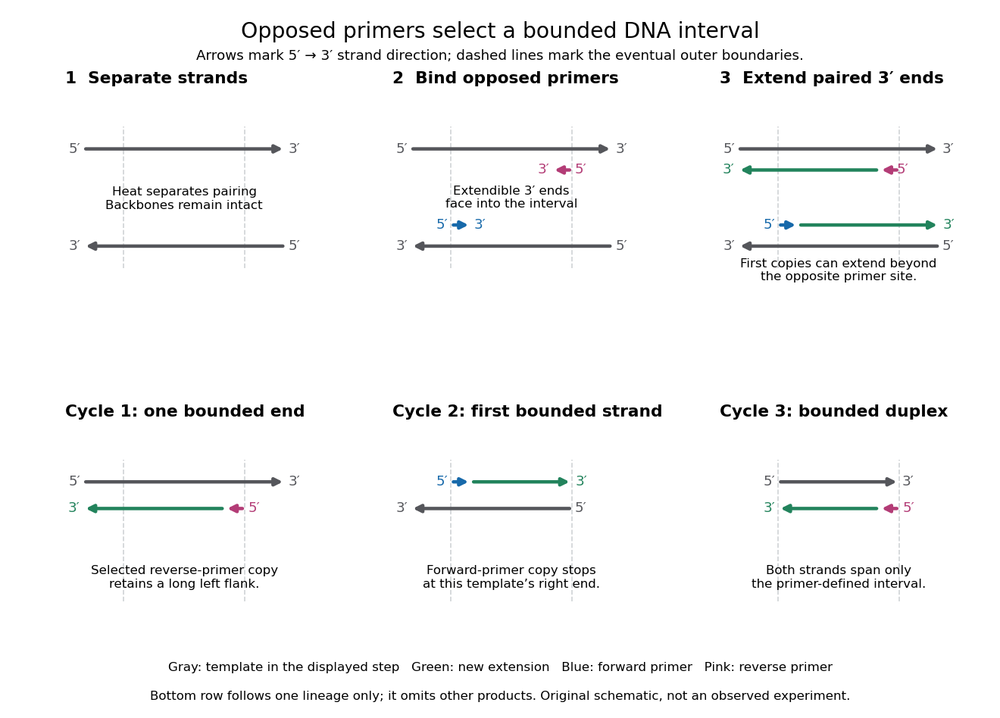

# Polymerase chain reaction

↑ **Parent:** [Molecular genetics](molecular-genetics-split.md)  
ⓦ [Wiki](https://en.wikipedia.org/wiki/Polymerase_chain_reaction)

The [polymerase chain reaction](polymerase-chain-reaction.md) amplifies a selected [DNA](deoxyribonucleic-acid.md) region using repeated copying steps. Amplified material can be examined by [DNA sequencing](dna-sequencing.md); appropriate template controls help distinguish a new rearrangement from material already present in the starting preparation.

The essential trick is to choose two [PCR primers](pcr-primer.md) on opposite [DNA](deoxyribonucleic-acid.md) strands with their extendible $3'$ ends facing into the same interval. A [DNA polymerase](dna-polymerase.md) extends each [PCR primer](pcr-primer.md) $5'\to3'$; the resulting [DNA](deoxyribonucleic-acid.md) can itself become a template. The [amplicon](amplicon.md) is therefore selected by two opposed [PCR primers](pcr-primer.md), rather than by the [DNA polymerase](dna-polymerase.md) recognizing a named [gene](gene.md). This makes [PCR amplification](polymerase-chain-reaction.md) useful for inspecting one interval within a much larger [genome](genome.md). Here PCR means [polymerase chain reaction](polymerase-chain-reaction.md); the statistical abbreviation [PCR](principal-component-regression.md) means [principal component regression](principal-component-regression.md).[Background Information: two primers, template-directed copying and product verification](polymerase-chain-reaction-pcr-by-addgene.md)

For a deliberately tiny [nucleotide sequence](nucleic-acid-sequence.md) example, display the upper strand as $5'\text{-}\mathrm{ACGT}\text{-}\mathrm{GGAATT}\text{-}\mathrm{CAGC}\text{-}3'$. The left [PCR primer](pcr-primer.md) is $5'\text{-}\mathrm{ACGT}\text{-}3'$ and binds the lower strand. The right [PCR primer](pcr-primer.md), written in its own $5'$-to-$3'$ direction, is $5'\text{-}\mathrm{GCTG}\text{-}3'$: the [reverse complement](reverse-complement.md) of CAGC. It binds the upper strand and extends leftward in the drawing. With flanks outside this interval, the bounded [amplicon](amplicon.md) contains $4+6+4=14$ [base pairs](base-pair.md), including both [PCR primer](pcr-primer.md) sequences. These four-[nucleotide](nucleotide.md) [PCR primers](pcr-primer.md) illustrate direction and counting only; they are not a proposed experimental design.

**[Figure 7](#image-opposed-pcr-primers-define-the-amplicon-through-successive-copying-cycles). Opposed PCR primers define the amplicon through successive copying cycles**. Original schematic, not molecular imaging. The upper panel follows separation, binding and $5'$-to-$3'$ extension on the two original [DNA](deoxyribonucleic-acid.md) strands. The lower panel follows one selected lineage: cycle 1 makes a strand with one primer-defined end; cycle 2 copies it to make the first strand bounded at both ends; cycle 3 copies that bounded strand to make a bounded duplex. Other products are omitted. Primer colors identify the two [PCR primers](pcr-primer.md), not different [nucleobases](nucleotide-base.md); extensions continue beyond the second site when the available template extends farther.

A useful way to understand the [polymerase chain reaction](polymerase-chain-reaction.md) is to separate recognition from construction. [Base pairing](base-pairing.md) positions a [PCR primer](pcr-primer.md); a [DNA polymerase](dna-polymerase.md) then joins new [nucleotides](nucleotide.md) onto that existing strand. The [PCR primer](pcr-primer.md) becomes part of the copied [DNA](deoxyribonucleic-acid.md), rather than merely marking a place for an independent strand to start. A [PCR thermal cycle](pcr-thermal-cycle.md) repeatedly exposes templates, positions starting ends and permits construction. This makes [DNA](deoxyribonucleic-acid.md) copying possible outside [biological cells](biological-cell-split.md), with the chosen [PCR primers](pcr-primer.md) specifying which interval is repeatedly accessible.

**Table of contents**

- [Error-prone PCR](error-prone-pcr.md)
- [PCR primer](pcr-primer.md)
  - [Primer melting temperature](primer-melting-temperature.md)
- [Amplicon](amplicon.md)
- [PCR thermal cycle](pcr-thermal-cycle.md)
  - [PCR denaturation](pcr-denaturation.md)
  - [PCR annealing](pcr-annealing.md)
  - [PCR extension](pcr-extension.md)
- [Thermal cycler](thermal-cycler.md)
- [PCR efficiency](pcr-efficiency.md)
  - [PCR plateau](pcr-plateau.md)
- [PCR specificity](pcr-specificity.md)
  - [Primer dimer](primer-dimer.md)
  - [PCR controls](pcr-controls.md)
- [PV92 teaching experiment](pv92-teaching-experiment.md)
- [Reverse transcription polymerase chain reaction](reverse-transcription-polymerase-chain-reaction.md)
- [Real-time polymerase chain reaction](real-time-polymerase-chain-reaction.md)
  - [RT-qPCR](rt-qpcr.md)
- [Polymerase chain reaction history](polymerase-chain-reaction-history.md)

## ↑ Ancestors (4)

1. [Molecular genetics](molecular-genetics-split.md)
2. [Genetics](genetics-split.md)
3. [Biology](biology-split.md)
4. [Codex Wiki](split.md)

## ← Incoming links (5)

- [Functional plastid-to-nucleus gene transfer experiment](functional-plastid-to-nucleus-gene-transfer-experiment.md)
- [Solution](past-exam-of-the-biochemistry-and-molecular-biology-course-of-the-university-of-cambridge/2024/paper-1/section-a/2/solution.md)
- [Solution](past-exam-of-the-systems-biology-course-of-the-university-of-cambridge/2024/paper-2/2/ii/solution.md)
- [Polymerase chain reaction](polymerase-chain-reaction.md)
- [Polymerase chain reaction history](polymerase-chain-reaction-history.md)
