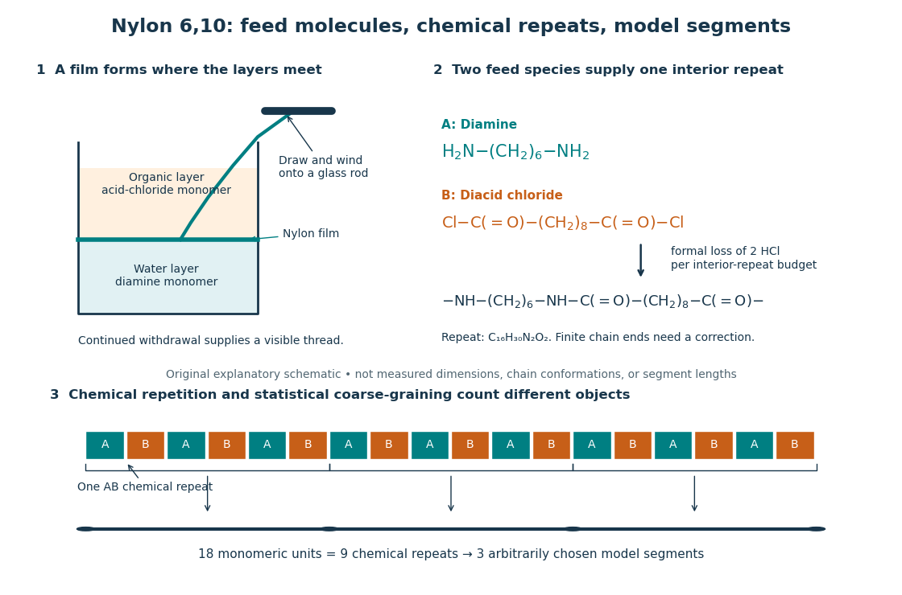
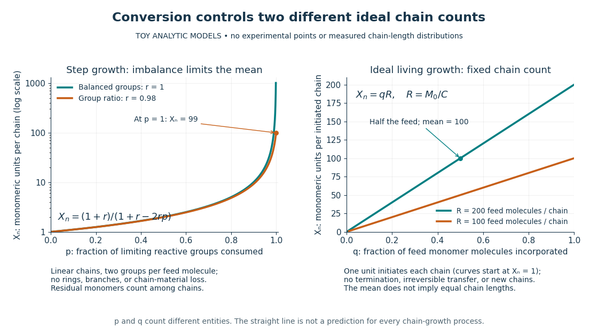

# Polymerization

↑ **Parent:** [Polymer](polymer-split.md)

[Polymerization](polymerization.md) converts a [monomer](monomer.md), or a mixture of [monomers](monomer.md), into a [polymer](polymer-split.md): repeated [chemical reactions](chemical-reaction-split.md) establish a connected molecular chain or network. The central question is how connections form, not merely whether a material becomes solid. Joining small [molecules](molecule-split.md) can produce a thread that can be handled, while the individual [molecules](molecule-split.md) remain invisible. See [IUPAC, Basic Definitions of Terms Relating to Polymers, definition 2.2](https://old.iupac.org/publications/pac/1974/pdf/4003x0477.pdf).

**[Figure 3](#polymerization-monomers-interface-units). From two liquid layers to a Nylon 6,10 thread: monomers, a constitutional repeating unit, and statistical segments**. Original schematic of the authored UCSB [polymerization](polymerization.md) demonstration described below. Chemical formulas identify the actual reactants and interior repeat; colored blocks identify their contributions. The lower coarse-graining sketch deliberately groups three repeats per model segment. Shapes, sizes, and that grouping are illustrative, not measured molecular geometry or a fitted [Kuhn length](kuhn-length.md).

In [step-growth polymerization](step-growth-polymerization.md), complementary reactive groups on [monomers](monomer.md) and on shorter or longer chains can react with one another. A two-unit chain can join a three-unit chain to make a five-unit chain; growth does not require a specially active end to add only free [monomers](monomer.md). An example is the [Nylon 6,10](nylon-6-10.md) reaction of $\mathrm{H_2N(CH_2)_6NH_2}$ with $\mathrm{ClC(=O)(CH_2)_8C(=O)Cl}$: each [amine](amine.md) end can form an [amide](amide.md) connection with an acid-chloride end, with formal elimination of $\mathrm{HCl}$. Both reactants have two suitable ends, allowing repeated joining. See [Paula Hammond, MIT 10.569 lecture 2: step-growth joining](https://ocw.mit.edu/courses/10-569-synthesis-of-polymers-fall-2006/5474dc576b0669a8a09e9b70e39b1239_lec02_09082006.pdf) and [Hammond, lecture 5, p. 4: acid chloride–amine reaction](https://ocw.mit.edu/courses/10-569-synthesis-of-polymers-fall-2006/d9f9ac7021b0d0f418d3d3c90dbfb94b_lec05_09152006.pdf).

In [chain-growth polymerization](chain-growth-polymerization.md), a [monomer](monomer.md) reacts with an active site on a growing chain, and the growth step regenerates an active site. Schematically, $P_j^*+M\longrightarrow P_{j+1}^*$, where $j$ counts incorporated [monomeric units](monomeric-unit.md) and the star denotes reactivity rather than a particular [electric charge](electric-charge-split.md). [Ethene](ethylene.md) forming [polyethylene](polyethylene.md) is an example: the double [chemical bond](chemical-bond-split.md) is converted into single [chemical bonds](chemical-bond-split.md) as the [carbon](carbon.md) backbone grows. Initiation creates the active chains; subsequent reactions can deactivate them or transfer reactivity to another [molecule](molecule-split.md). See [IUPAC: chain polymerization](https://goldbook.iupac.org/terms/view/C00958/plain) and [John McMurry, Organic Chemistry, 31.1: chain growth](https://openstax.org/books/organic-chemistry/pages/31-1-chain-growth-polymers). Whether growth is stepwise or carried by an active site is a different question from whether small byproducts are released: [chain-growth polymerization](chain-growth-polymerization.md) can also release them.

**A motivating experiment: drawing nylon from a liquid interface.** Feldwinn's UCSB demonstration places $25\,\mathrm{mL}$ of an aqueous [chemical solution](solution-chemistry.md) of hexamethylenediamine, $\mathrm{H_2N(CH_2)_6NH_2}$, in a $100\,\mathrm{mL}$ beaker, then gently adds $25\,\mathrm{mL}$ of sebacoyl chloride, $\mathrm{ClC(=O)(CH_2)_8C(=O)Cl}$, in an organic [solvent](solvent.md). The procedure specifies hexane; other parts of that handout list cyclohexane. The layers remain separate. The instructor catches material at their interface with tweezers and winds it slowly onto a glass rod; the handout reports continued spooling of [Nylon 6,10](nylon-6-10.md). It specifies freshly prepared acid-chloride [chemical solution](solution-chemistry.md) and washing the thread before touching it. These are observations and conditions of a supervised laboratory demonstration, not measurements of chain lengths. See [Feldwinn, UCSB Demonstration Library, Demo 044, pp. 1–3](https://people.chem.ucsb.edu/feldwinn/darby/DemoLibrary/DemoPDFs/Demo044.pdf).

The mechanistic interpretation is that the [monomers](monomer.md) encounter one another near the interface, where [amide](amide.md) connections produce the film; withdrawing it exposes a region where more material can form. An authored research demonstration independently reports a rapidly formed interfacial film collapsing into a thread on withdrawal, using cyclohexane and an aqueous [chemical solution](solution-chemistry.md) containing potassium hydroxide. See [Polymer Day: Outreach Experiments for High School Students, Journal of Chemical Education (2017), nylon demonstration](https://pubs.acs.org/doi/10.1021/acs.jchemed.6b00767). This is the striking observation: a thread much longer than the beaker can emerge because material is continually supplied to the formation region, rather than because a pre-existing thread was hidden in the liquid.

Useful _proposed controls_, not results reported in those demonstrations, omit one [monomer](monomer.md) at a time while retaining the same [solvents](solvent.md), liquid amounts, and pulling procedure. The prediction is loss of a renewable drawable [Nylon 6,10](nylon-6-10.md) film; merely finding cloudiness would not establish [polymerization](polymerization.md), since other [chemical reactions](chemical-reaction-split.md), including acid-chloride [hydrolysis](hydrolysis.md), can occur. See [McMurry, 21.4: competing acid-chloride hydrolysis](https://openstax.org/books/organic-chemistry/pages/21-4-chemistry-of-acid-halides). Stopping and restarting withdrawal would probe renewal at the interface. Even successful drawing does not measure the [degree of polymerization](degree-of-polymerization.md), establish a chain-length [probability distribution](probability-distribution-split.md), or prove the entire growth mechanism. Chemical identification and a molecular-size measurement would be needed for those stronger conclusions. These controls and limits are inferences from the setup, not invented experimental data.

**Why almost complete reaction matters in step growth.** For ideal linear [step-growth polymerization](step-growth-polymerization.md), assume exactly two reactive groups per starting [molecule](molecule-split.md), equal numbers of complementary groups, only joining of different chains, no rings, no branching, and no loss of chain material. Let $N_0$ count starting [monomer molecules](monomer-molecule.md), including both reactant species, and let $p$ be the fraction of either type of reactive group consumed. There are initially $N_0$ groups of each type, so $pN_0$ connections reduce the number of chain-bearing [molecules](molecule-split.md) to $N=N_0(1-p)$; the count excludes small byproducts but includes unreacted [monomers](monomer.md). The number-average [degree of polymerization](degree-of-polymerization.md), measured in [monomeric units](monomeric-unit.md), is therefore

$$
X_n=\frac{N_0}{N}=\frac{1}{1-p}.
$$

Thus $p=0.90$, $0.99$, and $0.999$ give $X_n=10$, $100$, and $1000$. Losing the last fraction of unreacted groups matters enormously. See [Hammond, lecture 3: balanced step-growth conversion](https://ocw.mit.edu/courses/10-569-synthesis-of-polymers-fall-2006/c7b7a987f7d5b66e0832be42fbf52b7d_lec03_09112006.pdf). This counts residues of both feed species; a [Nylon 6,10](nylon-6-10.md) interior [constitutional repeating unit](repeat-unit.md) contains two such [monomeric units](monomeric-unit.md).

For an $AA+BB$ feed with $A_0\leq B_0$ initial reactive-group counts, put $r=A_0/B_0$ and now let $p$ denote the fraction of the _limiting $A$ groups_ consumed. Under the same linear, no-ring assumptions, $N_0=(A_0+B_0)/2$ and $N=N_0-pA_0$, giving

$$
X_n=\frac{1+r}{1+r-2rp}.
$$

For $r=0.98$, even complete consumption of $A$ gives $X_n=(1.98)/(0.02)=99$. [Stoichiometry](stoichiometry.md) controls chain length as well as yield. See [Hammond, lecture 2, pp. 2–3: stoichiometric imbalance](https://ocw.mit.edu/courses/10-569-synthesis-of-polymers-fall-2006/5474dc576b0669a8a09e9b70e39b1239_lec02_09082006.pdf). The liquid-interface demonstration is not a homogeneous, balanced reactor, so its thread length cannot be inserted into this formula as a molecular chain length.

**[Figure 4](#polymerization-monomers-conversion-models). Two ideal degree of polymerization counts: late growth in step-growth polymerization and fixed-chain growth in ideal living polymerization**. Toy analytic curves, not measured data. Left: $X_n=(1+r)/(1+r-2rp)$, with $p$ the limiting-group conversion and $r$ the initial reactive-group ratio. Right: $X_n=qR$, with $q$ the fraction of feed [monomer molecules](monomer-molecule.md) incorporated and $R$ their initial number per initiated chain. The two horizontal axes count different entities; the right plot represents a special ideal model, not all [chain-growth polymerization](chain-growth-polymerization.md).

**A contrasting chain count.** In ideal [living polymerization](living-polymerization.md), assume no chain termination or irreversible chain transfer, all chains initiated before the counted growth, one chain per effective initiator, a fixed chain count $C$, and every consumed [monomer molecule](monomer-molecule.md) incorporated into those chains. If $M_0$ is the initial number of feed [monomer molecules](monomer-molecule.md) and $q$ their incorporated fraction, conservation gives $X_n=qM_0/C=qR$ in [monomeric units](monomeric-unit.md), excluding initiator fragments. For $R=200$, incorporating half the feed gives $X_n=100$. If initiation consumes one [monomer molecule](monomer-molecule.md) per chain, the fixed-chain interval starts at $q=1/R$, rather than $q=0$. See [Hammond, lecture 21, p. 1: ideal living-chain count](https://ocw.mit.edu/courses/10-569-synthesis-of-polymers-fall-2006/42d2e82b585136f5b6849919a0ee4449_lec21_11012006.pdf). The mean does not imply identical chain lengths. [Living polymerization](living-polymerization.md) does not require reversible loss of [monomers](monomer.md); the defining absence of chain termination and irreversible chain transfer is explained in [Devon Shipp, IUPAC Polymer Education workshop, Radical Polymerizations II, slide 50](https://iupac.org/wp-content/uploads/2017/03/IUPAC_PolymEdu_EduWorkshop_PPT_Shipp2.pdf). Ordinary [chain-growth polymerization](chain-growth-polymerization.md) with new chains, termination, or transfer need not follow the straight line.

The useful connection is between local chemistry and a macroscopic material: selecting reactive ends and their proportions controls connectivity, while the resulting [polymer](polymer-split.md)'s conformation is a separate problem described by models such as the [freely jointed chain](ideal-chain.md) or [Gaussian chain](gaussian-chain.md). Formation of [chemical bonds](chemical-bond-split.md), the count of [monomeric units](monomeric-unit.md), and the count of statistical segments must be kept distinct.

**Table of contents**

- [Monomer functionality](monomer-functionality.md)
- [Chain termination](chain-termination.md)
- [Ring-opening polymerization](ring-opening-polymerization.md)
  - [Ring-opening metathesis polymerization](ring-opening-metathesis-polymerization.md)
- [Cossee-Arlman mechanism](cossee-arlman-mechanism.md)
- [Step-growth polymerization](step-growth-polymerization.md)
  - [Linear step-growth molecule count](linear-step-growth-molecule-count.md)
    - [Functional-group conversion in step growth](functional-group-conversion-in-step-growth.md)
  - [Carothers equation](carothers-equation.md)
    - [Stoichiometric imbalance in step growth](stoichiometric-imbalance-in-step-growth.md)
  - [Cyclization in step-growth polymerization](cyclization-in-step-growth-polymerization.md)
  - [Polyaddition](polyaddition.md)
    - [Residual-group monitoring of polyurethane formation](residual-group-monitoring-of-polyurethane-formation.md)
  - [Polycondensation](polycondensation.md)
    - [Silanol condensation](silanol-condensation.md)
- [Functionality in polymerization](functionality-in-polymerization.md)
- [Gelation](gelation.md)
- [Chain-growth polymerization](chain-growth-polymerization.md)
  - [Catalyst-transfer polymerization](catalyst-transfer-polymerization.md)
  - [Coordination polymerization](coordination-polymerization.md)
  - [Radical polymerization](radical-polymerization.md)
    - [Reversible-deactivation radical polymerization](reversible-deactivation-radical-polymerization.md)
      - [Nitroxide-mediated polymerization](nitroxide-mediated-polymerization.md)
  - [Polymerization-active site](polymerization-active-site.md)
  - [Chain-growth initiation](chain-growth-initiation.md)
  - [Chain-growth propagation](chain-growth-propagation.md)
  - [Chain-growth termination](chain-growth-termination.md)
  - [Chain transfer in chain polymerization](chain-transfer-in-chain-polymerization.md)
  - [Finite chain-growth bookkeeping](finite-chain-growth-bookkeeping.md)
  - [Living versus terminating chain populations](living-versus-terminating-chain-populations.md)
  - [NMR monitoring of chain polymerization](nmr-monitoring-of-chain-polymerization.md)
  - [Size-exclusion characterization of chain polymers](size-exclusion-characterization-of-chain-polymers.md)
  - [Monitoring chain polymerization in a sealed tube](monitoring-chain-polymerization-in-a-sealed-tube.md)
  - [Living polymerization](living-polymerization.md)

## ↑ Ancestors (3)

1. [Polymer](polymer-split.md)
2. [Chemistry](chemistry-split.md)
3. [Codex Wiki](split.md)

## ← Incoming links (16)

- [Hafnium](hafnium.md)
- [Living polymerization](living-polymerization.md)
- [Methylaluminoxane](methylaluminoxane.md)
- [Monitoring chain polymerization in a sealed tube](monitoring-chain-polymerization-in-a-sealed-tube.md)
- [Monomer](monomer.md)
- [Monomer functionality](monomer-functionality.md)
- [Monomer molecule](monomer-molecule.md)
- [Nylon 6,10](nylon-6-10.md)
- [Solution](past-exam-of-the-chemistry-b-course-of-the-university-of-cambridge/2024/paper-2/b8/b/iv/solution.md)
- [Solution](past-exam-of-the-chemistry-course-of-the-year-4-of-the-natural-sciences-course-of-the-university-of-cambridge/2022/paper-2/section-a/18/a/solution.md)
- [Solution](past-exam-of-the-chemistry-course-of-the-year-4-of-the-natural-sciences-course-of-the-university-of-cambridge/2022/paper-2/section-a/19/e/solution.md)
- [Solution](past-exam-of-the-mathematics-course-of-the-university-of-cambridge/2003/iii/paper-71/3/b/solution.md)
- [Solution](past-exam-of-the-mphil-in-micro-and-nanotechnology-enterprise-course-of-the-university-of-cambridge/2021/paper-1/10/ii/a/solution.md)
- [Polymerization](polymerization.md)
- [Step-growth polymerization](step-growth-polymerization.md)
- [Zirconium](zirconium.md)
