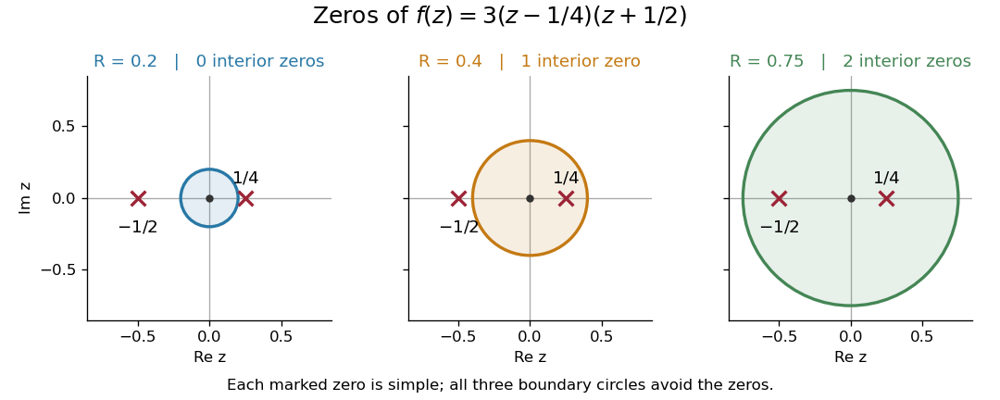
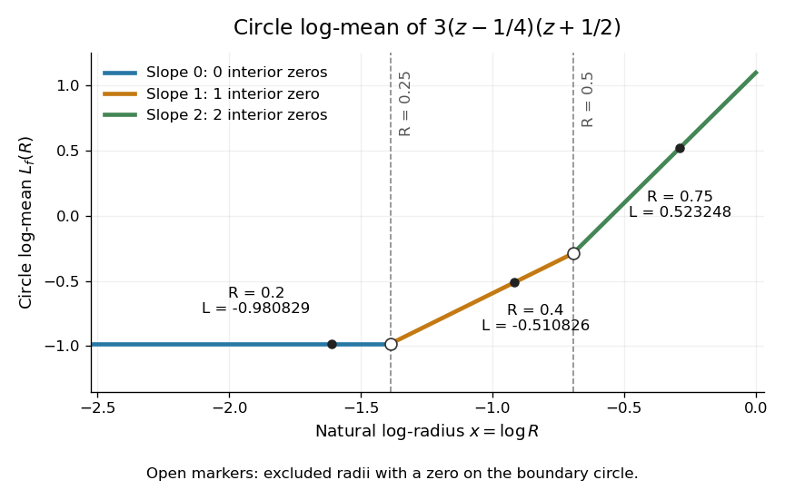

# Polynomial circle log-mean

↑ **Parent:** [Circle log-mean of a holomorphic function](circle-log-mean-of-a-holomorphic-function.md)

For a [polynomial](polynomial-split.md) $p(z)=c\prod_j(z-a_j)$ with $c\ne0$, no [polynomial root](root-of-a-polynomial.md) at zero, and $R>0$ different from every $|a_j|$, [Jensen's formula](jensen-s-formula.md) gives the displayed expression. The [polynomial roots](root-of-a-polynomial.md) are repeated according to their [multiplicity of a zero](multiplicity-of-a-zero.md): an exterior root contributes $\log|a_j|$, whereas an interior root contributes $\log R$.

For an explicit example, take the [polynomial](polynomial-split.md)

$$
f(z)=3(z-\tfrac14)(z+\tfrac12),\qquad f(0)=-\tfrac38.
$$

Its two [simple zeros](simple-zero.md) are $1/4$ and $-1/2$. The [circle log-mean of a holomorphic function](circle-log-mean-of-a-holomorphic-function.md) is therefore

$$
L_f(R)=\begin{cases}
\log(3/8),&0<R<1/4,\\
\log(3R/2),&1/4<R<1/2,\\
\log(3R^2),&R>1/2.
\end{cases}
$$

At $R=0.2$ the [open disc](open-disc.md) contains no [zeros of a function](zero-of-a-function.md), at $R=0.4$ it contains $1/4$ only, and at $R=0.75$ it contains both. These three [circles](circle.md) avoid the [polynomial roots](root-of-a-polynomial.md); the radii $1/4$ and $1/2$ are excluded from the displayed version.

**[Figure 1](#image-the-zeros-of-3-z-1-4-z-plus-1-2-inside-three-concentric-disks). The zeros of $3(z-1/4)(z+1/2)$ inside three concentric disks**. The three boundary [circles](circle.md) enclose respectively zero, one and two [simple zeros](simple-zero.md). Each zero contributes to [Jensen's formula](jensen-s-formula.md) only after the radius exceeds its [complex modulus](complex-modulus.md).

The corresponding values of the [circle log-mean of a holomorphic function](circle-log-mean-of-a-holomorphic-function.md) and the [circle geometric mean of a holomorphic function](circle-geometric-mean-of-a-holomorphic-function.md) are

$$
\begin{array}{c|c|c|c}
R&n_f(R)&L_f(R)&G_f(R)\\\hline
0.2&0&\log(3/8)\approx-0.980829&3/8\\
0.4&1&\log(3/5)\approx-0.510826&3/5\\
0.75&2&\log(27/16)\approx0.523248&27/16
\end{array}
$$

For example, at $R=0.4$ the contribution of the sole interior [zero of a function](zero-of-a-function.md) is $\log(0.4/0.25)=\log(8/5)$; adding it to $\log(3/8)$ gives $\log(3/5)$. The second [polynomial root](root-of-a-polynomial.md) still affects $f(0)$, but contributes no additional interior-zero term at this radius.

**[Figure 2](#image-circle-log-mean-versus-log-radius-for-3-z-1-4-z-plus-1-2). Circle log-mean versus log-radius for $3(z-1/4)(z+1/2)$**. The [log-radius slope of the circle log-mean](log-radius-slope-of-the-circle-log-mean.md) is zero, one and two in the three intervals, matching the [radial zero-counting function](radial-zero-counting-function.md). Open markers exclude the boundary-zero radii $1/4$ and $1/2$; filled markers show the three computed examples.

## ↑ Ancestors (8)

1. [Circle log-mean of a holomorphic function](circle-log-mean-of-a-holomorphic-function.md)
2. [Jensen's formula](jensen-s-formula.md)
3. [Holomorphic function](holomorphic-function-split.md)
4. [Complex analysis](complex-analysis-split.md)
5. [Analysis](analysis-split.md)
6. [Area of mathematics](area-of-mathematics.md)
7. [Mathematics](mathematics-split.md)
8. [Codex Wiki](split.md)

## ← Incoming links (1)

- [Radial zero-counting function](radial-zero-counting-function.md)
