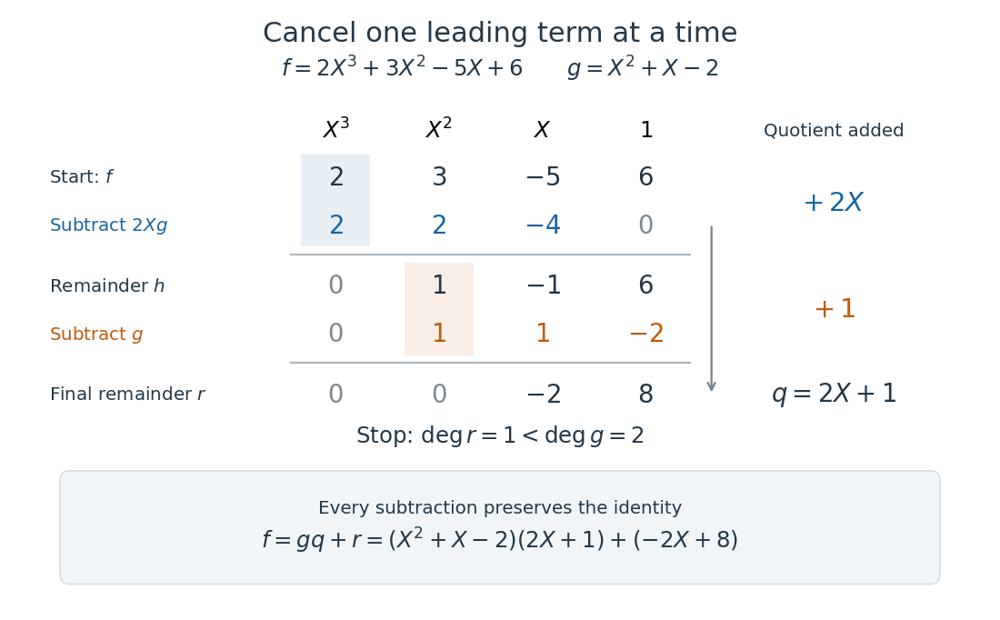

# Polynomial division

↑ **Parent:** [Polynomial](polynomial-split.md)

[Polynomial division](polynomial-division.md) separates a [polynomial](polynomial-split.md) into a multiple of a chosen divisor and a smaller [polynomial remainder](remainder-of-polynomial-division.md). Given $f,g\in F[X]$ over a [field](field.md) $F$, with $g\ne0$, there are unique [polynomials](polynomial-split.md) $q,r$ satisfying

$$
f=gq+r,\qquad r=0\ \text{or}\ \deg r<\deg g.
$$

Here $q$ is the [polynomial quotient](quotient-of-polynomial-division.md). The bound concerns [polynomial degree](degree-of-a-polynomial.md), rather than the sizes of the [coefficients](coefficient.md).[Fields and Galois Theory, version 5.10, Chapter 1, p. 10, §1.6: division algorithm, zero remainder alternative and uniqueness](fields-and-galois-theory-by-james-s-milne.md)

For an original example over the [rational numbers](rational-number.md), take

$$
f=2X^3+3X^2-5X+6,\qquad g=X^2+X-2.
$$

[Polynomial long division](polynomial-long-division.md) first cancels $2X^3$ by subtracting $2Xg$:

$$
f-2Xg=X^2-X+6.
$$

Subtracting one more copy of $g$ cancels $X^2$:

$$
(X^2-X+6)-g=-2X+8.
$$

Thus

$$
q=2X+1,\qquad r=-2X+8,\qquad f=(X^2+X-2)(2X+1)+(-2X+8).
$$

The final [polynomial remainder](remainder-of-polynomial-division.md) has [polynomial degree](degree-of-a-polynomial.md) one, below the divisor's [polynomial degree](degree-of-a-polynomial.md) two. Multiplying out the last identity checks every [coefficient](coefficient.md), including the constant term $-2+8=6$.

**[Figure 11](#image-polynomial-long-division-cancels-the-cubic-and-quadratic-terms-in-two-steps-recording-q-2x-plus-1-and-r-2x-plus-8). Polynomial long division cancels the cubic and quadratic terms in two steps, recording $q=2X+1$ and $r=-2X+8$**.

The [polynomial degree](degree-of-a-polynomial.md) bound makes this decomposition useful: it replaces a potentially long [polynomial](polynomial-split.md) with a short [polynomial remainder](remainder-of-polynomial-division.md) whenever multiples of $g$ can be discarded. At any [root of a polynomial](root-of-a-polynomial.md) of $g$, those multiples vanish under [polynomial evaluation](polynomial-evaluation.md). Repeated [polynomial division](polynomial-division.md) also drives the [Euclidean algorithm](euclidean-algorithm.md) for finding a [greatest common divisor](greatest-common-divisor.md) of [polynomials](polynomial-split.md).

The coefficient setting matters. Over a [commutative ring](commutative-ring.md), the same existence and uniqueness hold when the divisor's [leading coefficient](leading-coefficient-of-a-polynomial.md) is a [unit in a ring](unit-in-a-ring.md). A [monic polynomial](monic-polynomial.md) therefore works over the [integers](integer-split.md), even though they do not form a [field](field.md); [monic polynomial division over a ring](monic-polynomial-division-over-a-ring.md) explains why [zero divisors](zero-divisor.md) cause no difficulty in that case.[Abstract Algebra, Chapter 3 Ring theory, §3.9, Theorem 3.9.1: division with a unit leading coefficient](abstract-algebra-by-romyar-sharifi/chapter-3-ring-theory.md)

A nonzero divisor alone is insufficient over the [integers](integer-split.md). Dividing $X$ by $2X+1$ with an [integer](integer-split.md) [polynomial quotient](quotient-of-polynomial-division.md) and a constant [polynomial remainder](remainder-of-polynomial-division.md) would require $1=2c$ for an [integer](integer-split.md) $c$, which is impossible. Over the [rational numbers](rational-number.md) the division instead gives

$$
X=(2X+1)\frac12-\frac12.
$$

The obstruction is the [nonunit](nonunit.md) [leading coefficient](leading-coefficient-of-a-polynomial.md) $2$. This example separates existence from uniqueness: over an [integral domain](integral-domain.md), the [polynomial degree](degree-of-a-polynomial.md) argument still makes any admissible pair unique, if it exists.

**Table of contents**

- [Quotient of polynomial division](quotient-of-polynomial-division.md)
- [Remainder of polynomial division](remainder-of-polynomial-division.md)
  - [Polynomial remainder theorem](polynomial-remainder-theorem.md)
- [Polynomial long division](polynomial-long-division.md)

## ↑ Ancestors (5)

1. [Polynomial](polynomial-split.md)
2. [Algebra](algebra-split.md)
3. [Area of mathematics](area-of-mathematics.md)
4. [Mathematics](mathematics-split.md)
5. [Codex Wiki](split.md)

## ← Incoming links (31)

- [Chapter 3 Ring theory](abstract-algebra-by-romyar-sharifi/chapter-3-ring-theory.md)
- [Factor theorem](factor-theorem.md)
- [Fields and Galois Theory by James S. Milne](fields-and-galois-theory-by-james-s-milne.md)
- [Gaussian quadrature](gaussian-quadrature.md)
- [Horner's method](horner-s-method.md)
- [Lagrange root bound over a field](lagrange-root-bound-over-a-field.md)
- [Solution](past-exam-of-the-mathematics-course-of-the-university-of-cambridge/2002/ia/paper-1/2d/solution.md)
- [Solution](past-exam-of-the-mathematics-course-of-the-university-of-cambridge/2005/iii/paper-87/2/solution.md)
- [Solution](past-exam-of-the-mathematics-course-of-the-university-of-cambridge/2006/ib/paper-4/2e/solution.md)
- [Solution](past-exam-of-the-mathematics-course-of-the-university-of-cambridge/2016/ib/paper-1/10e/b/solution.md)
- [Solution](past-exam-of-the-mathematics-course-of-the-university-of-cambridge/2016/ib/paper-1/10e/c/solution.md)
- [Solution](past-exam-of-the-mathematics-course-of-the-university-of-cambridge/2016/iii/paper-114/5/solution.md)
- [Solution](past-exam-of-the-mathematics-course-of-the-university-of-cambridge/2017/ib/paper-3/11e/b/solution.md)
- [Solution](past-exam-of-the-mathematics-course-of-the-university-of-cambridge/2017/ib/paper-4/11e/a/solution.md)
- [Solution](past-exam-of-the-mathematics-course-of-the-university-of-cambridge/2018/ib/paper-3/10e/solution.md)
- [Solution](past-exam-of-the-mathematics-course-of-the-university-of-cambridge/2020/ib/paper-1/18c/b/solution.md)
- [Solution](past-exam-of-the-mathematics-course-of-the-university-of-cambridge/2020/ii/paper-4/1h/solution.md)
- [Solution](past-exam-of-the-mathematics-course-of-the-university-of-cambridge/2021/ii/paper-2/11h/d/solution.md)
- [Solution](past-exam-of-the-mathematics-course-of-the-university-of-cambridge/2023/ib/paper-3/17b/a/solution.md)
- [Solution](past-exam-of-the-mathematics-course-of-the-year-1-of-the-natural-sciences-course-of-the-university-of-cambridge/2007/paper-1/section-a/1/solution.md)
- [Solution](past-exam-of-the-mathematics-course-of-the-year-1-of-the-natural-sciences-course-of-the-university-of-cambridge/2009/paper-1/1/solution.md)
- [Solution](past-exam-of-the-mathematics-course-of-the-year-1-of-the-natural-sciences-course-of-the-university-of-cambridge/2010/paper-1/1/solution.md)
- [Solution](past-exam-of-the-mathematics-course-of-the-year-1-of-the-natural-sciences-course-of-the-university-of-cambridge/2017/paper-1/13/c/solution.md)
- [Solution](past-exam-of-the-mathematics-course-of-the-year-1-of-the-natural-sciences-course-of-the-university-of-cambridge/2023/paper-1/2/solution.md)
- [Polynomial division](polynomial-division.md)
- [Polynomial reduction of matrix powers](polynomial-reduction-of-matrix-powers.md)
- [Polynomial remainder theorem](polynomial-remainder-theorem.md)
- [Quotient of polynomial division](quotient-of-polynomial-division.md)
- [Remainder of polynomial division](remainder-of-polynomial-division.md)
- [Repeated eigenvalues in the Cayley-Hamilton theorem](repeated-eigenvalues-in-the-cayley-hamilton-theorem.md)
- [Systematic polynomial encoding of a cyclic code](systematic-polynomial-encoding-of-a-cyclic-code.md)
