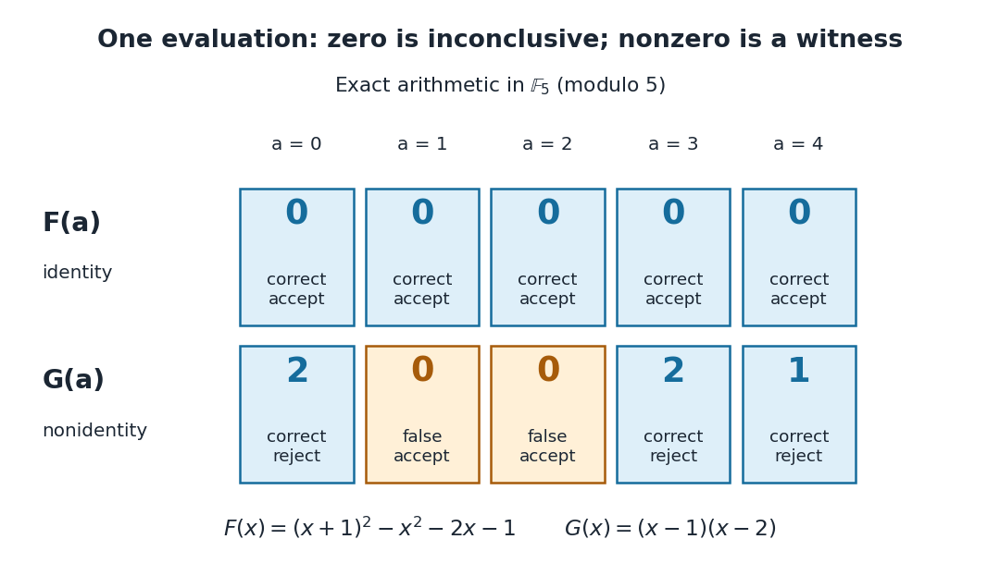

# Polynomial identity testing over a finite field

↑ **Parent:** [Polynomial identity testing](polynomial-identity-testing.md)

Work in the [finite field](finite-field.md) $\mathbb F_5=\{0,1,2,3,4\}$, using [modular arithmetic](modular-arithmetic-split.md) modulo five. Consider the two original [polynomial](polynomial-split.md) examples

$$
F(x)=(x+1)^2-x^2-2x-1,\qquad G(x)=(x-1)(x-2).
$$

The [distributive property](distributive-property.md) gives $(x+1)^2=x^2+2x+1$, so all [coefficients](coefficient.md) of $F$ cancel: $F$ is identically zero. In contrast, $G=x^2-3x+2=x^2+2x+2$ in this [finite field](finite-field.md), with nonzero leading [coefficient](coefficient.md). Its [roots of a polynomial](root-of-a-polynomial.md) are exactly one and two: a product in a [field](field.md) is zero only if a factor is zero.

The complete [polynomial evaluations](polynomial-evaluation.md), displayed as representatives modulo five, are

$$
\begin{array}{c|ccccc}
a&0&1&2&3&4\\\hline
F(a)&0&0&0&0&0\\
G(a)&2&0&0&2&1
\end{array}.
$$

In particular, $G(3)=(3-1)(3-2)=2$ is a nonzero witness, which disproves identity without examining other points. At one or two, a zero value fails to reveal that $G$ is nonzero. A [random variable](random-variable-split.md) $a$ with a [uniform distribution on a finite set](discrete-uniform-distribution.md) $\mathbb F_5$ hits those two [polynomial roots](root-of-a-polynomial.md) with [probability](probability.md) $2/5$.

**[Figure 31](#image-exact-evaluations-distinguish-a-zero-polynomial-from-a-nonzero-polynomial-with-two-roots). Exact evaluations distinguish a zero polynomial from a nonzero polynomial with two roots**. Every element of the [finite field](finite-field.md) $\mathbb F_5$ is shown. The upper row always accepts the identity $F=0$. In the lower row, the two orange zero values falsely accept $G=0$; the three blue nonzero values correctly reject it. These are all possible outcomes, not sampled frequencies.

A crucial limit appears with $H(x)=x^5-x$. Its [coefficients](coefficient.md) make it a nonzero [polynomial](polynomial-split.md) of [polynomial degree](degree-of-a-polynomial.md) five in $\mathbb F_5[x]$, yet direct [polynomial evaluation](polynomial-evaluation.md) gives zero at all five [field](field.md) elements: the values before reduction are $0,0,30,240,1020$, all divisible by five. Thus $H$ induces the same [polynomial function](polynomial-function.md) as the zero [polynomial](polynomial-split.md). Any number of trials restricted to $\mathbb F_5$ will falsely accept this identity. This is compatible with the [Schwartz-Zippel lemma](schwartz-zippel-lemma.md): the ratio of [polynomial degree](degree-of-a-polynomial.md) to sampling-set size is $5/5=1$, which gives no useful guarantee.

When a [polynomial](polynomial-split.md)'s representation permits [polynomial evaluation](polynomial-evaluation.md) over a larger [field extension](field-extension.md), a larger sampling [set](set-split.md) can restore the useful degree ratio. Access only to the induced [polynomial function](polynomial-function.md) on the original [finite field](finite-field.md) cannot distinguish $H$ from zero.[CPSC 536N: Randomized Algorithms; Lecture 9: Polynomial Identity Testing by the Schwartz-Zippel Lemma, §1.4: formal nonzero polynomials can vanish everywhere on a finite field; extension-field evaluations need a suitable representation](cpsc-536n-randomized-algorithms/lecture-9-polynomial-identity-testing-by-the-schwartz-zippel-lemma.md)

## ↑ Ancestors (5)

1. [Polynomial identity testing](polynomial-identity-testing.md)
2. [Randomized algorithm](randomized-algorithm.md)
3. [Algorithm](algorithm-split.md)
4. [Computer science](computer-science-split.md)
5. [Codex Wiki](split.md)

## ← Incoming links (1)

- [Random evaluation test for a polynomial identity](random-evaluation-test-for-a-polynomial-identity.md)
