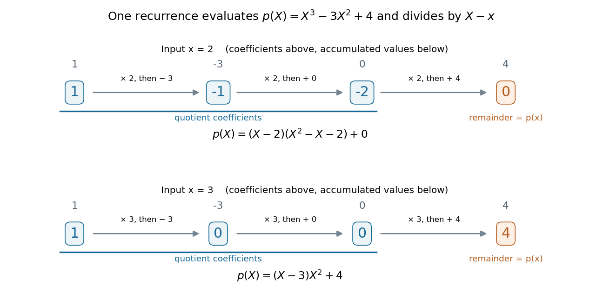
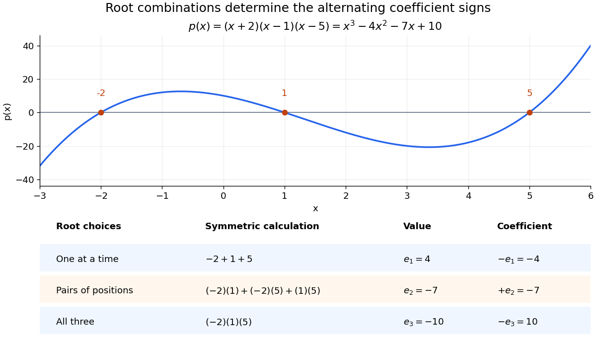
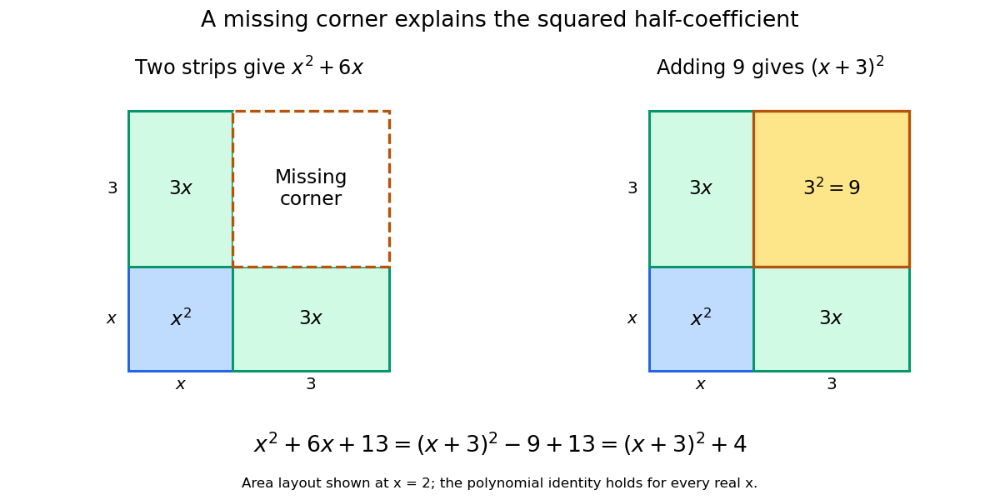
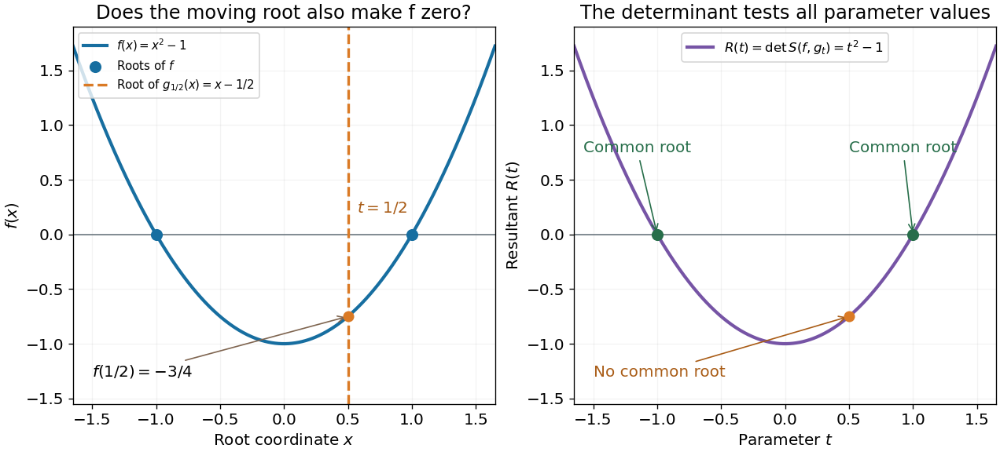
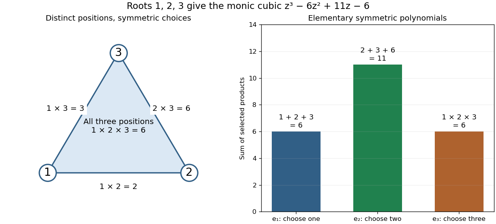
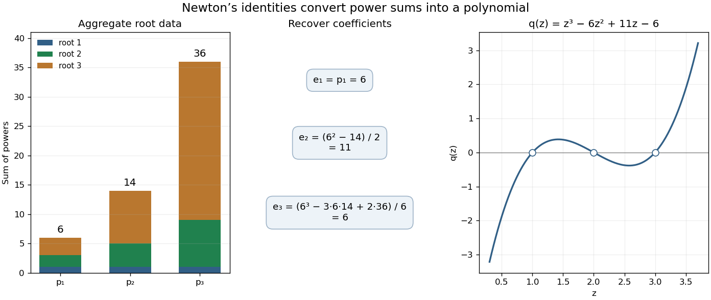
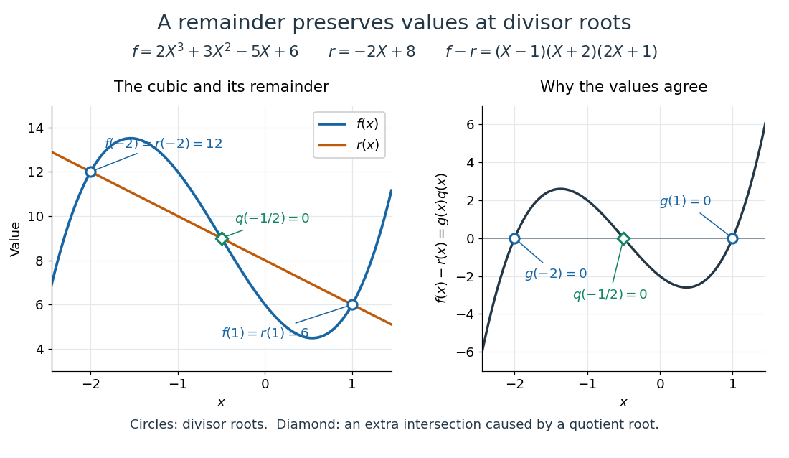

# Polynomial

↑ **Parent:** [Algebra](algebra.md)  
ⓦ [Wiki](https://en.wikipedia.org/wiki/Polynomial)

A polynomial is a finite [sum](arithmetic.md#sum) of [monomials](#monomial) with [coefficients](vector-space.md#coefficient) in a [ring](commutative-algebra.md#ring). In one [variable](mathematics.md#variable-mathematics) $X$ over a [commutative ring](commutative-algebra.md#commutative-ring) $R$, write

$$
p(X)=a_0+a_1X+\cdots+a_nX^n,\qquad a_j\in R.
$$

The symbol $X$ is an [indeterminate](#indeterminate): it records powers formally before we choose an input value. Finite expressions are easy to add, multiply, evaluate, and differentiate, making [polynomials](polynomial.md) a common language for exact [algebra](algebra.md) and approximate [numerical analysis](numerical-analysis.md).

Consider the real [polynomial](polynomial.md)

$$
p(X)=X^3-3X^2+4=(X+1)(X-2)^2.
$$

The expanded form displays the [coefficients](vector-space.md#coefficient) and the [degree of a polynomial](#degree-of-a-polynomial); the factored form displays its [roots of a polynomial](#root-of-a-polynomial). At $X=3$, either description gives $p(3)=4$. At $X=-1$ and $X=2$, the factored form makes the zero values immediate. Keeping several descriptions of one object is useful because each makes a different question easy.

**[Figure 1](#image-a-simple-polynomial-root-crosses-the-axis-while-a-double-root-touches-it-perturbing-the-double-factor-can-produce-real-or-complex-roots). A simple polynomial root crosses the axis, while a double root touches it; perturbing the double factor can produce real or complex roots**.

The graph shows another connection. The factor $X+1$ changes sign across $-1$, while $(X-2)^2$ stays nonnegative across $2$. Thus the graph crosses the axis at the simple [root of a polynomial](#root-of-a-polynomial) and touches it at the double root. [Multiplicity of a root](#multiplicity-of-a-root) turns an algebraic repetition into visible local behavior.

For calculations, [Horner's method](#horner-s-method) evaluates a [polynomial](polynomial.md) through nested [multiplication](arithmetic.md#multiplication). For modeling, a [Taylor polynomial](calculus.md#taylor-polynomial) describes local behavior near a point, while [polynomial interpolation](interpolation.md#polynomial-interpolation) constructs a [polynomial](polynomial.md) matching prescribed data. Their usefulness comes with assumptions: a local approximation and an exact identity are different claims, and changing the coefficient [ring](commutative-algebra.md#ring) can change which [polynomial roots](#root-of-a-polynomial) exist.

**Table of contents**

- [Polynomial composition](#polynomial-composition)
- [Linear polynomial](#linear-polynomial)
- [Polynomial greatest common divisor](#polynomial-greatest-common-divisor)
- [Fibonacci polynomial](#fibonacci-polynomial)
- [Polynomial multiplication](#polynomial-multiplication)
  - [Polynomial convolution](#polynomial-convolution)
  - [Carryless multiplication](#carryless-multiplication)
  - [Kronecker substitution](#kronecker-substitution)
- [Sophie Germain identity](#sophie-germain-identity)
- [Factorization of polynomials](#factorization-of-polynomials)
  - [Polynomial sieve](#polynomial-sieve)
  - [Berlekamp polynomial factorization algorithm](#berlekamp-polynomial-factorization-algorithm)
  - [Sum of two cubes](#sum-of-two-cubes)
  - [Difference of two cubes](#difference-of-two-cubes)
- [Polynomial evaluation](#polynomial-evaluation)
- [Indeterminate](#indeterminate)
- [Additive polynomial](#additive-polynomial)
  - [Linearized polynomial over a finite field](#linearized-polynomial-over-a-finite-field)
    - [Quadratic constant extension of a q-squared linearized splitting field](#quadratic-constant-extension-of-a-q-squared-linearized-splitting-field)
    - [Projective transitivity of a trinomial linearized polynomial](#projective-transitivity-of-a-trinomial-linearized-polynomial)
- [Hasse derivative](#hasse-derivative)
- [Quartic polynomial](#quartic-polynomial)
- [Reciprocal polynomial](#reciprocal-polynomial)
- [Horner's method](#horner-s-method)
- [Fixed-degree polynomial limit](#fixed-degree-polynomial-limit)
- [Quadratic polynomial](#quadratic-polynomial)
- [Polynomial identity](#polynomial-identity)
- [Coprime polynomials](#coprime-polynomials)
  - [Polynomial pencil with four square members](#polynomial-pencil-with-four-square-members)
  - [Bézout's identity for polynomials](#bezout-s-identity-for-polynomials)
- [Symmetric polynomial](#symmetric-polynomial)
- [Descartes' rule of signs](#descartes-rule-of-signs)
- [Even part of a polynomial](#even-part-of-a-polynomial)
- [Leading coefficient of a polynomial](#leading-coefficient-of-a-polynomial)
- [Polynomial factor](#polynomial-factor)
  - [Common polynomial factor](#common-polynomial-factor)
- [Coefficient extraction](#coefficient-extraction)
- [Nonnegative polynomial](#nonnegative-polynomial)
  - [Polynomial SOS](#polynomial-sos)
    - [Homogeneous sum of squares representation](#homogeneous-sum-of-squares-representation)
    - [Sign averaging of a sum of squares](#sign-averaging-of-a-sum-of-squares)
    - [Sum of squares criterion for a biquadratic form](#sum-of-squares-criterion-for-a-biquadratic-form)
- [Polynomial function](#polynomial-function)
  - [Piecewise polynomial function](#piecewise-polynomial-function)
    - [Truncated power function](#truncated-power-function)
- [Vector space of univariate polynomials](#vector-space-of-univariate-polynomials)
- [Vieta's formulas](#vieta-s-formulas)
  - [Vieta formulas for a cubic](#vieta-formulas-for-a-cubic)
  - [Repeated roots in Vieta's formulas](#repeated-roots-in-vieta-s-formulas)
  - [Complex conjugate roots in Vieta's formulas](#complex-conjugate-roots-in-vieta-s-formulas)
  - [History of Vieta's formulas](#history-of-vieta-s-formulas)
- [Completing the square](#completing-the-square)
  - [Completing the square by area](#completing-the-square-by-area)
  - [Vertex form of a quadratic](#vertex-form-of-a-quadratic)
    - [Roots from a completed square](#roots-from-a-completed-square)
  - [History of completing the square](#history-of-completing-the-square)
- [Monomial](#monomial)
- [Laurent polynomial](#laurent-polynomial)
  - [Breadth of a Laurent polynomial](#breadth-of-a-laurent-polynomial)
  - [Laurent monomial](#laurent-monomial)
  - [Constant term](#constant-term)
- [Polynomial equation](#polynomial-equation)
  - [Cubic equation](#cubic-equation)
- [Monic polynomial](#monic-polynomial)
  - [Monic polynomial division over a ring](#monic-polynomial-division-over-a-ring)
    - [Monic polynomial quotient is finite free](#monic-polynomial-quotient-is-finite-free)
      - [Monic irreducible integer-polynomial quotient is a domain](#monic-irreducible-integer-polynomial-quotient-is-a-domain)
- [Multivariate polynomial](#multivariate-polynomial)
  - [Diagonal monomial action of a second-order Euler operator](#diagonal-monomial-action-of-a-second-order-euler-operator)
  - [Alternating polynomial](#alternating-polynomial)
    - [Monomial alternant](#monomial-alternant)
  - [Polynomial restriction to a line](#polynomial-restriction-to-a-line)
  - [Dimension of a bounded-total-degree polynomial space](#dimension-of-a-bounded-total-degree-polynomial-space)
    - [Polynomial evaluation map on a finite point set](#polynomial-evaluation-map-on-a-finite-point-set)
- [Zero of a function](#zero-of-a-function)
  - [Root of an equation](#root-of-an-equation)
  - [Zero set](#zero-set)
  - [Root of a polynomial](#root-of-a-polynomial)
    - [Integer root](#integer-root)
    - [Interlacing roots of polynomials](#interlacing-roots-of-polynomials)
      - [Monotonicity of polynomial critical points in their roots](#monotonicity-of-polynomial-critical-points-in-their-roots)
      - [Markov interlacing lemma](#markov-interlacing-lemma)
    - [Unit-circle root](#unit-circle-root)
    - [Positive root of a polynomial](#positive-root-of-a-polynomial)
    - [Factor theorem](#factor-theorem)
    - [Multiplicity (mathematics)](#multiplicity-mathematics)
      - [Multiplicity of a root](#multiplicity-of-a-root)
        - [Double root](#double-root)
        - [Multiple root](#multiple-root)
    - [Common root](#common-root)
    - [Complex root](#complex-root)
- [Multilinear polynomial](#multilinear-polynomial)
  - [Boolean multilinearization](#boolean-multilinearization)
  - [Homogenisation on a uniform layer](#homogenisation-on-a-uniform-layer)
  - [Multilinear reduction on the Boolean cube](#multilinear-reduction-on-the-boolean-cube)
- [Resultant](#resultant)
  - [Sylvester matrix](#sylvester-matrix)
  - [Resultant as a product over roots](#resultant-as-a-product-over-roots)
  - [Eliminating a variable with a resultant](#eliminating-a-variable-with-a-resultant)
    - [Degree drop in a specialized resultant](#degree-drop-in-a-specialized-resultant)
- [Elementary symmetric polynomial](#elementary-symmetric-polynomial)
  - [Elementary symmetric sum](#elementary-symmetric-sum)
  - [Fundamental theorem of symmetric polynomials](#fundamental-theorem-of-symmetric-polynomials)
  - [Newton's identities](#newton-s-identities)
    - [Root power-sum recurrence](#root-power-sum-recurrence)
    - [Characteristic polynomial from traces of powers](#characteristic-polynomial-from-traces-of-powers)
    - [Root sensitivity in power-sum reconstruction](#root-sensitivity-in-power-sum-reconstruction)
    - [Newton identities in positive characteristic](#newton-identities-in-positive-characteristic)
- [Irreducible polynomial](#irreducible-polynomial)
  - [Quotient by an irreducible polynomial is a field](#quotient-by-an-irreducible-polynomial-is-a-field)
- [Polynomial division](#polynomial-division)
  - [Quotient of polynomial division](#quotient-of-polynomial-division)
  - [Remainder of polynomial division](#remainder-of-polynomial-division)
    - [Polynomial remainder theorem](#polynomial-remainder-theorem)
  - [Polynomial long division](#polynomial-long-division)
- [Degree of a polynomial](#degree-of-a-polynomial)
  - [Total degree of a polynomial](#total-degree-of-a-polynomial)
  - [Lagrange root bound over a field](#lagrange-root-bound-over-a-field)
- [Polynomial length](#polynomial-length)
- [Quadratic function](#quadratic-function)
  - [Quadratic dependence](#quadratic-dependence)
  - [Quadratic equation](#quadratic-equation)
    - [Quadratic formula](#quadratic-formula)
    - [Quadratic inequality](#quadratic-inequality)
- [Discriminant](#discriminant)
  - [Quadratic discriminant](#quadratic-discriminant)
- [Cubic polynomial](#cubic-polynomial)
- [Univariate polynomial](#univariate-polynomial)

## Polynomial composition

↑ **Parent:** [Polynomial](polynomial.md)

For polynomials $p$ and $q$ over a common [commutative ring](commutative-algebra.md#commutative-ring), their composition is $(p\circ q)(x)=p(q(x))$. It substitutes the whole polynomial $q$ for each occurrence of the indeterminate in $p$, rather than multiplying their coefficient arrays.

## Linear polynomial

↑ **Parent:** [Polynomial](polynomial.md)

## Polynomial greatest common divisor

↑ **Parent:** [Polynomial](polynomial.md)

A polynomial greatest common divisor of two [polynomials](polynomial.md) over a [field](algebra.md#field) divides both and is divisible by every common polynomial divisor. It is unique after requiring it to be monic, and the polynomial [Euclidean algorithm](number-theory.md#euclidean-algorithm) computes it.

## Fibonacci polynomial

↑ **Parent:** [Polynomial](polynomial.md)

Fibonacci polynomials are defined by $F_0(x)=0$, $F_1(x)=1$, and $F_{n+1}(x)=xF_n(x)+F_{n-1}(x)$. Setting $x=1$ recovers the [Fibonacci numbers](sequence-and-series.md#fibonacci-number).

## Polynomial multiplication

↑ **Parent:** [Polynomial](polynomial.md)

### Polynomial convolution

↑ **Parent:** [Polynomial multiplication](#polynomial-multiplication)

The convolution of coefficient sequences $a_i,b_i$ has coefficients $c_n=\sum_{i+j=n}a_i b_j$. These are exactly the coefficients of the product of the corresponding [polynomials](polynomial.md).

### Carryless multiplication

↑ **Parent:** [Polynomial multiplication](#polynomial-multiplication)

Carryless multiplication treats binary digits as coefficients of a [polynomial](polynomial.md) over the [field with two elements](algebra.md#field-with-two-elements). Products are formed by [polynomial multiplication](#polynomial-multiplication), with [exclusive or](theoretical-computer-science.md#exclusive-or) combining equal-degree terms instead of carrying to the next binary position.

### Kronecker substitution

↑ **Parent:** [Polynomial multiplication](#polynomial-multiplication)

Kronecker substitution encodes a [polynomial](polynomial.md) with bounded [nonnegative integer](arithmetic.md#natural-number) coefficients as one large [integer](integer.md) by evaluating it at a sufficiently large base. Integer multiplication then gives the polynomial product, provided the base exceeds every output coefficient so carries cannot mix coefficients.

## Sophie Germain identity

↑ **Parent:** [Polynomial](polynomial.md)

The [polynomial](polynomial.md) identity $a^4+4b^4=(a^2-2ab+2b^2)(a^2+2ab+2b^2)$ follows by writing the left side as $(a^2+2b^2)^2-(2ab)^2$ and taking a difference of squares.

## Factorization of polynomials

↑ **Parent:** [Polynomial](polynomial.md)  
ⓦ [Wiki](https://en.wikipedia.org/wiki/Factorization_of_polynomials)

A [polynomial factorization](#factorization-of-polynomials) expresses a [polynomial](polynomial.md) as a product of other [polynomials](polynomial.md). The allowed [coefficients](vector-space.md#coefficient) matter: $X^2-2$ has no nonconstant factorization over the [rational numbers](number-theory.md#rational-number), but factors as $(X-\sqrt2)(X+\sqrt2)$ over the [real numbers](arithmetic.md#real-number). [Difference of squares](number-theory.md#difference-of-two-squares) gives $X^2-Y^2=(X-Y)(X+Y)$ over any [commutative ring](commutative-algebra.md#commutative-ring).

### Polynomial sieve

↑ **Parent:** [Factorization of polynomials](#factorization-of-polynomials)

A sieve that marks reducible polynomials by their divisibility by smaller irreducible polynomials. It is the polynomial-ring analogue of a [number-theoretic sieve](algorithm.md#number-theoretic-sieve).

### Berlekamp polynomial factorization algorithm

↑ **Parent:** [Factorization of polynomials](#factorization-of-polynomials)

### Sum of two cubes

↑ **Parent:** [Factorization of polynomials](#factorization-of-polynomials)

Replacing $b$ by $-b$ in the [difference of two cubes](#difference-of-two-cubes) gives

$$
\boxed{a^3+b^3=(a+b)(a^2-ab+b^2).}
$$

For real cube roots $u=a^{1/3}$ and $v=b^{1/3}$, this simplifies $(a^{1/3}+b^{1/3})(a^{2/3}-(ab)^{1/3}+b^{2/3})$ to $a+b$. Specifying real cube roots matters when using such identities with negative real inputs; unconstrained [complex exponentiation](analysis.md#complex-exponentiation) has logarithm-branch choices.

### Difference of two cubes

↑ **Parent:** [Factorization of polynomials](#factorization-of-polynomials)

The [polynomial identity](#polynomial-identity)

$$
\boxed{a^3-b^3=(a-b)(a^2+ab+b^2)}
$$

follows by multiplying out the right side. For real $a,b$, the quadratic factor is $a^2+ab+b^2=(a+b/2)^2+3b^2/4$, so it is nonnegative and vanishes only when $a=b=0$. The identity is a special case of the [finite geometric series](sequence-and-series.md#finite-geometric-series) factorisation $a^n-b^n=(a-b)\sum_{j=0}^{n-1}a^{n-1-j}b^j$.

## Polynomial evaluation

↑ **Parent:** [Polynomial](polynomial.md)

[Polynomial evaluation](#polynomial-evaluation) replaces the [indeterminate](#indeterminate) of a [polynomial](polynomial.md) by an input value. For a fixed [scalar](vector-space.md#scalar) $a$, the rule $E_a:p\mapsto p(a)$ is a [linear functional](dual-space.md#linear-functional) on a [vector space](vector-space.md) of [polynomials](polynomial.md), because evaluating a [linear combination](vector-space.md#linear-combination) gives the same [linear combination](vector-space.md#linear-combination) of the values. For $p(t)=1+2t+3t^2$, evaluation at zero gives one and evaluation at two gives seventeen. [Polynomial interpolation](interpolation.md#polynomial-interpolation) uses these measurements to reconstruct a [polynomial](polynomial.md) subject to a [polynomial degree](#degree-of-a-polynomial) bound.

## Indeterminate

↑ **Parent:** [Polynomial](polynomial.md)

An indeterminate is a formal symbol used to construct a [polynomial](polynomial.md). Choosing an input later defines a [polynomial function](#polynomial-function); the symbol itself is not a fixed member of the coefficient [ring](commutative-algebra.md#ring).

## Additive polynomial

↑ **Parent:** [Polynomial](polynomial.md)  
ⓦ [Wiki](https://en.wikipedia.org/wiki/Additive_polynomial)

Over a [field](algebra.md#field) of characteristic $p$, additive [polynomials](polynomial.md) are sums of $p$-power monomials, $L(X)=\sum_i a_iX^{p^i}$. They act linearly over the prime [field](algebra.md#field). The identity follows from the [Frobenius endomorphism](galois-theory.md#frobenius-endomorphism); the converse follows by comparing mixed binomial coefficients. Their zero sets are additive groups, and a nonzero linear coefficient makes all roots simple.

### Linearized polynomial over a finite field

↑ **Parent:** [Additive polynomial](#additive-polynomial)

Over a [field](algebra.md#field) containing $\mathbb F_q$, a sum of $q$-power monomials is $\mathbb F_q$-linear. If its leading coefficient and linear coefficient are nonzero, its root space has exactly $q^d$ elements and dimension $d$ over $\mathbb F_q$. Automorphisms of its [splitting field](galois-theory.md#splitting-field) act faithfully and linearly on that root space, embedding the [Galois group](galois-theory.md#galois-group) in $GL(d,q)$.

#### Quadratic constant extension of a q-squared linearized splitting field

↑ **Parent:** [Linearized polynomial over a finite field](#linearized-polynomial-over-a-finite-field)

For even $d=2n$, the roots of $X^{q^d}+X^{q^2}+TX$ form an $n$-dimensional [vector space](vector-space.md) over $\mathbb F_{q^2}$. Ratios $(c\alpha)/\alpha$ for a nonzero root $\alpha$ show that the [splitting field](galois-theory.md#splitting-field) contains every $c\in\mathbb F_{q^2}$. The subgroup fixing that quadratic constant extension is normal of index two and lies in $GL(n,q^2)$; applying projective transitivity over $\mathbb F_{q^2}(T)$ makes it contain $SL(n,q^2)$. It therefore normalizes that [special linear group](group-theory.md#special-linear-group), while the full group acts semilinearly.

#### Projective transitivity of a trinomial linearized polynomial

↑ **Parent:** [Linearized polynomial over a finite field](#linearized-polynomial-over-a-finite-field)

For $d\geq2$, nonzero roots define projective-point coordinates $s=X^{q-1}$, satisfying $s^N+s+T=0$, where $N=(q^d-1)/(q-1)$. This [polynomial](polynomial.md) is irreducible over $\mathbb F_q(T)$. After fixing one root $s$, the remaining coordinates satisfy $R(Y,s)=(Y^N-s^N)/(Y-s)+1$. Substitute $z=Y/s$ and $h=1/s$: the equation becomes $h^{N-1}+(z^N-1)/(z-1)=0$. At a nontrivial $N$th [root of unity](algebra.md#root-of-unity) the second term has a simple zero, so the [polynomial](polynomial.md) is Eisenstein over the [algebraic closure](algebra.md#algebraic-closure)'s [rational function field](algebra.md#rational-function-field). This proves irreducibility of $R$ and hence two-transitivity on projective points.

## Hasse derivative

↑ **Parent:** [Polynomial](polynomial.md)  
ⓦ [Wiki](https://en.wikipedia.org/wiki/Hasse_derivative)

The Hasse derivatives of a [polynomial](polynomial.md) are the coefficients in $f(x+t)=\sum_{\ell\geq0}f^{[\ell]}(x)t^\ell$. A point $a$ has [multiplicity](#multiplicity-mathematics) at least $m$ exactly when $f^{[\ell]}(a)=0$ for $0\leq\ell<m$. Unlike iterated [formal derivatives](galois-theory.md#formal-derivative) divided by [factorials](combinatorics.md#factorial), this definition works in positive [characteristic](algebra.md#characteristic-of-a-field), where factorials can vanish. For example, in characteristic two $(x+1)^2$ has zero first [formal derivative](galois-theory.md#formal-derivative) but nonzero second Hasse derivative.

// Target: coding-theory.bigb

## Quartic polynomial

↑ **Parent:** [Polynomial](polynomial.md)

A quartic is a [polynomial](polynomial.md) of [degree of a polynomial](#degree-of-a-polynomial) four. Its leading coefficient is nonzero.

## Reciprocal polynomial

↑ **Parent:** [Polynomial](polynomial.md)

The reciprocal polynomial reverses the coefficients of a polynomial with nonzero constant term. For a binary cyclic code with generator $g$ and canonical check polynomial $h$, the reciprocal $h^*$ generates the [dual of a cyclic code](coding-theory.md#dual-of-a-cyclic-code).

// Target: algebra.bigb

<h2 id="horner-s-method">Horner's method</h2>

↑ **Parent:** [Polynomial](polynomial.md)  
ⓦ [Wiki](https://en.wikipedia.org/wiki/Horner's_method)

[Horner's method](#horner-s-method) evaluates a [polynomial](polynomial.md) by nested multiplication, requiring one multiplication and one addition per degree after initialization.

For $p(X)=a_nX^n+\cdots+a_0$, start with $b_n=a_n$ and compute $b_j=xb_{j+1}+a_j$ for $j=n-1,\ldots,0$. The final value is $b_0=p(x)$. Equivalently,

$$
p(x)=a_0+x\bigl(a_1+x\bigl(a_2+\cdots+xa_n\bigr)\bigr).
$$

This reorganization reuses intermediate results, avoiding separate computation of every power. A dense degree-$n$ [polynomial](polynomial.md) takes $n$ [multiplications](arithmetic.md#multiplication) and $n$ coefficient [additions](arithmetic.md#addition) after reading its [leading coefficient](#leading-coefficient-of-a-polynomial); special zero coefficients may permit further simplifications.

For our cubic, the coefficient list in descending order is $1,-3,0,4$. The zero is important: it occupies the missing $X$ term's position. At $x=2$, the accumulated values are

$$
1\ \longrightarrow\ 2\cdot1-3=-1\ \longrightarrow\ 2(-1)+0=-2\ \longrightarrow\ 2(-2)+4=0.
$$

At $x=3$, the same operations give $1,0,0,4$, confirming $p(3)=4$.

**[Figure 2](#image-the-same-nested-arithmetic-evaluates-a-polynomial-and-produces-the-coefficients-for-division-by-a-linear-factor). The same nested arithmetic evaluates a polynomial and produces the coefficients for division by a linear factor**.

The intermediate values do more than evaluate. They are the [coefficients](vector-space.md#coefficient) of the [polynomial quotient](#quotient-of-polynomial-division) in [polynomial division](#polynomial-division) by $X-x$, with the final value as the [polynomial remainder](#remainder-of-polynomial-division). At $x=2$, the first three values give $X^2-X-2$, so

$$
p(X)=(X-2)(X^2-X-2)+0.
$$

At $x=3$, they give $X^2$, so $p(X)=(X-3)X^2+4$. This links an efficient numerical calculation with the exact [factor theorem](#factor-theorem).

[William George Horner](mathematics.md#william-george-horner)'s 1819 paper concerns solving numerical [equations](algebra.md#equation) by successive approximation. The Royal Society archive records the manuscript and its reading on 1 July 1819; it provides a historical reference for the method's name. [Royal Society archive, Horner's 1819 manuscript](https://makingscience.royalsociety.org/items/pt_13_23/paper-a-new-method-of-solving-numerical-equations-of-all-orders-by-continuous-approximation-by-w-g-william-george-horner)

// Target: geometry-and-topology.bigb

## Fixed-degree polynomial limit

↑ **Parent:** [Polynomial](polynomial.md)

If [polynomials](polynomial.md) of degree at most $d$ converge at $d+1$ distinct points, their coefficients converge, by invertibility of the [Vandermonde matrix](galois-theory.md#vandermonde-matrix). Their limit is a [polynomial](polynomial.md) of degree at most $d$, and convergence is uniform on every compact subset of $\mathbb C$. Under convergence on compact sets, [Rouché's theorem](complex-analysis.md#rouche-s-theorem) further locates a unique nearby zero for each simple root of the limit, for all sufficiently large indices. Finite initial polynomials need not have any root.

## Quadratic polynomial

↑ **Parent:** [Polynomial](polynomial.md)

A quadratic polynomial in one variable over a [field](algebra.md#field) has [polynomial degree](#degree-of-a-polynomial) two and the displayed form. Its [roots of a polynomial](#root-of-a-polynomial) satisfy a [quadratic equation](#quadratic-equation). The [polynomial](polynomial.md) and its associated [polynomial function](#polynomial-function) are distinct objects: over a [finite field](algebra.md#finite-field), different [polynomials](polynomial.md) can define the same [function](function.md).

## Polynomial identity

↑ **Parent:** [Polynomial](polynomial.md)

A polynomial identity is equality of two [polynomials](polynomial.md) for every value of the variables, rather than an equation imposed only at selected roots. Over the real or complex numbers, this is equivalent to equality of corresponding coefficients: their difference, if nonzero, has only finitely many roots in one variable. The [binomial theorem](binomial-coefficient.md#binomial-theorem) is an example. Coefficient comparison transfers a polynomial product identity into finite sums of [binomial coefficients](binomial-coefficient.md).

## Coprime polynomials

↑ **Parent:** [Polynomial](polynomial.md)

Two [polynomials](polynomial.md) over a [field](algebra.md#field) are coprime if their only common factors are nonzero constants. Equivalently, their [greatest common divisor](divisibility.md#greatest-common-divisor) is a [unit](algebra.md#unit-in-a-ring) in the [polynomial ring](commutative-algebra.md#polynomial-ring). In one variable this is equivalent to a [Bezout identity](algebra.md#bezout-s-identity) $Af+Bg=1$ with polynomial coefficients. Independent members of a pencil spanned by [coprime polynomials](#coprime-polynomials) are themselves coprime.

### Polynomial pencil with four square members

↑ **Parent:** [Coprime polynomials](#coprime-polynomials)

Let $u,v\in\mathbb C[t]$ be [coprime polynomials](#coprime-polynomials). If $\alpha u+\beta v$ is a square for four distinct $(\alpha:\beta)$, then $u,v$ are constant. For independent $u,v$, the four square members $L_j=s_j^2$ are pairwise [coprime polynomials](#coprime-polynomials). Let $d$ and $e$ be their maximal and minimal degrees; at least three have degree $d$. For independent members of degrees $e,d$, the nonzero [polynomial](polynomial.md) $W=L_k'L_l-L_kL_l'$ has degree at most $d+e-1$. Each $s_j$ divides $W$, giving $\deg W\geq(3d+e)/2>d+e-1$, a contradiction. The dependent case follows directly from [coprimality of polynomials](#coprime-polynomials).

<h3 id="bezout-s-identity-for-polynomials">Bézout's identity for polynomials</h3>

↑ **Parent:** [Coprime polynomials](#coprime-polynomials)

For [univariate polynomials](#univariate-polynomial) $f,g$ over a [field](algebra.md#field), not both zero, there are [polynomials](polynomial.md) $A,B$ such that $Af+Bg=d$, where $d$ is their monic [greatest common divisor](divisibility.md#greatest-common-divisor). In particular, [coprime polynomials](#coprime-polynomials) admit $Af+Bg=1$. The [extended Euclidean algorithm](number-theory.md#extended-euclidean-algorithm) constructs the coefficients.

## Symmetric polynomial

↑ **Parent:** [Polynomial](polynomial.md)  
ⓦ [Wiki](https://en.wikipedia.org/wiki/Symmetric_polynomial)

A symmetric polynomial is unchanged by permutations of its variables. The [Fundamental theorem of symmetric polynomials](#fundamental-theorem-of-symmetric-polynomials) expresses it as a polynomial in the [elementary symmetric polynomials](#elementary-symmetric-polynomial). The square of the [Vandermonde determinant](galois-theory.md#vandermonde-determinant) is an important example.

## Descartes' rule of signs

↑ **Parent:** [Polynomial](polynomial.md)  
ⓦ [Wiki](https://en.wikipedia.org/wiki/Descartes'_rule_of_signs)

Let $V(p)$ be the number of sign changes in the list of nonzero coefficients of a real [polynomial](polynomial.md), arranged by increasing or decreasing degree. The [positive roots of a polynomial](#positive-root-of-a-polynomial), counted with [multiplicity of a root](#multiplicity-of-a-root), satisfy

$$
N_+(p)\le V(p),\qquad V(p)-N_+(p)\text{ is even}.
$$

The bound follows by induction on the nonzero terms after removing the lowest power of $x$. Differentiation removes the constant coefficient. If it and the next coefficient have opposite signs, the [Rolle root count with multiplicities](calculus.md#rolle-root-count-with-multiplicities) loses at most one root and the sign-change count loses one. If their signs agree, the derivative must have an extra root before the first positive root, so neither count needs that extra allowance. The parity statement follows by comparing the signs near zero and at positive infinity: roots of odd multiplicity reverse the sign, and roots of even multiplicity preserve it. Apply the same rule to $p(-x)$ to bound negative roots.

## Even part of a polynomial

↑ **Parent:** [Polynomial](polynomial.md)

The even part of a [polynomial](polynomial.md) $P$ is $(P(z)+P(-z))/2$. It retains exactly the terms whose exponents are even. Applied to the [binomial theorem](binomial-coefficient.md#binomial-theorem), it extracts sums of even-indexed [binomial coefficients](binomial-coefficient.md).

## Leading coefficient of a polynomial

↑ **Parent:** [Polynomial](polynomial.md)

The leading coefficient of a nonzero [polynomial](polynomial.md) $a_nx^n+\cdots+a_0$, with $a_n\ne0$, is $a_n$; its [degree of a polynomial](#degree-of-a-polynomial) is $n$. A [monic polynomial](#monic-polynomial) has leading coefficient one. For [polynomials](polynomial.md) over a [field](algebra.md#field), a product has [leading coefficient](#leading-coefficient-of-a-polynomial) equal to the product of the two [leading coefficients](#leading-coefficient-of-a-polynomial), which prevents cancellation of their highest-degree terms.

## Polynomial factor

↑ **Parent:** [Polynomial](polynomial.md)

A polynomial factor $g$ of a [polynomial](polynomial.md) $f$ satisfies $f=gh$ for another polynomial $h$. Common polynomial factors are cancelled when expressing a [rational function](isolated-singularity.md#rational-function) in reduced form; its [degree of a rational map of the Riemann sphere](riemann-surfaces.md#degree-of-a-rational-map-of-the-riemann-sphere) is determined after this cancellation.

### Common polynomial factor

↑ **Parent:** [Polynomial factor](#polynomial-factor)

A [polynomial factor](#polynomial-factor) of each of two specified [polynomials](polynomial.md). A nonconstant common factor prevents them from being [coprime polynomials](#coprime-polynomials).

## Coefficient extraction

↑ **Parent:** [Polynomial](polynomial.md)

Coefficient extraction is the linear operation selecting the coefficient of a specified [monomial](#monomial) from a [polynomial](polynomial.md) or [Laurent polynomial](#laurent-polynomial). Multiplying by the inverse of that monomial reduces the operation to taking a [constant term](#constant-term). The coefficient form of the [Combinatorial Nullstellensatz](combinatorics.md#combinatorial-nullstellensatz) expresses certain coefficient extractions as weighted sums of evaluations on a finite product set.

## Nonnegative polynomial

↑ **Parent:** [Polynomial](polynomial.md)

A real [polynomial](polynomial.md) is globally nonnegative if its value is nonnegative at every point of its real domain. A [sum of squares polynomial](#polynomial-sos) is always nonnegative, but the [Horn copositive matrix](linear-algebra.md#horn-copositive-matrix) gives a nonnegative quartic [polynomial](polynomial.md) that is not a [sum of squares polynomial](#polynomial-sos).

### Polynomial SOS

↑ **Parent:** [Nonnegative polynomial](#nonnegative-polynomial)  
ⓦ [Wiki](https://en.wikipedia.org/wiki/Polynomial_SOS)

A [sum of squares polynomial](#polynomial-sos) is a real polynomial expressible as $p=\sum_iq_i^2$ for real polynomials $q_i$. In the homogeneous degree-$2m$ case the summands may be taken homogeneous of degree $m$. Every such polynomial is nonnegative on real inputs; the converse fails for multivariate polynomials in general.

A real [polynomial](polynomial.md) $p$ is a sum of squares polynomial if $p=\sum_\ell q_\ell^2$ for real [polynomials](polynomial.md) $q_\ell$. Such a representation certifies global nonnegativity. If $m(z)$ is the vector of relevant [monomials](#monomial), the identity $p(z)=m(z)^TGm(z)$ with a [positive semidefinite matrix](quadratic-form.md#positive-semidefinite-matrix) $G$ encodes a sum of squares through a [Gram matrix](inner-product.md#gram-matrix). Equating coefficients is linear in $G$, so finding a certificate is a [semidefinite program](convex-optimization.md#semidefinite-programming).

#### Homogeneous sum of squares representation

↑ **Parent:** [Polynomial SOS](#polynomial-sos)

If a degree-$2d$ [homogeneous polynomial](algebra.md#homogeneous-polynomial) is a [sum of squares polynomial](#polynomial-sos), it has a representation as squares of degree-$d$ [homogeneous polynomials](algebra.md#homogeneous-polynomial). In any sum of squares, the highest-degree terms cannot cancel, since their homogeneous part is itself a sum of squares. Likewise the lowest nonzero degree cannot cancel. Thus every nonzero summand has only degree $d$.

#### Sign averaging of a sum of squares

↑ **Parent:** [Polynomial SOS](#polynomial-sos)

A [polynomial](polynomial.md) invariant under changing the sign of each coordinate can have its sum of squares representation averaged over independent [Rademacher random variables](probability-distribution.md#rademacher-distribution) $\varepsilon_i\in\{-1,1\}$. Distinct parity patterns of [monomials](#monomial) have zero cross terms because $\mathbb E[\prod_i\varepsilon_i^{a_i}]$ vanishes when some exponent is [odd](calculus.md#odd-function). For a quadratic [homogeneous polynomial](algebra.md#homogeneous-polynomial)

$$
q(z)=\sum_i a_i z_i^2+\sum_{i<j}b_{ij}z_iz_j,
$$

this gives

$$
\mathbb E[q(\varepsilon_1z_1,\ldots,\varepsilon_nz_n)^2]
=\left(\sum_i a_i z_i^2\right)^2+\sum_{i<j}b_{ij}^2z_i^2z_j^2.
$$

This identity separates the [even](calculus.md#even-function) monomials from each distinct two-coordinate parity pattern.

#### Sum of squares criterion for a biquadratic form

↑ **Parent:** [Polynomial SOS](#polynomial-sos)

For a real [symmetric matrix](linear-algebra.md#symmetric-matrix) $A$, set $v(z)=(z_1^2,\ldots,z_n^2)^T$. Then

$$
v(z)^TAv(z)\text{ is a sum of squares}
\quad\Longleftrightarrow\quad
A=P+N,\quad P\succeq0,\quad N=N^T\geq0\text{ entrywise}.
$$

For sufficiency, factor $P=B^TB$. Its contribution is a sum of squares of linear combinations of $z_i^2$, while the contribution of $N$ is $\sum_i N_{ii}(z_i^2)^2+\sum_{i<j}2N_{ij}(z_iz_j)^2$. For necessity, use a [homogeneous sum of squares representation](#homogeneous-sum-of-squares-representation) and [sign averaging of a sum of squares](#sign-averaging-of-a-sum-of-squares). Writing each quadratic summand with coefficients $a_{\ell i},b_{\ell ij}$ gives $P=\sum_\ell a_\ell a_\ell^T$, $N_{ii}=0$ and $N_{ij}=\frac12\sum_\ell b_{\ell ij}^2$ for $i<j$. Comparing coefficients gives $A=P+N$.

This is the basic [semidefinite programming](convex-optimization.md#semidefinite-programming) certificate of copositivity discussed in [Parrilo's paper on matrix copositivity](https://www.mit.edu/~parrilo/pubs/files/Parrilo-Semidefinite%20programming%20based%20tests%20for%20matrix%20copositivity.pdf).

## Polynomial function

↑ **Parent:** [Polynomial](polynomial.md)  
ⓦ [Wiki](https://en.wikipedia.org/wiki/Polynomial_function)

A polynomial function is the [function](function.md) obtained by evaluating a [polynomial](polynomial.md) on a specified [ring](commutative-algebra.md#ring) or [field](algebra.md#field). Distinct [polynomials](polynomial.md) can induce the same polynomial function over a [finite field](algebra.md#finite-field); for example, $x^p$ and $x$ agree on $\mathbb F_p$.

Over $\mathbb F_2$, the nonzero formal [polynomial](polynomial.md) $X^2-X$ evaluates to zero at both possible inputs, zero and one. It therefore induces the same [polynomial function](#polynomial-function) as the zero [polynomial](polynomial.md), despite having different [coefficients](vector-space.md#coefficient) and [polynomial degree](#degree-of-a-polynomial). Over an infinite [field](algebra.md#field), equality at every input forces equality of [polynomials](polynomial.md) by the [root bound for a polynomial](#lagrange-root-bound-over-a-field). The distinction matters whenever a representation is supposed to identify the function uniquely.

### Piecewise polynomial function

↑ **Parent:** [Polynomial function](#polynomial-function)

A piecewise polynomial function agrees with a [polynomial](polynomial.md) on each member of a partition. Approximation claims usually require finitely many pieces with controlled interfaces. In one dimension, finitely many partition points and localized [wavelets](fourier-analysis.md#wavelet) with more [vanishing moments](fourier-analysis.md#vanishing-moment) than the polynomial degree leave only a bounded number of nonzero coefficients per scale, yielding exponential squared [best N-term approximation](hilbert-space.md#best-n-term-approximation) error.

#### Truncated power function

↑ **Parent:** [Piecewise polynomial function](#piecewise-polynomial-function)

For integer $r\ge1$, the truncated power is zero for $x\le t$ and equals $(x-t)^r$ for $x>t$. It is globally $C^{r-1}$ and its $r$th derivative has a jump at $t$. Order zero is the step-function convention $\mathbf1_{\{x>t\}}$. Knot [divided differences](interpolation.md#divided-difference) of these functions produce [B-splines](uniform-approximation.md#b-spline).

## Vector space of univariate polynomials

↑ **Parent:** [Polynomial](polynomial.md)

The real univariate polynomials form a [vector space](vector-space.md) with the countable [Hamel basis](vector-space.md#basis)

$$
1,X,X^2,\ldots.
$$

The subspace of polynomials of degree at most $n$ has dimension $n+1$.

<h2 id="vieta-s-formulas">Vieta's formulas</h2>

↑ **Parent:** [Polynomial](polynomial.md)  
ⓦ [Wiki](https://en.wikipedia.org/wiki/Vieta's_formulas)

[Vieta's formulas](#vieta-s-formulas) connect two descriptions of a [polynomial](polynomial.md): its [coefficients](vector-space.md#coefficient) and its [roots of a polynomial](#root-of-a-polynomial). They let us read the [sum](arithmetic.md#sum) and [product](arithmetic.md#product-of-numbers) of the [roots of a polynomial](#root-of-a-polynomial) without finding the individual [roots of a polynomial](#root-of-a-polynomial), and turn a proposed [factorization of polynomials](#factorization-of-polynomials) into checkable [coefficient](vector-space.md#coefficient) identities. The key is that [coefficients](vector-space.md#coefficient) encode [elementary symmetric polynomials](#elementary-symmetric-polynomial), which are unchanged by a [permutation](combinatorics.md#permutation) of the [roots of a polynomial](#root-of-a-polynomial).

For a [polynomial](polynomial.md) of [polynomial degree](#degree-of-a-polynomial) $n\geq1$, with nonzero [leading coefficient](#leading-coefficient-of-a-polynomial) $a_n$, write its [factorization of polynomials](#factorization-of-polynomials) in a [splitting field](galois-theory.md#splitting-field) as

$$
p(x)=a_nx^n+a_{n-1}x^{n-1}+\cdots+a_0
=a_n\prod_{i=1}^n(x-r_i).
$$

List every [root of a polynomial](#root-of-a-polynomial) according to its [multiplicity of a root](#multiplicity-of-a-root). Then

$$
\boxed{e_k(r_1,\ldots,r_n)=(-1)^k\frac{a_{n-k}}{a_n},\qquad 0\leq k\leq n.}
$$

In particular, $\sum_i r_i=-a_{n-1}/a_n$ and $\prod_i r_i=(-1)^na_0/a_n$. With [coefficients](vector-space.md#coefficient) in the [real numbers](arithmetic.md#real-number) or [complex numbers](complex-analysis.md#complex-number), the [fundamental theorem of algebra](algebra.md#fundamental-theorem-of-algebra) ensures that a list of $n$ [roots of a polynomial](#root-of-a-polynomial) in the [complex numbers](complex-analysis.md#complex-number) exists when [multiplicity of a root](#multiplicity-of-a-root) is counted.[NIST Digital Library of Mathematical Functions; §1.11(ii), root multiplicity paragraph and equation 1.11.10](mathematics-bibliography.md#nist-digital-library-of-mathematical-functions/1-algebraic-and-analytic-methods)

For a [monic polynomial](#monic-polynomial), this is the familiar convention

$$
X^n+c_1X^{n-1}+\cdots+c_n=\prod_{i=1}^n(X-r_i),
$$

where $(-1)^kc_k$ is the $k$th [elementary symmetric polynomial](#elementary-symmetric-polynomial) in the [roots of a polynomial](#root-of-a-polynomial); in particular, $\prod_i r_i=(-1)^nc_n$. The ratio by $a_n$ in the general statement matters: multiplying every [coefficient](vector-space.md#coefficient) by the same nonzero [scalar](vector-space.md#scalar) preserves both the [roots of a polynomial](#root-of-a-polynomial) and these ratios.

A short derivation explains every alternating sign. In the [product](arithmetic.md#product-of-numbers) $\prod_i(x-r_i)$, a term of [polynomial degree](#degree-of-a-polynomial) $n-k$ arises by choosing $-r_i$ from $k$ distinct factor positions and $x$ from the others. Summing the resulting [products](arithmetic.md#product-of-numbers) gives $(-1)^ke_k$. Values at different positions may coincide: the selection is of positions, not distinct root values. Matching [coefficients](vector-space.md#coefficient) gives the formula. This is the [distributive property](algebraic-operation.md#distributive-property) organized by the number of chosen root factors.

### Vieta formulas for a cubic

↑ **Parent:** [Vieta's formulas](#vieta-s-formulas)

Take the stipulated [polynomial roots](#root-of-a-polynomial) $-2,1,5$. Their first three [elementary symmetric polynomials](#elementary-symmetric-polynomial) are

$$
e_1=-2+1+5=4,\qquad
e_2=(-2)(1)+(-2)(5)+(1)(5)=-7,\qquad
e_3=(-2)(1)(5)=-10.
$$

Their [monic polynomial](#monic-polynomial) is therefore

$$
\boxed{(x+2)(x-1)(x-5)=x^3-4x^2-7x+10.}
$$

The constant [coefficient](vector-space.md#coefficient) is $10$, while the [product](arithmetic.md#product-of-numbers) of the three [roots of a polynomial](#root-of-a-polynomial) is $-10$: for a [cubic polynomial](#cubic-polynomial), these have opposite signs. Expanding the factors directly verifies the same [polynomial identity](#polynomial-identity).

**[Figure 3](#image-the-roots-2-1-5-determine-the-signed-coefficients-of-a-cubic). The roots $-2,1,5$ determine the signed coefficients of a cubic**. An original exact calculation: the graph shows the stipulated [polynomial](polynomial.md), and the ledger groups choices of one, two or three root positions into [elementary symmetric polynomials](#elementary-symmetric-polynomial). The alternating factors $(-1)^k$ convert these values into [monic polynomial](#monic-polynomial) [coefficients](vector-space.md#coefficient).

For the nonmonic [polynomial](polynomial.md) $-3x^3+12x^2+21x-30$, the same ratios give [sum](arithmetic.md#sum) $-12/(-3)=4$, pairwise-product sum $21/(-3)=-7$, and [product](arithmetic.md#product-of-numbers) $-(-30)/(-3)=-10$. It is $-3$ times the [monic polynomial](#monic-polynomial) above, so its [roots of a polynomial](#root-of-a-polynomial) are the same. Checking only the [sum](arithmetic.md#sum) and [product](arithmetic.md#product-of-numbers) would leave the middle [elementary symmetric polynomial](#elementary-symmetric-polynomial) unchecked; all three are needed to recover a [monic polynomial](#monic-polynomial) of [polynomial degree](#degree-of-a-polynomial) three.

<h3 id="repeated-roots-in-vieta-s-formulas">Repeated roots in Vieta's formulas</h3>

↑ **Parent:** [Vieta's formulas](#vieta-s-formulas)

For the [polynomial](polynomial.md) $(x-2)^2(x+1)=x^3-3x^2+4$, the root list is $2,2,-1$, not $2,-1$. Its [elementary symmetric polynomials](#elementary-symmetric-polynomial) are

$$
e_1=2+2-1=3,\qquad e_2=(2)(2)+(2)(-1)+(2)(-1)=0,\qquad e_3=(2)(2)(-1)=-4.
$$

The zero [coefficient](vector-space.md#coefficient) of $x$ is accounted for by the cancellation in $e_2$. Omitting one occurrence of the double [root of a polynomial](#root-of-a-polynomial) loses both the [polynomial degree](#degree-of-a-polynomial) and the correct [coefficients](vector-space.md#coefficient). [Multiplicity of a root](#multiplicity-of-a-root) is part of the root data.

<h3 id="complex-conjugate-roots-in-vieta-s-formulas">Complex conjugate roots in Vieta's formulas</h3>

↑ **Parent:** [Vieta's formulas](#vieta-s-formulas)

For the [quadratic polynomial](#quadratic-polynomial) $p(x)=2x^2-6x+5$, the [discriminant](#discriminant) is $(-6)^2-4(2)(5)=-4$, so its [roots of a polynomial](#root-of-a-polynomial) are the [complex conjugates](complex-analysis.md#complex-conjugate)

$$
r_+=\frac{3+i}{2},\qquad r_-=\frac{3-i}{2}.
$$

Their [sum](arithmetic.md#sum) is $3=-(-6)/2$, and their [product](arithmetic.md#product-of-numbers) is $(9+1)/4=5/2$, matching the constant [coefficient](vector-space.md#coefficient) divided by the [leading coefficient](#leading-coefficient-of-a-polynomial). More revealingly, $r_+r_-=r_+\overline{r_+}=|r_+|^2$: the [product](arithmetic.md#product-of-numbers) is the square of a [complex modulus](complex-analysis.md#complex-modulus). [Coefficients](vector-space.md#coefficient) in the [real numbers](arithmetic.md#real-number) therefore need not imply [polynomial roots](#root-of-a-polynomial) in the [real numbers](arithmetic.md#real-number).

**[Figure 4](#image-complex-conjugate-roots-of-2x-2-6x-plus-5-satisfy-the-same-coefficient-identities). Complex conjugate roots of $2x^2-6x+5$ satisfy the same coefficient identities**. The two stipulated [roots of a polynomial](#root-of-a-polynomial) are reflections across the [real axis](complex-analysis.md#real-axis) of the [complex plane](complex-analysis.md#complex-plane). Their [sum](arithmetic.md#sum) cancels the [imaginary parts](complex-analysis.md#imaginary-part), and their [product](arithmetic.md#product-of-numbers) is the squared [complex modulus](complex-analysis.md#complex-modulus) $5/2$. The pale arc marks that common [complex modulus](complex-analysis.md#complex-modulus). Both positions belong in the root list even though there are no [roots of a polynomial](#root-of-a-polynomial) in the [real numbers](arithmetic.md#real-number).

For any [polynomial](polynomial.md) with [coefficients](vector-space.md#coefficient) in the [real numbers](arithmetic.md#real-number), $p(\overline z)=\overline{p(z)}$. Thus a nonreal [root of a polynomial](#root-of-a-polynomial) brings its [complex conjugate](complex-analysis.md#complex-conjugate) along with the same [multiplicity of a root](#multiplicity-of-a-root). This follows by applying [complex conjugation](complex-analysis.md#complex-conjugation) to the [polynomial](polynomial.md) expression and its factors. It explains why sums of [complex conjugate](complex-analysis.md#complex-conjugate) terms can produce [coefficients](vector-space.md#coefficient) in the [real numbers](arithmetic.md#real-number).

<h3 id="history-of-vieta-s-formulas">History of Vieta's formulas</h3>

↑ **Parent:** [Vieta's formulas](#vieta-s-formulas)

[François Viète](mathematics.md#francois-viete) studied the connection between positive [roots of a polynomial](#root-of-a-polynomial) and the [coefficients](vector-space.md#coefficient) of the powers of the unknown. His 1591 presentation of [algebraic notation](algebra.md#algebraic-notation) used letters for both known and unknown quantities, with consonants for known quantities and vowels for unknown quantities. That move makes it possible to express a relation for whole families of [polynomials](polynomial.md), rather than only a numerical instance. His historical setting concerned positive roots and expressions satisfying [dimensional homogeneity](mathematical-physics.md#dimensional-homogeneity); the modern [splitting field](galois-theory.md#splitting-field) formulation above is a broader statement.[MacTutor, François Viète: paragraphs on the 1591 algebraic notation, known and unknown quantities, and positive roots and coefficients](mathematics-bibliography.md#francois-viete-by-john-joseph-o-connor-and-edmund-frederick-robertson)

## Completing the square

↑ **Parent:** [Polynomial](polynomial.md)  
ⓦ [Wiki](https://en.wikipedia.org/wiki/Completing_the_square)

Completing the square rewrites a [quadratic polynomial](#quadratic-polynomial) so that its [minimum](set.md#minimum-of-a-subset-of-a-total-order) or [maximum](set.md#maximum-of-a-subset-of-a-total-order) and its [roots of a polynomial](#root-of-a-polynomial) become easy to read. The linear term is absorbed into a shift of the [variable](mathematics.md#variable-mathematics); the resulting [polynomial identity](#polynomial-identity) changes the description, rather than the values of the [polynomial](polynomial.md).

For [coefficients](vector-space.md#coefficient) $a,b,c$ in the [real numbers](arithmetic.md#real-number), with $a\ne0$,

$$
\boxed{ax^2+bx+c
=a\left(x+\frac{b}{2a}\right)^2
+c-\frac{b^2}{4a}.}
$$

First factor out the [leading coefficient](#leading-coefficient-of-a-polynomial) from $ax^2+bx$, then add and subtract $(b/(2a))^2$ inside the bracket. The cross term in $(x+b/(2a))^2$ is $(b/a)x$, exactly the term needed. Multiplication by $a$ restores $bx$. Thus the half-coefficient is $b/(2a)$, rather than $b/2$ unless the [quadratic polynomial](#quadratic-polynomial) is a [monic polynomial](#monic-polynomial). Expanding the right-hand side verifies the [polynomial identity](#polynomial-identity) directly.[Intermediate Algebra 2e, §9.2: completing a square and normalizing a nonmonic quadratic](mathematics-bibliography.md#intermediate-algebra-2e-by-lynn-marecek-and-andrea-honeycutt-mathis/9-2-solve-quadratic-equations-by-completing-the-square)

For an original example,

$$
x^2+6x+13=(x^2+6x+9)+4=\boxed{(x+3)^2+4}.
$$

For every $x$ in the [real numbers](arithmetic.md#real-number), $(x+3)^2\geq0$, with equality only at $x=-3$. The [minimum](set.md#minimum-of-a-subset-of-a-total-order) is therefore $4$, reached at $-3$; no [calculus](calculus.md) is needed, and there are no [roots of a polynomial](#root-of-a-polynomial) in the [real numbers](arithmetic.md#real-number). The expanded [coefficients](vector-space.md#coefficient) conceal these conclusions more effectively than the completed square does.

### Completing the square by area

↑ **Parent:** [Completing the square](#completing-the-square)

Start with a [square](euclidean-geometry.md#square) of side length $x>0$ and add two [rectangles](euclidean-geometry.md#rectangle), each with side lengths $x$ and $3$. The total [area](differential-geometry.md#surface-area) is $x^2+6x$. Place the [rectangles](euclidean-geometry.md#rectangle) along two adjacent sides of the [square](euclidean-geometry.md#square): the missing corner is a $3$ by $3$ [square](euclidean-geometry.md#square), of [area](differential-geometry.md#surface-area) $9$. Filling it produces a [square](euclidean-geometry.md#square) of side length $x+3$.

**[Figure 5](#image-two-rectangles-and-a-missing-corner-explain-x-plus-3-2-x-2-plus-6x-plus-9). Two rectangles and a missing corner explain $(x+3)^2=x^2+6x+9$**. An original [area](differential-geometry.md#surface-area) assembly, drawn at the stipulated positive side length $x=2$. The corner has [area](differential-geometry.md#surface-area) $9$; the remaining constant $13-9=4$ gives $x^2+6x+13=(x+3)^2+4$. The diagram uses positive side lengths, while the [polynomial identity](#polynomial-identity) holds for every $x$ in the [real numbers](arithmetic.md#real-number).

The [area](differential-geometry.md#surface-area) picture explains why the half-coefficient is squared. It also separates two operations that are easy to confuse: adding $9$ changes $x^2+6x$, whereas adding and subtracting $9$ preserves the expression. When solving an [equation](algebra.md#equation) instead, adding $9$ to one side requires adding $9$ to the other side too.

### Vertex form of a quadratic

↑ **Parent:** [Completing the square](#completing-the-square)

Write the [quadratic polynomial](#quadratic-polynomial) as

$$
p(x)=a(x-h)^2+k,\qquad h=-\frac b{2a},\qquad k=c-\frac{b^2}{4a}.
$$

Its [function graph](function.md#graph-of-a-function) is a [parabola](euclidean-geometry.md#parabola) with [vertex of a parabola](euclidean-geometry.md#vertex-of-a-parabola) $(h,k)$. Equal offsets from $h$ give equal values, since $p(h+t)=p(h-t)=at^2+k$. If $a>0$, the [minimum](set.md#minimum-of-a-subset-of-a-total-order) is $k$; if $a<0$, the [maximum](set.md#maximum-of-a-subset-of-a-total-order) is $k$. In both cases it is attained only at $x=h$.

For the nonmonic [quadratic polynomial](#quadratic-polynomial)

$$
-2x^2+8x-5=-2(x^2-4x)-5
=\boxed{-2(x-2)^2+3},
$$

the negative [leading coefficient](#leading-coefficient-of-a-polynomial) reverses the [inequality](arithmetic.md#inequality-mathematics): $-2(x-2)^2\leq0$. Its [maximum](set.md#maximum-of-a-subset-of-a-total-order) is $3$ at $x=2$. Its [coefficients](vector-space.md#coefficient) are different from those of the positive example, but the same form exposes the shape of both [function graphs](function.md#graph-of-a-function).

**[Figure 6](#image-completed-squares-reveal-a-quadratic-s-vertex-extremum-and-real-roots). Completed squares reveal a quadratic's vertex, extremum and real roots**. Original [function graphs](function.md#graph-of-a-function) of the two stipulated [quadratic polynomials](#quadratic-polynomial). On the left, $(x+3)^2+4$ stays above zero. On the right, $-2(x-2)^2+3$ opens downward and has [roots of a polynomial](#root-of-a-polynomial) $2\pm\sqrt{3/2}$; the green labels round these values to three decimal places. The dashed lines pass through the [vertices of parabolas](euclidean-geometry.md#vertex-of-a-parabola).

Completing the square also simplifies an [integral](integral.md) containing the [exponential function](calculus.md#exponential-function):

$$
\int_{-\infty}^{\infty}e^{-(x^2+6x+13)}\,dx
=e^{-4}\int_{-\infty}^{\infty}e^{-(x+3)^2}\,dx
=e^{-4}\sqrt\pi.
$$

The substitution $u=x+3$ removes the linear term and leaves the standard [Gaussian integral](integral.md#gaussian-integral). The same shift that locates the [minimum](set.md#minimum-of-a-subset-of-a-total-order) makes this [integral](integral.md) recognizable.

#### Roots from a completed square

↑ **Parent:** [Vertex form of a quadratic](#vertex-form-of-a-quadratic)

Setting $a(x-h)^2+k=0$ gives $(x-h)^2=-k/a$. A positive $-k/a$ gives two distinct [roots of a polynomial](#root-of-a-polynomial) in the [real numbers](arithmetic.md#real-number); zero gives a repeated [root of a polynomial](#root-of-a-polynomial) at $h$; a negative value gives a pair of [complex conjugate](complex-analysis.md#complex-conjugate) [roots of a polynomial](#root-of-a-polynomial). For the downward-opening example, the two [roots of a polynomial](#root-of-a-polynomial) are $2\pm\sqrt{3/2}$, approximately $0.775255$ and $3.224745$.

The [discriminant](#discriminant) $\Delta=b^2-4ac$ packages the same calculation, because

$$
k=-\frac{\Delta}{4a},\qquad (x-h)^2=\frac{\Delta}{4a^2}.
$$

Since $4a^2>0$, the sign of $\Delta$ determines which of the three cases occurs. This derives the [quadratic formula](#quadratic-formula) by a [polynomial identity](#polynomial-identity), and explains its structure: first shift to $h$, then take a [square root](algebra.md#square-root). For the upward-opening example, $(x+3)^2=-4$ gives the [complex conjugate](complex-analysis.md#complex-conjugate) [roots of a polynomial](#root-of-a-polynomial) $-3\pm2i$.

### History of completing the square

↑ **Parent:** [Completing the square](#completing-the-square)

[Al-Khwarizmi](mathematics.md#al-khwarizmi) presented geometric completions of [squares](euclidean-geometry.md#square) in his treatment of [quadratic equations](#quadratic-equation). His exposition used verbal instructions, positive lengths and [areas](differential-geometry.md#surface-area), rather than the modern [algebraic notation](algebra.md#algebraic-notation) used here. The [area](differential-geometry.md#surface-area) assembly above illustrates the same principle with a different expression and arrangement. The modern [polynomial identity](#polynomial-identity) also covers negative values of the [variable](mathematics.md#variable-mathematics) and [roots of a polynomial](#root-of-a-polynomial) in the [complex numbers](complex-analysis.md#complex-number), which need no interpretation as positive side lengths.[MacTutor, Abu Ja'far Muhammad ibn Musa Al-Khwarizmi: six standard equation forms, verbal algebra and geometric square completion](mathematics-bibliography.md#al-khwarizmi-by-john-joseph-o-connor-and-edmund-frederick-robertson)

## Monomial

↑ **Parent:** [Polynomial](polynomial.md)  
ⓦ [Wiki](https://en.wikipedia.org/wiki/Monomial)

A monomial is a product of nonnegative integer powers of variables, usually multiplied by a coefficient. In variables $x_1,\ldots,x_n$ it has the form $c x_1^{a_1}\cdots x_n^{a_n}$ with $a_i\in\mathbb Z_{\geq0}$.

## Laurent polynomial

↑ **Parent:** [Polynomial](polynomial.md)  
ⓦ [Wiki](https://en.wikipedia.org/wiki/Laurent_polynomial)

A Laurent polynomial permits finitely many positive and negative integer powers, so it has the form $\sum_{k=-m}^na_kz^k$.

### Breadth of a Laurent polynomial

↑ **Parent:** [Laurent polynomial](#laurent-polynomial)

For a nonzero [Laurent polynomial](#laurent-polynomial), its breadth is the largest exponent with nonzero coefficient minus the smallest such exponent. Unlike its highest exponent, it is unchanged by multiplying by a Laurent monomial [unit](algebra.md#unit-in-a-ring). The breadth of a nonzero constant is zero.

### Laurent monomial

↑ **Parent:** [Laurent polynomial](#laurent-polynomial)

A [monomial](#monomial) allowing negative integer exponents in invertible variables. Finite sums of Laurent monomials form a [Laurent polynomial ring](commutative-algebra.md#laurent-polynomial-ring). In a graded coordinate ring each has total degree $\sum_i a_i$.

### Constant term

↑ **Parent:** [Laurent polynomial](#laurent-polynomial)

The constant term of a [Laurent polynomial](#laurent-polynomial) is the coefficient of the [monomial](#monomial) with exponent zero in every variable. Taking the constant term in just one variable leaves a [Laurent polynomial](#laurent-polynomial) in the other variables; successive extractions recover the full constant term. This operation is linear, but need not preserve products. The [Dyson constant-term identity](combinatorics.md#dyson-constant-term-identity) is a multivariate example of [coefficient extraction](#coefficient-extraction).

## Polynomial equation

↑ **Parent:** [Polynomial](polynomial.md)  
ⓦ [Wiki](https://en.wikipedia.org/wiki/Polynomial_equation)

A polynomial equation has the form $p(x_1,\ldots,x_n)=0$ for a [polynomial](polynomial.md) $p$. Its solutions are the points at which that polynomial vanishes.

### Cubic equation

↑ **Parent:** [Polynomial equation](#polynomial-equation)  
ⓦ [Wiki](https://en.wikipedia.org/wiki/Cubic_equation)

A cubic equation is a [polynomial equation](#polynomial-equation) of [degree of a polynomial](#degree-of-a-polynomial) three, $ax^3+bx^2+cx+d=0$, with $a\ne0$. Its three complex [roots of a polynomial](#root-of-a-polynomial), counted with [multiplicity of a root](#multiplicity-of-a-root), need not all have physical significance in an application; a model often selects a branch by continuity from a known limit.

## Monic polynomial

↑ **Parent:** [Polynomial](polynomial.md)  
ⓦ [Wiki](https://en.wikipedia.org/wiki/Monic_polynomial)

A monic polynomial has leading coefficient one.

### Monic polynomial division over a ring

↑ **Parent:** [Monic polynomial](#monic-polynomial)

If $f(T)$ is monic of degree $k$ over a commutative [ring](commutative-algebra.md#ring), every polynomial has a unique expression $g=qf+r$ with $\deg r<k$. Cancel the highest remaining term successively; the leading coefficient one needs no inversion. Uniqueness follows because multiplication by a monic polynomial raises the degree of every nonzero polynomial by $k$, even when the ring has [zero divisors](mathematics.md#zero-divisor). The same argument applies to an even central variable and central coefficients in a [graded commutative algebra](commutative-algebra.md#graded-commutative-algebra).

#### Monic polynomial quotient is finite free

↑ **Parent:** [Monic polynomial division over a ring](#monic-polynomial-division-over-a-ring)

For any commutative [ring](commutative-algebra.md#ring) $A$ and a [monic polynomial](#monic-polynomial) $F$ of positive degree $D$, [monic polynomial division over a ring](#monic-polynomial-division-over-a-ring) gives unique representatives of degree less than $D$. Thus the classes of $1,T,\ldots,T^{D-1}$ form a [basis of a module](module-theory.md#basis-of-a-module) over $A$. This is a finite free algebra, hence flat, and the map $A\to A[T]/(F)$ is injective. The monic hypothesis makes leading-degree arguments valid even when $A$ has zero divisors.

##### Monic irreducible integer-polynomial quotient is a domain

↑ **Parent:** [Monic polynomial quotient is finite free](#monic-polynomial-quotient-is-finite-free)

For monic $p\in\mathbb Z[X]$ irreducible in $\mathbb Q[X]$, monic division gives an injection $\mathbb Z[X]/(p)\hookrightarrow\mathbb Q[X]/(p)$: an integer polynomial in the rational ideal has zero integer remainder. The target is a [field](algebra.md#field), so the source is an [integral domain](commutative-algebra.md#integral-domain). For positive degree $d$, unique remainders make the source a free [abelian group](group.md#abelian-group) on $1,X,\ldots,X^{d-1}$. The nonzero integer $2$ is not a unit, since multiplying an integer remainder by two cannot give remainder one. Thus this integral domain is not a field.

## Multivariate polynomial

↑ **Parent:** [Polynomial](polynomial.md)  
ⓦ [Wiki](https://en.wikipedia.org/wiki/Multivariate_polynomial)

A multivariate polynomial is a finite linear combination of monomials in two or more variables.

### Diagonal monomial action of a second-order Euler operator

↑ **Parent:** [Multivariate polynomial](#multivariate-polynomial)

The [monomial](#monomial) $x^iy^j$ is an [eigenvector](linear-operator-theory.md#eigenvector) of the differential [linear operator](vector-space.md#linear-operator) $x^2\partial_x^2+y^2\partial_y^2$, with [eigenvalue](linear-operator-theory.md#eigenvalue) $i(i-1)+j(j-1)$. Over the real or complex numbers this vanishes exactly for $i,j\in\{0,1\}$. On [polynomials](polynomial.md) of bounded [total degree](#total-degree-of-a-polynomial), the [kernel](kernel-of-a-linear-map.md) is therefore spanned by the permitted members of $1,x,y,xy$, while the [image of a linear map](vector-space.md#image-of-a-linear-map) is spanned by all remaining [monomials](#monomial). The [trace](linear-algebra.md#matrix-trace) is the sum of those diagonal [eigenvalues](linear-operator-theory.md#eigenvalue).

### Alternating polynomial

↑ **Parent:** [Multivariate polynomial](#multivariate-polynomial)

Over a field of [characteristic zero](algebra.md#characteristic-zero), an alternating [polynomial](polynomial.md) changes sign when two variables are interchanged. It vanishes when two coordinates agree, so each factor $x_i-x_j$ divides it. These distinct linear factors are relatively prime in the [polynomial ring](commutative-algebra.md#polynomial-ring), hence their product, the [Vandermonde determinant](galois-theory.md#vandermonde-determinant), divides it. The quotient is a [symmetric polynomial](#symmetric-polynomial).

#### Monomial alternant

↑ **Parent:** [Alternating polynomial](#alternating-polynomial)

A monomial alternant is the [determinant](multilinear-algebra.md#determinant) formed from powers with an integer exponent tuple $\ell$. It is a [polynomial](polynomial.md) when the exponents are nonnegative, and otherwise a [Laurent polynomial](#laurent-polynomial). Equal exponents give equal columns and zero [determinant](multilinear-algebra.md#determinant); interchanging exponents changes its sign. Ordered strictly decreasing nonnegative exponents give a [basis](vector-space.md#basis) of alternating [polynomials](polynomial.md), by grouping monomials into permutation orbits.

### Polynomial restriction to a line

↑ **Parent:** [Multivariate polynomial](#multivariate-polynomial)

For a line $\ell=\{\mathbf a+t\mathbf v:t\in\mathbb R\}$ with $\mathbf v\ne0$, restricting a degree-at-most-$d$ [multivariate polynomial](#multivariate-polynomial) gives a univariate polynomial in $t$ of degree at most $d$. Its $d+1$ coefficients are [linear functionals](dual-space.md#linear-functional) of the original coefficient vector. Vanishing on the whole line is therefore equivalent to at most $d+1$ homogeneous linear conditions. Alternatively, $d+1$ distinct roots force the restriction to be identically zero.

### Dimension of a bounded-total-degree polynomial space

↑ **Parent:** [Multivariate polynomial](#multivariate-polynomial)

The [vector space](vector-space.md) of formal [polynomials](polynomial.md) over a [field](algebra.md#field) $k$ in $n$ variables with [total degree of a polynomial](#total-degree-of-a-polynomial) at most $d$ has the [monomial](#monomial) basis $x_1^{a_1}\cdots x_n^{a_n}$ for nonnegative exponents with $\sum_i a_i\leq d$. Introducing a slack exponent and using [stars and bars](combinatorics.md#stars-and-bars-combinatorics) counts $\binom{n+d}{n}$ basis elements. These are formal [polynomials](polynomial.md); over a [finite field](algebra.md#finite-field), distinct formal [polynomials](polynomial.md) need not define distinct [polynomial functions](#polynomial-function) unless suitable degree restrictions hold.

#### Polynomial evaluation map on a finite point set

↑ **Parent:** [Dimension of a bounded-total-degree polynomial space](#dimension-of-a-bounded-total-degree-polynomial-space)

Evaluation of bounded-degree [multivariate polynomials](#multivariate-polynomial) on a finite set defines a [linear map](vector-space.md#linear-map) $E_P:f\mapsto(f(p))_{p\in P}$. Its rank is at most $|P|$ and its kernel is the space of polynomials vanishing on $P$. The [rank-nullity theorem](kernel-of-a-linear-map.md#rank-nullity-theorem) gives $\dim\ker E_P\ge\binom{d+n}{n}-|P|$ for degree at most $d$ in $n$ variables. Dependent point constraints only enlarge the kernel.

## Zero of a function

↑ **Parent:** [Polynomial](polynomial.md)  
ⓦ [Wiki](https://en.wikipedia.org/wiki/Zero_of_a_function)

A zero of a function $f$ is an argument $a$ for which $f(a)=0$.

### Root of an equation

↑ **Parent:** [Zero of a function](#zero-of-a-function)

### Zero set

↑ **Parent:** [Zero of a function](#zero-of-a-function)

The zero set of a [function](function.md) $f$ is the [preimage](set-theory.md#preimage) $f^{-1}(\{0\})$, consisting of all its [zeros of a function](#zero-of-a-function). For a real- or complex-valued [continuous function](calculus.md#continuous-function), it is a [closed set](topology.md#closed-set), because the preimage of the closed singleton $\{0\}$ under a [continuous function](calculus.md#continuous-function) is closed. A nonzero [holomorphic function](holomorphic-function.md) on a connected open set has isolated zeros by the [identity theorem for holomorphic functions](complex-analysis.md#identity-theorem).

### Root of a polynomial

↑ **Parent:** [Zero of a function](#zero-of-a-function)

A root of a polynomial $f$ is a scalar $a$ satisfying $f(a)=0$ in the chosen [field](algebra.md#field) or [ring](commutative-algebra.md#ring). For $p(X)=(X+1)(X-2)^2$ over the [real numbers](arithmetic.md#real-number), the distinct [roots of a polynomial](#root-of-a-polynomial) are $-1$ and $2$. The second has [multiplicity of a root](#multiplicity-of-a-root) two, so there are three roots when counted with multiplicity.

The domain matters. $X^2+1$ has no real [polynomial root](#root-of-a-polynomial), but has the two [complex number](complex-analysis.md#complex-number) roots $i,-i$. The [fundamental theorem of algebra](algebra.md#fundamental-theorem-of-algebra) guarantees a [polynomial root](#root-of-a-polynomial) in the [complex numbers](complex-analysis.md#complex-number) for every nonconstant complex [polynomial](polynomial.md), and complete factorization counts its [degree of a polynomial](#degree-of-a-polynomial) many roots with [multiplicity of a root](#multiplicity-of-a-root). It does not promise that those roots are real or that they have a simple expression.

#### Integer root

↑ **Parent:** [Root of a polynomial](#root-of-a-polynomial)

A [polynomial root](#root-of-a-polynomial) that is an [integer](integer.md). For a [polynomial](polynomial.md) with [integer](integer.md) coefficients and nonzero constant term, any integer root divides that constant term, by the [rational root theorem](mathematics.md#rational-root-theorem).

#### Interlacing roots of polynomials

↑ **Parent:** [Root of a polynomial](#root-of-a-polynomial)

Two real [polynomials](polynomial.md) with only real [roots of a polynomial](#root-of-a-polynomial) interlace when their ordered roots alternate, counting [multiplicity of a root](#multiplicity-of-a-root). For equal [polynomial degrees](#degree-of-a-polynomial), one ordering is the displayed chain; the opposite ordering is also permitted. Consecutive degrees give the analogous chain with one extra root at each end for the higher-degree [polynomial](polynomial.md). Strict interlacing uses strict inequalities. Weak interlacing permits common roots and follows as a [limit](calculus.md#limit-of-a-function) of strict interlacing.

##### Monotonicity of polynomial critical points in their roots

↑ **Parent:** [Interlacing roots of polynomials](#interlacing-roots-of-polynomials)

For a [monic polynomial](#monic-polynomial) $p(x)=\prod_i(x-a_i)$ with distinct ordered real [roots of a polynomial](#root-of-a-polynomial), each [critical point](analysis.md#critical-point) $\xi$ lies between two consecutive roots by [Rolle's theorem](calculus.md#rolle-theorem). Its [logarithmic derivative](analytic-number-theory.md#logarithmic-derivative) gives $\sum_i(\xi-a_i)^{-1}=0$. [Implicit differentiation](multivariable-calculus.md#implicit-differentiation) gives the displayed formula, so moving any root to the right moves every ordered [critical point](analysis.md#critical-point) to the right, while the roots remain distinct. Iterating this statement for [derivatives](calculus.md#derivative) preserves componentwise ordering of their roots. Weak inequalities extend by [continuity](calculus.md#continuous-function) to repeated roots.

##### Markov interlacing lemma

↑ **Parent:** [Interlacing roots of polynomials](#interlacing-roots-of-polynomials)

[Differentiation](calculus.md#differentiation) preserves the ordering of [interlacing roots of polynomials](#interlacing-roots-of-polynomials) of equal or consecutive [polynomial degrees](#degree-of-a-polynomial). Iteration gives the result for every [derivative](calculus.md#derivative) for which both [polynomials](polynomial.md) are nonconstant; common roots are allowed by a limiting argument. This is a result about the locations of [roots of a polynomial](#root-of-a-polynomial), distinct from the [Markov inequality for polynomial derivatives](uniform-approximation.md#markov-inequality-for-polynomial-derivatives). Theorem A of [Dimitar K. Dimitrov's account](https://www.math.bas.bg/mathmod/Proceedings_CTF/CTF-2010/files_CTF-2010/11-Dimitrov.pdf) states the first-derivative result.

#### Unit-circle root

↑ **Parent:** [Root of a polynomial](#root-of-a-polynomial)

A [root of a polynomial](#root-of-a-polynomial) lying on the complex [unit circle](complex-analysis.md#complex-unit-circle). For a numerical [amplification polynomial](linear-multistep-method.md#amplification-polynomial-of-a-multistep-method), a simple such root gives an undamped oscillatory mode. A repeated one supplies polynomial growth in the step index and fails the [root condition for a multistep method](linear-multistep-method.md#root-condition-for-a-multistep-method).

#### Positive root of a polynomial

↑ **Parent:** [Root of a polynomial](#root-of-a-polynomial)

A positive root of a real [polynomial](polynomial.md) $p$ is a real number $r>0$ for which $p(r)=0$. Zero is excluded. A count of distinct positive roots counts each such number once; a count with [multiplicity of a root](#multiplicity-of-a-root) counts a root of order $m$ exactly $m$ times. Multiplication by a power of $x$ does not change either positive-root count.

#### Factor theorem

↑ **Parent:** [Root of a polynomial](#root-of-a-polynomial)  
ⓦ [Wiki](https://en.wikipedia.org/wiki/Factor_theorem)

For a [polynomial](polynomial.md) $f$ over a [field](algebra.md#field), $f(a)=0$ exactly when $X-a$ divides $f(X)$. [Polynomial division](#polynomial-division) by the monic linear factor gives

$$
f(X)=(X-a)q(X)+f(a).
$$

The constant [polynomial remainder](#remainder-of-polynomial-division) is thus the value obtained by evaluation. For $p(X)=X^3-3X^2+4$, the [root of a polynomial](#root-of-a-polynomial) $2$ gives factor $X-2$ and [polynomial quotient](#quotient-of-polynomial-division) $X^2-X-2$. The latter also vanishes at $2$, explaining the repeated factor. This provides a practical way to move between evaluation and factorization.

#### Multiplicity (mathematics)

↑ **Parent:** [Root of a polynomial](#root-of-a-polynomial)  
ⓦ [Wiki](https://en.wikipedia.org/wiki/Multiplicity_(mathematics))

Multiplicity records how many times an object occurs when repetitions carry mathematical information.

##### Multiplicity of a root

↑ **Parent:** [Multiplicity (mathematics)](#multiplicity-mathematics)

For a nonzero [polynomial](polynomial.md) over a [field](algebra.md#field), the multiplicity of a root $a$ is the largest [integer](integer.md) $m\geq1$ such that $(X-a)^m$ divides it. Write $p(X)=(X-a)^m q(X)$ with $q(a)\ne0$. For real [polynomials](polynomial.md), [continuity](calculus.md#continuous-function) keeps the sign of $q$ fixed sufficiently near $a$, so an [odd integer](integer.md#odd-integer) $m$ makes the graph cross the axis and an [even integer](integer.md#even-number) $m$ makes it touch without crossing.

The right-hand panel above replaces $(X-2)^2$ by $(X-2)^2-\varepsilon$. For $\varepsilon=0.04$, its two [roots of a polynomial](#root-of-a-polynomial) are $1.8$ and $2.2$; for $\varepsilon=-0.04$, they are $2\pm0.2i$. The unperturbed double root lies between these two cases. Small coefficient changes can therefore split a repeated root into distinct real roots or move it off the real axis, illustrating why repeated-root problems can be numerically sensitive.

###### Double root

↑ **Parent:** [Multiplicity of a root](#multiplicity-of-a-root)

A [root of a polynomial](#root-of-a-polynomial) is double when its [multiplicity of a root](#multiplicity-of-a-root) is exactly two. Equivalently, $p(x)=(x-x_0)^2q(x)$ with $q(x_0)\ne0$. A generic small perturbation splits it according to [square-root splitting of a double polynomial root](analysis.md#square-root-splitting-of-a-double-polynomial-root).

###### Multiple root

↑ **Parent:** [Multiplicity of a root](#multiplicity-of-a-root)

A root is multiple when its [multiplicity of a root](#multiplicity-of-a-root) is greater than one.

#### Common root

↑ **Parent:** [Root of a polynomial](#root-of-a-polynomial)

A common root of polynomials $f$ and $g$ is a scalar $a$ satisfying $f(a)=g(a)=0$.

#### Complex root

↑ **Parent:** [Root of a polynomial](#root-of-a-polynomial)

A [root of a polynomial](#root-of-a-polynomial) lying in the [complex numbers](complex-analysis.md#complex-number). It may be real: a nonreal complex root has nonzero [imaginary part](complex-analysis.md#imaginary-part).

## Multilinear polynomial

↑ **Parent:** [Polynomial](polynomial.md)  
ⓦ [Wiki](https://en.wikipedia.org/wiki/Multilinear_polynomial)

A multilinear polynomial has degree at most one in each variable. It has a unique expansion $f(x)=\sum_{S}a_S\prod_{i\in S}x_i$.

### Boolean multilinearization

↑ **Parent:** [Multilinear polynomial](#multilinear-polynomial)

Replace each positive power $x_i^d$ by $x_i$ in a [polynomial](polynomial.md). This gives a [multilinear polynomial](#multilinear-polynomial) of no larger [polynomial degree](#degree-of-a-polynomial) with the same values on $\{0,1\}^n$. In the [polynomial method in combinatorics](combinatorics.md#polynomial-method-in-combinatorics), these functions lie in a [vector space](vector-space.md) with a [basis](vector-space.md#basis) consisting of the square-free [monomials](#monomial) of the required [polynomial degrees](#degree-of-a-polynomial).

### Homogenisation on a uniform layer

↑ **Parent:** [Multilinear polynomial](#multilinear-polynomial)

On the [uniform layer of the Boolean cube](extremal-set-theory.md#uniform-layer-of-the-boolean-cube) $\Omega_r$, every [multilinear polynomial](#multilinear-polynomial) of [polynomial degree](#degree-of-a-polynomial) at most $s\leq r$ is in the [span](vector-space.md#linear-span) of the degree-$s$ square-free [monomials](#monomial). For $T\subseteq[n]$, $|T|=j\leq s$, and $x_T=\prod_{i\in T}x_i$, the identity is

$$
x_T=\binom{r-j}{s-j}^{-1}\sum_{\substack{S\supseteq T\\|S|=s}}x_S\quad\text{on }\Omega_r.
$$

At the [characteristic vector of a set](extremal-set-theory.md#characteristic-vector-of-a-set) $A$ of size $r$, both sides vanish if $T\nsubseteq A$. Otherwise exactly $\binom{r-j}{s-j}$ summands are $1$. Hence the [dimension](vector-space.md#dimension-vector-space) of the restricted polynomial space is at most $\binom ns$. No assertion of independence of the spanning [monomials](#monomial) is needed, so no condition $r+s\leq n$ is required. Unlike ordinary [homogenization](projective-space.md#homogenization-algebra), this operation preserves degree bounds by using the fixed-weight evaluation domain.

### Multilinear reduction on the Boolean cube

↑ **Parent:** [Multilinear polynomial](#multilinear-polynomial)

Replace each positive power $x_i^a$ in a [monomial](#monomial) by $x_i$ and combine equal [monomials](#monomial). The result is a [multilinear polynomial](#multilinear-polynomial) agreeing with the original [polynomial](polynomial.md) at every point of $\{0,1\}^n$, because $x_i^a=x_i$ there for $a\geq1$. Its [polynomial degree](#degree-of-a-polynomial) does not increase. This reduction identifies polynomial functions on the [Boolean lattice](extremal-set-theory.md#boolean-lattice) with their unique square-free [monomial](#monomial) representations: uniqueness follows by successively evaluating at [characteristic vectors of sets](extremal-set-theory.md#characteristic-vector-of-a-set) in increasing order of size.

## Resultant

↑ **Parent:** [Polynomial](polynomial.md)  
ⓦ [Wiki](https://en.wikipedia.org/wiki/Resultant)

The [resultant](#resultant) turns a shared-[root of a polynomial](#root-of-a-polynomial) question into a calculation using only [coefficients](vector-space.md#coefficient). For nonconstant [univariate polynomials](#univariate-polynomial) $f,g\in K[x]$ over a [field](algebra.md#field) $K$, with their actual [polynomial degrees](#degree-of-a-polynomial) $m,n$, define

$$
\operatorname{Res}_x(f,g)=\det S(f,g),
$$

where $S(f,g)$ is the [Sylvester matrix](#sylvester-matrix). Then

$$
\boxed{\operatorname{Res}_x(f,g)=0\quad\Longleftrightarrow\quad f,g\text{ have a common root in }\overline K.}
$$

Here $\overline K$ is an [algebraic closure](algebra.md#algebraic-closure). The [common root](#common-root) need not lie in $K$: two real [polynomials](polynomial.md) may share a nonreal [complex root](#complex-root). The subscript identifies which [variable](mathematics.md#variable-mathematics) is eliminated.[Algebraic Techniques and Semidefinite Optimization, MIT 6.972, Spring 2006; MIT 6.972, Lecture 6, 28 February 2006, pp. 6-1–6-2, Resultants: Sylvester matrix, root product and common-root criterion](mathematics-bibliography.md#algebraic-techniques-and-semidefinite-optimization-mit-6-972-spring-2006/lecture-6-resultants-and-discriminants)

The useful surprise is that a [determinant](multilinear-algebra.md#determinant) detects a shared [root of a polynomial](#root-of-a-polynomial) without first finding either list of [roots of a polynomial](#root-of-a-polynomial). If the [coefficients](vector-space.md#coefficient) depend on a parameter, the [resultant](#resultant) itself is a [polynomial](polynomial.md) in that parameter. Its zeros pick out possible exceptional parameter values. [Elimination theory](algebraic-geometry.md#elimination-theory) uses this to reduce a pair of [polynomial equations](#polynomial-equation) in two [variables](mathematics.md#variable-mathematics) to a single necessary equation in one [variable](mathematics.md#variable-mathematics); [eliminating a variable with a resultant](#eliminating-a-variable-with-a-resultant) gives an exact example below.

A nonzero [resultant](#resultant) also supplies a certificate that $f$ and $g$ are [coprime polynomials](#coprime-polynomials). The [Sylvester matrix](#sylvester-matrix) then solves for [polynomials](polynomial.md) $A,B$ satisfying $Af+Bg=1$, a [Bézout's identity for polynomials](#bezout-s-identity-for-polynomials). Evaluating such an identity at a hypothetical [common root](#common-root) would give $0=1$.

### Sylvester matrix

↑ **Parent:** [Resultant](#resultant)  
ⓦ [Wiki](https://en.wikipedia.org/wiki/Sylvester_matrix)

For [polynomials](polynomial.md) $f,g$ of [polynomial degrees](#degree-of-a-polynomial) $m,n$, the [Sylvester matrix](#sylvester-matrix) has $n$ shifted coefficient rows of $f$ followed by $m$ shifted rows of $g$, using descending-power order. It is a square [matrix](vector-space.md#matrix) of size $m+n$. Its [transpose](vector-space.md#transpose) represents the [linear map](vector-space.md#linear-map) $(A,B)\mapsto Af+Bg$ with $\deg A<n$, $\deg B<m$; its [determinant](multilinear-algebra.md#determinant) is the [resultant](#resultant).

For an original parameter example, choose $f(x)=x^2-1$ and $g_t(x)=x-t$. Then

$$
S(f,g_t)=\begin{pmatrix}1&0&-1\\1&-t&0\\0&1&-t\end{pmatrix},\qquad
\operatorname{Res}_x(f,g_t)=t^2-1.
$$

The two lists of [coefficients](vector-space.md#coefficient) become three rows because $g_t$ is multiplied by both $x$ and $1$. Thus **the common-root parameter values are $t=-1$ and $t=1$**. At $t=1/2$, the [resultant](#resultant) is $-3/4$, so the two [polynomials](polynomial.md) have no [common root](#common-root).

**[Figure 7](#image-a-sylvester-matrix-tests-when-a-moving-root-of-a-polynomial-coincides-with-a-fixed-one). A Sylvester matrix tests when a moving root of a polynomial coincides with a fixed one**. Original example $f(x)=x^2-1$, $g_t(x)=x-t$. Left: the vertical dashed line marks the [root of a polynomial](#root-of-a-polynomial) of $g_{1/2}$; it does not make $f$ zero. Right: the same test for all parameters is the [function graph](function.md#graph-of-a-function) of the [resultant](#resultant) $t^2-1$. A crossing between two arbitrary function curves would not suffice: both values must be zero.

One can verify the certificate without any [determinant](multilinear-algebra.md#determinant) expansion:

$$
f(x)-(x+t)g_t(x)=t^2-1.
$$

For $t\ne\pm1$, division by $t^2-1$ gives a [Bézout's identity for polynomials](#bezout-s-identity-for-polynomials). At $t=1$, the identity instead becomes a nontrivial cancellation between multiples of two [polynomials](polynomial.md) sharing the [polynomial factor](#polynomial-factor) $x-1$.

The general proof needs only a short [linear algebra](linear-algebra.md) outline. A [common polynomial factor](#common-polynomial-factor) gives a nonzero cancelling pair $Af+Bg=0$ within the degree bounds, making the [Sylvester matrix](#sylvester-matrix) singular. Conversely, if $f,g$ are [coprime polynomials](#coprime-polynomials) and $Af=-Bg$, then $f$ divides $B$; the bound $\deg B<m$ forces $B=0$ and then $A=0$. Thus the [linear map](vector-space.md#linear-map) has zero [kernel of a linear map](kernel-of-a-linear-map.md) exactly in the coprime case. Over an [algebraic closure](algebra.md#algebraic-closure), a nonconstant [common polynomial factor](#common-polynomial-factor) is equivalent to a [common root](#common-root).

In 1840, [James Joseph Sylvester](mathematics.md#james-joseph-sylvester) described forming the shifted coefficient rows and taking a signed sum of products selected by [permutations](combinatorics.md#permutation). In modern notation, this is the [Sylvester matrix](#sylvester-matrix) and its [determinant](multilinear-algebra.md#determinant). The construction turns the nonlinear common-[root of a polynomial](#root-of-a-polynomial) question into [linear algebra](linear-algebra.md). His paper's word _derivatives_ concerns elimination, rather than the [formal derivative](galois-theory.md#formal-derivative) used below.[The Collected Mathematical Papers of James Joseph Sylvester, Volume I; Paper 9, A method of determining by mere inspection the derivatives from two equations of any degree; Collected Mathematical Papers, volume I (1904), pp. 54–55, rules 1–4; original Philosophical Magazine XVI (1840), pp. 132–135](mathematics-bibliography.md#the-collected-mathematical-papers-of-james-joseph-sylvester-volume-i/a-method-of-determining-by-mere-inspection-the-derivatives-from-two-equations-of-any-degree)

### Resultant as a product over roots

↑ **Parent:** [Resultant](#resultant)

Write $f(x)=a_m\prod_{i=1}^m(x-\alpha_i)$ and $g(x)=b_n\prod_{j=1}^n(x-\beta_j)$ in an [algebraic closure](algebra.md#algebraic-closure), counting [multiplicity of a root](#multiplicity-of-a-root). The coefficient-row convention above gives

$$
\operatorname{Res}(f,g)
=a_m^n\prod_{i=1}^m g(\alpha_i)
=a_m^n b_n^m\prod_{i=1}^m\prod_{j=1}^n(\alpha_i-\beta_j).
$$

This makes the shared-[root of a polynomial](#root-of-a-polynomial) test transparent: a factor vanishes precisely when one $\alpha_i$ equals one $\beta_j$. Swapping the two [polynomials](polynomial.md) reverses the sign of all $mn$ differences, giving $\operatorname{Res}(g,f)=(-1)^{mn}\operatorname{Res}(f,g)$.[Algebraic Techniques and Semidefinite Optimization, MIT 6.972, Spring 2006; MIT 6.972, Lecture 6, pp. 6-1–6-2, root products, equation (1), and argument-swap sign](mathematics-bibliography.md#algebraic-techniques-and-semidefinite-optimization-mit-6-972-spring-2006/lecture-6-resultants-and-discriminants)

The value measures an algebraic product, not a normalized geometric distance. Replacing $f$ by $cf$ for nonzero $c\in K$ leaves its [roots of a polynomial](#root-of-a-polynomial) unchanged but multiplies the [resultant](#resultant) by $c^n$. Therefore a small numerical [resultant](#resultant) alone does not quantify how close two sets of [roots of a polynomial](#root-of-a-polynomial) are. Exact zero testing and numerical sensitivity are different questions.

A [multiple root](#multiple-root) of a [polynomial](polynomial.md) is also a [root of a polynomial](#root-of-a-polynomial) of its [formal derivative](galois-theory.md#formal-derivative). In [characteristic zero](algebra.md#characteristic-zero), for $\deg f=m\geq2$, the associated [discriminant](#discriminant) is

$$
\operatorname{Disc}(f)=\frac{(-1)^{m(m-1)/2}}{a_m}\operatorname{Res}(f,f').
$$

For example, $h(x)=x^2+s$ gives $\operatorname{Res}(h,2x)=4s$ and $\operatorname{Disc}(h)=-4s$. The two [roots of a polynomial](#root-of-a-polynomial) merge precisely at $s=0$.[Algebraic Techniques and Semidefinite Optimization, MIT 6.972, Spring 2006; MIT 6.972, Lecture 6, p. 6-2, Definition 2: discriminant as a polynomial–derivative resultant](mathematics-bibliography.md#algebraic-techniques-and-semidefinite-optimization-mit-6-972-spring-2006/lecture-6-resultants-and-discriminants)

### Eliminating a variable with a resultant

↑ **Parent:** [Resultant](#resultant)

Consider the original pair of [polynomial equations](#polynomial-equation)

$$
F(x,y)=y-x^2=0,\qquad G(x,y)=y+x^2-2=0.
$$

Treat them as [polynomials](polynomial.md) in $y$ with [coefficients](vector-space.md#coefficient) in $\mathbb R[x]$. Their [Sylvester matrix](#sylvester-matrix) and [resultant](#resultant) are

$$
S_y(F,G)=\begin{pmatrix}1&-x^2\\1&x^2-2\end{pmatrix},\qquad
R(x)=\operatorname{Res}_y(F,G)=2(x^2-1).
$$

Every common solution must therefore have $x=-1$ or $x=1$. Back-substitution into $F=0$ gives $y=x^2=1$, and both pairs also satisfy $G=0$. The complete real solution set is

$$
\boxed{\{(-1,1),(1,1)\}.}
$$

Here elimination and direct substitution agree: subtracting $F$ from $G$ gives $2x^2-2$, exactly the same condition.

**[Figure 8](#image-polynomial-elimination-keeps-the-possible-first-coordinates-of-intersections). Polynomial elimination keeps the possible first coordinates of intersections**. Original [parabola](euclidean-geometry.md#parabola) example. Left: both equations vanish at the two marked intersections; dashed lines retain their $x$-coordinates on an auxiliary horizontal reference line at $y=-1/2$. Right: the [resultant](#resultant) has zeros at those coordinates. Substitution recovers $y=1$ and verifies each full solution pair.

In general, first solve the one-[variable](mathematics.md#variable-mathematics) [resultant](#resultant) equation, then recover and check the other coordinate in both original [polynomial equations](#polynomial-equation). A real coordinate candidate can correspond only to nonreal values of the eliminated [variable](mathematics.md#variable-mathematics). Also, vanishing [leading coefficients](#leading-coefficient-of-a-polynomial) require the separate check in [degree drop in a specialized resultant](#degree-drop-in-a-specialized-resultant). The general elimination-and-back-substitution method is described in the lecture's §3.1.[Algebraic Techniques and Semidefinite Optimization, MIT 6.972, Spring 2006; MIT 6.972, Lecture 6, p. 6-3, §3.1 Polynomial equations: eliminate one variable, solve and back-substitute](mathematics-bibliography.md#algebraic-techniques-and-semidefinite-optimization-mit-6-972-spring-2006/lecture-6-resultants-and-discriminants)

#### Degree drop in a specialized resultant

↑ **Parent:** [Eliminating a variable with a resultant](#eliminating-a-variable-with-a-resultant)

The actual-degree condition in the [resultant](#resultant) theorem matters when [coefficients](vector-space.md#coefficient) depend on a parameter. Take

$$
f_t(x)=tx+1,\qquad g_t(x)=tx+2.
$$

The nominal degree-one [Sylvester matrix](#sylvester-matrix) is $\begin{pmatrix}t&1\\t&2\end{pmatrix}$, whose [determinant](multilinear-algebra.md#determinant) is $t$. Its specialization at $t=0$ therefore vanishes. But the specialized [polynomials](polynomial.md) are the nonzero constants $1$ and $2$, which have no [common root](#common-root) at all.

For $t\ne0$, the [roots of a polynomial](#root-of-a-polynomial) are $-1/t$ and $-2/t$; neither has a finite [limit](calculus.md#limit-of-a-function) as $t\to0$. Both [leading coefficients](#leading-coefficient-of-a-polynomial) vanish at the exceptional parameter. The fixed-size [determinant](multilinear-algebra.md#determinant) has retained the original degree format even though the specialized [polynomial degrees](#degree-of-a-polynomial) have dropped. Recompute using the actual specialized [polynomials](polynomial.md) and check the original equations before accepting a zero of a parameter-dependent [resultant](#resultant) as a solution.

## Elementary symmetric polynomial

↑ **Parent:** [Polynomial](polynomial.md)  
ⓦ [Wiki](https://en.wikipedia.org/wiki/Elementary_symmetric_polynomial)

The $k$th elementary symmetric polynomial adds every product obtained by choosing $k$ distinct positions from $x_1,\ldots,x_n$:

$$
e_k(x_1,\ldots,x_n)=\sum_{1\leq i_1<\cdots<i_k\leq n}x_{i_1}\cdots x_{i_k}.
$$

The conventions are $e_0=1$ and $e_k=0$ for $k>n$. The positions must be distinct, but their values may coincide. Each [permutation](combinatorics.md#permutation) of the variables merely rearranges the summands, so this is a [symmetric polynomial](#symmetric-polynomial).

For $x_1=1$, $x_2=2$, $x_3=3$, we obtain $e_1=1+2+3=6$, $e_2=1\cdot2+1\cdot3+2\cdot3=11$, and $e_3=1\cdot2\cdot3=6$. Expanding the product gives

$$
\boxed{(z-1)(z-2)(z-3)=z^3-6z^2+11z-6}.
$$

In general, $\prod_{i=1}^n(z-x_i)=z^n-e_1z^{n-1}+e_2z^{n-2}-\cdots+(-1)^ne_n$. Thus the [coefficients](vector-space.md#coefficient) of a [monic polynomial](#monic-polynomial) collect [elementary symmetric polynomials](#elementary-symmetric-polynomial) of its [roots of a polynomial](#root-of-a-polynomial), with alternating signs. These are the [Vieta formulas](#vieta-s-formulas).[NIST Digital Library of Mathematical Functions; §1.11(ii), equation 1.11.10](mathematics-bibliography.md#nist-digital-library-of-mathematical-functions/1-algebraic-and-analytic-methods)

**[Figure 9](#image-choosing-one-two-or-three-root-positions-gives-the-coefficients-of-a-cubic). Choosing one, two, or three root positions gives the coefficients of a cubic**. For the stipulated roots $1,2,3$, node values add to $e_1=6$, edge products add to $e_2=11$, and the product of all three positions is $e_3=6$. These [elementary symmetric polynomials](#elementary-symmetric-polynomial) enter the [monic polynomial](#monic-polynomial) with alternating signs. The graph is an original illustration of the exact finite calculation.

### Elementary symmetric sum

↑ **Parent:** [Elementary symmetric polynomial](#elementary-symmetric-polynomial)

### Fundamental theorem of symmetric polynomials

↑ **Parent:** [Elementary symmetric polynomial](#elementary-symmetric-polynomial)  
ⓦ [Wiki](https://en.wikipedia.org/wiki/Fundamental_theorem_of_symmetric_polynomials)

Every symmetric polynomial over a commutative ring has a unique expression as a polynomial in the elementary symmetric polynomials.

<h3 id="newton-s-identities">Newton's identities</h3>

↑ **Parent:** [Elementary symmetric polynomial](#elementary-symmetric-polynomial)  
ⓦ [Wiki](https://en.wikipedia.org/wiki/Newton's_identities)

Newton's identities let two different summaries of the same [polynomial roots](#root-of-a-polynomial) talk to each other. [Elementary symmetric polynomials](#elementary-symmetric-polynomial) record products of distinct root positions; [power sums](combinatorics.md#power-sum-symmetric-polynomial) record sums of individual powers, $p_r=\sum_{i=1}^n x_i^r$. Either can be easier to obtain in a particular problem. The identities turn one into the other, often avoiding any need to find the individual [polynomial roots](#root-of-a-polynomial).

Write $e_0=1$ and $e_m=0$ for $m>n$. For every positive [integer](integer.md) $m$, the identity is

$$
\boxed{m e_m=\sum_{r=1}^m(-1)^{r-1}e_{m-r}p_r}.
$$

It is a [polynomial identity](#polynomial-identity) over the [integers](integer.md), so it remains true on substitution in any [commutative ring](commutative-algebra.md#commutative-ring). To solve it for $e_m$ by division, however, $m$ must have a [multiplicative inverse](arithmetic.md#multiplicative-inverse). Over a [field](algebra.md#field) of [characteristic zero](algebra.md#characteristic-zero), the first $n$ [power sums](combinatorics.md#power-sum-symmetric-polynomial) recover every [elementary symmetric polynomial](#elementary-symmetric-polynomial). The same recovery works when the positive [characteristic of a field](algebra.md#characteristic-of-a-field) is greater than $n$; small characteristic needs care.[§4, p. 3, equations (30)–(37)](mathematics-bibliography.md#rational-univariate-representation-lecture-12-by-jan-verschelde)

The first three relations are $e_1=p_1$, $2e_2=e_1p_1-p_2$, and $3e_3=e_2p_1-e_1p_2+p_3$. When division by two and three is permitted, this becomes

$$
e_1=p_1,
\qquad
e_2=\frac{p_1^2-p_2}{2},
\qquad
e_3=\frac{p_1^3-3p_1p_2+2p_3}{6}.
$$

For the three roots $1,2,3$, their power sums are $p_1=6$, $p_2=14$, and $p_3=36$. The formulas give $e_2=(36-14)/2=11$ and $e_3=(216-252+72)/6=6$, recovering **the polynomial $z^3-6z^2+11z-6$** from aggregate data.

**[Figure 10](#image-three-power-sums-reconstruct-a-cubic-without-assigning-names-to-its-roots). Three power sums reconstruct a cubic without assigning names to its roots**. Left: exact contributions of the stipulated roots $1,2,3$ to the first three [power sums](combinatorics.md#power-sum-symmetric-polynomial). Middle: [Newton's identities](#newton-s-identities) recover $e_1=6$, $e_2=11$, $e_3=6$. Right: the resulting [monic polynomial](#monic-polynomial) has its three [roots of a polynomial](#root-of-a-polynomial) at the original values. These are algebraic examples, not inferred experimental data.

The beauty is that the summaries do not depend on the order of the [polynomial roots](#root-of-a-polynomial). In [symmetric polynomials](#symmetric-polynomial), one can work with quantities that survive every relabeling; in [linear algebra](linear-algebra.md), [traces](linear-algebra.md#matrix-trace) of [matrix powers](vector-space.md#matrix-power) give the same kind of aggregate information about [eigenvalues](linear-operator-theory.md#eigenvalue). The identities convert those summaries into [coefficients](vector-space.md#coefficient) of a [characteristic polynomial](linear-operator-theory.md#characteristic-polynomial).

A short derivation packages the identities into a [formal power series](commutative-algebra.md#formal-power-series). Let $E(t)=\prod_i(1+x_it)=\sum_{m\geq0}e_mt^m$. Since its constant coefficient is one, it has an inverse as a [formal power series](commutative-algebra.md#formal-power-series), and its [formal derivative](galois-theory.md#formal-derivative) satisfies

$$
\frac{E'(t)}{E(t)}=\sum_i\frac{x_i}{1+x_it}=\sum_{r\geq1}(-1)^{r-1}p_rt^{r-1}.
$$

Multiply by $E(t)$ and compare the coefficient of $t^{m-1}$. This gives [Newton's identities](#newton-s-identities) without a convergence assumption or division by $m$. The division issue arises only when using them to recover $e_m$. The logarithmic-derivative approach is also developed in [Newton's Identities (January 2019 notes) by Milan Mossé](mathematics-bibliography.md#newton-s-identities-january-2019-notes-by-milan-mosse) (§4, pp. 6–8).

The alternate name [Newton-Girard identities](#newton-s-identities) recalls [Albert Girard](mathematics.md#albert-girard)'s earlier work. A modern historical account credits formulas through sixth powers to [Albert Girard](mathematics.md#albert-girard) in 1629 and discusses their later appearance in [Isaac Newton](mathematics.md#isaac-newton)'s Arithmetica universalis.[Newton's Identities (January 2019 notes) by Milan Mossé](mathematics-bibliography.md#newton-s-identities-january-2019-notes-by-milan-mosse) This citation refers to that account; the original historical editions have not been inspected here.

#### Root power-sum recurrence

↑ **Parent:** [Newton's identities](#newton-s-identities)

For the [monic polynomial](#monic-polynomial) $q(z)=z^n-e_1z^{n-1}+\cdots+(-1)^ne_n$, its root power sums satisfy

$$
p_m=e_1p_{m-1}-e_2p_{m-2}+\cdots+(-1)^{n+1}e_np_{m-n},\qquad m>n.
$$

Each root obeys $q(x_i)=0$. Multiplying that equation by $x_i^{m-n}$ and summing over root positions proves the [recurrence relation](sequence-and-series.md#recurrence-relation). The first $n$ power sums are initialized by [Newton's identities](#newton-s-identities); their later values require only this fixed-order recurrence. For $q(z)=z^3-6z^2+11z-6$, it gives $p_4=6\cdot36-11\cdot14+6\cdot6=98$. Directly, $1^4+2^4+3^4=98$. No new root-solving step is needed.[§4, p. 3, equations (21)–(33)](mathematics-bibliography.md#rational-univariate-representation-lecture-12-by-jan-verschelde)

#### Characteristic polynomial from traces of powers

↑ **Parent:** [Newton's identities](#newton-s-identities)

For a complex $n\times n$ [matrix](vector-space.md#matrix) $A$, $\operatorname{tr}(A^k)$ is the sum of the $k$th powers of its [eigenvalues](linear-operator-theory.md#eigenvalue), counted with [algebraic multiplicity](linear-operator-theory.md#algebraic-multiplicity). This does not require [diagonalizability](linear-operator-theory.md#diagonalizable-matrix): a similar [upper triangular matrix](linear-algebra.md#upper-triangular-matrix) has the [eigenvalues](linear-operator-theory.md#eigenvalue) on its diagonal, and taking powers raises those diagonal entries to their corresponding powers. [Newton's identities](#newton-s-identities) therefore recover its [characteristic polynomial](linear-operator-theory.md#characteristic-polynomial) from the first $n$ such [traces](linear-algebra.md#matrix-trace).

For the [Jordan block](linear-operator-theory.md#jordan-block) $A=\begin{pmatrix}2&1\\0&2\end{pmatrix}$, $\operatorname{tr}A=4$ and $\operatorname{tr}(A^2)=8$. Hence $e_1=4$ and $e_2=(4^2-8)/2=4$, giving **$\det(zI-A)=z^2-4z+4=(z-2)^2$**. The repeated [eigenvalue](linear-operator-theory.md#eigenvalue) is recovered even though this [matrix](vector-space.md#matrix) is not [diagonalizable](linear-operator-theory.md#diagonalizable-matrix).[§5, pp. 4–5](mathematics-bibliography.md#rational-univariate-representation-lecture-12-by-jan-verschelde)

#### Root sensitivity in power-sum reconstruction

↑ **Parent:** [Newton's identities](#newton-s-identities)

Exact reconstruction does not promise that small errors in [power sums](combinatorics.md#power-sum-symmetric-polynomial) produce proportionally small errors in individual [polynomial roots](#root-of-a-polynomial). For two roots, let $p_1=2$ and $p_2=2+\delta$. [Newton's identities](#newton-s-identities) give $e_1=2$ and $e_2=1-\delta/2$, so the [monic polynomial](#monic-polynomial) is $(z-1)^2-\delta/2$. Its [polynomial roots](#root-of-a-polynomial) are $1\pm\sqrt{\delta/2}$. A zero value of $\delta$ gives a [multiple root](#multiple-root); positive $\delta$ splits it into two real roots, and negative $\delta$ splits it into a complex-conjugate pair.

With $\delta=2\varepsilon^2>0$, the second [power sum](combinatorics.md#power-sum-symmetric-polynomial) changes by $2\varepsilon^2$ while each [polynomial root](#root-of-a-polynomial) moves by $\varepsilon$. The ratio $1/(2\varepsilon)$ grows without bound as $\varepsilon$ tends to zero. Thus [coefficients](vector-space.md#coefficient) can stay close while individual root locations are more sensitive. This is a reason to distinguish recovering [coefficients](vector-space.md#coefficient) by [Newton's identities](#newton-s-identities) from subsequently approximating the [polynomial roots](#root-of-a-polynomial).

#### Newton identities in positive characteristic

↑ **Parent:** [Newton's identities](#newton-s-identities)

The [polynomial identities](#polynomial-identity) remain true in positive [characteristic of a field](algebra.md#characteristic-of-a-field), but recovering [elementary symmetric polynomials](#elementary-symmetric-polynomial) by division can fail. In the [prime field](algebra.md#prime-field) $\mathbb F_2$ of [characteristic two](algebra.md#characteristic-two), the root lists $(0,0)$ and $(1,1)$ have the same power sum zero for every positive exponent: $0^k+0^k=0$ and $1^k+1^k=0$. Their [monic polynomials](#monic-polynomial) differ, however: $z^2$ and $(z-1)^2=z^2+1$. Thus **even all positive power sums need not determine the polynomial** when its degree meets the characteristic. The relation $2e_2=e_1p_1-p_2$ becomes $0=0$ and supplies no value for $e_2$.

## Irreducible polynomial

↑ **Parent:** [Polynomial](polynomial.md)  
ⓦ [Wiki](https://en.wikipedia.org/wiki/Irreducible_polynomial)

An irreducible polynomial is a nonconstant polynomial that cannot be written as a product of two nonconstant polynomials over its coefficient field. Over a general integral domain, neither factor may be a unit.

### Quotient by an irreducible polynomial is a field

↑ **Parent:** [Irreducible polynomial](#irreducible-polynomial)

If $f$ is an [irreducible polynomial](#irreducible-polynomial) over a [field](algebra.md#field) $F$, then a nonzero residue $[g]$ modulo $(f)$ has $\gcd(f,g)=1$. The [Euclidean algorithm](number-theory.md#euclidean-algorithm) supplies $uf+vg=1$, giving inverse $[v]$ for $[g]$. Thus the [quotient ring](commutative-algebra.md#quotient-ring) $F[X]/(f)$ is a field. If $\deg f=d$ and $F$ has $q$ elements, polynomial division supplies exactly $q^d$ residue classes.

## Polynomial division

↑ **Parent:** [Polynomial](polynomial.md)

[Polynomial division](#polynomial-division) separates a [polynomial](polynomial.md) into a multiple of a chosen divisor and a smaller [polynomial remainder](#remainder-of-polynomial-division). Given $f,g\in F[X]$ over a [field](algebra.md#field) $F$, with $g\ne0$, there are unique [polynomials](polynomial.md) $q,r$ satisfying

$$
f=gq+r,\qquad r=0\ \text{or}\ \deg r<\deg g.
$$

Here $q$ is the [polynomial quotient](#quotient-of-polynomial-division). The bound concerns [polynomial degree](#degree-of-a-polynomial), rather than the sizes of the [coefficients](vector-space.md#coefficient).[Fields and Galois Theory, version 5.10, Chapter 1, p. 10, §1.6: division algorithm, zero remainder alternative and uniqueness](mathematics-bibliography.md#fields-and-galois-theory-by-james-s-milne)

For an original example over the [rational numbers](number-theory.md#rational-number), take

$$
f=2X^3+3X^2-5X+6,\qquad g=X^2+X-2.
$$

[Polynomial long division](#polynomial-long-division) first cancels $2X^3$ by subtracting $2Xg$:

$$
f-2Xg=X^2-X+6.
$$

Subtracting one more copy of $g$ cancels $X^2$:

$$
(X^2-X+6)-g=-2X+8.
$$

Thus

$$
q=2X+1,\qquad r=-2X+8,\qquad f=(X^2+X-2)(2X+1)+(-2X+8).
$$

The final [polynomial remainder](#remainder-of-polynomial-division) has [polynomial degree](#degree-of-a-polynomial) one, below the divisor's [polynomial degree](#degree-of-a-polynomial) two. Multiplying out the last identity checks every [coefficient](vector-space.md#coefficient), including the constant term $-2+8=6$.

**[Figure 11](#image-polynomial-long-division-cancels-the-cubic-and-quadratic-terms-in-two-steps-recording-q-2x-plus-1-and-r-2x-plus-8). Polynomial long division cancels the cubic and quadratic terms in two steps, recording $q=2X+1$ and $r=-2X+8$**.

The [polynomial degree](#degree-of-a-polynomial) bound makes this decomposition useful: it replaces a potentially long [polynomial](polynomial.md) with a short [polynomial remainder](#remainder-of-polynomial-division) whenever multiples of $g$ can be discarded. At any [root of a polynomial](#root-of-a-polynomial) of $g$, those multiples vanish under [polynomial evaluation](#polynomial-evaluation). Repeated [polynomial division](#polynomial-division) also drives the [Euclidean algorithm](number-theory.md#euclidean-algorithm) for finding a [greatest common divisor](divisibility.md#greatest-common-divisor) of [polynomials](polynomial.md).

The coefficient setting matters. Over a [commutative ring](commutative-algebra.md#commutative-ring), the same existence and uniqueness hold when the divisor's [leading coefficient](#leading-coefficient-of-a-polynomial) is a [unit in a ring](algebra.md#unit-in-a-ring). A [monic polynomial](#monic-polynomial) therefore works over the [integers](integer.md), even though they do not form a [field](algebra.md#field); [monic polynomial division over a ring](#monic-polynomial-division-over-a-ring) explains why [zero divisors](mathematics.md#zero-divisor) cause no difficulty in that case.[Abstract Algebra, Chapter 3 Ring theory, §3.9, Theorem 3.9.1: division with a unit leading coefficient](mathematics-bibliography.md#abstract-algebra-by-romyar-sharifi/chapter-3-ring-theory)

A nonzero divisor alone is insufficient over the [integers](integer.md). Dividing $X$ by $2X+1$ with an [integer](integer.md) [polynomial quotient](#quotient-of-polynomial-division) and a constant [polynomial remainder](#remainder-of-polynomial-division) would require $1=2c$ for an [integer](integer.md) $c$, which is impossible. Over the [rational numbers](number-theory.md#rational-number) the division instead gives

$$
X=(2X+1)\frac12-\frac12.
$$

The obstruction is the [nonunit](algebra.md#nonunit) [leading coefficient](#leading-coefficient-of-a-polynomial) $2$. This example separates existence from uniqueness: over an [integral domain](commutative-algebra.md#integral-domain), the [polynomial degree](#degree-of-a-polynomial) argument still makes any admissible pair unique, if it exists.

### Quotient of polynomial division

↑ **Parent:** [Polynomial division](#polynomial-division)

In [polynomial division](#polynomial-division) $q=Qs+r$ over a [field](algebra.md#field), the polynomial quotient is the [polynomial](polynomial.md) $s$. The [polynomial remainder](#remainder-of-polynomial-division) $r$ has smaller [polynomial degree](#degree-of-a-polynomial) than the nonzero divisor $Q$ unless it is zero.

In the notation $f=gq+r$, the [polynomial quotient](#quotient-of-polynomial-division) is instead named $q$. It is a [polynomial](polynomial.md) determined by the divisor and the [polynomial degree](#degree-of-a-polynomial) bound. The pointwise ratio of the associated [polynomial functions](#polynomial-function) satisfies

$$
\frac{f(x)}{g(x)}=q(x)+\frac{r(x)}{g(x)}\qquad\text{when }g(x)\ne0.
$$

For the worked example, $f(0)/g(0)=6/(-2)=-3$, while $q(0)=1$; the correction is $r(0)/g(0)=8/(-2)=-4$. Thus a [polynomial quotient](#quotient-of-polynomial-division) need not equal the [rational function](isolated-singularity.md#rational-function) $f/g$. At $x=1$ and $x=-2$, the pointwise ratio is undefined, but the [polynomial quotient](#quotient-of-polynomial-division) still has perfectly well-defined values. When $r=0$, the divisor is a [polynomial factor](#polynomial-factor) of $f$ and the ratio agrees with $q$ wherever $g(x)\ne0$.

### Remainder of polynomial division

↑ **Parent:** [Polynomial division](#polynomial-division)

The polynomial remainder is the [polynomial](polynomial.md) $r$ in [polynomial division](#polynomial-division) $q=Qs+r$. Division by $X-a$ has a constant [polynomial remainder](#remainder-of-polynomial-division) $q(a)$, as expressed by the [factor theorem](#factor-theorem).

For any identity $f=gq+r$, [polynomial evaluation](#polynomial-evaluation) at a [root of a polynomial](#root-of-a-polynomial) $a$ of $g$ gives

$$
f(a)=g(a)q(a)+r(a)=r(a).
$$

This substitution requires no division by $g(a)$. In the worked example, [polynomial factorization](#factorization-of-polynomials) gives $g=(X-1)(X+2)$, so its two [roots of a polynomial](#root-of-a-polynomial) are $1$ and $-2$. The cubic [polynomial](polynomial.md) and its linear [polynomial remainder](#remainder-of-polynomial-division) agree there:

$$
\begin{aligned}
f(1)&=2+3-5+6=6=r(1),\\
f(-2)&=-16+12+10+6=12=r(-2).
\end{aligned}
$$

A cubic expression has been compressed into a straight line carrying exactly these two values.

**[Figure 12](#image-the-original-polynomial-f-and-its-polynomial-remainder-r-agree-at-both-polynomial-roots-of-g-because-f-r-gq-vanishes-there). The original polynomial $f$ and its polynomial remainder $r$ agree at both polynomial roots of $g$ because $f-r=gq$ vanishes there**.

Conversely, those two values determine the linear [polynomial remainder](#remainder-of-polynomial-division) by [polynomial interpolation](interpolation.md#polynomial-interpolation). Write $r=AX+B$; then $A+B=6$ and $-2A+B=12$, giving $A=-2$ and $B=8$. The [polynomial degree](#degree-of-a-polynomial) bound is essential: adding any multiple of $g$ preserves the two values, but generally raises the [polynomial degree](#degree-of-a-polynomial). The plot also shows agreement at $x=-1/2$, where $q=0$ rather than $g=0$. Agreement of $f$ and $r$ at a point therefore does not imply that the point is a [root of a polynomial](#root-of-a-polynomial) of the divisor.

#### Polynomial remainder theorem

↑ **Parent:** [Remainder of polynomial division](#remainder-of-polynomial-division)  
ⓦ [Wiki](https://en.wikipedia.org/wiki/Polynomial_remainder_theorem)

Dividing a [polynomial](polynomial.md) $f$ by $X-a$ leaves the constant [polynomial remainder](#remainder-of-polynomial-division) $f(a)$. [Polynomial division](#polynomial-division) makes the [polynomial remainder](#remainder-of-polynomial-division) constant because its [polynomial degree](#degree-of-a-polynomial) must be below one; [polynomial evaluation](#polynomial-evaluation) at $a$ identifies that constant. In particular, it is zero exactly when $a$ is a [root of a polynomial](#root-of-a-polynomial) of $f$, which is the [factor theorem](#factor-theorem).[Fields and Galois Theory, version 5.10, Chapter 1, p. 10, §1.7: division by X−a and evaluation of the constant remainder](mathematics-bibliography.md#fields-and-galois-theory-by-james-s-milne)

In the worked example, division by $X-1$ leaves $6$ and division by $X+2$ leaves $12$. Division by their product leaves $-2X+8$, a [polynomial remainder](#remainder-of-polynomial-division) that stores both values at once. The argument also holds over a [commutative ring](commutative-algebra.md#commutative-ring) for $a$ in that [ring](commutative-algebra.md#ring), because $X-a$ is a [monic polynomial](#monic-polynomial).

### Polynomial long division

↑ **Parent:** [Polynomial division](#polynomial-division)  
ⓦ [Wiki](https://en.wikipedia.org/wiki/Polynomial_long_division)

Start with a provisional [polynomial quotient](#quotient-of-polynomial-division) $q=0$ and remainder $h=f$. If $h$ has [polynomial degree](#degree-of-a-polynomial) $n$ at least the divisor's [polynomial degree](#degree-of-a-polynomial) $m$, with [leading coefficients](#leading-coefficient-of-a-polynomial) $a$ and $b$, subtract $t g$, where

$$
t=\frac{a}{b}X^{n-m},\qquad q\longleftarrow q+t,\qquad h\longleftarrow h-tg.
$$

The identity $f=gq+h$ survives each step, while the leading term cancels and the [polynomial degree](#degree-of-a-polynomial) of nonzero $h$ strictly decreases. Stop when $h=0$ or $\deg h<m$.

For uniqueness over a [field](algebra.md#field), subtract two proposed decompositions:

$$
g(q_1-q_2)=r_2-r_1.
$$

If $q_1\ne q_2$, the left side has [polynomial degree](#degree-of-a-polynomial) at least $\deg g$, while the right side is zero or has smaller [polynomial degree](#degree-of-a-polynomial). Hence $q_1=q_2$ and then $r_1=r_2$.[Abstract Algebra, Chapter 3 Ring theory, §3.9, Theorem 3.9.1 and proof: cancellation, termination and degree comparison for uniqueness](mathematics-bibliography.md#abstract-algebra-by-romyar-sharifi/chapter-3-ring-theory)

## Degree of a polynomial

↑ **Parent:** [Polynomial](polynomial.md)  
ⓦ [Wiki](https://en.wikipedia.org/wiki/Degree_of_a_polynomial)

The degree of a nonzero [polynomial](polynomial.md) is the largest exponent of a [monomial](#monomial) with a nonzero [coefficient](vector-space.md#coefficient). Thus $X^3-3X^2+4$ has degree three, while any nonzero constant [polynomial](polynomial.md) has degree zero. The zero [polynomial](polynomial.md) is treated separately in degree statements.

Over an [integral domain](commutative-algebra.md#integral-domain), [polynomial degrees](#degree-of-a-polynomial) add under [multiplication](arithmetic.md#multiplication): $\deg(pq)=\deg p+\deg q$ for nonzero factors, because the product of their [leading coefficients](#leading-coefficient-of-a-polynomial) cannot vanish. Under [addition](arithmetic.md#addition), cancellation may lower the degree: $(X^2+1)+(-X^2+X)=X+1$. This explains why degree is reliable for counting factors and bounding [polynomial roots](#root-of-a-polynomial), but cannot always be inferred from the degrees of summands alone.

### Total degree of a polynomial

↑ **Parent:** [Degree of a polynomial](#degree-of-a-polynomial)

The total degree of a multivariate [monomial](#monomial) $x_1^{a_1}\cdots x_n^{a_n}$ is $a_1+\cdots+a_n$. The total degree of a nonzero [polynomial](polynomial.md) is the largest total degree of one of its monomials with nonzero coefficient.

### Lagrange root bound over a field

↑ **Parent:** [Degree of a polynomial](#degree-of-a-polynomial)

A nonzero [polynomial](polynomial.md) of [degree](#degree-of-a-polynomial) $d$ over a [field](algebra.md#field) has at most $d$ distinct roots. Indeed, each root supplies a linear factor by [polynomial division](#polynomial-division), and induction on $d$ gives the bound.

## Polynomial length

↑ **Parent:** [Polynomial](polynomial.md)

For a polynomial $P=\sum_{\mathbf i}a_{\mathbf i}\mathbf X^{\mathbf i}$, its length is the sum of the absolute values of its coefficients:

$$
\mathcal L(P)=\sum_{\mathbf i}|a_{\mathbf i}|.
$$

## Quadratic function

↑ **Parent:** [Polynomial](polynomial.md)  
ⓦ [Wiki](https://en.wikipedia.org/wiki/Quadratic_function)

A quadratic function of one variable has the form $ax^2+bx+c$ with $a\ne0$.

### Quadratic dependence

↑ **Parent:** [Quadratic function](#quadratic-function)

A [quadratic dependence](#quadratic-dependence) on a variable is described by a [quadratic function](#quadratic-function) of that variable. State the variable and which other quantities are held fixed.

### Quadratic equation

↑ **Parent:** [Quadratic function](#quadratic-function)  
ⓦ [Wiki](https://en.wikipedia.org/wiki/Quadratic_equation)

The roots of $ax^2+bx+c=0$, where $a\ne0$, are

$$
x=\frac{-b\mathbin\pm\sqrt{b^2-4ac}}{2a}.
$$

#### Quadratic formula

↑ **Parent:** [Quadratic equation](#quadratic-equation)  
ⓦ [Wiki](https://en.wikipedia.org/wiki/Quadratic_formula)

For a [quadratic equation](#quadratic-equation) $ax^2+bx+c=0$ with $a\ne0$, completing the square gives

$$
x=\frac{-b\pm\sqrt{b^2-4ac}}{2a}.
$$

Over the [complex numbers](complex-analysis.md#complex-number) both roots exist, with a repeated [root of a polynomial](#root-of-a-polynomial) when the [discriminant](#discriminant) $b^2-4ac$ is zero. Over the real numbers the discriminant determines whether there are two distinct roots, one repeated root, or no real root.

#### Quadratic inequality

↑ **Parent:** [Quadratic equation](#quadratic-equation)

For a real quadratic $as^2+bs+c$ with $a>0$, strict negativity occurs between its two distinct real roots, if they exist. Completing the square gives discriminant $b^2-4ac>0$ as the existence condition. A physical domain restriction must be intersected with that interval.

## Discriminant

↑ **Parent:** [Polynomial](polynomial.md)  
ⓦ [Wiki](https://en.wikipedia.org/wiki/Discriminant)

A discriminant is a polynomial expression in the coefficients that vanishes when the associated polynomial has a repeated root.

### Quadratic discriminant

↑ **Parent:** [Discriminant](#discriminant)

The quadratic discriminant is $\Delta=b^2-4ac$ for $ax^2+bx+c$. Over the real numbers, the equation has two, one, or no real roots according as $\Delta$ is positive, zero, or negative.

## Cubic polynomial

↑ **Parent:** [Polynomial](polynomial.md)

A [cubic polynomial](#cubic-polynomial) in one [variable](mathematics.md#variable-mathematics) has [polynomial degree](#degree-of-a-polynomial) three. Over a [splitting field](galois-theory.md#splitting-field), its [factorization of polynomials](#factorization-of-polynomials) contains three [polynomial factors](#polynomial-factor) of [polynomial degree](#degree-of-a-polynomial) one when [multiplicity of a root](#multiplicity-of-a-root) is counted.

## Univariate polynomial

↑ **Parent:** [Polynomial](polynomial.md)

A [polynomial](polynomial.md) in one [indeterminate](#indeterminate); its [coefficients](vector-space.md#coefficient) lie in a specified [ring](commutative-algebra.md#ring). For example, $3x^2+1$ is univariate, whereas $x+y$ involves two [indeterminates](#indeterminate).

## ↑ Ancestors (4)

1. [Algebra](algebra.md)
2. [Area of mathematics](mathematics.md#area-of-mathematics)
3. [Mathematics](mathematics.md)
4. [Codex Wiki](README.md)

## ← Incoming links (1147)

- [A distribution with zero derivative is constant](distribution-theory.md#a-distribution-with-zero-derivative-is-constant)
- [Additive polynomial](#additive-polynomial)
- [Algebraic addition theorem](isolated-singularity.md#algebraic-addition-theorem)
- [Algebraic integer](algebraic-number-theory.md#algebraic-integer)
- [Algebraically closed field](algebra.md#algebraically-closed-field)
- [Alternating binomial moment](binomial-coefficient.md#alternating-binomial-moment)
- [Alternating-group polynomial invariants](representation-theory.md#alternating-group-polynomial-invariants)
- [Alternating polynomial](#alternating-polynomial)
- [Angular momentum of a radial function times a linear polynomial](quantum-mechanics.md#angular-momentum-of-a-radial-function-times-a-linear-polynomial)
- [Argument principle](complex-analysis.md#argument-principle)
- [Arithmetic circuit](theoretical-computer-science.md#arithmetic-circuit)
- [Asymptotic power series](asymptotic-expansion.md#asymptotic-power-series)
- [Auxiliary-value height argument for the Fredholm series](diophantine-approximation.md#auxiliary-value-height-argument-for-the-fredholm-series)
- [Basis](vector-space.md#basis)
- [Bernoulli corrections for polynomial sums](bernoulli-number.md#bernoulli-corrections-for-polynomial-sums)
- [Bernoulli number](bernoulli-number.md)
- [Bernstein polynomial](functional-analysis.md#bernstein-polynomial)
- [Bernstein polynomial degree preservation](functional-analysis.md#bernstein-polynomial-degree-preservation)
- [Bézier curve](computer-aided-geometric-design.md#bezier-curve)
- [Bézout's identity for polynomials](#bezout-s-identity-for-polynomials)
- [Bialternant formula](combinatorics.md#bialternant-formula)
- [Binary quartic](lie-theory.md#binary-quartic)
- [Binomial polynomial](commutative-algebra.md#binomial-polynomial)
- [Biquadratic morphism for elliptic sums and differences](normalization-of-an-algebraic-curve.md#biquadratic-morphism-for-elliptic-sums-and-differences)
- [Bisection method](numerical-analysis.md#bisection-method)
- [Bisection stopping criterion](numerical-analysis.md#bisection-stopping-criterion)
- [Boole's rule](numerical-integration.md#boole-s-rule)
- [Boolean multilinearization](#boolean-multilinearization)
- [Boundary sampling can miss winding](complex-analysis.md#boundary-sampling-can-miss-winding)
- [Boundary wavelet](fourier-analysis.md#boundary-wavelet)
- [Carryless multiplication](#carryless-multiplication)
- [Cayley coefficient proof of the first Dahlquist barrier](linear-multistep-method.md#cayley-coefficient-proof-of-the-first-dahlquist-barrier)
- [Cayley's matrix memoir](cayley-hamilton-theorem.md#cayley-s-matrix-memoir)
- [Character generating series of symmetric powers](multilinear-algebra.md#character-generating-series-of-symmetric-powers)
- [Chebyshev–Gauss quadrature](numerical-analysis.md#chebyshev-gauss-quadrature)
- [Chebyshev polynomial](numerical-analysis.md#chebyshev-polynomial)
- [Chebyshev projection of a semicircle](numerical-analysis.md#chebyshev-projection-of-a-semicircle)
- [Chromatic polynomial](graph-coloring.md#chromatic-polynomial)
- [Code encoding](coding-theory.md#code-encoding)
- [Coefficient](vector-space.md#coefficient)
- [Coefficient extraction](#coefficient-extraction)
- [Coefficient pairing for a monogenic algebra](algebraic-number-theory.md#coefficient-pairing-for-a-monogenic-algebra)
- [Common polynomial factor](#common-polynomial-factor)
- [Commutative algebra](commutative-algebra.md)
- [Compact support solvability for a constant-coefficient ordinary differential equation](differential-equation.md#compact-support-solvability-for-a-constant-coefficient-ordinary-differential-equation)
- [Completing the square](#completing-the-square)
- [Complex analysis](complex-analysis.md)
- [Complex conjugate roots in Vieta's formulas](#complex-conjugate-roots-in-vieta-s-formulas)
- [Complex quadratic Schur criterion](numerical-analysis.md#complex-quadratic-schur-criterion)
- [Composite midpoint quadrature rule](numerical-analysis.md#composite-midpoint-quadrature-rule)
- [Composite trapezoidal rule](runge-kutta-method.md#composite-trapezoidal-rule)
- [Conjugate-spectrum proof of Cartan solvability](lie-algebra.md#conjugate-spectrum-proof-of-cartan-solvability)
- [Conjugate symmetry of trigonometric polynomial coefficients](fourier-series.md#conjugate-symmetry-of-trigonometric-polynomial-coefficients)
- [Continuation method](numerical-analysis.md#continuation-method)
- [Continuation predictor-corrector step](numerical-analysis.md#continuation-predictor-corrector-step)
- [Continuity into a product space](geometry-and-topology.md#continuity-into-a-product-space)
- [Convergence criterion for a stationary iteration](numerical-linear-algebra.md#convergence-criterion-for-a-stationary-iteration)
- [Convergence of positive quadrature on continuous functions](numerical-integration.md#convergence-of-positive-quadrature-on-continuous-functions)
- [Convex optimization](convex-optimization.md)
- [Coprime-factor Hensel lifting](non-archimedean-analysis.md#coprime-factor-hensel-lifting)
- [Coprime factor lifting from valuation-extension uniqueness](non-archimedean-analysis.md#coprime-factor-lifting-from-valuation-extension-uniqueness)
- [Coprime polynomials](#coprime-polynomials)
- [Countable closure under real polynomial roots](cardinal-number.md#countable-closure-under-real-polynomial-roots)
- [Credible interval](bayesian-statistics.md#credible-interval)
- [Critical point](analysis.md#critical-point)
- [Critically damped RLC response](electrical-circuit.md#critically-damped-rlc-response)
- [Cube map on 3-adic principal units](non-archimedean-analysis.md#cube-map-on-3-adic-principal-units)
- [Cubic exactness of Simpson's rule](numerical-integration.md#cubic-exactness-of-simpson-s-rule)
- [Cyclotomic Milnor square](algebra.md#cyclotomic-milnor-square)
- [Damping ratio](wave-equation.md#damping-ratio)
- [De Boor–Fix spline coefficient functional](uniform-approximation.md#de-boor-fix-spline-coefficient-functional)
- [De Casteljau's algorithm](computer-aided-geometric-design.md#de-casteljau-s-algorithm)
- [Decoupled coefficients of orthogonal polynomial projections](orthogonal-polynomial.md#decoupled-coefficients-of-orthogonal-polynomial-projections)
- [Degree drop in a specialized resultant](#degree-drop-in-a-specialized-resultant)
- [Degree of a polynomial](#degree-of-a-polynomial)
- [Degree of an isogeny from its x-coordinate map](normalization-of-an-algebraic-curve.md#degree-of-an-isogeny-from-its-x-coordinate-map)
- [Degree of precision of a quadrature rule](numerical-integration.md#degree-of-precision-of-a-quadrature-rule)
- [Deletion-contraction recurrence for the chromatic polynomial](graph-coloring.md#deletion-contraction-recurrence-for-the-chromatic-polynomial)
- [Derivative of the determinant](multilinear-algebra.md#derivative-of-the-determinant)
- [Derivative-ratio Sobolev gain for a polynomial operator](distribution-theory.md#derivative-ratio-sobolev-gain-for-a-polynomial-operator)
- [Descartes' rule of signs](#descartes-rule-of-signs)
- [Descent lemma](gradient-descent.md#descent-lemma)
- [Diagonal monomial action of a second-order Euler operator](#diagonal-monomial-action-of-a-second-order-euler-operator)
- [Dimension of a bounded-total-degree polynomial space](#dimension-of-a-bounded-total-degree-polynomial-space)
- [Discrete convolution](fourier-analysis.md#discrete-convolution)
- [Distributional regularity of a constant-coefficient ordinary differential equation](differential-equation.md#distributional-regularity-of-a-constant-coefficient-ordinary-differential-equation)
- [Divided difference table](interpolation.md#divided-difference-table)
- [Dual basis](dual-space.md#dual-basis)
- [Duffin-Schaeffer polynomial derivative inequality](uniform-approximation.md#duffin-schaeffer-polynomial-derivative-inequality)
- [Electroweak phase transition](standard-model.md#electroweak-phase-transition)
- [Elementary lower bound for the twin-prime sieve denominator](analytic-number-theory.md#elementary-lower-bound-for-the-twin-prime-sieve-denominator)
- [Eliminating a variable with a resultant](#eliminating-a-variable-with-a-resultant)
- [Elliptic integral](complex-analysis.md#elliptic-integral)
- [Entire function](holomorphic-function.md#entire-function)
- [Error bound for composite Simpson's rule](numerical-integration.md#error-bound-for-composite-simpson-s-rule)
- [Euler's criterion](quadratic-residue.md#euler-s-criterion)
- [Even multiplicity of unit-circle roots of a nonnegative trigonometric polynomial](fourier-series.md#even-multiplicity-of-unit-circle-roots-of-a-nonnegative-trigonometric-polynomial)
- [Even part of a polynomial](#even-part-of-a-polynomial)
- [Exact polynomial steps for a delay equation](differential-equation.md#exact-polynomial-steps-for-a-delay-equation)
- [Exponential polynomial](holomorphic-function.md#exponential-polynomial)
- [Exponential polynomial solution of a constant-coefficient differential equation](differential-equation.md#exponential-polynomial-solution-of-a-constant-coefficient-differential-equation)
- [Exponential series divided by a shifted index](calculus.md#exponential-series-divided-by-a-shifted-index)
- [Factor theorem](#factor-theorem)
- [Factorization](algebra.md#factorization)
- [Factorization of polynomials](#factorization-of-polynomials)
- [Fejér–Riesz theorem](fourier-series.md#fejer-riesz-theorem)
- [Fibonacci-coefficient autoregression](time-series.md#fibonacci-coefficient-autoregression)
- [Field](algebra.md#field)
- [Field with four elements](algebra.md#field-with-four-elements)
- [Finite difference](finite-difference.md)
- [Finite element solution of the one-dimensional Poisson equation](finite-element-method.md#finite-element-solution-of-the-one-dimensional-poisson-equation)
- [Finite field](algebra.md#finite-field)
- [Finite-field Kakeya polynomial bound](vector-space.md#finite-field-kakeya-polynomial-bound)
- [Finite samples do not certify quadrature accuracy](numerical-integration.md#finite-samples-do-not-certify-quadrature-accuracy)
- [Finite spectral matching by polynomial invariants](hyperbolic-geometry.md#finite-spectral-matching-by-polynomial-invariants)
- [Finite-time stability versus power boundedness](finite-difference.md#finite-time-stability-versus-power-boundedness)
- [Fischer inner product](inner-product.md#fischer-inner-product)
- [Fixed-degree polynomial limit](#fixed-degree-polynomial-limit)
- [Fold of a solution branch](numerical-analysis.md#fold-of-a-solution-branch)
- [Formal monodromy correction to an entire-system Stokes product](complex-analysis.md#formal-monodromy-correction-to-an-entire-system-stokes-product)
- [Forward difference](finite-difference.md#forward-difference)
- [Frobenius permutation and roots modulo a prime](non-archimedean-analysis.md#frobenius-permutation-and-roots-modulo-a-prime)
- [Full-degree irreducible Alexander polynomial implies a prime knot](knot-theory.md#full-degree-irreducible-alexander-polynomial-implies-a-prime-knot)
- [Gale hemisphere lemma](euclidean-geometry.md#gale-hemisphere-lemma)
- [Galois-preserving Hilbert specialization](algebra.md#galois-preserving-hilbert-specialization)
- [Galton-Watson process](galton-watson-process.md)
- [Gauss-Legendre quadrature](numerical-analysis.md#gauss-legendre-quadrature)
- [Gaussian binomial coefficient](binomial-coefficient.md#gaussian-binomial-coefficient)
- [Gaussian binomial coefficient recurrence](binomial-coefficient.md#gaussian-binomial-coefficient-recurrence)
- [Gaussian Poisson summation identity](fourier-analysis.md#gaussian-poisson-summation-identity)
- [Gaussian quadrature](numerical-analysis.md#gaussian-quadrature)
- [Generating function](sequence-and-series.md#generating-function)
- [Graded weights separate analytic polynomial relations](modular-function.md#graded-weights-separate-analytic-polynomial-relations)
- [Gram matrix representation of a trigonometric polynomial](fourier-series.md#gram-matrix-representation-of-a-trigonometric-polynomial)
- [Great Picard theorem](holomorphic-function.md#great-picard-theorem)
- [Gupta-Bleuler null-state quotient](relativistic-quantum-field.md#gupta-bleuler-null-state-quotient)
- [Hadamard factorization theorem](holomorphic-function.md#hadamard-factorization-theorem)
- [Hasse derivative](#hasse-derivative)
- [Heat-kernel convergence for Gaussian-integrable initial data](diffusion-equation.md#heat-kernel-convergence-for-gaussian-integrable-initial-data)
- [High-frequency reciprocal parametrix kernel](distribution-theory.md#high-frequency-reciprocal-parametrix-kernel)
- [Highest-weight classification of rational GL representations](lie-theory.md#highest-weight-classification-of-rational-gl-representations)
- [Hilbert Nullstellensatz](algebraic-geometry.md#hilbert-nullstellensatz)
- [Hilbert subset](algebra.md#hilbert-subset)
- [Hilbertian field](algebra.md#hilbertian-field)
- [History function of a delay differential equation](differential-equation.md#history-function-of-a-delay-differential-equation)
- [History of Vieta's formulas](#history-of-vieta-s-formulas)
- [Holmgren uniqueness theorem](partial-differential-equation.md#holmgren-uniqueness-theorem)
- [Holomorphic square root outside all polynomial roots](complex-analysis.md#holomorphic-square-root-outside-all-polynomial-roots)
- [Horner's method](#horner-s-method)
- [Independent repetition of a polynomial identity test](algorithm.md#independent-repetition-of-a-polynomial-identity-test)
- [Indeterminate](#indeterminate)
- [Integer-coefficient polynomial approximation](uniform-approximation.md#integer-coefficient-polynomial-approximation)
- [Integer polynomial approximation away from zero and one](uniform-approximation.md#integer-polynomial-approximation-away-from-zero-and-one)
- [Integer power sum](bernoulli-number.md#integer-power-sum)
- [Integer root](#integer-root)
- [Integer-valued polynomial](commutative-algebra.md#integer-valued-polynomial)
- [Integral basis of a two-prime biquadratic field](algebraic-number-theory.md#integral-basis-of-a-two-prime-biquadratic-field)
- [Integral domain](commutative-algebra.md#integral-domain)
- [Integration by parts](calculus.md#integration-by-parts)
- [Interlacing roots of polynomials](#interlacing-roots-of-polynomials)
- [Interpolation](interpolation.md)
- [Interpolation polynomial](interpolation.md#interpolation-polynomial)
- [Intersection polynomial](combinatorics.md#intersection-polynomial)
- [Interval bisection](numerical-analysis.md#interval-bisection)
- [Interval dependency problem](numerical-analysis.md#interval-dependency-problem)
- [Invariant theory](representation-theory.md#invariant-theory)
- [Jones polynomial evaluation at one](knot-theory.md#jones-polynomial-evaluation-at-one)
- [Jucys–Murphy description of the center of a symmetric-group algebra](representation-theory-of-the-symmetric-group.md#jucys-murphy-description-of-the-center-of-a-symmetric-group-algebra)
- [Jump response of a localized analyzing function](fourier-analysis.md#jump-response-of-a-localized-analyzing-function)
- [Kravchuk polynomials](orthogonal-polynomial.md#kravchuk-polynomials)
- [Kronecker substitution](#kronecker-substitution)
- [Lagrange cardinal polynomial](interpolation.md#lagrange-cardinal-polynomial)
- [Lagrange multiplier as a marginal cost](mathematical-optimization.md#lagrange-multiplier-as-a-marginal-cost)
- [Lagrange root bound over a field](#lagrange-root-bound-over-a-field)
- [Laplacian as departure from a local average](multivariable-calculus.md#laplacian-as-departure-from-a-local-average)
- [Large-level degeneracy of a closed bosonic string](bosonic-string-theory.md#large-level-degeneracy-of-a-closed-bosonic-string)
- [Laughlin wavefunction](relativistic-electromagnetism.md#laughlin-wavefunction)
- [Leading coefficient of a polynomial](#leading-coefficient-of-a-polynomial)
- [Legendre least-squares projections of a cubic](orthogonal-polynomial.md#legendre-least-squares-projections-of-a-cubic)
- [Legendre polynomial](linear-ordinary-differential-equation.md#legendre-polynomial)
- [Legendre polynomial kernel construction](nonparametric-statistics.md#legendre-polynomial-kernel-construction)
- [Legendre symbol](quadratic-residue.md#legendre-symbol)
- [Light curve](astrophysics.md#light-curve)
- [Limitations of bisection](numerical-analysis.md#limitations-of-bisection)
- [Linear algebra](linear-algebra.md)
- [Linear combination](vector-space.md#linear-combination)
- [Linear functional](dual-space.md#linear-functional)
- [Little Picard theorem](holomorphic-function.md#little-picard-theorem)
- [Lobatto quadrature](numerical-analysis.md#lobatto-quadrature)
- [Local linear independence of B-splines](uniform-approximation.md#local-linear-independence-of-b-splines)
- [Lubin–Tate Galois action on primitive torsion](non-archimedean-analysis.md#lubin-tate-galois-action-on-primitive-torsion)
- [Markov interlacing lemma](#markov-interlacing-lemma)
- [Mathematical proof](foundations-of-mathematics.md#mathematical-proof)
- [Matrix pencil](vector-space.md#matrix-pencil)
- [Matrix similarity invariants](linear-algebra.md#matrix-similarity-invariants)
- [Mean value theorem](calculus.md#mean-value-theorem)
- [Meromorphic functions on the sphere are rational](isolated-singularity.md#meromorphic-functions-on-the-sphere-are-rational)
- [Midpoint quadrature rule](numerical-analysis.md#midpoint-quadrature-rule)
- [Minimal polynomial](linear-operator-theory.md#minimal-polynomial)
- [Minimum roughness property of the natural cubic spline interpolant](uniform-approximation.md#minimum-roughness-property-of-the-natural-cubic-spline-interpolant)
- [Modular intersection polynomial](extremal-set-theory.md#modular-intersection-polynomial)
- [Moment determinacy on a compact interval](convergence-of-random-variables.md#moment-determinacy-on-a-compact-interval)
- [Monomial alternant](#monomial-alternant)
- [Monomial orthonormal basis on the unit torus](linear-algebra.md#monomial-orthonormal-basis-on-the-unit-torus)
- [Morphism of affine varieties](algebraic-variety.md#morphism-of-affine-varieties)
- [Multilinear reduction on the Boolean cube](#multilinear-reduction-on-the-boolean-cube)
- [Multiplicativity of the nonarchimedean polynomial norm](commutative-algebra.md#multiplicativity-of-the-nonarchimedean-polynomial-norm)
- [Multiplicity of a plane curve at a point](algebraic-geometry.md#multiplicity-of-a-plane-curve-at-a-point)
- [Multiplicity of a root](#multiplicity-of-a-root)
- [Negacyclic code](coding-theory.md#negacyclic-code)
- [Negative-index scalar Riemann-Hilbert moment conditions](boundary-value-problem.md#negative-index-scalar-riemann-hilbert-moment-conditions)
- [Newton-Cotes closed quadrature](numerical-integration.md#newton-cotes-closed-quadrature)
- [Newton forward interpolation](interpolation.md#newton-forward-interpolation)
- [Newton polygon root valuation theorem](non-archimedean-analysis.md#newton-polygon-root-valuation-theorem)
- [Newton polynomial](interpolation.md#newton-polynomial)
- [Newton root-finding iteration](numerical-analysis.md#newton-root-finding-iteration)
- [Newton series](finite-difference.md#newton-series)
- [Nodal derivative norm from Lagrange cardinal polynomials](interpolation.md#nodal-derivative-norm-from-lagrange-cardinal-polynomials)
- [Node order in Newton interpolation](interpolation.md#node-order-in-newton-interpolation)
- [Nonnegative polynomial](#nonnegative-polynomial)
- [Nonpolynomial entire function has a centre with no zero Taylor coefficient](topological-analysis.md#nonpolynomial-entire-function-has-a-centre-with-no-zero-taylor-coefficient)
- [Norm and spectral bounds for subdivision regularity](computer-aided-geometric-design.md#norm-and-spectral-bounds-for-subdivision-regularity)
- [Normalizable zero mode of a polynomial factorized Hamiltonian](quantum-system.md#normalizable-zero-mode-of-a-polynomial-factorized-hamiltonian)
- [Normalization of the ordinary Laguerre polynomials](linear-operator-theory.md#normalization-of-the-ordinary-laguerre-polynomials)
- [Number-theoretic transform](discrete-fourier-transform.md#number-theoretic-transform)
- [Numerical integration](numerical-integration.md)
- [Odd polynomial solutions of the Hermite differential equation](analysis.md#odd-polynomial-solutions-of-the-hermite-differential-equation)
- [One-sided error](algorithm.md#one-sided-error)
- [Orbit product of polynomial factors](representation-theory.md#orbit-product-of-polynomial-factors)
- [Orthogonal-node criterion for Gaussian quadrature](numerical-analysis.md#orthogonal-node-criterion-for-gaussian-quadrature)
- [Orthogonal polynomial](orthogonal-polynomial.md)
- [Orthogonal projection](hilbert-space.md#orthogonal-projection)
- [Orthogonality forces many interior zeros](orthogonal-polynomial.md#orthogonality-forces-many-interior-zeros)
- [Parabolic-cap proof of Holmgren uniqueness](partial-differential-equation.md#parabolic-cap-proof-of-holmgren-uniqueness)
- [Parameter continuation](numerical-analysis.md#parameter-continuation)
- [Solution](past-exam-of-the-mathematics-course-of-the-university-of-cambridge/2001/ib/paper-1.md#14c/a/solution)
- [Solution](past-exam-of-the-mathematics-course-of-the-university-of-cambridge/2001/ib/paper-1.md#14c/b/solution)
- [Solution](past-exam-of-the-mathematics-course-of-the-university-of-cambridge/2001/ib/paper-3.md#16e/a/solution)
- [Solution](past-exam-of-the-mathematics-course-of-the-university-of-cambridge/2001/iii/paper-14.md#2/b/solution)
- [Solution](past-exam-of-the-mathematics-course-of-the-university-of-cambridge/2001/iii/paper-14.md#3/a/solution)
- [Solution](past-exam-of-the-mathematics-course-of-the-university-of-cambridge/2001/iii/paper-14.md#3/c/solution)
- [Solution](past-exam-of-the-mathematics-course-of-the-university-of-cambridge/2001/iii/paper-14.md#4/solution)
- [Solution](past-exam-of-the-mathematics-course-of-the-university-of-cambridge/2001/iii/paper-2.md#2/solution)
- [Solution](past-exam-of-the-mathematics-course-of-the-university-of-cambridge/2001/iii/paper-2.md#3/i/solution)
- [Solution](past-exam-of-the-mathematics-course-of-the-university-of-cambridge/2001/iii/paper-2.md#3/ii/solution)
- [Solution](past-exam-of-the-mathematics-course-of-the-university-of-cambridge/2001/iii/paper-2.md#4/iv/solution)
- [Solution](past-exam-of-the-mathematics-course-of-the-university-of-cambridge/2001/iii/paper-20.md#1/solution)
- [Solution](past-exam-of-the-mathematics-course-of-the-university-of-cambridge/2001/iii/paper-20.md#2/solution)
- [Solution](past-exam-of-the-mathematics-course-of-the-university-of-cambridge/2001/iii/paper-20.md#3/i/solution)
- [Solution](past-exam-of-the-mathematics-course-of-the-university-of-cambridge/2001/iii/paper-20.md#3/ii/solution)
- [Solution](past-exam-of-the-mathematics-course-of-the-university-of-cambridge/2001/iii/paper-20.md#4/ii/solution)
- [Solution](past-exam-of-the-mathematics-course-of-the-university-of-cambridge/2001/iii/paper-20.md#6/i/solution)
- [Solution](past-exam-of-the-mathematics-course-of-the-university-of-cambridge/2001/iii/paper-20.md#7/solution)
- [Solution](past-exam-of-the-mathematics-course-of-the-university-of-cambridge/2001/iii/paper-53.md#3/c/solution)
- [Solution](past-exam-of-the-mathematics-course-of-the-university-of-cambridge/2001/iii/paper-54.md#1/b/solution)
- [Solution](past-exam-of-the-mathematics-course-of-the-university-of-cambridge/2001/iii/paper-54.md#2/b/solution)
- [Solution](past-exam-of-the-mathematics-course-of-the-university-of-cambridge/2001/iii/paper-58.md#1/solution)
- [Solution](past-exam-of-the-mathematics-course-of-the-university-of-cambridge/2001/iii/paper-58.md#2/solution)
- [Solution](past-exam-of-the-mathematics-course-of-the-university-of-cambridge/2001/iii/paper-58.md#3/solution)
- [Solution](past-exam-of-the-mathematics-course-of-the-university-of-cambridge/2001/iii/paper-58.md#4/solution)
- [Solution](past-exam-of-the-mathematics-course-of-the-university-of-cambridge/2001/iii/paper-58.md#6/solution)
- [Solution](past-exam-of-the-mathematics-course-of-the-university-of-cambridge/2001/iii/paper-58.md#7/solution)
- [Solution](past-exam-of-the-mathematics-course-of-the-university-of-cambridge/2001/iii/paper-75.md#2/solution)
- [Solution](past-exam-of-the-mathematics-course-of-the-university-of-cambridge/2001/iii/paper-75.md#4/solution)
- [Solution](past-exam-of-the-mathematics-course-of-the-university-of-cambridge/2001/iii/paper-77.md#4/solution)
- [Solution](past-exam-of-the-mathematics-course-of-the-university-of-cambridge/2001/iii/paper-77.md#6/solution)
- [Solution](past-exam-of-the-mathematics-course-of-the-university-of-cambridge/2001/iii/paper-8.md#2/solution)
- [Solution](past-exam-of-the-mathematics-course-of-the-university-of-cambridge/2002/ia/paper-1.md#2d/solution)
- [Solution](past-exam-of-the-mathematics-course-of-the-university-of-cambridge/2002/ib/paper-1.md#11a/solution)
- [Solution](past-exam-of-the-mathematics-course-of-the-university-of-cambridge/2002/ib/paper-1.md#14g/a/solution)
- [Solution](past-exam-of-the-mathematics-course-of-the-university-of-cambridge/2002/ib/paper-1.md#5g/solution)
- [Solution](past-exam-of-the-mathematics-course-of-the-university-of-cambridge/2002/ib/paper-2.md#14b/a/solution)
- [Solution](past-exam-of-the-mathematics-course-of-the-university-of-cambridge/2002/ib/paper-3.md#6b/solution)
- [Solution](past-exam-of-the-mathematics-course-of-the-university-of-cambridge/2002/ib/paper-3.md#9f/solution)
- [Solution](past-exam-of-the-mathematics-course-of-the-university-of-cambridge/2002/ib/paper-4.md#13g/c/solution)
- [Solution](past-exam-of-the-mathematics-course-of-the-university-of-cambridge/2002/ib/paper-4.md#13g/d/solution)
- [Solution](past-exam-of-the-mathematics-course-of-the-university-of-cambridge/2002/ib/paper-4.md#15f/solution)
- [Solution](past-exam-of-the-mathematics-course-of-the-university-of-cambridge/2002/iii/paper-11.md#3/i/solution)
- [Solution](past-exam-of-the-mathematics-course-of-the-university-of-cambridge/2002/iii/paper-11.md#3/ii/solution)
- [Solution](past-exam-of-the-mathematics-course-of-the-university-of-cambridge/2002/iii/paper-17.md#4/solution)
- [Solution](past-exam-of-the-mathematics-course-of-the-university-of-cambridge/2002/iii/paper-19.md#1/b/solution)
- [Solution](past-exam-of-the-mathematics-course-of-the-university-of-cambridge/2002/iii/paper-19.md#1/solution)
- [Solution](past-exam-of-the-mathematics-course-of-the-university-of-cambridge/2002/iii/paper-19.md#3/solution)
- [Solution](past-exam-of-the-mathematics-course-of-the-university-of-cambridge/2002/iii/paper-19.md#4/solution)
- [Solution](past-exam-of-the-mathematics-course-of-the-university-of-cambridge/2002/iii/paper-3.md#1/a/solution)
- [Solution](past-exam-of-the-mathematics-course-of-the-university-of-cambridge/2002/iii/paper-3.md#1/b/solution)
- [Solution](past-exam-of-the-mathematics-course-of-the-university-of-cambridge/2002/iii/paper-3.md#1/c/solution)
- [Solution](past-exam-of-the-mathematics-course-of-the-university-of-cambridge/2002/iii/paper-3.md#2/solution)
- [Solution](past-exam-of-the-mathematics-course-of-the-university-of-cambridge/2002/iii/paper-3.md#5/a/solution)
- [Solution](past-exam-of-the-mathematics-course-of-the-university-of-cambridge/2002/iii/paper-3.md#5/b/solution)
- [Solution](past-exam-of-the-mathematics-course-of-the-university-of-cambridge/2002/iii/paper-3.md#5/c/solution)
- [Solution](past-exam-of-the-mathematics-course-of-the-university-of-cambridge/2002/iii/paper-30.md#1/solution)
- [Solution](past-exam-of-the-mathematics-course-of-the-university-of-cambridge/2002/iii/paper-30.md#3/solution)
- [Solution](past-exam-of-the-mathematics-course-of-the-university-of-cambridge/2002/iii/paper-49.md#2/solution)
- [Solution](past-exam-of-the-mathematics-course-of-the-university-of-cambridge/2002/iii/paper-59.md#1/solution)
- [Solution](past-exam-of-the-mathematics-course-of-the-university-of-cambridge/2002/iii/paper-60.md#2/solution)
- [Solution](past-exam-of-the-mathematics-course-of-the-university-of-cambridge/2002/iii/paper-60.md#5/b/solution)
- [Solution](past-exam-of-the-mathematics-course-of-the-university-of-cambridge/2002/iii/paper-61.md#1/b/solution)
- [Solution](past-exam-of-the-mathematics-course-of-the-university-of-cambridge/2002/iii/paper-61.md#5/solution)
- [Solution](past-exam-of-the-mathematics-course-of-the-university-of-cambridge/2002/iii/paper-61.md#6/solution)
- [Solution](past-exam-of-the-mathematics-course-of-the-university-of-cambridge/2002/iii/paper-7.md#1/iv/solution)
- [Solution](past-exam-of-the-mathematics-course-of-the-university-of-cambridge/2002/iii/paper-7.md#1/v/solution)
- [Solution](past-exam-of-the-mathematics-course-of-the-university-of-cambridge/2002/iii/paper-7.md#2/solution)
- [Solution](past-exam-of-the-mathematics-course-of-the-university-of-cambridge/2002/iii/paper-7.md#5/solution)
- [Solution](past-exam-of-the-mathematics-course-of-the-university-of-cambridge/2002/iii/paper-7.md#6/i/solution)
- [Solution](past-exam-of-the-mathematics-course-of-the-university-of-cambridge/2002/iii/paper-7.md#6/ii/solution)
- [Solution](past-exam-of-the-mathematics-course-of-the-university-of-cambridge/2003/ib/paper-2.md#10f/solution)
- [Solution](past-exam-of-the-mathematics-course-of-the-university-of-cambridge/2003/ib/paper-2.md#14b/a/solution)
- [Solution](past-exam-of-the-mathematics-course-of-the-university-of-cambridge/2003/ib/paper-2.md#14b/b/solution)
- [Solution](past-exam-of-the-mathematics-course-of-the-university-of-cambridge/2003/ib/paper-2.md#15e/d/solution)
- [Solution](past-exam-of-the-mathematics-course-of-the-university-of-cambridge/2003/ib/paper-2.md#16b/b/solution)
- [Solution](past-exam-of-the-mathematics-course-of-the-university-of-cambridge/2003/ib/paper-2.md#16b/c/solution)
- [Solution](past-exam-of-the-mathematics-course-of-the-university-of-cambridge/2003/ib/paper-2.md#16b/d/solution)
- [Solution](past-exam-of-the-mathematics-course-of-the-university-of-cambridge/2003/ib/paper-2.md#6e/solution)
- [Solution](past-exam-of-the-mathematics-course-of-the-university-of-cambridge/2003/ib/paper-2.md#7b/a/solution)
- [Solution](past-exam-of-the-mathematics-course-of-the-university-of-cambridge/2003/ib/paper-3.md#16b/a/solution)
- [Solution](past-exam-of-the-mathematics-course-of-the-university-of-cambridge/2003/ib/paper-3.md#17g/solution)
- [Solution](past-exam-of-the-mathematics-course-of-the-university-of-cambridge/2003/ib/paper-3.md#6b/a/solution)
- [Solution](past-exam-of-the-mathematics-course-of-the-university-of-cambridge/2003/ib/paper-4.md#13e/d/solution)
- [Solution](past-exam-of-the-mathematics-course-of-the-university-of-cambridge/2003/iii/paper-13.md#1/solution)
- [Solution](past-exam-of-the-mathematics-course-of-the-university-of-cambridge/2003/iii/paper-26.md#6/solution)
- [Solution](past-exam-of-the-mathematics-course-of-the-university-of-cambridge/2003/iii/paper-36.md#2/solution)
- [Solution](past-exam-of-the-mathematics-course-of-the-university-of-cambridge/2003/iii/paper-36.md#3/solution)
- [Solution](past-exam-of-the-mathematics-course-of-the-university-of-cambridge/2003/iii/paper-36.md#4/solution)
- [Solution](past-exam-of-the-mathematics-course-of-the-university-of-cambridge/2003/iii/paper-60.md#2/i/solution)
- [Solution](past-exam-of-the-mathematics-course-of-the-university-of-cambridge/2003/iii/paper-60.md#3/i/solution)
- [Solution](past-exam-of-the-mathematics-course-of-the-university-of-cambridge/2003/iii/paper-68.md#5/solution)
- [Solution](past-exam-of-the-mathematics-course-of-the-university-of-cambridge/2003/iii/paper-68.md#6/solution)
- [Solution](past-exam-of-the-mathematics-course-of-the-university-of-cambridge/2003/iii/paper-69.md#1/b/solution)
- [Solution](past-exam-of-the-mathematics-course-of-the-university-of-cambridge/2003/iii/paper-69.md#1/c/solution)
- [Solution](past-exam-of-the-mathematics-course-of-the-university-of-cambridge/2003/iii/paper-69.md#3/b/solution)
- [Solution](past-exam-of-the-mathematics-course-of-the-university-of-cambridge/2003/iii/paper-69.md#5/1/solution)
- [Solution](past-exam-of-the-mathematics-course-of-the-university-of-cambridge/2003/iii/paper-69.md#6/a/solution)
- [Solution](past-exam-of-the-mathematics-course-of-the-university-of-cambridge/2003/iii/paper-7.md#2/solution)
- [Solution](past-exam-of-the-mathematics-course-of-the-university-of-cambridge/2003/iii/paper-77.md#2/solution)
- [Solution](past-exam-of-the-mathematics-course-of-the-university-of-cambridge/2003/iii/paper-8.md#1/solution)
- [Solution](past-exam-of-the-mathematics-course-of-the-university-of-cambridge/2003/iii/paper-8.md#3/solution)
- [Solution](past-exam-of-the-mathematics-course-of-the-university-of-cambridge/2004/ia/paper-2.md#5b/solution)
- [Solution](past-exam-of-the-mathematics-course-of-the-university-of-cambridge/2004/ia/paper-2.md#9f/solution)
- [Solution](past-exam-of-the-mathematics-course-of-the-university-of-cambridge/2004/ia/paper-4.md#7e/solution)
- [Solution](past-exam-of-the-mathematics-course-of-the-university-of-cambridge/2004/ib/paper-2.md#9a/solution)
- [Solution](past-exam-of-the-mathematics-course-of-the-university-of-cambridge/2004/iii/paper-13.md#5/solution)
- [Solution](past-exam-of-the-mathematics-course-of-the-university-of-cambridge/2004/iii/paper-17.md#1/solution)
- [Solution](past-exam-of-the-mathematics-course-of-the-university-of-cambridge/2004/iii/paper-17.md#3/solution)
- [Solution](past-exam-of-the-mathematics-course-of-the-university-of-cambridge/2004/iii/paper-17.md#4/solution)
- [Solution](past-exam-of-the-mathematics-course-of-the-university-of-cambridge/2004/iii/paper-2.md#5/a/solution)
- [Solution](past-exam-of-the-mathematics-course-of-the-university-of-cambridge/2004/iii/paper-21.md#1/solution)
- [Solution](past-exam-of-the-mathematics-course-of-the-university-of-cambridge/2004/iii/paper-21.md#2/solution)
- [Solution](past-exam-of-the-mathematics-course-of-the-university-of-cambridge/2004/iii/paper-21.md#3/solution)
- [Solution](past-exam-of-the-mathematics-course-of-the-university-of-cambridge/2004/iii/paper-29.md#1/solution)
- [Solution](past-exam-of-the-mathematics-course-of-the-university-of-cambridge/2004/iii/paper-3.md#5/i/solution)
- [Solution](past-exam-of-the-mathematics-course-of-the-university-of-cambridge/2004/iii/paper-54.md#3/solution)
- [Solution](past-exam-of-the-mathematics-course-of-the-university-of-cambridge/2004/iii/paper-64.md#2/solution)
- [Solution](past-exam-of-the-mathematics-course-of-the-university-of-cambridge/2004/iii/paper-64.md#4/solution)
- [Solution](past-exam-of-the-mathematics-course-of-the-university-of-cambridge/2004/iii/paper-69.md#1/b/solution)
- [Solution](past-exam-of-the-mathematics-course-of-the-university-of-cambridge/2004/iii/paper-69.md#6/solution)
- [Solution](past-exam-of-the-mathematics-course-of-the-university-of-cambridge/2004/iii/paper-71.md#1/c/solution)
- [Solution](past-exam-of-the-mathematics-course-of-the-university-of-cambridge/2004/iii/paper-71.md#2/2/solution)
- [Solution](past-exam-of-the-mathematics-course-of-the-university-of-cambridge/2004/iii/paper-71.md#3/a/solution)
- [Solution](past-exam-of-the-mathematics-course-of-the-university-of-cambridge/2004/iii/paper-71.md#6/solution)
- [Solution](past-exam-of-the-mathematics-course-of-the-university-of-cambridge/2004/iii/paper-71.md#7/solution)
- [Solution](past-exam-of-the-mathematics-course-of-the-university-of-cambridge/2005/ia/paper-1.md#12e/solution)
- [Solution](past-exam-of-the-mathematics-course-of-the-university-of-cambridge/2005/ia/paper-1.md#5c/v/solution)
- [Solution](past-exam-of-the-mathematics-course-of-the-university-of-cambridge/2005/ia/paper-2.md#6b/solution)
- [Solution](past-exam-of-the-mathematics-course-of-the-university-of-cambridge/2005/ib/paper-1.md#1c/solution)
- [Solution](past-exam-of-the-mathematics-course-of-the-university-of-cambridge/2005/ib/paper-2.md#18f/a/solution)
- [Solution](past-exam-of-the-mathematics-course-of-the-university-of-cambridge/2005/ib/paper-2.md#18f/b/solution)
- [Solution](past-exam-of-the-mathematics-course-of-the-university-of-cambridge/2005/ib/paper-4.md#2c/solution)
- [Solution](past-exam-of-the-mathematics-course-of-the-university-of-cambridge/2005/ib/paper-4.md#8f/solution)
- [Solution](past-exam-of-the-mathematics-course-of-the-university-of-cambridge/2005/ii/paper-1.md#18g/solution)
- [Solution](past-exam-of-the-mathematics-course-of-the-university-of-cambridge/2005/ii/paper-1.md#20g/solution)
- [Solution](past-exam-of-the-mathematics-course-of-the-university-of-cambridge/2005/ii/paper-1.md#31d/b/solution)
- [Solution](past-exam-of-the-mathematics-course-of-the-university-of-cambridge/2005/ii/paper-1.md#37e/solution)
- [Solution](past-exam-of-the-mathematics-course-of-the-university-of-cambridge/2005/ii/paper-3.md#12j/solution)
- [Solution](past-exam-of-the-mathematics-course-of-the-university-of-cambridge/2005/ii/paper-3.md#29c/solution)
- [Solution](past-exam-of-the-mathematics-course-of-the-university-of-cambridge/2005/ii/paper-3.md#2f/i/solution)
- [Solution](past-exam-of-the-mathematics-course-of-the-university-of-cambridge/2005/ii/paper-3.md#2f/ii/solution)
- [Solution](past-exam-of-the-mathematics-course-of-the-university-of-cambridge/2005/ii/paper-3.md#2f/iii/solution)
- [Solution](past-exam-of-the-mathematics-course-of-the-university-of-cambridge/2005/ii/paper-3.md#7b/solution)
- [Solution](past-exam-of-the-mathematics-course-of-the-university-of-cambridge/2005/ii/paper-4.md#20g/solution)
- [Solution](past-exam-of-the-mathematics-course-of-the-university-of-cambridge/2005/ii/paper-4.md#24h/iii/solution)
- [Solution](past-exam-of-the-mathematics-course-of-the-university-of-cambridge/2005/ii/paper-4.md#2f/ii/solution)
- [Solution](past-exam-of-the-mathematics-course-of-the-university-of-cambridge/2005/ii/paper-4.md#7b/solution)
- [Solution](past-exam-of-the-mathematics-course-of-the-university-of-cambridge/2005/iii/paper-18.md#3/solution)
- [Solution](past-exam-of-the-mathematics-course-of-the-university-of-cambridge/2005/iii/paper-2.md#1/b/ii/solution)
- [Solution](past-exam-of-the-mathematics-course-of-the-university-of-cambridge/2005/iii/paper-29.md#1/solution)
- [Solution](past-exam-of-the-mathematics-course-of-the-university-of-cambridge/2005/iii/paper-29.md#2/solution)
- [Solution](past-exam-of-the-mathematics-course-of-the-university-of-cambridge/2005/iii/paper-29.md#3/solution)
- [Solution](past-exam-of-the-mathematics-course-of-the-university-of-cambridge/2005/iii/paper-29.md#4/solution)
- [Solution](past-exam-of-the-mathematics-course-of-the-university-of-cambridge/2005/iii/paper-30.md#3/solution)
- [Solution](past-exam-of-the-mathematics-course-of-the-university-of-cambridge/2005/iii/paper-30.md#4/solution)
- [Solution](past-exam-of-the-mathematics-course-of-the-university-of-cambridge/2005/iii/paper-31.md#2/i/solution)
- [Solution](past-exam-of-the-mathematics-course-of-the-university-of-cambridge/2005/iii/paper-31.md#2/ii/solution)
- [Solution](past-exam-of-the-mathematics-course-of-the-university-of-cambridge/2005/iii/paper-37.md#2/b/i/solution)
- [Solution](past-exam-of-the-mathematics-course-of-the-university-of-cambridge/2005/iii/paper-43.md#3/solution)
- [Solution](past-exam-of-the-mathematics-course-of-the-university-of-cambridge/2005/iii/paper-47.md#2/solution)
- [Solution](past-exam-of-the-mathematics-course-of-the-university-of-cambridge/2005/iii/paper-6.md#4/solution)
- [Solution](past-exam-of-the-mathematics-course-of-the-university-of-cambridge/2005/iii/paper-66.md#1/iv/solution)
- [Solution](past-exam-of-the-mathematics-course-of-the-university-of-cambridge/2005/iii/paper-66.md#3/iii/solution)
- [Solution](past-exam-of-the-mathematics-course-of-the-university-of-cambridge/2005/iii/paper-68.md#2/solution)
- [Solution](past-exam-of-the-mathematics-course-of-the-university-of-cambridge/2005/iii/paper-68.md#3/c/solution)
- [Solution](past-exam-of-the-mathematics-course-of-the-university-of-cambridge/2005/iii/paper-68.md#4/a/solution)
- [Solution](past-exam-of-the-mathematics-course-of-the-university-of-cambridge/2005/iii/paper-68.md#4/b/solution)
- [Solution](past-exam-of-the-mathematics-course-of-the-university-of-cambridge/2005/iii/paper-7.md#2/solution)
- [Solution](past-exam-of-the-mathematics-course-of-the-university-of-cambridge/2005/iii/paper-86.md#3/solution)
- [Solution](past-exam-of-the-mathematics-course-of-the-university-of-cambridge/2005/iii/paper-86.md#5/solution)
- [Solution](past-exam-of-the-mathematics-course-of-the-university-of-cambridge/2005/iii/paper-87.md#2/solution)
- [Solution](past-exam-of-the-mathematics-course-of-the-university-of-cambridge/2005/iii/paper-87.md#3/solution)
- [Solution](past-exam-of-the-mathematics-course-of-the-university-of-cambridge/2006/ib/paper-1.md#1h/solution)
- [Solution](past-exam-of-the-mathematics-course-of-the-university-of-cambridge/2006/ib/paper-2.md#11e/i/solution)
- [Solution](past-exam-of-the-mathematics-course-of-the-university-of-cambridge/2006/ib/paper-2.md#16b/solution)
- [Solution](past-exam-of-the-mathematics-course-of-the-university-of-cambridge/2006/ib/paper-2.md#18d/a/solution)
- [Solution](past-exam-of-the-mathematics-course-of-the-university-of-cambridge/2006/ib/paper-2.md#18d/b/solution)
- [Solution](past-exam-of-the-mathematics-course-of-the-university-of-cambridge/2006/ib/paper-3.md#10h/b/solution)
- [Solution](past-exam-of-the-mathematics-course-of-the-university-of-cambridge/2006/ib/paper-3.md#11e/solution)
- [Solution](past-exam-of-the-mathematics-course-of-the-university-of-cambridge/2006/ib/paper-3.md#14h/solution)
- [Solution](past-exam-of-the-mathematics-course-of-the-university-of-cambridge/2006/ii/paper-2.md#11g/a/solution)
- [Solution](past-exam-of-the-mathematics-course-of-the-university-of-cambridge/2006/ii/paper-2.md#11g/b/solution)
- [Solution](past-exam-of-the-mathematics-course-of-the-university-of-cambridge/2006/ii/paper-2.md#12g/solution)
- [Solution](past-exam-of-the-mathematics-course-of-the-university-of-cambridge/2006/ii/paper-2.md#18h/solution)
- [Solution](past-exam-of-the-mathematics-course-of-the-university-of-cambridge/2006/ii/paper-2.md#2g/a/solution)
- [Solution](past-exam-of-the-mathematics-course-of-the-university-of-cambridge/2006/ii/paper-2.md#2g/b/solution)
- [Solution](past-exam-of-the-mathematics-course-of-the-university-of-cambridge/2006/ii/paper-2.md#31e/solution)
- [Solution](past-exam-of-the-mathematics-course-of-the-university-of-cambridge/2006/ii/paper-3.md#18h/solution)
- [Solution](past-exam-of-the-mathematics-course-of-the-university-of-cambridge/2006/iii/paper-10.md#4/solution)
- [Solution](past-exam-of-the-mathematics-course-of-the-university-of-cambridge/2006/iii/paper-14.md#6/solution)
- [Solution](past-exam-of-the-mathematics-course-of-the-university-of-cambridge/2006/iii/paper-17.md#3/solution)
- [Solution](past-exam-of-the-mathematics-course-of-the-university-of-cambridge/2006/iii/paper-17.md#4/solution)
- [Solution](past-exam-of-the-mathematics-course-of-the-university-of-cambridge/2006/iii/paper-2.md#6/solution)
- [Solution](past-exam-of-the-mathematics-course-of-the-university-of-cambridge/2006/iii/paper-4.md#6/solution)
- [Solution](past-exam-of-the-mathematics-course-of-the-university-of-cambridge/2006/iii/paper-6.md#5/solution)
- [Solution](past-exam-of-the-mathematics-course-of-the-university-of-cambridge/2006/iii/paper-6.md#6/solution)
- [Solution](past-exam-of-the-mathematics-course-of-the-university-of-cambridge/2006/iii/paper-67.md#1/solution)
- [Solution](past-exam-of-the-mathematics-course-of-the-university-of-cambridge/2006/iii/paper-67.md#4/a/solution)
- [Solution](past-exam-of-the-mathematics-course-of-the-university-of-cambridge/2006/iii/paper-67.md#4/b/solution)
- [Solution](past-exam-of-the-mathematics-course-of-the-university-of-cambridge/2006/iii/paper-67.md#6/b/solution)
- [Solution](past-exam-of-the-mathematics-course-of-the-university-of-cambridge/2006/iii/paper-68.md#1/a/solution)
- [Solution](past-exam-of-the-mathematics-course-of-the-university-of-cambridge/2006/iii/paper-68.md#1/b/solution)
- [Solution](past-exam-of-the-mathematics-course-of-the-university-of-cambridge/2006/iii/paper-68.md#3/a/solution)
- [Solution](past-exam-of-the-mathematics-course-of-the-university-of-cambridge/2006/iii/paper-68.md#3/c/solution)
- [Solution](past-exam-of-the-mathematics-course-of-the-university-of-cambridge/2006/iii/paper-74.md#3/ii/solution)
- [Solution](past-exam-of-the-mathematics-course-of-the-university-of-cambridge/2006/iii/paper-8.md#5/solution)
- [Solution](past-exam-of-the-mathematics-course-of-the-university-of-cambridge/2006/iii/paper-9.md#2/solution)
- [Solution](past-exam-of-the-mathematics-course-of-the-university-of-cambridge/2006/iii/paper-9.md#4/solution)
- [Solution](past-exam-of-the-mathematics-course-of-the-university-of-cambridge/2006/iii/paper-9.md#5/solution)
- [Solution](past-exam-of-the-mathematics-course-of-the-university-of-cambridge/2007/ia/paper-1.md#8a/iii/solution)
- [Solution](past-exam-of-the-mathematics-course-of-the-university-of-cambridge/2007/ia/paper-4.md#6e/solution)
- [Solution](past-exam-of-the-mathematics-course-of-the-university-of-cambridge/2007/ib/paper-1.md#10g/ii/solution)
- [Solution](past-exam-of-the-mathematics-course-of-the-university-of-cambridge/2007/ib/paper-1.md#19c/solution)
- [Solution](past-exam-of-the-mathematics-course-of-the-university-of-cambridge/2007/ib/paper-2.md#10g/i/solution)
- [Solution](past-exam-of-the-mathematics-course-of-the-university-of-cambridge/2007/ib/paper-2.md#10g/ii/solution)
- [Solution](past-exam-of-the-mathematics-course-of-the-university-of-cambridge/2007/ib/paper-2.md#11g/i/solution)
- [Solution](past-exam-of-the-mathematics-course-of-the-university-of-cambridge/2007/ib/paper-2.md#11g/ii/solution)
- [Solution](past-exam-of-the-mathematics-course-of-the-university-of-cambridge/2007/ib/paper-2.md#1g/solution)
- [Solution](past-exam-of-the-mathematics-course-of-the-university-of-cambridge/2007/ib/paper-3.md#15e/solution)
- [Solution](past-exam-of-the-mathematics-course-of-the-university-of-cambridge/2007/ib/paper-4.md#10g/i/solution)
- [Solution](past-exam-of-the-mathematics-course-of-the-university-of-cambridge/2007/ii/paper-1.md#11g/solution)
- [Solution](past-exam-of-the-mathematics-course-of-the-university-of-cambridge/2007/ii/paper-1.md#2f/iii/solution)
- [Solution](past-exam-of-the-mathematics-course-of-the-university-of-cambridge/2007/ii/paper-2.md#12f/i/solution)
- [Solution](past-exam-of-the-mathematics-course-of-the-university-of-cambridge/2007/ii/paper-2.md#12f/ii/solution)
- [Solution](past-exam-of-the-mathematics-course-of-the-university-of-cambridge/2007/ii/paper-2.md#12f/iii/solution)
- [Solution](past-exam-of-the-mathematics-course-of-the-university-of-cambridge/2007/ii/paper-2.md#30a/ii/solution)
- [Solution](past-exam-of-the-mathematics-course-of-the-university-of-cambridge/2007/ii/paper-2.md#33a/solution)
- [Solution](past-exam-of-the-mathematics-course-of-the-university-of-cambridge/2007/ii/paper-2.md#6b/solution)
- [Solution](past-exam-of-the-mathematics-course-of-the-university-of-cambridge/2007/ii/paper-3.md#12f/i/solution)
- [Solution](past-exam-of-the-mathematics-course-of-the-university-of-cambridge/2007/ii/paper-3.md#18f/i/solution)
- [Solution](past-exam-of-the-mathematics-course-of-the-university-of-cambridge/2007/ii/paper-3.md#29a/solution)
- [Solution](past-exam-of-the-mathematics-course-of-the-university-of-cambridge/2007/ii/paper-3.md#2f/solution)
- [Solution](past-exam-of-the-mathematics-course-of-the-university-of-cambridge/2007/ii/paper-3.md#4g/solution)
- [Solution](past-exam-of-the-mathematics-course-of-the-university-of-cambridge/2007/ii/paper-4.md#11f/i/solution)
- [Solution](past-exam-of-the-mathematics-course-of-the-university-of-cambridge/2007/ii/paper-4.md#11f/solution)
- [Solution](past-exam-of-the-mathematics-course-of-the-university-of-cambridge/2007/ii/paper-4.md#18f/solution)
- [Solution](past-exam-of-the-mathematics-course-of-the-university-of-cambridge/2007/ii/paper-4.md#19h/solution)
- [Solution](past-exam-of-the-mathematics-course-of-the-university-of-cambridge/2007/ii/paper-4.md#20h/solution)
- [Solution](past-exam-of-the-mathematics-course-of-the-university-of-cambridge/2007/ii/paper-4.md#4g/solution)
- [Solution](past-exam-of-the-mathematics-course-of-the-university-of-cambridge/2007/iii/paper-10.md#7/solution)
- [Solution](past-exam-of-the-mathematics-course-of-the-university-of-cambridge/2007/iii/paper-27.md#1/ii/solution)
- [Solution](past-exam-of-the-mathematics-course-of-the-university-of-cambridge/2007/iii/paper-27.md#3/b/solution)
- [Solution](past-exam-of-the-mathematics-course-of-the-university-of-cambridge/2007/iii/paper-31.md#4/solution)
- [Solution](past-exam-of-the-mathematics-course-of-the-university-of-cambridge/2007/iii/paper-4.md#1/iii/solution)
- [Solution](past-exam-of-the-mathematics-course-of-the-university-of-cambridge/2007/iii/paper-4.md#5/ii/solution)
- [Solution](past-exam-of-the-mathematics-course-of-the-university-of-cambridge/2007/iii/paper-43.md#1/solution)
- [Solution](past-exam-of-the-mathematics-course-of-the-university-of-cambridge/2007/iii/paper-43.md#3/i/solution)
- [Solution](past-exam-of-the-mathematics-course-of-the-university-of-cambridge/2007/iii/paper-43.md#5/b/solution)
- [Solution](past-exam-of-the-mathematics-course-of-the-university-of-cambridge/2007/iii/paper-49.md#1/solution)
- [Solution](past-exam-of-the-mathematics-course-of-the-university-of-cambridge/2007/iii/paper-49.md#2/solution)
- [Solution](past-exam-of-the-mathematics-course-of-the-university-of-cambridge/2008/ia/paper-4.md#5d/b/solution)
- [Solution](past-exam-of-the-mathematics-course-of-the-university-of-cambridge/2008/ia/paper-4.md#5d/c/solution)
- [Solution](past-exam-of-the-mathematics-course-of-the-university-of-cambridge/2008/ib/paper-3.md#14e/solution)
- [Solution](past-exam-of-the-mathematics-course-of-the-university-of-cambridge/2008/ib/paper-4.md#2g/solution)
- [Solution](past-exam-of-the-mathematics-course-of-the-university-of-cambridge/2008/ib/paper-4.md#8d/solution)
- [Solution](past-exam-of-the-mathematics-course-of-the-university-of-cambridge/2008/ii/paper-1.md#18h/i/solution)
- [Solution](past-exam-of-the-mathematics-course-of-the-university-of-cambridge/2008/ii/paper-1.md#2f/solution)
- [Solution](past-exam-of-the-mathematics-course-of-the-university-of-cambridge/2008/ii/paper-4.md#20g/b/solution)
- [Solution](past-exam-of-the-mathematics-course-of-the-university-of-cambridge/2008/ii/paper-4.md#2f/a/solution)
- [Solution](past-exam-of-the-mathematics-course-of-the-university-of-cambridge/2008/ii/paper-4.md#4g/solution)
- [Solution](past-exam-of-the-mathematics-course-of-the-university-of-cambridge/2008/iii/paper-11.md#4/solution)
- [Solution](past-exam-of-the-mathematics-course-of-the-university-of-cambridge/2008/iii/paper-12.md#3/solution)
- [Solution](past-exam-of-the-mathematics-course-of-the-university-of-cambridge/2008/iii/paper-14.md#4/solution)
- [Solution](past-exam-of-the-mathematics-course-of-the-university-of-cambridge/2008/iii/paper-20.md#1/solution)
- [Solution](past-exam-of-the-mathematics-course-of-the-university-of-cambridge/2008/iii/paper-20.md#5/solution)
- [Solution](past-exam-of-the-mathematics-course-of-the-university-of-cambridge/2008/iii/paper-42.md#6/solution)
- [Solution](past-exam-of-the-mathematics-course-of-the-university-of-cambridge/2008/iii/paper-51.md#3/solution)
- [Solution](past-exam-of-the-mathematics-course-of-the-university-of-cambridge/2008/iii/paper-75.md#3/a/solution)
- [Solution](past-exam-of-the-mathematics-course-of-the-university-of-cambridge/2008/iii/paper-75.md#3/b/solution)
- [Solution](past-exam-of-the-mathematics-course-of-the-university-of-cambridge/2008/iii/paper-75.md#3/c/solution)
- [Solution](past-exam-of-the-mathematics-course-of-the-university-of-cambridge/2008/iii/paper-75.md#3/solution)
- [Solution](past-exam-of-the-mathematics-course-of-the-university-of-cambridge/2008/iii/paper-75.md#4/b/solution)
- [Solution](past-exam-of-the-mathematics-course-of-the-university-of-cambridge/2008/iii/paper-75.md#5/solution)
- [Solution](past-exam-of-the-mathematics-course-of-the-university-of-cambridge/2008/iii/paper-75.md#6/2/solution)
- [Solution](past-exam-of-the-mathematics-course-of-the-university-of-cambridge/2008/iii/paper-77.md#4/iv/solution)
- [Solution](past-exam-of-the-mathematics-course-of-the-university-of-cambridge/2008/iii/paper-77.md#5/iv/solution)
- [Solution](past-exam-of-the-mathematics-course-of-the-university-of-cambridge/2008/iii/paper-77.md#5/v/solution)
- [Solution](past-exam-of-the-mathematics-course-of-the-university-of-cambridge/2008/iii/paper-82.md#1/a/solution)
- [Solution](past-exam-of-the-mathematics-course-of-the-university-of-cambridge/2009/ia/paper-4.md#7e/solution)
- [Solution](past-exam-of-the-mathematics-course-of-the-university-of-cambridge/2009/ib/paper-1.md#14b/solution)
- [Solution](past-exam-of-the-mathematics-course-of-the-university-of-cambridge/2009/ib/paper-1.md#1g/1/solution)
- [Solution](past-exam-of-the-mathematics-course-of-the-university-of-cambridge/2009/ib/paper-1.md#6c/solution)
- [Solution](past-exam-of-the-mathematics-course-of-the-university-of-cambridge/2009/ib/paper-1.md#9g/solution)
- [Solution](past-exam-of-the-mathematics-course-of-the-university-of-cambridge/2009/ib/paper-3.md#19c/solution)
- [Solution](past-exam-of-the-mathematics-course-of-the-university-of-cambridge/2009/ib/paper-3.md#1f/solution)
- [Solution](past-exam-of-the-mathematics-course-of-the-university-of-cambridge/2009/ib/paper-4.md#1g/solution)
- [Solution](past-exam-of-the-mathematics-course-of-the-university-of-cambridge/2009/ii/paper-1.md#18h/solution)
- [Solution](past-exam-of-the-mathematics-course-of-the-university-of-cambridge/2009/ii/paper-1.md#20h/iii/solution)
- [Solution](past-exam-of-the-mathematics-course-of-the-university-of-cambridge/2009/ii/paper-1.md#22h/c/solution)
- [Solution](past-exam-of-the-mathematics-course-of-the-university-of-cambridge/2009/ii/paper-1.md#23g/a/solution)
- [Solution](past-exam-of-the-mathematics-course-of-the-university-of-cambridge/2009/ii/paper-1.md#2f/i/solution)
- [Solution](past-exam-of-the-mathematics-course-of-the-university-of-cambridge/2009/ii/paper-1.md#2f/ii/solution)
- [Solution](past-exam-of-the-mathematics-course-of-the-university-of-cambridge/2009/ii/paper-2.md#12h/solution)
- [Solution](past-exam-of-the-mathematics-course-of-the-university-of-cambridge/2009/ii/paper-2.md#18h/solution)
- [Solution](past-exam-of-the-mathematics-course-of-the-university-of-cambridge/2009/ii/paper-2.md#24g/solution)
- [Solution](past-exam-of-the-mathematics-course-of-the-university-of-cambridge/2009/ii/paper-2.md#2f/a/solution)
- [Solution](past-exam-of-the-mathematics-course-of-the-university-of-cambridge/2009/ii/paper-2.md#2f/b/solution)
- [Solution](past-exam-of-the-mathematics-course-of-the-university-of-cambridge/2009/ii/paper-3.md#12f/a/solution)
- [Solution](past-exam-of-the-mathematics-course-of-the-university-of-cambridge/2009/ii/paper-3.md#12f/b/solution)
- [Solution](past-exam-of-the-mathematics-course-of-the-university-of-cambridge/2009/ii/paper-3.md#12f/c/solution)
- [Solution](past-exam-of-the-mathematics-course-of-the-university-of-cambridge/2009/ii/paper-3.md#19f/solution)
- [Solution](past-exam-of-the-mathematics-course-of-the-university-of-cambridge/2009/ii/paper-3.md#2f/a/solution)
- [Solution](past-exam-of-the-mathematics-course-of-the-university-of-cambridge/2009/ii/paper-3.md#2f/b/solution)
- [Solution](past-exam-of-the-mathematics-course-of-the-university-of-cambridge/2009/ii/paper-4.md#18h/b/solution)
- [Solution](past-exam-of-the-mathematics-course-of-the-university-of-cambridge/2009/ii/paper-4.md#18h/c/solution)
- [Solution](past-exam-of-the-mathematics-course-of-the-university-of-cambridge/2009/ii/paper-4.md#20h/solution)
- [Solution](past-exam-of-the-mathematics-course-of-the-university-of-cambridge/2009/ii/paper-4.md#30b/solution)
- [Solution](past-exam-of-the-mathematics-course-of-the-university-of-cambridge/2009/ii/paper-4.md#39b/a/solution)
- [Solution](past-exam-of-the-mathematics-course-of-the-university-of-cambridge/2009/ii/paper-4.md#39b/b/solution)
- [Solution](past-exam-of-the-mathematics-course-of-the-university-of-cambridge/2009/iii/paper-10.md#4/a/solution)
- [Solution](past-exam-of-the-mathematics-course-of-the-university-of-cambridge/2009/iii/paper-10.md#5/e/solution)
- [Solution](past-exam-of-the-mathematics-course-of-the-university-of-cambridge/2009/iii/paper-11.md#2/solution)
- [Solution](past-exam-of-the-mathematics-course-of-the-university-of-cambridge/2009/iii/paper-11.md#3/solution)
- [Solution](past-exam-of-the-mathematics-course-of-the-university-of-cambridge/2009/iii/paper-28.md#1/i/solution)
- [Solution](past-exam-of-the-mathematics-course-of-the-university-of-cambridge/2009/iii/paper-28.md#1/ii/solution)
- [Solution](past-exam-of-the-mathematics-course-of-the-university-of-cambridge/2009/iii/paper-28.md#4/i/solution)
- [Solution](past-exam-of-the-mathematics-course-of-the-university-of-cambridge/2009/iii/paper-3.md#1/solution)
- [Solution](past-exam-of-the-mathematics-course-of-the-university-of-cambridge/2009/iii/paper-6.md#1/i/solution)
- [Solution](past-exam-of-the-mathematics-course-of-the-university-of-cambridge/2009/iii/paper-6.md#1/ii/solution)
- [Solution](past-exam-of-the-mathematics-course-of-the-university-of-cambridge/2009/iii/paper-6.md#4/ii/solution)
- [Solution](past-exam-of-the-mathematics-course-of-the-university-of-cambridge/2009/iii/paper-68.md#3/solution)
- [Solution](past-exam-of-the-mathematics-course-of-the-university-of-cambridge/2009/iii/paper-72.md#2/a/solution)
- [Solution](past-exam-of-the-mathematics-course-of-the-university-of-cambridge/2009/iii/paper-72.md#2/c/solution)
- [Solution](past-exam-of-the-mathematics-course-of-the-university-of-cambridge/2009/iii/paper-72.md#6/solution)
- [Solution](past-exam-of-the-mathematics-course-of-the-university-of-cambridge/2009/iii/paper-72.md#7/solution)
- [Solution](past-exam-of-the-mathematics-course-of-the-university-of-cambridge/2010/ia/paper-1.md#7b/iv/solution)
- [Solution](past-exam-of-the-mathematics-course-of-the-university-of-cambridge/2010/ia/paper-2.md#3f/b/solution)
- [Solution](past-exam-of-the-mathematics-course-of-the-university-of-cambridge/2010/ia/paper-2.md#5a/a/solution)
- [Solution](past-exam-of-the-mathematics-course-of-the-university-of-cambridge/2010/ia/paper-2.md#5a/b/solution)
- [Solution](past-exam-of-the-mathematics-course-of-the-university-of-cambridge/2010/ia/paper-2.md#8a/c/solution)
- [Solution](past-exam-of-the-mathematics-course-of-the-university-of-cambridge/2010/ii/paper-2.md#12h/solution)
- [Solution](past-exam-of-the-mathematics-course-of-the-university-of-cambridge/2010/ii/paper-2.md#18h/solution)
- [Solution](past-exam-of-the-mathematics-course-of-the-university-of-cambridge/2010/ii/paper-2.md#1g/i/solution)
- [Solution](past-exam-of-the-mathematics-course-of-the-university-of-cambridge/2010/ii/paper-2.md#24g/solution)
- [Solution](past-exam-of-the-mathematics-course-of-the-university-of-cambridge/2010/ii/paper-2.md#2f/a/solution)
- [Solution](past-exam-of-the-mathematics-course-of-the-university-of-cambridge/2010/ii/paper-2.md#2f/b/i/solution)
- [Solution](past-exam-of-the-mathematics-course-of-the-university-of-cambridge/2010/ii/paper-2.md#2f/b/ii/solution)
- [Solution](past-exam-of-the-mathematics-course-of-the-university-of-cambridge/2010/ii/paper-3.md#19f/solution)
- [Solution](past-exam-of-the-mathematics-course-of-the-university-of-cambridge/2010/ii/paper-3.md#21h/solution)
- [Solution](past-exam-of-the-mathematics-course-of-the-university-of-cambridge/2010/ii/paper-3.md#22g/solution)
- [Solution](past-exam-of-the-mathematics-course-of-the-university-of-cambridge/2010/ii/paper-3.md#2f/i/solution)
- [Solution](past-exam-of-the-mathematics-course-of-the-university-of-cambridge/2010/ii/paper-3.md#2f/ii/solution)
- [Solution](past-exam-of-the-mathematics-course-of-the-university-of-cambridge/2010/ii/paper-3.md#2f/iii/solution)
- [Solution](past-exam-of-the-mathematics-course-of-the-university-of-cambridge/2010/ii/paper-4.md#18h/ii/solution)
- [Solution](past-exam-of-the-mathematics-course-of-the-university-of-cambridge/2010/ii/paper-4.md#19f/solution)
- [Solution](past-exam-of-the-mathematics-course-of-the-university-of-cambridge/2010/ii/paper-4.md#20g/solution)
- [Solution](past-exam-of-the-mathematics-course-of-the-university-of-cambridge/2010/ii/paper-4.md#23g/iii/solution)
- [Solution](past-exam-of-the-mathematics-course-of-the-university-of-cambridge/2010/ii/paper-4.md#2f/solution)
- [Solution](past-exam-of-the-mathematics-course-of-the-university-of-cambridge/2010/ii/paper-4.md#39a/a/solution)
- [Solution](past-exam-of-the-mathematics-course-of-the-university-of-cambridge/2010/ii/paper-4.md#39a/b/solution)
- [Solution](past-exam-of-the-mathematics-course-of-the-university-of-cambridge/2010/ii/paper-4.md#39a/c/solution)
- [Solution](past-exam-of-the-mathematics-course-of-the-university-of-cambridge/2010/iii/paper-19.md#1/solution)
- [Solution](past-exam-of-the-mathematics-course-of-the-university-of-cambridge/2010/iii/paper-24.md#2/b/iii/solution)
- [Solution](past-exam-of-the-mathematics-course-of-the-university-of-cambridge/2010/iii/paper-24.md#2/b/iv/solution)
- [Solution](past-exam-of-the-mathematics-course-of-the-university-of-cambridge/2010/iii/paper-24.md#3/c/solution)
- [Solution](past-exam-of-the-mathematics-course-of-the-university-of-cambridge/2010/iii/paper-24.md#4/b/solution)
- [Solution](past-exam-of-the-mathematics-course-of-the-university-of-cambridge/2010/iii/paper-24.md#4/c/solution)
- [Solution](past-exam-of-the-mathematics-course-of-the-university-of-cambridge/2010/iii/paper-24.md#5/a/solution)
- [Solution](past-exam-of-the-mathematics-course-of-the-university-of-cambridge/2010/iii/paper-24.md#5/b/solution)
- [Solution](past-exam-of-the-mathematics-course-of-the-university-of-cambridge/2010/iii/paper-28.md#5/c/solution)
- [Solution](past-exam-of-the-mathematics-course-of-the-university-of-cambridge/2010/iii/paper-28.md#5/d/solution)
- [Solution](past-exam-of-the-mathematics-course-of-the-university-of-cambridge/2010/iii/paper-31.md#2/solution)
- [Solution](past-exam-of-the-mathematics-course-of-the-university-of-cambridge/2010/iii/paper-38.md#3/b/solution)
- [Solution](past-exam-of-the-mathematics-course-of-the-university-of-cambridge/2010/iii/paper-62.md#1/d/solution)
- [Solution](past-exam-of-the-mathematics-course-of-the-university-of-cambridge/2010/iii/paper-62.md#3/a/solution)
- [Solution](past-exam-of-the-mathematics-course-of-the-university-of-cambridge/2010/iii/paper-62.md#3/b/solution)
- [Solution](past-exam-of-the-mathematics-course-of-the-university-of-cambridge/2010/iii/paper-62.md#4/a/solution)
- [Solution](past-exam-of-the-mathematics-course-of-the-university-of-cambridge/2010/iii/paper-63.md#1/1/solution)
- [Solution](past-exam-of-the-mathematics-course-of-the-university-of-cambridge/2010/iii/paper-63.md#1/2/solution)
- [Solution](past-exam-of-the-mathematics-course-of-the-university-of-cambridge/2010/iii/paper-63.md#4/1/solution)
- [Solution](past-exam-of-the-mathematics-course-of-the-university-of-cambridge/2010/iii/paper-63.md#4/2/solution)
- [Solution](past-exam-of-the-mathematics-course-of-the-university-of-cambridge/2010/iii/paper-63.md#4/3/solution)
- [Solution](past-exam-of-the-mathematics-course-of-the-university-of-cambridge/2010/iii/paper-63.md#6/solution)
- [Solution](past-exam-of-the-mathematics-course-of-the-university-of-cambridge/2010/iii/paper-63.md#7/solution)
- [Solution](past-exam-of-the-mathematics-course-of-the-university-of-cambridge/2010/iii/paper-68.md#1/b/solution)
- [Solution](past-exam-of-the-mathematics-course-of-the-university-of-cambridge/2010/iii/paper-68.md#4/b/solution)
- [Solution](past-exam-of-the-mathematics-course-of-the-university-of-cambridge/2010/iii/paper-70.md#1/a/solution)
- [Solution](past-exam-of-the-mathematics-course-of-the-university-of-cambridge/2010/iii/paper-70.md#4/c/ii/solution)
- [Solution](past-exam-of-the-mathematics-course-of-the-university-of-cambridge/2011/ia/paper-2.md#1a/a/solution)
- [Solution](past-exam-of-the-mathematics-course-of-the-university-of-cambridge/2011/ii/paper-1.md#2f/ii/solution)
- [Solution](past-exam-of-the-mathematics-course-of-the-university-of-cambridge/2011/ii/paper-3.md#12f/i/solution)
- [Solution](past-exam-of-the-mathematics-course-of-the-university-of-cambridge/2011/ii/paper-3.md#12f/iii/b/solution)
- [Solution](past-exam-of-the-mathematics-course-of-the-university-of-cambridge/2011/ii/paper-3.md#1i/i/solution)
- [Solution](past-exam-of-the-mathematics-course-of-the-university-of-cambridge/2011/ii/paper-3.md#2f/i/solution)
- [Solution](past-exam-of-the-mathematics-course-of-the-university-of-cambridge/2011/ii/paper-3.md#2f/ii/solution)
- [Solution](past-exam-of-the-mathematics-course-of-the-university-of-cambridge/2012/ia/paper-4.md#7d/iii/solution)
- [Solution](past-exam-of-the-mathematics-course-of-the-university-of-cambridge/2012/iii/paper-1.md#2/solution)
- [Solution](past-exam-of-the-mathematics-course-of-the-university-of-cambridge/2012/iii/paper-13.md#1/iii/solution)
- [Solution](past-exam-of-the-mathematics-course-of-the-university-of-cambridge/2012/iii/paper-13.md#3/i/solution)
- [Solution](past-exam-of-the-mathematics-course-of-the-university-of-cambridge/2012/iii/paper-13.md#3/ii/solution)
- [Solution](past-exam-of-the-mathematics-course-of-the-university-of-cambridge/2012/iii/paper-3.md#3/solution)
- [Solution](past-exam-of-the-mathematics-course-of-the-university-of-cambridge/2012/iii/paper-3.md#4/solution)
- [Solution](past-exam-of-the-mathematics-course-of-the-university-of-cambridge/2012/iii/paper-3.md#5/solution)
- [Solution](past-exam-of-the-mathematics-course-of-the-university-of-cambridge/2012/iii/paper-31.md#1/i/solution)
- [Solution](past-exam-of-the-mathematics-course-of-the-university-of-cambridge/2012/iii/paper-31.md#1/iii/solution)
- [Solution](past-exam-of-the-mathematics-course-of-the-university-of-cambridge/2012/iii/paper-39.md#5/solution)
- [Solution](past-exam-of-the-mathematics-course-of-the-university-of-cambridge/2012/iii/paper-39.md#6/solution)
- [Solution](past-exam-of-the-mathematics-course-of-the-university-of-cambridge/2012/iii/paper-67.md#2/a/solution)
- [Solution](past-exam-of-the-mathematics-course-of-the-university-of-cambridge/2012/iii/paper-68.md#1/solution)
- [Solution](past-exam-of-the-mathematics-course-of-the-university-of-cambridge/2012/iii/paper-70.md#2/c/solution)
- [Solution](past-exam-of-the-mathematics-course-of-the-university-of-cambridge/2012/iii/paper-70.md#4/a/solution)
- [Solution](past-exam-of-the-mathematics-course-of-the-university-of-cambridge/2012/iii/paper-70.md#4/b/solution)
- [Solution](past-exam-of-the-mathematics-course-of-the-university-of-cambridge/2012/iii/paper-76.md#1/a/solution)
- [Solution](past-exam-of-the-mathematics-course-of-the-university-of-cambridge/2012/iii/paper-82.md#1/2/solution)
- [Solution](past-exam-of-the-mathematics-course-of-the-university-of-cambridge/2012/iii/paper-82.md#4/solution)
- [Solution](past-exam-of-the-mathematics-course-of-the-university-of-cambridge/2013/ib/paper-1.md#6c/solution)
- [Solution](past-exam-of-the-mathematics-course-of-the-university-of-cambridge/2013/iii/paper-1.md#2/solution)
- [Solution](past-exam-of-the-mathematics-course-of-the-university-of-cambridge/2013/iii/paper-1.md#5/solution)
- [Solution](past-exam-of-the-mathematics-course-of-the-university-of-cambridge/2013/iii/paper-10.md#4/solution)
- [Solution](past-exam-of-the-mathematics-course-of-the-university-of-cambridge/2013/iii/paper-16.md#2/solution)
- [Solution](past-exam-of-the-mathematics-course-of-the-university-of-cambridge/2013/iii/paper-16.md#5/solution)
- [Solution](past-exam-of-the-mathematics-course-of-the-university-of-cambridge/2013/iii/paper-23.md#3/d/solution)
- [Solution](past-exam-of-the-mathematics-course-of-the-university-of-cambridge/2013/iii/paper-23.md#6/b/solution)
- [Solution](past-exam-of-the-mathematics-course-of-the-university-of-cambridge/2013/iii/paper-5.md#2/solution)
- [Solution](past-exam-of-the-mathematics-course-of-the-university-of-cambridge/2013/iii/paper-5.md#3/solution)
- [Solution](past-exam-of-the-mathematics-course-of-the-university-of-cambridge/2013/iii/paper-5.md#4/solution)
- [Solution](past-exam-of-the-mathematics-course-of-the-university-of-cambridge/2013/iii/paper-5.md#5/solution)
- [Solution](past-exam-of-the-mathematics-course-of-the-university-of-cambridge/2013/iii/paper-60.md#1/solution)
- [Solution](past-exam-of-the-mathematics-course-of-the-university-of-cambridge/2013/iii/paper-60.md#2/solution)
- [Solution](past-exam-of-the-mathematics-course-of-the-university-of-cambridge/2013/iii/paper-61.md#1/2/a/solution)
- [Solution](past-exam-of-the-mathematics-course-of-the-university-of-cambridge/2013/iii/paper-61.md#2/solution)
- [Solution](past-exam-of-the-mathematics-course-of-the-university-of-cambridge/2013/iii/paper-61.md#3/a/solution)
- [Solution](past-exam-of-the-mathematics-course-of-the-university-of-cambridge/2013/iii/paper-61.md#4/b/solution)
- [Solution](past-exam-of-the-mathematics-course-of-the-university-of-cambridge/2013/iii/paper-61.md#6/a/solution)
- [Solution](past-exam-of-the-mathematics-course-of-the-university-of-cambridge/2013/iii/paper-61.md#6/b/solution)
- [Solution](past-exam-of-the-mathematics-course-of-the-university-of-cambridge/2013/iii/paper-61.md#6/c/solution)
- [Solution](past-exam-of-the-mathematics-course-of-the-university-of-cambridge/2013/iii/paper-9.md#3/solution)
- [Solution](past-exam-of-the-mathematics-course-of-the-university-of-cambridge/2013/iii/paper-9.md#4/solution)
- [Solution](past-exam-of-the-mathematics-course-of-the-university-of-cambridge/2014/ib/paper-4.md#1g/solution)
- [Solution](past-exam-of-the-mathematics-course-of-the-university-of-cambridge/2014/ib/paper-4.md#8c/solution)
- [Solution](past-exam-of-the-mathematics-course-of-the-university-of-cambridge/2014/iii/paper-13.md#2/solution)
- [Solution](past-exam-of-the-mathematics-course-of-the-university-of-cambridge/2014/iii/paper-13.md#4/solution)
- [Solution](past-exam-of-the-mathematics-course-of-the-university-of-cambridge/2014/iii/paper-2.md#5/solution)
- [Solution](past-exam-of-the-mathematics-course-of-the-university-of-cambridge/2014/iii/paper-22.md#1/ii/solution)
- [Solution](past-exam-of-the-mathematics-course-of-the-university-of-cambridge/2014/iii/paper-22.md#2/i/solution)
- [Solution](past-exam-of-the-mathematics-course-of-the-university-of-cambridge/2014/iii/paper-22.md#4/i/solution)
- [Solution](past-exam-of-the-mathematics-course-of-the-university-of-cambridge/2014/iii/paper-5.md#1/b/solution)
- [Solution](past-exam-of-the-mathematics-course-of-the-university-of-cambridge/2014/iii/paper-67.md#2/solution)
- [Solution](past-exam-of-the-mathematics-course-of-the-university-of-cambridge/2014/iii/paper-67.md#3/solution)
- [Solution](past-exam-of-the-mathematics-course-of-the-university-of-cambridge/2015/ia/paper-3.md#5d/a/solution)
- [Solution](past-exam-of-the-mathematics-course-of-the-university-of-cambridge/2015/ii/paper-1.md#16h/a/solution)
- [Solution](past-exam-of-the-mathematics-course-of-the-university-of-cambridge/2015/ii/paper-1.md#16h/b/solution)
- [Solution](past-exam-of-the-mathematics-course-of-the-university-of-cambridge/2015/ii/paper-1.md#17f/i/solution)
- [Solution](past-exam-of-the-mathematics-course-of-the-university-of-cambridge/2015/ii/paper-1.md#17f/ii/solution)
- [Solution](past-exam-of-the-mathematics-course-of-the-university-of-cambridge/2015/ii/paper-1.md#17f/iii/solution)
- [Solution](past-exam-of-the-mathematics-course-of-the-university-of-cambridge/2015/ii/paper-1.md#21f/i/solution)
- [Solution](past-exam-of-the-mathematics-course-of-the-university-of-cambridge/2015/ii/paper-1.md#21f/ii/solution)
- [Solution](past-exam-of-the-mathematics-course-of-the-university-of-cambridge/2015/ii/paper-1.md#21f/iii/solution)
- [Solution](past-exam-of-the-mathematics-course-of-the-university-of-cambridge/2015/ii/paper-2.md#15f/i/solution)
- [Solution](past-exam-of-the-mathematics-course-of-the-university-of-cambridge/2015/ii/paper-2.md#15f/ii/solution)
- [Solution](past-exam-of-the-mathematics-course-of-the-university-of-cambridge/2015/ii/paper-2.md#16h/i/solution)
- [Solution](past-exam-of-the-mathematics-course-of-the-university-of-cambridge/2015/ii/paper-2.md#17f/i/solution)
- [Solution](past-exam-of-the-mathematics-course-of-the-university-of-cambridge/2015/ii/paper-2.md#21f/ii/solution)
- [Solution](past-exam-of-the-mathematics-course-of-the-university-of-cambridge/2015/ii/paper-2.md#2i/i/solution)
- [Solution](past-exam-of-the-mathematics-course-of-the-university-of-cambridge/2015/ii/paper-2.md#2i/ii/solution)
- [Solution](past-exam-of-the-mathematics-course-of-the-university-of-cambridge/2015/ii/paper-2.md#2i/iii/solution)
- [Solution](past-exam-of-the-mathematics-course-of-the-university-of-cambridge/2015/ii/paper-2.md#2i/solution)
- [Solution](past-exam-of-the-mathematics-course-of-the-university-of-cambridge/2015/ii/paper-3.md#2i/solution)
- [Solution](past-exam-of-the-mathematics-course-of-the-university-of-cambridge/2015/ii/paper-4.md#3g/solution)
- [Solution](past-exam-of-the-mathematics-course-of-the-university-of-cambridge/2015/iii/paper-12.md#5/solution)
- [Solution](past-exam-of-the-mathematics-course-of-the-university-of-cambridge/2015/iii/paper-13.md#1/ii/solution)
- [Solution](past-exam-of-the-mathematics-course-of-the-university-of-cambridge/2015/iii/paper-69.md#3/solution)
- [Solution](past-exam-of-the-mathematics-course-of-the-university-of-cambridge/2015/iii/paper-69.md#4/b/solution)
- [Solution](past-exam-of-the-mathematics-course-of-the-university-of-cambridge/2015/iii/paper-69.md#4/c/solution)
- [Solution](past-exam-of-the-mathematics-course-of-the-university-of-cambridge/2015/iii/paper-69.md#5/a/solution)
- [Solution](past-exam-of-the-mathematics-course-of-the-university-of-cambridge/2015/iii/paper-69.md#5/b/solution)
- [Solution](past-exam-of-the-mathematics-course-of-the-university-of-cambridge/2015/iii/paper-69.md#6/2/solution)
- [Solution](past-exam-of-the-mathematics-course-of-the-university-of-cambridge/2015/iii/paper-69.md#6/3/solution)
- [Solution](past-exam-of-the-mathematics-course-of-the-university-of-cambridge/2015/iii/paper-72.md#1/a/solution)
- [Solution](past-exam-of-the-mathematics-course-of-the-university-of-cambridge/2016/ia/paper-2.md#1a/b/solution)
- [Solution](past-exam-of-the-mathematics-course-of-the-university-of-cambridge/2016/ia/paper-2.md#2a/a/solution)
- [Solution](past-exam-of-the-mathematics-course-of-the-university-of-cambridge/2016/ia/paper-4.md#8e/b/solution)
- [Solution](past-exam-of-the-mathematics-course-of-the-university-of-cambridge/2016/ib/paper-3.md#10f/iii/solution)
- [Solution](past-exam-of-the-mathematics-course-of-the-university-of-cambridge/2016/ib/paper-4.md#2e/solution)
- [Solution](past-exam-of-the-mathematics-course-of-the-university-of-cambridge/2016/iii/paper-101.md#1/solution)
- [Solution](past-exam-of-the-mathematics-course-of-the-university-of-cambridge/2016/iii/paper-101.md#6/solution)
- [Solution](past-exam-of-the-mathematics-course-of-the-university-of-cambridge/2016/iii/paper-103.md#3/iii/solution)
- [Solution](past-exam-of-the-mathematics-course-of-the-university-of-cambridge/2016/iii/paper-103.md#4/c/solution)
- [Solution](past-exam-of-the-mathematics-course-of-the-university-of-cambridge/2016/iii/paper-106.md#4/solution)
- [Solution](past-exam-of-the-mathematics-course-of-the-university-of-cambridge/2016/iii/paper-109.md#4/solution)
- [Solution](past-exam-of-the-mathematics-course-of-the-university-of-cambridge/2016/iii/paper-117.md#1/solution)
- [Solution](past-exam-of-the-mathematics-course-of-the-university-of-cambridge/2016/iii/paper-123.md#2/b/solution)
- [Solution](past-exam-of-the-mathematics-course-of-the-university-of-cambridge/2016/iii/paper-123.md#3/a/solution)
- [Solution](past-exam-of-the-mathematics-course-of-the-university-of-cambridge/2016/iii/paper-123.md#3/b/solution)
- [Solution](past-exam-of-the-mathematics-course-of-the-university-of-cambridge/2016/iii/paper-328.md#3/iv/solution)
- [Solution](past-exam-of-the-mathematics-course-of-the-university-of-cambridge/2016/iii/paper-328.md#3/v/solution)
- [Solution](past-exam-of-the-mathematics-course-of-the-university-of-cambridge/2017/ia/paper-4.md#5d/b/solution)
- [Solution](past-exam-of-the-mathematics-course-of-the-university-of-cambridge/2017/ia/paper-4.md#7d/a/solution)
- [Solution](past-exam-of-the-mathematics-course-of-the-university-of-cambridge/2017/ia/paper-4.md#7d/b/solution)
- [Solution](past-exam-of-the-mathematics-course-of-the-university-of-cambridge/2017/ib/paper-1.md#6c/solution)
- [Solution](past-exam-of-the-mathematics-course-of-the-university-of-cambridge/2017/ib/paper-3.md#11e/b/solution)
- [Solution](past-exam-of-the-mathematics-course-of-the-university-of-cambridge/2017/ib/paper-3.md#11e/c/solution)
- [Solution](past-exam-of-the-mathematics-course-of-the-university-of-cambridge/2017/ib/paper-4.md#10f/solution)
- [Solution](past-exam-of-the-mathematics-course-of-the-university-of-cambridge/2017/ib/paper-4.md#11e/a/solution)
- [Solution](past-exam-of-the-mathematics-course-of-the-university-of-cambridge/2017/ib/paper-4.md#1f/solution)
- [Solution](past-exam-of-the-mathematics-course-of-the-university-of-cambridge/2017/ib/paper-4.md#5a/i/solution)
- [Solution](past-exam-of-the-mathematics-course-of-the-university-of-cambridge/2017/ib/paper-4.md#5a/ii/solution)
- [Solution](past-exam-of-the-mathematics-course-of-the-university-of-cambridge/2017/ii/paper-1.md#10g/i/solution)
- [Solution](past-exam-of-the-mathematics-course-of-the-university-of-cambridge/2017/ii/paper-1.md#10g/ii/solution)
- [Solution](past-exam-of-the-mathematics-course-of-the-university-of-cambridge/2017/ii/paper-1.md#17i/a/solution)
- [Solution](past-exam-of-the-mathematics-course-of-the-university-of-cambridge/2017/ii/paper-1.md#17i/b/i/solution)
- [Solution](past-exam-of-the-mathematics-course-of-the-university-of-cambridge/2017/ii/paper-1.md#19h/a/solution)
- [Solution](past-exam-of-the-mathematics-course-of-the-university-of-cambridge/2017/ii/paper-1.md#19h/d/solution)
- [Solution](past-exam-of-the-mathematics-course-of-the-university-of-cambridge/2017/ii/paper-1.md#23f/solution)
- [Solution](past-exam-of-the-mathematics-course-of-the-university-of-cambridge/2017/ii/paper-1.md#24i/a/solution)
- [Solution](past-exam-of-the-mathematics-course-of-the-university-of-cambridge/2017/ii/paper-1.md#24i/b/solution)
- [Solution](past-exam-of-the-mathematics-course-of-the-university-of-cambridge/2017/ii/paper-1.md#24i/d/solution)
- [Solution](past-exam-of-the-mathematics-course-of-the-university-of-cambridge/2017/ii/paper-1.md#25i/solution)
- [Solution](past-exam-of-the-mathematics-course-of-the-university-of-cambridge/2017/ii/paper-2.md#16i/a/solution)
- [Solution](past-exam-of-the-mathematics-course-of-the-university-of-cambridge/2017/ii/paper-2.md#16i/c/solution)
- [Solution](past-exam-of-the-mathematics-course-of-the-university-of-cambridge/2017/ii/paper-2.md#18h/a/solution)
- [Solution](past-exam-of-the-mathematics-course-of-the-university-of-cambridge/2017/ii/paper-2.md#2f/i/solution)
- [Solution](past-exam-of-the-mathematics-course-of-the-university-of-cambridge/2017/ii/paper-2.md#2f/ii/solution)
- [Solution](past-exam-of-the-mathematics-course-of-the-university-of-cambridge/2017/ii/paper-2.md#2f/iii/solution)
- [Solution](past-exam-of-the-mathematics-course-of-the-university-of-cambridge/2017/ii/paper-3.md#16i/a/solution)
- [Solution](past-exam-of-the-mathematics-course-of-the-university-of-cambridge/2017/ii/paper-3.md#16i/b/ii/solution)
- [Solution](past-exam-of-the-mathematics-course-of-the-university-of-cambridge/2017/ii/paper-3.md#16i/b/iii/solution)
- [Solution](past-exam-of-the-mathematics-course-of-the-university-of-cambridge/2017/ii/paper-3.md#17g/b/solution)
- [Solution](past-exam-of-the-mathematics-course-of-the-university-of-cambridge/2017/ii/paper-3.md#39a/iii/solution)
- [Solution](past-exam-of-the-mathematics-course-of-the-university-of-cambridge/2017/ii/paper-3.md#3g/solution)
- [Solution](past-exam-of-the-mathematics-course-of-the-university-of-cambridge/2017/ii/paper-4.md#17i/b/solution)
- [Solution](past-exam-of-the-mathematics-course-of-the-university-of-cambridge/2017/ii/paper-4.md#18g/b/solution)
- [Solution](past-exam-of-the-mathematics-course-of-the-university-of-cambridge/2017/ii/paper-4.md#8e/solution)
- [Solution](past-exam-of-the-mathematics-course-of-the-university-of-cambridge/2017/iii/paper-105.md#1/2/b/solution)
- [Solution](past-exam-of-the-mathematics-course-of-the-university-of-cambridge/2017/iii/paper-105.md#1/2/e/solution)
- [Solution](past-exam-of-the-mathematics-course-of-the-university-of-cambridge/2017/iii/paper-105.md#1/2/f/solution)
- [Solution](past-exam-of-the-mathematics-course-of-the-university-of-cambridge/2017/iii/paper-105.md#1/2/g/solution)
- [Solution](past-exam-of-the-mathematics-course-of-the-university-of-cambridge/2017/iii/paper-105.md#1/2/h/solution)
- [Solution](past-exam-of-the-mathematics-course-of-the-university-of-cambridge/2017/iii/paper-125.md#1/b/solution)
- [Solution](past-exam-of-the-mathematics-course-of-the-university-of-cambridge/2017/iii/paper-128.md#4/solution)
- [Solution](past-exam-of-the-mathematics-course-of-the-university-of-cambridge/2017/iii/paper-129.md#3/solution)
- [Solution](past-exam-of-the-mathematics-course-of-the-university-of-cambridge/2017/iii/paper-136.md#1/solution)
- [Solution](past-exam-of-the-mathematics-course-of-the-university-of-cambridge/2017/iii/paper-136.md#3/solution)
- [Solution](past-exam-of-the-mathematics-course-of-the-university-of-cambridge/2017/iii/paper-136.md#4/solution)
- [Solution](past-exam-of-the-mathematics-course-of-the-university-of-cambridge/2017/iii/paper-210.md#4/solution)
- [Solution](past-exam-of-the-mathematics-course-of-the-university-of-cambridge/2017/iii/paper-301.md#1/d/solution)
- [Solution](past-exam-of-the-mathematics-course-of-the-university-of-cambridge/2017/iii/paper-303.md#1/a/solution)
- [Solution](past-exam-of-the-mathematics-course-of-the-university-of-cambridge/2017/iii/paper-303.md#1/d/solution)
- [Solution](past-exam-of-the-mathematics-course-of-the-university-of-cambridge/2017/iii/paper-303.md#3/b/solution)
- [Solution](past-exam-of-the-mathematics-course-of-the-university-of-cambridge/2017/iii/paper-327.md#3/solution)
- [Solution](past-exam-of-the-mathematics-course-of-the-university-of-cambridge/2017/iii/paper-336.md#1/a/solution)
- [Solution](past-exam-of-the-mathematics-course-of-the-university-of-cambridge/2017/iii/paper-339.md#3/a/solution)
- [Solution](past-exam-of-the-mathematics-course-of-the-university-of-cambridge/2017/iii/paper-339.md#3/b/i/solution)
- [Solution](past-exam-of-the-mathematics-course-of-the-university-of-cambridge/2017/iii/paper-339.md#3/b/ii/solution)
- [Solution](past-exam-of-the-mathematics-course-of-the-university-of-cambridge/2017/iii/paper-340.md#2/c/solution)
- [Solution](past-exam-of-the-mathematics-course-of-the-university-of-cambridge/2017/iii/paper-341.md#1/i/solution)
- [Solution](past-exam-of-the-mathematics-course-of-the-university-of-cambridge/2017/iii/paper-341.md#2/iii/solution)
- [Solution](past-exam-of-the-mathematics-course-of-the-university-of-cambridge/2017/iii/paper-341.md#6/solution)
- [Solution](past-exam-of-the-mathematics-course-of-the-university-of-cambridge/2017/iii/paper-345.md#3/solution)
- [Solution](past-exam-of-the-mathematics-course-of-the-university-of-cambridge/2018/ia/paper-1.md#9f/b/solution)
- [Solution](past-exam-of-the-mathematics-course-of-the-university-of-cambridge/2018/ii/paper-3.md#2f/solution)
- [Solution](past-exam-of-the-mathematics-course-of-the-university-of-cambridge/2018/iii/paper-109.md#4/ii/solution)
- [Solution](past-exam-of-the-mathematics-course-of-the-university-of-cambridge/2018/iii/paper-118.md#2/e/solution)
- [Solution](past-exam-of-the-mathematics-course-of-the-university-of-cambridge/2018/iii/paper-141.md#4/c/solution)
- [Solution](past-exam-of-the-mathematics-course-of-the-university-of-cambridge/2018/iii/paper-202.md#6/iv/solution)
- [Solution](past-exam-of-the-mathematics-course-of-the-university-of-cambridge/2018/iii/paper-327.md#3/solution)
- [Solution](past-exam-of-the-mathematics-course-of-the-university-of-cambridge/2018/iii/paper-340.md#1/e/solution)
- [Solution](past-exam-of-the-mathematics-course-of-the-university-of-cambridge/2018/iii/paper-340.md#6/solution)
- [Solution](past-exam-of-the-mathematics-course-of-the-university-of-cambridge/2019/ib/paper-2.md#10f/b/solution)
- [Solution](past-exam-of-the-mathematics-course-of-the-university-of-cambridge/2019/ib/paper-2.md#11g/b/solution)
- [Solution](past-exam-of-the-mathematics-course-of-the-university-of-cambridge/2019/ii/paper-3.md#21h/c/solution)
- [Solution](past-exam-of-the-mathematics-course-of-the-university-of-cambridge/2019/ii/paper-3.md#26k/c/solution)
- [Solution](past-exam-of-the-mathematics-course-of-the-university-of-cambridge/2019/iii/paper-147.md#4/solution)
- [Solution](past-exam-of-the-mathematics-course-of-the-university-of-cambridge/2019/iii/paper-149.md#1/c/solution)
- [Solution](past-exam-of-the-mathematics-course-of-the-university-of-cambridge/2019/iii/paper-341.md#2/a/solution)
- [Solution](past-exam-of-the-mathematics-course-of-the-university-of-cambridge/2019/iii/paper-341.md#6/solution)
- [Solution](past-exam-of-the-mathematics-course-of-the-university-of-cambridge/2020/ii/paper-3.md#2h/solution)
- [Solution](past-exam-of-the-mathematics-course-of-the-university-of-cambridge/2020/ii/paper-3.md#3i/solution)
- [Solution](past-exam-of-the-mathematics-course-of-the-university-of-cambridge/2020/ii/paper-4.md#1h/solution)
- [Solution](past-exam-of-the-mathematics-course-of-the-university-of-cambridge/2021/ia/paper-4.md#7e/b/i/solution)
- [Solution](past-exam-of-the-mathematics-course-of-the-university-of-cambridge/2021/ib/paper-1.md#12g/b/solution)
- [Solution](past-exam-of-the-mathematics-course-of-the-university-of-cambridge/2021/ib/paper-2.md#10f/solution)
- [Solution](past-exam-of-the-mathematics-course-of-the-university-of-cambridge/2021/ib/paper-3.md#14a/c/solution)
- [Solution](past-exam-of-the-mathematics-course-of-the-university-of-cambridge/2021/iii/paper-161.md#4/iv/solution)
- [Solution](past-exam-of-the-mathematics-course-of-the-university-of-cambridge/2022/ii/paper-2.md#18h/b/solution)
- [Solution](past-exam-of-the-mathematics-course-of-the-university-of-cambridge/2022/iii/paper-341.md#section-b/6/solution)
- [Solution](past-exam-of-the-mathematics-course-of-the-university-of-cambridge/2023/ia/paper-1.md#6c/a/solution)
- [Solution](past-exam-of-the-mathematics-course-of-the-university-of-cambridge/2023/ia/paper-1.md#6c/b/solution)
- [Solution](past-exam-of-the-mathematics-course-of-the-university-of-cambridge/2023/ia/paper-1.md#6c/c/solution)
- [Solution](past-exam-of-the-mathematics-course-of-the-university-of-cambridge/2023/ia/paper-2.md#1a/solution)
- [Solution](past-exam-of-the-mathematics-course-of-the-university-of-cambridge/2023/ia/paper-4.md#5f/b/solution)
- [Solution](past-exam-of-the-mathematics-course-of-the-university-of-cambridge/2023/ia/paper-4.md#5f/c/solution)
- [Solution](past-exam-of-the-mathematics-course-of-the-university-of-cambridge/2023/ib/paper-1.md#3b/b/solution)
- [Solution](past-exam-of-the-mathematics-course-of-the-university-of-cambridge/2023/ib/paper-1.md#8f/a/solution)
- [Solution](past-exam-of-the-mathematics-course-of-the-university-of-cambridge/2023/ib/paper-1.md#8f/b/solution)
- [Solution](past-exam-of-the-mathematics-course-of-the-university-of-cambridge/2023/ib/paper-1.md#8f/e/solution)
- [Solution](past-exam-of-the-mathematics-course-of-the-university-of-cambridge/2023/ib/paper-2.md#13c/b/ii/solution)
- [Solution](past-exam-of-the-mathematics-course-of-the-university-of-cambridge/2023/ib/paper-2.md#13c/b/iv/solution)
- [Solution](past-exam-of-the-mathematics-course-of-the-university-of-cambridge/2023/ib/paper-2.md#8f/solution)
- [Solution](past-exam-of-the-mathematics-course-of-the-university-of-cambridge/2023/ib/paper-3.md#10e/a/i/solution)
- [Solution](past-exam-of-the-mathematics-course-of-the-university-of-cambridge/2023/ib/paper-3.md#10e/a/ii/solution)
- [Solution](past-exam-of-the-mathematics-course-of-the-university-of-cambridge/2023/ib/paper-3.md#10e/a/solution)
- [Solution](past-exam-of-the-mathematics-course-of-the-university-of-cambridge/2023/ib/paper-3.md#10e/b/solution)
- [Solution](past-exam-of-the-mathematics-course-of-the-university-of-cambridge/2023/ib/paper-3.md#17b/b/solution)
- [Solution](past-exam-of-the-mathematics-course-of-the-university-of-cambridge/2023/ib/paper-3.md#9f/solution)
- [Solution](past-exam-of-the-mathematics-course-of-the-university-of-cambridge/2023/ii/paper-2.md#1g/solution)
- [Solution](past-exam-of-the-mathematics-course-of-the-university-of-cambridge/2023/ii/paper-3.md#18i/a/solution)
- [Solution](past-exam-of-the-mathematics-course-of-the-university-of-cambridge/2023/ii/paper-3.md#2f/i/solution)
- [Solution](past-exam-of-the-mathematics-course-of-the-university-of-cambridge/2023/ii/paper-3.md#2f/ii/solution)
- [Solution](past-exam-of-the-mathematics-course-of-the-university-of-cambridge/2023/ii/paper-4.md#12f/a/solution)
- [Solution](past-exam-of-the-mathematics-course-of-the-university-of-cambridge/2023/ii/paper-4.md#12f/b/solution)
- [Solution](past-exam-of-the-mathematics-course-of-the-university-of-cambridge/2023/ii/paper-4.md#12f/c/solution)
- [Solution](past-exam-of-the-mathematics-course-of-the-university-of-cambridge/2023/ii/paper-4.md#18i/a/solution)
- [Solution](past-exam-of-the-mathematics-course-of-the-university-of-cambridge/2023/ii/paper-4.md#18i/b/i/solution)
- [Solution](past-exam-of-the-mathematics-course-of-the-university-of-cambridge/2024/ia/paper-1.md#1a/a/i/solution)
- [Solution](past-exam-of-the-mathematics-course-of-the-university-of-cambridge/2024/ia/paper-1.md#1a/a/ii/solution)
- [Solution](past-exam-of-the-mathematics-course-of-the-university-of-cambridge/2024/ia/paper-1.md#6c/d/ii/solution)
- [Solution](past-exam-of-the-mathematics-course-of-the-university-of-cambridge/2024/ia/paper-1.md#7b/c/solution)
- [Solution](past-exam-of-the-mathematics-course-of-the-university-of-cambridge/2024/ia/paper-1.md#7b/d/solution)
- [Solution](past-exam-of-the-mathematics-course-of-the-university-of-cambridge/2024/ia/paper-3.md#2d/i/solution)
- [Solution](past-exam-of-the-mathematics-course-of-the-university-of-cambridge/2024/ib/paper-1.md#5a/solution)
- [Solution](past-exam-of-the-mathematics-course-of-the-university-of-cambridge/2024/ib/paper-2.md#1e/ii/solution)
- [Solution](past-exam-of-the-mathematics-course-of-the-university-of-cambridge/2024/ib/paper-2.md#1e/solution)
- [Solution](past-exam-of-the-mathematics-course-of-the-university-of-cambridge/2024/ib/paper-2.md#3b/solution)
- [Solution](past-exam-of-the-mathematics-course-of-the-university-of-cambridge/2024/ib/paper-2.md#8g/a/solution)
- [Solution](past-exam-of-the-mathematics-course-of-the-university-of-cambridge/2024/ib/paper-2.md#8g/b/solution)
- [Solution](past-exam-of-the-mathematics-course-of-the-university-of-cambridge/2024/ib/paper-3.md#10e/b/i/solution)
- [Solution](past-exam-of-the-mathematics-course-of-the-university-of-cambridge/2024/ib/paper-3.md#10e/c/solution)
- [Solution](past-exam-of-the-mathematics-course-of-the-university-of-cambridge/2024/ib/paper-3.md#17a/solution)
- [Solution](past-exam-of-the-mathematics-course-of-the-university-of-cambridge/2024/ii/paper-1.md#18h/a/solution)
- [Solution](past-exam-of-the-mathematics-course-of-the-university-of-cambridge/2024/ii/paper-1.md#18h/c/solution)
- [Solution](past-exam-of-the-mathematics-course-of-the-university-of-cambridge/2024/ii/paper-1.md#20f/solution)
- [Solution](past-exam-of-the-mathematics-course-of-the-university-of-cambridge/2024/ii/paper-1.md#25f/solution)
- [Solution](past-exam-of-the-mathematics-course-of-the-university-of-cambridge/2024/ii/paper-1.md#2g/a/solution)
- [Solution](past-exam-of-the-mathematics-course-of-the-university-of-cambridge/2024/ii/paper-1.md#2g/b/solution)
- [Solution](past-exam-of-the-mathematics-course-of-the-university-of-cambridge/2024/ii/paper-1.md#2g/c/solution)
- [Solution](past-exam-of-the-mathematics-course-of-the-university-of-cambridge/2024/ii/paper-2.md#18h/a/ii/solution)
- [Solution](past-exam-of-the-mathematics-course-of-the-university-of-cambridge/2024/ii/paper-2.md#18h/a/solution)
- [Solution](past-exam-of-the-mathematics-course-of-the-university-of-cambridge/2024/ii/paper-2.md#18h/b/solution)
- [Solution](past-exam-of-the-mathematics-course-of-the-university-of-cambridge/2024/ii/paper-3.md#18h/a/solution)
- [Solution](past-exam-of-the-mathematics-course-of-the-university-of-cambridge/2024/ii/paper-3.md#18h/b/solution)
- [Solution](past-exam-of-the-mathematics-course-of-the-university-of-cambridge/2024/ii/paper-3.md#21g/solution)
- [Solution](past-exam-of-the-mathematics-course-of-the-university-of-cambridge/2024/ii/paper-4.md#18h/b/solution)
- [Solution](past-exam-of-the-mathematics-course-of-the-university-of-cambridge/2024/ii/paper-4.md#18h/c/solution)
- [Solution](past-exam-of-the-mathematics-course-of-the-university-of-cambridge/2024/ii/paper-4.md#23g/a/solution)
- [Solution](past-exam-of-the-mathematics-course-of-the-university-of-cambridge/2024/ii/paper-4.md#25j/d/solution)
- [Solution](past-exam-of-the-mathematics-course-of-the-university-of-cambridge/2024/ii/paper-4.md#2g/a/solution)
- [Solution](past-exam-of-the-mathematics-course-of-the-university-of-cambridge/2024/iii/paper-303.md#1/a/i/solution)
- [Solution](past-exam-of-the-mathematics-course-of-the-university-of-cambridge/2024/iii/paper-358.md#2/b/solution)
- [Solution](past-exam-of-the-mathematics-course-of-the-university-of-cambridge/2025/ia/paper-1.md#7a/a/solution)
- [Solution](past-exam-of-the-mathematics-course-of-the-university-of-cambridge/2025/ia/paper-2.md#8c/b/solution)
- [Solution](past-exam-of-the-mathematics-course-of-the-university-of-cambridge/2025/ia/paper-3.md#10a/a/solution)
- [Solution](past-exam-of-the-mathematics-course-of-the-university-of-cambridge/2025/ia/paper-3.md#4a/solution)
- [Solution](past-exam-of-the-mathematics-course-of-the-university-of-cambridge/2025/ia/paper-4.md#8d/solution)
- [Solution](past-exam-of-the-mathematics-course-of-the-university-of-cambridge/2025/ib/paper-1.md#12/12-2a/b/ii/solution)
- [Solution](past-exam-of-the-mathematics-course-of-the-university-of-cambridge/2025/ib/paper-1.md#5a/b/solution)
- [Solution](past-exam-of-the-mathematics-course-of-the-university-of-cambridge/2025/ib/paper-2.md#12/12-2a/a/solution)
- [Solution](past-exam-of-the-mathematics-course-of-the-university-of-cambridge/2025/ib/paper-3.md#10e/a/i/solution)
- [Solution](past-exam-of-the-mathematics-course-of-the-university-of-cambridge/2025/ib/paper-3.md#10e/a/solution)
- [Solution](past-exam-of-the-mathematics-course-of-the-university-of-cambridge/2025/ib/paper-3.md#10e/b/solution)
- [Solution](past-exam-of-the-mathematics-course-of-the-university-of-cambridge/2025/ib/paper-3.md#17b/a/solution)
- [Solution](past-exam-of-the-mathematics-course-of-the-university-of-cambridge/2025/ib/paper-3.md#17b/c/solution)
- [Solution](past-exam-of-the-mathematics-course-of-the-university-of-cambridge/2025/ib/paper-3.md#9f/a/solution)
- [Solution](past-exam-of-the-mathematics-course-of-the-university-of-cambridge/2025/ib/paper-3.md#9f/c/solution)
- [Solution](past-exam-of-the-mathematics-course-of-the-university-of-cambridge/2025/ib/paper-4.md#10g/solution)
- [Solution](past-exam-of-the-mathematics-course-of-the-university-of-cambridge/2025/ib/paper-4.md#9e/b/ii/solution)
- [Solution](past-exam-of-the-mathematics-course-of-the-university-of-cambridge/2025/ib/paper-4.md#9e/b/iii/solution)
- [Solution](past-exam-of-the-mathematics-course-of-the-university-of-cambridge/2025/ii/paper-1.md#18j/a/solution)
- [Solution](past-exam-of-the-mathematics-course-of-the-university-of-cambridge/2025/ii/paper-1.md#20g/a/solution)
- [Solution](past-exam-of-the-mathematics-course-of-the-university-of-cambridge/2025/ii/paper-1.md#20g/b/solution)
- [Solution](past-exam-of-the-mathematics-course-of-the-university-of-cambridge/2025/ii/paper-1.md#20g/d/solution)
- [Solution](past-exam-of-the-mathematics-course-of-the-university-of-cambridge/2025/ii/paper-1.md#2i/solution)
- [Solution](past-exam-of-the-mathematics-course-of-the-university-of-cambridge/2025/ii/paper-2.md#11i/b/solution)
- [Solution](past-exam-of-the-mathematics-course-of-the-university-of-cambridge/2025/ii/paper-2.md#2i/solution)
- [Solution](past-exam-of-the-mathematics-course-of-the-university-of-cambridge/2026/ia/paper-1.md#9e/a/solution)
- [Solution](past-exam-of-the-mathematics-course-of-the-university-of-cambridge/2026/ia/paper-1.md#9e/d/solution)
- [Solution](past-exam-of-the-mathematics-course-of-the-university-of-cambridge/2026/ia/paper-4.md#5f/i/d/solution)
- [Solution](past-exam-of-the-mathematics-course-of-the-university-of-cambridge/2026/ia/paper-4.md#6d/v/solution)
- [Solution](past-exam-of-the-mathematics-course-of-the-university-of-cambridge/2026/ia/paper-4.md#8e/a/solution)
- [Solution](past-exam-of-the-mathematics-course-of-the-university-of-cambridge/2026/ia/paper-4.md#8e/b/solution)
- [Solution](past-exam-of-the-mathematics-course-of-the-university-of-cambridge/2026/ib/paper-1.md#1g/a/solution)
- [Solution](past-exam-of-the-mathematics-course-of-the-university-of-cambridge/2026/ib/paper-1.md#5c/i/solution)
- [Solution](past-exam-of-the-mathematics-course-of-the-university-of-cambridge/2026/ib/paper-1.md#9e/ii/solution)
- [Solution](past-exam-of-the-mathematics-course-of-the-university-of-cambridge/2026/ib/paper-1.md#9e/iii/solution)
- [Solution](past-exam-of-the-mathematics-course-of-the-university-of-cambridge/2026/ib/paper-2.md#8e/a/solution)
- [Solution](past-exam-of-the-mathematics-course-of-the-university-of-cambridge/2026/ib/paper-3.md#10e/solution)
- [Solution](past-exam-of-the-mathematics-course-of-the-university-of-cambridge/2026/ib/paper-3.md#17c/solution)
- [Solution](past-exam-of-the-mathematics-course-of-the-university-of-cambridge/2026/ib/paper-4.md#9e/solution)
- [Solution](past-exam-of-the-mathematics-course-of-the-university-of-cambridge/2026/ii/paper-1.md#14d/solution)
- [Solution](past-exam-of-the-mathematics-course-of-the-university-of-cambridge/2026/ii/paper-1.md#18f/solution)
- [Solution](past-exam-of-the-mathematics-course-of-the-university-of-cambridge/2026/ii/paper-1.md#32b/b/solution)
- [Solution](past-exam-of-the-mathematics-course-of-the-university-of-cambridge/2026/ii/paper-2.md#18f/b/solution)
- [Solution](past-exam-of-the-mathematics-course-of-the-university-of-cambridge/2026/ii/paper-2.md#2i/solution)
- [Solution](past-exam-of-the-mathematics-course-of-the-university-of-cambridge/2026/ii/paper-3.md#16j/d/solution)
- [Solution](past-exam-of-the-mathematics-course-of-the-university-of-cambridge/2026/ii/paper-3.md#18f/a/solution)
- [Solution](past-exam-of-the-mathematics-course-of-the-university-of-cambridge/2026/ii/paper-3.md#18f/b/solution)
- [Solution](past-exam-of-the-mathematics-course-of-the-university-of-cambridge/2026/ii/paper-4.md#2i/i/solution)
- [Solution](past-exam-of-the-mathematics-course-of-the-university-of-cambridge/2026/ii/paper-4.md#40b/a/solution)
- [Solution](past-exam-of-the-mathematics-course-of-the-university-of-cambridge/2026/ii/paper-4.md#6c/solution)
- [Solution](past-exam-of-the-mathematics-course-of-the-year-1-of-the-natural-sciences-course-of-the-university-of-cambridge/2001/paper-1.md#11/b/ii/solution)
- [Solution](past-exam-of-the-mathematics-course-of-the-year-1-of-the-natural-sciences-course-of-the-university-of-cambridge/2006/paper-1.md#1/b/solution)
- [Solution](past-exam-of-the-mathematics-course-of-the-year-1-of-the-natural-sciences-course-of-the-university-of-cambridge/2006/paper-2.md#11/d/solution)
- [Solution](past-exam-of-the-mathematics-course-of-the-year-1-of-the-natural-sciences-course-of-the-university-of-cambridge/2006/paper-2.md#5/c/solution)
- [Solution](past-exam-of-the-mathematics-course-of-the-year-1-of-the-natural-sciences-course-of-the-university-of-cambridge/2007/paper-1.md#section-b/5/b/solution)
- [Solution](past-exam-of-the-mathematics-course-of-the-year-1-of-the-natural-sciences-course-of-the-university-of-cambridge/2008/paper-1.md#4/solution)
- [Solution](past-exam-of-the-mathematics-course-of-the-year-1-of-the-natural-sciences-course-of-the-university-of-cambridge/2010/paper-1.md#1/solution)
- [Solution](past-exam-of-the-mathematics-course-of-the-year-1-of-the-natural-sciences-course-of-the-university-of-cambridge/2010/paper-1.md#12/f/solution)
- [Solution](past-exam-of-the-mathematics-course-of-the-year-1-of-the-natural-sciences-course-of-the-university-of-cambridge/2010/paper-2.md#20/a/solution)
- [Solution](past-exam-of-the-mathematics-course-of-the-year-1-of-the-natural-sciences-course-of-the-university-of-cambridge/2011/paper-1.md#11/a/solution)
- [Solution](past-exam-of-the-mathematics-course-of-the-year-1-of-the-natural-sciences-course-of-the-university-of-cambridge/2011/paper-1.md#17/b/solution)
- [Solution](past-exam-of-the-mathematics-course-of-the-year-1-of-the-natural-sciences-course-of-the-university-of-cambridge/2011/paper-1.md#6/solution)
- [Solution](past-exam-of-the-mathematics-course-of-the-year-1-of-the-natural-sciences-course-of-the-university-of-cambridge/2011/paper-2.md#20/a/solution)
- [Solution](past-exam-of-the-mathematics-course-of-the-year-1-of-the-natural-sciences-course-of-the-university-of-cambridge/2011/paper-2.md#20/c/solution)
- [Solution](past-exam-of-the-mathematics-course-of-the-year-1-of-the-natural-sciences-course-of-the-university-of-cambridge/2012/paper-1.md#19/a/iii/solution)
- [Solution](past-exam-of-the-mathematics-course-of-the-year-1-of-the-natural-sciences-course-of-the-university-of-cambridge/2012/paper-2.md#16/b/solution)
- [Solution](past-exam-of-the-mathematics-course-of-the-year-1-of-the-natural-sciences-course-of-the-university-of-cambridge/2013/paper-1.md#12/b/solution)
- [Solution](past-exam-of-the-mathematics-course-of-the-year-1-of-the-natural-sciences-course-of-the-university-of-cambridge/2013/paper-1.md#12/c/solution)
- [Solution](past-exam-of-the-mathematics-course-of-the-year-1-of-the-natural-sciences-course-of-the-university-of-cambridge/2013/paper-2.md#14/a/solution)
- [Solution](past-exam-of-the-mathematics-course-of-the-year-1-of-the-natural-sciences-course-of-the-university-of-cambridge/2013/paper-2.md#18/b/solution)
- [Solution](past-exam-of-the-mathematics-course-of-the-year-1-of-the-natural-sciences-course-of-the-university-of-cambridge/2014/paper-1.md#12/c/solution)
- [Solution](past-exam-of-the-mathematics-course-of-the-year-1-of-the-natural-sciences-course-of-the-university-of-cambridge/2014/paper-1.md#15/b/solution)
- [Solution](past-exam-of-the-mathematics-course-of-the-year-1-of-the-natural-sciences-course-of-the-university-of-cambridge/2014/paper-1.md#8/a/solution)
- [Solution](past-exam-of-the-mathematics-course-of-the-year-1-of-the-natural-sciences-course-of-the-university-of-cambridge/2014/paper-2.md#15/a/solution)
- [Solution](past-exam-of-the-mathematics-course-of-the-year-1-of-the-natural-sciences-course-of-the-university-of-cambridge/2015/paper-1.md#1/a/solution)
- [Solution](past-exam-of-the-mathematics-course-of-the-year-1-of-the-natural-sciences-course-of-the-university-of-cambridge/2016/paper-1.md#1/b/solution)
- [Solution](past-exam-of-the-mathematics-course-of-the-year-1-of-the-natural-sciences-course-of-the-university-of-cambridge/2016/paper-1.md#13/c/solution)
- [Solution](past-exam-of-the-mathematics-course-of-the-year-1-of-the-natural-sciences-course-of-the-university-of-cambridge/2016/paper-1.md#17/a/ii/solution)
- [Solution](past-exam-of-the-mathematics-course-of-the-year-1-of-the-natural-sciences-course-of-the-university-of-cambridge/2016/paper-1.md#17/b/ii/solution)
- [Solution](past-exam-of-the-mathematics-course-of-the-year-1-of-the-natural-sciences-course-of-the-university-of-cambridge/2016/paper-1.md#20/b/ii/solution)
- [Solution](past-exam-of-the-mathematics-course-of-the-year-1-of-the-natural-sciences-course-of-the-university-of-cambridge/2016/paper-1.md#20/c/solution)
- [Solution](past-exam-of-the-mathematics-course-of-the-year-1-of-the-natural-sciences-course-of-the-university-of-cambridge/2016/paper-2.md#17/a/solution)
- [Solution](past-exam-of-the-mathematics-course-of-the-year-1-of-the-natural-sciences-course-of-the-university-of-cambridge/2016/paper-2.md#17/b/vi/solution)
- [Solution](past-exam-of-the-mathematics-course-of-the-year-1-of-the-natural-sciences-course-of-the-university-of-cambridge/2017/paper-1.md#13/a/solution)
- [Solution](past-exam-of-the-mathematics-course-of-the-year-1-of-the-natural-sciences-course-of-the-university-of-cambridge/2017/paper-1.md#5/a/solution)
- [Solution](past-exam-of-the-mathematics-course-of-the-year-1-of-the-natural-sciences-course-of-the-university-of-cambridge/2017/paper-1.md#5/b/solution)
- [Solution](past-exam-of-the-mathematics-course-of-the-year-1-of-the-natural-sciences-course-of-the-university-of-cambridge/2017/paper-2.md#18/b/solution)
- [Solution](past-exam-of-the-mathematics-course-of-the-year-1-of-the-natural-sciences-course-of-the-university-of-cambridge/2017/paper-2.md#18/c/solution)
- [Solution](past-exam-of-the-mathematics-course-of-the-year-1-of-the-natural-sciences-course-of-the-university-of-cambridge/2018/paper-1.md#10/a/solution)
- [Solution](past-exam-of-the-mathematics-course-of-the-year-1-of-the-natural-sciences-course-of-the-university-of-cambridge/2019/paper-2.md#1/solution)
- [Solution](past-exam-of-the-mathematics-course-of-the-year-1-of-the-natural-sciences-course-of-the-university-of-cambridge/2020/paper-1.md#10/solution)
- [Solution](past-exam-of-the-mathematics-course-of-the-year-1-of-the-natural-sciences-course-of-the-university-of-cambridge/2020/paper-1.md#13/b/iii/solution)
- [Solution](past-exam-of-the-mathematics-course-of-the-year-1-of-the-natural-sciences-course-of-the-university-of-cambridge/2021/paper-1.md#7/solution)
- [Solution](past-exam-of-the-mathematics-course-of-the-year-1-of-the-natural-sciences-course-of-the-university-of-cambridge/2022/paper-2.md#10/solution)
- [Solution](past-exam-of-the-mathematics-course-of-the-year-1-of-the-natural-sciences-course-of-the-university-of-cambridge/2022/paper-2.md#12/c/solution)
- [Solution](past-exam-of-the-mathematics-course-of-the-year-1-of-the-natural-sciences-course-of-the-university-of-cambridge/2023/paper-1.md#1/solution)
- [Solution](past-exam-of-the-mathematics-course-of-the-year-1-of-the-natural-sciences-course-of-the-university-of-cambridge/2023/paper-2.md#8/b/solution)
- [Solution](past-exam-of-the-mathematics-course-of-the-year-1-of-the-natural-sciences-course-of-the-university-of-cambridge/2024/paper-2.md#12/d/solution)
- [Solution](past-exam-of-the-mathematics-course-of-the-year-2-of-the-natural-sciences-course-of-the-university-of-cambridge/2002/paper-1.md#6/b/solution)
- [Solution](past-exam-of-the-mathematics-course-of-the-year-2-of-the-natural-sciences-course-of-the-university-of-cambridge/2002/paper-2.md#1/solution)
- [Solution](past-exam-of-the-mathematics-course-of-the-year-2-of-the-natural-sciences-course-of-the-university-of-cambridge/2003/paper-1.md#10/solution)
- [Solution](past-exam-of-the-mathematics-course-of-the-year-2-of-the-natural-sciences-course-of-the-university-of-cambridge/2003/paper-1.md#6/solution)
- [Solution](past-exam-of-the-mathematics-course-of-the-year-2-of-the-natural-sciences-course-of-the-university-of-cambridge/2007/paper-1.md#4/solution)
- [Solution](past-exam-of-the-mathematics-course-of-the-year-2-of-the-natural-sciences-course-of-the-university-of-cambridge/2007/paper-1.md#6/ii/solution)
- [Solution](past-exam-of-the-mathematics-course-of-the-year-2-of-the-natural-sciences-course-of-the-university-of-cambridge/2010/paper-1.md#8/solution)
- [Solution](past-exam-of-the-mathematics-course-of-the-year-2-of-the-natural-sciences-course-of-the-university-of-cambridge/2011/paper-2.md#1/solution)
- [Solution](past-exam-of-the-mathematics-course-of-the-year-2-of-the-natural-sciences-course-of-the-university-of-cambridge/2016/paper-1.md#1/c/solution)
- [Solution](past-exam-of-the-mathematics-course-of-the-year-2-of-the-natural-sciences-course-of-the-university-of-cambridge/2016/paper-1.md#10/b/solution)
- [Solution](past-exam-of-the-mathematics-course-of-the-year-2-of-the-natural-sciences-course-of-the-university-of-cambridge/2017/paper-1.md#5/b/solution)
- [Solution](past-exam-of-the-mathematics-course-of-the-year-2-of-the-natural-sciences-course-of-the-university-of-cambridge/2017/paper-1.md#8/a/solution)
- [Solution](past-exam-of-the-mathematics-course-of-the-year-2-of-the-natural-sciences-course-of-the-university-of-cambridge/2018/paper-2.md#7/a/solution)
- [Solution](past-exam-of-the-mathematics-course-of-the-year-2-of-the-natural-sciences-course-of-the-university-of-cambridge/2019/paper-2.md#1/b/solution)
- [Solution](past-exam-of-the-mathematics-course-of-the-year-2-of-the-natural-sciences-course-of-the-university-of-cambridge/2019/paper-2.md#1/d/solution)
- [Solution](past-exam-of-the-mathematics-course-of-the-year-2-of-the-natural-sciences-course-of-the-university-of-cambridge/2020/paper-1.md#2/a/ii/solution)
- [Solution](past-exam-of-the-mathematics-course-of-the-year-2-of-the-natural-sciences-course-of-the-university-of-cambridge/2020/paper-1.md#4/e/solution)
- [Solution](past-exam-of-the-mathematics-course-of-the-year-2-of-the-natural-sciences-course-of-the-university-of-cambridge/2021/paper-1.md#7/b/solution)
- [Solution](past-exam-of-the-mathematics-course-of-the-year-2-of-the-natural-sciences-course-of-the-university-of-cambridge/2022/paper-2.md#4/b/i/solution)
- [Solution](past-exam-of-the-mathematics-course-of-the-year-2-of-the-natural-sciences-course-of-the-university-of-cambridge/2023/paper-1.md#4/b/solution)
- [Solution](past-exam-of-the-mathematics-course-of-the-year-2-of-the-natural-sciences-course-of-the-university-of-cambridge/2025/paper-1.md#5/b/vi/solution)
- [Solution](past-exam-of-the-thermal-and-statistical-physics-course-of-the-university-of-cambridge/2015/paper-1.md#4/solution)
- [Solution](past-exam-of-the-thermal-and-statistical-physics-course-of-the-university-of-cambridge/2018.md#section-b/b4/solution)
- [Pencil (geometry)](geometry-and-topology.md#pencil-geometry)
- [Percolation critical probability](percolation-theory.md#percolation-critical-probability)
- [Picard iteration](differential-equation.md#picard-iteration)
- [Picard-Lindelöf theorem](differential-equation.md#picard-lindelof-theorem)
- [Piecewise polynomial function](#piecewise-polynomial-function)
- [Pointwise polynomial approximation of a half-plane sign](complex-analysis.md#pointwise-polynomial-approximation-of-a-half-plane-sign)
- [Pointwise vanishing derivative criterion for a polynomial](holomorphic-function.md#pointwise-vanishing-derivative-criterion-for-a-polynomial)
- [Polynomial](polynomial.md)
- [Polynomial approximation](uniform-approximation.md#polynomial-approximation)
- [Polynomial circle log-mean](holomorphic-function.md#polynomial-circle-log-mean)
- [Polynomial-coefficient recurrence relation](sequence-and-series.md#polynomial-coefficient-recurrence-relation)
- [Polynomial convolution](#polynomial-convolution)
- [Polynomial division](#polynomial-division)
- [Polynomial division preservation of exponential type](distribution-theory.md#polynomial-division-preservation-of-exponential-type)
- [Polynomial encoding of hyperbolic geodesic lengths](hyperbolic-geometry.md#polynomial-encoding-of-hyperbolic-geodesic-lengths)
- [Polynomial equation](#polynomial-equation)
- [Polynomial evaluated at a matrix](cayley-hamilton-theorem.md#polynomial-evaluated-at-a-matrix)
- [Polynomial evaluation](#polynomial-evaluation)
- [Polynomial factor](#polynomial-factor)
- [Polynomial function](#polynomial-function)
- [Polynomial greatest common divisor](#polynomial-greatest-common-divisor)
- [Polynomial hull](complex-analysis.md#polynomial-hull)
- [Polynomial identity](#polynomial-identity)
- [Polynomial identity testing](algorithm.md#polynomial-identity-testing)
- [Polynomial identity testing over a finite field](algorithm.md#polynomial-identity-testing-over-a-finite-field)
- [Polynomial interpolation](interpolation.md#polynomial-interpolation)
- [Polynomial method for quantum query lower bounds](theoretical-computer-science.md#polynomial-method-for-quantum-query-lower-bounds)
- [Polynomial module from a linear operator](module-theory.md#polynomial-module-from-a-linear-operator)
- [Polynomial moment bounds for the adjustment coefficient](actuarial-statistics.md#polynomial-moment-bounds-for-the-adjustment-coefficient)
- [Polynomial multiples of a Gaussian flat function](analysis.md#polynomial-multiples-of-a-gaussian-flat-function)
- [Polynomial pencil with four square members](#polynomial-pencil-with-four-square-members)
- [Polynomial recurrence for the absolute value](functional-analysis.md#polynomial-recurrence-for-the-absolute-value)
- [Polynomial remainder theorem](#polynomial-remainder-theorem)
- [Polynomial representation of the general linear group](lie-theory.md#polynomial-representation-of-the-general-linear-group)
- [Polynomial SOS](#polynomial-sos)
- [Positive root of a polynomial](#positive-root-of-a-polynomial)
- [Positive weights of Gaussian quadrature](numerical-analysis.md#positive-weights-of-gaussian-quadrature)
- [Power series](sequence-and-series.md#power-series)
- [Power series of the Chebyshev differential equation](numerical-analysis.md#power-series-of-the-chebyshev-differential-equation)
- [Power series solutions of the Hermite differential equation](analysis.md#power-series-solutions-of-the-hermite-differential-equation)
- [Primitive polynomial over a finite field](algebra.md#primitive-polynomial-over-a-finite-field)
- [Projective transitivity of a trinomial linearized polynomial](#projective-transitivity-of-a-trinomial-linearized-polynomial)
- [Proper rational transfer function](control-theory.md#proper-rational-transfer-function)
- [Pruning and minimal-degree polynomial argument](combinatorics.md#pruning-and-minimal-degree-polynomial-argument)
- [Pseudo-polynomial time](theoretical-computer-science.md#pseudo-polynomial-time)
- [Quadratic branch parity criterion](non-archimedean-analysis.md#quadratic-branch-parity-criterion)
- [Quadratic form](quadratic-form.md)
- [Quadratic four-direction box spline](uniform-approximation.md#quadratic-four-direction-box-spline)
- [Quadratic polynomial](#quadratic-polynomial)
- [Quadratic spline](uniform-approximation.md#quadratic-spline)
- [Quadric surface](euclidean-geometry.md#quadric-surface)
- [Quartic closure of scalar effective-potential counterterms](perturbative-quantum-field-theory.md#quartic-closure-of-scalar-effective-potential-counterterms)
- [Quartic double well with bilinear coupling](analysis.md#quartic-double-well-with-bilinear-coupling)
- [Quartic polynomial](#quartic-polynomial)
- [Quasipolynomial](commutative-algebra.md#quasipolynomial)
- [Quotient of polynomial division](#quotient-of-polynomial-division)
- [Radial Gaussian flat function](analysis.md#radial-gaussian-flat-function)
- [Ramification polynomial](non-archimedean-analysis.md#ramification-polynomial)
- [Random evaluation test for a polynomial identity](algorithm.md#random-evaluation-test-for-a-polynomial-identity)
- [Rational composition law for the Nevanlinna characteristic](isolated-singularity.md#rational-composition-law-for-the-nevanlinna-characteristic)
- [Rational extension from SL to GL](lie-theory.md#rational-extension-from-sl-to-gl)
- [Rational function](isolated-singularity.md#rational-function)
- [Rational generating function](sequence-and-series.md#rational-generating-function)
- [Rational representation](lie-theory.md#rational-representation)
- [Rational Schur module](lie-theory.md#rational-schur-module)
- [Real matrices have real minimal polynomials](linear-operator-theory.md#real-matrices-have-real-minimal-polynomials)
- [Reciprocal-conjugate root pairing](fourier-series.md#reciprocal-conjugate-root-pairing)
- [Reciprocal-polynomial root identities](isolated-singularity.md#reciprocal-polynomial-root-identities)
- [Reduced ramification polynomial](non-archimedean-analysis.md#reduced-ramification-polynomial)
- [Reed-Solomon error correction](coding-theory.md#reed-solomon-error-correction)
- [Reflected Newton polygon convention](non-archimedean-analysis.md#reflected-newton-polygon-convention)
- [Remainder of polynomial division](#remainder-of-polynomial-division)
- [Repeated eigenvalues in the Cayley-Hamilton theorem](cayley-hamilton-theorem.md#repeated-eigenvalues-in-the-cayley-hamilton-theorem)
- [Repeated roots in Vieta's formulas](#repeated-roots-in-vieta-s-formulas)
- [Resultant](#resultant)
- [Resultant as a product over roots](#resultant-as-a-product-over-roots)
- [Rich line covering bound over a finite field](combinatorics.md#rich-line-covering-bound-over-a-finite-field)
- [Ring of integers of Q of square root two](algebraic-number-theory.md#ring-of-integers-of-q-of-square-root-two)
- [Rolle root count with multiplicities](calculus.md#rolle-root-count-with-multiplicities)
- [Rolle theorem](calculus.md#rolle-theorem)
- [Root bracket](numerical-analysis.md#root-bracket)
- [Root-embedding correspondence](galois-theory.md#root-embedding-correspondence)
- [Root of a polynomial](#root-of-a-polynomial)
- [Routh-Hurwitz stability criterion](dynamical-systems.md#routh-hurwitz-stability-criterion)
- [Runge exhaustion of a slit disk](complex-analysis.md#runge-exhaustion-of-a-slit-disk)
- [Schinzel-Tijdeman exponent theorem](number-theory.md#schinzel-tijdeman-exponent-theorem)
- [Schwartz-Zippel lemma](combinatorics.md#schwartz-zippel-lemma)
- [Second-difference analyzing function](fourier-analysis.md#second-difference-analyzing-function)
- [Separable quartic landscape with nine stationary points](analysis.md#separable-quartic-landscape-with-nine-stationary-points)
- [Separating subspace of an algebraic dual](dual-space.md#separating-subspace-of-an-algebraic-dual)
- [Sextic even Landau potential](critical-phenomenon.md#sextic-even-landau-potential)
- [Sextic stabilization of a quartic saddle](analysis.md#sextic-stabilization-of-a-quartic-saddle)
- [Sharp Peano-kernel constant for the three-point endpoint first derivative](numerical-analysis.md#sharp-peano-kernel-constant-for-the-three-point-endpoint-first-derivative)
- [Shifted Eisenstein polynomial](non-archimedean-analysis.md#shifted-eisenstein-polynomial)
- [Sign averaging of a sum of squares](#sign-averaging-of-a-sum-of-squares)
- [Simply periodic entire function without an algebraic addition theorem](isolated-singularity.md#simply-periodic-entire-function-without-an-algebraic-addition-theorem)
- [Simpson's rule](numerical-integration.md#simpson-s-rule)
- [Single-error test from two binary BCH syndromes](coding-theory.md#single-error-test-from-two-binary-bch-syndromes)
- [Small-solid-diffusivity melting concentration](geophysics.md#small-solid-diffusivity-melting-concentration)
- [Sophie Germain identity](#sophie-germain-identity)
- [Spectrum of a polynomial-generated Banach subalgebra](banach-algebra.md#spectrum-of-a-polynomial-generated-banach-subalgebra)
- [Spline knot](uniform-approximation.md#spline-knot)
- [Spline quasi-interpolation](uniform-approximation.md#spline-quasi-interpolation)
- [Square-root splitting of a double polynomial root](analysis.md#square-root-splitting-of-a-double-polynomial-root)
- [Stability of a supremum under uniform perturbations](real-analysis.md#stability-of-a-supremum-under-uniform-perturbations)
- [Stirling numbers of the second kind](combinatorics.md#stirling-numbers-of-the-second-kind)
- [Strict decrease of best polynomial approximation under a derivative sign](uniform-approximation.md#strict-decrease-of-best-polynomial-approximation-under-a-derivative-sign)
- [Strictly increasing function](calculus.md#strictly-increasing-function)
- [Sylvester matrix](#sylvester-matrix)
- [Symmetric-square proof of the naive height parallelogram estimate](normalization-of-an-algebraic-curve.md#symmetric-square-proof-of-the-naive-height-parallelogram-estimate)
- [Systematic polynomial encoding of a cyclic code](coding-theory.md#systematic-polynomial-encoding-of-a-cyclic-code)
- [Taylor polynomial](calculus.md#taylor-polynomial)
- [Taylor series](calculus.md#taylor-series)
- [Terminating Frobenius series](complex-analysis.md#terminating-frobenius-series)
- [Ternary Hamming code as a negacyclic code](coding-theory.md#ternary-hamming-code-as-a-negacyclic-code)
- [Thermocouple reference function](thermoelectric-effect.md#thermocouple-reference-function)
- [Total degree of a polynomial](#total-degree-of-a-polynomial)
- [Total differential](multivariable-calculus.md#total-differential)
- [Trace orthogonality nilpotence lemma](linear-algebra.md#trace-orthogonality-nilpotence-lemma)
- [Training error](statistical-learning.md#training-error)
- [Trapezoidal rule](runge-kutta-method.md#trapezoidal-rule)
- [Two-dimensional Coulomb bound state](quantum-system.md#two-dimensional-coulomb-bound-state)
- [Two-electron Laughlin relative probability](relativistic-electromagnetism.md#two-electron-laughlin-relative-probability)
- [Two-node Gaussian quadrature with linear weight](numerical-analysis.md#two-node-gaussian-quadrature-with-linear-weight)
- [Two-step family with a third-order member](linear-multistep-method.md#two-step-family-with-a-third-order-member)
- [Uniform analyticity under polynomial coordinate changes](analysis.md#uniform-analyticity-under-polynomial-coordinate-changes)
- [Uniform Cauchy radius for polynomial forcing](partial-differential-equation.md#uniform-cauchy-radius-for-polynomial-forcing)
- [Uniform layer of the Boolean cube](extremal-set-theory.md#uniform-layer-of-the-boolean-cube)
- [Uniqueness of best uniform polynomial approximation](uniform-approximation.md#uniqueness-of-best-uniform-polynomial-approximation)
- [Uniqueness of Chebyshev derivative-norming nodes](uniform-approximation.md#uniqueness-of-chebyshev-derivative-norming-nodes)
- [Unit-direction univariate box spline](uniform-approximation.md#unit-direction-univariate-box-spline)
- [Unit-integral normalization of a B-spline](uniform-approximation.md#unit-integral-normalization-of-a-b-spline)
- [Unit of a Laurent polynomial ring](commutative-algebra.md#unit-of-a-laurent-polynomial-ring)
- [Univariate polynomial](#univariate-polynomial)
- [Vandermonde shift identity](galois-theory.md#vandermonde-shift-identity)
- [Vanishing moment](fourier-analysis.md#vanishing-moment)
- [Vector](vector-space.md#vector)
- [Vector space](vector-space.md)
- [Vieta formulas for a cubic](#vieta-formulas-for-a-cubic)
- [Vieta's formulas](#vieta-s-formulas)
- [Virial expansion](statistical-physics.md#virial-expansion)
- [Wavelet polynomial annihilation](fourier-analysis.md#wavelet-polynomial-annihilation)
- [Weak convergence of bounded-variation integrators](real-analysis.md#weak-convergence-of-bounded-variation-integrators)
- [Weierstrass approximation does not preserve derivatives](functional-analysis.md#weierstrass-approximation-does-not-preserve-derivatives)
- [Weierstrass approximation theorem](functional-analysis.md#weierstrass-approximation-theorem)
- [Weight enumerator](coding-theory.md#weight-enumerator)
- [Weighted Gauss valuation](algebra.md#weighted-gauss-valuation)
- [Weighted Vandermonde determinant](galois-theory.md#weighted-vandermonde-determinant)
- [Zariski-closed set](algebraic-geometry.md#zariski-closed-set)
- [Zero of a cyclic code](coding-theory.md#zero-of-a-cyclic-code)
- [Zero power sums force a finite complex multiset to vanish](galois-theory.md#zero-power-sums-force-a-finite-complex-multiset-to-vanish)
