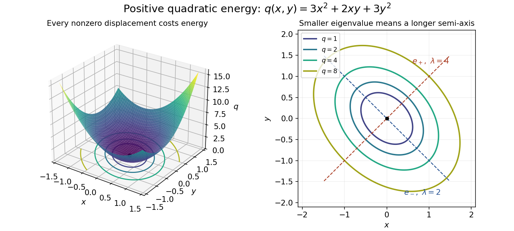

# Positive definiteness

↑ **Parent:** [Positive-definite bilinear form](positive-definite-bilinear-form.md)

The strict positivity of a [quadratic form](quadratic-form-split.md) on every nonzero [vector](vector.md). A real symmetric [matrix](matrix.md) has positive definiteness exactly when its associated [quadratic form](quadratic-form-split.md) does, making it a [positive-definite matrix](positive-definite-matrix.md). A [Hermitian form](hermitian-form.md) is positive definite when its value on $(v,v)$ is real and strictly positive for every nonzero vector.

Think of a [positive-definite quadratic form](positive-definite-quadratic-form.md) as an energy cost for a displacement: every direction costs something, and zero cost identifies the origin. For example, the real [symmetric matrix](symmetric-matrix.md)

$$
A=\begin{pmatrix}3&1\\1&3\end{pmatrix},\qquad q(x,y)=3x^2+2xy+3y^2=3\left(x+\frac y3\right)^2+\frac83y^2
$$

is a [positive-definite matrix](positive-definite-matrix.md) because the two squares can vanish together only at $(0,0)$. The mixed term couples the [coordinates](coordinate-linear-algebra.md), but cannot overwhelm their positive contributions: $q(1,1)=8$ and $q(1,-1)=4$. The graph is a bowl, and its positive [level sets](level-set.md) are [ellipses](ellipse.md) with axes along the [eigenvectors](eigenvector.md), rather than along the original [coordinates](coordinate-linear-algebra.md).

**[Figure 3](#image-positive-quadratic-energy-bowl-and-elliptical-level-curves). Positive quadratic energy bowl and elliptical level curves**.

The real and complex settings require different symmetry assumptions. For a real [symmetric matrix](symmetric-matrix.md) use $q(x)=x^TAx$ with $x\in\mathbb R^n$; for a complex [Hermitian matrix](hermitian-operator.md) use $q(z)=z^*Az$ with $z\in\mathbb C^n$, where $z^*$ is the [conjugate transpose](conjugate-transpose.md). The latter expression is real, so strict positivity is meaningful. A complex [quadratic form](quadratic-form-split.md) such as $z_1^2+z_2^2$ has no such positivity: it vanishes at $(1,i)$ and takes negative real values at $(i,0)$. A [Hermitian form](hermitian-form.md) uses [complex conjugation](complex-conjugation.md), which changes this example to $|z_1|^2+|z_2|^2$.

For a real [matrix](matrix.md) $M$ without a symmetry hypothesis, its [quadratic form](quadratic-form-split.md) depends only on its [symmetric part of a matrix](symmetric-part-of-a-matrix.md):

$$
x^TMx=x^T\frac{M+M^T}{2}x.
$$

Positive [eigenvalues](eigenvalue.md) of $M$ alone do not establish [positive definiteness](positive-definiteness.md) of this [quadratic form](quadratic-form-split.md). For example, $M=\begin{pmatrix}1&4\\0&1\end{pmatrix}$ has both [eigenvalues](eigenvalue.md) equal to $1$, yet $q(1,-1)=1-4+1=-2$. The relevant test is positivity of the [symmetric part of a matrix](symmetric-part-of-a-matrix.md), not the [spectrum](spectrum-functional-analysis.md) of an arbitrary [matrix](matrix.md).[Theorem 1.7, equation (1.3), p. 3: symmetric and alternating parts](bilinear-forms-by-keith-conrad.md)

**Table of contents**

- [Two-by-two positive-definiteness test](two-by-two-positive-definiteness-test.md)
- [Positive-definiteness threshold in a two-by-two family](positive-definiteness-threshold-in-a-two-by-two-family.md)
- [Ellipsoid level sets of a positive-definite quadratic form](ellipsoid-level-sets-of-a-positive-definite-quadratic-form.md)
- [Unique minimizer of a positive-definite quadratic function](unique-minimizer-of-a-positive-definite-quadratic-function.md)

## ↑ Ancestors (8)

1. [Positive-definite bilinear form](positive-definite-bilinear-form.md)
2. [Symmetric bilinear form](symmetric-bilinear-form.md)
3. [Bilinear form](bilinear-form-split.md)
4. [Linear algebra](linear-algebra-split.md)
5. [Algebra](algebra-split.md)
6. [Area of mathematics](area-of-mathematics.md)
7. [Mathematics](mathematics-split.md)
8. [Codex Wiki](split.md)

## ← Incoming links (15)

- [Cholesky decomposition as a sum of squares](cholesky-decomposition-as-a-sum-of-squares.md)
- [Coercive bilinear form](coercive-bilinear-form.md)
- [Hermitian form](hermitian-form.md)
- [Hermitian inner product](hermitian-inner-product.md)
- [Hessian matrix](hessian-matrix.md)
- [Matrix decomposition](matrix-decomposition.md)
- [Miscibility criterion for a two-component condensate](miscibility-criterion-for-a-two-component-condensate.md)
- [Nondegenerate bilinear form](nondegenerate-bilinear-form.md)
- [Solution](past-exam-of-the-mathematics-course-of-the-university-of-cambridge/2002/iii/paper-32/2/c/solution.md)
- [Solution](past-exam-of-the-mathematics-course-of-the-university-of-cambridge/2004/ib/paper-2/12e/solution.md)
- [Solution](past-exam-of-the-mathematics-course-of-the-university-of-cambridge/2005/iii/paper-21/4/b/solution.md)
- [Solution](past-exam-of-the-mathematics-course-of-the-university-of-cambridge/2005/iii/paper-46/1/i/solution.md)
- [Solution](past-exam-of-the-mathematics-course-of-the-university-of-cambridge/2005/iii/paper-83/4/iii/solution.md)
- [Positive definiteness](positive-definiteness.md)
- [Sylvester's criterion](sylvester-s-criterion.md)
