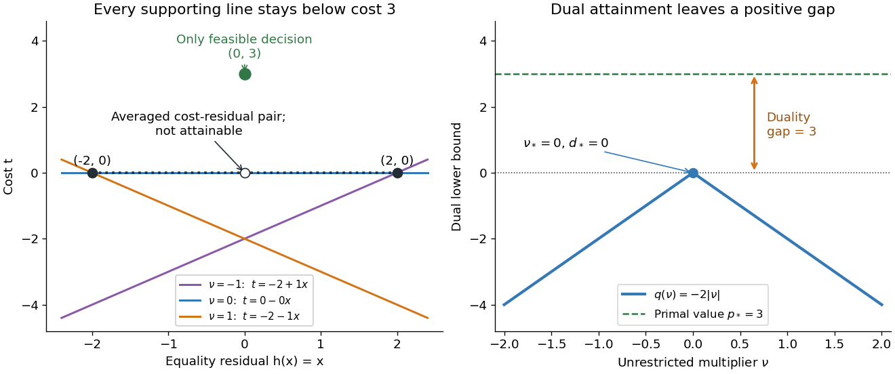

# Positive Lagrangian duality gap on a finite domain

↑ **Parent:** [Lagrangian duality](lagrangian-duality.md)

A nonconvex [primal problem](primal-problem.md) can have a positive [duality gap](duality-gap.md) even when both optima are attained. Choose the [finite set](finite-set.md) $X=\{-2,0,2\}$, the [objective function](objective-function.md) values $f(-2)=0$, $f(0)=3$, $f(2)=0$, and the equality [optimization constraint](optimization-constraint.md) $h(x)=x=0$. The only [feasible point](feasible-point.md) is $0$, so $p_*=3$.

With unrestricted equality [Lagrange multiplier](lagrange-multiplier.md) $\nu$, the three possible [optimization Lagrangian](optimization-lagrangian.md) values and their [minimum](minimum-of-a-subset-of-a-total-order.md) are

$$
L(-2,\nu)=-2\nu,\qquad L(0,\nu)=3,\qquad L(2,\nu)=2\nu,
\qquad q(\nu)=\min\{-2\nu,3,2\nu\}=-2|\nu|.
$$

The [concave](concave-function.md) [Lagrange dual function](lagrange-dual-function.md) has unique maximizer $\nu_*=0$, with $d_*=0$. Thus the [duality gap](duality-gap.md) is $3$. At the optimal [Lagrange multiplier](lagrange-multiplier.md), both inner minimizers $-2$ and $2$ violate the equality; the dual optimum does not recover a primal optimizer.

**[Figure 9](#image-a-feasible-finite-problem-has-a-duality-gap-of-3-despite-dual-attainment). A feasible finite problem has a duality gap of 3 despite dual attainment**. Left: three allowed decisions shown as cost versus equality residual. For each indicated [Lagrange multiplier](lagrange-multiplier.md), the [line](straight-line.md) $t=q(\nu)-\nu x$ lies below every allowed cost. The dotted segment joining the two zero-cost points contains cost-residual pairs unavailable to any allowed decision. Right: maximizing $q(\nu)=-2|\nu|$ gives 0, below the primal value 3.

Why can no slope close the gap? Any [affine function](affine-function.md) $a+bx$ lying below the two endpoint costs obeys $a-2b\leq0$ and $a+2b\leq0$. Adding gives $a\leq0$, so its value at residual zero cannot reach the feasible cost $3$. A [convex combination](convex-combination.md) of the endpoint cost-residual pairs with equal weights has residual zero and average cost zero. This averaged pair is unattainable: the actual decision $x=0$ costs $3$. This geometry explains precisely what the dual bounds fail to distinguish. Nonconvexity does not force a positive [duality gap](duality-gap.md): changing only $f(0)$ to $0$ makes both optimal values zero on the same nonconvex domain.

## ↑ Ancestors (5)

1. [Lagrangian duality](lagrangian-duality.md)
2. [Mathematical optimization](mathematical-optimization-split.md)
3. [Area of mathematics](area-of-mathematics.md)
4. [Mathematics](mathematics-split.md)
5. [Codex Wiki](split.md)
