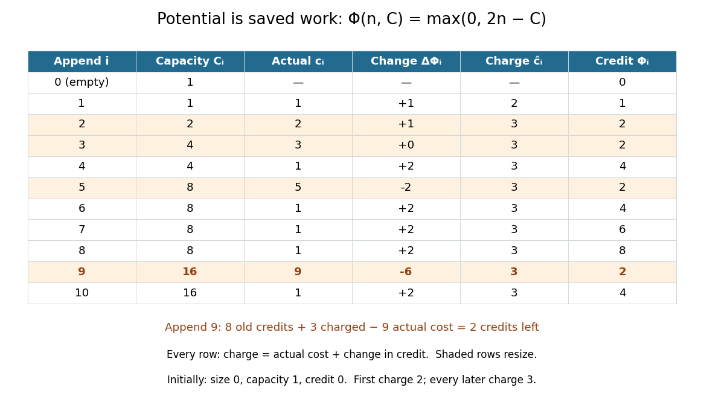

# Potential method

↑ **Parent:** [Amortized analysis](amortized-analysis.md)  
ⓦ [Wiki](https://en.wikipedia.org/wiki/Potential_method)

The [potential method](potential-method.md) assigns a number $\Phi(D)$ to each state $D$ of a [data structure](data-structure-split.md). Let $D_i$ be the state after operation $i$, $\Phi_i=\Phi(D_i)$, and $c_i$ its actual cost. Its [amortized cost](amortized-cost.md) is the actual cost plus the change in potential. Summing and cancelling adjacent potentials gives a [telescoping sum](telescoping-sum.md):

$$
\widehat c_i=c_i+\Phi_i-\Phi_{i-1},\qquad
\sum_{i=1}^m c_i=\sum_{i=1}^m\widehat c_i+\Phi_0-\Phi_m.
$$

If $\Phi_0=0$ and every reachable $\Phi_i\geq0$, the sum of [amortized costs](amortized-cost.md) bounds the actual total for every prefix. A nonzero initial potential contributes the explicit additive term $\Phi_0$. Potential is proof bookkeeping; the [algorithm](algorithm-split.md) need not store it.[CS 312 at Cornell University; CS 312, lecture 20, “Amortized analysis”: definition of amortized time and cancellation of successive potential changes](cs-312-at-cornell-university/lecture-20-hash-tables-and-amortized-analysis.md)

For [dynamic array doubling](dynamic-array-doubling.md), choose

$$
\Phi(n,C)=\max(0,2n-C).
$$

The [potential method](potential-method.md) now starts at $\Phi(0,1)=0$. After every nonempty reachable state, $C<2n$, so the maximum equals $2n-C$. There are just three cases for append:

- First append: $(0,1)$ becomes $(1,1)$, so $c_1=1$ and $\widehat c_1=1+(1-0)=2$.
- Later append without resizing: $C$ stays fixed and $n$ increases by one, so $\Delta\Phi=2$ and $\widehat c_i=1+2=3$.
- Append to a full capacity $k$: $(k,k)$ becomes $(k+1,2k)$, so the potential changes from $k$ to $2$. Hence $\widehat c_i=(k+1)+(2-k)=3$, including the resize from capacity one to two.

For every $n\geq1$, the total charge is $2+3(n-1)=3n-1$, and the [telescoping sum](telescoping-sum.md) proves

$$
T(n)=3n-1-\Phi(n,C_n)\leq3n-1.
$$

This agrees exactly with $T(n)=n+C_n-1$. The unmodified choice $2n-C$ has initial value $-1$, so calling it nonnegative at the empty state would be incorrect. It also works if that initial constant is retained in the identity; alternatively, $2n-C+1$ starts at zero and is nonnegative on these reachable states. The maximum above keeps a literal nonnegative credit balance from the beginning. The proof covers append alone; allowing reserve or arbitrary deletion changes the reachable states and requires a new argument.

**[Figure 6](#image-the-potential-method-as-a-credit-ledger-for-dynamic-array-doubling). The potential method as a credit ledger for dynamic array doubling**. Each row satisfies $\widehat c_i=c_i+\Delta\Phi_i$. Before append 9 there are eight credits; its charge of three and actual cost of nine leave two. Credits pay for counted work and do not represent spare [computer memory](computer-memory.md) slots.

**Table of contents**

- [Amortized cost](amortized-cost.md)

## ↑ Ancestors (7)

1. [Amortized analysis](amortized-analysis.md)
2. [Time complexity](time-complexity.md)
3. [Complexity class](complexity-class.md)
4. [Computational complexity theory](computational-complexity-theory.md)
5. [Theoretical computer science](theoretical-computer-science-split.md)
6. [Computer science](computer-science-split.md)
7. [Codex Wiki](split.md)

## ← Incoming links (4)

- [Accounting method](accounting-method.md)
- [Amortized analysis](amortized-analysis.md)
- [Amortized cost](amortized-cost.md)
- [Potential method](potential-method.md)
