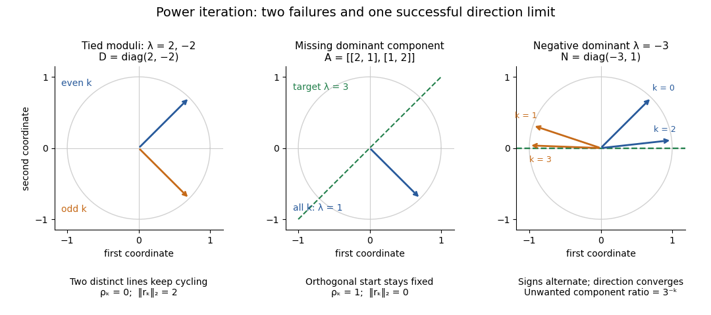

# Power iteration failure cases

↑ **Parent:** [Power iteration](power-iteration.md)

A tied largest [modulus](modulus.md) can prevent even direction convergence. With $D=\operatorname{diag}(2,-2)$ and $x_0=(1,1)^T/\sqrt2$,

$$
x_k=\frac1{\sqrt2}\begin{pmatrix}1\\(-1)^k\end{pmatrix},\qquad \rho_k=0,\qquad \|r_k\|_2=2.
$$

The two directions form a cycle; neither is an [eigenvector](eigenvector.md). There is no dominant-[modulus](modulus.md) [spectral gap](spectral-gap.md). A tied [modulus](modulus.md) is not a universal failure: an initial [eigenvector](eigenvector.md) remains on its line, and $A=2I$ preserves every direction. [Subspace iteration](subspace-iteration.md) addresses a separated cluster by targeting a [dominant invariant subspace](dominant-invariant-subspace.md) instead of one [eigenvector](eigenvector.md).

An [orthogonal](orthogonal-vectors.md) start can fail despite a strict [spectral gap](spectral-gap.md). For $A=\begin{pmatrix}2&1\\1&2\end{pmatrix}$ and $x_0=(1,-1)^T/\sqrt2$, the dominant component is zero, so $Ax_0=x_0$ and every iterate equals $x_0$. The [Rayleigh quotient](rayleigh-quotient.md) is exactly $1$ and the [eigenpair residual](eigenpair-residual.md) is zero, although the [dominant eigenvalue](dominant-eigenvalue.md) is $3$. Exact arithmetic never creates a missing component.[Power Method](templates-for-the-solution-of-algebraic-eigenvalue-problems-a-practical-guide/power-method.md)

**[Figure 41](#image-tied-eigenvalue-moduli-an-orthogonal-start-and-sign-alternation-in-power-iteration). Tied eigenvalue moduli, an orthogonal start, and sign alternation in power iteration**.

The third panel contrasts these failures with $N=\operatorname{diag}(-3,1)$, $x_0=(1,1)^T/\sqrt2$, for which

$$
x_k=\frac1{\sqrt{1+3^{-2k}}}\begin{pmatrix}(-1)^k\\3^{-k}\end{pmatrix}.
$$

Here the horizontal [eigenvector](eigenvector.md) direction converges with a strict [spectral gap](spectral-gap.md), while the normalized [vectors](vector.md) alternate signs. This is the successful direction convergence described under [sign and phase in power iteration](sign-and-phase-in-power-iteration.md).

For a [nonorthogonal](nonorthogonal-vectors.md) [eigenbasis](eigenbasis.md), even the word “orthogonal” must be used carefully. The [diagonalizable matrix](diagonalizable-matrix.md) $C=\begin{pmatrix}3&2\\0&1\end{pmatrix}$ has right [eigenvectors](eigenvector.md) $v_1=(1,0)^T$, $v_2=(-1,1)^T$, and dominant [left eigenvector](left-eigenvector.md) $w_1=(1,1)^T$. For $x_0=(a,b)^T$, the dominant coefficient is $c_1=w_1^Tx_0=a+b$. The starting [vector](vector.md) $v_2$ is [nonorthogonal](nonorthogonal-vectors.md) to $v_1$ but stays at the smaller [eigenvalue](eigenvalue.md) $1$; $(0,1)^T$ is [orthogonal](orthogonal-vectors.md) to $v_1$ but has $c_1=1$ and converges to the dominant direction. The [left eigenvector](left-eigenvector.md) test, not the right-[eigenvector](eigenvector.md) [inner product](inner-product.md), controls the outcome.

A [random vector](random-vector.md) drawn from a [continuous probability distribution](continuous-probability-distribution-split.md) with a [probability density function](probability-density-function.md) on the full real or complex [vector space](vector-space-split.md) has $c_1\ne0$ with probability one. This avoids the exact missing-component [hyperplane](hyperplane.md), but does not guarantee a large component or fast convergence. [Floating-point arithmetic](floating-point-arithmetic.md) may seed a missing component, yet a structurally preserved zero can remain zero, so accidental perturbations are not a convergence guarantee.

## ↑ Ancestors (7)

1. [Power iteration](power-iteration.md)
2. [Numerical linear algebra](numerical-linear-algebra.md)
3. [Numerical analysis](numerical-analysis-split.md)
4. [Analysis](analysis-split.md)
5. [Area of mathematics](area-of-mathematics.md)
6. [Mathematics](mathematics-split.md)
7. [Codex Wiki](split.md)

## ← Incoming links (1)

- [Power iteration convergence for a diagonalizable matrix](power-iteration-convergence-for-a-diagonalizable-matrix.md)
