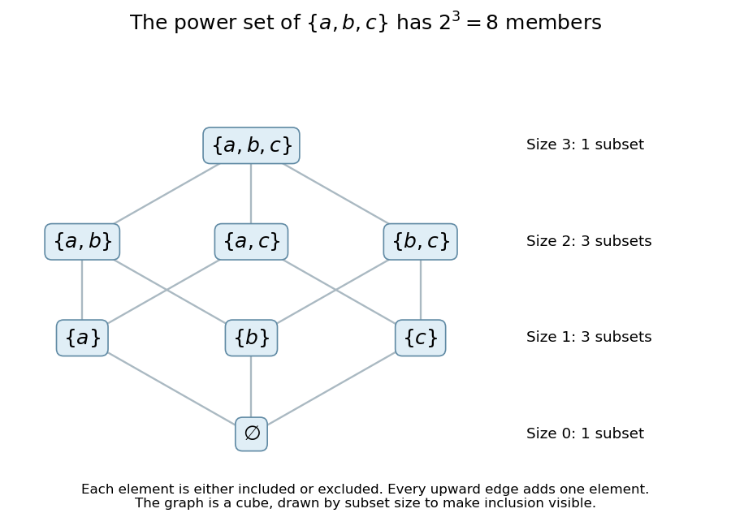

# Power set

↑ **Parent:** [Set](set-split.md)  
ⓦ [Wiki](https://en.wikipedia.org/wiki/Power_set)

The power set $\mathcal P(X)$ is the [set](set-split.md) of all [subsets](subset.md) of $X$, including the [empty set](empty-set.md) and $X$ itself. It is useful whenever an object is a selection rather than an individual member: a possible collection of active vertices in a [graph](graph-split.md), for example, belongs to the [power set](power-set.md) of the vertex [set](set-split.md).

For $X=\{a,b,c\}$, the [power set](power-set.md) has eight members:

$$
\mathcal P(X)=\{\varnothing,\{a\},\{b\},\{c\},\{a,b\},\{a,c\},\{b,c\},\{a,b,c\}\}.
$$

Each of the three [set elements](element-of-a-set.md) is either included or excluded. More generally, if $|X|=n<\infty$, these $n$ independent binary choices give $|\mathcal P(X)|=2^n$. This is a [bijection](bijection.md) between [subsets](subset.md) and [binary strings](binary-string.md) of length $n$, not a probabilistic independence assumption.

**[Figure 3](#image-eight-subsets-of-a-three-element-set-form-a-cube-when-edges-add-one-element). Eight subsets of a three-element set form a cube when edges add one element**.

Ordering the [subsets](subset.md) by inclusion gives a [Boolean lattice](boolean-lattice.md). In the picture an upward edge adds one member. Complementation reverses inclusion, and [union](set-union.md) and [intersection](set-intersection.md) combine selections. The empty-input case is worth checking: $\mathcal P(\varnothing)=\{\varnothing\}$ has one member, not zero, consistently with $2^0=1$.

**Table of contents**

- [Cantor's theorem](cantor-s-theorem.md)

## ↑ Ancestors (6)

1. [Set](set-split.md)
2. [Set theory](set-theory-split.md)
3. [Foundations of mathematics](foundations-of-mathematics-split.md)
4. [Area of mathematics](area-of-mathematics.md)
5. [Mathematics](mathematics-split.md)
6. [Codex Wiki](split.md)

## ← Incoming links (83)

- [Adjoints of inverse image on power sets](adjoints-of-inverse-image-on-power-sets.md)
- [Basic Fraenkel permutation model](basic-fraenkel-permutation-model.md)
- [Beth number](beth-number.md)
- [Binomial theorem](binomial-theorem.md)
- [Boolean lattice](boolean-lattice.md)
- [Borel sigma-algebra of a discrete space](borel-sigma-algebra-of-a-discrete-space.md)
- [Cantor's diagonal argument](cantor-s-diagonal-argument.md)
- [Cantor's theorem](cantor-s-theorem.md)
- [Cardinality of integer-periodic function spaces](cardinality-of-integer-periodic-function-spaces.md)
- [Countability of finite subsets of a countable set](countability-of-finite-subsets-of-a-countable-set.md)
- [Countable rank-initial segment cannot model ZFC](countable-rank-initial-segment-cannot-model-zfc.md)
- [Counting measure](counting-measure.md)
- [Dirac measure](dirac-measure.md)
- [Events determined by a random variable](events-determined-by-a-random-variable.md)
- [Expected utility representation on a finite measurable space](expected-utility-representation-on-a-finite-measurable-space.md)
- [Finite-subset lifting of a well-quasi-order](finite-subset-lifting-of-a-well-quasi-order.md)
- [Finitely supported permutation](finitely-supported-permutation.md)
- [Full semantics for second-order logic](full-semantics-for-second-order-logic.md)
- [Functor](functor-split.md)
- [Generic coordinate reals for finite-function forcing](generic-coordinate-reals-for-finite-function-forcing.md)
- [Henkin semantics](henkin-semantics.md)
- [Hereditarily locally small membership model](hereditarily-locally-small-membership-model.md)
- [Inner models with all reals preserve omega-one](inner-models-with-all-reals-preserve-omega-one.md)
- [Kolmogorov axioms](kolmogorov-axioms.md)
- [Matroid independence axioms](matroid-independence-axioms.md)
- [Measure space](measure-space.md)
- [Natural transformation](natural-transformation.md)
- [Nondeterministic finite automaton](nondeterministic-finite-automaton.md)
- [Solution](past-exam-of-the-mathematics-course-of-the-university-of-cambridge/2001/ia/paper-4/1e/a/solution.md)
- [Solution](past-exam-of-the-mathematics-course-of-the-university-of-cambridge/2001/iii/paper-18/2/solution.md)
- [Solution](past-exam-of-the-mathematics-course-of-the-university-of-cambridge/2002/iii/paper-20/7/ii/solution.md)
- [Solution](past-exam-of-the-mathematics-course-of-the-university-of-cambridge/2002/iii/paper-21/2/solution.md)
- [Solution](past-exam-of-the-mathematics-course-of-the-university-of-cambridge/2002/iii/paper-21/3/solution.md)
- [Solution](past-exam-of-the-mathematics-course-of-the-university-of-cambridge/2003/iii/paper-19/2/solution.md)
- [Solution](past-exam-of-the-mathematics-course-of-the-university-of-cambridge/2003/iii/paper-19/3/solution.md)
- [Solution](past-exam-of-the-mathematics-course-of-the-university-of-cambridge/2003/iii/paper-19/4/solution.md)
- [Solution](past-exam-of-the-mathematics-course-of-the-university-of-cambridge/2004/ia/paper-4/5e/solution.md)
- [Solution](past-exam-of-the-mathematics-course-of-the-university-of-cambridge/2004/iii/paper-24/1/solution.md)
- [Solution](past-exam-of-the-mathematics-course-of-the-university-of-cambridge/2004/iii/paper-24/3/solution.md)
- [Solution](past-exam-of-the-mathematics-course-of-the-university-of-cambridge/2005/iii/paper-27/2/solution.md)
- [Solution](past-exam-of-the-mathematics-course-of-the-university-of-cambridge/2005/iii/paper-27/4/solution.md)
- [Solution](past-exam-of-the-mathematics-course-of-the-university-of-cambridge/2006/ia/paper-4/8e/solution.md)
- [Solution](past-exam-of-the-mathematics-course-of-the-university-of-cambridge/2006/iii/paper-25/2/solution.md)
- [Solution](past-exam-of-the-mathematics-course-of-the-university-of-cambridge/2006/iii/paper-25/5/solution.md)
- [Solution](past-exam-of-the-mathematics-course-of-the-university-of-cambridge/2006/iii/paper-25/8/solution.md)
- [Solution](past-exam-of-the-mathematics-course-of-the-university-of-cambridge/2007/iii/paper-12/4/solution.md)
- [Solution](past-exam-of-the-mathematics-course-of-the-university-of-cambridge/2008/ii/paper-3/16g/solution.md)
- [Solution](past-exam-of-the-mathematics-course-of-the-university-of-cambridge/2008/iii/paper-34/1/solution.md)
- [Solution](past-exam-of-the-mathematics-course-of-the-university-of-cambridge/2009/iii/paper-25/2/solution.md)
- [Solution](past-exam-of-the-mathematics-course-of-the-university-of-cambridge/2009/iii/paper-25/4/solution.md)
- [Solution](past-exam-of-the-mathematics-course-of-the-university-of-cambridge/2010/iii/paper-10/4/solution.md)
- [Solution](past-exam-of-the-mathematics-course-of-the-university-of-cambridge/2010/iii/paper-20/5/solution.md)
- [Solution](past-exam-of-the-mathematics-course-of-the-university-of-cambridge/2011/ia/paper-4/7e/solution.md)
- [Solution](past-exam-of-the-mathematics-course-of-the-university-of-cambridge/2012/iii/paper-83/1/i/solution.md)
- [Solution](past-exam-of-the-mathematics-course-of-the-university-of-cambridge/2013/ia/paper-4/7e/ii/solution.md)
- [Solution](past-exam-of-the-mathematics-course-of-the-university-of-cambridge/2013/iii/paper-19/1/i/b/solution.md)
- [Solution](past-exam-of-the-mathematics-course-of-the-university-of-cambridge/2013/iii/paper-19/1/ii/b/solution.md)
- [Solution](past-exam-of-the-mathematics-course-of-the-university-of-cambridge/2013/iii/paper-19/1/iv/solution.md)
- [Solution](past-exam-of-the-mathematics-course-of-the-university-of-cambridge/2014/iii/paper-21/5/ii/solution.md)
- [Solution](past-exam-of-the-mathematics-course-of-the-university-of-cambridge/2016/ia/paper-4/5e/a/solution.md)
- [Solution](past-exam-of-the-mathematics-course-of-the-university-of-cambridge/2016/iii/paper-121/4/d/solution.md)
- [Solution](past-exam-of-the-mathematics-course-of-the-university-of-cambridge/2017/iii/paper-121/1/iii/solution.md)
- [Solution](past-exam-of-the-mathematics-course-of-the-university-of-cambridge/2017/iii/paper-121/2/v/solution.md)
- [Solution](past-exam-of-the-mathematics-course-of-the-university-of-cambridge/2017/iii/paper-121/3/iii/solution.md)
- [Solution](past-exam-of-the-mathematics-course-of-the-university-of-cambridge/2018/iii/paper-121/1/v/a/solution.md)
- [Solution](past-exam-of-the-mathematics-course-of-the-university-of-cambridge/2019/ii/paper-3/16i/ii/solution.md)
- [Solution](past-exam-of-the-mathematics-course-of-the-university-of-cambridge/2019/iii/paper-121/1/ii/solution.md)
- [Solution](past-exam-of-the-mathematics-course-of-the-university-of-cambridge/2020/ia/paper-2/8d/a/solution.md)
- [Solution](past-exam-of-the-mathematics-course-of-the-university-of-cambridge/2020/ia/paper-2/8d/c/ii/solution.md)
- [Solution](past-exam-of-the-mathematics-course-of-the-university-of-cambridge/2020/ii/paper-1/16h/i/solution.md)
- [Solution](past-exam-of-the-mathematics-course-of-the-university-of-cambridge/2020/ii/paper-1/4f/solution.md)
- [Power set](power-set.md)
- [Power-set closure of better-quasi-orderings](power-set-closure-of-better-quasi-orderings.md)
- [Power-set failure in an increasing union of generic extensions](power-set-failure-in-an-increasing-union-of-generic-extensions.md)
- [Power-set failure in hereditarily small sets](power-set-failure-in-hereditarily-small-sets.md)
- [Power set in a generic extension](power-set-in-a-generic-extension.md)
- [Set](set-split.md)
- [Set theory](set-theory-split.md)
- [Sigma-algebra](sigma-algebra.md)
- [Topological space](topological-space.md)
- [Two-toss sample space](two-toss-sample-space.md)
- [Vector space bases from Zorn's lemma](vector-space-bases-from-zorn-s-lemma.md)
- [Zermelo set theory](zermelo-set-theory.md)
