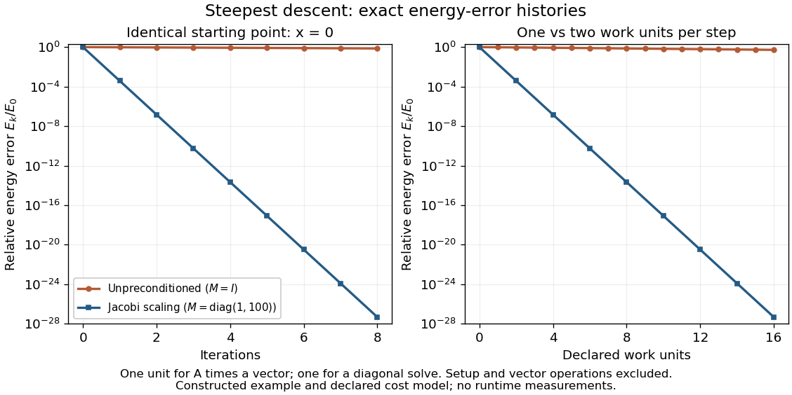

# Preconditioned steepest descent

↑ **Parent:** [Matrix preconditioning](matrix-preconditioning.md)

For fixed [symmetric positive-definite matrices](symmetric-positive-definite-matrix.md) $A$ and $M$, [preconditioned steepest descent](preconditioned-steepest-descent.md) minimizes $F(x)=x^TAx/2-b^Tx$ along the direction supplied by the auxiliary solve. Given $x_k$, form the [linear-system residual](linear-system-residual.md) $r_k=b-Ax_k$. If $r_k=0$, stop: $x_k=x_*$. Otherwise solve $Mz_k=r_k$ and use

$$
\alpha_k=\frac{r_k^Tz_k}{z_k^TAz_k},\qquad x_{k+1}=x_k+\alpha_kz_k,\qquad r_{k+1}=r_k-\alpha_kAz_k.
$$

This is [exact line search for a positive-definite quadratic](exact-line-search-for-a-positive-definite-quadratic.md) along $z_k$. Indeed,

$$
F(x_k+\alpha z_k)=F(x_k)-\alpha r_k^Tz_k+\frac12\alpha^2z_k^TAz_k,
$$

whose [derivative](derivative.md) vanishes at the displayed positive [step size](step-size.md). Unlike the [Preconditioned conjugate gradient method](preconditioned-conjugate-gradient-method.md), it uses the fresh $z_k$ directly rather than combining it with a previous conjugate direction.

For [diagonal scaling for a two-dimensional linear system](diagonal-scaling-for-a-two-dimensional-linear-system.md), start at $x_0=0$. Without [matrix preconditioning](matrix-preconditioning.md), take $M=I$: $z_0=(1,1)^T$, $\alpha_0=10/507$, and

$$
x_1=\frac1{507}\begin{pmatrix}10\\10\end{pmatrix},\qquad r_1=\frac{165}{169}\begin{pmatrix}1\\-1\end{pmatrix}.
$$

With the [Jacobi preconditioner](jacobi-preconditioner.md) $M=\operatorname{diag}(1,100)$, $z_0=(1,1/100)^T$, $\alpha_0=505/507$, and

$$
x_1=\begin{pmatrix}505/507\\101/10140\end{pmatrix},\qquad r_1=\begin{pmatrix}33/16900\\-33/169\end{pmatrix}.
$$

The original [linear-system residual](linear-system-residual.md) becomes much smaller after this correction. Quantify progress in the same [energy norm](energy-norm.md) in both cases: $E_k=F(x_k)-F(x_*)$ and $E_0=2515/4998$. Exact substitution gives

$$
\frac{E_1}{E_0}=q_I=\frac{81675}{85007}\approx0.960803228,\qquad \frac{E_1^{(M)}}{E_0}=q_M=\frac{3267}{8500700}\approx0.000384321291.
$$

In this particular example the entire histories are $E_k/E_0=q_I^k$ and $E_k^{(M)}/E_0=q_M^k$. To check that this is exact, the next [step sizes](step-size.md) are $10/503$ and $505/503$, respectively, and their residual updates give $r_2=q_Ir_0$ and $r_2^{(M)}=q_Mr_0$. Multiplying a [linear-system residual](linear-system-residual.md) by a nonzero [scalar](scalar.md) leaves the next [step size](step-size.md) unchanged; every pair of steps repeats the same directions at a smaller scale. The two first-step energy ratios then establish these formulas for all $k$.

**[Figure 2](#image-computed-steepest-descent-method-energy-errors-before-and-after-jacobi-preconditioning). Computed steepest descent method energy errors before and after Jacobi preconditioning**.

The curves come from exact rational updates of the specified [linear system](system-of-linear-equations.md), converted to decimal values for plotting. The left panel counts iterations. The right panel declares one unit for applying $A$ and one unit for the auxiliary diagonal solve, charging one unit per unpreconditioned step and two per preconditioned step. It excludes setup and [vector](vector.md) operations, so it compares a declared cost model rather than measured runtime. Scaling is advantageous even with that extra charge.

These curves compare [steepest descent method](gradient-descent-split.md) iterations. On this two-dimensional [linear system](system-of-linear-equations.md), both the [Conjugate gradient method](conjugate-gradient-method.md) and the [Preconditioned conjugate gradient method](preconditioned-conjugate-gradient-method.md) terminate within two steps in exact arithmetic. The plot therefore establishes no CG iteration-count advantage for this example; the benefit of scaling for larger problems depends on their [eigenvalues](eigenvalue.md) and auxiliary-solve costs.

**Table of contents**

- [Condition-number bound for preconditioned steepest descent](condition-number-bound-for-preconditioned-steepest-descent.md)

## ↑ Ancestors (7)

1. [Matrix preconditioning](matrix-preconditioning.md)
2. [Numerical linear algebra](numerical-linear-algebra-split.md)
3. [Numerical analysis](numerical-analysis-split.md)
4. [Analysis](analysis-split.md)
5. [Area of mathematics](area-of-mathematics.md)
6. [Mathematics](mathematics-split.md)
7. [Codex Wiki](split.md)

## ← Incoming links (4)

- [Condition-number bound for preconditioned steepest descent](condition-number-bound-for-preconditioned-steepest-descent.md)
- [Matrix preconditioning](matrix-preconditioning.md)
- [Preconditioned steepest descent](preconditioned-steepest-descent.md)
- [Symmetric preconditioning as energy geometry](symmetric-preconditioning-as-energy-geometry.md)
