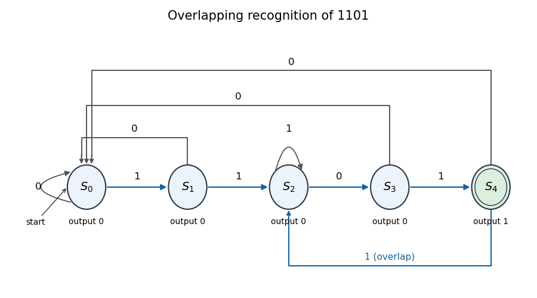

# Prefix-suffix sequence recognizer

↑ **Parent:** [Moore machine](moore-machine.md)

For a fixed word $w$, store the length of the longest suffix of the received stream that is also a prefix of $w$. On a new input symbol, append it to the represented prefix and select the longest resulting suffix that is a prefix of $w$. The complete-word state signals recognition. Its outgoing transitions retain proper suffix matches, allowing overlapping occurrences rather than automatically restarting from the empty prefix. This is the finite-state form of the prefix information used by the [Knuth-Morris-Pratt algorithm](knuth-morris-pratt-algorithm.md).

For example, recognizing $1101$ needs suffix-prefix states of lengths zero through four. After a complete match followed by one, the last two symbols are $11$, so the next state retains length two. This permits the second match in $1101101$ without clearing the useful suffix.

**[Figure 1](#image-an-overlapping-prefix-suffix-sequence-recognizer-for-1101). An overlapping prefix-suffix sequence recognizer for $1101$**.

## ↑ Ancestors (7)

1. [Moore machine](moore-machine.md)
2. [Finite-state machine](finite-state-machine.md)
3. [Formal language theory](formal-language-theory.md)
4. [Foundations of mathematics](foundations-of-mathematics-split.md)
5. [Area of mathematics](area-of-mathematics.md)
6. [Mathematics](mathematics-split.md)
7. [Codex Wiki](split.md)

## ← Incoming links (2)

- [Solution](past-exam-of-the-year-1-of-the-computer-science-course-of-the-university-of-oxford/2018/digital-systems-linear-algebra-introduction-to-formal-proof/1/a/solution.md)
- [Prefix-suffix sequence recognizer](prefix-suffix-sequence-recognizer.md)
