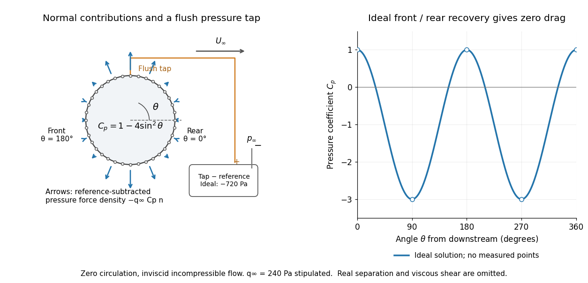

# Pressure coefficient

↑ **Parent:** [Lift (force)](lift-force.md)

The [pressure coefficient](pressure-coefficient.md) compares a local [static pressure](static-pressure.md) with a specified reference [static pressure](static-pressure.md), using a fixed reference [dynamic pressure](dynamic-pressure.md):

$$
C_p(\mathbf x)=\frac{p(\mathbf x)-p_\infty}{q_\infty},\qquad
q_\infty=\frac12\rho_\infty U_\infty^2>0.
$$

The reference [mass density](density.md), [speed](speed.md), [pressure](pressure.md) and location must accompany a reported [pressure coefficient](pressure-coefficient.md). Keep the same $q_\infty$ throughout a surface distribution; replacing it by local $\rho U^2/2$ gives a different quantity and fails at a [stagnation point](stagnation-point.md). The definition itself requires neither [Bernoulli's principle](bernoulli-s-principle.md) nor [inviscid flow](inviscid-flow.md), so measured [pressure coefficients](pressure-coefficient.md) remain useful when those idealizations fail.

Positive $C_p$ means $p>p_\infty$; zero means equality; negative $C_p$ means $p<p_\infty$. This sign does not specify the sign of [absolute pressure](absolute-pressure.md). For stipulated $p_\infty=101325\,\mathrm{Pa}$ absolute and $q_\infty=240\,\mathrm{Pa}$, $C_p=-3$ gives $p=100605\,\mathrm{Pa}$ absolute: a $720\,\mathrm{Pa}$ deficit, not a negative [absolute pressure](absolute-pressure.md). If $p_\infty$ equals [atmospheric pressure](atmospheric-pressure.md), the numerator is [gauge pressure](gauge-pressure.md); a [wind tunnel](wind-tunnel.md)'s reference [static pressure](static-pressure.md) need not equal room [atmospheric pressure](atmospheric-pressure.md). These are reference choices, not different physical [pressures](pressure.md).

Under the same-height, constant-[mass density](density.md) $\rho=\rho_\infty$, [steady flow](steady-flow.md) and [inviscid flow](inviscid-flow.md) hypotheses of the [Bernoulli equation](bernoulli-equation.md), and with the same [Bernoulli invariant](bernoulli-invariant.md) as the reference flow,

$$
p+\frac12\rho U^2=p_\infty+\frac12\rho U_\infty^2,
\qquad C_p=1-\left(\frac{U}{U_\infty}\right)^2.
$$

The first equation immediately gives the second after subtracting $p_\infty$ and dividing by $q_\infty$. Hence a lossless [stagnation point](stagnation-point.md) has $C_p=1$, $U=U_\infty$ gives $C_p=0$, and $U=2U_\infty$ gives $C_p=-3$. For a real stationary wall satisfying the [no-slip boundary condition](no-slip-boundary-condition.md), the [velocity](velocity.md) is zero right at the wall; inserting that wall [velocity](velocity.md) in an [inviscid flow](inviscid-flow.md) formula would wrongly predict $C_p=1$ everywhere. A thin [boundary layer](boundary-layer.md) approximation instead relates the wall [pressure](pressure.md) to the outer-flow [pressure](pressure.md) and uses the outer [velocity](velocity.md) where the [Bernoulli equation](bernoulli-equation.md) applies.

**[Figure 6](#image-ideal-cylinder-pressure-coefficients-pressure-tapping-and-cancellation-of-pressure-drag). Ideal cylinder pressure coefficients, pressure tapping and cancellation of pressure drag**. Original [potential flow around a circular cylinder](potential-flow-around-a-circular-cylinder.md) with zero [circulation](circulation-physics.md), not experimental data or a fit. [Angle](angle.md) is measured counterclockwise from the downstream direction. Hollow circles mark sampling locations; arrows show only the reference-subtracted [pressure](pressure.md) [force](force.md) per unit [area](surface-area.md). A separate [pressure tapping](pressure-tapping.md) measures [static pressure](static-pressure.md), rather than [stagnation pressure](stagnation-pressure.md). The front and rear ideal [pressure](pressure.md) [forces](force.md) cancel, so this model predicts zero [drag](drag-physics.md).

For [potential flow around a circular cylinder](potential-flow-around-a-circular-cylinder.md) of radius $a$ with zero [circulation](circulation-physics.md), the surface tangential [velocity](velocity.md) is $u_\theta=-2U_\infty\sin\theta$. Thus the ideal [pressure coefficient](pressure-coefficient.md) is

$$
C_p(\theta)=1-4\sin^2\theta.
$$

With $\theta$ measured from downstream, the front is at $\pi$ and the rear at zero. Both ideal [stagnation points](stagnation-point.md) have $C_p=1$, while the sides at $\pi/2$ and $3\pi/2$ have $C_p=-3$. This exact model is a useful baseline for an experiment; its complete rearward [pressure](pressure.md) recovery is not a prediction for a separated real [fluid wake](wake-physics.md).

To obtain a [force](force.md), integrate the local normal contributions with their directions. Let $\mathbf n$ be the unit [normal vector](normal-vector.md) from the body into the [fluid](fluid.md) and $\Sigma$ its closed wetted surface:

$$
\mathbf F_p=-\int_\Sigma p\mathbf n\,dA
=-q_\infty\int_\Sigma C_p\mathbf n\,dA,
\qquad \int_\Sigma\mathbf n\,dA=\mathbf0.
$$

The second equality removes a spatially constant reference [pressure](pressure.md) over the closed surface; it does not remove a nonuniform [hydrostatic pressure](hydrostatic-pressure.md) or justify dropping the reference term on an isolated open patch. A negative $C_p$ contributes outwards in this reference-subtracted calculation, even though a positive [absolute pressure](absolute-pressure.md) still pushes inwards locally. Project $\mathbf F_p$ onto the chosen [lift](lift-force.md) and [drag](drag-physics.md) directions. The full [fluid](fluid.md) [force](force.md) also includes $\int_\Sigma\boldsymbol\sigma_{\rm visc}\mathbf n\,dA$ from the [viscous stress tensor](viscous-stress-tensor.md), including tangential [shear stress](shear-stress.md); [pressure tapping](pressure-tapping.md) does not measure that contribution.

For the two-dimensional cylinder, [force](force.md) per unit span follows from $dA=a\,d\theta$ per unit span and $\mathbf n=(\cos\theta,\sin\theta)$:

$$
(D'_p,L'_p)=-q_\infty a\int_0^{2\pi}C_p(\theta)(\cos\theta,\sin\theta)\,d\theta.
$$

Substituting $C_p=1-4\sin^2\theta$ gives $(0,0)$: opposite points have identical [pressure coefficients](pressure-coefficient.md) and opposite [normal vectors](normal-vector.md). Zero [drag](drag-physics.md) despite a strongly nonuniform [pressure](pressure.md) is the instructive limitation associated with [D'Alembert's paradox](d-alembert-s-paradox.md). Real [viscosity](dynamic-viscosity.md), [boundary layers](boundary-layer.md) and [flow separation](flow-separation.md) can prevent rearward [pressure](pressure.md) recovery and produce [pressure drag](pressure-drag.md). Thus the measured curve can test the model and estimate a [pressure](pressure.md) contribution without proving that total [drag](drag-physics.md) vanishes.

A motivating measurement is Virginia Tech's [Experiment 3 - Flow Past a Circular Cylinder](aoe-3054-laboratory-manual/experiment-3-flow-past-a-circular-cylinder.md). Its open-jet [wind tunnel](wind-tunnel.md) holds a rotatable $140\,\mathrm{mm}$ cylinder with end plates and 36 one-millimetre [pressure tappings](pressure-tapping.md) at ten-degree intervals. A reference [Pitot-static tube](pitot-static-tube.md) supplies $p_{0\infty}$ and $p_\infty$ to one digital [manometer](manometer.md); a second connects a surface tap to its positive port and reference [static pressure](static-pressure.md) to its negative port. Record the simultaneous readings:

$$
\Delta p_{\rm ref}=p_{0\infty}-p_\infty,\qquad
\Delta p_i=p_i-p_\infty,\qquad
C_{p,i}=\frac{\Delta p_i}{\Delta p_{\rm ref}}.
$$

The last equality uses the low-speed stopping relation, not an additional [speed](speed.md) measurement. The manual requires sealed tubing and zero checks with the tunnel off. It also provides a water-column [manometer](manometer.md): read each column's initial level, and subtract the independently measured reference-to-atmosphere [pressure](pressure.md) from the tap-to-atmosphere readings. Record tap positions after rotation. Compare the two instruments and check spanwise uniformity; end plates do not guarantee two-dimensional flow. [Experiment 3 - Flow Past a Circular Cylinder](aoe-3054-laboratory-manual/experiment-3-flow-past-a-circular-cylinder.md)

The inferential distinction matters: the [manometers](manometer.md) directly measure [pressure](pressure.md) differences, the ratio estimates [pressure coefficients](pressure-coefficient.md), and a [surface integral](surface-integral.md) estimates the pressure part of the [force](force.md). Measure room [absolute pressure](absolute-pressure.md) and [temperature](temperature.md) if converting the reference difference to [speed](speed.md) through the [ideal gas law](ideal-gas-law.md) $\rho=p_{\rm abs}/(RT)$; use [thermodynamic temperature](thermodynamic-temperature.md) in that equation. For [force](force.md) reconstruction, cover the complete contour and use [numerical integration](numerical-integration.md) with the tap geometry. Finite tap spacing, unknown end effects, probe disturbance and fluctuations limit that reconstruction; tubes and instruments also average or delay changing [pressures](pressure.md). Retain the signed raw readings, repeated readings and reference readings so that these limits can be assessed. A small reference difference magnifies any zero error in the ratio, rather than producing a reliably large $C_p$.

**Table of contents**

- [Pressure tapping](pressure-tapping.md)

## ↑ Ancestors (5)

1. [Lift (force)](lift-force.md)
2. [Fluid mechanics](fluid-mechanics-split.md)
3. [Branches of physics](branches-of-physics.md)
4. [Physics](physics-split.md)
5. [Codex Wiki](split.md)

## ← Incoming links (4)

- [D'Alembert's paradox](d-alembert-s-paradox.md)
- [Dynamic pressure](dynamic-pressure.md)
- [Lift (force)](lift-force.md)
- [Pressure coefficient](pressure-coefficient.md)
