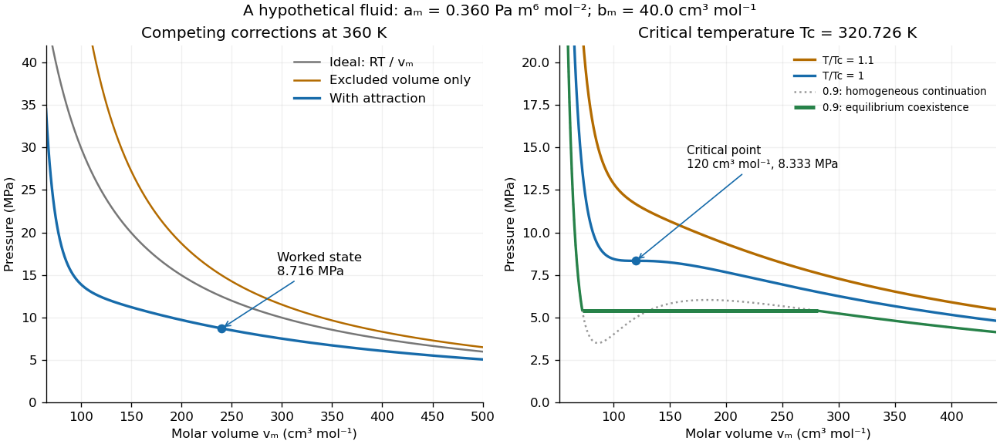

# Pressure

↑ **Parent:** [Thermodynamics](thermodynamics.md)  
ⓦ [Wiki](https://en.wikipedia.org/wiki/Pressure)

Pressure measures the compressive [normal force](force.md#normal-force) per unit [surface area](differential-geometry.md#surface-area). For a uniformly loaded surface of [surface area](differential-geometry.md#surface-area) $A$, the magnitude of the perpendicular [force](force.md) is $F_\perp=PA$; locally, $P=dF_\perp/dA$. Its [SI](physics.md#international-system-of-units) unit is the pascal, $1\,\mathrm{Pa}=1\,\mathrm{N\,m^{-2}}$. A [force](force.md) parallel to the surface contributes shear [stress](continuum-mechanics.md#stress), rather than [pressure](pressure.md). In a [gas](thermodynamics.md#gas), the steady macroscopic [force](force.md) comes from many microscopic transfers of [momentum](momentum.md); [ideal gas pressure from wall collisions](ideal-gas.md#ideal-gas-pressure-from-wall-collisions) makes this connection explicit. [OpenStax University Physics Volume 2, section 2.2: microscopic origin of pressure](https://openstax.org/books/university-physics-volume-2/pages/2-2-pressure-temperature-and-rms-speed)

For a computed example, a uniform [pressure](pressure.md) of $100\,\mathrm{kPa}$ on a piston of [surface area](differential-geometry.md#surface-area) $10\,\mathrm{cm^2}=10^{-3}\,\mathrm{m^2}$ produces a perpendicular [force](force.md) of $100\,\mathrm N$. If the opposite face is exposed to $80\,\mathrm{kPa}$, the net [force](force.md) due to the two [pressures](pressure.md) is $(100-80)\times10^3\times10^{-3}=20\,\mathrm N$, directed toward the lower-[pressure](pressure.md) side. The [pressure](pressure.md) on either face and their difference answer different questions; [gauge pressure](fluid-mechanics.md#gauge-pressure) records a difference from a specified reference, often [atmospheric pressure](#atmospheric-pressure).

A scalar [pressure](pressure.md) describes a [gas](thermodynamics.md#gas) in local [thermodynamic equilibrium](thermodynamics.md#thermodynamic-equilibrium) with [isotropic](continuum-mechanics.md#isotropy) random particle [velocities](classical-mechanics.md#velocity): every wall orientation has the same normal [force](force.md) per unit [surface area](differential-geometry.md#surface-area). Without this [isotropy](continuum-mechanics.md#isotropy), normal [stresses](continuum-mechanics.md#stress) can depend on direction and a [pressure tensor](#pressure-tensor) is needed. Thus random motion alone is insufficient; a preferred direction matters.

In [thermodynamics](thermodynamics.md), [pressure](pressure.md) and [volume](thermodynamics.md#volume-thermodynamics) are [thermodynamic conjugate variables](thermodynamics.md#conjugate-variables-thermodynamics). For a [simple compressible system](thermodynamics.md#simple-compressible-system), reversible expansion delivers [work](energy.md#work) $\delta W=P\,dV$, and at fixed [entropy](entropy.md) $S$ and particle number $N$,

$$
P=-\left(\frac{\partial U}{\partial V}\right)_{S,N},
$$

where $U$ is [internal energy](internal-energy.md). A large [pressure](pressure.md) therefore means both a large wall [force](force.md) per unit [surface area](differential-geometry.md#surface-area) and a large amount of expansion [work](energy.md#work) per small increase in [volume](thermodynamics.md#volume-thermodynamics).

**Table of contents**

- [Multi-anvil press](#multi-anvil-press)
- [Pressure sensor](#pressure-sensor)
- [Atmospheric pressure](#atmospheric-pressure)
- [Kinematic pressure](#kinematic-pressure)
- [Pressure tensor](#pressure-tensor)
- [Gas pressure](#gas-pressure)
- [Radiation pressure](#radiation-pressure)
  - [Proper-time acceleration by reflected laser light](#proper-time-acceleration-by-reflected-laser-light)
  - [Radiation pressure of a directed beam](#radiation-pressure-of-a-directed-beam)
  - [Radiation pressure of an isotropic photon gas](#radiation-pressure-of-an-isotropic-photon-gas)
  - [Radiation-pressure laser power measurement](#radiation-pressure-laser-power-measurement)
- [Equation of state](#equation-of-state)
  - [Compressibility factor](#compressibility-factor)
  - [Barotropic stellar equation of state](#barotropic-stellar-equation-of-state)
  - [Clausius gas](#clausius-gas)
  - [Van der Waals equation](#van-der-waals-equation)
    - [Van der Waals gas](#van-der-waals-gas)
      - [Isothermal free-energy change of a Van der Waals gas](#isothermal-free-energy-change-of-a-van-der-waals-gas)
    - [Caloric closure of the van der Waals equation](#caloric-closure-of-the-van-der-waals-equation)
    - [Internal energy of a van der Waals gas](#internal-energy-of-a-van-der-waals-gas)
    - [Entropy excess of a van der Waals gas](#entropy-excess-of-a-van-der-waals-gas)
    - [Van der Waals molar equation](#van-der-waals-molar-equation)
      - [Molar Van der Waals worked example](#molar-van-der-waals-worked-example)
    - [Van der Waals law of corresponding states](#van-der-waals-law-of-corresponding-states)
    - [Van der Waals isotherm](#van-der-waals-isotherm)
    - [Van der Waals critical point](#van-der-waals-critical-point)
      - [Critical-isochore compressibility of a van der Waals gas](#critical-isochore-compressibility-of-a-van-der-waals-gas)
    - [Van der Waals liquid-gas coexistence](#van-der-waals-liquid-gas-coexistence)
      - [Low-temperature liquid volume of a van der Waals gas](#low-temperature-liquid-volume-of-a-van-der-waals-gas)
    - [Andrews's carbon dioxide experiment](#andrews-s-carbon-dioxide-experiment)
  - [Equation of state of an ideal ultrarelativistic gas](#equation-of-state-of-an-ideal-ultrarelativistic-gas)
  - [Adiabatic equation of state](#adiabatic-equation-of-state)
- [Pressure measurement](#pressure-measurement)
  - [High-pressure experimental metrology](#high-pressure-experimental-metrology)
    - [Piston-cylinder pressure apparatus](#piston-cylinder-pressure-apparatus)
      - [Bridgman unsupported-area seal](#bridgman-unsupported-area-seal)
    - [Hydrostatic stress](#hydrostatic-stress)
    - [Pressure calibration](#pressure-calibration)
      - [Resistance pressure gauge](#resistance-pressure-gauge)
    - [Diamond anvil cell](#diamond-anvil-cell)
      - [Diamond anvil culet](#diamond-anvil-culet)
      - [Ruby pressure scale](#ruby-pressure-scale)
        - [Ruby R-line shift](#ruby-r-line-shift)
        - [Ruby calibration against sodium chloride](#ruby-calibration-against-sodium-chloride)
        - [Ruby pressure uncertainty worked example](#ruby-pressure-uncertainty-worked-example)
        - [Nonhydrostatic stress in ruby pressure measurement](#nonhydrostatic-stress-in-ruby-pressure-measurement)

## Multi-anvil press

↑ **Parent:** [Pressure](pressure.md)

A high-pressure apparatus in which several anvils compress a relatively large specimen. Compared with a [diamond anvil cell](#diamond-anvil-cell), it typically offers greater sample volume for synthesis and bulk measurements, with less optical access and a lower ultimate pressure range.

## Pressure sensor

↑ **Parent:** [Pressure](pressure.md)

A pressure sensor converts a [pressure](pressure.md) into a recorded signal. An [absolute pressure](fluid-mechanics.md#absolute-pressure) sensor uses a [vacuum](physics.md#vacuum) reference; a [gauge pressure](fluid-mechanics.md#gauge-pressure) sensor uses a specified reference [pressure](pressure.md). A closed [gas](thermodynamics.md#gas) syringe and an [absolute pressure](fluid-mechanics.md#absolute-pressure) sensor can test [Boyle's law](second-law-of-thermodynamics.md#boyle-s-law) after allowing the [temperature](temperature.md) to stabilize.

## Atmospheric pressure

↑ **Parent:** [Pressure](pressure.md)  
ⓦ [Wiki](https://en.wikipedia.org/wiki/Atmospheric_pressure)

[Atmospheric pressure](#atmospheric-pressure) often provides the reference for a [gauge pressure](fluid-mechanics.md#gauge-pressure) measurement: $p_g=p_{\rm abs}-p_{\rm atm}$. The absolute [pressure](pressure.md) is measured relative to an ideal [vacuum](physics.md#vacuum), whereas zero [gauge pressure](fluid-mechanics.md#gauge-pressure) means equality to the chosen reference. The actual [atmospheric pressure](#atmospheric-pressure) can vary; it must be specified when converting between these descriptions. [OpenStax: atmospheric, gauge and absolute pressure](physics-bibliography.md#university-physics-volume-1-by-william-moebs-and-others).

## Kinematic pressure

↑ **Parent:** [Pressure](pressure.md)

Dividing a [pressure](pressure.md) disturbance by the constant reference [mass density](fluid-mechanics.md#density) $\rho_0$ gives a quantity whose [gradient](multivariable-calculus.md#gradient) enters the [Boussinesq equations](geophysical-fluid-dynamics.md#boussinesq-equations) directly as an [acceleration](classical-mechanics.md#acceleration). Its units are squared [velocity](classical-mechanics.md#velocity). Distinguish this convention from physical [pressure](pressure.md) when calculating [energy flux](mathematical-physics.md#energy-flux) or comparing [wave polarization](wave.md#polarization-waves) formulae.

## Pressure tensor

↑ **Parent:** [Pressure](pressure.md)

In the local rest frame of a gas, the [pressure tensor](#pressure-tensor) is the directional [momentum flux](mathematical-physics.md#momentum-flux) $P_{ij}=\int p_iv_jf(\mathbf p)\,d^3p$, where $f$ is the [phase-space distribution function](statistical-physics.md#phase-space-distribution-function) per unit [momentum](momentum.md) volume and $\mathbf v$ is particle velocity. For an isotropic distribution, $P_{ij}=P\delta_{ij}$, recovering the [kinetic pressure of an isotropic gas](statistical-physics.md#kinetic-pressure-of-an-isotropic-gas). An anisotropic distribution can exert different normal [pressures](pressure.md) along different directions.

## Gas pressure

↑ **Parent:** [Pressure](pressure.md)

Gas pressure is the mechanical pressure contributed by material particles. For a classical ideal gas, $p_{\rm gas}=nk_BT$.

## Radiation pressure

↑ **Parent:** [Pressure](pressure.md)  
ⓦ [Wiki](https://en.wikipedia.org/wiki/Radiation_pressure)

[Radiation pressure](#radiation-pressure) is the normal [momentum flux](mathematical-physics.md#momentum-flux) transferred by [electromagnetic radiation](electromagnetic-radiation.md) to a surface. A [photon](quantum-mechanics.md#photon) travelling in [vacuum](physics.md#vacuum) carries [momentum](momentum.md) $p_\gamma=E_\gamma/c=h\nu/c$, where $E_\gamma$ is its [energy](energy.md), $\nu$ its [frequency](wave.md#frequency), $h$ the [Planck constant](quantum-mechanics.md#planck-constant) and $c$ the [speed of light](special-relativity.md#speed-of-light). [Photon absorption](quantum-mechanics.md#photon-absorption) transfers that [momentum](momentum.md); [specular reflection](optics.md#specular-reflection) reverses its normal component. This lets [light](optics.md#light) exert a [force](force.md) even when almost no [energy](energy.md) becomes [heat](heat.md) in the receiver.

Two useful formulas describe different preparations. A directed beam normally incident on a stationary perfect absorber gives [pressure](pressure.md) $I/c$, and on a stationary perfect mirror gives $2I/c$. Here $I$ is [light intensity](wave.md#light-intensity), the incident [power](energy.md#power) per beam cross-sectional [area](differential-geometry.md#surface-area) perpendicular to propagation, in $\mathrm{W\,m^{-2}}$. An [isotropic](continuum-mechanics.md#isotropy) [photon gas](statistical-physics.md#photon-gas) has [pressure](pressure.md) $u/3$, where $u=U/V$ is its radiation [internal energy](internal-energy.md) per [volume](thermodynamics.md#volume-thermodynamics), in $\mathrm{J\,m^{-3}}$. Stored [energy density](statistical-physics.md#energy-density) and travelling [energy flux](mathematical-physics.md#energy-flux) must be distinguished: an [isotropic](continuum-mechanics.md#isotropy) field can have zero net [energy flux](mathematical-physics.md#energy-flux) and positive [radiation pressure](#radiation-pressure).

The physical appeal is that the same [momentum conservation](momentum.md#momentum-conservation) connects a single [photon](quantum-mechanics.md#photon) collision, a mirror's measurable [force](force.md), and a radiation-filled cavity's [equation of state](#equation-of-state). The directional calculation below complements [radiation pressure on a perfectly absorbing surface](electromagnetism.md#radiation-pressure-on-a-perfectly-absorbing-surface); the equilibrium spectrum and its [temperature](temperature.md) dependence belong to [blackbody radiation](statistical-physics.md#black-body-radiation) and the [photon gas](statistical-physics.md#photon-gas).

### Proper-time acceleration by reflected laser light

↑ **Parent:** [Radiation pressure](#radiation-pressure)

An ideal receding mirror reflecting a source beam of constant [power](energy.md#power) $P$ receives [force](force.md) $(2P/c)(1-\beta)/(1+\beta)$ after including both Doppler-shifted reflected [momentum](momentum.md) and reduced impact rate. For fixed [rest mass](special-relativity.md#invariant-mass) $M$, use $dt/d\tau=\gamma$ in the [momentum](momentum.md) equation. It reduces to $d\beta/d\tau=(1-\beta)^2/\tau_0$, where $\tau_0=Mc^2/(2P)$. Starting from rest gives $\beta=\tau/(\tau+\tau_0)$. This continuum mirror model neglects individual-photon recoil and finite beam interception.

### Radiation pressure of a directed beam

↑ **Parent:** [Radiation pressure](#radiation-pressure)

For normal incidence in [vacuum](physics.md#vacuum), a uniform beam delivers [energy](energy.md) $IA\,\Delta t$ to an illuminated [surface area](differential-geometry.md#surface-area) $A$ during time $\Delta t$. A perfect absorber receives [momentum](momentum.md) $IA\,\Delta t/c$, so [force](force.md) divided by [surface area](differential-geometry.md#surface-area) gives $p_{\rm abs}=I/c$. A perfect stationary mirror sends the [photons](quantum-mechanics.md#photon) back with reversed [momentum](momentum.md), so [momentum conservation](momentum.md#momentum-conservation) gives twice the normal transfer, $p_{\rm refl}=2I/c$. These are time-averaged [pressures](pressure.md); the microscopic arrivals need not be uniform.

**[Figure 1](#image-photon-momentum-transfer-to-an-absorber-and-a-mirror). Photon momentum transfer to an absorber and a mirror**. Original idealized normal-incidence diagram. Blue arrows show the incoming [photon](quantum-mechanics.md#photon) [momentum](momentum.md); orange shows the reflected [photon](quantum-mechanics.md#photon) [momentum](momentum.md). The green arrow is the [momentum](momentum.md) delivered to the receiver, not another outgoing [photon](quantum-mechanics.md#photon). The mirror reverses the incoming [momentum](momentum.md) and therefore receives twice as much.

For a stipulated model [light intensity](wave.md#light-intensity) $I=1000\,\mathrm{W\,m^{-2}}$ and the exact [SI](physics.md#international-system-of-units) [speed of light](special-relativity.md#speed-of-light) $c=299792458\,\mathrm{m\,s^{-1}}$,

$$
p_{\rm abs}=3.335640952\times10^{-6}\,\mathrm{Pa}\simeq3.3356\,\mu\mathrm{Pa},\qquad
p_{\rm refl}=6.671281904\times10^{-6}\,\mathrm{Pa}\simeq6.6713\,\mu\mathrm{Pa}.
$$

These are computed predictions, not measured data or a universal sunlight value. If the beam fully covers a normally oriented [surface area](differential-geometry.md#surface-area) $A=0.010\,\mathrm{m^2}$, the intercepted [radiant flux](radiometry.md#radiant-flux) is $\Phi=IA=10\,\mathrm W$ and the absorber's [force](force.md) is $\Phi/c\simeq33.356\,\mathrm{nN}$. Using the total source [power](energy.md#power) would be wrong if only part of its beam reaches the receiver. The absorption prediction assumes complete [photon absorption](quantum-mechanics.md#photon-absorption), while the reflection prediction assumes complete [specular reflection](optics.md#specular-reflection); transmission, [scattering of light](optics.md#scattering-of-light) and directed thermal [photon emission](quantum-mechanics.md#photon-emission) require their own outgoing [momentum](momentum.md) accounting.

Measure the [angle of incidence](optics.md#angle-of-incidence) $\theta$ between the incoming path and the surface's normal line, with $0\leq\theta<\pi/2$. There are two separate [cosine](geometry-and-topology.md#cosine) factors. A fixed actual [surface area](differential-geometry.md#surface-area) $A$ intercepts only its [projected area](radiometry.md#projected-area) $A\cos\theta$, so $\Phi=IA\cos\theta$. Each incoming [photon](quantum-mechanics.md#photon) supplies normal [momentum](momentum.md) $(E_\gamma/c)\cos\theta$ on absorption, or twice that on [specular reflection](optics.md#specular-reflection). Thus, for [radiometric absorptance](radiometry.md#radiometric-absorptance) $a$ and reflected [power](energy.md#power) fraction $R$,

$$
F_\perp=(a+2R)\frac{\Phi}{c}\cos\theta,\qquad
p_\perp=\frac{F_\perp}{A}=(a+2R)\frac{I}{c}\cos^2\theta.
$$

This model assumes transmitted [light](optics.md#light) continues straight in the same medium and carries away its original [momentum](momentum.md). It omits thermal recoil and assumes a stationary receiver. At $\theta=60^\circ$, fixed beam [light intensity](wave.md#light-intensity) therefore gives one quarter of the normal-incidence [pressure](pressure.md). For fixed intercepted [radiant flux](radiometry.md#radiant-flux) $\Phi$, however, the normal [force](force.md) has only one [cosine](geometry-and-topology.md#cosine) factor. Equivalently, if the given quantity is receiving-surface [irradiance](radiometry.md#irradiance) $E_{\rm inc}=I\cos\theta$, then $p_\perp=(a+2R)E_{\rm inc}\cos\theta/c$. The distinction matters when interpreting an experiment's angle scan. [Williams and collaborators, Use of radiation pressure for measurement of high-power laser emission, equation (1): force expressed using intercepted optical power and the incidence-angle cosine](physics-bibliography.md#use-of-radiation-pressure-for-measurement-of-high-power-laser-emission-by-paul-a-williams-and-others)

Absorption also transfers a tangential [momentum](momentum.md) component at oblique incidence. It contributes a tangential [force](force.md), rather than normal [pressure](pressure.md). Ideal [specular reflection](optics.md#specular-reflection) preserves the tangential [momentum](momentum.md) component, so it transfers only normal [momentum](momentum.md).

### Radiation pressure of an isotropic photon gas

↑ **Parent:** [Radiation pressure](#radiation-pressure)

For radiation in [vacuum](physics.md#vacuum) with [isotropy](continuum-mechanics.md#isotropy), [energy](energy.md) is distributed equally per [solid angle](euclidean-geometry.md#solid-angle): write $u_\Omega=u/(4\pi)$ for [energy density](statistical-physics.md#energy-density) per unit [solid angle](euclidean-geometry.md#solid-angle). Let $\theta$ be the [angle](geometry-and-topology.md#angle) between a ray's path and the wall normal. Its normal [velocity](classical-mechanics.md#velocity) $c\cos\theta$ determines the arrival rate, while normal [momentum](momentum.md) per [energy](energy.md) is $\cos\theta/c$. Their product is $\cos^2\theta$. For a perfectly reflecting cavity wall,

$$
p_{\rm rad}=2\int_{\rm incoming\ hemisphere}u_\Omega\cos^2\theta\,d\Omega
=\frac{2u}{4\pi}\int_0^{2\pi}d\varphi\int_0^{\pi/2}\cos^2\theta\sin\theta\,d\theta
=\frac u3.
$$

The leading two is the normal [momentum](momentum.md) reversal; the incoming [hemisphere](euclidean-geometry.md#hemisphere) contains half of the field's directional [energy density](statistical-physics.md#energy-density). This is also the normal component of the bulk [pressure tensor](#pressure-tensor), $P_{nn}=\int_{4\pi}u_\Omega\cos^2\theta\,d\Omega=u/3$. [Isotropy](continuum-mechanics.md#isotropy) makes all three diagonal components equal, while their sum is $u$ because the squared direction components sum to one. The factor one third therefore depends on three-dimensional angular geometry, not on the shape of the [blackbody radiation](statistical-physics.md#black-body-radiation) spectrum.

**[Figure 2](#image-isotropic-radiation-angular-energy-weights-and-normal-momentum-flux). Isotropic radiation: angular energy weights and normal momentum flux**. Original angular model of a reflecting cavity wall. The left panel shows representative incoming paths, not a literal two-dimensional [photon gas](statistical-physics.md#photon-gas). The right panel uses the correct three-dimensional [solid angle](euclidean-geometry.md#solid-angle) weight, normalized on an incoming [hemisphere](euclidean-geometry.md#hemisphere): $\sin\theta$. The normal [pressure](pressure.md) contribution adds $\cos^2\theta$, giving total weight $\int_0^{\pi/2}\sin\theta\cos^2\theta\,d\theta=1/3$.

A perfectly absorbing wall exposed to this incoming [hemisphere](euclidean-geometry.md#hemisphere) receives only $u/6$ from absorption. If it is in [thermal equilibrium](thermal-equilibrium.md) with the [isotropic](continuum-mechanics.md#isotropy) radiation, its outgoing emission supplies another $u/6$ of recoil, recovering $u/3$. A cold absorber before equilibrium is a different boundary condition. Similarly, the one-way incident [energy flux](mathematical-physics.md#energy-flux) is $cu/4$, whereas the net [energy flux](mathematical-physics.md#energy-flux) across a plane in the undisturbed [isotropic](continuum-mechanics.md#isotropy) field is zero. Dividing $cu/4$ by $c$ misses the extra normal-[momentum](momentum.md) projection and does not give the cavity [pressure](pressure.md).

For a stipulated isotropic radiation [energy density](statistical-physics.md#energy-density) $u=6\,\mu\mathrm{J\,m^{-3}}$, the bulk [pressure](pressure.md) is $2\,\mu\mathrm{Pa}$ regardless of its spectral shape. In [thermal equilibrium](thermal-equilibrium.md), [blackbody radiation](statistical-physics.md#black-body-radiation) supplies $u=a_{\rm rad}T^4$ with [radiation constant](astrophysics.md#radiation-constant) $a_{\rm rad}=4\sigma/c$, so $p_{\rm rad}=a_{\rm rad}T^4/3$; [Stefan–Boltzmann law](heat.md#stefan-boltzmann-law) defines $\sigma$. The equilibrium [photon gas](statistical-physics.md#photon-gas) derives this same [equation of state](#equation-of-state) from its [free energy](thermodynamic-potential.md#thermodynamic-free-energy).[§3.2, pressure immediately after the photon free-energy formula: $p=E/(3V)$](physics-bibliography.md#statistical-physics-by-david-tong/3-quantum-gases)

### Radiation-pressure laser power measurement

↑ **Parent:** [Radiation pressure](#radiation-pressure)

A 2013 experiment by [Paul A. Williams](physics.md#paul-a-williams) and collaborators mounted a 25-mm dielectric mirror on a commercial [force-restoration balance](physics.md#force-restoration-balance). Removing its pan-weight compensation spring allowed horizontal [force](force.md) sensing with a horizontal [laser](laser.md) path. They measured mirror [optical reflectance](radiometry.md#reflectance) and varied incidence from about $7^\circ$ to $45^\circ$. A 1071-nm [laser](laser.md), capable of 530 W, was switched at 0.1 Hz. Digitized [mass](classical-mechanics.md#mass)-equivalent readings were converted to [force](force.md) using $g$; [quadrature demodulation](electrical-engineering.md#quadrature-demodulation) isolated the switched signal from drift. [Williams and collaborators, pp. 2–3, Figures 1–3 and equation (2): preparation, apparatus and readout](physics-bibliography.md#use-of-radiation-pressure-for-measurement-of-high-power-laser-emission-by-paul-a-williams-and-others)

[Measurement calibration](physics.md#measurement-calibration) used a 20-g [mass](classical-mechanics.md#mass), with checks down to 1 mg. The optical [forces](force.md) lay below that checked range, limiting the accuracy claim. An angle scan tested the predicted [cosine](geometry-and-topology.md#cosine) dependence at fixed intercepted [power](energy.md#power). Replacing the mirror with a [carbon nanotube](chemical-substance.md#carbon-nanotube) coated absorber increased absorbed [power](energy.md#power) while reducing the predicted optical [force](force.md); no modulation peak was detected. This bounded gas-heating artifacts under those conditions, rather than proving their universal absence. The fitted slope was about 7% below $2/c$. Inferring [laser](laser.md) [power](energy.md#power) requires calibrated [force](force.md), [optical reflectance](radiometry.md#reflectance), [radiometric absorptance](radiometry.md#radiometric-absorptance) and [angle of incidence](optics.md#angle-of-incidence), with [measurement uncertainty](physics.md#measurement-uncertainty) for each. [Williams and collaborators, pp. 2–4, Figures 3, 5–7: calibration limits, angle and absorber controls, and reported slope discrepancy](physics-bibliography.md#use-of-radiation-pressure-for-measurement-of-high-power-laser-emission-by-paul-a-williams-and-others)

## Equation of state

↑ **Parent:** [Pressure](pressure.md)  
ⓦ [Wiki](https://en.wikipedia.org/wiki/Equation_of_state)

An equation of state is a relation among thermodynamic state variables such as pressure, volume, temperature, energy, and particle number.

### Compressibility factor

↑ **Parent:** [Equation of state](#equation-of-state)

The [compressibility factor](#compressibility-factor) is the ratio $p/(nk_BT)$, where $n$ is [number density](statistical-physics.md#number-density). A classical [ideal gas](ideal-gas.md) has $Z=1$. The [virial expansion](statistical-physics.md#virial-expansion) writes $Z=1+B_2n+B_3n^2+\cdots$ for a dilute [gas](thermodynamics.md#gas); this dimensionless ratio is distinct from [isothermal compressibility](thermodynamics.md#isothermal-compressibility), which is a response [derivative](calculus.md#derivative) with units of inverse [pressure](pressure.md).

### Barotropic stellar equation of state

↑ **Parent:** [Equation of state](#equation-of-state)

A [perfect fluid in general relativity](stress-energy-tensor.md#perfect-fluid-in-general-relativity) stellar model in which pressure depends only on energy density, $p=p(\rho)$. A positive derivative makes this relation locally invertible and turns outward-decreasing pressure into outward-decreasing density. This general relation need not have the constant ratio $p/\rho$ used for a constant cosmological fluid parameter.

### Clausius gas

↑ **Parent:** [Equation of state](#equation-of-state)

A Clausius gas with covolume parameter $b$ obeys $P(V-Nb)=Nk_BT$. It is the repulsive-volume part of a [Van der Waals equation](#van-der-waals-equation) without the attractive term.

### Van der Waals equation

↑ **Parent:** [Equation of state](#equation-of-state)  
ⓦ [Wiki](https://en.wikipedia.org/wiki/Van_der_Waals_equation)

The [Van der Waals equation](#van-der-waals-equation) is a simple [real gas](thermodynamics.md#real-gas) [equation of state](#equation-of-state) that can also describe a [liquid-gas critical point](critical-phenomenon.md#liquid-gas-critical-point). With particle count $N$ fixed, write the [volume per particle](thermodynamics.md#volume-per-particle) as $v=V/N$:

$$
p=\frac{k_BT}{v-b}-\frac{a}{v^2},\qquad v>b,\quad a>0,\quad b>0,
$$

or equivalently $(p+aN^2/V^2)(V-Nb)=Nk_BT$. Here $p$ is [pressure](pressure.md), $T$ is absolute [temperature](temperature.md), and $k_B$ is the [Boltzmann constant](thermodynamics.md#boltzmann-constant). In [SI](physics.md#international-system-of-units), $v$ and $b$ have units $\mathrm{m^3}$ per particle, $a$ has units $\mathrm{Pa\,m^6}=\mathrm{J\,m^3}$, and $k_B$ has units $\mathrm{J\,K^{-1}}$; the particle count is dimensionless. The pole at $v=b$ excludes smaller [volume](thermodynamics.md#volume-thermodynamics) values from this model.

The $b$ correction represents [excluded volume](statistical-physics.md#excluded-volume); the attraction term lowers [pressure](pressure.md) at fixed [temperature](temperature.md) and particle [number density](statistical-physics.md#number-density) $1/v$. This is a [mean-field theory](statistical-physics.md#mean-field-theory), replacing detailed intermolecular structure by two parameters. At $v\gg b$ with $a/v^2\ll k_BT/v$, it approaches the [ideal gas law](ideal-gas.md#ideal-gas-law) $pv=k_BT$. It supplies a useful qualitative route from a dilute [gas](thermodynamics.md#gas) to [phase coexistence](critical-phenomenon.md#phase-coexistence), without a claim of quantitative accuracy for every [fluid](fluid-mechanics.md#fluid).[opening explanation and equation 6.156: excluded volume and attractive pressure correction; Fitzpatrick uses molar volume](physics-bibliography.md#thermodynamics-and-statistical-mechanics-by-richard-fitzpatrick/van-der-waals-gas)

Do not mix this particle convention with the [molar volume](thermodynamics.md#molar-volume) convention elsewhere in this article. With [amount of substance](physics.md#amount-of-substance) $n_{\rm mol}=N/N_A$, [Avogadro constant](physics.md#avogadro-constant) $N_A$, and [molar gas constant](ideal-gas.md#molar-gas-constant) $R=N_Ak_B$, one has $v_m=N_Av$, $b_m=N_Ab$, and $a_m=N_A^2a$, so $p=RT/(v_m-b_m)-a_m/v_m^2$. The molar parameters have units $\mathrm{m^3\,mol^{-1}}$ and $\mathrm{Pa\,m^6\,mol^{-2}}$, respectively.

[Johannes Diderik van der Waals](physicist.md#johannes-diderik-van-der-waals) introduced this [equation of state](#equation-of-state) in 1873, connecting molecular attraction with departures from the dilute [ideal gas law](ideal-gas.md#ideal-gas-law). Its historical significance is the unified treatment of [gases](thermodynamics.md#gas) and [liquids](thermodynamics.md#liquid), rather than a universally exact fit.[Nobel Prize Outreach, Johannes Diderik van der Waals, Work: equation introduced in 1873 and molecular attraction](physics-bibliography.md#johannes-diderik-van-der-waals-facts-by-nobel-prize-outreach)

#### Van der Waals gas

↑ **Parent:** [Van der Waals equation](#van-der-waals-equation)

A mean-field fluid model with excluded-volume and attractive-interaction parameters, described by the [Van der Waals equation](#van-der-waals-equation). Its pressure law alone does not fix every thermal property: the [caloric closure of the van der Waals equation](#caloric-closure-of-the-van-der-waals-equation) supplies the additional internal-energy assumption.

##### Isothermal free-energy change of a Van der Waals gas

↑ **Parent:** [Van der Waals gas](#van-der-waals-gas)

For the one-mole [Van der Waals equation](#van-der-waals-equation) with constant parameters, integrate $dF=-p\,dV$ along an isotherm to obtain the displayed difference. The attractive contribution has a positive change on expansion, whereas the translational term lowers free [energy](energy.md). Thermodynamic consistency independently gives $\Delta U=a(1/V_1-1/V_2)$ and $\Delta S=R\ln[(V_2-b)/(V_1-b)]$. These homogeneous-branch expressions are not a substitute for equilibrium convexification through a subcritical coexistence region.

#### Caloric closure of the van der Waals equation

↑ **Parent:** [Van der Waals equation](#van-der-waals-equation)

The thermodynamic identity $(\partial U/\partial V)_T=T(\partial P/\partial T)_V-P$ fixes the volume-dependent term $-aN^2/V$ but leaves an arbitrary function of [temperature](temperature.md). Classical monatomic mean-field modelling adds $3Nk_BT/2$, giving $U=3Nk_BT/2-aN^2/V+C$.

#### Internal energy of a van der Waals gas

↑ **Parent:** [Van der Waals equation](#van-der-waals-equation)

For fixed [amount of substance](physics.md#amount-of-substance), thermodynamic consistency gives

$$
\left(\frac{\partial U}{\partial V}\right)_T
=T\left(\frac{\partial P}{\partial T}\right)_V-P.
$$

Indeed, the [first law of thermodynamics](first-law-of-thermodynamics.md) gives $U_V|_T=T S_V|_T-P$, and the [Helmholtz free energy](thermodynamic-potential.md#helmholtz-free-energy) [Maxwell relation](thermodynamics.md#maxwell-relations) gives $S_V|_T=P_T|_V$. For the fixed-amount convention $P=RT/(V-b)-a/V^2$ with temperature-independent $a,b$, substitution gives $U_V|_T=a/V^2$. Integration yields $U=h(T)-a/V$. If the dilute-limit reference is $U\to cT$ as $V\to\infty$ for every $T$, then $h(T)=cT$.

The same formula may be interpreted molarly if $V,U,a,b$ all use that convention. Mixing molar and total quantities changes the amount factors. The attraction controls the volume correction to [internal energy](internal-energy.md), while excluded volume alone does not contribute to this derivative when $a,b$ are independent of temperature.

#### Entropy excess of a van der Waals gas

↑ **Parent:** [Van der Waals equation](#van-der-waals-equation)

For one mole with temperature-independent parameters $a,b$, the [equation of state](#equation-of-state) is $P=RT/(V-b)-a/V^2$. A [Maxwell relation](thermodynamics.md#maxwell-relations) gives $(\partial S/\partial V)_T=R/(V-b)$, so the volume dependence is $R\ln(V-b)$. Matching the [ideal gas](ideal-gas.md) entropy at infinite volume fixes the excess at the same $V,T$ to $R\ln(1-b/V)$. The attraction contributes $-a/V$ to the [Helmholtz free energy](thermodynamic-potential.md#helmholtz-free-energy) but no excess entropy when $a$ is independent of temperature. A temperature-dependent attraction parameter would change this conclusion.

#### Van der Waals molar equation

↑ **Parent:** [Van der Waals equation](#van-der-waals-equation)

The [molar volume](thermodynamics.md#molar-volume) $v_m=V/n_{\rm mol}$ is the [volume](thermodynamics.md#volume-thermodynamics) per [amount of substance](physics.md#amount-of-substance), not the total container [volume](thermodynamics.md#volume-thermodynamics) or the [volume per particle](thermodynamics.md#volume-per-particle). In the molar convention of the [Van der Waals equation](#van-der-waals-equation), take constant positive parameters

$$
[a_m]=\mathrm{Pa\,m^6\,mol^{-2}},\qquad
[b_m]=\mathrm{m^3\,mol^{-1}},\qquad
[R]=\mathrm{Pa\,m^3\,mol^{-1}\,K^{-1}}.
$$

Then

$$
p=\frac{RT}{v_m-b_m}-\frac{a_m}{v_m^2},\qquad v_m>b_m,
$$

or, for any fixed [amount of substance](physics.md#amount-of-substance),

$$
\left(p+\frac{a_m n_{\rm mol}^2}{V^2}\right)
(V-n_{\rm mol}b_m)=n_{\rm mol}RT.
$$

Both terms in the first equation are [pressures](pressure.md). The total excluded [volume](thermodynamics.md#volume-thermodynamics) is $n_{\rm mol}b_m$: using $V-b_m$ would subtract quantities with different units. Changing the sample size at fixed [molar volume](thermodynamics.md#molar-volume) and [temperature](temperature.md) changes $V$ and $n_{\rm mol}$ proportionally, while leaving [pressure](pressure.md) unchanged. This is a useful unit and extensivity check before fitting a [real gas](thermodynamics.md#real-gas).

For the molar [Van der Waals critical point](#van-der-waals-critical-point), differentiate with respect to [molar volume](thermodynamics.md#molar-volume) at fixed [temperature](temperature.md):

$$
\left(\frac{\partial p}{\partial v_m}\right)_T
=-\frac{RT}{(v_m-b_m)^2}+\frac{2a_m}{v_m^3},\qquad
\left(\frac{\partial^2 p}{\partial v_m^2}\right)_T
=\frac{2RT}{(v_m-b_m)^3}-\frac{6a_m}{v_m^4}.
$$

Setting both to zero gives $RT_c=2a_m(v_{m,c}-b_m)^2/v_{m,c}^3$ and $RT_c=3a_m(v_{m,c}-b_m)^3/v_{m,c}^4$. Equating them and dividing by the nonzero factors yields $2v_{m,c}=3(v_{m,c}-b_m)$, so

$$
v_{m,c}=3b_m,\qquad
T_c=\frac{8a_m}{27Rb_m},\qquad
p_c=\frac{a_m}{27b_m^2}.
$$

Here $v_{m,c}$ has units $\mathrm{m^3\,mol^{-1}}$, $T_c$ has units $\mathrm K$, and $p_c$ has units $\mathrm{Pa}$. This is the molar version of the particle derivation below: $v_{m,c}=N_Av_c$, with the same physical $T_c$ and $p_c$. If one writes $v_c=3b$, $T_c=8a/(27Rb)$ and $p_c=a/(27b^2)$ without subscripts, then all of $v_c,b,a$ in those formulas must be molar quantities.

Now define the dimensionless reduced variables explicitly as $x=v_m/v_{m,c}$, $t=T/T_c$ and $q=p/p_c$. Substituting the three critical values cancels $a_m,b_m,R$ and gives

$$
q=\frac{8t}{3x-1}-\frac{3}{x^2}.
$$

Because $v_m/v_{m,c}=v/v_c$, these are exactly the reduced variables in the [Van der Waals isotherm](#van-der-waals-isotherm) discussion. The [Van der Waals law of corresponding states](#van-der-waals-law-of-corresponding-states) is therefore independent of whether one starts with particle or molar units. It predicts a critical ratio $p_cv_{m,c}/(RT_c)=3/8$, providing a third check on any proposed parameter fit.

##### Molar Van der Waals worked example

↑ **Parent:** [Van der Waals molar equation](#van-der-waals-molar-equation)

Choose a hypothetical [fluid](fluid-mechanics.md#fluid) with molar constants $a_m=0.360\,\mathrm{Pa\,m^6\,mol^{-2}}$ and $b_m=4.00\times10^{-5}\,\mathrm{m^3\,mol^{-1}}$, using $R=8.314462618\,\mathrm{J\,mol^{-1}\,K^{-1}}$. These stipulated constants are not a fit to [carbon dioxide](chemical-substance.md#carbon-dioxide). The molar critical formulas give

$$
v_{m,c}=120.0\,\mathrm{cm^3\,mol^{-1}},\qquad
T_c\simeq320.7263\,\mathrm K,\qquad
p_c=8.333333\,\mathrm{MPa}.
$$

At $T=360\,\mathrm K$ and $v_m=240\,\mathrm{cm^3\,mol^{-1}}$, first convert $v_m$ to $2.40\times10^{-4}\,\mathrm{m^3\,mol^{-1}}$. The repulsive-volume term and attractive correction are

$$
\frac{RT}{v_m-b_m}=14.966033\,\mathrm{MPa},\qquad
\frac{a_m}{v_m^2}=6.250000\,\mathrm{MPa},
$$

so $p=8.716033\,\mathrm{MPa}$. The [ideal gas law](ideal-gas.md#ideal-gas-law) would instead give $RT/v_m=12.471694\,\mathrm{MPa}$. The [excluded volume](statistical-physics.md#excluded-volume) raises [pressure](pressure.md) relative to that ideal value, but attraction more than offsets the increase here. Neither correction alone describes this example.

**[Figure 3](#image-molar-van-der-waals-equation-competing-corrections-and-a-calculated-critical-point). Molar Van der Waals equation: competing corrections and a calculated critical point**. Original calculations for the stipulated hypothetical [fluid](fluid-mechanics.md#fluid). Left: the [ideal gas law](ideal-gas.md#ideal-gas-law), the excluded-volume term and their attraction-corrected result at $360\,\mathrm K$. Right: molar [Van der Waals isotherms](#van-der-waals-isotherm); the dotted subcritical curve is a homogeneous continuation, while the green [Maxwell construction](thermodynamic-potential.md#maxwell-construction) plateau is equilibrium [phase coexistence](critical-phenomenon.md#phase-coexistence). None of the curves are measured [carbon dioxide](chemical-substance.md#carbon-dioxide) data.

For $n_{\rm mol}=0.500\,\mathrm{mol}$, the same state occupies $V=n_{\rm mol}v_m=120\,\mathrm{cm^3}$. The total-volume formula gives $n_{\rm mol}b_m=20\,\mathrm{cm^3}$ and the same $8.716033\,\mathrm{MPa}$. Halving the sample has halved both its physical [volume](thermodynamics.md#volume-thermodynamics) and its excluded [volume](thermodynamics.md#volume-thermodynamics), while retaining its [pressure](pressure.md). Conversely, if the two critical measurements $T_c,p_c$ are used to determine model constants, inversion gives

$$
b_m=\frac{RT_c}{8p_c},\qquad
a_m=\frac{27R^2T_c^2}{64p_c}.
$$

An independent critical [molar volume](thermodynamics.md#molar-volume) then tests the prediction $v_{m,c}=3RT_c/(8p_c)$; agreement with two fitted numbers does not ensure agreement with the third.

At $t=0.9$, the [Van der Waals liquid-gas coexistence](#van-der-waals-liquid-gas-coexistence) example below becomes $T\simeq288.6537\,\mathrm K$, $p_*\simeq5.391653\,\mathrm{MPa}$, $v_{m,l}\simeq72.40823\,\mathrm{cm^3\,mol^{-1}}$ and $v_{m,g}\simeq281.8611\,\mathrm{cm^3\,mol^{-1}}$. For a mean [molar volume](thermodynamics.md#molar-volume) of $120\,\mathrm{cm^3\,mol^{-1}}$, the [lever rule](thermodynamic-potential.md#lever-rule) gives gas [mole fraction](mathematical-biology.md#mole-fraction) $f_g\simeq0.227219$. Its [volume fraction](continuum-mechanics.md#volume-fraction) is instead $f_gv_{m,g}/v_m\simeq0.533703$: less than one quarter of the molecules occupy more than half the [volume](thermodynamics.md#volume-thermodynamics). The flat equilibrium [pressure](pressure.md) corresponds to changing these proportions. It does not describe a homogeneous sample sliding along the unstable loop.

#### Van der Waals law of corresponding states

↑ **Parent:** [Van der Waals equation](#van-der-waals-equation)

The [Van der Waals equation](#van-der-waals-equation) becomes independent of its material parameters when [pressure](pressure.md), [temperature](temperature.md) and molecular [volume](geometry-and-topology.md#volume) are divided by their critical values: $\bar p=8\bar T/(3\bar v-1)-3/\bar v^2$. This explains the common reduced isotherms within this model, without claiming exact agreement for all real fluids.

#### Van der Waals isotherm

↑ **Parent:** [Van der Waals equation](#van-der-waals-equation)

A [Van der Waals isotherm](#van-der-waals-isotherm) is the [pressure](pressure.md)–particle [volume](thermodynamics.md#volume-thermodynamics) curve at a fixed [temperature](temperature.md). Put $x=v/v_c$, $t=T/T_c$, and $q=p/p_c$, using the [Van der Waals critical point](#van-der-waals-critical-point) values below. Then the existing [Van der Waals law of corresponding states](#van-der-waals-law-of-corresponding-states) becomes

$$
q(x,t)=\frac{8t}{3x-1}-\frac{3}{x^2},\qquad x>\frac13.
$$

All curves in the figure are calculations in this reduced model.

**[Figure 4](#van-der-waals-reduced-isotherms). Van der Waals isotherms below, at and above the Van der Waals critical point**. The dashed subcritical homogeneous continuation contains an unstable red segment. The green [Maxwell construction](thermodynamic-potential.md#maxwell-construction) plateau describes equilibrium [phase coexistence](critical-phenomenon.md#phase-coexistence); the two shaded areas are equal. Curves are model calculations, not [carbon dioxide](chemical-substance.md#carbon-dioxide) measurements.

For a uniform [thermodynamic phase](thermodynamics.md#thermodynamic-phase), the [isothermal compressibility](thermodynamics.md#isothermal-compressibility) is

$$
\kappa_T=-\frac1v\left(\frac{\partial v}{\partial p}\right)_T
=-\frac{1}{v(\partial p/\partial v)_T}.
$$

Thus the upward-sloping portion of a subcritical [Van der Waals isotherm](#van-der-waals-isotherm) has $\kappa_T<0$: compression would reduce [pressure](pressure.md), allowing a density disturbance to grow. It is mechanically unstable. The [spinodal points](critical-phenomenon.md#spinodal-point) bound that portion; setting the [derivative](calculus.md#derivative) $\partial q/\partial x$ to zero gives their curve $t=(3x-1)^2/(4x^3)$. Negative slope alone guarantees only local mechanical stability: portions between the [spinodal](critical-phenomenon.md#spinodal) and the [phase coexistence](critical-phenomenon.md#phase-coexistence) endpoints have [metastability](critical-phenomenon.md#metastability). Equilibrium replaces the entire interval between those endpoints, including these metastable portions, by a [Maxwell construction](thermodynamic-potential.md#maxwell-construction) plateau.[§5.1, equation 5.3 and §5.1.1, Maxwell Construction and Meta-Stable States: unstable middle branch and coexistence versus spinodal](physics-bibliography.md#statistical-physics-by-david-tong)

#### Van der Waals critical point

↑ **Parent:** [Van der Waals equation](#van-der-waals-equation)

The [liquid-gas critical point](critical-phenomenon.md#liquid-gas-critical-point) of the [Van der Waals equation](#van-der-waals-equation) occurs where its two subcritical stationary points merge into a horizontal [inflection point](topology.md#inflection-point). The conditions are $(\partial p/\partial v)_T=(\partial^2p/\partial v^2)_T=0$. The short calculation is

$$
-\frac{k_BT_c}{(v_c-b)^2}+\frac{2a}{v_c^3}=0,\qquad
\frac{2k_BT_c}{(v_c-b)^3}-\frac{6a}{v_c^4}=0.
$$

Dividing these relations gives $2/(v_c-b)=3/v_c$, hence

$$
v_c=3b,\qquad T_c=\frac{8a}{27bk_B},\qquad p_c=\frac{a}{27b^2}.
$$

Substitution gives the [Van der Waals law of corresponding states](#van-der-waals-law-of-corresponding-states) and the parameter-independent ratio $p_cv_c/(k_BT_c)=3/8$. That ratio belongs to this [equation of state](#equation-of-state); reducing a real [fluid](fluid-mechanics.md#fluid)'s variables does not enforce it.[§5.1.3, equations 5.7–5.8: critical values, reduced equation and compressibility ratio](physics-bibliography.md#statistical-physics-by-david-tong)

An exact rearrangement of the reduced critical [Van der Waals isotherm](#van-der-waals-isotherm) makes its flatness visible:

$$
q(x,1)-1=-\frac{3(x-1)^3}{x^2(3x-1)}.
$$

The first nonzero departure near $x=1$ is $-3(x-1)^3/2$. On the critical particle [volume](thermodynamics.md#volume-thermodynamics) approached from $t>1$, $(\partial q/\partial x)_{x=1}=-6(t-1)$ and

$$
\kappa_T=\frac{1}{6p_c(t-1)}.
$$

The divergent [isothermal compressibility](thermodynamics.md#isothermal-compressibility) and cubic flattening explain why the critical region is mechanically soft. These are [mean-field theory](statistical-physics.md#mean-field-theory) predictions; [thermal fluctuations](statistical-physics.md#thermal-fluctuation) limit their use for real [fluids](fluid-mechanics.md#fluid) very close to a [thermodynamic critical point](critical-phenomenon.md#thermodynamic-critical-point).

##### Critical-isochore compressibility of a van der Waals gas

↑ **Parent:** [Van der Waals critical point](#van-der-waals-critical-point)

For molar equation $p=RT/(v-b)-a/v^2$, the critical values are $v_c=3b$ and $T_c=8a/(27Rb)$. At $v=v_c$, $(\partial p/\partial v)_T=-R(T-T_c)/(4b^2)$. Thus $\kappa_T=-v_c^{-1}(\partial v/\partial p)_T=4b/[3R(T-T_c)]$ on the stable branch above $T_c$. The mean-field compressibility exponent is one; the continuation below the [critical temperature](quantum-ideal-gas-statistics.md#critical-temperature) is unstable rather than an equilibrium negative compressibility.

#### Van der Waals liquid-gas coexistence

↑ **Parent:** [Van der Waals equation](#van-der-waals-equation)

Below $T_c$, the equilibrium [liquid](thermodynamics.md#liquid) and [gas](thermodynamics.md#gas) have the same [temperature](temperature.md), [pressure](pressure.md) $p_*$, and per-particle [chemical potential](chemical-potential.md). For macroscopic bulk [thermodynamic phases](thermodynamics.md#thermodynamic-phase), neglect interface contributions. The [Maxwell equal-area construction](thermodynamic-potential.md#maxwell-construction) determines $v_l$ and $v_g$ by

$$
p(v_l,T)=p(v_g,T)=p_*,\qquad
\int_{v_l}^{v_g}[p(v,T)-p_*]\,dv=0.
$$

It expresses equality of [chemical potentials](chemical-potential.md), since $d\mu=v\,dp$ at fixed [temperature](temperature.md). Equivalently, the equilibrium [Helmholtz free energy](thermodynamic-potential.md#helmholtz-free-energy) per particle follows a common [tangent line](calculus.md#tangent-line) between the two endpoint states, lying below the homogeneous continuation between them. The construction uses that mathematical continuation to compare endpoints; it is not a physical compression path through negative [isothermal compressibility](thermodynamics.md#isothermal-compressibility) states.[§5.1.1, equation 5.5, Maxwell Construction and figures 36–37: chemical-potential equality and flat coexistence intervals](physics-bibliography.md#statistical-physics-by-david-tong)

Here is a reproducible calculated example at $t=0.9$. With $q_*=p_*/p_c$, the homogeneous intersections solve the [cubic equation](polynomial.md#cubic-equation)

$$
3q_*x^3-(q_*+8t)x^2+9x-3=0.
$$

The [Maxwell construction](thermodynamic-potential.md#maxwell-construction) gives

$$
q_*\simeq0.646998352,\qquad
(x_l,x_m,x_g)\simeq(0.603401903,\ 1.090526633,\ 2.348842376).
$$

All three [roots of a polynomial](polynomial.md#root-of-a-polynomial) satisfy $x>1/3$. Only the smallest and largest are the [phase coexistence](critical-phenomenon.md#phase-coexistence) endpoints; the middle one has negative [isothermal compressibility](thermodynamics.md#isothermal-compressibility). Equal [pressures](pressure.md) at three admissible values of [volume](thermodynamics.md#volume-thermodynamics) therefore do not imply three stable [thermodynamic phases](thermodynamics.md#thermodynamic-phase). An analytic area check is

$$
\frac{8t}{3}\ln\frac{3x_g-1}{3x_l-1}
+3\left(\frac1{x_g}-\frac1{x_l}\right)-q_*(x_g-x_l)=0.
$$

At full numerical precision, the residual is below $10^{-11}$ in reduced units; independent numerical integration gives the same cancellation. At $t=0.9$, the [spinodal points](critical-phenomenon.md#spinodal-point) are instead $x\simeq0.718597189$ and $1.528504964$.

**[Figure 5](#van-der-waals-critical-coexistence). Phase coexistence and spinodal curves meet at the Van der Waals critical point**. The horizontal coordinate is reduced [number density](statistical-physics.md#number-density) $n/n_c=1/x$, not [molar volume](thermodynamics.md#molar-volume). The green region is equilibrium [liquid](thermodynamics.md#liquid)–[gas](thermodynamics.md#gas) coexistence, bounded by the [binodal](critical-phenomenon.md#binodal). Hatching marks unstable homogeneous states, and the strips between solid and dashed boundaries mark homogeneous [metastability](critical-phenomenon.md#metastability). This is a model [phase diagram](thermodynamic-potential.md#phase-diagram), not measured data.

The equilibrium plateau changes the [phase fraction](thermodynamics.md#phase-fraction) rather than the endpoint densities. For a gas particle fraction $f_g=N_g/N$ and mean particle [volume](thermodynamics.md#volume-thermodynamics) $\bar v=V/N$, the [lever rule](thermodynamic-potential.md#lever-rule) reads

$$
\bar v=(1-f_g)v_l+f_gv_g,\qquad
f_g=\frac{\bar v-v_l}{v_g-v_l}.
$$

Thus $\bar v=v_c$ at $t=0.9$ gives $f_g\simeq0.227219$: this is a particle fraction, not the [volume fraction](continuum-mechanics.md#volume-fraction) occupied by [gas](thermodynamics.md#gas). Differentiating equality of [chemical potentials](chemical-potential.md) along this model's [phase coexistence curve](thermodynamic-potential.md#phase-coexistence-curve) yields the same [Clapeyron equation](thermodynamic-potential.md#clausius-clapeyron-relation) explained below, $dp_*/dT=\ell/[T(v_g-v_l)]$, with [latent heat](thermodynamic-potential.md#latent-heat) $\ell$ per particle. Both endpoint differences vanish as the [Van der Waals critical point](#van-der-waals-critical-point) is approached; the equation's critical limit must be taken as a ratio.

The [Maxwell construction](thermodynamic-potential.md#maxwell-construction) presumes a pure bulk [fluid](fluid-mechanics.md#fluid) at [thermodynamic equilibrium](thermodynamics.md#thermodynamic-equilibrium). Its endpoint equality does not specify how rapidly a real compression reaches equilibrium. A homogeneous [metastable](critical-phenomenon.md#metastability) sample can persist while [nucleation](critical-phenomenon.md#nucleation) is delayed; the [spinodal](critical-phenomenon.md#spinodal) marks loss of local mechanical stability in this [mean-field theory](statistical-physics.md#mean-field-theory), rather than the equilibrium onset of condensation. [Surface tension](surface-tension.md), finite sample size and impurities can affect the observed transition. These qualifications matter when comparing a mathematical [Van der Waals isotherm](#van-der-waals-isotherm) with a visible [liquid meniscus](mixture.md#meniscus-liquid-surface).

##### Low-temperature liquid volume of a van der Waals gas

↑ **Parent:** [Van der Waals liquid-gas coexistence](#van-der-waals-liquid-gas-coexistence)

For one mole, liquid–vapour [phase coexistence](critical-phenomenon.md#phase-coexistence) requires equal [pressure](pressure.md) and [chemical potential](chemical-potential.md). At $\tau=RTb/a\ll1$, the saturation pressure is exponentially small. Neglecting it in the dense-phase [equation of state](#equation-of-state) gives $RTV_l^2-aV_l+ab=0$. The root near the excluded volume is

$$
V_l\simeq\frac{a}{2RT}\left(1-\sqrt{1-4RTb/a}\right)
=\frac{2b}{1+\sqrt{1-4\tau}}
=b(1+\tau+2\tau^2+\cdots).
$$

This is an asymptotic low-temperature result, not an exact coexistence volume at every subcritical temperature. Away from that limit, solve equal pressure together with the [Maxwell equal-area construction](thermodynamic-potential.md#maxwell-construction).

<h4 id="andrews-s-carbon-dioxide-experiment">Andrews's carbon dioxide experiment</h4>

↑ **Parent:** [Van der Waals equation](#van-der-waals-equation)

The 1869 [The Bakerian Lecture: On the Continuity of the Gaseous and Liquid States of Matter by Thomas Andrews](physics-bibliography.md#the-bakerian-lecture-on-the-continuity-of-the-gaseous-and-liquid-states-of-matter-by-thomas-andrews) describes dried [carbon dioxide](chemical-substance.md#carbon-dioxide) trapped above [mercury](chemical-substance.md#mercury-element) in a sealed [capillary tube](physics.md#capillary-tube). A steel screw pressurized [water](chemical-substance.md#water) in a strong [copper](chemical-substance.md#copper) tube; movable [mercury](chemical-substance.md#mercury-element) transmitted the load. A second [capillary tube](physics.md#capillary-tube) held air as a [pressure](pressure.md) gauge. Flowing [water](chemical-substance.md#water) around the visible [capillary tubes](physics.md#capillary-tube) controlled [temperature](temperature.md); a [thermometer](temperature.md#thermometer) read the bath. A [cathetometer](physics.md#cathetometer) read column positions, converted to [volume](thermodynamics.md#volume-thermodynamics) readings using weighed-[mercury](chemical-substance.md#mercury-element) calibration.[Andrews, pp. 576–578 and Plate LXIII, figures 3 and 5–7: sample preparation, screw, coupled capillaries, water jackets and optical readout](physics-bibliography.md#the-bakerian-lecture-on-the-continuity-of-the-gaseous-and-liquid-states-of-matter-by-thomas-andrews)

Below the critical [temperature](temperature.md), compression produced a visible [liquid](thermodynamics.md#liquid)–[gas](thermodynamics.md#gas) boundary; above it, large density changes occurred without that boundary. Three trials gave $30.92\,{}^\circ\mathrm C$ as his critical [temperature](temperature.md). Purity checks detected residual air; [mercury](chemical-substance.md#mercury-element) height corrections accounted for unequal [hydrostatic pressures](fluid-mechanics.md#hydrostatic-pressure). He explicitly left air nonideality and pressure-induced tube-capacity corrections unresolved, so his air-gauge [pressures](pressure.md) were approximate. These readouts support a [liquid-gas critical point](critical-phenomenon.md#liquid-gas-critical-point); they do not measure a homogeneous unstable loop or establish universal quantitative accuracy of the later [Van der Waals equation](#van-der-waals-equation).[Andrews, pp. 576, 578–580 and 583: residual air, approximate air-gauge pressure, hydrostatic corrections and three critical-temperature trials](physics-bibliography.md#the-bakerian-lecture-on-the-continuity-of-the-gaseous-and-liquid-states-of-matter-by-thomas-andrews)

**[Figure 6](#image-andrews-s-carbon-dioxide-experiment-control-readout-and-the-liquid-gas-critical-point). Andrews's carbon dioxide experiment: control, readout and the liquid-gas critical point**. Original functional schematic, not a scale reconstruction. The [water](chemical-substance.md#water) circuit transmits compression through [mercury](chemical-substance.md#mercury-element) to two samples; separate [temperature](temperature.md) jackets permit control of the sample and air gauge. The right panels distinguish a visible [liquid](thermodynamics.md#liquid)–[gas](thermodynamics.md#gas) [liquid meniscus](mixture.md#meniscus-liquid-surface) from a single [thermodynamic phase](thermodynamics.md#thermodynamic-phase). Interpret alongside the experimental limitations above.

A disappearing [liquid meniscus](mixture.md#meniscus-liquid-surface) by itself has more than one possible explanation: in ordinary subcritical condensation or evaporation, one [thermodynamic phase](thermodynamics.md#thermodynamic-phase) can simply run out. The stronger critical-point inference combines [temperature](temperature.md) control, compression readings and the existence of a continuous route around the endpoint of the [phase coexistence curve](thermodynamic-potential.md#phase-coexistence-curve). On that route a dilute [gas](thermodynamics.md#gas) can become dense without crossing a two-phase boundary. This is what continuity of [liquid](thermodynamics.md#liquid) and [gas](thermodynamics.md#gas) means; it does not remove their distinct equilibrium [number densities](statistical-physics.md#number-density) below $T_c$.

In his 12 December 1910 Nobel lecture, [Johannes Diderik van der Waals](physicist.md#johannes-diderik-van-der-waals) explained [gases](thermodynamics.md#gas) and [liquids](thermodynamics.md#liquid) through the same moving [molecules](molecule.md), with attraction and finite size modifying their [pressure](pressure.md). He also rejected the idea that constant $a,b$ should give universal numerical agreement. His critical-volume discussion explicitly retained [derivatives](calculus.md#derivative) of a volume-dependent $b$: the familiar $v_c=3b$ follows only when those [derivatives](calculus.md#derivative) are neglected. Thus the elegant constant-parameter [Van der Waals critical point](#van-der-waals-critical-point) is a model result whose limitations were already part of its author's account.[The equation of state for gases and liquids, Nobel lecture delivered 12 December 1910, pp. 254–257: molecular continuity, constant-parameter caveat and critical-volume derivatives](physics-bibliography.md#the-equation-of-state-for-gases-and-liquids-by-johannes-diderik-van-der-waals)

### Equation of state of an ideal ultrarelativistic gas

↑ **Parent:** [Equation of state](#equation-of-state)

An isotropic ideal gas whose particles obey the ultrarelativistic dispersion $\varepsilon=pc$ satisfies

$$
pV=\frac E3.
$$

### Adiabatic equation of state

↑ **Parent:** [Equation of state](#equation-of-state)

An adiabatic equation of state relates pressure and volume along a process with no heat transfer. It commonly has the form $pV^\gamma=\text{constant}$.

## Pressure measurement

↑ **Parent:** [Pressure](pressure.md)  
ⓦ [Wiki](https://en.wikipedia.org/wiki/Pressure_measurement)

A [pressure measurement](#pressure-measurement) determines [pressure](pressure.md) relative to a specified reference using an instrument such as a [manometer](fluid-mechanics.md#manometer) or [pressure transducer](fluid-mechanics.md#pressure-transducer). [Gauge pressure](fluid-mechanics.md#gauge-pressure), [absolute pressure](fluid-mechanics.md#absolute-pressure) and differential [pressure](pressure.md) require different references; [measurement calibration](physics.md#measurement-calibration) and [measurement uncertainty](physics.md#measurement-uncertainty) determine how the reading can be interpreted.

### High-pressure experimental metrology

↑ **Parent:** [Pressure measurement](#pressure-measurement)

High-pressure experimental [metrology](physics.md#metrology) connects three tasks: producing [pressure](pressure.md), retaining it without leakage, and assigning a calibrated value to the [pressure](pressure.md) experienced by a sample. A large applied [force](force.md) alone establishes none of the last two. The useful result is a reproducible material property at specified [pressure](pressure.md), [temperature](temperature.md) and [stress](continuum-mechanics.md#stress) conditions, with stated [measurement uncertainty](physics.md#measurement-uncertainty).

[Percy Williams Bridgman](physicist.md#percy-williams-bridgman) identified leakage as an earlier experimental limit. His 1946 lecture describes packing that tightens as [pressure](pressure.md) rises, ultimately leaving vessel strength as a limit.[General survey of certain results in the field of high-pressure physics, delivered 11 December 1946, p. 53 opening and Figure 1 caption](physics-bibliography.md#general-survey-of-certain-results-in-the-field-of-high-pressure-physics-by-percy-williams-bridgman)

The [Bridgman unsupported-area seal](#bridgman-unsupported-area-seal) turns the very [pressure](pressure.md) that would drive a leak into an extra seating [force](force.md). Its appeal is a feedback between load and sealing, rather than an assumption of perfectly fitted rigid surfaces. The [piston-cylinder pressure apparatus](#piston-cylinder-pressure-apparatus) below explains that feedback; [pressure calibration](#pressure-calibration) then separates the applied load from the sample's inferred [pressure](pressure.md).

#### Piston-cylinder pressure apparatus

↑ **Parent:** [High-pressure experimental metrology](#high-pressure-experimental-metrology)

In a functional model, a driven [piston](engineering.md#piston) reduces the chamber's [volume](thermodynamics.md#volume-thermodynamics). A surrounding cylinder carries the wall [stress](continuum-mechanics.md#stress); a deformable packing or gasket closes a potential leak path around a moving or removable closure. A sample and a separate [pressure sensor](#pressure-sensor) occupy the chamber. A transmitting [liquid](thermodynamics.md#liquid) can load the sample on all sides; the sensor's signal passes to an external readout. This is a division of experimental functions, not a scale reconstruction of one historical machine.

For a slowly moving frictionless drive [piston](engineering.md#piston) of effective [surface area](differential-geometry.md#surface-area) $A$, external [pressure](pressure.md) $p_{\rm ext}$ and inward applied [force](force.md) $F$, [Newton's second law](force.md#newton-s-second-law) at mechanical balance gives

$$
F+p_{\rm ext}A-pA=0,\qquad p-p_{\rm ext}=F/A.
$$

Thus $20\,\mathrm{kN}$ on a stipulated $20\,\mathrm{mm^2}$ effective [surface area](differential-geometry.md#surface-area) corresponds ideally to $1\,\mathrm{GPa}$ of differential [pressure](pressure.md). These are illustrative numbers, not apparatus specifications. The effective [surface area](differential-geometry.md#surface-area) is the one associated with the [pressure](pressure.md) difference, not necessarily an external ram's visible cross section. With resisting [friction](newtonian-mechanics.md#friction) $F_f$ during inward motion, the balance becomes $p-p_{\rm ext}=(F-F_f)/A$. During outward motion the sign of the [friction](newtonian-mechanics.md#friction) contribution reverses. An applied-load reading can therefore show [hysteresis](critical-phenomenon.md#hysteresis) even when the chamber's actual [pressure](pressure.md) is well defined.

A [resistance pressure gauge](#resistance-pressure-gauge) instead supplies an internal signal. In a generic electrical readout, measure an [electric potential difference](electric-field.md#electric-potential-difference) $V_e$ with a known [electric current](electric-charge.md#electric-current) $I$ and use [Ohm's law](electric-charge.md#ohm-s-law) to infer [electrical resistance](electric-charge.md#electrical-resistance) $R=V_e/I$. This describes a possible readout principle; the lecture passage cited below identifies the sensor material and calibration landmarks without specifying this wiring.

##### Bridgman unsupported-area seal

↑ **Parent:** [Piston-cylinder pressure apparatus](#piston-cylinder-pressure-apparatus)

Consider an ideal pressure-driven closure plug with a large chamber-facing [projected area](radiometry.md#projected-area) $A_p$. Its opposite side seats against a smaller annular packing [surface area](differential-geometry.md#surface-area) $A_{\rm seal}$. The remaining projected part $A_u=A_p-A_{\rm seal}>0$ is the unsupported area: it has no opposing packing contact in that plane. Here $p$ is the chamber [pressure](pressure.md) relative to the exterior. Let $q$ denote the mean axial compressive contact [stress](continuum-mechanics.md#stress) on the packing, not the chamber's [hydrostatic stress](#hydrostatic-stress).

**[Figure 7](#image-bridgman-unsupported-area-seal-unequal-surface-areas-make-the-packing-load-itself). Bridgman unsupported-area seal: unequal surface areas make the packing load itself**. Original functional section and [force](force.md) diagram, with no historical dimensions. Chamber [pressure](pressure.md) acts over $A_p$; the packing reaction acts over the smaller $A_{\rm seal}$. The central stem occupies the unsupported projected part $A_u$. Blue arrows show the chamber load on the closure; orange arrows show the opposing packing reaction. The drive [piston](engineering.md#piston) that pressurizes the chamber is a separate experimental function.

Neglect [friction](newtonian-mechanics.md#friction), the plug's [weight](semisimple-lie-algebra.md#weight-representation-theory), and other axial reactions. The plug's [Newton's second law](force.md#newton-s-second-law) in static balance is

$$
pA_p-qA_{\rm seal}=0,\qquad
q=p\frac{A_p}{A_{\rm seal}}
=p\left(1+\frac{A_u}{A_{\rm seal}}\right)>p.
$$

The load is the same on both sides; its smaller supporting [surface area](differential-geometry.md#surface-area) raises the packing's mean contact [stress](continuum-mechanics.md#stress). For a stipulated ratio $A_p/A_{\rm seal}=1.25$ and $p=1\,\mathrm{GPa}$, the ideal seating [stress](continuum-mechanics.md#stress) is $q=1.25\,\mathrm{GPa}$. Its excess over chamber [pressure](pressure.md) is $0.25\,\mathrm{GPa}$. Reducing $A_u$ to zero removes this amplification. This is the elementary [force](force.md) balance behind self-energizing seating, consistent with the lecture's Figure 1 caption.[p. 53, Figure 1 caption: packing compression maintained above liquid pressure; the formula here is an idealized derivation](physics-bibliography.md#general-survey-of-certain-results-in-the-field-of-high-pressure-physics-by-percy-williams-bridgman)

The relation is a model, not a universal sealing law. The mean axial contact [stress](continuum-mechanics.md#stress) need not equal the local contact [stress](continuum-mechanics.md#stress) along every possible leakage path. Confinement and [plasticity in continuum mechanics](continuum-mechanics.md#plasticity-physics) determine whether the packing closes a gap or instead extrudes into it. [Friction](newtonian-mechanics.md#friction) diverts load into other surfaces; material [plasticity in continuum mechanics](continuum-mechanics.md#plasticity-physics) changes contact geometry; the vessel must carry its own [stress](continuum-mechanics.md#stress). A finite initial seating load may also be needed before chamber [pressure](pressure.md) can develop. An arbitrarily small $A_{\rm seal}$ does not yield arbitrarily useful sealing: the assumptions fail when local deformation, extrusion or structural failure takes over.

#### Hydrostatic stress

↑ **Parent:** [High-pressure experimental metrology](#high-pressure-experimental-metrology)

With tension taken positive, [hydrostatic stress](#hydrostatic-stress) is the [stress tensor](continuum-mechanics.md#cauchy-stress-tensor) $\boldsymbol{\sigma}=-p\mathbf I$, where $\mathbf I$ is the [identity matrix](vector-space.md#identity-matrix). Every plane has the same compressive normal [stress](continuum-mechanics.md#stress), and no tangential traction. More generally,

$$
p=-\frac13\operatorname{tr}\boldsymbol{\sigma},\qquad
\boldsymbol{\sigma}=-p\mathbf I+\mathbf s,\qquad
\operatorname{tr}\mathbf s=0,
$$

where $\mathbf s$ is [deviatoric stress](continuum-mechanics.md#deviatoric-stress). Two samples can share the same mean [pressure](pressure.md) while experiencing different [deviatoric stresses](continuum-mechanics.md#deviatoric-stress). A stationary [liquid](thermodynamics.md#liquid) cannot sustain equilibrium shear [stress](continuum-mechanics.md#stress); a [solid](thermodynamics.md#solid) transmitting medium can support it. Consequently, a load divided by [surface area](differential-geometry.md#surface-area) does not by itself establish hydrostatic sample conditions. A transmitting medium's state at the actual [pressure](pressure.md) and [temperature](temperature.md), and contact between sample and walls, matter.

Bridgman's Figure 4 compares mild [steel](chemical-substance.md#steel) fractured in tension at [atmospheric pressure](#atmospheric-pressure) with [steel](chemical-substance.md#steel) stretched further in a [liquid](thermodynamics.md#liquid) at $25000\,\mathrm{kgf\,cm^{-2}}$.[p. 56, Figure 4 caption: atmospheric-pressure tensile fracture versus greater reduction of area in pressurized liquid; historical kg/cm² rendered explicitly as force per area](physics-bibliography.md#general-survey-of-certain-results-in-the-field-of-high-pressure-physics-by-percy-williams-bridgman) The imposed tension remains a directional load: the experiment combines confinement with deformation, rather than measuring a [hydrostatic stress](#hydrostatic-stress) alone. Its comparison motivates recording the loading path and the surrounding medium as well as [pressure](pressure.md); it does not establish a universal fracture threshold for all [steels](chemical-substance.md#steel).

#### Pressure calibration

↑ **Parent:** [High-pressure experimental metrology](#high-pressure-experimental-metrology)

[Pressure calibration](#pressure-calibration) assigns [pressure](pressure.md) values to a sensor's output by comparison with a reference under specified conditions. It is not the same as making the output more finely resolved. A smooth [electrical resistance](electric-charge.md#electrical-resistance) curve can be repeatable yet have an incorrect [pressure](pressure.md) scale.

Bridgman used pressure-dependent [electrical resistance](electric-charge.md#electrical-resistance) of [manganin](chemical-substance.md#manganin) and established fixed points, including a [bismuth](chemical-substance.md#bismuth) transition. He reported poorer accuracy above the better calibrated range.[p. 56, pressure-measurement paragraph: manganin gauge, bismuth fixed point, and different accuracy estimates below and above 30000 kg/cm²](physics-bibliography.md#general-survey-of-certain-results-in-the-field-of-high-pressure-physics-by-percy-williams-bridgman)

A fixed-point specimen and a property-measurement sample have distinct roles: one helps assign the scale, while the other is studied on that scale. The reference transition must itself have an assigned [pressure](pressure.md) at the relevant [temperature](temperature.md). Agreement at a single point does not determine a nonlinear sensor response elsewhere. Comparing increasing and decreasing [pressure](pressure.md) checks [hysteresis](critical-phenomenon.md#hysteresis); returning to a reference checks drift. These are checks one can design from the measurement model, not additional historical controls asserted for the lecture's experiments.

##### Resistance pressure gauge

↑ **Parent:** [Pressure calibration](#pressure-calibration)

A [resistance pressure gauge](#resistance-pressure-gauge) is a [pressure sensor](#pressure-sensor) whose [electrical resistance](electric-charge.md#electrical-resistance) is calibrated against [pressure](pressure.md). Even a simple local response needs both [pressure](pressure.md) and [temperature](temperature.md). For an original illustrative model define

$$
y=\frac{R}{R_0}-1=\alpha p+\beta(T-T_0)+h,\qquad
p=\frac{y-\beta(T-T_0)-h}{\alpha},
$$

where $R_0$ is the reference [electrical resistance](electric-charge.md#electrical-resistance) at $p=0$, $T=T_0$, and zero history offset. The [derivatives](calculus.md#derivative) $\alpha$ and $\beta$ are local sensitivities with units $\mathrm{Pa^{-1}}$ and $\mathrm{K^{-1}}$, respectively; $h$ is a dimensionless history offset. Constant sensitivities are an approximation over a chosen range, not material constants valid at every [pressure](pressure.md).

Choose synthetic coefficients $\alpha=0.020\,\mathrm{GPa^{-1}}$ and $\beta=2.0\times10^{-4}\,\mathrm{K^{-1}}$, with $T-T_0=10\,\mathrm K$ and $h=0$. A measured ratio $R/R_0=1.022$ then gives $p=(0.022-0.002)/0.020=1.00\,\mathrm{GPa}$. Ignoring the [temperature](temperature.md) change gives $1.10\,\mathrm{GPa}$, a $0.10\,\mathrm{GPa}$ error. This model is deliberately stipulated; these numbers are not measured [manganin](chemical-substance.md#manganin) coefficients or Bridgman's data.

**[Figure 8](#image-pressure-calibration-a-synthetic-electrical-resistance-response-with-temperature-and-hysteresis-offsets). Pressure calibration: a synthetic electrical resistance response with temperature and hysteresis offsets**. Original calculated example. The blue reference line has $T=T_0$, $h=0$; the orange line has $T-T_0=10\,\mathrm K$, $h=0$. Dashed lines illustrate two histories with $h=\pm0.0002$, not observed data. A ratio 1.022 maps to 1.00 GPa after correcting [temperature](temperature.md), or 1.10 GPa if read against the blue line. The lower chain distinguishes the specimen, the internal sensor, the electrical readout and the calibrated [pressure](pressure.md).

If two histories differ by $\Delta h=0.0004$, their outputs at the same [pressure](pressure.md) differ by $0.0004R_0$; interpreting both with a single history-free curve gives an apparent [pressure](pressure.md) separation $\Delta h/\alpha=0.020\,\mathrm{GPa}$. The half separation is $0.010\,\mathrm{GPa}$. Reversing the drive can additionally cause mechanical [friction](newtonian-mechanics.md#friction) [hysteresis](critical-phenomenon.md#hysteresis), independently of this sensor model. Record both the electrical calibration history and the loading direction.

For independent small standard [measurement uncertainties](physics.md#measurement-uncertainty) $u_y,u_T,u_h$ and exact stipulated $\alpha,\beta$, first-order propagation gives

$$
u_p^2=\frac{u_y^2+\beta^2u_T^2+u_h^2}{\alpha^2}.
$$

For $u_y=10^{-4}$, $u_T=0.5\,\mathrm K$, and $u_h=10^{-4}$, this is $u_p=0.00866\,\mathrm{GPa}$. Real calibration also includes coefficient [measurement uncertainties](physics.md#measurement-uncertainty), correlations, reference-point [measurement uncertainty](physics.md#measurement-uncertainty), and any unresolved nonhydrostatic loading. A sensor calibrates its local environment; it cannot by itself certify the absence of [deviatoric stress](continuum-mechanics.md#deviatoric-stress) throughout the sample.

#### Diamond anvil cell

↑ **Parent:** [High-pressure experimental metrology](#high-pressure-experimental-metrology)  
ⓦ [Wiki](https://en.wikipedia.org/wiki/Diamond_anvil_cell)

A [diamond anvil cell](#diamond-anvil-cell) compresses a sample between opposed [diamond](chemical-substance.md#diamond) tips. The flat [diamond anvil culets](#diamond-anvil-culet) load a metal [gasket](engineering.md#gasket) whose hole holds the specimen and a [pressure](pressure.md)-transmitting medium. Transparent [diamond](chemical-substance.md#diamond) admits excitation and returning [fluorescence](fluorescence.md), enabling an internal [ruby](chemical-substance.md#ruby) [pressure sensor](#pressure-sensor).[Sections 2–3, Figures 1 and 5: anvils, optical path and gasket](physics-bibliography.md#high-pressure-x-ray-crystallography-with-the-diamond-cell-at-nist⁄nbs-by-gasper-j-piermarini)

**[Figure 9](#image-diamond-anvil-cell-compression-optical-access-and-internal-ruby-readout). Diamond anvil cell: compression, optical access and internal ruby readout**. Original functional section, not a reconstruction or a scale drawing. The separate excitation and collection paths depict one possible arrangement. A [monochromator](optical-instrument.md#monochromator) and [photodetector](optical-instrument.md#photodetector) resolve the [fluorescence emission spectrum](fluorescence.md#fluorescence-emission-spectrum); the inference uses a [spectral line](stellar-astrophysics.md#spectral-line) position rather than its brightness. The optional [sodium chloride](chemical-substance.md#sodium-chloride) reference belongs to the calibration experiment, rather than to every subsequent sample measurement.

The functions in the drawing answer different questions. The drive applies [force](force.md), the [gasket](engineering.md#gasket) confines the sample, the medium transmits [stress](continuum-mechanics.md#stress), and the [ruby pressure scale](#ruby-pressure-scale) assigns a local [pressure](pressure.md) from an optical signal. A large drive reading cannot establish either the sample's [pressure](pressure.md) or the absence of [deviatoric stress](continuum-mechanics.md#deviatoric-stress). Optical access also permits repeated readings without unloading the sample: a change during a long measurement can be detected rather than silently folded into a material-property curve.

##### Diamond anvil culet

↑ **Parent:** [Diamond anvil cell](#diamond-anvil-cell)

A [diamond anvil culet](#diamond-anvil-culet) is the small flat contact face at the tip of a [diamond](chemical-substance.md#diamond) anvil. Its diameter $d_c$ determines its nominal [surface area](differential-geometry.md#surface-area) $A_c$. The [gasket](engineering.md#gasket) hole has a different [surface area](differential-geometry.md#surface-area) $A_h$; neither should be confused with the much larger drive mechanism. For an ideal static axial balance, $F$ is the compressive [force](force.md) on either anvil. The two equal opposing loads do not produce $2F$ through a single contact.

For an original chosen geometry, $F=1000\,\mathrm N$ and $d_c=0.300\,\mathrm{mm}$ give

$$
A_c=7.0686\times10^{-8}\,\mathrm{m^2},\qquad
\bar q=F/A_c=14.147\,\mathrm{GPa}.
$$

Here $\bar q$ is the mean axial contact [stress](continuum-mechanics.md#stress) over the culet, not a measured chamber [pressure](pressure.md). Using a $0.100\,\mathrm{mm}$ hole instead would give $F/A_h=127.324\,\mathrm{GPa}$, nine times larger. That substitution falsely assigns the entire applied [force](force.md) to the hole.

To see the missing load path, idealize the culet as a coplanar hole region plus a surrounding contact annulus. With a hydrostatic chamber [pressure](pressure.md) $p$ and axial resultant $F_g$ carried by the [gasket](engineering.md#gasket), its [force](force.md) balance is

$$
F=pA_h+F_g.
$$

If the stipulated chamber [pressure](pressure.md) is $5.40\,\mathrm{GPa}$, the hole carries only $42.4\,\mathrm N$ and the [gasket](engineering.md#gasket) carries $957.6\,\mathrm N$. These are model loads, not measurements. Real [gasket](engineering.md#gasket) deformation and anvil [elasticity](elasticity-physics.md) alter the local contact [stress](continuum-mechanics.md#stress); the scalar balance cannot predict $p$ without additional information. This is why internal [pressure calibration](#pressure-calibration) matters even when applied [force](force.md) is accurately known.

##### Ruby pressure scale

↑ **Parent:** [Diamond anvil cell](#diamond-anvil-cell)  
ⓦ [Wiki](https://en.wikipedia.org/wiki/Ruby_pressure_scale)

The [ruby pressure scale](#ruby-pressure-scale) converts a shift of a [ruby](chemical-substance.md#ruby) [fluorescence](fluorescence.md) [spectral line](stellar-astrophysics.md#spectral-line) into [pressure](pressure.md). Excitation [light](optics.md#light) produces a [fluorescence emission spectrum](fluorescence.md#fluorescence-emission-spectrum); fitting its $R_1$ line gives a [wavelength](wave-equation.md#wavelength) $\lambda_{R_1}$. The reference $\lambda_{R_1,0}$ must be measured or assigned at specified reference [pressure](pressure.md) and [temperature](temperature.md). The difference $\Delta\lambda$ is an observable; interpreting it as [pressure](pressure.md) requires a [pressure calibration](#pressure-calibration) and suitable [stress](continuum-mechanics.md#stress) conditions.

The original 1972 report found sharp $R_1,R_2$ emission shifting toward lower [photon](quantum-mechanics.md#photon) [energy](energy.md) as [pressure](pressure.md) increased; it tentatively associated broadening with nonhydrostatic conditions.[Abstract: direction of R-line shifts and tentative nonhydrostatic interpretation](physics-bibliography.md#pressure-measurement-made-by-the-utilization-of-ruby-sharp-line-luminescence-by-richard-a-forman-and-others) In use, excitation rejection, a calibrated [wavelength](wave-equation.md#wavelength) axis and a fitted background matter because leakage or background can move an apparent peak. A brighter trace improves counting statistics but does not alone establish a correct [pressure](pressure.md) scale.

###### Ruby R-line shift

↑ **Parent:** [Ruby pressure scale](#ruby-pressure-scale)

The [ruby R-line shift](#ruby-r-line-shift) compares the same emission feature under two conditions. It is distinct from the [Stokes shift](fluorescence.md#stokes-shift), which compares absorption and emission features. In [ruby](chemical-substance.md#ruby), [chromium](chemical-substance.md#chromium) [ions](chemistry.md#ion) in the [corundum](chemical-substance.md#corundum) [crystal](thermodynamics.md#crystal) provide the [electronic transitions](atomic-physics.md#electronic-transition); compression changes their local environment and transition [energies](energy.md).[Introduction and hydrostatic-pressure discussion: chromium fluorescence in alumina and stress-sensitive R lines](physics-bibliography.md#stress-measurements-in-alumina-by-optical-fluorescence-revisited-by-robert-f-cook-and-chris-a-michaels)

For consistently defined [vacuum](physics.md#vacuum) [wavelengths](wave-equation.md#wavelength), the reciprocal relation gives

$$
\Delta(1/\lambda)=\frac{1}{\lambda_0+\Delta\lambda}-\frac1{\lambda_0}
=-\frac{\Delta\lambda}{\lambda_0(\lambda_0+\Delta\lambda)}.
$$

Thus a positive [wavelength](wave-equation.md#wavelength) shift means a negative reciprocal shift, and $E=hc/\lambda$ gives lower [photon](quantum-mechanics.md#photon) [energy](energy.md); $h$ is the [Planck constant](quantum-mechanics.md#planck-constant) and $c$ the [speed of light](special-relativity.md#speed-of-light). For [spectroscopic wavenumber](wave-equation.md#spectroscopic-wavenumber), use [vacuum](physics.md#vacuum) [wavelength](wave-equation.md#wavelength) and keep that convention consistent. A calibration specified in air [wavelength](wave-equation.md#wavelength) must retain its convention or be converted consistently. The reciprocal relation is nonlinear: a line exactly linear in $\Delta\lambda$ is not exactly linear in $\Delta(1/\lambda)$.

For a purely mathematical check with chosen [vacuum](physics.md#vacuum) [wavelengths](wave-equation.md#wavelength) $\lambda_0=700.0\,\mathrm{nm}$ and $\Delta\lambda=2.0\,\mathrm{nm}$, the reciprocal shift is $-40.7000\,\mathrm{cm^{-1}}$. The small-shift approximation $-\Delta\lambda/\lambda_0^2$ gives $-40.8163\,\mathrm{cm^{-1}}$, about $0.286\%$ too large in magnitude. These chosen values illustrate the conversion; they are not measured [ruby](chemical-substance.md#ruby) lines or an additional [pressure calibration](#pressure-calibration).

###### Ruby calibration against sodium chloride

↑ **Parent:** [Ruby pressure scale](#ruby-pressure-scale)

The 1975 experiment mixed powdered [sodium chloride](chemical-substance.md#sodium-chloride) and 0.5%-[chromium](chemical-substance.md#chromium) [ruby](chemical-substance.md#ruby) in a 4:1 volume ratio. An Inconel [gasket](engineering.md#gasket), initially $0.15\,\mathrm{mm}$ thick with a $0.3\,\mathrm{mm}$ hole, held the powder and 4:1 [methanol](chemical-substance.md#methanol)–[ethanol](biology.md#ethanol). At $25\,{}^\circ\mathrm C$, [X-ray diffraction](quantum-scattering.md#x-ray-diffraction) rings on film $12\,\mathrm{cm}$ away gave salt compression; a reference [equation of state](#equation-of-state) assigned [pressure](pressure.md). After decreasing load, they waited at least five hours and bracketed diffraction exposures with $R_1$ readings to check drift.[pp. 2774–2775, Experimental Procedures](physics-bibliography.md#calibration-of-the-pressure-dependence-of-the-r1-ruby-fluorescence-line-to-195-kbar-by-gasper-j-piermarini-and-others)

The recommended linear slope was $2.740\,\mathrm{GPa\,nm^{-1}}$, with a $95\%$ fit [confidence interval](statistical-inference.md#confidence-interval) of $\pm0.016\,\mathrm{GPa\,nm^{-1}}$, to $19.5\,\mathrm{GPa}$. Reference-scale systematic [measurement uncertainty](physics.md#measurement-uncertainty) remained separate. Above about $10.4\,\mathrm{GPa}$ the medium was only quasihydrostatic; separate range fits checked consistency.[pp. 2775–2776, Table I and recommended calibration; p. 2778, pressure-distribution discussion](physics-bibliography.md#calibration-of-the-pressure-dependence-of-the-r1-ruby-fluorescence-line-to-195-kbar-by-gasper-j-piermarini-and-others)

The logical chain is compression to reference [pressure](pressure.md), paired with optical shift, then a fitted response. [X-ray diffraction](quantum-scattering.md#x-ray-diffraction) supplies the reference comparison during calibration; subsequent [ruby](chemical-substance.md#ruby) readings transfer that scale to other samples. The reference [equation of state](#equation-of-state) is therefore part of the meaning of the reported [pressure](pressure.md). Changing it can move all calibrated readings together, even if the optical measurements repeat perfectly. A [regression residual](probability-and-statistics.md#regression-residual) tests agreement with the chosen reference within the sampled conditions; it cannot independently certify that reference.

###### Ruby pressure uncertainty worked example

↑ **Parent:** [Ruby pressure scale](#ruby-pressure-scale)

Construct a synthetic local calibration to show the calculation independently of the historical data. Choose reference pairs $(\Delta\lambda_i,p_i)=(1.00,2.69),(2.00,5.42),(3.00,8.09)$, with shifts in $\mathrm{nm}$ and [pressures](pressure.md) in $\mathrm{GPa}$. The reference zero is already subtracted. Treat the shifts as exact for this fit and give the three reference [pressures](pressure.md) equal weights. Minimizing the [ordinary least squares](normal-linear-model.md#ordinary-least-squares) objective

$$
S(a)=\sum_i(p_i-a\Delta\lambda_i)^2
$$

and setting its [derivative](calculus.md#derivative) to zero gives

$$
a=\frac{\sum_i\Delta\lambda_i p_i}{\sum_i(\Delta\lambda_i)^2}
=\frac{37.80}{14.00}=2.70\,\mathrm{GPa\,nm^{-1}}.
$$

The [regression residuals](probability-and-statistics.md#regression-residual) are $(-0.01,0.02,-0.01)\,\mathrm{GPa}$. Their weighted moment $\sum_i\Delta\lambda_i(p_i-a\Delta\lambda_i)$ vanishes, as required by the [least-squares normal equations](linear-regression.md#normal-equations-for-linear-least-squares). An unknown reference offset requires fitting an [intercept](linear-regression.md#regression-intercept) instead; forcing it to zero can bias the slope. If shift errors matter, this elementary fit is insufficient.

**[Figure 10](#image-synthetic-ruby-pressure-scale-fitting-the-response-and-propagating-measurement-uncertainty). Synthetic ruby pressure scale: fitting the response and propagating measurement uncertainty**. Original stipulated reference points and calculations, not measured historical calibration. The left panel shows the fitted slope and a chosen reading. The right panel separates independent contributions to [standard uncertainty](physics.md#standard-uncertainty); bar lengths are standard contributions, which combine by sums of squares. The assigned slope [standard uncertainty](physics.md#standard-uncertainty) includes a hypothetical reference-scale contribution and is not estimated from the three residuals.

Use the local measurement model

$$
p=aD,\qquad D=\lambda-\lambda_0-k_T(T-T_0).
$$

Here $p$ denotes [pressure](pressure.md) relative to the reference, $a$ is calibrated sensitivity, and $k_T$ is a local [wavelength](wave-equation.md#wavelength) sensitivity to [temperature](temperature.md) at fixed [pressure](pressure.md). Choose $a=2.70\,\mathrm{GPa\,nm^{-1}}$, $k_T=0.010\,\mathrm{nm\,K^{-1}}$ and a reading $\lambda-\lambda_0=2.00\,\mathrm{nm}$ at $T=T_0$. The inferred [pressure](pressure.md) is $5.40\,\mathrm{GPa}$. These coefficients and readings are stipulated, not measured [ruby](chemical-substance.md#ruby) constants. With the same [pressure](pressure.md), a $10\,\mathrm K$ increase in [temperature](temperature.md) would add $0.100\,\mathrm{nm}$ to the shift in this model; neglecting it would overestimate [pressure](pressure.md) by $0.270\,\mathrm{GPa}$.

Assign independent [standard uncertainties](physics.md#standard-uncertainty) $u_a=0.020\,\mathrm{GPa\,nm^{-1}}$, $u_\lambda=u_0=0.010\,\mathrm{nm}$ and $u_T=0.50\,\mathrm K$ for the [temperature](temperature.md) difference. Here $u_a$ is an independently assigned calibration uncertainty, not an estimate from the [regression residuals](probability-and-statistics.md#regression-residual) above; treat $k_T$ as exact in this example. First-order [propagation of uncertainty](wave-equation.md#propagation-of-uncertainty) follows by differentiating the measurement model:

$$
dp=D\,da+a\,d\lambda-a\,d\lambda_0-a k_T\,d(T-T_0),
$$

$$
u_p^2=D^2u_a^2+a^2\left(u_\lambda^2+u_0^2+k_T^2u_T^2\right).
$$

The four standard contributions are $0.0400,0.0270,0.0270,0.0135\,\mathrm{GPa}$, giving $u_p=0.0569\,\mathrm{GPa}$. This is a [standard uncertainty](physics.md#standard-uncertainty), not automatically a $95\%$ interval. Correlated reference and loaded [wavelength](wave-equation.md#wavelength) readings require the corresponding [covariance](variance.md#covariance) term; common wavelength-axis drift may cancel in their difference. Uncertain $k_T$, nonzero $T-T_0$, model inadequacy and unresolved [deviatoric stress](continuum-mechanics.md#deviatoric-stress) require a broader budget. Taking more optical readings reduces some random errors while leaving a common reference-scale error.

###### Nonhydrostatic stress in ruby pressure measurement

↑ **Parent:** [Ruby pressure scale](#ruby-pressure-scale)

A single optical shift represents [pressure](pressure.md) only to the extent that the calibration's mechanical and thermal conditions apply. Under [hydrostatic stress](#hydrostatic-stress), all directions have the same compressive normal [stress](continuum-mechanics.md#stress). Under [deviatoric stress](continuum-mechanics.md#deviatoric-stress), differently oriented [ruby](chemical-substance.md#ruby) grains can respond differently; spatially varying [pressure](pressure.md) can also superpose shifted lines. These mechanisms can produce different optical signals at equal mean [pressure](pressure.md).[Sections 1–2: stress-sensitive fluorescence shifts and crystallographic stress components](physics-bibliography.md#stress-measurements-in-alumina-by-optical-fluorescence-revisited-by-robert-f-cook-and-chris-a-michaels)

The 2001 account describes scanning local line positions and measuring line width over an extended region. The former resolves spatial differences; the latter supplies a rapid warning.[Section 4.2, Methods I and II](physics-bibliography.md#high-pressure-x-ray-crystallography-with-the-diamond-cell-at-nist⁄nbs-by-gasper-j-piermarini)

Neither a broadened line nor a narrow one uniquely determines the [stress tensor](continuum-mechanics.md#cauchy-stress-tensor). Instrument resolution, [temperature](temperature.md) variation and unresolved overlapping signals can also affect width. A small observed region can have a narrow line while differing from another region. Compare locations, reference traces and instrument settings before treating width as evidence for a particular mechanical explanation. These are proposed diagnostic checks, not additional historical controls attributed to the 1975 experiment.

[Temperature](temperature.md) is another independent input. A useful local expansion is $\Delta\lambda\simeq s_p p+s_T(T-T_0)$: one measured shift cannot determine both unknowns. Measure or control [temperature](temperature.md), or supply a second independently calibrated observable. The coefficients need not remain constant across a large range. Even when a pressure sensitivity transfers over some [temperatures](temperature.md), the reference line, line width and practical readout quality can change. 

The historical high-temperature account reports degrading [pressure measurement](#pressure-measurement) quality above about $300\,{}^\circ\mathrm C$.[Section 4.1, high-temperature cell and readout-quality discussion](physics-bibliography.md#high-pressure-x-ray-crystallography-with-the-diamond-cell-at-nist⁄nbs-by-gasper-j-piermarini)

## ↑ Ancestors (5)

1. [Thermodynamics](thermodynamics.md)
2. [Statistical physics](statistical-physics.md)
3. [Branches of physics](physics.md#branches-of-physics)
4. [Physics](physics.md)
5. [Codex Wiki](README.md)

## ← Incoming links (1234)

- [Absolute pressure](fluid-mechanics.md#absolute-pressure)
- [Absolute pressure in Boyle's law](second-law-of-thermodynamics.md#absolute-pressure-in-boyle-s-law)
- [Acoustic density perturbation](linear-acoustics.md#acoustic-density-perturbation)
- [Acoustic wavelength measurement](wave-equation.md#acoustic-wavelength-measurement)
- [Acoustically rigid boundary](fluid-mechanics.md#acoustically-rigid-boundary)
- [Adenosine triphosphate](molecule.md#adenosine-triphosphate)
- [Adiabatic bulk modulus](elasticity-physics.md#adiabatic-bulk-modulus)
- [Adiabatic compression](first-law-of-thermodynamics.md#adiabatic-compression)
- [Adiabatic pressure support during gravitational collapse](astrophysical-fluid-dynamics.md#adiabatic-pressure-support-during-gravitational-collapse)
- [Adiabatic process](first-law-of-thermodynamics.md#adiabatic-process)
- [Adiabatic work in a comoving volume](cosmology.md#adiabatic-work-in-a-comoving-volume)
- [Adsorption](physical-chemistry.md#adsorption)
- [Adsorption isotherm](physical-chemistry.md#adsorption-isotherm)
- [Advective and pressure contributions to circulatory lift](fluid-mechanics.md#advective-and-pressure-contributions-to-circulatory-lift)
- [Airfoil](fluid-mechanics.md#airfoil)
- [Alfvén wave](ideal-magnetohydrodynamics.md#alfven-wave)
- [Altitude](astrophysics.md#altitude)
- [Andrews's carbon dioxide experiment](#andrews-s-carbon-dioxide-experiment)
- [Annular viscous extension](viscous-fluid-flow.md#annular-viscous-extension)
- [Archimedes' principle](fluid-mechanics.md#archimedes-principle)
- [Argon detection in a binary gas mixture](chemical-substance.md#argon-detection-in-a-binary-gas-mixture)
- [Arterial pressure wave](physiological-fluid-dynamics.md#arterial-pressure-wave)
- [Atkinson cycle](thermodynamics.md#atkinson-cycle)
- [Atmospheric isobar](mathematical-physics.md#atmospheric-isobar)
- [Atmospheric pressure](#atmospheric-pressure)
- [Atmospheric supersaturation](critical-phenomenon.md#atmospheric-supersaturation)
- [Axisymmetric geostrophic mode](gravitational-instability-of-an-astrophysical-disk.md#axisymmetric-geostrophic-mode)
- [Axisymmetric incompressible epicyclic wave](astrophysical-disk.md#axisymmetric-incompressible-epicyclic-wave)
- [Axisymmetric vertical mode of a shearing sheet](gravitational-instability-of-an-astrophysical-disk.md#axisymmetric-vertical-mode-of-a-shearing-sheet)
- [Azeotrope](chemistry.md#azeotrope)
- [Barotropic closure of a razor-thin disk](astrophysical-disk.md#barotropic-closure-of-a-razor-thin-disk)
- [Barotropic energy density](fluid-mechanics.md#barotropic-energy-density)
- [Barotropic enthalpy function](fluid-mechanics.md#barotropic-enthalpy-function)
- [Barotropic matter-vacuum acceleration transition](cosmology.md#barotropic-matter-vacuum-acceleration-transition)
- [Barotropic shearing-wave gravitational amplitude system](gravitational-instability-of-an-astrophysical-disk.md#barotropic-shearing-wave-gravitational-amplitude-system)
- [Bernoulli's principle](euler-equations-for-an-inviscid-fluid.md#bernoulli-s-principle)
- [Bifurcation reflection of an arterial pressure wave](physiological-fluid-dynamics.md#bifurcation-reflection-of-an-arterial-pressure-wave)
- [Binary activity-coefficient consistency](thermodynamics.md#binary-activity-coefficient-consistency)
- [Black-body radiation](statistical-physics.md#black-body-radiation)
- [Blasius boundary layer](continuum-mechanics.md#blasius-boundary-layer)
- [Body force](fluid-mechanics.md#body-force)
- [Borsuk-Ulam theorem](algebraic-topology.md#borsuk-ulam-theorem)
- [Boundary-pressure correction to the virial theorem](classical-mechanics.md#boundary-pressure-correction-to-the-virial-theorem)
- [Boundary work and mean-flow energy of an internal wave](gravity-wave.md#boundary-work-and-mean-flow-energy-of-an-internal-wave)
- [Boyle's law](second-law-of-thermodynamics.md#boyle-s-law)
- [Bridgman unsupported-area seal](#bridgman-unsupported-area-seal)
- [Bubble-chamber nucleation model](particle-detection.md#bubble-chamber-nucleation-model)
- [Bubble-chamber pressure cycle](particle-detection.md#bubble-chamber-pressure-cycle)
- [Buoyancy](fluid-mechanics.md#buoyancy)
- [Buoyancy exchange time of a cold-air enclosure](reduced-gravity.md#buoyancy-exchange-time-of-a-cold-air-enclosure)
- [Buoyancy-modified Darcy fingering dispersion relation](porous-media-flow.md#buoyancy-modified-darcy-fingering-dispersion-relation)
- [Buoyancy polarization of a plane internal gravity wave](gravity-wave.md#buoyancy-polarization-of-a-plane-internal-gravity-wave)
- [Calorimeter calibration](calorimetry.md#calorimeter-calibration)
- [Calorimetry](calorimetry.md)
- [Capacitance diaphragm gauge](kinetic-theory.md#capacitance-diaphragm-gauge)
- [Capillary collapse of an annular viscous cylinder](viscous-fluid-flow.md#capillary-collapse-of-an-annular-viscous-cylinder)
- [Capillary instability of an annular liquid lining](surface-tension.md#capillary-instability-of-an-annular-liquid-lining)
- [Capillary tensile force of a hollow slender thread](viscous-fluid-flow.md#capillary-tensile-force-of-a-hollow-slender-thread)
- [Capillary tensile force of a slender thread](viscous-fluid-flow.md#capillary-tensile-force-of-a-slender-thread)
- [Capillary wave](surface-tension.md#capillary-wave)
- [Carbon-dioxide viewing-cell phase-transition experiment](statistical-physics.md#carbon-dioxide-viewing-cell-phase-transition-experiment)
- [Casimir force](statistical-physics.md#casimir-force)
- [Catalysed peroxide comparison](chemical-kinetics.md#catalysed-peroxide-comparison)
- [Catalyst](chemical-kinetics.md#catalyst)
- [Cavitation](fluid-mechanics.md#cavitation)
- [Cell wall](biological-cell.md#cell-wall)
- [Centrifugal potential of cylindrical rotation](fluid-mechanics.md#centrifugal-potential-of-cylindrical-rotation)
- [Characteristic admittance of an arterial wave](physiological-fluid-dynamics.md#characteristic-admittance-of-an-arterial-wave)
- [Chemical equilibrium](chemical-potential.md#chemical-equilibrium)
- [Chemical fugacity](chemical-potential.md#chemical-fugacity)
- [Chemical kinetics](chemical-kinetics.md)
- [Chemical potential](chemical-potential.md)
- [Chemical potential and Helmholtz free energy](chemical-potential.md#chemical-potential-and-helmholtz-free-energy)
- [Chemical potential equality for particle exchange](chemical-potential.md#chemical-potential-equality-for-particle-exchange)
- [Chemical potential of a composition field](chemical-potential.md#chemical-potential-of-a-composition-field)
- [Chemical potential of an ideal gas](chemical-potential.md#chemical-potential-of-an-ideal-gas)
- [Choked flow](compressible-flow.md#choked-flow)
- [Circularly polarized nonlinear Alfvén wave](ideal-magnetohydrodynamics.md#circularly-polarized-nonlinear-alfven-wave)
- [Classical ideal-gas entropy limits](ideal-gas.md#classical-ideal-gas-entropy-limits)
- [Clausius-Clapeyron relation](thermodynamic-potential.md#clausius-clapeyron-relation)
- [Clément-Desormes experiment](ideal-gas.md#clement-desormes-experiment)
- [Closed-vessel thermal transpiration](kinetic-theory.md#closed-vessel-thermal-transpiration)
- [Cloud pressure degeneracy of a transmission feature](exoplanet.md#cloud-pressure-degeneracy-of-a-transmission-feature)
- [Cloud-top pressure in an isothermal atmosphere](exoplanet.md#cloud-top-pressure-in-an-isothermal-atmosphere)
- [Coefficient of thermal expansion](thermodynamics.md#coefficient-of-thermal-expansion)
- [Cold neutral medium](galaxy.md#cold-neutral-medium)
- [Collapsible tube flow](physiological-fluid-dynamics.md#collapsible-tube-flow)
- [Common-pressure melting-point slope](thermodynamic-potential.md#common-pressure-melting-point-slope)
- [Common-tangent construction for phase coexistence](critical-phenomenon.md#common-tangent-construction-for-phase-coexistence)
- [Competitive adsorption](physical-chemistry.md#competitive-adsorption)
- [Compressibility](thermodynamics.md#compressibility)
- [Compressibility factor](#compressibility-factor)
- [Compression ratio of a perpendicular magnetohydrodynamic shock](ideal-magnetohydrodynamics.md#compression-ratio-of-a-perpendicular-magnetohydrodynamic-shock)
- [Compton y parameter](mathematical-physics.md#compton-y-parameter)
- [Conservative energy flux of a polytropic ideal gas](euler-equations-for-an-inviscid-fluid.md#conservative-energy-flux-of-a-polytropic-ideal-gas)
- [Constant gas-radiation ratio vertical disc structure](astrophysical-disk.md#constant-gas-radiation-ratio-vertical-disc-structure)
- [Constant-tension balloon discharge](euler-equations-for-an-inviscid-fluid.md#constant-tension-balloon-discharge)
- [Constrained Gibbs minimization for chemical equilibrium](thermodynamic-potential.md#constrained-gibbs-minimization-for-chemical-equilibrium)
- [Contact discontinuity](transport-equation.md#contact-discontinuity)
- [Control-volume drag formula for a sphere in a tube](viscous-fluid-flow.md#control-volume-drag-formula-for-a-sphere-in-a-tube)
- [Convex viscous potential minimum principle](rheology.md#convex-viscous-potential-minimum-principle)
- [Cooling flow](large-scale-structure-of-the-universe.md#cooling-flow)
- [Cowling energy principle for a rotating barotropic star](astrophysical-fluid-dynamics.md#cowling-energy-principle-for-a-rotating-barotropic-star)
- [Critical mass from a virial pressure turning point](statistical-physics.md#critical-mass-from-a-virial-pressure-turning-point)
- [Critical mass-to-flux ratio](ideal-magnetohydrodynamics.md#critical-mass-to-flux-ratio)
- [Critically rotating self-gravitating cylinder](astrophysical-fluid-dynamics.md#critically-rotating-self-gravitating-cylinder)
- [Cryogenics](temperature.md#cryogenics)
- [Cylindrical magnetostatic equilibrium](magnetic-field.md#cylindrical-magnetostatic-equilibrium)
- [Cylindrical magnetostatic pressure balance](magnetic-field.md#cylindrical-magnetostatic-pressure-balance)
- [Daniell cell](electrochemistry.md#daniell-cell)
- [de Laval nozzle](fluid-mechanics.md#de-laval-nozzle)
- [Degenerate-electron pressure crossover](stellar-astrophysics.md#degenerate-electron-pressure-crossover)
- [Density scaling invariance of incompressible Euler flow](euler-equations-for-an-inviscid-fluid.md#density-scaling-invariance-of-incompressible-euler-flow)
- [Density-wave dispersion relation in a non-self-gravitating disk](gravitational-instability-of-an-astrophysical-disk.md#density-wave-dispersion-relation-in-a-non-self-gravitating-disk)
- [Diamond anvil cell](#diamond-anvil-cell)
- [Diamond anvil culet](#diamond-anvil-culet)
- [Differential-pressure calibration](fluid-mechanics.md#differential-pressure-calibration)
- [Dipolar perturbations of a critically rotating cylinder](astrophysical-fluid-dynamics.md#dipolar-perturbations-of-a-critically-rotating-cylinder)
- [Dissociative adsorption](physical-chemistry.md#dissociative-adsorption)
- [Drag on a plane beneath a translating cylinder](viscous-fluid-flow.md#drag-on-a-plane-beneath-a-translating-cylinder)
- [Draining tank with constant cross-sectional area](fluid-mechanics.md#draining-tank-with-constant-cross-sectional-area)
- [Dust trap](astrophysical-disk.md#dust-trap)
- [Dynamic pressure](lift-force.md#dynamic-pressure)
- [Effective opening area for pressure-driven ventilation](fluid-mechanics.md#effective-opening-area-for-pressure-driven-ventilation)
- [Einstein field equations](einstein-field-equations.md)
- [Electrical calorimetry of a resistor](electric-charge.md#electrical-calorimetry-of-a-resistor)
- [Electrochemical potential](chemical-potential.md#electrochemical-potential)
- [Electrolysis](electrochemistry.md#electrolysis)
- [Electrostatic pressure](electrostatics.md#electrostatic-pressure)
- [Elementary charge](electric-charge.md#elementary-charge)
- [Energy dissipation identity for Model H](critical-phenomenon.md#energy-dissipation-identity-for-model-h)
- [Enthalpy](enthalpy.md)
- [Enthalpy cycle](chemistry.md#enthalpy-cycle)
- [Enthalpy of activation](chemical-kinetics.md#enthalpy-of-activation)
- [Entropy density](entropy.md#entropy-density)
- [Entropy density of a photon gas](statistical-physics.md#entropy-density-of-a-photon-gas)
- [Entropy mode](ideal-magnetohydrodynamics.md#entropy-mode)
- [Entropy of activation](chemical-kinetics.md#entropy-of-activation)
- [Entropy of mixing](mixture.md#entropy-of-mixing)
- [Entropy production in a perfect-gas shock](compressible-flow.md#entropy-production-in-a-perfect-gas-shock)
- [Entropy production in successive weak shocks](compressible-flow.md#entropy-production-in-successive-weak-shocks)
- [Equilibrium constant](chemical-potential.md#equilibrium-constant)
- [Equilibrium stage](chemistry.md#equilibrium-stage)
- [Euler equation in a uniformly rotating frame](euler-equations-for-an-inviscid-fluid.md#euler-equation-in-a-uniformly-rotating-frame)
- [Eutectic point](thermodynamic-potential.md#eutectic-point)
- [Eutectic solidification](thermodynamic-potential.md#eutectic-solidification)
- [Exact single-phase incompressible perturbation of a shear flow](gravitational-instability-of-an-astrophysical-disk.md#exact-single-phase-incompressible-perturbation-of-a-shear-flow)
- [Exchange contribution to the second virial coefficient](statistical-physics.md#exchange-contribution-to-the-second-virial-coefficient)
- [Exergonic reaction](chemical-reaction.md#exergonic-reaction)
- [Exergy](thermodynamic-potential.md#exergy)
- [Exobase](exoplanet.md#exobase)
- [Expansion cloud chamber](particle-detection.md#expansion-cloud-chamber)
- [Extensional equations for a slender Newtonian column](rheology.md#extensional-equations-for-a-slender-newtonian-column)
- [Fault shear stress from a plate-integrated force](viscous-fluid-flow.md#fault-shear-stress-from-a-plate-integrated-force)
- [Finite battery charge reservoir](electrical-circuit.md#finite-battery-charge-reservoir)
- [First law of thermodynamics](first-law-of-thermodynamics.md)
- [First sound](physics.md#first-sound)
- [Five quadratic cascade invariants of anisotropic magnetohydrodynamic turbulence](ideal-magnetohydrodynamics.md#five-quadratic-cascade-invariants-of-anisotropic-magnetohydrodynamic-turbulence)
- [Fixed-particle-number Gibbs minimum](thermodynamic-potential.md#fixed-particle-number-gibbs-minimum)
- [Fizeau experiment](special-relativity.md#fizeau-experiment)
- [Flat-plate boundary-layer traverse experiment](continuum-mechanics.md#flat-plate-boundary-layer-traverse-experiment)
- [Floating extensional viscous gravity current](reduced-gravity.md#floating-extensional-viscous-gravity-current)
- [Fluid mechanics](fluid-mechanics.md)
- [Flux-tube axial field virial identity](magnetic-field.md#flux-tube-axial-field-virial-identity)
- [Force density](force.md#force-density)
- [Franck-Hertz experiment](energy-eigenvalue.md#franck-hertz-experiment)
- [Free expansion](thermodynamics.md#free-expansion)
- [Full-film eccentric journal-bearing rotation](viscous-fluid-flow.md#full-film-eccentric-journal-bearing-rotation)
- [Full-film journal bearing](viscous-fluid-flow.md#full-film-journal-bearing)
- [Gap opening by a planet](planetary-science.md#gap-opening-by-a-planet)
- [Gas density](fluid-mechanics.md#gas-density)
- [Gas flasher in a Dalén light](engineering.md#gas-flasher-in-a-dalen-light)
- [Gas-globe density measurement](fluid-mechanics.md#gas-globe-density-measurement)
- [Gas-syringe measurement of Boyle's law](second-law-of-thermodynamics.md#gas-syringe-measurement-of-boyle-s-law)
- [Gas thermometer](temperature.md#gas-thermometer)
- [Gas thermometer dead-space correction](temperature.md#gas-thermometer-dead-space-correction)
- [Gasper J. Piermarini](physical-chemistry.md#gasper-j-piermarini)
- [Gauge pressure](fluid-mechanics.md#gauge-pressure)
- [Gibbs-Duhem equation](thermodynamics.md#gibbs-duhem-equation)
- [Gibbs energy of reaction](chemical-potential.md#gibbs-energy-of-reaction)
- [Gibbs free energy](thermodynamic-potential.md#gibbs-free-energy)
- [Gibbs free energy of an ideal-gas mixture](thermodynamic-potential.md#gibbs-free-energy-of-an-ideal-gas-mixture)
- [Gibbs free energy of mixing](mixture.md#gibbs-free-energy-of-mixing)
- [Glaser bubble-chamber experiment](particle-detection.md#glaser-bubble-chamber-experiment)
- [Gravitational energy generation in a homologously contracting ideal-gas star](stellar-astrophysics.md#gravitational-energy-generation-in-a-homologously-contracting-ideal-gas-star)
- [Gravity-capillary wave](surface-tension.md#gravity-capillary-wave)
- [Gravity deflection of an atomic beam](physics.md#gravity-deflection-of-an-atomic-beam)
- [Hard-sphere gas](statistical-physics.md#hard-sphere-gas)
- [Heat](heat.md)
- [Heat capacity](heat.md#heat-capacity)
- [Heat capacity at constant pressure](enthalpy.md#heat-capacity-at-constant-pressure)
- [Heat capacity at constant volume](heat.md#heat-capacity-at-constant-volume)
- [Heat-engine calorimetry](thermodynamics.md#heat-engine-calorimetry)
- [Heating and cooling balance in the interstellar medium](galaxy.md#heating-and-cooling-balance-in-the-interstellar-medium)
- [Helium-3 superfluid discovery experiment](statistical-physics.md#helium-3-superfluid-discovery-experiment)
- [Helium-3 superfluidity](statistical-physics.md#helium-3-superfluidity)
- [Helium liquefaction](temperature.md#helium-liquefaction)
- [Helium slit-flow experiment](statistical-physics.md#helium-slit-flow-experiment)
- [Helmholtz free energy](thermodynamic-potential.md#helmholtz-free-energy)
- [Helmholtz-Smoluchowski electro-osmotic velocity](electrostatics.md#helmholtz-smoluchowski-electro-osmotic-velocity)
- [Hess cosmic-ray balloon experiment](galaxy.md#hess-cosmic-ray-balloon-experiment)
- [Hess's law](chemistry.md#hess-s-law)
- [Hess's law calorimetry experiment](chemistry.md#hess-s-law-calorimetry-experiment)
- [High-pressure experimental metrology](#high-pressure-experimental-metrology)
- [Homologous isothermal mass-radius relation](statistical-physics.md#homologous-isothermal-mass-radius-relation)
- [Horizontal virial balance of a cold magnetized fluid](galaxy.md#horizontal-virial-balance-of-a-cold-magnetized-fluid)
- [Hydraulic resistance](fluid-mechanics.md#hydraulic-resistance)
- [Hydrodynamic attraction of a plane wall to a point source](fluid-mechanics.md#hydrodynamic-attraction-of-a-plane-wall-to-a-point-source)
- [Hydrophobic effect](physical-chemistry.md#hydrophobic-effect)
- [Hydrostatic equilibrium along a Killing vector](stress-energy-tensor.md#hydrostatic-equilibrium-along-a-killing-vector)
- [Hydrostatic lower bound on planetary central pressure](exoplanet.md#hydrostatic-lower-bound-on-planetary-central-pressure)
- [Hydrostatic pressure](fluid-mechanics.md#hydrostatic-pressure)
- [Hydrostatic stress](#hydrostatic-stress)
- [Hydrostatic temperature of an inverse-square halo](classical-mechanics.md#hydrostatic-temperature-of-an-inverse-square-halo)
- [Hydrostatic volume strain from Young's modulus and Poisson's ratio](elasticity-physics.md#hydrostatic-volume-strain-from-young-s-modulus-and-poisson-s-ratio)
- [Ice-melting calorimetry](statistical-physics.md#ice-melting-calorimetry)
- [Ideal binary Gibbs-Duhem cancellation](thermodynamics.md#ideal-binary-gibbs-duhem-cancellation)
- [Ideal binary vapor composition](mixture.md#ideal-binary-vapor-composition)
- [Ideal gas](ideal-gas.md)
- [Ideal gas law](ideal-gas.md#ideal-gas-law)
- [Ideal gas pressure from wall collisions](ideal-gas.md#ideal-gas-pressure-from-wall-collisions)
- [Ideal magnetohydrodynamic energy conservation](ideal-magnetohydrodynamics.md#ideal-magnetohydrodynamic-energy-conservation)
- [Ideal magnetohydrodynamic equations](ideal-magnetohydrodynamics.md#ideal-magnetohydrodynamic-equations)
- [Ideal magnetohydrodynamic momentum equation](ideal-magnetohydrodynamics.md#ideal-magnetohydrodynamic-momentum-equation)
- [Ideal solution](mixture.md#ideal-solution)
- [Ideal-solution vapor-liquid equilibrium test](mixture.md#ideal-solution-vapor-liquid-equilibrium-test)
- [Ideal-vapor Clausius-Clapeyron approximation](thermodynamic-potential.md#ideal-vapor-clausius-clapeyron-approximation)
- [Incompressible flow](fluid-mechanics.md#incompressible-flow)
- [Inertial modes in a rigid rotating sphere](geophysical-fluid-dynamics.md#inertial-modes-in-a-rigid-rotating-sphere)
- [Inertial modes of an incompressible disk](astrophysical-disk.md#inertial-modes-of-an-incompressible-disk)
- [Inertial-wave vorticity equation](geophysical-fluid-dynamics.md#inertial-wave-vorticity-equation)
- [Inflation and extension of an incompressible tube](elasticity-physics.md#inflation-and-extension-of-an-incompressible-tube)
- [Integrated Compton parameter](mathematical-physics.md#integrated-compton-parameter)
- [Intensive and extensive thermodynamic quantities](thermodynamics.md#intensive-and-extensive-thermodynamic-quantities)
- [Intensive quantity](thermodynamics.md#intensive-quantity)
- [Internal energy at constant temperature](internal-energy.md#internal-energy-at-constant-temperature)
- [Internal energy of an ideal gas](ideal-gas.md#internal-energy-of-an-ideal-gas)
- [Internal-wave transmission across a velocity jump](gravity-wave.md#internal-wave-transmission-across-a-velocity-jump)
- [Intrinsic planetary luminosity](stellar-astrophysics.md#intrinsic-planetary-luminosity)
- [Inviscid falling jet and radial impact film](fluid-mechanics.md#inviscid-falling-jet-and-radial-impact-film)
- [Ionization-chamber charge-loss model](galaxy.md#ionization-chamber-charge-loss-model)
- [Isobaric conductive cooling in mass coordinates](heat.md#isobaric-conductive-cooling-in-mass-coordinates)
- [Isobaric ideal-gas internal-energy density](ideal-gas.md#isobaric-ideal-gas-internal-energy-density)
- [Isobaric recombination-cooling stability with constant volumetric heating](astrophysical-fluid-dynamics.md#isobaric-recombination-cooling-stability-with-constant-volumetric-heating)
- [Isobaric thermal instability](astrophysical-fluid-dynamics.md#isobaric-thermal-instability)
- [Isobaric thermal stability of a heated ideal gas](astrophysical-fluid-dynamics.md#isobaric-thermal-stability-of-a-heated-ideal-gas)
- [Isobaric thermal stability of a two-level coolant](atomic-physics.md#isobaric-thermal-stability-of-a-two-level-coolant)
- [Isochoric thermal stability of a collisionally excited line](atomic-physics.md#isochoric-thermal-stability-of-a-collisionally-excited-line)
- [Isothermal compressibility](thermodynamics.md#isothermal-compressibility)
- [Isothermal displacement energy of a self-gravitating slab](galaxy.md#isothermal-displacement-energy-of-a-self-gravitating-slab)
- [Isothermal expansion](second-law-of-thermodynamics.md#isothermal-expansion)
- [Isothermal gas syringe experiment](second-law-of-thermodynamics.md#isothermal-gas-syringe-experiment)
- [Isothermal ideal-gas work](second-law-of-thermodynamics.md#isothermal-ideal-gas-work)
- [Isothermal-isobaric ensemble](statistical-physics.md#isothermal-isobaric-ensemble)
- [Isothermal pressure support during gravitational collapse](astrophysical-fluid-dynamics.md#isothermal-pressure-support-during-gravitational-collapse)
- [Isothermal process](second-law-of-thermodynamics.md#isothermal-process)
- [Isotropic elastic modulus relation](elasticity-physics.md#isotropic-elastic-modulus-relation)
- [J. Dean Barnett](physicist.md#j-dean-barnett)
- [Joule's free-expansion experiment](thermodynamics.md#joule-s-free-expansion-experiment)
- [Joule-Thomson coefficient](enthalpy.md#joule-thomson-coefficient)
- [Joule-Thomson effect](enthalpy.md#joule-thomson-effect)
- [Joule-Thomson inversion curve](enthalpy.md#joule-thomson-inversion-curve)
- [Joule-Thomson inversion temperature](enthalpy.md#joule-thomson-inversion-temperature)
- [Journal bearing](viscous-fluid-flow.md#journal-bearing)
- [Kinematic pressure](#kinematic-pressure)
- [Kinematic reversibility of Stokes flow](stokes-flow.md#kinematic-reversibility-of-stokes-flow)
- [Kinetic energy flux of circular Poiseuille flow](viscous-fluid-flow.md#kinetic-energy-flux-of-circular-poiseuille-flow)
- [Kinetic estimates of gas transport coefficients](kinetic-theory.md#kinetic-estimates-of-gas-transport-coefficients)
- [Kinetic theory](kinetic-theory.md)
- [Kirchhoff's law of thermochemistry](chemistry.md#kirchhoff-s-law-of-thermochemistry)
- [Knudsen number](kinetic-theory.md#knudsen-number)
- [Kramers radiative-zero envelope around a stellar core](stellar-structure.md#kramers-radiative-zero-envelope-around-a-stellar-core)
- [Kundt's tube](linear-acoustics.md#kundt-s-tube)
- [Lagrangian pressure perturbation](fluid-mechanics.md#lagrangian-pressure-perturbation)
- [Lambda point](statistical-physics.md#lambda-point)
- [Lamé stress distribution in a pressurized cylindrical wall](elasticity-physics.md#lame-stress-distribution-in-a-pressurized-cylindrical-wall)
- [Laminar flow](fluid-mechanics.md#laminar-flow)
- [Langmuir adsorption model](physical-chemistry.md#langmuir-adsorption-model)
- [Langmuir mica adsorption experiment](physical-chemistry.md#langmuir-mica-adsorption-experiment)
- [Latent heat](thermodynamic-potential.md#latent-heat)
- [Latent heat from a vapor-pressure slope](thermodynamic-potential.md#latent-heat-from-a-vapor-pressure-slope)
- [Latent heat of fusion](statistical-physics.md#latent-heat-of-fusion)
- [Lattice enthalpy from solution calorimetry](ionic-bonding.md#lattice-enthalpy-from-solution-calorimetry)
- [Lift (force)](lift-force.md)
- [Linear Alfvén wave equations](ideal-magnetohydrodynamics.md#linear-alfven-wave-equations)
- [Linear displacement equations for a magnetized atmosphere](ideal-magnetohydrodynamics.md#linear-displacement-equations-for-a-magnetized-atmosphere)
- [Linear thermal expansion coefficient](thermodynamics.md#linear-thermal-expansion-coefficient)
- [Liquefaction enthalpy budget](temperature.md#liquefaction-enthalpy-budget)
- [Load sharing between co-moving spheres in a tube](viscous-fluid-flow.md#load-sharing-between-co-moving-spheres-in-a-tube)
- [Long-wavelength undular magnetic buoyancy criterion](magnetohydrodynamics.md#long-wavelength-undular-magnetic-buoyancy-criterion)
- [Low-temperature Gibbs free-energy expansion](thermodynamics.md#low-temperature-gibbs-free-energy-expansion)
- [Low-temperature liquid volume of a van der Waals gas](#low-temperature-liquid-volume-of-a-van-der-waals-gas)
- [Lubrication model of a crawling snail](viscous-fluid-flow.md#lubrication-model-of-a-crawling-snail)
- [Lubrication prevents finite-time collision of smooth spheres](viscous-fluid-flow.md#lubrication-prevents-finite-time-collision-of-smooth-spheres)
- [Lunar laser ranging](energy.md#lunar-laser-ranging)
- [Mach angle](compressible-flow.md#mach-angle)
- [Mach number](compressible-flow.md#mach-number)
- [Magnetic-field-dependent Langmuir adsorption](physical-chemistry.md#magnetic-field-dependent-langmuir-adsorption)
- [Magnetic Jeans mass](stellar-astrophysics.md#magnetic-jeans-mass)
- [Magnetic-pressure obstruction to a linearly polarized Alfvén wave](ideal-magnetohydrodynamics.md#magnetic-pressure-obstruction-to-a-linearly-polarized-alfven-wave)
- [Magnetic skin-layer streaming slip](resistive-magnetohydrodynamics.md#magnetic-skin-layer-streaming-slip)
- [Magnetized-fluid tensor virial theorem](galaxy.md#magnetized-fluid-tensor-virial-theorem)
- [Magnetohydrodynamic total pressure](magnetohydrodynamics.md#magnetohydrodynamic-total-pressure)
- [Magnetospheric truncation radius](astrophysical-disk.md#magnetospheric-truncation-radius)
- [Magnetostrophic balance](magnetohydrodynamics.md#magnetostrophic-balance)
- [Magnus effect](fluid-mechanics.md#magnus-effect)
- [Manometer](fluid-mechanics.md#manometer)
- [Manometer height-to-pressure calibration](fluid-mechanics.md#manometer-height-to-pressure-calibration)
- [Matching of a white-dwarf envelope to a degenerate core](stellar-astrophysics.md#matching-of-a-white-dwarf-envelope-to-a-degenerate-core)
- [Matrix-relative Brinkman velocity](stokes-flow.md#matrix-relative-brinkman-velocity)
- [Maxwell construction](thermodynamic-potential.md#maxwell-construction)
- [Maxwell construction in density coordinates](thermodynamic-potential.md#maxwell-construction-in-density-coordinates)
- [Maxwell relations](thermodynamics.md#maxwell-relations)
- [Maxwell torque conservation in an axisymmetric wind](ideal-magnetohydrodynamics.md#maxwell-torque-conservation-in-an-axisymmetric-wind)
- [Mayer's relation](ideal-gas.md#mayer-s-relation)
- [Mean curvature](second-fundamental-form.md#mean-curvature)
- [Measurement resolution](physics.md#measurement-resolution)
- [Mechanical equilibrium](thermodynamics.md#mechanical-equilibrium)
- [Melting pressure inferred from flotation and latent heats](thermodynamic-potential.md#melting-pressure-inferred-from-flotation-and-latent-heats)
- [Membrane osmometer](cell-membrane.md#membrane-osmometer)
- [Membrane transport](cell-membrane.md#membrane-transport)
- [Mixing calorimetry](calorimetry.md#mixing-calorimetry)
- [Mixture measurements and the Gibbs-Duhem constraint](thermodynamics.md#mixture-measurements-and-the-gibbs-duhem-constraint)
- [Moist adiabatic lapse rate](exoplanet.md#moist-adiabatic-lapse-rate)
- [Molar enthalpy](enthalpy.md#molar-enthalpy)
- [Molar Van der Waals worked example](#molar-van-der-waals-worked-example)
- [Moving-point acoustic wavefronts](compressible-flow.md#moving-point-acoustic-wavefronts)
- [Multiphase interstellar medium](galaxy.md#multiphase-interstellar-medium)
- [Negative melting-point slope of water](thermodynamic-potential.md#negative-melting-point-slope-of-water)
- [Neutral buoyancy](fluid-mechanics.md#neutral-buoyancy)
- [Newtonian fluid stress tensor](viscous-fluid-flow.md#newtonian-fluid-stress-tensor)
- [Newtonian velocity preservation in a second-order fluid](rheology.md#newtonian-velocity-preservation-in-a-second-order-fluid)
- [Nobel Prize in Physics in 1946](nobel-prize-in-physics.md#nobel-prize-in-physics-in-1946)
- [Nonhydrostatic stress in ruby pressure measurement](#nonhydrostatic-stress-in-ruby-pressure-measurement)
- [Nonlinear Alfvén wave](ideal-magnetohydrodynamics.md#nonlinear-alfven-wave)
- [Normal shock reflection at a rigid wall](compressible-flow.md#normal-shock-reflection-at-a-rigid-wall)
- [Normal Shock Wave Equations by NASA Glenn Research Center](physics-bibliography.md#normal-shock-wave-equations-by-nasa-glenn-research-center)
- [Nozzle area-velocity relation](fluid-mechanics.md#nozzle-area-velocity-relation)
- [Occultation spectroscopy](exoplanet.md#occultation-spectroscopy)
- [Oil drop charge readout and calibration](electric-charge.md#oil-drop-charge-readout-and-calibration)
- [One-dimensional photon-gas thermodynamics](statistical-physics.md#one-dimensional-photon-gas-thermodynamics)
- [One-third-power similarity of an indented channel boundary layer](viscous-fluid-flow.md#one-third-power-similarity-of-an-indented-channel-boundary-layer)
- [Open-system equilibrium contacts](chemical-potential.md#open-system-equilibrium-contacts)
- [Optical path length](physical-optics.md#optical-path-length)
- [Osmometry](cell-membrane.md#osmometry)
- [Osmosis](cell-membrane.md#osmosis)
- [Osmosis concentration-pressure example](cell-membrane.md#osmosis-concentration-pressure-example)
- [Osmotic pressure](cell-membrane.md#osmotic-pressure)
- [Oxygen concentration cell](electrochemistry.md#oxygen-concentration-cell)
- [Parabolic free surface of a rigidly rotating liquid](mathematical-physics.md#parabolic-free-surface-of-a-rigidly-rotating-liquid)
- [Partial pressure](ideal-gas.md#partial-pressure)
- [Pascal (unit)](physics.md#pascal-unit)
- [Passive acoustic impedance](elasticity-physics.md#passive-acoustic-impedance)
- [Solution](past-exam-of-the-astrophysical-fluid-dynamics-course-of-the-university-of-cambridge/2012/paper-1.md#1/a/solution)
- [Solution](past-exam-of-the-astrophysical-fluid-dynamics-course-of-the-university-of-cambridge/2012/paper-1.md#1/b/solution)
- [Solution](past-exam-of-the-astrophysical-fluid-dynamics-course-of-the-university-of-cambridge/2012/paper-1.md#1/c/solution)
- [Solution](past-exam-of-the-astrophysical-fluid-dynamics-course-of-the-university-of-cambridge/2012/paper-1.md#2/a/solution)
- [Solution](past-exam-of-the-astrophysical-fluid-dynamics-course-of-the-university-of-cambridge/2012/paper-1.md#2/c/solution)
- [Solution](past-exam-of-the-astrophysical-fluid-dynamics-course-of-the-university-of-cambridge/2012/paper-1.md#3/solution)
- [Solution](past-exam-of-the-astrophysical-fluid-dynamics-course-of-the-university-of-cambridge/2012/paper-1.md#4/solution)
- [Solution](past-exam-of-the-astrophysical-fluid-dynamics-course-of-the-university-of-cambridge/2013/paper-1.md#1/a/solution)
- [Solution](past-exam-of-the-astrophysical-fluid-dynamics-course-of-the-university-of-cambridge/2013/paper-1.md#3/solution)
- [Solution](past-exam-of-the-astrophysical-fluid-dynamics-course-of-the-university-of-cambridge/2014/paper-1.md#1/b/solution)
- [Solution](past-exam-of-the-astrophysical-fluid-dynamics-course-of-the-university-of-cambridge/2014/paper-1.md#2/a/solution)
- [Solution](past-exam-of-the-astrophysical-fluid-dynamics-course-of-the-university-of-cambridge/2014/paper-1.md#2/c/solution)
- [Solution](past-exam-of-the-astrophysical-fluid-dynamics-course-of-the-university-of-cambridge/2014/paper-1.md#3/solution)
- [Solution](past-exam-of-the-astrophysical-fluid-dynamics-course-of-the-university-of-cambridge/2014/paper-1.md#4/solution)
- [Solution](past-exam-of-the-astrophysical-fluid-dynamics-course-of-the-university-of-cambridge/2015/paper-1.md#1/b/solution)
- [Solution](past-exam-of-the-astrophysical-fluid-dynamics-course-of-the-university-of-cambridge/2015/paper-1.md#2/b/solution)
- [Solution](past-exam-of-the-astrophysical-fluid-dynamics-course-of-the-university-of-cambridge/2015/paper-1.md#4/b/solution)
- [Solution](past-exam-of-the-astrophysical-fluid-dynamics-course-of-the-university-of-cambridge/2016/paper-1.md#1/a/solution)
- [Solution](past-exam-of-the-astrophysical-fluid-dynamics-course-of-the-university-of-cambridge/2016/paper-1.md#1/c/solution)
- [Solution](past-exam-of-the-astrophysical-fluid-dynamics-course-of-the-university-of-cambridge/2016/paper-1.md#2/b/solution)
- [Solution](past-exam-of-the-astrophysical-fluid-dynamics-course-of-the-university-of-cambridge/2016/paper-1.md#2/c/solution)
- [Solution](past-exam-of-the-astrophysical-fluid-dynamics-course-of-the-university-of-cambridge/2016/paper-1.md#3/b/solution)
- [Solution](past-exam-of-the-astrophysical-fluid-dynamics-course-of-the-university-of-cambridge/2016/paper-1.md#3/c/solution)
- [Solution](past-exam-of-the-astrophysical-fluid-dynamics-course-of-the-university-of-cambridge/2016/paper-1.md#4/a/solution)
- [Solution](past-exam-of-the-astrophysical-fluid-dynamics-course-of-the-university-of-cambridge/2016/paper-1.md#4/b/solution)
- [Solution](past-exam-of-the-astrophysical-fluid-dynamics-course-of-the-university-of-cambridge/2017.md#1/b/solution)
- [Solution](past-exam-of-the-astrophysical-fluid-dynamics-course-of-the-university-of-cambridge/2017.md#1/c/solution)
- [Solution](past-exam-of-the-astrophysical-fluid-dynamics-course-of-the-university-of-cambridge/2017.md#2/c/solution)
- [Solution](past-exam-of-the-astrophysical-fluid-dynamics-course-of-the-university-of-cambridge/2017.md#3/a/solution)
- [Solution](past-exam-of-the-astrophysical-fluid-dynamics-course-of-the-university-of-cambridge/2017.md#3/b/solution)
- [Solution](past-exam-of-the-astrophysical-fluid-dynamics-course-of-the-university-of-cambridge/2017.md#3/d/solution)
- [Solution](past-exam-of-the-astrophysical-fluid-dynamics-course-of-the-university-of-cambridge/2017.md#4/a/solution)
- [Solution](past-exam-of-the-astrophysical-fluid-dynamics-course-of-the-university-of-cambridge/2017.md#4/c/solution)
- [Solution](past-exam-of-the-astrophysical-fluid-dynamics-course-of-the-university-of-cambridge/2017.md#4/e/solution)
- [Solution](past-exam-of-the-astrophysical-fluid-dynamics-course-of-the-university-of-cambridge/2018.md#section-a/a1/a/solution)
- [Solution](past-exam-of-the-astrophysical-fluid-dynamics-course-of-the-university-of-cambridge/2019.md#section-a/1/solution)
- [Solution](past-exam-of-the-astrophysical-fluid-dynamics-course-of-the-university-of-cambridge/2019.md#section-b/4/solution)
- [Solution](past-exam-of-the-astrophysical-fluid-dynamics-course-of-the-university-of-cambridge/2019.md#section-b/5/solution)
- [Solution](past-exam-of-the-astrophysical-fluid-dynamics-course-of-the-university-of-cambridge/2019.md#section-b/6/solution)
- [Solution](past-exam-of-the-astrophysical-fluid-dynamics-course-of-the-university-of-cambridge/2021.md#section-a/1/solution)
- [Solution](past-exam-of-the-astrophysical-fluid-dynamics-course-of-the-university-of-cambridge/2021.md#section-b/4/a/solution)
- [Solution](past-exam-of-the-astrophysical-fluid-dynamics-course-of-the-university-of-cambridge/2021.md#section-b/4/b/solution)
- [Solution](past-exam-of-the-astrophysical-fluid-dynamics-course-of-the-university-of-cambridge/2021.md#section-b/4/d/solution)
- [Solution](past-exam-of-the-astrophysical-fluid-dynamics-course-of-the-university-of-cambridge/2021.md#section-b/5/a/solution)
- [Solution](past-exam-of-the-astrophysical-fluid-dynamics-course-of-the-university-of-cambridge/2021.md#section-b/5/e/solution)
- [Solution](past-exam-of-the-astrophysical-fluid-dynamics-course-of-the-university-of-cambridge/2021.md#section-b/6/a/solution)
- [Solution](past-exam-of-the-astrophysical-fluid-dynamics-course-of-the-university-of-cambridge/2021.md#section-b/6/c/solution)
- [Solution](past-exam-of-the-astrophysical-fluid-dynamics-course-of-the-university-of-cambridge/2022.md#section-b/4/a/solution)
- [Solution](past-exam-of-the-astrophysical-fluid-dynamics-course-of-the-university-of-cambridge/2022.md#section-b/4/b/solution)
- [Solution](past-exam-of-the-astrophysical-fluid-dynamics-course-of-the-university-of-cambridge/2022.md#section-b/4/c/solution)
- [Solution](past-exam-of-the-astrophysical-fluid-dynamics-course-of-the-university-of-cambridge/2022.md#section-b/6/a/solution)
- [Solution](past-exam-of-the-astrophysical-fluid-dynamics-course-of-the-university-of-cambridge/2022.md#section-b/6/b/solution)
- [Solution](past-exam-of-the-astrophysical-fluid-dynamics-course-of-the-university-of-cambridge/2022.md#section-b/6/d/solution)
- [Solution](past-exam-of-the-chemistry-a-course-of-the-university-of-cambridge/2022/paper-2.md#a6/e/solution)
- [Solution](past-exam-of-the-chemistry-a-course-of-the-university-of-cambridge/2022/paper-2.md#a6/f/solution)
- [Solution](past-exam-of-the-chemistry-a-course-of-the-university-of-cambridge/2022/paper-2.md#a8/a/ii/solution)
- [Solution](past-exam-of-the-chemistry-a-course-of-the-university-of-cambridge/2022/paper-2.md#a8/b/i/solution)
- [Solution](past-exam-of-the-chemistry-course-of-the-year-1-of-the-natural-sciences-course-of-the-university-of-cambridge/2022/paper-1.md#4/a/i/solution)
- [Solution](past-exam-of-the-chemistry-course-of-the-year-1-of-the-natural-sciences-course-of-the-university-of-cambridge/2022/paper-1.md#4/a/iii/solution)
- [Solution](past-exam-of-the-chemistry-course-of-the-year-1-of-the-natural-sciences-course-of-the-university-of-cambridge/2023/paper-1.md#4/a/solution)
- [Solution](past-exam-of-the-chemistry-course-of-the-year-1-of-the-natural-sciences-course-of-the-university-of-cambridge/2023/paper-1.md#4/b/solution)
- [Solution](past-exam-of-the-chemistry-course-of-the-year-1-of-the-natural-sciences-course-of-the-university-of-cambridge/2023/paper-1.md#4/d/solution)
- [Solution](past-exam-of-the-chemistry-course-of-the-year-1-of-the-natural-sciences-course-of-the-university-of-cambridge/2023/paper-1.md#6/d/solution)
- [Solution](past-exam-of-the-chemistry-course-of-the-year-1-of-the-natural-sciences-course-of-the-university-of-cambridge/2023/paper-1.md#6/e/solution)
- [Solution](past-exam-of-the-chemistry-course-of-the-year-3-of-the-natural-sciences-course-of-the-university-of-cambridge/2022/paper-3.md#43/b/i/solution)
- [Solution](past-exam-of-the-chemistry-course-of-the-year-3-of-the-natural-sciences-course-of-the-university-of-cambridge/2022/paper-3.md#47/a/solution)
- [Solution](past-exam-of-the-chemistry-course-of-the-year-3-of-the-natural-sciences-course-of-the-university-of-cambridge/2022/paper-3.md#47/b/solution)
- [Solution](past-exam-of-the-chemistry-course-of-the-year-3-of-the-natural-sciences-course-of-the-university-of-cambridge/2022/paper-3.md#47/d/solution)
- [Solution](past-exam-of-the-chemistry-course-of-the-year-3-of-the-natural-sciences-course-of-the-university-of-cambridge/2022/paper-3.md#48/c/solution)
- [Solution](past-exam-of-the-chemistry-course-of-the-year-3-of-the-natural-sciences-course-of-the-university-of-cambridge/2022/paper-3.md#48/f/solution)
- [Solution](past-exam-of-the-chemistry-course-of-the-year-4-of-the-natural-sciences-course-of-the-university-of-cambridge/2021/paper-id.md#3/a/i/solution)
- [Solution](past-exam-of-the-chemistry-course-of-the-year-4-of-the-natural-sciences-course-of-the-university-of-cambridge/2022/paper-id.md#2/a/solution)
- [Solution](past-exam-of-the-chemistry-course-of-the-year-4-of-the-natural-sciences-course-of-the-university-of-cambridge/2022/paper-id.md#2/b/solution)
- [Solution](past-exam-of-the-chemistry-course-of-the-year-4-of-the-natural-sciences-course-of-the-university-of-cambridge/2022/paper-id.md#2/e/solution)
- [Solution](past-exam-of-the-exoplanets-and-planetary-systems-course-of-the-university-of-cambridge/2015/paper-1.md#3/a/solution)
- [Solution](past-exam-of-the-exoplanets-and-planetary-systems-course-of-the-university-of-cambridge/2015/paper-1.md#3/d/solution)
- [Solution](past-exam-of-the-exoplanets-and-planetary-systems-course-of-the-university-of-cambridge/2016/paper-1.md#2/solution)
- [Solution](past-exam-of-the-exoplanets-and-planetary-systems-course-of-the-university-of-cambridge/2016/paper-1.md#3/a/solution)
- [Solution](past-exam-of-the-exoplanets-and-planetary-systems-course-of-the-university-of-cambridge/2016/paper-1.md#3/b/solution)
- [Solution](past-exam-of-the-formation-of-structure-in-the-universe-course-of-the-university-of-cambridge/2012/paper-1.md#1/a/solution)
- [Solution](past-exam-of-the-formation-of-structure-in-the-universe-course-of-the-university-of-cambridge/2012/paper-1.md#1/b/solution)
- [Solution](past-exam-of-the-formation-of-structure-in-the-universe-course-of-the-university-of-cambridge/2012/paper-1.md#1/c/solution)
- [Solution](past-exam-of-the-formation-of-structure-in-the-universe-course-of-the-university-of-cambridge/2012/paper-1.md#1/d/solution)
- [Solution](past-exam-of-the-formation-of-structure-in-the-universe-course-of-the-university-of-cambridge/2013/paper-1.md#1/a/solution)
- [Solution](past-exam-of-the-formation-of-structure-in-the-universe-course-of-the-university-of-cambridge/2013/paper-1.md#1/b/solution)
- [Solution](past-exam-of-the-formation-of-structure-in-the-universe-course-of-the-university-of-cambridge/2013/paper-1.md#1/d/solution)
- [Solution](past-exam-of-the-formation-of-structure-in-the-universe-course-of-the-university-of-cambridge/2013/paper-1.md#2/solution)
- [Solution](past-exam-of-the-formation-of-structure-in-the-universe-course-of-the-university-of-cambridge/2013/paper-1.md#3/solution)
- [Solution](past-exam-of-the-formation-of-structure-in-the-universe-course-of-the-university-of-cambridge/2014/paper-1.md#1/solution)
- [Solution](past-exam-of-the-formation-of-structure-in-the-universe-course-of-the-university-of-cambridge/2014/paper-1.md#2/solution)
- [Solution](past-exam-of-the-formation-of-structure-in-the-universe-course-of-the-university-of-cambridge/2014/paper-1.md#3/a/solution)
- [Solution](past-exam-of-the-formation-of-structure-in-the-universe-course-of-the-university-of-cambridge/2014/paper-1.md#3/b/solution)
- [Solution](past-exam-of-the-formation-of-structure-in-the-universe-course-of-the-university-of-cambridge/2014/paper-1.md#3/d/solution)
- [Solution](past-exam-of-the-formation-of-structure-in-the-universe-course-of-the-university-of-cambridge/2015/paper-1.md#1/a/solution)
- [Solution](past-exam-of-the-formation-of-structure-in-the-universe-course-of-the-university-of-cambridge/2015/paper-1.md#1/c/solution)
- [Solution](past-exam-of-the-formation-of-structure-in-the-universe-course-of-the-university-of-cambridge/2015/paper-1.md#2/a/solution)
- [Solution](past-exam-of-the-formation-of-structure-in-the-universe-course-of-the-university-of-cambridge/2015/paper-1.md#2/e/solution)
- [Solution](past-exam-of-the-frontiers-of-experimental-condensed-matter-physics-course-of-the-university-of-cambridge/2013/paper-1.md#3/solution)
- [Solution](past-exam-of-the-frontiers-of-observational-astrophysics-course-of-the-university-of-cambridge/2012/paper-1.md#1/c/solution)
- [Solution](past-exam-of-the-frontiers-of-observational-astrophysics-course-of-the-university-of-cambridge/2013/paper-1.md#3/b/solution)
- [Solution](past-exam-of-the-frontiers-of-observational-astrophysics-course-of-the-university-of-cambridge/2014/paper-1.md#3/a/solution)
- [Solution](past-exam-of-the-materials-science-course-of-the-university-of-cambridge/2016/paper-1.md#1/b/solution)
- [Solution](past-exam-of-the-materials-science-course-of-the-university-of-cambridge/2016/paper-1.md#1/c/solution)
- [Solution](past-exam-of-the-materials-science-course-of-the-university-of-cambridge/2016/paper-1.md#4/a/solution)
- [Solution](past-exam-of-the-materials-science-course-of-the-university-of-cambridge/2022/paper-1.md#7/a/solution)
- [Solution](past-exam-of-the-materials-science-course-of-the-university-of-cambridge/2022/paper-1.md#7/b/solution)
- [Solution](past-exam-of-the-materials-science-course-of-the-university-of-cambridge/2022/paper-1.md#7/c/solution)
- [Solution](past-exam-of-the-mathematics-course-of-the-university-of-cambridge/2001/ib/paper-4.md#7g/solution)
- [Solution](past-exam-of-the-mathematics-course-of-the-university-of-cambridge/2001/iii/paper-35.md#1/solution)
- [Solution](past-exam-of-the-mathematics-course-of-the-university-of-cambridge/2001/iii/paper-35.md#2/solution)
- [Solution](past-exam-of-the-mathematics-course-of-the-university-of-cambridge/2001/iii/paper-35.md#4/solution)
- [Solution](past-exam-of-the-mathematics-course-of-the-university-of-cambridge/2001/iii/paper-36.md#1/a/solution)
- [Solution](past-exam-of-the-mathematics-course-of-the-university-of-cambridge/2001/iii/paper-36.md#1/d/solution)
- [Solution](past-exam-of-the-mathematics-course-of-the-university-of-cambridge/2001/iii/paper-36.md#3/b/solution)
- [Solution](past-exam-of-the-mathematics-course-of-the-university-of-cambridge/2001/iii/paper-36.md#3/c/solution)
- [Solution](past-exam-of-the-mathematics-course-of-the-university-of-cambridge/2001/iii/paper-36.md#3/d/solution)
- [Solution](past-exam-of-the-mathematics-course-of-the-university-of-cambridge/2001/iii/paper-38.md#2/solution)
- [Solution](past-exam-of-the-mathematics-course-of-the-university-of-cambridge/2001/iii/paper-42.md#1/solution)
- [Solution](past-exam-of-the-mathematics-course-of-the-university-of-cambridge/2001/iii/paper-42.md#2/solution)
- [Solution](past-exam-of-the-mathematics-course-of-the-university-of-cambridge/2001/iii/paper-42.md#3/solution)
- [Solution](past-exam-of-the-mathematics-course-of-the-university-of-cambridge/2001/iii/paper-43.md#1/a/solution)
- [Solution](past-exam-of-the-mathematics-course-of-the-university-of-cambridge/2001/iii/paper-43.md#2/b/solution)
- [Solution](past-exam-of-the-mathematics-course-of-the-university-of-cambridge/2001/iii/paper-44.md#1/a/solution)
- [Solution](past-exam-of-the-mathematics-course-of-the-university-of-cambridge/2001/iii/paper-44.md#2/solution)
- [Solution](past-exam-of-the-mathematics-course-of-the-university-of-cambridge/2001/iii/paper-44.md#3/solution)
- [Solution](past-exam-of-the-mathematics-course-of-the-university-of-cambridge/2001/iii/paper-44.md#4/solution)
- [Solution](past-exam-of-the-mathematics-course-of-the-university-of-cambridge/2001/iii/paper-45.md#3/solution)
- [Solution](past-exam-of-the-mathematics-course-of-the-university-of-cambridge/2001/iii/paper-49.md#1/solution)
- [Solution](past-exam-of-the-mathematics-course-of-the-university-of-cambridge/2001/iii/paper-49.md#2/solution)
- [Solution](past-exam-of-the-mathematics-course-of-the-university-of-cambridge/2001/iii/paper-50.md#2/solution)
- [Solution](past-exam-of-the-mathematics-course-of-the-university-of-cambridge/2002/ib/paper-1.md#15c/solution)
- [Solution](past-exam-of-the-mathematics-course-of-the-university-of-cambridge/2002/ib/paper-3.md#18c/solution)
- [Solution](past-exam-of-the-mathematics-course-of-the-university-of-cambridge/2002/ib/paper-3.md#8c/solution)
- [Solution](past-exam-of-the-mathematics-course-of-the-university-of-cambridge/2002/iii/paper-41.md#2/solution)
- [Solution](past-exam-of-the-mathematics-course-of-the-university-of-cambridge/2002/iii/paper-42.md#1/solution)
- [Solution](past-exam-of-the-mathematics-course-of-the-university-of-cambridge/2002/iii/paper-42.md#2/solution)
- [Solution](past-exam-of-the-mathematics-course-of-the-university-of-cambridge/2002/iii/paper-43.md#1/solution)
- [Solution](past-exam-of-the-mathematics-course-of-the-university-of-cambridge/2002/iii/paper-43.md#3/solution)
- [Solution](past-exam-of-the-mathematics-course-of-the-university-of-cambridge/2002/iii/paper-43.md#4/solution)
- [Solution](past-exam-of-the-mathematics-course-of-the-university-of-cambridge/2002/iii/paper-46.md#2/i/solution)
- [Solution](past-exam-of-the-mathematics-course-of-the-university-of-cambridge/2002/iii/paper-46.md#3/solution)
- [Solution](past-exam-of-the-mathematics-course-of-the-university-of-cambridge/2002/iii/paper-47.md#2/solution)
- [Solution](past-exam-of-the-mathematics-course-of-the-university-of-cambridge/2002/iii/paper-47.md#3/solution)
- [Solution](past-exam-of-the-mathematics-course-of-the-university-of-cambridge/2002/iii/paper-47.md#4/solution)
- [Solution](past-exam-of-the-mathematics-course-of-the-university-of-cambridge/2002/iii/paper-49.md#1/solution)
- [Solution](past-exam-of-the-mathematics-course-of-the-university-of-cambridge/2002/iii/paper-52.md#3/a/solution)
- [Solution](past-exam-of-the-mathematics-course-of-the-university-of-cambridge/2002/iii/paper-52.md#4/c/solution)
- [Solution](past-exam-of-the-mathematics-course-of-the-university-of-cambridge/2002/iii/paper-52.md#5/b/solution)
- [Solution](past-exam-of-the-mathematics-course-of-the-university-of-cambridge/2002/iii/paper-52.md#6/a/solution)
- [Solution](past-exam-of-the-mathematics-course-of-the-university-of-cambridge/2002/iii/paper-52.md#6/c/solution)
- [Solution](past-exam-of-the-mathematics-course-of-the-university-of-cambridge/2002/iii/paper-53.md#1/solution)
- [Solution](past-exam-of-the-mathematics-course-of-the-university-of-cambridge/2002/iii/paper-53.md#3/b/solution)
- [Solution](past-exam-of-the-mathematics-course-of-the-university-of-cambridge/2002/iii/paper-53.md#3/c/solution)
- [Solution](past-exam-of-the-mathematics-course-of-the-university-of-cambridge/2002/iii/paper-71.md#5/a/solution)
- [Solution](past-exam-of-the-mathematics-course-of-the-university-of-cambridge/2002/iii/paper-71.md#5/b/solution)
- [Solution](past-exam-of-the-mathematics-course-of-the-university-of-cambridge/2003/ib/paper-3.md#8c/solution)
- [Solution](past-exam-of-the-mathematics-course-of-the-university-of-cambridge/2003/ib/paper-4.md#7c/solution)
- [Solution](past-exam-of-the-mathematics-course-of-the-university-of-cambridge/2003/iii/paper-62.md#2/solution)
- [Solution](past-exam-of-the-mathematics-course-of-the-university-of-cambridge/2003/iii/paper-63.md#1/c/solution)
- [Solution](past-exam-of-the-mathematics-course-of-the-university-of-cambridge/2003/iii/paper-64.md#1/solution)
- [Solution](past-exam-of-the-mathematics-course-of-the-university-of-cambridge/2003/iii/paper-64.md#2/solution)
- [Solution](past-exam-of-the-mathematics-course-of-the-university-of-cambridge/2003/iii/paper-64.md#3/solution)
- [Solution](past-exam-of-the-mathematics-course-of-the-university-of-cambridge/2003/iii/paper-73.md#1/solution)
- [Solution](past-exam-of-the-mathematics-course-of-the-university-of-cambridge/2003/iii/paper-73.md#2/solution)
- [Solution](past-exam-of-the-mathematics-course-of-the-university-of-cambridge/2003/iii/paper-74.md#1/solution)
- [Solution](past-exam-of-the-mathematics-course-of-the-university-of-cambridge/2003/iii/paper-74.md#2/solution)
- [Solution](past-exam-of-the-mathematics-course-of-the-university-of-cambridge/2003/iii/paper-74.md#4/ii/solution)
- [Solution](past-exam-of-the-mathematics-course-of-the-university-of-cambridge/2003/iii/paper-74.md#4/iii/solution)
- [Solution](past-exam-of-the-mathematics-course-of-the-university-of-cambridge/2003/iii/paper-75.md#1/solution)
- [Solution](past-exam-of-the-mathematics-course-of-the-university-of-cambridge/2003/iii/paper-75.md#3/i/b/solution)
- [Solution](past-exam-of-the-mathematics-course-of-the-university-of-cambridge/2003/iii/paper-75.md#3/i/solution)
- [Solution](past-exam-of-the-mathematics-course-of-the-university-of-cambridge/2003/iii/paper-75.md#4/a/solution)
- [Solution](past-exam-of-the-mathematics-course-of-the-university-of-cambridge/2003/iii/paper-75.md#4/b/solution)
- [Solution](past-exam-of-the-mathematics-course-of-the-university-of-cambridge/2003/iii/paper-75.md#4/c/solution)
- [Solution](past-exam-of-the-mathematics-course-of-the-university-of-cambridge/2003/iii/paper-75.md#4/solution)
- [Solution](past-exam-of-the-mathematics-course-of-the-university-of-cambridge/2003/iii/paper-77.md#3/solution)
- [Solution](past-exam-of-the-mathematics-course-of-the-university-of-cambridge/2004/iii/paper-64.md#1/solution)
- [Solution](past-exam-of-the-mathematics-course-of-the-university-of-cambridge/2004/iii/paper-64.md#3/solution)
- [Solution](past-exam-of-the-mathematics-course-of-the-university-of-cambridge/2004/iii/paper-64.md#4/solution)
- [Solution](past-exam-of-the-mathematics-course-of-the-university-of-cambridge/2004/iii/paper-67.md#3/a/solution)
- [Solution](past-exam-of-the-mathematics-course-of-the-university-of-cambridge/2004/iii/paper-73.md#2/solution)
- [Solution](past-exam-of-the-mathematics-course-of-the-university-of-cambridge/2004/iii/paper-73.md#4/solution)
- [Solution](past-exam-of-the-mathematics-course-of-the-university-of-cambridge/2004/iii/paper-74.md#1/solution)
- [Solution](past-exam-of-the-mathematics-course-of-the-university-of-cambridge/2004/iii/paper-74.md#3/solution)
- [Solution](past-exam-of-the-mathematics-course-of-the-university-of-cambridge/2004/iii/paper-74.md#4/solution)
- [Solution](past-exam-of-the-mathematics-course-of-the-university-of-cambridge/2005/ii/paper-2.md#10d/a/solution)
- [Solution](past-exam-of-the-mathematics-course-of-the-university-of-cambridge/2005/ii/paper-2.md#10d/b/solution)
- [Solution](past-exam-of-the-mathematics-course-of-the-university-of-cambridge/2005/iii/paper-70.md#1/solution)
- [Solution](past-exam-of-the-mathematics-course-of-the-university-of-cambridge/2005/iii/paper-71.md#1/solution)
- [Solution](past-exam-of-the-mathematics-course-of-the-university-of-cambridge/2005/iii/paper-71.md#2/solution)
- [Solution](past-exam-of-the-mathematics-course-of-the-university-of-cambridge/2005/iii/paper-71.md#3/solution)
- [Solution](past-exam-of-the-mathematics-course-of-the-university-of-cambridge/2005/iii/paper-71.md#4/solution)
- [Solution](past-exam-of-the-mathematics-course-of-the-university-of-cambridge/2005/iii/paper-73.md#1/i/solution)
- [Solution](past-exam-of-the-mathematics-course-of-the-university-of-cambridge/2005/iii/paper-73.md#1/ii/solution)
- [Solution](past-exam-of-the-mathematics-course-of-the-university-of-cambridge/2005/iii/paper-73.md#1/iv/solution)
- [Solution](past-exam-of-the-mathematics-course-of-the-university-of-cambridge/2005/iii/paper-73.md#2/i/solution)
- [Solution](past-exam-of-the-mathematics-course-of-the-university-of-cambridge/2005/iii/paper-73.md#2/ii/solution)
- [Solution](past-exam-of-the-mathematics-course-of-the-university-of-cambridge/2005/iii/paper-73.md#2/iii/solution)
- [Solution](past-exam-of-the-mathematics-course-of-the-university-of-cambridge/2005/iii/paper-73.md#2/v/solution)
- [Solution](past-exam-of-the-mathematics-course-of-the-university-of-cambridge/2005/iii/paper-73.md#3/solution)
- [Solution](past-exam-of-the-mathematics-course-of-the-university-of-cambridge/2005/iii/paper-75.md#1/1/solution)
- [Solution](past-exam-of-the-mathematics-course-of-the-university-of-cambridge/2005/iii/paper-75.md#1/2/solution)
- [Solution](past-exam-of-the-mathematics-course-of-the-university-of-cambridge/2005/iii/paper-75.md#1/4/solution)
- [Solution](past-exam-of-the-mathematics-course-of-the-university-of-cambridge/2005/iii/paper-75.md#2/1/solution)
- [Solution](past-exam-of-the-mathematics-course-of-the-university-of-cambridge/2005/iii/paper-78.md#2/solution)
- [Solution](past-exam-of-the-mathematics-course-of-the-university-of-cambridge/2005/iii/paper-78.md#4/solution)
- [Solution](past-exam-of-the-mathematics-course-of-the-university-of-cambridge/2005/iii/paper-78.md#5/a/solution)
- [Solution](past-exam-of-the-mathematics-course-of-the-university-of-cambridge/2005/iii/paper-78.md#5/b/solution)
- [Solution](past-exam-of-the-mathematics-course-of-the-university-of-cambridge/2005/iii/paper-80.md#1/solution)
- [Solution](past-exam-of-the-mathematics-course-of-the-university-of-cambridge/2005/iii/paper-80.md#3/solution)
- [Solution](past-exam-of-the-mathematics-course-of-the-university-of-cambridge/2005/iii/paper-80.md#4/solution)
- [Solution](past-exam-of-the-mathematics-course-of-the-university-of-cambridge/2005/iii/paper-81.md#1/i/solution)
- [Solution](past-exam-of-the-mathematics-course-of-the-university-of-cambridge/2005/iii/paper-81.md#1/ii/solution)
- [Solution](past-exam-of-the-mathematics-course-of-the-university-of-cambridge/2005/iii/paper-81.md#2/i/solution)
- [Solution](past-exam-of-the-mathematics-course-of-the-university-of-cambridge/2005/iii/paper-81.md#2/ii/solution)
- [Solution](past-exam-of-the-mathematics-course-of-the-university-of-cambridge/2005/iii/paper-81.md#2/iv/solution)
- [Solution](past-exam-of-the-mathematics-course-of-the-university-of-cambridge/2005/iii/paper-81.md#2/v/solution)
- [Solution](past-exam-of-the-mathematics-course-of-the-university-of-cambridge/2005/iii/paper-81.md#3/solution)
- [Solution](past-exam-of-the-mathematics-course-of-the-university-of-cambridge/2005/iii/paper-81.md#4/i/solution)
- [Solution](past-exam-of-the-mathematics-course-of-the-university-of-cambridge/2005/iii/paper-81.md#4/ii/solution)
- [Solution](past-exam-of-the-mathematics-course-of-the-university-of-cambridge/2006/ib/paper-1.md#17a/solution)
- [Solution](past-exam-of-the-mathematics-course-of-the-university-of-cambridge/2006/ib/paper-3.md#18a/solution)
- [Solution](past-exam-of-the-mathematics-course-of-the-university-of-cambridge/2006/ii/paper-1.md#10d/b/solution)
- [Solution](past-exam-of-the-mathematics-course-of-the-university-of-cambridge/2006/ii/paper-2.md#34d/solution)
- [Solution](past-exam-of-the-mathematics-course-of-the-university-of-cambridge/2006/ii/paper-2.md#36b/solution)
- [Solution](past-exam-of-the-mathematics-course-of-the-university-of-cambridge/2006/iii/paper-62.md#2/b/solution)
- [Solution](past-exam-of-the-mathematics-course-of-the-university-of-cambridge/2006/iii/paper-70.md#1/a/solution)
- [Solution](past-exam-of-the-mathematics-course-of-the-university-of-cambridge/2006/iii/paper-70.md#1/c/solution)
- [Solution](past-exam-of-the-mathematics-course-of-the-university-of-cambridge/2006/iii/paper-70.md#4/c/solution)
- [Solution](past-exam-of-the-mathematics-course-of-the-university-of-cambridge/2006/iii/paper-70.md#4/d/solution)
- [Solution](past-exam-of-the-mathematics-course-of-the-university-of-cambridge/2006/iii/paper-70.md#4/e/solution)
- [Solution](past-exam-of-the-mathematics-course-of-the-university-of-cambridge/2006/iii/paper-71.md#1/solution)
- [Solution](past-exam-of-the-mathematics-course-of-the-university-of-cambridge/2006/iii/paper-71.md#2/solution)
- [Solution](past-exam-of-the-mathematics-course-of-the-university-of-cambridge/2006/iii/paper-71.md#3/a/solution)
- [Solution](past-exam-of-the-mathematics-course-of-the-university-of-cambridge/2006/iii/paper-71.md#3/b/solution)
- [Solution](past-exam-of-the-mathematics-course-of-the-university-of-cambridge/2006/iii/paper-72.md#4/iii/solution)
- [Solution](past-exam-of-the-mathematics-course-of-the-university-of-cambridge/2006/iii/paper-75.md#2/solution)
- [Solution](past-exam-of-the-mathematics-course-of-the-university-of-cambridge/2006/iii/paper-75.md#3/solution)
- [Solution](past-exam-of-the-mathematics-course-of-the-university-of-cambridge/2006/iii/paper-77.md#1/solution)
- [Solution](past-exam-of-the-mathematics-course-of-the-university-of-cambridge/2006/iii/paper-77.md#2/solution)
- [Solution](past-exam-of-the-mathematics-course-of-the-university-of-cambridge/2006/iii/paper-77.md#3/solution)
- [Solution](past-exam-of-the-mathematics-course-of-the-university-of-cambridge/2006/iii/paper-77.md#4/iii/solution)
- [Solution](past-exam-of-the-mathematics-course-of-the-university-of-cambridge/2006/iii/paper-77.md#4/vi/solution)
- [Solution](past-exam-of-the-mathematics-course-of-the-university-of-cambridge/2006/iii/paper-78.md#1/solution)
- [Solution](past-exam-of-the-mathematics-course-of-the-university-of-cambridge/2006/iii/paper-78.md#3/solution)
- [Solution](past-exam-of-the-mathematics-course-of-the-university-of-cambridge/2006/iii/paper-78.md#4/i/solution)
- [Solution](past-exam-of-the-mathematics-course-of-the-university-of-cambridge/2006/iii/paper-78.md#4/ii/solution)
- [Solution](past-exam-of-the-mathematics-course-of-the-university-of-cambridge/2006/iii/paper-78.md#4/iii/solution)
- [Solution](past-exam-of-the-mathematics-course-of-the-university-of-cambridge/2006/iii/paper-78.md#4/solution)
- [Solution](past-exam-of-the-mathematics-course-of-the-university-of-cambridge/2006/iii/paper-83.md#1/solution)
- [Solution](past-exam-of-the-mathematics-course-of-the-university-of-cambridge/2006/iii/paper-83.md#2/solution)
- [Solution](past-exam-of-the-mathematics-course-of-the-university-of-cambridge/2006/iii/paper-83.md#3/solution)
- [Solution](past-exam-of-the-mathematics-course-of-the-university-of-cambridge/2006/iii/paper-83.md#4/solution)
- [Solution](past-exam-of-the-mathematics-course-of-the-university-of-cambridge/2007/ib/paper-1.md#17d/i/solution)
- [Solution](past-exam-of-the-mathematics-course-of-the-university-of-cambridge/2007/ib/paper-1.md#17d/ii/solution)
- [Solution](past-exam-of-the-mathematics-course-of-the-university-of-cambridge/2007/ib/paper-1.md#17d/solution)
- [Solution](past-exam-of-the-mathematics-course-of-the-university-of-cambridge/2007/ib/paper-1.md#5d/ii/solution)
- [Solution](past-exam-of-the-mathematics-course-of-the-university-of-cambridge/2007/ib/paper-2.md#8d/solution)
- [Solution](past-exam-of-the-mathematics-course-of-the-university-of-cambridge/2007/ib/paper-4.md#18d/solution)
- [Solution](past-exam-of-the-mathematics-course-of-the-university-of-cambridge/2007/iii/paper-64.md#1/iii/solution)
- [Solution](past-exam-of-the-mathematics-course-of-the-university-of-cambridge/2007/iii/paper-64.md#2/i/solution)
- [Solution](past-exam-of-the-mathematics-course-of-the-university-of-cambridge/2007/iii/paper-64.md#2/ii/solution)
- [Solution](past-exam-of-the-mathematics-course-of-the-university-of-cambridge/2007/iii/paper-65.md#1/a/solution)
- [Solution](past-exam-of-the-mathematics-course-of-the-university-of-cambridge/2007/iii/paper-65.md#1/b/solution)
- [Solution](past-exam-of-the-mathematics-course-of-the-university-of-cambridge/2007/iii/paper-65.md#1/c/solution)
- [Solution](past-exam-of-the-mathematics-course-of-the-university-of-cambridge/2007/iii/paper-65.md#1/d/solution)
- [Solution](past-exam-of-the-mathematics-course-of-the-university-of-cambridge/2007/iii/paper-65.md#2/a/solution)
- [Solution](past-exam-of-the-mathematics-course-of-the-university-of-cambridge/2007/iii/paper-65.md#2/b/solution)
- [Solution](past-exam-of-the-mathematics-course-of-the-university-of-cambridge/2007/iii/paper-65.md#2/c/i/solution)
- [Solution](past-exam-of-the-mathematics-course-of-the-university-of-cambridge/2007/iii/paper-65.md#2/c/ii/solution)
- [Solution](past-exam-of-the-mathematics-course-of-the-university-of-cambridge/2007/iii/paper-65.md#3/a/solution)
- [Solution](past-exam-of-the-mathematics-course-of-the-university-of-cambridge/2007/iii/paper-65.md#3/b/solution)
- [Solution](past-exam-of-the-mathematics-course-of-the-university-of-cambridge/2007/iii/paper-65.md#4/b/solution)
- [Solution](past-exam-of-the-mathematics-course-of-the-university-of-cambridge/2007/iii/paper-65.md#4/c/solution)
- [Solution](past-exam-of-the-mathematics-course-of-the-university-of-cambridge/2007/iii/paper-66.md#2/solution)
- [Solution](past-exam-of-the-mathematics-course-of-the-university-of-cambridge/2007/iii/paper-66.md#3/a/solution)
- [Solution](past-exam-of-the-mathematics-course-of-the-university-of-cambridge/2007/iii/paper-66.md#3/b/solution)
- [Solution](past-exam-of-the-mathematics-course-of-the-university-of-cambridge/2007/iii/paper-68.md#2/i/solution)
- [Solution](past-exam-of-the-mathematics-course-of-the-university-of-cambridge/2007/iii/paper-68.md#4/solution)
- [Solution](past-exam-of-the-mathematics-course-of-the-university-of-cambridge/2007/iii/paper-70.md#3/solution)
- [Solution](past-exam-of-the-mathematics-course-of-the-university-of-cambridge/2007/iii/paper-75.md#1/c/solution)
- [Solution](past-exam-of-the-mathematics-course-of-the-university-of-cambridge/2007/iii/paper-75.md#3/b/solution)
- [Solution](past-exam-of-the-mathematics-course-of-the-university-of-cambridge/2007/iii/paper-75.md#3/c/solution)
- [Solution](past-exam-of-the-mathematics-course-of-the-university-of-cambridge/2007/iii/paper-77.md#1/ii/solution)
- [Solution](past-exam-of-the-mathematics-course-of-the-university-of-cambridge/2007/iii/paper-77.md#1/solution)
- [Solution](past-exam-of-the-mathematics-course-of-the-university-of-cambridge/2007/iii/paper-77.md#2/solution)
- [Solution](past-exam-of-the-mathematics-course-of-the-university-of-cambridge/2007/iii/paper-77.md#3/solution)
- [Solution](past-exam-of-the-mathematics-course-of-the-university-of-cambridge/2007/iii/paper-77.md#4/solution)
- [Solution](past-exam-of-the-mathematics-course-of-the-university-of-cambridge/2007/iii/paper-78.md#1/solution)
- [Solution](past-exam-of-the-mathematics-course-of-the-university-of-cambridge/2007/iii/paper-78.md#2/a/solution)
- [Solution](past-exam-of-the-mathematics-course-of-the-university-of-cambridge/2007/iii/paper-78.md#2/b/solution)
- [Solution](past-exam-of-the-mathematics-course-of-the-university-of-cambridge/2007/iii/paper-78.md#2/solution)
- [Solution](past-exam-of-the-mathematics-course-of-the-university-of-cambridge/2007/iii/paper-78.md#3/solution)
- [Solution](past-exam-of-the-mathematics-course-of-the-university-of-cambridge/2007/iii/paper-78.md#4/solution)
- [Solution](past-exam-of-the-mathematics-course-of-the-university-of-cambridge/2007/iii/paper-81.md#1/solution)
- [Solution](past-exam-of-the-mathematics-course-of-the-university-of-cambridge/2007/iii/paper-81.md#3/solution)
- [Solution](past-exam-of-the-mathematics-course-of-the-university-of-cambridge/2007/iii/paper-83.md#1/a/solution)
- [Solution](past-exam-of-the-mathematics-course-of-the-university-of-cambridge/2007/iii/paper-83.md#2/a/solution)
- [Solution](past-exam-of-the-mathematics-course-of-the-university-of-cambridge/2007/iii/paper-83.md#2/b/solution)
- [Solution](past-exam-of-the-mathematics-course-of-the-university-of-cambridge/2007/iii/paper-83.md#3/a/solution)
- [Solution](past-exam-of-the-mathematics-course-of-the-university-of-cambridge/2008/ii/paper-3.md#10e/solution)
- [Solution](past-exam-of-the-mathematics-course-of-the-university-of-cambridge/2008/iii/paper-63.md#1/a/solution)
- [Solution](past-exam-of-the-mathematics-course-of-the-university-of-cambridge/2008/iii/paper-63.md#1/b/solution)
- [Solution](past-exam-of-the-mathematics-course-of-the-university-of-cambridge/2008/iii/paper-63.md#1/solution)
- [Solution](past-exam-of-the-mathematics-course-of-the-university-of-cambridge/2008/iii/paper-69.md#1/b/solution)
- [Solution](past-exam-of-the-mathematics-course-of-the-university-of-cambridge/2008/iii/paper-69.md#2/b/solution)
- [Solution](past-exam-of-the-mathematics-course-of-the-university-of-cambridge/2008/iii/paper-69.md#4/solution)
- [Solution](past-exam-of-the-mathematics-course-of-the-university-of-cambridge/2008/iii/paper-74.md#1/solution)
- [Solution](past-exam-of-the-mathematics-course-of-the-university-of-cambridge/2008/iii/paper-74.md#3/i/solution)
- [Solution](past-exam-of-the-mathematics-course-of-the-university-of-cambridge/2008/iii/paper-82.md#4/b/solution)
- [Solution](past-exam-of-the-mathematics-course-of-the-university-of-cambridge/2008/iii/paper-86.md#2/solution)
- [Solution](past-exam-of-the-mathematics-course-of-the-university-of-cambridge/2008/iii/paper-86.md#3/solution)
- [Solution](past-exam-of-the-mathematics-course-of-the-university-of-cambridge/2008/iii/paper-86.md#4/solution)
- [Solution](past-exam-of-the-mathematics-course-of-the-university-of-cambridge/2009/iii/paper-63.md#2/solution)
- [Solution](past-exam-of-the-mathematics-course-of-the-university-of-cambridge/2009/iii/paper-64.md#2/b/i/solution)
- [Solution](past-exam-of-the-mathematics-course-of-the-university-of-cambridge/2009/iii/paper-64.md#2/b/ii/solution)
- [Solution](past-exam-of-the-mathematics-course-of-the-university-of-cambridge/2009/iii/paper-64.md#3/a/solution)
- [Solution](past-exam-of-the-mathematics-course-of-the-university-of-cambridge/2009/iii/paper-64.md#3/b/iii/solution)
- [Solution](past-exam-of-the-mathematics-course-of-the-university-of-cambridge/2009/iii/paper-64.md#4/a/solution)
- [Solution](past-exam-of-the-mathematics-course-of-the-university-of-cambridge/2009/iii/paper-64.md#4/b/solution)
- [Solution](past-exam-of-the-mathematics-course-of-the-university-of-cambridge/2009/iii/paper-68.md#3/solution)
- [Solution](past-exam-of-the-mathematics-course-of-the-university-of-cambridge/2009/iii/paper-73.md#1/i/solution)
- [Solution](past-exam-of-the-mathematics-course-of-the-university-of-cambridge/2009/iii/paper-73.md#1/iii/1/solution)
- [Solution](past-exam-of-the-mathematics-course-of-the-university-of-cambridge/2009/iii/paper-73.md#2/ii/solution)
- [Solution](past-exam-of-the-mathematics-course-of-the-university-of-cambridge/2009/iii/paper-73.md#2/iv/solution)
- [Solution](past-exam-of-the-mathematics-course-of-the-university-of-cambridge/2009/iii/paper-74.md#1/i/solution)
- [Solution](past-exam-of-the-mathematics-course-of-the-university-of-cambridge/2009/iii/paper-74.md#2/a/solution)
- [Solution](past-exam-of-the-mathematics-course-of-the-university-of-cambridge/2009/iii/paper-74.md#2/b/solution)
- [Solution](past-exam-of-the-mathematics-course-of-the-university-of-cambridge/2009/iii/paper-74.md#2/c/solution)
- [Solution](past-exam-of-the-mathematics-course-of-the-university-of-cambridge/2009/iii/paper-74.md#3/solution)
- [Solution](past-exam-of-the-mathematics-course-of-the-university-of-cambridge/2009/iii/paper-74.md#4/solution)
- [Solution](past-exam-of-the-mathematics-course-of-the-university-of-cambridge/2009/iii/paper-78.md#1/solution)
- [Solution](past-exam-of-the-mathematics-course-of-the-university-of-cambridge/2009/iii/paper-78.md#4/a/solution)
- [Solution](past-exam-of-the-mathematics-course-of-the-university-of-cambridge/2009/iii/paper-78.md#4/b/solution)
- [Solution](past-exam-of-the-mathematics-course-of-the-university-of-cambridge/2009/iii/paper-80.md#1/solution)
- [Solution](past-exam-of-the-mathematics-course-of-the-university-of-cambridge/2010/ii/paper-3.md#10d/solution)
- [Solution](past-exam-of-the-mathematics-course-of-the-university-of-cambridge/2010/ii/paper-3.md#35c/ii/solution)
- [Solution](past-exam-of-the-mathematics-course-of-the-university-of-cambridge/2010/iii/paper-59.md#1/solution)
- [Solution](past-exam-of-the-mathematics-course-of-the-university-of-cambridge/2010/iii/paper-59.md#2/solution)
- [Solution](past-exam-of-the-mathematics-course-of-the-university-of-cambridge/2010/iii/paper-59.md#3/solution)
- [Solution](past-exam-of-the-mathematics-course-of-the-university-of-cambridge/2010/iii/paper-59.md#4/solution)
- [Solution](past-exam-of-the-mathematics-course-of-the-university-of-cambridge/2010/iii/paper-65.md#1/solution)
- [Solution](past-exam-of-the-mathematics-course-of-the-university-of-cambridge/2010/iii/paper-66.md#1/a/solution)
- [Solution](past-exam-of-the-mathematics-course-of-the-university-of-cambridge/2010/iii/paper-66.md#2/solution)
- [Solution](past-exam-of-the-mathematics-course-of-the-university-of-cambridge/2010/iii/paper-66.md#3/solution)
- [Solution](past-exam-of-the-mathematics-course-of-the-university-of-cambridge/2010/iii/paper-66.md#4/solution)
- [Solution](past-exam-of-the-mathematics-course-of-the-university-of-cambridge/2010/iii/paper-72.md#1/solution)
- [Solution](past-exam-of-the-mathematics-course-of-the-university-of-cambridge/2012/iii/paper-61.md#1/i/solution)
- [Solution](past-exam-of-the-mathematics-course-of-the-university-of-cambridge/2012/iii/paper-61.md#1/ii/solution)
- [Solution](past-exam-of-the-mathematics-course-of-the-university-of-cambridge/2012/iii/paper-61.md#1/iii/solution)
- [Solution](past-exam-of-the-mathematics-course-of-the-university-of-cambridge/2012/iii/paper-61.md#1/iv/solution)
- [Solution](past-exam-of-the-mathematics-course-of-the-university-of-cambridge/2012/iii/paper-61.md#2/ii/solution)
- [Solution](past-exam-of-the-mathematics-course-of-the-university-of-cambridge/2012/iii/paper-61.md#3/i/solution)
- [Solution](past-exam-of-the-mathematics-course-of-the-university-of-cambridge/2012/iii/paper-61.md#3/ii/solution)
- [Solution](past-exam-of-the-mathematics-course-of-the-university-of-cambridge/2012/iii/paper-61.md#3/iii/solution)
- [Solution](past-exam-of-the-mathematics-course-of-the-university-of-cambridge/2012/iii/paper-61.md#3/iv/solution)
- [Solution](past-exam-of-the-mathematics-course-of-the-university-of-cambridge/2012/iii/paper-62.md#1/solution)
- [Solution](past-exam-of-the-mathematics-course-of-the-university-of-cambridge/2012/iii/paper-62.md#4/solution)
- [Solution](past-exam-of-the-mathematics-course-of-the-university-of-cambridge/2012/iii/paper-73.md#3/i/solution)
- [Solution](past-exam-of-the-mathematics-course-of-the-university-of-cambridge/2012/iii/paper-73.md#3/iv/solution)
- [Solution](past-exam-of-the-mathematics-course-of-the-university-of-cambridge/2012/iii/paper-73.md#3/v/solution)
- [Solution](past-exam-of-the-mathematics-course-of-the-university-of-cambridge/2013/iii/paper-52.md#1/b/solution)
- [Solution](past-exam-of-the-mathematics-course-of-the-university-of-cambridge/2013/iii/paper-53.md#1/c/solution)
- [Solution](past-exam-of-the-mathematics-course-of-the-university-of-cambridge/2013/iii/paper-54.md#1/a/solution)
- [Solution](past-exam-of-the-mathematics-course-of-the-university-of-cambridge/2013/iii/paper-54.md#2/c/solution)
- [Solution](past-exam-of-the-mathematics-course-of-the-university-of-cambridge/2013/iii/paper-68.md#2/solution)
- [Solution](past-exam-of-the-mathematics-course-of-the-university-of-cambridge/2013/iii/paper-69.md#5/solution)
- [Solution](past-exam-of-the-mathematics-course-of-the-university-of-cambridge/2013/iii/paper-69.md#6/solution)
- [Solution](past-exam-of-the-mathematics-course-of-the-university-of-cambridge/2013/iii/paper-70.md#1/d/solution)
- [Solution](past-exam-of-the-mathematics-course-of-the-university-of-cambridge/2013/iii/paper-70.md#2/a/solution)
- [Solution](past-exam-of-the-mathematics-course-of-the-university-of-cambridge/2013/iii/paper-70.md#2/b/solution)
- [Solution](past-exam-of-the-mathematics-course-of-the-university-of-cambridge/2013/iii/paper-70.md#2/c/solution)
- [Solution](past-exam-of-the-mathematics-course-of-the-university-of-cambridge/2014/iii/paper-54.md#1/a/solution)
- [Solution](past-exam-of-the-mathematics-course-of-the-university-of-cambridge/2014/iii/paper-54.md#1/b/solution)
- [Solution](past-exam-of-the-mathematics-course-of-the-university-of-cambridge/2014/iii/paper-54.md#2/a/solution)
- [Solution](past-exam-of-the-mathematics-course-of-the-university-of-cambridge/2014/iii/paper-54.md#2/c/solution)
- [Solution](past-exam-of-the-mathematics-course-of-the-university-of-cambridge/2014/iii/paper-54.md#4/b/solution)
- [Solution](past-exam-of-the-mathematics-course-of-the-university-of-cambridge/2014/iii/paper-54.md#4/c/solution)
- [Solution](past-exam-of-the-mathematics-course-of-the-university-of-cambridge/2014/iii/paper-54.md#4/d/solution)
- [Solution](past-exam-of-the-mathematics-course-of-the-university-of-cambridge/2014/iii/paper-55.md#1/solution)
- [Solution](past-exam-of-the-mathematics-course-of-the-university-of-cambridge/2014/iii/paper-55.md#2/solution)
- [B](past-exam-of-the-mathematics-course-of-the-university-of-cambridge/2014/iii/paper-55.md#3/b)
- [Solution](past-exam-of-the-mathematics-course-of-the-university-of-cambridge/2014/iii/paper-55.md#3/i/solution)
- [Solution](past-exam-of-the-mathematics-course-of-the-university-of-cambridge/2014/iii/paper-55.md#4/solution)
- [Solution](past-exam-of-the-mathematics-course-of-the-university-of-cambridge/2014/iii/paper-57.md#2/a/solution)
- [Solution](past-exam-of-the-mathematics-course-of-the-university-of-cambridge/2014/iii/paper-58.md#2/solution)
- [Solution](past-exam-of-the-mathematics-course-of-the-university-of-cambridge/2014/iii/paper-73.md#1/a/solution)
- [Solution](past-exam-of-the-mathematics-course-of-the-university-of-cambridge/2014/iii/paper-73.md#3/solution)
- [Solution](past-exam-of-the-mathematics-course-of-the-university-of-cambridge/2014/iii/paper-75.md#1/b/solution)
- [Solution](past-exam-of-the-mathematics-course-of-the-university-of-cambridge/2014/iii/paper-77.md#2/b/solution)
- [Solution](past-exam-of-the-mathematics-course-of-the-university-of-cambridge/2014/iii/paper-77.md#2/c/solution)
- [Solution](past-exam-of-the-mathematics-course-of-the-university-of-cambridge/2014/iii/paper-77.md#2/d/solution)
- [Solution](past-exam-of-the-mathematics-course-of-the-university-of-cambridge/2014/iii/paper-78.md#1/solution)
- [Solution](past-exam-of-the-mathematics-course-of-the-university-of-cambridge/2015/ii/paper-2.md#35e/i/solution)
- [Solution](past-exam-of-the-mathematics-course-of-the-university-of-cambridge/2015/ii/paper-2.md#35e/ii/solution)
- [Solution](past-exam-of-the-mathematics-course-of-the-university-of-cambridge/2015/ii/paper-2.md#35e/iii/solution)
- [Solution](past-exam-of-the-mathematics-course-of-the-university-of-cambridge/2015/ii/paper-2.md#35e/iv/solution)
- [Solution](past-exam-of-the-mathematics-course-of-the-university-of-cambridge/2015/iii/paper-54.md#1/a/ii/solution)
- [Solution](past-exam-of-the-mathematics-course-of-the-university-of-cambridge/2015/iii/paper-54.md#1/a/iii/solution)
- [Solution](past-exam-of-the-mathematics-course-of-the-university-of-cambridge/2015/iii/paper-54.md#1/b/i/solution)
- [Solution](past-exam-of-the-mathematics-course-of-the-university-of-cambridge/2015/iii/paper-54.md#1/b/ii/solution)
- [Solution](past-exam-of-the-mathematics-course-of-the-university-of-cambridge/2015/iii/paper-58.md#1/a/solution)
- [Solution](past-exam-of-the-mathematics-course-of-the-university-of-cambridge/2015/iii/paper-58.md#2/a/solution)
- [Solution](past-exam-of-the-mathematics-course-of-the-university-of-cambridge/2015/iii/paper-58.md#2/c/solution)
- [Solution](past-exam-of-the-mathematics-course-of-the-university-of-cambridge/2015/iii/paper-58.md#2/e/solution)
- [Solution](past-exam-of-the-mathematics-course-of-the-university-of-cambridge/2015/iii/paper-58.md#3/a/solution)
- [Solution](past-exam-of-the-mathematics-course-of-the-university-of-cambridge/2015/iii/paper-58.md#3/b/solution)
- [Solution](past-exam-of-the-mathematics-course-of-the-university-of-cambridge/2015/iii/paper-58.md#3/c/solution)
- [Solution](past-exam-of-the-mathematics-course-of-the-university-of-cambridge/2015/iii/paper-58.md#4/solution)
- [Solution](past-exam-of-the-mathematics-course-of-the-university-of-cambridge/2015/iii/paper-60.md#1/i/solution)
- [Solution](past-exam-of-the-mathematics-course-of-the-university-of-cambridge/2015/iii/paper-60.md#1/ii/solution)
- [Solution](past-exam-of-the-mathematics-course-of-the-university-of-cambridge/2015/iii/paper-64.md#2/a/solution)
- [Solution](past-exam-of-the-mathematics-course-of-the-university-of-cambridge/2015/iii/paper-64.md#2/b/solution)
- [Solution](past-exam-of-the-mathematics-course-of-the-university-of-cambridge/2015/iii/paper-64.md#2/d/solution)
- [Solution](past-exam-of-the-mathematics-course-of-the-university-of-cambridge/2015/iii/paper-64.md#3/c/solution)
- [Solution](past-exam-of-the-mathematics-course-of-the-university-of-cambridge/2015/iii/paper-73.md#2/solution)
- [Solution](past-exam-of-the-mathematics-course-of-the-university-of-cambridge/2015/iii/paper-73.md#4/solution)
- [Solution](past-exam-of-the-mathematics-course-of-the-university-of-cambridge/2015/iii/paper-76.md#2/b/solution)
- [Solution](past-exam-of-the-mathematics-course-of-the-university-of-cambridge/2015/iii/paper-77.md#2/a/solution)
- [Solution](past-exam-of-the-mathematics-course-of-the-university-of-cambridge/2015/iii/paper-77.md#2/b/solution)
- [Solution](past-exam-of-the-mathematics-course-of-the-university-of-cambridge/2015/iii/paper-78.md#1/solution)
- [Solution](past-exam-of-the-mathematics-course-of-the-university-of-cambridge/2015/iii/paper-78.md#2/solution)
- [Solution](past-exam-of-the-mathematics-course-of-the-university-of-cambridge/2016/iii/paper-314.md#1/solution)
- [Solution](past-exam-of-the-mathematics-course-of-the-university-of-cambridge/2016/iii/paper-314.md#3/solution)
- [Solution](past-exam-of-the-mathematics-course-of-the-university-of-cambridge/2016/iii/paper-314.md#4/solution)
- [Solution](past-exam-of-the-mathematics-course-of-the-university-of-cambridge/2016/iii/paper-317.md#1/a/solution)
- [Solution](past-exam-of-the-mathematics-course-of-the-university-of-cambridge/2016/iii/paper-317.md#1/b/solution)
- [Solution](past-exam-of-the-mathematics-course-of-the-university-of-cambridge/2016/iii/paper-317.md#3/solution)
- [Solution](past-exam-of-the-mathematics-course-of-the-university-of-cambridge/2016/iii/paper-318.md#1/i/solution)
- [Solution](past-exam-of-the-mathematics-course-of-the-university-of-cambridge/2016/iii/paper-331.md#1/b/solution)
- [Solution](past-exam-of-the-mathematics-course-of-the-university-of-cambridge/2016/iii/paper-331.md#2/a/solution)
- [Solution](past-exam-of-the-mathematics-course-of-the-university-of-cambridge/2016/iii/paper-332.md#2/solution)
- [Solution](past-exam-of-the-mathematics-course-of-the-university-of-cambridge/2017/ib/paper-3.md#18d/solution)
- [Solution](past-exam-of-the-mathematics-course-of-the-university-of-cambridge/2017/ii/paper-2.md#34d/b/i/solution)
- [Solution](past-exam-of-the-mathematics-course-of-the-university-of-cambridge/2017/ii/paper-2.md#36b/solution)
- [Solution](past-exam-of-the-mathematics-course-of-the-university-of-cambridge/2017/ii/paper-3.md#13c/b/solution)
- [Solution](past-exam-of-the-mathematics-course-of-the-university-of-cambridge/2017/ii/paper-3.md#34d/b/ii/solution)
- [Solution](past-exam-of-the-mathematics-course-of-the-university-of-cambridge/2017/ii/paper-3.md#37b/solution)
- [Solution](past-exam-of-the-mathematics-course-of-the-university-of-cambridge/2017/ii/paper-4.md#34d/i/solution)
- [Solution](past-exam-of-the-mathematics-course-of-the-university-of-cambridge/2017/ii/paper-4.md#34d/iv/solution)
- [Solution](past-exam-of-the-mathematics-course-of-the-university-of-cambridge/2017/ii/paper-4.md#37b/solution)
- [Solution](past-exam-of-the-mathematics-course-of-the-university-of-cambridge/2017/ii/paper-4.md#9c/a/solution)
- [Solution](past-exam-of-the-mathematics-course-of-the-university-of-cambridge/2017/ii/paper-4.md#9c/b/solution)
- [Solution](past-exam-of-the-mathematics-course-of-the-university-of-cambridge/2017/iii/paper-310.md#1/d/solution)
- [Solution](past-exam-of-the-mathematics-course-of-the-university-of-cambridge/2017/iii/paper-314.md#2/solution)
- [Solution](past-exam-of-the-mathematics-course-of-the-university-of-cambridge/2017/iii/paper-314.md#4/a/solution)
- [Solution](past-exam-of-the-mathematics-course-of-the-university-of-cambridge/2017/iii/paper-315.md#1/a/i/solution)
- [Solution](past-exam-of-the-mathematics-course-of-the-university-of-cambridge/2017/iii/paper-315.md#1/a/ii/solution)
- [Solution](past-exam-of-the-mathematics-course-of-the-university-of-cambridge/2017/iii/paper-315.md#1/a/iii/solution)
- [Solution](past-exam-of-the-mathematics-course-of-the-university-of-cambridge/2017/iii/paper-315.md#1/a/iv/solution)
- [Solution](past-exam-of-the-mathematics-course-of-the-university-of-cambridge/2017/iii/paper-315.md#2/a/i/solution)
- [Solution](past-exam-of-the-mathematics-course-of-the-university-of-cambridge/2017/iii/paper-315.md#2/a/ii/solution)
- [Solution](past-exam-of-the-mathematics-course-of-the-university-of-cambridge/2017/iii/paper-315.md#2/b/i/solution)
- [Solution](past-exam-of-the-mathematics-course-of-the-university-of-cambridge/2017/iii/paper-315.md#2/b/ii/solution)
- [Solution](past-exam-of-the-mathematics-course-of-the-university-of-cambridge/2017/iii/paper-315.md#2/c/i/solution)
- [Solution](past-exam-of-the-mathematics-course-of-the-university-of-cambridge/2017/iii/paper-315.md#3/a/i/solution)
- [Solution](past-exam-of-the-mathematics-course-of-the-university-of-cambridge/2017/iii/paper-315.md#3/b/solution)
- [Solution](past-exam-of-the-mathematics-course-of-the-university-of-cambridge/2017/iii/paper-315.md#4/a/solution)
- [Solution](past-exam-of-the-mathematics-course-of-the-university-of-cambridge/2017/iii/paper-315.md#4/e/solution)
- [Solution](past-exam-of-the-mathematics-course-of-the-university-of-cambridge/2017/iii/paper-315.md#4/g/solution)
- [Solution](past-exam-of-the-mathematics-course-of-the-university-of-cambridge/2017/iii/paper-317.md#1/solution)
- [Solution](past-exam-of-the-mathematics-course-of-the-university-of-cambridge/2017/iii/paper-317.md#2/solution)
- [Solution](past-exam-of-the-mathematics-course-of-the-university-of-cambridge/2017/iii/paper-317.md#4/solution)
- [Solution](past-exam-of-the-mathematics-course-of-the-university-of-cambridge/2017/iii/paper-320.md#3/a/solution)
- [Solution](past-exam-of-the-mathematics-course-of-the-university-of-cambridge/2017/iii/paper-321.md#2/a/solution)
- [Solution](past-exam-of-the-mathematics-course-of-the-university-of-cambridge/2017/iii/paper-321.md#2/b/solution)
- [Solution](past-exam-of-the-mathematics-course-of-the-university-of-cambridge/2017/iii/paper-321.md#2/c/solution)
- [Solution](past-exam-of-the-mathematics-course-of-the-university-of-cambridge/2017/iii/paper-321.md#2/d/solution)
- [Solution](past-exam-of-the-mathematics-course-of-the-university-of-cambridge/2017/iii/paper-321.md#3/a/i/solution)
- [Solution](past-exam-of-the-mathematics-course-of-the-university-of-cambridge/2017/iii/paper-321.md#3/a/ii/solution)
- [Solution](past-exam-of-the-mathematics-course-of-the-university-of-cambridge/2017/iii/paper-321.md#3/b/i/solution)
- [Solution](past-exam-of-the-mathematics-course-of-the-university-of-cambridge/2017/iii/paper-329.md#2/a/solution)
- [Solution](past-exam-of-the-mathematics-course-of-the-university-of-cambridge/2017/iii/paper-329.md#2/b/solution)
- [Solution](past-exam-of-the-mathematics-course-of-the-university-of-cambridge/2017/iii/paper-329.md#2/c/solution)
- [Solution](past-exam-of-the-mathematics-course-of-the-university-of-cambridge/2017/iii/paper-329.md#3/a/solution)
- [Solution](past-exam-of-the-mathematics-course-of-the-university-of-cambridge/2017/iii/paper-329.md#3/b/solution)
- [Solution](past-exam-of-the-mathematics-course-of-the-university-of-cambridge/2017/iii/paper-329.md#3/c/solution)
- [Solution](past-exam-of-the-mathematics-course-of-the-university-of-cambridge/2017/iii/paper-331.md#1/a/ii/solution)
- [Solution](past-exam-of-the-mathematics-course-of-the-university-of-cambridge/2017/iii/paper-331.md#1/b/i/solution)
- [Solution](past-exam-of-the-mathematics-course-of-the-university-of-cambridge/2017/iii/paper-331.md#4/b/solution)
- [Solution](past-exam-of-the-mathematics-course-of-the-university-of-cambridge/2017/iii/paper-332.md#1/solution)
- [Solution](past-exam-of-the-mathematics-course-of-the-university-of-cambridge/2017/iii/paper-332.md#4/solution)
- [Solution](past-exam-of-the-mathematics-course-of-the-university-of-cambridge/2017/iii/paper-337.md#1/i/solution)
- [Solution](past-exam-of-the-mathematics-course-of-the-university-of-cambridge/2017/iii/paper-337.md#1/ii/solution)
- [Solution](past-exam-of-the-mathematics-course-of-the-university-of-cambridge/2017/iii/paper-337.md#4/solution)
- [Solution](past-exam-of-the-mathematics-course-of-the-university-of-cambridge/2017/iii/paper-344.md#2/a/solution)
- [Solution](past-exam-of-the-mathematics-course-of-the-university-of-cambridge/2017/iii/paper-344.md#2/b/solution)
- [Solution](past-exam-of-the-mathematics-course-of-the-university-of-cambridge/2018/ii/paper-1.md#35a/a/solution)
- [Solution](past-exam-of-the-mathematics-course-of-the-university-of-cambridge/2018/iii/paper-315.md#1/b/solution)
- [Solution](past-exam-of-the-mathematics-course-of-the-university-of-cambridge/2018/iii/paper-315.md#3/b/i/solution)
- [Solution](past-exam-of-the-mathematics-course-of-the-university-of-cambridge/2018/iii/paper-315.md#3/b/ii/solution)
- [Solution](past-exam-of-the-mathematics-course-of-the-university-of-cambridge/2018/iii/paper-315.md#3/b/iv/solution)
- [Solution](past-exam-of-the-mathematics-course-of-the-university-of-cambridge/2018/iii/paper-317.md#1/i/solution)
- [Solution](past-exam-of-the-mathematics-course-of-the-university-of-cambridge/2018/iii/paper-321.md#1/c/solution)
- [Solution](past-exam-of-the-mathematics-course-of-the-university-of-cambridge/2018/iii/paper-321.md#2/c/solution)
- [Solution](past-exam-of-the-mathematics-course-of-the-university-of-cambridge/2018/iii/paper-321.md#2/d/solution)
- [Solution](past-exam-of-the-mathematics-course-of-the-university-of-cambridge/2018/iii/paper-321.md#2/e/solution)
- [Solution](past-exam-of-the-mathematics-course-of-the-university-of-cambridge/2018/iii/paper-321.md#3/a/solution)
- [Solution](past-exam-of-the-mathematics-course-of-the-university-of-cambridge/2018/iii/paper-321.md#3/b/solution)
- [Solution](past-exam-of-the-mathematics-course-of-the-university-of-cambridge/2018/iii/paper-344.md#2/b/solution)
- [Solution](past-exam-of-the-mathematics-course-of-the-university-of-cambridge/2019/iii/paper-310.md#1/a/solution)
- [Solution](past-exam-of-the-mathematics-course-of-the-university-of-cambridge/2019/iii/paper-310.md#2/a/solution)
- [Solution](past-exam-of-the-mathematics-course-of-the-university-of-cambridge/2019/iii/paper-314.md#2/a/solution)
- [Solution](past-exam-of-the-mathematics-course-of-the-university-of-cambridge/2019/iii/paper-314.md#2/e/solution)
- [Solution](past-exam-of-the-mathematics-course-of-the-university-of-cambridge/2019/iii/paper-314.md#3/c/solution)
- [Solution](past-exam-of-the-mathematics-course-of-the-university-of-cambridge/2019/iii/paper-315.md#3/a/solution)
- [Solution](past-exam-of-the-mathematics-course-of-the-university-of-cambridge/2019/iii/paper-315.md#4/a/solution)
- [Solution](past-exam-of-the-mathematics-course-of-the-university-of-cambridge/2019/iii/paper-315.md#4/d/solution)
- [Solution](past-exam-of-the-mathematics-course-of-the-university-of-cambridge/2019/iii/paper-317.md#2/i/solution)
- [Solution](past-exam-of-the-mathematics-course-of-the-university-of-cambridge/2019/iii/paper-344.md#3/a/solution)
- [Solution](past-exam-of-the-mathematics-course-of-the-university-of-cambridge/2019/iii/paper-345.md#1/a/solution)
- [Solution](past-exam-of-the-mathematics-course-of-the-university-of-cambridge/2019/iii/paper-345.md#1/c/solution)
- [Solution](past-exam-of-the-mathematics-course-of-the-university-of-cambridge/2022/iii/paper-345.md#1/a/solution)
- [Solution](past-exam-of-the-mathematics-course-of-the-university-of-cambridge/2023/ib/paper-1.md#16c/a/ii/solution)
- [Solution](past-exam-of-the-mathematics-course-of-the-university-of-cambridge/2023/ib/paper-1.md#16c/b/iv/solution)
- [Solution](past-exam-of-the-mathematics-course-of-the-university-of-cambridge/2023/ib/paper-3.md#7c/solution)
- [Solution](past-exam-of-the-mathematics-course-of-the-university-of-cambridge/2024/ib/paper-3.md#7d/solution)
- [Solution](past-exam-of-the-mathematics-course-of-the-university-of-cambridge/2024/ii/paper-1.md#15d/b/solution)
- [Solution](past-exam-of-the-mathematics-course-of-the-university-of-cambridge/2024/ii/paper-1.md#39c/solution)
- [Solution](past-exam-of-the-mathematics-course-of-the-university-of-cambridge/2024/ii/paper-1.md#40d/b/i/solution)
- [Solution](past-exam-of-the-mathematics-course-of-the-university-of-cambridge/2024/ii/paper-1.md#40d/b/ii/solution)
- [Solution](past-exam-of-the-mathematics-course-of-the-university-of-cambridge/2024/ii/paper-2.md#37b/a/solution)
- [Solution](past-exam-of-the-mathematics-course-of-the-university-of-cambridge/2024/ii/paper-3.md#14d/a/solution)
- [Solution](past-exam-of-the-mathematics-course-of-the-university-of-cambridge/2024/ii/paper-3.md#36d/b/solution)
- [Solution](past-exam-of-the-mathematics-course-of-the-university-of-cambridge/2024/ii/paper-3.md#38c/a/solution)
- [Solution](past-exam-of-the-mathematics-course-of-the-university-of-cambridge/2024/ii/paper-3.md#39d/b/iv/solution)
- [Solution](past-exam-of-the-mathematics-course-of-the-university-of-cambridge/2024/ii/paper-4.md#35b/d/i/solution)
- [Solution](past-exam-of-the-mathematics-course-of-the-university-of-cambridge/2024/ii/paper-4.md#38c/solution)
- [Solution](past-exam-of-the-mathematics-course-of-the-university-of-cambridge/2024/iii/paper-321.md#3/c/iv/solution)
- [Solution](past-exam-of-the-mathematics-course-of-the-university-of-cambridge/2025/ib/paper-1.md#16d/ii/solution)
- [Solution](past-exam-of-the-mathematics-course-of-the-university-of-cambridge/2025/ib/paper-3.md#7d/solution)
- [Solution](past-exam-of-the-mathematics-course-of-the-university-of-cambridge/2025/ib/paper-4.md#16d/solution)
- [Solution](past-exam-of-the-mathematics-course-of-the-university-of-cambridge/2025/ii/paper-1.md#36c/b/ii/solution)
- [Solution](past-exam-of-the-mathematics-course-of-the-university-of-cambridge/2025/ii/paper-1.md#39d/a/solution)
- [Solution](past-exam-of-the-mathematics-course-of-the-university-of-cambridge/2025/ii/paper-1.md#39d/c/iii/solution)
- [Solution](past-exam-of-the-mathematics-course-of-the-university-of-cambridge/2025/ii/paper-1.md#40a/a/solution)
- [Solution](past-exam-of-the-mathematics-course-of-the-university-of-cambridge/2025/ii/paper-1.md#40a/c/ii/solution)
- [Solution](past-exam-of-the-mathematics-course-of-the-university-of-cambridge/2025/iii/paper-344.md#1/d/ii/solution)
- [Solution](past-exam-of-the-mathematics-course-of-the-university-of-cambridge/2026/ib/paper-3.md#7a/solution)
- [Solution](past-exam-of-the-mathematics-course-of-the-university-of-cambridge/2026/ii/paper-1.md#36e/a/i/solution)
- [Solution](past-exam-of-the-mathematics-course-of-the-university-of-cambridge/2026/ii/paper-1.md#36e/b/i/solution)
- [Solution](past-exam-of-the-mathematics-course-of-the-university-of-cambridge/2026/ii/paper-1.md#39c/solution)
- [Solution](past-exam-of-the-mathematics-course-of-the-university-of-cambridge/2026/ii/paper-1.md#40c/b/solution)
- [Solution](past-exam-of-the-mathematics-course-of-the-university-of-cambridge/2026/ii/paper-2.md#39c/b/solution)
- [Solution](past-exam-of-the-mathematics-course-of-the-university-of-cambridge/2026/ii/paper-3.md#38c/solution)
- [Solution](past-exam-of-the-mathematics-course-of-the-university-of-cambridge/2026/ii/paper-4.md#39c/b/solution)
- [Solution](past-exam-of-the-mathematics-course-of-the-university-of-cambridge/2026/iii/paper-310.md#1/a/ii/solution)
- [Solution](past-exam-of-the-mathematics-course-of-the-university-of-cambridge/2026/iii/paper-310.md#1/a/iii/solution)
- [Solution](past-exam-of-the-mathematics-course-of-the-year-1-of-the-natural-sciences-course-of-the-university-of-cambridge/2003/paper-2.md#9/b/solution)
- [Solution](past-exam-of-the-mphil-in-micro-and-nanotechnology-enterprise-course-of-the-university-of-cambridge/2017/paper-1.md#section-a-iii/6/i/solution)
- [Solution](past-exam-of-the-mphil-in-micro-and-nanotechnology-enterprise-course-of-the-university-of-cambridge/2017/paper-1.md#section-b/10/i/solution)
- [Solution](past-exam-of-the-mphil-in-micro-and-nanotechnology-enterprise-course-of-the-university-of-cambridge/2017/paper-1.md#section-b/10/iv/b/solution)
- [Solution](past-exam-of-the-mphil-in-micro-and-nanotechnology-enterprise-course-of-the-university-of-cambridge/2017/paper-1.md#section-b/10/iv/c/solution)
- [Solution](past-exam-of-the-mphil-in-micro-and-nanotechnology-enterprise-course-of-the-university-of-cambridge/2017/paper-1.md#section-b/11/iv/solution)
- [Solution](past-exam-of-the-mphil-in-nuclear-energy-course-of-the-university-of-cambridge/2020/paper-ne2.md#2/b/solution)
- [Solution](past-exam-of-the-mphil-in-nuclear-energy-course-of-the-university-of-cambridge/2021/paper-ne3.md#1/a/solution)
- [Solution](past-exam-of-the-mphil-in-nuclear-energy-course-of-the-university-of-cambridge/2021/paper-ne3.md#1/b/solution)
- [Solution](past-exam-of-the-particle-astrophysics-course-of-the-university-of-cambridge/2015/paper-1.md#1/solution)
- [Solution](past-exam-of-the-physics-a-course-of-the-university-of-cambridge/2014/paper-2.md#section-d/d12/a/solution)
- [Solution](past-exam-of-the-physics-b-course-of-the-university-of-cambridge/2010/paper-1.md#section-b/b8/d/solution)
- [Solution](past-exam-of-the-physics-b-course-of-the-university-of-cambridge/2010/paper-1.md#section-b/b9/solution)
- [Solution](past-exam-of-the-physics-b-course-of-the-university-of-cambridge/2010/paper-1.md#section-c/c10/a/solution)
- [Solution](past-exam-of-the-physics-b-course-of-the-university-of-cambridge/2010/paper-1.md#section-c/c10/solution)
- [Solution](past-exam-of-the-physics-b-course-of-the-university-of-cambridge/2010/paper-1.md#section-c/c13/solution)
- [Solution](past-exam-of-the-physics-b-course-of-the-university-of-cambridge/2011/paper-1.md#section-b/b9/solution)
- [Solution](past-exam-of-the-physics-b-course-of-the-university-of-cambridge/2011/paper-1.md#section-c/c10/solution)
- [Solution](past-exam-of-the-physics-b-course-of-the-university-of-cambridge/2011/paper-1.md#section-c/c11/solution)
- [Solution](past-exam-of-the-physics-b-course-of-the-university-of-cambridge/2011/paper-1.md#section-c/c12/solution)
- [Solution](past-exam-of-the-physics-b-course-of-the-university-of-cambridge/2012/paper-2.md#section-a/a1/solution)
- [Solution](past-exam-of-the-physics-b-course-of-the-university-of-cambridge/2012/paper-2.md#section-b/b9/solution)
- [Solution](past-exam-of-the-physics-b-course-of-the-university-of-cambridge/2012/paper-2.md#section-c/c10/solution)
- [Solution](past-exam-of-the-physics-b-course-of-the-university-of-cambridge/2012/paper-2.md#section-c/c12/solution)
- [Solution](past-exam-of-the-physics-b-course-of-the-university-of-cambridge/2012/paper-2.md#section-c/c13/solution)
- [Solution](past-exam-of-the-physics-b-course-of-the-university-of-cambridge/2013/paper-1.md#section-a/a1/solution)
- [Solution](past-exam-of-the-physics-b-course-of-the-university-of-cambridge/2013/paper-1.md#section-c/c13/solution)
- [Solution](past-exam-of-the-physics-b-course-of-the-university-of-cambridge/2013/paper-2.md#section-c/c10/solution)
- [Solution](past-exam-of-the-physics-b-course-of-the-university-of-cambridge/2013/paper-2.md#section-c/c11/solution)
- [Solution](past-exam-of-the-physics-b-course-of-the-university-of-cambridge/2013/paper-2.md#section-c/c13/solution)
- [Solution](past-exam-of-the-physics-b-course-of-the-university-of-cambridge/2014/paper-1.md#section-b/b8/b/solution)
- [Solution](past-exam-of-the-physics-b-course-of-the-university-of-cambridge/2014/paper-1.md#section-b/b8/solution)
- [Solution](past-exam-of-the-physics-b-course-of-the-university-of-cambridge/2014/paper-2.md#section-a/a1/solution)
- [Solution](past-exam-of-the-physics-b-course-of-the-university-of-cambridge/2014/paper-2.md#section-c/c13/solution)
- [Solution](past-exam-of-the-physics-b-course-of-the-university-of-cambridge/2015/paper-1.md#section-a/a3/solution)
- [Solution](past-exam-of-the-physics-b-course-of-the-university-of-cambridge/2015/paper-2.md#section-b/b7/solution)
- [Solution](past-exam-of-the-physics-b-course-of-the-university-of-cambridge/2015/paper-2.md#section-b/b8/d/solution)
- [Solution](past-exam-of-the-physics-b-course-of-the-university-of-cambridge/2015/paper-2.md#section-c/c10/solution)
- [Solution](past-exam-of-the-physics-b-course-of-the-university-of-cambridge/2015/paper-2.md#section-c/c12/solution)
- [Solution](past-exam-of-the-physics-b-course-of-the-university-of-cambridge/2016/paper-2.md#section-b/b8/a/solution)
- [Solution](past-exam-of-the-physics-b-course-of-the-university-of-cambridge/2016/paper-2.md#section-c/c13/solution)
- [Solution](past-exam-of-the-physics-b-course-of-the-university-of-cambridge/2017/paper-1.md#section-a/a2/solution)
- [Solution](past-exam-of-the-physics-b-course-of-the-university-of-cambridge/2017/paper-1.md#section-a/a4/solution)
- [Solution](past-exam-of-the-physics-b-course-of-the-university-of-cambridge/2017/paper-1.md#section-a/a5/solution)
- [Solution](past-exam-of-the-physics-b-course-of-the-university-of-cambridge/2017/paper-1.md#section-c/c13/solution)
- [Solution](past-exam-of-the-physics-b-course-of-the-university-of-cambridge/2017/paper-2.md#section-b/b8/d/solution)
- [Solution](past-exam-of-the-physics-b-course-of-the-university-of-cambridge/2017/paper-2.md#section-b/b9/solution)
- [Solution](past-exam-of-the-physics-b-course-of-the-university-of-cambridge/2017/paper-2.md#section-c/c11/a/solution)
- [Solution](past-exam-of-the-physics-b-course-of-the-university-of-cambridge/2017/paper-2.md#section-c/c11/b/solution)
- [Solution](past-exam-of-the-physics-b-course-of-the-university-of-cambridge/2017/paper-2.md#section-c/c11/equations-of-state-and-transitions/solution)
- [Solution](past-exam-of-the-physics-b-course-of-the-university-of-cambridge/2017/paper-2.md#section-c/c11/isotherms-and-excluded-volume/solution)
- [Solution](past-exam-of-the-physics-b-course-of-the-university-of-cambridge/2017/paper-2.md#section-c/c12/mixing-by-effusion/solution)
- [Solution](past-exam-of-the-physics-b-course-of-the-university-of-cambridge/2017/paper-2.md#section-c/c12/pressures-in-heated-connected-vessels/solution)
- [Solution](past-exam-of-the-physics-b-course-of-the-university-of-cambridge/2017/paper-2.md#section-c/c13/solution)
- [Solution](past-exam-of-the-physics-b-course-of-the-university-of-cambridge/2018/paper-1.md#section-a/a5/solution)
- [Solution](past-exam-of-the-physics-b-course-of-the-university-of-cambridge/2018/paper-2.md#section-c/c13/solution)
- [Solution](past-exam-of-the-physics-b-course-of-the-university-of-cambridge/2019/paper-1.md#section-a/a3/solution)
- [Solution](past-exam-of-the-physics-b-course-of-the-university-of-cambridge/2019/paper-2.md#section-a/a2/solution)
- [Solution](past-exam-of-the-physics-b-course-of-the-university-of-cambridge/2019/paper-2.md#section-b/b8/c/solution)
- [Solution](past-exam-of-the-physics-b-course-of-the-university-of-cambridge/2019/paper-2.md#section-c/c10/solution)
- [Solution](past-exam-of-the-physics-b-course-of-the-university-of-cambridge/2021/paper-1.md#section-a/a1/solution)
- [Solution](past-exam-of-the-physics-b-course-of-the-university-of-cambridge/2021/paper-1.md#section-a/a4/solution)
- [Solution](past-exam-of-the-physics-b-course-of-the-university-of-cambridge/2021/paper-2.md#section-a/a1/solution)
- [Solution](past-exam-of-the-physics-b-course-of-the-university-of-cambridge/2021/paper-2.md#section-b/b6/d/solution)
- [Solution](past-exam-of-the-physics-b-course-of-the-university-of-cambridge/2021/paper-2.md#section-c/c8/a/solution)
- [Solution](past-exam-of-the-physics-b-course-of-the-university-of-cambridge/2021/paper-2.md#section-c/c8/b/solution)
- [Solution](past-exam-of-the-physics-b-course-of-the-university-of-cambridge/2021/paper-2.md#section-c/c8/c/solution)
- [Solution](past-exam-of-the-physics-b-course-of-the-university-of-cambridge/2021/paper-2.md#section-c/c8/e/solution)
- [Solution](past-exam-of-the-physics-b-course-of-the-university-of-cambridge/2022/paper-2.md#section-a/a1/solution)
- [Solution](past-exam-of-the-physics-b-course-of-the-university-of-cambridge/2022/paper-2.md#section-b/b6/solution)
- [Solution](past-exam-of-the-physics-b-course-of-the-university-of-cambridge/2022/paper-2.md#section-c/c8/a/solution)
- [Solution](past-exam-of-the-physics-b-course-of-the-university-of-cambridge/2022/paper-2.md#section-c/c8/d/solution)
- [Solution](past-exam-of-the-physics-course-of-the-year-1-of-the-natural-sciences-course-of-the-university-of-cambridge/2016/paper-1.md#section-a/a2/solution)
- [Solution](past-exam-of-the-physics-course-of-the-year-1-of-the-natural-sciences-course-of-the-university-of-cambridge/2019.md#section-b/6/solution)
- [Solution](past-exam-of-the-physics-course-of-the-year-4-of-the-natural-sciences-course-of-the-university-of-cambridge/2015/paper-1.md#section-b/b2/c/solution)
- [Solution](past-exam-of-the-physics-course-of-the-year-4-of-the-natural-sciences-course-of-the-university-of-cambridge/2015/paper-1.md#section-b/b2/solution)
- [Solution](past-exam-of-the-physics-course-of-the-year-4-of-the-natural-sciences-course-of-the-university-of-cambridge/2015/paper-1.md#section-b/b3/b/solution)
- [Solution](past-exam-of-the-physics-course-of-the-year-4-of-the-natural-sciences-course-of-the-university-of-cambridge/2015/paper-1.md#section-b/b3/c/solution)
- [Solution](past-exam-of-the-physics-course-of-the-year-4-of-the-natural-sciences-course-of-the-university-of-cambridge/2015/paper-1.md#section-b/b3/d/solution)
- [Solution](past-exam-of-the-physics-course-of-the-year-4-of-the-natural-sciences-course-of-the-university-of-cambridge/2016/paper-1.md#section-b/b2/a/solution)
- [Solution](past-exam-of-the-physics-course-of-the-year-4-of-the-natural-sciences-course-of-the-university-of-cambridge/2016/paper-1.md#section-b/b2/c/solution)
- [Solution](past-exam-of-the-physics-of-the-earth-as-a-planet-course-of-the-university-of-cambridge/2013/paper-1.md#1/c/solution)
- [Solution](past-exam-of-the-physics-of-the-earth-as-a-planet-course-of-the-university-of-cambridge/2013/paper-1.md#1/d/solution)
- [Solution](past-exam-of-the-physics-of-the-earth-as-a-planet-course-of-the-university-of-cambridge/2013/paper-1.md#1/e/solution)
- [Solution](past-exam-of-the-physics-of-the-earth-as-a-planet-course-of-the-university-of-cambridge/2014/paper-1.md#2/a/solution)
- [Solution](past-exam-of-the-physics-of-the-earth-as-a-planet-course-of-the-university-of-cambridge/2016/paper-1.md#2/b/solution)
- [Solution](past-exam-of-the-quantum-condensed-matter-course-of-the-university-of-cambridge/2004.md#section-a/2/solution)
- [Solution](past-exam-of-the-quantum-condensed-matter-course-of-the-university-of-cambridge/2004.md#section-b/b7/a/solution)
- [Solution](past-exam-of-the-quantum-condensed-matter-course-of-the-university-of-cambridge/2004.md#section-b/b7/b/solution)
- [Solution](past-exam-of-the-quantum-condensed-matter-course-of-the-university-of-cambridge/2004.md#section-b/b8/solution)
- [Solution](past-exam-of-the-quantum-condensed-matter-course-of-the-university-of-cambridge/2004.md#section-c/c11/solution)
- [Solution](past-exam-of-the-quantum-condensed-matter-course-of-the-university-of-cambridge/2007.md#section-a/a4/e/solution)
- [Solution](past-exam-of-the-quantum-condensed-matter-course-of-the-university-of-cambridge/2008.md#section-a/a1/a/solution)
- [Solution](past-exam-of-the-quantum-condensed-matter-course-of-the-university-of-cambridge/2008.md#section-a/a2/d/solution)
- [Solution](past-exam-of-the-quantum-condensed-matter-course-of-the-university-of-cambridge/2008.md#section-a/a4/e/solution)
- [Solution](past-exam-of-the-quantum-information-course-of-the-university-of-cambridge/2013/paper-1.md#3/b/solution)
- [Solution](past-exam-of-the-relativistic-astrophysics-and-cosmology-course-of-the-university-of-cambridge/2013/paper-1.md#3/d/solution)
- [Solution](past-exam-of-the-relativistic-astrophysics-and-cosmology-course-of-the-university-of-cambridge/2015/paper-1.md#2/solution)
- [Solution](past-exam-of-the-relativistic-astrophysics-and-cosmology-course-of-the-university-of-cambridge/2015/paper-1.md#3/e/solution)
- [Solution](past-exam-of-the-relativity-course-of-the-university-of-cambridge/2013/paper-1.md#1/b/solution)
- [Solution](past-exam-of-the-relativity-course-of-the-university-of-cambridge/2015/paper-1.md#2/b/solution)
- [Solution](past-exam-of-the-relativity-course-of-the-university-of-cambridge/2016/paper-1.md#2/b/solution)
- [Solution](past-exam-of-the-relativity-course-of-the-university-of-cambridge/2016/paper-1.md#3/solution)
- [Solution](past-exam-of-the-relativity-course-of-the-university-of-cambridge/2019.md#section-b/b4/solution)
- [Solution](past-exam-of-the-soft-condensed-matter-course-of-the-university-of-cambridge/2016/paper-1.md#2/a/solution)
- [Solution](past-exam-of-the-soft-condensed-matter-course-of-the-university-of-cambridge/2017.md#4/solution)
- [Solution](past-exam-of-the-soft-condensed-matter-course-of-the-university-of-cambridge/2018.md#section-b/b3/solution)
- [Solution](past-exam-of-the-soft-matter-and-biological-physics-course-of-the-university-of-cambridge/2014/paper-1.md#3/solution)
- [Solution](past-exam-of-the-soft-matter-and-biological-physics-course-of-the-university-of-cambridge/2015/paper-1.md#1/solution)
- [Solution](past-exam-of-the-soft-matter-and-biological-physics-course-of-the-university-of-cambridge/2015/paper-1.md#2/b/solution)
- [Solution](past-exam-of-the-thermal-and-statistical-physics-course-of-the-university-of-cambridge/2015/paper-1.md#1/a/solution)
- [Solution](past-exam-of-the-thermal-and-statistical-physics-course-of-the-university-of-cambridge/2015/paper-1.md#1/b/solution)
- [Solution](past-exam-of-the-thermal-and-statistical-physics-course-of-the-university-of-cambridge/2015/paper-1.md#2/a/solution)
- [Solution](past-exam-of-the-thermal-and-statistical-physics-course-of-the-university-of-cambridge/2015/paper-1.md#3/solution)
- [Solution](past-exam-of-the-thermal-and-statistical-physics-course-of-the-university-of-cambridge/2017.md#2/a/solution)
- [Solution](past-exam-of-the-thermal-and-statistical-physics-course-of-the-university-of-cambridge/2017.md#3/b/solution)
- [Solution](past-exam-of-the-thermal-and-statistical-physics-course-of-the-university-of-cambridge/2018.md#section-a/a1/a/solution)
- [Solution](past-exam-of-the-thermal-and-statistical-physics-course-of-the-university-of-cambridge/2018.md#section-a/a1/c/solution)
- [Solution](past-exam-of-the-thermal-and-statistical-physics-course-of-the-university-of-cambridge/2018.md#section-b/b3/solution)
- [Solution](past-exam-of-the-thermal-and-statistical-physics-course-of-the-university-of-cambridge/2019.md#section-a/1/solution)
- [Solution](past-exam-of-the-thermal-and-statistical-physics-course-of-the-university-of-cambridge/2019.md#section-b/5/solution)
- [Solution](past-exam-of-the-thermal-and-statistical-physics-course-of-the-university-of-cambridge/2021.md#section-b/5/a/solution)
- [Solution](past-exam-of-the-zoology-course-of-the-university-of-cambridge/2025/paper-zl6.md#1/solution)
- [Pea seed respirometry](biology.md#pea-seed-respirometry)
- [Peristaltic pumping](physiological-fluid-dynamics.md#peristaltic-pumping)
- [Permeating solute](cell-membrane.md#permeating-solute)
- [Perturbative inflaton reheating equations](cosmic-inflation.md#perturbative-inflaton-reheating-equations)
- [Phase diagram](thermodynamic-potential.md#phase-diagram)
- [Phase rule](thermodynamic-potential.md#phase-rule)
- [Physiological fluid dynamics](physiological-fluid-dynamics.md)
- [Piston-cylinder pressure apparatus](#piston-cylinder-pressure-apparatus)
- [Pitot-static tube](fluid-mechanics.md#pitot-static-tube)
- [Point-force radiation from a fluid-loaded sheet](linear-acoustics.md#point-force-radiation-from-a-fluid-loaded-sheet)
- [Polymorphism (materials science)](thermodynamics.md#polymorphism-materials-science)
- [Pomeranchuk entropy-balance model](statistical-physics.md#pomeranchuk-entropy-balance-model)
- [Potential dipole](fluid-mechanics.md#potential-dipole)
- [Power-law pressure-supported axial current](magnetic-field.md#power-law-pressure-supported-axial-current)
- [Precision displacement measurement with a Michelson interferometer](physical-optics.md#precision-displacement-measurement-with-a-michelson-interferometer)
- [Premelted-film particle pushing](geophysics.md#premelted-film-particle-pushing)
- [Pressure](pressure.md)
- [Pressure and motion in a closed acoustic tube](linear-acoustics.md#pressure-and-motion-in-a-closed-acoustic-tube)
- [Pressure-area law of a collapsible tube](physiological-fluid-dynamics.md#pressure-area-law-of-a-collapsible-tube)
- [Pressure calibration](#pressure-calibration)
- [Pressure coefficient](lift-force.md#pressure-coefficient)
- [Pressure-confined isothermal sphere](statistical-physics.md#pressure-confined-isothermal-sphere)
- [Pressure-confined Jeans mass](stellar-astrophysics.md#pressure-confined-jeans-mass)
- [Pressure-confined singular isothermal gas sphere](galaxy.md#pressure-confined-singular-isothermal-gas-sphere)
- [Pressure continuity](fluid-mechanics.md#pressure-continuity)
- [Pressure-density Hugoniot relation for a perfect gas](compressible-flow.md#pressure-density-hugoniot-relation-for-a-perfect-gas)
- [Pressure-driven flux through a parabolic lubrication gap](viscous-fluid-flow.md#pressure-driven-flux-through-a-parabolic-lubrication-gap)
- [Pressure equilibrium](thermodynamics.md#pressure-equilibrium)
- [Pressure-flow phase lag from one arterial reflection](physiological-fluid-dynamics.md#pressure-flow-phase-lag-from-one-arterial-reflection)
- [Pressure gradient force](fluid-mechanics.md#pressure-gradient-force)
- [Pressure-gradient parameter of a protoplanetary disk](astrophysical-disk.md#pressure-gradient-parameter-of-a-protoplanetary-disk)
- [Pressure Hessian of an elliptical shearing-sheet vortex](gravitational-instability-of-an-astrophysical-disk.md#pressure-hessian-of-an-elliptical-shearing-sheet-vortex)
- [Pressure matching at a piecewise-linear shear interface](hydrodynamic-stability.md#pressure-matching-at-a-piecewise-linear-shear-interface)
- [Pressure measurement](#pressure-measurement)
- [Pressure scale height](statistical-physics.md#pressure-scale-height)
- [Pressure sensor](#pressure-sensor)
- [Pressure similarity in a spherical blast wave](compressible-flow.md#pressure-similarity-in-a-spherical-blast-wave)
- [Pressure-temperature path-work identity](thermodynamics.md#pressure-temperature-path-work-identity)
- [Pressure tensor](#pressure-tensor)
- [Pressure transducer](fluid-mechanics.md#pressure-transducer)
- [Pressure-truncated singular isothermal gas sphere](galaxy.md#pressure-truncated-singular-isothermal-gas-sphere)
- [Pressureless homologous spherical collapse](astrophysics.md#pressureless-homologous-spherical-collapse)
- [Pseudo-Alfvén wave](ideal-magnetohydrodynamics.md#pseudo-alfven-wave)
- [Quasistatic process](thermodynamics.md#quasistatic-process)
- [Quasisteady sliding collar on a coated cylinder](viscous-fluid-flow.md#quasisteady-sliding-collar-on-a-coated-cylinder)
- [Radiation budget of monatomic cloud collapse](classical-mechanics.md#radiation-budget-of-monatomic-cloud-collapse)
- [Radiation fluid has no regular free surface](stress-energy-tensor.md#radiation-fluid-has-no-regular-free-surface)
- [Radiation pressure](#radiation-pressure)
- [Radiation pressure of a directed beam](#radiation-pressure-of-a-directed-beam)
- [Radiation pressure of an isotropic photon gas](#radiation-pressure-of-an-isotropic-photon-gas)
- [Radiation-to-degeneracy pressure boundary](stellar-structure.md#radiation-to-degeneracy-pressure-boundary)
- [Radiation-to-gas pressure boundary](stellar-structure.md#radiation-to-gas-pressure-boundary)
- [Radiative relaxation time in a planetary atmosphere](exoplanet.md#radiative-relaxation-time-in-a-planetary-atmosphere)
- [Radiative-zero white-dwarf envelope](stellar-astrophysics.md#radiative-zero-white-dwarf-envelope)
- [Ram pressure](fluid-mechanics.md#ram-pressure)
- [Raoult's law](mixture.md#raoult-s-law)
- [Rayleigh-Plesset equation](fluid-mechanics.md#rayleigh-plesset-equation)
- [Rayleigh-Ramsay argon density experiment](chemical-substance.md#rayleigh-ramsay-argon-density-experiment)
- [Red blood cell](biological-cell.md#red-blood-cell)
- [Reduced osmotic-pressure intercept](cell-membrane.md#reduced-osmotic-pressure-intercept)
- [Reflection of an arterial pressure wave](physiological-fluid-dynamics.md#reflection-of-an-arterial-pressure-wave)
- [Relative volatility](chemistry.md#relative-volatility)
- [Relativistic dust](stress-energy-tensor.md#relativistic-dust)
- [Renormalization group](critical-phenomenon.md#renormalization-group)
- [Resistance pressure gauge](#resistance-pressure-gauge)
- [Respirometer gas balance](biology.md#respirometer-gas-balance)
- [Reversible stress of a polar liquid crystal](critical-phenomenon.md#reversible-stress-of-a-polar-liquid-crystal)
- [Reynolds number](dynamic-viscosity.md#reynolds-number)
- [Reynolds pipe-and-dye experiment](fluid-mechanics.md#reynolds-pipe-and-dye-experiment)
- [Reynolds-stress energy production in a shearing sheet](turbulence.md#reynolds-stress-energy-production-in-a-shearing-sheet)
- [Richard A. Forman](physicist.md#richard-a-forman)
- [Ridge-push force in a plate model](geophysics.md#ridge-push-force-in-a-plate-model)
- [Rocket equation](momentum.md#rocket-equation)
- [Rocket thrust](momentum.md#rocket-thrust)
- [Rotating-flow pressure potential](mathematical-physics.md#rotating-flow-pressure-potential)
- [Ruby calibration against sodium chloride](#ruby-calibration-against-sodium-chloride)
- [Ruby pressure scale](#ruby-pressure-scale)
- [Ruby pressure uncertainty worked example](#ruby-pressure-uncertainty-worked-example)
- [Rüchardt experiment](ideal-gas.md#ruchardt-experiment)
- [Saturation-pressure equilibrium measurement](thermodynamic-potential.md#saturation-pressure-equilibrium-measurement)
- [Saturation spectroscopy preparation and detector readout](atomic-physics.md#saturation-spectroscopy-preparation-and-detector-readout)
- [Scale height](statistical-physics.md#scale-height)
- [Screened first-order transverse sheet flow](stokes-flow.md#screened-first-order-transverse-sheet-flow)
- [Second virial coefficient](statistical-physics.md#second-virial-coefficient)
- [Sectoral inertial mode of a slowly rotating barotropic star](astrophysical-fluid-dynamics.md#sectoral-inertial-mode-of-a-slowly-rotating-barotropic-star)
- [Self-gravitating incompressible slab](astrophysical-fluid-dynamics.md#self-gravitating-incompressible-slab)
- [Self-gravitating Kramers power-law envelope](stellar-structure.md#self-gravitating-kramers-power-law-envelope)
- [Self-gravity](newton-s-law-of-universal-gravitation.md#self-gravity)
- [Self-similar ideal-gas rarefaction](transport-equation.md#self-similar-ideal-gas-rarefaction)
- [Sensible heat](heat.md#sensible-heat)
- [Settling speed of a nearly occluding sphere without through-flow](viscous-fluid-flow.md#settling-speed-of-a-nearly-occluding-sphere-without-through-flow)
- [Shock polar](compressible-flow.md#shock-polar)
- [Shock tube](compressible-flow.md#shock-tube)
- [Short transverse wavelength limit for magnetic buoyancy](magnetohydrodynamics.md#short-transverse-wavelength-limit-for-magnetic-buoyancy)
- [Simple compressible system](thermodynamics.md#simple-compressible-system)
- [Simple fluid](rheology.md#simple-fluid)
- [Sintering](engineering.md#sintering)
- [Small-slope breakdown at an inclined-current nose](viscous-fluid-flow.md#small-slope-breakdown-at-an-inclined-current-nose)
- [Snow line](astrophysical-disk.md#snow-line)
- [Soap film between coaxial rings](second-fundamental-form.md#soap-film-between-coaxial-rings)
- [Soap film pressure balance](second-fundamental-form.md#soap-film-pressure-balance)
- [Softened Toomre dispersion relation](gravitational-instability-of-an-astrophysical-disk.md#softened-toomre-dispersion-relation)
- [Solubility product](chemical-reaction.md#solubility-product)
- [Solubility product and material balance](chemical-reaction.md#solubility-product-and-material-balance)
- [Solute potential](cell-membrane.md#solute-potential)
- [Solvation free energy](ionic-bonding.md#solvation-free-energy)
- [Solvation thermodynamic balance](ionic-bonding.md#solvation-thermodynamic-balance)
- [Sonic boom](fluid-mechanics.md#sonic-boom)
- [Sound pressure](linear-acoustics.md#sound-pressure)
- [Source-volume blocking of displacement ventilation](fluid-mechanics.md#source-volume-blocking-of-displacement-ventilation)
- [Specific enthalpy](enthalpy.md#specific-enthalpy)
- [Specific enthalpy per particle](stress-energy-tensor.md#specific-enthalpy-per-particle)
- [Specific entropy](entropy.md#specific-entropy)
- [Specific heat capacity](heat.md#specific-heat-capacity)
- [Specific heat capacity at constant pressure](heat.md#specific-heat-capacity-at-constant-pressure)
- [Sphere-frame flux in a tube](viscous-fluid-flow.md#sphere-frame-flux-in-a-tube)
- [Sphere-tube drag regimes with a radius-deficit gap](viscous-fluid-flow.md#sphere-tube-drag-regimes-with-a-radius-deficit-gap)
- [Spherical blast wave in a power-law ambient density](compressible-flow.md#spherical-blast-wave-in-a-power-law-ambient-density)
- [Spherical clean bubble without surface tension](stokes-flow.md#spherical-clean-bubble-without-surface-tension)
- [Square-root exponential atmospheric profile](exoplanet.md#square-root-exponential-atmospheric-profile)
- [Squeeze resistance of an eccentric journal bearing](viscous-fluid-flow.md#squeeze-resistance-of-an-eccentric-journal-bearing)
- [Stagnation pressure](fluid-mechanics.md#stagnation-pressure)
- [Standard pressure](chemical-potential.md#standard-pressure)
- [State function](thermodynamics.md#state-function)
- [State of matter](thermodynamics.md#state-of-matter)
- [Steady-flow energy balance](enthalpy.md#steady-flow-energy-balance)
- [Steady simple shear of an Oldroyd-A fluid](rheology.md#steady-simple-shear-of-an-oldroyd-a-fluid)
- [Stellar equation-of-state regime diagram](stellar-structure.md#stellar-equation-of-state-regime-diagram)
- [Stellar radiative temperature gradient](stellar-structure.md#stellar-radiative-temperature-gradient)
- [Stirling engine](thermodynamics.md#stirling-engine)
- [Stokes flow](stokes-flow.md)
- [Stokes's law](stokes-flow.md#stokes-s-law)
- [Stratified magneto-Coriolis wave](magnetohydrodynamics.md#stratified-magneto-coriolis-wave)
- [Subsonic flow](compressible-flow.md#subsonic-flow)
- [Subsonic isothermal breeze](astrophysical-fluid-dynamics.md#subsonic-isothermal-breeze)
- [Sunyaev-Zeldovich effect](cosmic-microwave-background.md#sunyaev-zeldovich-effect)
- [Superheated liquid](critical-phenomenon.md#superheated-liquid)
- [Supersonic wind tunnel](fluid-mechanics.md#supersonic-wind-tunnel)
- [Surface acoustic impedance](elasticity-physics.md#surface-acoustic-impedance)
- [Surface-catalysed hydrogen spin conversion experiment](molecule.md#surface-catalysed-hydrogen-spin-conversion-experiment)
- [Surface modes of a self-gravitating incompressible slab](astrophysical-fluid-dynamics.md#surface-modes-of-a-self-gravitating-incompressible-slab)
- [Surface tension](surface-tension.md)
- [Symmetric viscous interaction in an indented Poiseuille channel](viscous-fluid-flow.md#symmetric-viscous-interaction-in-an-indented-poiseuille-channel)
- [The Neutral Atomic Phases of the ISM in the Galaxy by Mark G. Wolfire and others](physics-bibliography.md#the-neutral-atomic-phases-of-the-ism-in-the-galaxy-by-mark-g-wolfire-and-others)
- [Thermal-diffusion scaling of a convection layer](viscous-fluid-flow.md#thermal-diffusion-scaling-of-a-convection-layer)
- [Thermal expansion](thermodynamics.md#thermal-expansion)
- [Thermal transpiration](kinetic-theory.md#thermal-transpiration)
- [Thermal transpiration experiment with a glass microtube](kinetic-theory.md#thermal-transpiration-experiment-with-a-glass-microtube)
- [Thermodynamic equilibrium](thermodynamics.md#thermodynamic-equilibrium)
- [Thermodynamic free energy](thermodynamic-potential.md#thermodynamic-free-energy)
- [Thermodynamic internal pressure](internal-energy.md#thermodynamic-internal-pressure)
- [Thermodynamic process](thermodynamics.md#thermodynamic-process)
- [Thermodynamic state](thermodynamics.md#thermodynamic-state)
- [Thermodynamics](thermodynamics.md)
- [Thermomechanical effect](statistical-physics.md#thermomechanical-effect)
- [Thermometer](temperature.md#thermometer)
- [Thin-accretion-disk truncation error](astrophysical-disk.md#thin-accretion-disk-truncation-error)
- [Thin-shell approximation for a spherical blast wave](compressible-flow.md#thin-shell-approximation-for-a-spherical-blast-wave)
- [Three-dimensional free-electron density of states](quantum-ideal-gas-statistics.md#three-dimensional-free-electron-density-of-states)
- [Three-dimensional point source](fluid-mechanics.md#three-dimensional-point-source)
- [Tidal force](newton-s-law-of-universal-gravitation.md#tidal-force)
- [Torricelli's law](fluid-mechanics.md#torricelli-s-law)
- [Triple point](thermodynamic-potential.md#triple-point)
- [Turgor pressure](biological-cell.md#turgor-pressure)
- [Two-dimensional vortex dynamics](vorticity.md#two-dimensional-vortex-dynamics)
- [Two reversible ideal-gas paths between the same states](thermodynamics.md#two-reversible-ideal-gas-paths-between-the-same-states)
- [U-tube differential manometer](fluid-mechanics.md#u-tube-differential-manometer)
- [Uniform-pressure friction torque on a circular contact](newtonian-mechanics.md#uniform-pressure-friction-torque-on-a-circular-contact)
- [Uniform-sphere pressure-work collapse criterion](stellar-astrophysics.md#uniform-sphere-pressure-work-collapse-criterion)
- [Uniformly rotating barotropic star](astrophysical-fluid-dynamics.md#uniformly-rotating-barotropic-star)
- [Unstable wavenumber band of a rotating gas sheet](gravitational-instability-of-an-astrophysical-disk.md#unstable-wavenumber-band-of-a-rotating-gas-sheet)
- [Vacuum distillation](chemistry.md#vacuum-distillation)
- [Vacuum domination by a scalar field](cosmic-inflation.md#vacuum-domination-by-a-scalar-field)
- [Van der Waals equation](#van-der-waals-equation)
- [Van der Waals isotherm](#van-der-waals-isotherm)
- [Van der Waals law of corresponding states](#van-der-waals-law-of-corresponding-states)
- [Van der Waals liquid-gas coexistence](#van-der-waals-liquid-gas-coexistence)
- [Van der Waals molar equation](#van-der-waals-molar-equation)
- [Van der Waals throttling model](enthalpy.md#van-der-waals-throttling-model)
- [Vapor-compression refrigeration](thermodynamics.md#vapor-compression-refrigeration)
- [Vapor-density molar mass measurement](chemistry.md#vapor-density-molar-mass-measurement)
- [Vapor pressure](thermodynamic-potential.md#vapor-pressure)
- [Vertical dynamical timescale of a disk](astrophysical-disk.md#vertical-dynamical-timescale-of-a-disk)
- [Vertical velocity](fluid-mechanics.md#vertical-velocity)
- [Vertically averaged alpha closure for a mixed-pressure layer](astrophysical-disk.md#vertically-averaged-alpha-closure-for-a-mixed-pressure-layer)
- [Vibrational factor in a Langmuir equilibrium constant](physical-chemistry.md#vibrational-factor-in-a-langmuir-equilibrium-constant)
- [Virial expansion](statistical-physics.md#virial-expansion)
- [Virial pressure-radius curve with uniform-sphere binding energy](statistical-physics.md#virial-pressure-radius-curve-with-uniform-sphere-binding-energy)
- [Virial theorem derivation and history](classical-mechanics.md#virial-theorem-derivation-and-history)
- [Viscometric flow](rheology.md#viscometric-flow)
- [Viscous buoyant conduit](stokes-flow.md#viscous-buoyant-conduit)
- [Viscous dissipation potential](rheology.md#viscous-dissipation-potential)
- [Viscous stress tensor](dynamic-viscosity.md#viscous-stress-tensor)
- [Volume derivative form of the heat-capacity difference](enthalpy.md#volume-derivative-form-of-the-heat-capacity-difference)
- [Volume fluctuations of a closed gas bubble](statistical-physics.md#volume-fluctuations-of-a-closed-gas-bubble)
- [Volume mixing ratio](mathematical-biology.md#volume-mixing-ratio)
- [Wall friction in the Navier slip boundary condition](fluid-mechanics.md#wall-friction-in-the-navier-slip-boundary-condition)
- [Warm neutral medium](galaxy.md#warm-neutral-medium)
- [Water-column wind-tunnel pressure measurement](fluid-mechanics.md#water-column-wind-tunnel-pressure-measurement)
- [Water potential](cell-membrane.md#water-potential)
- [Wave transfer matrix of an arterial segment](physiological-fluid-dynamics.md#wave-transfer-matrix-of-an-arterial-segment)
- [Wave transmission through a resistively loaded arterial loop](physiological-fluid-dynamics.md#wave-transmission-through-a-resistively-loaded-arterial-loop)
- [Weak peristaltic pumping of a collapsible tube](physiological-fluid-dynamics.md#weak-peristaltic-pumping-of-a-collapsible-tube)
- [Well-mixed ventilation temperature balance](fluid-mechanics.md#well-mixed-ventilation-temperature-balance)
- [White dwarf](stellar-astrophysics.md#white-dwarf)
- [Wind tunnel](fluid-mechanics.md#wind-tunnel)
- [Young–Laplace equation](surface-tension.md#young-laplace-equation)
- [Young's modulus](elasticity-physics.md#young-s-modulus)
- [Zero-frequency balanced mode of an axisymmetric disk](gravitational-instability-of-an-astrophysical-disk.md#zero-frequency-balanced-mode-of-an-axisymmetric-disk)
- [Zero-point motion](quantum-harmonic-oscillator.md#zero-point-motion)
